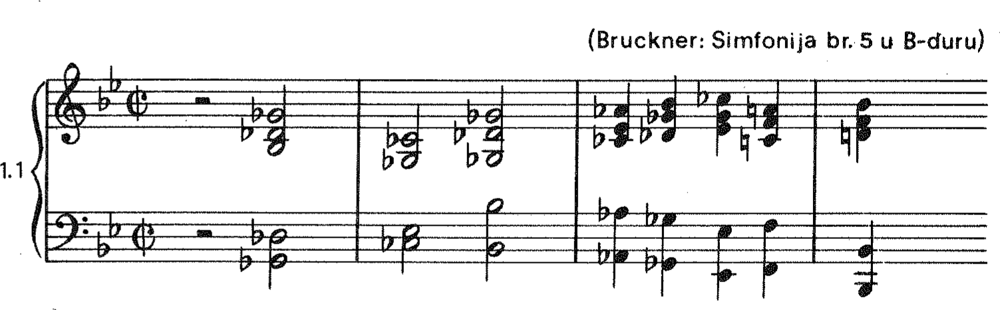
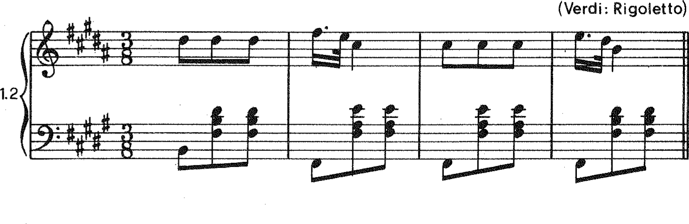
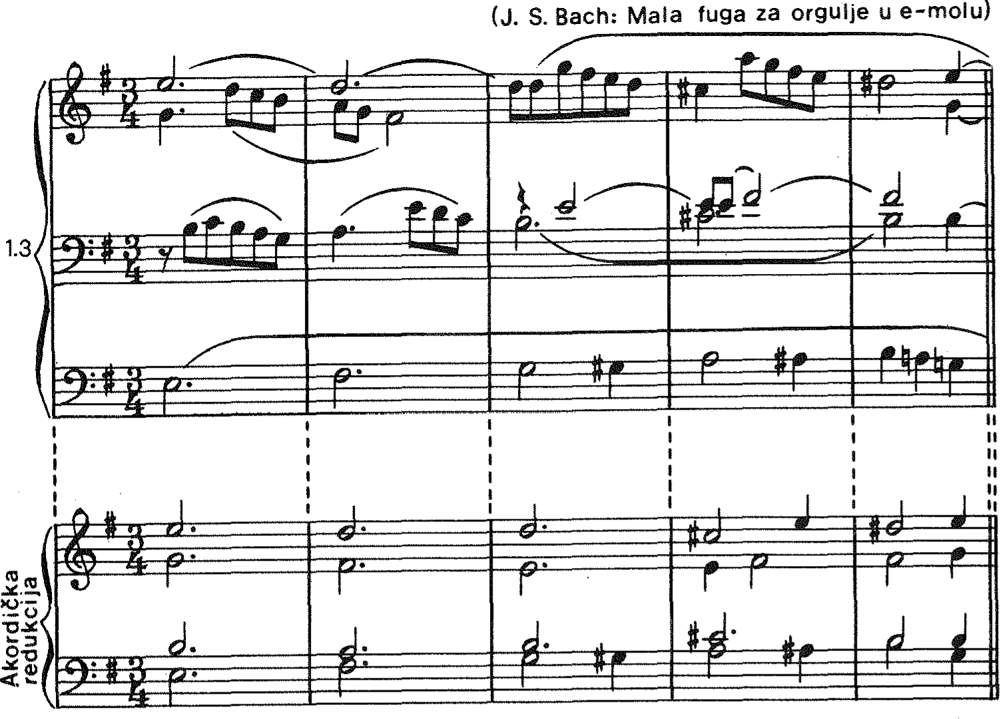
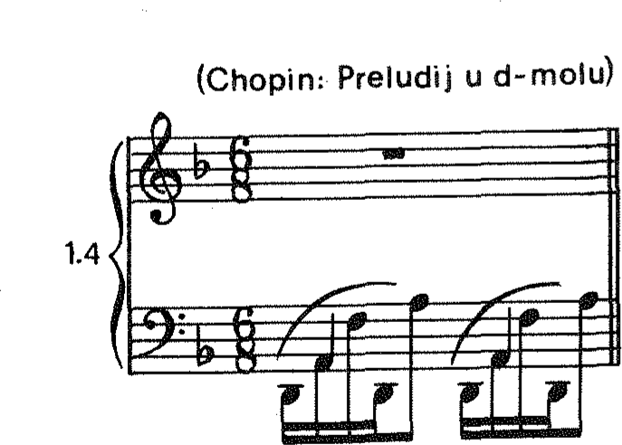
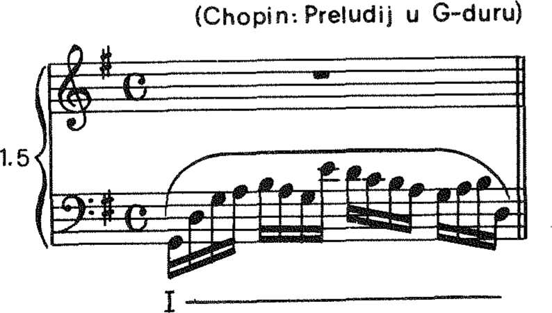
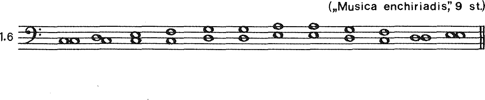
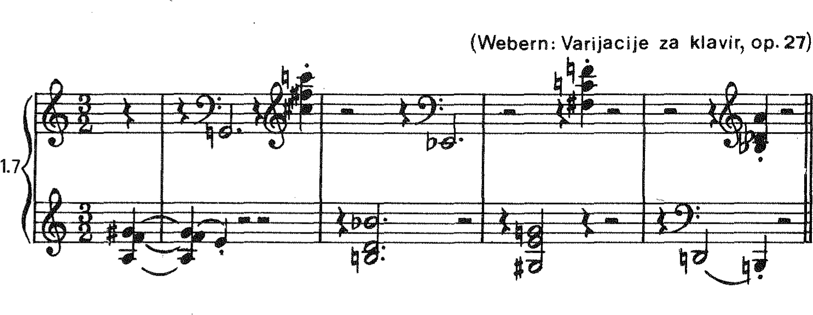

# 1. Uvod

Harmonija (grč. *harmonia* — spajanje, slaganje, sklad) jedna je od komponenata višeglasne muzike: ona predstavlja njezinu vertikalnu ili akordičku strukturu. Harmonija je, prema tome, prisutna prije svega u višeglasnoj muzici koja se pojavljuje u obliku vertikalnih sklopova tonova, tj. u obliku akorda. Pri tome redovito jedan glas, obično najgornji, predstavlja vodeću melodijsku liniju, a ostali akordičku pratnju; zajedno oni čine tzv. homofono (grč. *homos* — jednak i *fone* — glas) muzičko tkivo (primjeri 1.1 i 1.2).

*Primjer 1.1. Homofono muzičko tkivo. Izvor: tiskana stranica 7.*

MuseScore prijepis: *bit će dodan.*

*Primjer 1.2. Homofono muzičko tkivo. Izvor: tiskana stranica 7.*

MuseScore prijepis: *bit će dodan.*

I u polifonom (grč. *polys* — mnogostruk) muzičkom tkivu, gdje su glasovi ravnopravni i u kretanju samostalni, dakle gdje je primaran horizontalni moment, može također doći između melodijskih linija do vertikalne koordinacije, koja se često svodi na posve jednostavne harmonijske odnose (primjer 1.3).

*Primjer 1.3. Vertikalna koordinacija u polifonom tkivu. Izvor: tiskana stranica 8.*

MuseScore prijepis: *bit će dodan.*

A isto tako može harmonijska komponenta biti prisutna i u jednoglasju, ne samo kod čiste akordičke figuracije (primjer 1.4), nego i u melodijskoj liniji, koja osim akordičkih sadrži i druge, akordu strane tonove (primjer 1.5).

*Primjer 1.4. Akordička figuracija. Izvor: tiskana stranica 8.*

MuseScore prijepis: *bit će dodan.*

*Primjer 1.5. Melodijska linija s akordičkim i neakordičkim tonovima. Izvor: tiskana stranica 8.*

MuseScore prijepis: *bit će dodan.*

Harmonija, kao »oblast muzičkog mišljenja koja usklađuje odnose tonova u vertikalnom pogledu«,[^1] javlja se zapravo kod svake vertikalno koncipirane muzike, od primitivnoga organuma u 9. stoljeću (primjer 1.6) do složenih akordičkih konstrukcija atonalne muzike 20. stoljeća (primjer 1.7).

[^1]: J. N. Tjulin, *Učenie o garmoniji*, Moskva, 1939.

*Primjer 1.6. Organum. Izvor: tiskana stranica 9.*

MuseScore prijepis: *bit će dodan.*

*Primjer 1.7. Atonalna akordička konstrukcija. Izvor: tiskana stranica 9.*

MuseScore prijepis: *bit će dodan.*

Međutim, pod izrazom »harmonija« u praksi se vrlo često razumijeva samo »klasična« ili »tradicionalna harmonija«, koja je počela svoj vijek u drugoj polovici 17. stoljeća, završila ga krajem 19. stoljeća, a iskristalizirala se iz dijatonske osnove starih načina kao harmonija dur-tonaliteta i mol-tonaliteta i akorda građenih po tercama. Vijek klasične harmonije proteže se kroz tri stilska muzička razdoblja — barok, klasiku i romantiku. Muzički stvaraoci tih triju epoha usvojili su je kao opći harmonijski jezik, ali su je neprestano modificirali i varirali prema svojim individualnim sklonostima i stvaralačkim potrebama. Pritom su neprestano razvijali i obogaćivali njezinu dijatonsku osnovu kromatikom i enharmonijom, tako da ona na kraju svoga puta doseže stanje u kojem nestaje tonalitet, a akordi gube svoj tercni konstruktivni oslonac — stanje koje predstavlja vrhunac, ali i kraj jednoga dugog razvoja.

Klasična će harmonija biti predmetom prikazivanja i u ovoj knjizi, a i uobičajeni naslov »Harmonija« također je zadržan, jedino što ga treba prihvatiti uvjetno. Naime, on se odnosi i ovdje samo na najobimniju i najznačajniju pojavu harmonijskoga muzičkog izraza, na pojavu koja je takva i po svome dugom vijeku i po logičnosti i elastičnosti svoga sistema, ali koja usprkos svemu tome nije i jedina.

I, konačno, još jedno terminološko objašnjenje: riječ »harmonija« često će se u toku narednih poglavlja upotrebljavati i u svome užem značenju, tj. kada će se njome nazivati samo pojedina suzvučja, bez obzira na njihovu konkretnu akordičku konstrukciju, npr. u izrazima »konsonantna harmonija«, »disonantna harmonija«, »dominantna harmonija« ili jednostavno »ova harmonija«, »ona harmonija« i sl.
