# 2. Dijatonika

## 2.1. Kvintakordi

Tri tona, postavljena jedan iznad drugoga u intervalima terce, ili »po tercama«, čine trozvuk, osnovni akord klasičnoga harmonijskog sistema. Najviši ton trozvuka čini s najdubljim interval kvinte, i zato se naziva kvintom, a po njemu cijeli akord još i kvintakordom. Drugi po redu, srednji ton čini s najdubljim interval terce, pa se naziva tercom, a najdublji, koji je — intervalški gledan — prima, ujedno je temeljni ton kvintakorda. Umjesto naziva *trozvuk* upotrebljavat ćemo naziv *kvintakord*, jer ta riječ svojim značenjem već upućuje na okvirnu intervalsku određenost akorda.

### 2.1.1. Podjela kvintakorda

O vrsti (kvaliteti) intervala kvinte i terce ovisi i vrsta kvintakorda. Velika terca i čista kvinta čine veliki ili dur-kvintakord (primjer 2.1.a), mala terca i čista kvinta čine mali ili mol-kvintakord (primjer 2.1.b), mala terca i smanjena kvinta čine smanjeni kvintakord (primjer 2.1.c), a velika terca i povećana kvinta povećani kvintakord (primjer 2.1.d).

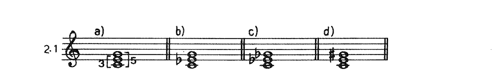

*Primjer 2.1. Vrste kvintakorda. Izvor: tiskana stranica 11.*

MuseScore prijepis: *bit će dodan.*

U duru se dur-kvintakord nalazi na I, IV i V stupnju, mol-kvintakord na II, III i VI stupnju, a smanjeni kvintakord na VII stupnju. U harmonijskom molu nalazi se mol-kvintakord na I i IV stupnju, dur-kvintakord na V i VI stupnju, smanjeni kvintakord na II i VII stupnju, a povećani kvintakord na III stupnju. Prema tome, u harmonijskom molu imamo sve četiri vrste kvintakorda, a u duru se povećani kvintakord ne pojavljuje (primjer 2.2).

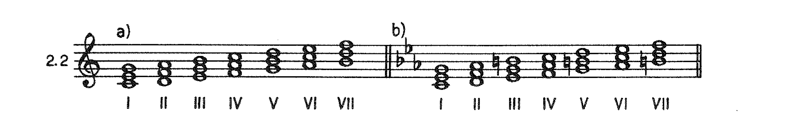

*Primjer 2.2. Kvintakordi u duru i harmonijskom molu. Izvor: tiskana stranica 11.*

MuseScore prijepis: *bit će dodan.*

Kvintakordi koji sadrže bilo koji disonantni interval jesu disonantni. Kako su uz sekunde i septime disonantni svi smanjeni i povećani intervali, smanjeni kvintakord, koji sadrži smanjenu kvintu, i povećani kvintakord, koji sadrži povećanu kvintu, disonantni su kvintakordi. Dur-kvintakord i mol-kvintakord, naprotiv, konsonantni su kvintakordi, a to su ujedno i jedini konsonantni akordi u čitavom harmonijskom sistemu. Konsonantni kvintakordi nalaze se stoga u duru na svim stupnjevima osim na VII, a u molu samo na I, IV, V i VI stupnju.

Među svim kvintakordima najvažnije mjesto pripada kvintakordu na I stupnju. On predstavlja polaznu i završnu točku harmonijskoga kretanja unutar tonaliteta, odnosno središte oko kojega se druge harmonije kreću. Harmonijsku funkciju kvintakorda I stupnja nazivamo toničkom funkcijom, a sam kvintakord također toničkim kvintakordom (*tonika* — isto što i prvi stupanj; ton po kojem se naziva tonalitet, kao C-dur, c-mol, G-dur itd.).

Uz bok kvintakordu I stupnja stoje još dva posebno važna kvintakorda: kvintakord na V stupnju i kvintakord na IV stupnju.

Kvintakord na V stupnju, odnosno na dominanti, ili dominantni kvintakord nosilac je dominantne funkcije (lat. *dominans* — gospodujući). Njegova je terca vođica, tj. ton koji se u dur-ljestvici i u harmonijskoj mol-ljestvici nalazi pola stepena ispod tonike i koji teži naviše, dakle »vodi« u toniku. Težnja vođice ka tonici prenosi se i na dominantni kvintakord, tako da on teži ka toničkom kvintakordu; u tome je njegova osnovna karakteristika.

Kvintakord na IV stupnju, odnosno na subdominanti (lat. *sub* — ispod), ili subdominantni kvintakord predstavlja subdominantnu funkciju. On stoji prema toničkom kvintakordu u obrnutom odnosu nego dominantni kvintakord: dominantni kvintakord nalazi se kvintu više od toničkoga, a subdominantni kvintu niže (primjer 2.3).

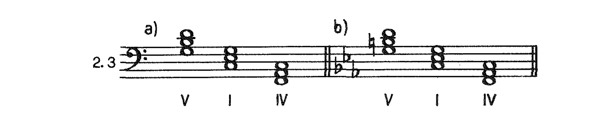

*Primjer 2.3. Odnos dominantnoga, toničkoga i subdominantnoga kvintakorda. Izvor: tiskana stranica 12.*

MuseScore prijepis: *bit će dodan.*

Dok dominantni kvintakord vodi u tonički kvintakord, subdominantni kvintakord nema te težnje, nego bi se prije moglo reći da tonički kvintakord vodi u subdominantni — po analogiji na dominantni kvintakord, koji vodi u tonički — jer su tu odnosi isti (primjer 2.4.a i b). Ali zato terca subdominantnog kvintakorda u molu, koji je mol-kvintakord, teži polustepenim pomakom naniže, u V stupanj, odnosno u dominantu, pa se ona smatra nekom vrstom silazne vođice (primjer 2.4.c).

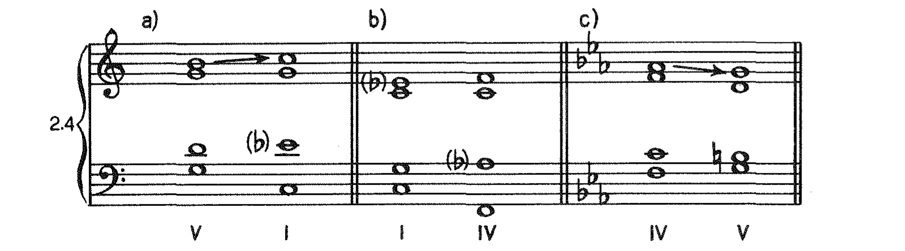

*Primjer 2.4. Odnosi toničkoga i subdominantnoga kvintakorda. Izvor: tiskana stranica 12.*

MuseScore prijepis: *bit će dodan.*

Tonički, subdominantni i dominantni kvintakord, odnosno sveukupnost njihovih međusobnih odnosa, određuje tonalitet, i stoga ih smatramo glavnim kvintakordima, a I, IV i V stupanj glavnim stupnjevima. Glavni kvintakordi ujedno su i glavni nosioci triju harmonijskih funkcija: toničke, subdominantne i dominantne. Tonička se funkcija označuje s »T«, subdominantna sa »S«, a dominantna s »D«.

Kvintakordi II, III, VI i VII stupnja sporedni su kvintakordi, a II, III, VI i VII stupanj sporedni stupnjevi. Sporedni kvintakordi nemaju posebnih funkcija, ali mogu zamjenjivati glavne kvintakorde i poprimati njihove funkcije. Glavni kvintakord može zamijeniti njegova paralela, tj. kvintakord koji se nalazi tercu niže i koji s njime ima dva zajednička tona: temeljni ton i terca glavnog kvintakorda identični su s tercom i kvintom kvintakorda koji ga zamjenjuje. Tako kvintakord VI stupnja može zamjenjivati tonički, kvintakord II stupnja subdominantni, a kvintakord III stupnja dominantni kvintakord (primjer 2.5). Dominantni kvintakord ima osim toga i vrlo uvjerljivog zamjenika u kvintakordu VII stupnja, koji se nalazi tercu više od njega; on doduše ne sadrži temeljni ton dominantnog kvintakorda, ali se u njemu pojavljuje vođica kao njegova prima — dakle karakterističan ton za dominantnu funkciju (primjer 2.6).

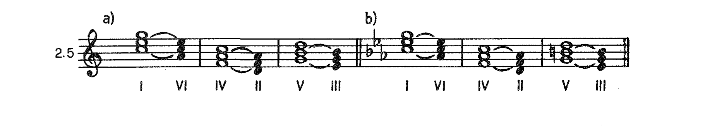

*Primjer 2.5. Zamjene glavnih kvintakorda. Izvor: tiskana stranica 13.*

MuseScore prijepis: *bit će dodan.*

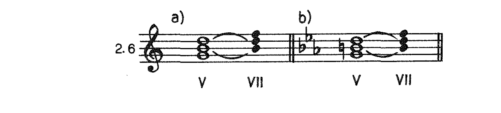

*Primjer 2.6. Kvintakord VII stupnja kao zamjena dominante. Izvor: tiskana stranica 13.*

MuseScore prijepis: *bit će dodan.*

Potreba za vođicom i za dominantnom funkcijom kao neophodnim predikatima tonaliteta dovela je u harmoniji, kada se radi o mol-tonalitetu, u prvi plan harmonijsku mol-ljestvicu, dakle onu varijantu mol-ljestvice koja u obliku povišenoga VII stupnja sadrži vođicu.

### 2.1.2. Postavljanje kvintakorda u četveroglasju

Od 17. stoljeća dalje četveroglasje postaje najčešćom i općom osnovom višeglasne muzike, stoga se četveroglasni stavak također primjenjuje i u teoretskim eksplikacijama harmonijskih zbivanja kao i u izradbi školskih harmonijskih zadataka. Pri tome se uvijek misli na četiri realna glasa; broj realnih glasova u primjeru 2.7 nije pet nego četiri, jer je jedan od glasova, drugi odozdo, samo udvajanje, odnosno pojačanje vodećega, najgornjeg, u njegovoj donjoj oktavi.

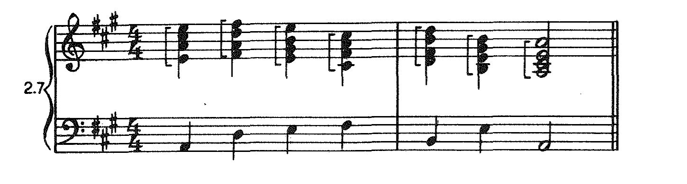

*Primjer 2.7. Četveroglasni stavak. Izvor: tiskana stranica 14.*

MuseScore prijepis: *bit će dodan.*

Što se tiče opsega pojedinih glasova, primjenjuju se norme koje vrijede za glasove mješovitog zbora; odande se preuzimaju i njihovi nazivi: sopran, alt, tenor i bas (primjer 2.8).

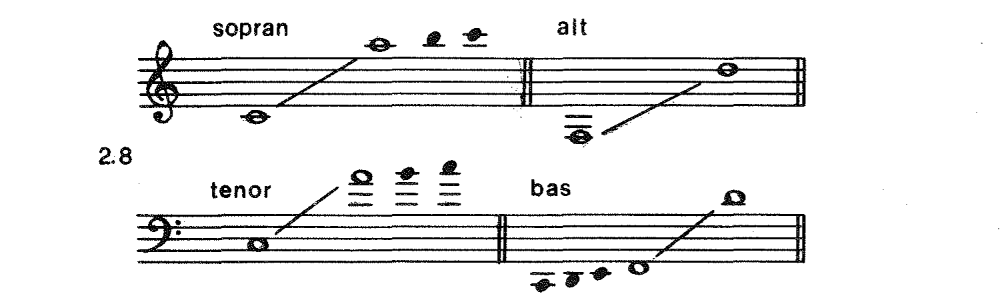

*Primjer 2.8. Opsezi glasova mješovitoga zbora. Izvor: tiskana stranica 14.*

MuseScore prijepis: *bit će dodan.*

Vanjski glasovi su bas i sopran, a unutarnji ili srednji tenor i alt; tenor, alt i sopran u odnosu prema basu preuzimaju ulogu gornjih glasova. Kod kvintakorda, kao i kod svih akorda uopće, prvo se postavlja basov ton, ili kraće bas, a zatim sopran, pa alt i na kraju tenor. Ako je bas već dan, redoslijed postavljanja ostalih glasova jest sopran–alt–tenor, a ako je dan sopran, redoslijed je bas–alt–tenor.

Budući da je kvintakord po sastavu troglasan akord, njegova će upotreba u četveroglasnom stavku nužno iziskivati udvajanje pojedinih tonova. Kod konsonantnih kvintakorda, dakle kod dur-kvintakorda i mol-kvintakorda, udvaja se u prvom redu temeljni ton, tj. onaj koji je najdublji kad su svi tonovi kvintakorda raspoređeni po tercama; to znači da se kvintakord tada pojavljuje u temeljnom obliku (primjer 2.9.a). Raspored tonova po tercama, koji je osnovno načelo gradnje akorda u klasičnoj harmoniji, ostvaruje se doslovno i u cijelosti samo kada se akordi pojavljuju potpuni, bez udvajanja i u tijesnom slogu. Kod akorda koji se pojavljuju nepotpuni (primjer 2.9.b), u širokom slogu (primjer 2.9.c), s udvajanjima (primjer 2.9.d) ili u kojem obratu (primjer 2.9.e), nastaju između susjednih tonova ne samo terce, već i drugi intervali. Time se ipak ne narušava osnovni princip rasporeda po tercama, jer se on uvijek odnosi na temeljni oblik potpunoga akorda, postavljenoga u tijesnom slogu i bez udvajanja (primjer 2.9.a).

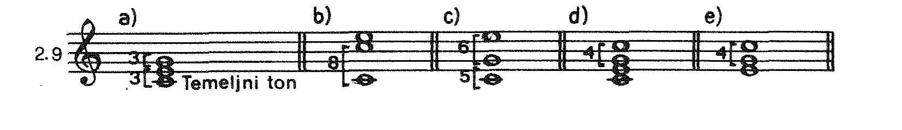

*Primjer 2.9. Rasporedi tonova kvintakorda. Izvor: tiskana stranica 14.*

MuseScore prijepis: *bit će dodan.*

Teoretska podloga najčešćega udvajanja temeljnog tona u prirodi je niz alikvotnih, parcijalnih ili harmonijskih tonova. Prvih šest tonova niza daje dur-kvintakord, u kojem se temeljni ton pojavljuje triput, kvinta dvaput, a terca samo jedanput (primjer 2.10). Iz toga bi nadalje logično proizlazilo da se terca udvaja najrjeđe, a udvajanje kvinte nalazi negdje na sredini između udvajanja temeljnog tona i udvajanja terce.

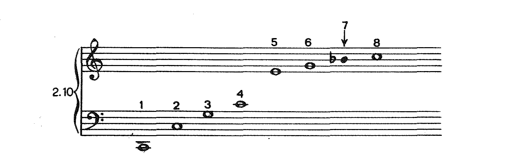

*Primjer 2.10. Alikvotni niz. Izvor: tiskana stranica 15.*

MuseScore prijepis: *bit će dodan.*

Međutim, u praksi se češće sreće udvajanje terce nego kvinte, ali to ne proturječi zakonitosti alikvotnoga niza, jer je ona mjerodavna kod izoliranih akorda, dok se relativno često udvajanje terce pojavljuje kao rezultat vođenja glasova u slijedu više akorda, a također i tamo gdje se ne radi o konsonantnim nego o disonantnim kvintakordima.

Terca dominantnog kvintakorda ne udvaja se jer je ona vođica; kao takva ističe se više od ostalih tonova, pa bi njezino udvajanje stvaralo zvukovnu prezasićenost koja neugodno djeluje. Naprotiv, kvinta u kvintakordu III stupnja u duru — premda je to isti ton kao i terca dominantnog kvintakorda — podnosi udvajanje jer kvinta, kao i temeljni ton, spada u statičke elemente konsonantnih kvintakorda, za razliku od terce, koja je dinamična i karakteristična. To se najbolje vidi pri suprotstavljanju istoimenih dur-kvintakorda i mol-kvintakorda, koji se međusobno razlikuju isključivo po terci (primjer 2.11).

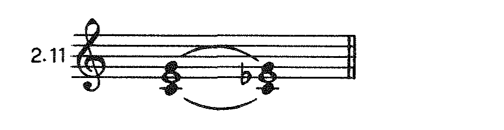

*Primjer 2.11. Dur-kvintakord i mol-kvintakord. Izvor: tiskana stranica 15.*

MuseScore prijepis: *bit će dodan.*

Terca subdominantnog kvintakorda u molu, koja ima karakter silazne vođice, također se u pravilu ne udvaja, ali u određenim uvjetima i njezino udvajanje može biti opravdano logičnim vođenjem glasova. Bez daljnjega može se udvajati temeljni ton kvintakorda VI stupnja u molu — iako je to inače isti ton kao i terca subdominantnog kvintakorda — jer on opet predstavlja statički element akorda.

Vođenje glasova može dovesti i do nastupa kvintakorda u nepotpunom obliku, odnosno do izostavljanja jednoga od akordičkih tonova. Tada se redovito izostavlja kvinta, a temeljni se ton u tom slučaju utrostručuje (primjer 2.12.a), čime se nimalo ne poremećuje zvučna izbalansiranost akorda, jer utrostručenje logično proizlazi iz niza alikvotnih tonova (primjer 2.10).

Ako bi u nepotpunom kvintakordu temeljni ton i terca bili podjednako zastupljeni, udvajanje terce bilo bi suviše nametljivo (primjer 2.12.b). Nepotpuni kvintakord bez terce zvuči prazno, a osim toga mu nedostaje tonalna određenost koju daje terca (primjer 2.12.c). Izostavljanje temeljnog tona lišilo bi kvintakord osobenosti: suzvučje e–g–e¹–g¹ (primjer 2.12.d), koje bi trebalo predstavljati kvintakord (c)–e–g, potpuno je neodređeno i prije bi se moglo shvatiti kao kvintakord e–g–(h), premda bi i za takvu interpretaciju nedostajala prevaga temeljnoga tona e nad tercom g.

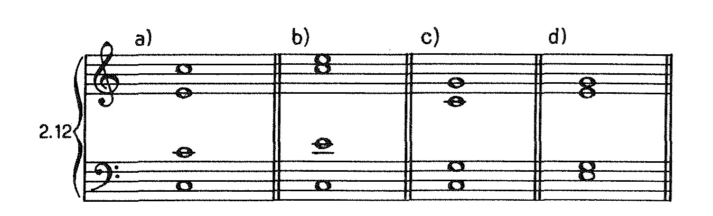

*Primjer 2.12. Potpuni i nepotpuni kvintakordi. Izvor: tiskana stranica 16.*

MuseScore prijepis: *bit će dodan.*

Kvintakord se može pojaviti u oktavnom, kvintnom i tercnom položaju, već prema tome koji se od njegovih tonova nalazi u najvišem glasu, sopranu: udvojeni temeljni ton, kvinta ili terca. Svaki položaj može biti izveden u tijesnom i u širokom slogu. U tijesnom slogu gornji su glasovi tako postavljeni da se između njih ne bi mogao umetnuti više nijedan akordički ton (primjer 2.13), a u širokom slogu to je moguće (primjer 2.14). Ako između gornjih glasova postoje i elementi tijesnog i širokog sloga, oni zajedno tvore mješoviti slog. Mješoviti se slog redovito javlja kod nepotpunoga oblika kvintakorda (primjer 2.15.a), te kada se u kvintakordu udvaja terca (primjer 2.15.b) ili kvinta (primjer 2.15.c). U obilježavanju, šifraži akorda, oktavni se položaj označuje s »(8)«, kvintni s »(5)«, a tercni s »(3)«, bez obzira na slog.

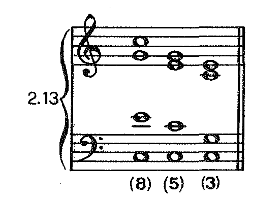

*Primjer 2.13. Tijesni slog. Izvor: tiskana stranica 16.*

MuseScore prijepis: *bit će dodan.*

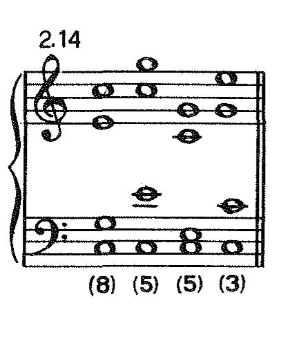

*Primjer 2.14. Široki slog. Izvor: tiskana stranica 16.*

MuseScore prijepis: *bit će dodan.*

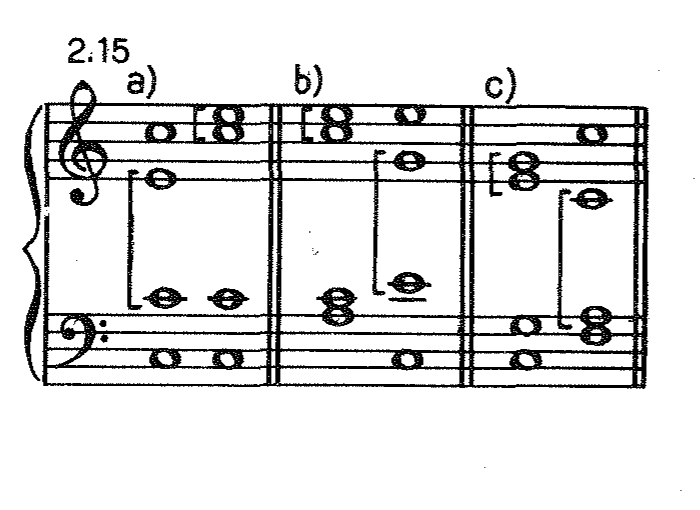

*Primjer 2.15. Mješoviti slog. Izvor: tiskana stranica 16.*

MuseScore prijepis: *bit će dodan.*

Da bi se sačuvala homogenost zvuka akorda, uzima se između gornjih glasova oktava kao maksimalni dozvoljeni razmak (primjer 2.16.a); razmak između basa i tenora može biti i veći jer suzvučanje alikvotnih tonova, što ih proizvodi basov ton, ispunjava eventualnu prazninu (primjer 2.16.b). Iznimno se i sopran može udaljiti od alta preko oktave, do decime, ako je njegovo udaljavanje uvjetovano i opravdano logičnim vođenjem glasova. Susjedni glasovi mogu tvoriti i unisono, ali se ne smiju križati, prelaziti jedan iznad odnosno ispod drugoga.

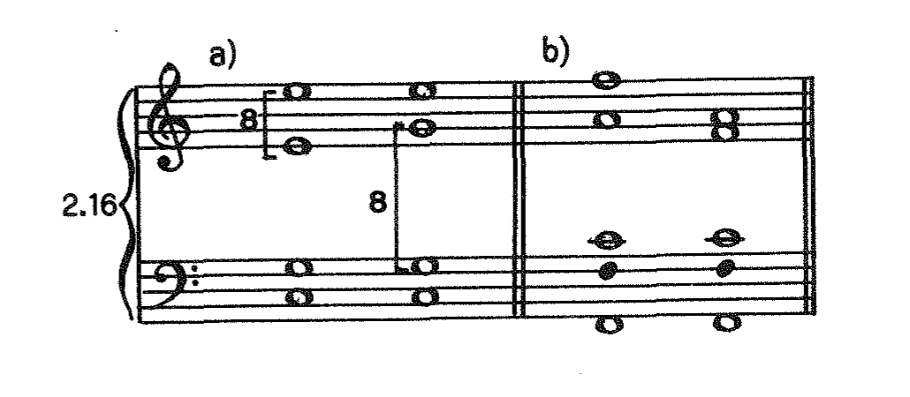

*Primjer 2.16. Najveći razmaci među glasovima. Izvor: tiskana stranica 17.*

MuseScore prijepis: *bit će dodan.*

### 2.1.3. Srodnost kvintakorda

Srodnost kvintakorda očituje se u postojanju zajedničkih tonova, a može biti kvintna ili tercna.

Kvintna srodnost postoji između kvintakorda kojima su temeljni tonovi udaljeni za čistu kvintu, odnosno za čistu kvartu, prema gore ili prema dolje, tako da je kvinta jednoga identična s temeljnim tonom drugoga i obratno. Kvintakordi koji međusobno stoje u kvintnoj srodnosti imaju jedan zajednički ton (primjer 2.17).

Tercna srodnost postoji između kvintakorda kojima su temeljni tonovi udaljeni za veliku ili malu tercu prema gore ili prema dolje, tako da su terca i kvinta jednoga identične s temeljnim tonom i tercom drugoga. Kvintakordi koji su u tercnoj srodnosti imaju dva zajednička tona (primjer 2.18).

Nesrodni kvintakordi nemaju zajedničkih tonova; njihovi su temeljni tonovi udaljeni za veliku ili malu sekundu prema gore ili prema dolje (primjer 2.19).

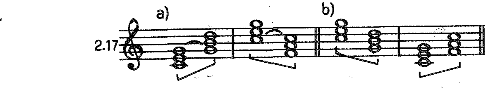

*Primjer 2.17. Kvintna srodnost. Izvor: tiskana stranica 17.*

MuseScore prijepis: *bit će dodan.*

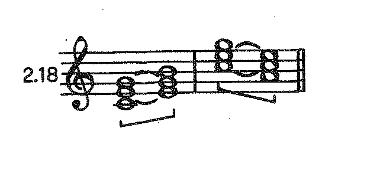

*Primjer 2.18. Tercna srodnost. Izvor: tiskana stranica 17.*

MuseScore prijepis: *bit će dodan.*

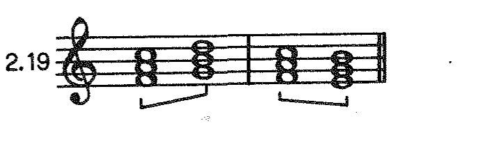

*Primjer 2.19. Nesrodni kvintakordi. Izvor: tiskana stranica 17.*

MuseScore prijepis: *bit će dodan.*

Kod glavnih kvintakorda postoji kvintna srodnost između toničkoga i dominantnog kvintakorda kao i između toničkoga i subdominantnog kvintakorda, dok između subdominantnog i dominantnog kvintakorda srodstva nema. Analogni odnosi postoje i između sporednih kvintakorda, dok se tercna srodnost javlja uvijek samo između jednoga glavnog i jednoga sporednog kvintakorda, kao, primjerice, između kvintakorda I i VI stupnja.

Smanjeni kvintakordi ne mogu se direktno uključivati u odnose srodstva s drugim konsonantnim kvintakordima jer su u pravilu izvedeni iz nekih drugih, primarnih akordičkih formacija. Smanjeni kvintakord na VII stupnju može se tako smatrati septakordom V stupnja kojem nedostaje temeljni ton, pa se odnos između kvintakorda IV stupnja i kvintakorda VII stupnja može eventualno valorizirati samo kao septimna srodnost, gdje je temeljni ton prvoga identičan sa septimom drugoga (primjer 2.20). Još složeniji oblik srodstva postoji između kvintakorda VI stupnja i smanjenoga kvintakorda II stupnja u molu, koji također imaju jedan zajednički ton. Osnova njihove srodnosti zapravo je odnos VI–IV, tercna srodnost (primjer 2.21.a), samo što je u harmoniji IV stupnja kvinta zamijenjena sekstom (primjer 2.21.b), koja, kad se tonovi slože po tercama, postaje temeljnim tonom kvintakorda II stupnja (primjer 2.21.c).

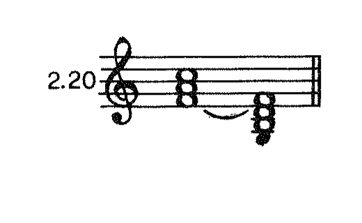

*Primjer 2.20. Septimna srodnost. Izvor: tiskana stranica 18.*

MuseScore prijepis: *bit će dodan.*

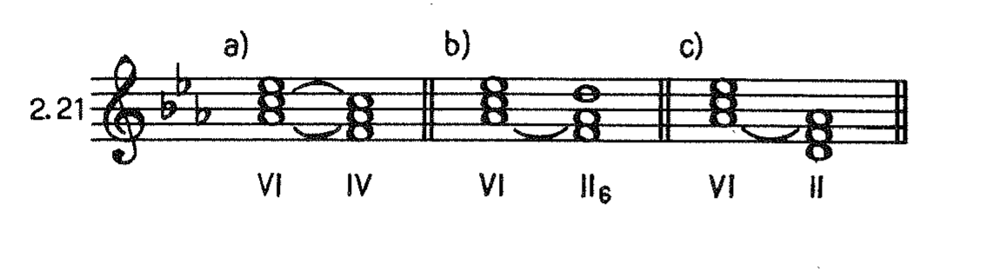

*Primjer 2.21. Odnos VI–IV i smanjeni kvintakord II stupnja. Izvor: tiskana stranica 18.*

MuseScore prijepis: *bit će dodan.*

### 2.1.4. Spajanje kvintakorda

Standardni oblici spajanja kvintakorda jesu strogi i slobodni spoj.

Strogi spoj moguć je samo između srodnih kvintakorda. Izvodi se tako da se zajednički tonovi zadrže u istim glasovima, a ostali se glasovi kreću na najbliže tonove sljedećega akorda (primjer 2.22). Pri tome se između pojedinih glasova formiraju tri različite vrste pomaka: paralelni pomak, kada se glasovi kreću u istom smjeru; protupomak, kada jedan glas uzlazi a drugi silazi; i jednostrani pomak, kada se samo jedan glas kreće, a drugi zadržava ili ponavlja isti ton. Kombinacijama tih triju vrsta pomaka ostvaruje se čvrsta veza između akorda i osigurava miran tok harmonijskoga kretanja. Ne moraju se u svakom spoju naći sve tri vrste, ali ako je prisutan samo paralelni pomak koji rezultira kretanjem svih glasova u istom smjeru, veza između harmonija postat će labava. Zato se paralelni pomak svih glasova redovito izbjegava.

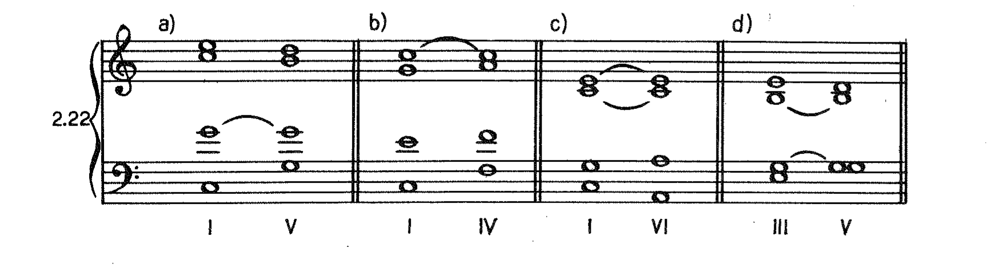

*Primjer 2.22. Strogi spoj kvintakorda. Izvor: tiskana stranica 18.*

MuseScore prijepis: *bit će dodan.*

Pri spajanju nesrodnih kvintakorda otpada zadržavanje zajedničkih tonova jer ih nema. Ne dolazi u obzir ni kretanje na apsolutno najbliže tonove sljedećega akorda jer bi ono rezultiralo paralelnim pomakom svih glasova, a još i pogrešnim paralelnim kvintama i oktavama (primjer 2.23.a). Zato se nesrodni kvintakordi spajaju tako da se gornji glasovi vode u protupomaku spram basa na najbliže moguće tonove sljedećega akorda, koji nisu uvijek apsolutno najbliži, nego najbliži pri kretanju u suprotnom smjeru basa. Na taj se način ostvaruje slobodni spoj akorda (primjeri 2.23.b i c).

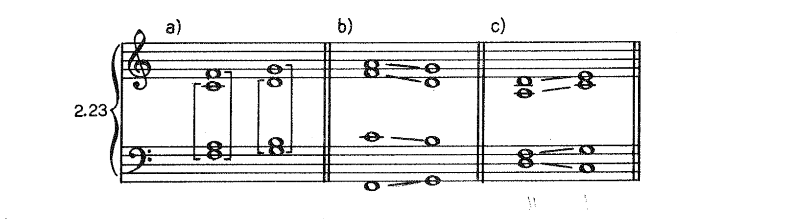

*Primjer 2.23. Slobodni spoj kvintakorda. Izvor: tiskana stranica 19.*

MuseScore prijepis: *bit će dodan.*

U klasičnoj školskoj formuli I–IV–V–I, koja ujedinjuje u logičnom slijedu, odnosno progresiji, sve glavne kvintakorde, pojavljuju se oba standardna spoja: strogi, I–IV i V–I, te slobodni, IV–V. Formula se može izvesti u svakom slogu na tri različita načina tako da svaki započne s drugim položajem prvoga akorda (primjer 2.24).

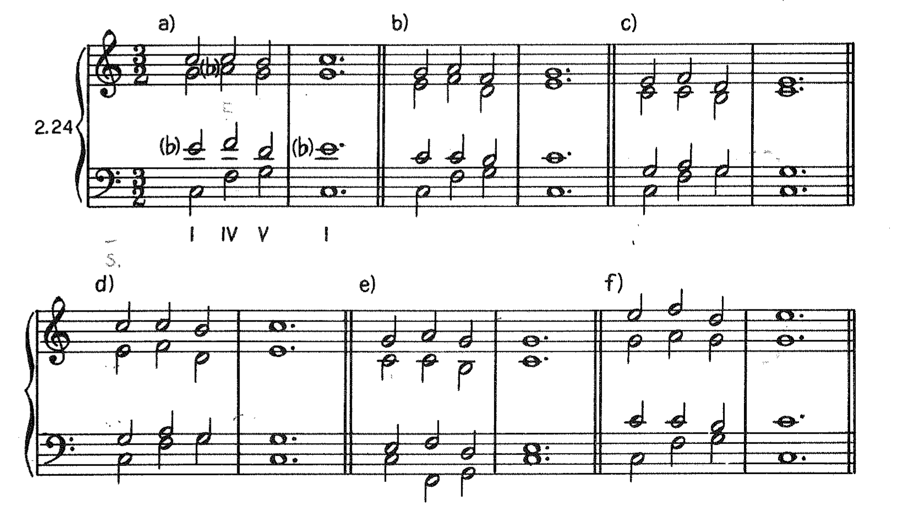

*Primjer 2.24. Progresija I–IV–V–I. Izvor: tiskana stranica 19.*

MuseScore prijepis: *bit će dodan.*

Ako se u prethodnoj formuli posljednji akord, I, zamijeni kvintakordom VI stupnja, promjena iziskuje nastavak IV–V–I da bi čitav slijed harmonija opet logično završio s toničkim kvintakordom. Slijed tada sadrži sedam kvintakorda: I–IV–V–VI–IV–V–I, a nastaje i spoj nesrodnih kvintakorda V–VI. Budući da terca dominantnog kvintakorda, vođica, zadržava tendenciju kretanja naviše i uzlazi polustepenim pomakom, vođica ide paralelno s basom, a samo se dva preostala glasa kreću u protupomaku na najbliža mjesta. Kvintakord VI stupnja pojavljuje se s udvojenom tercom (primjer 2.25.a). Tako postavljen kvintakord nemoguće je spojiti sa sljedećim, koji je s njime u tercnoj srodnosti, tako da se oba zajednička tona zadrže, jer se jedan od njih nalazi u basu i kreće se; slijedi ga jedan od gornjih glasova, dok drugi skače (primjer 2.25.b). Proširena formula može se izvesti na šest raznih načina (primjer 2.26).

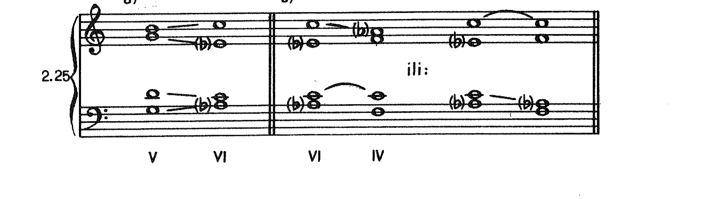

*Primjer 2.25. Spoj V–VI. Izvor: tiskana stranica 20.*

MuseScore prijepis: *bit će dodan.*

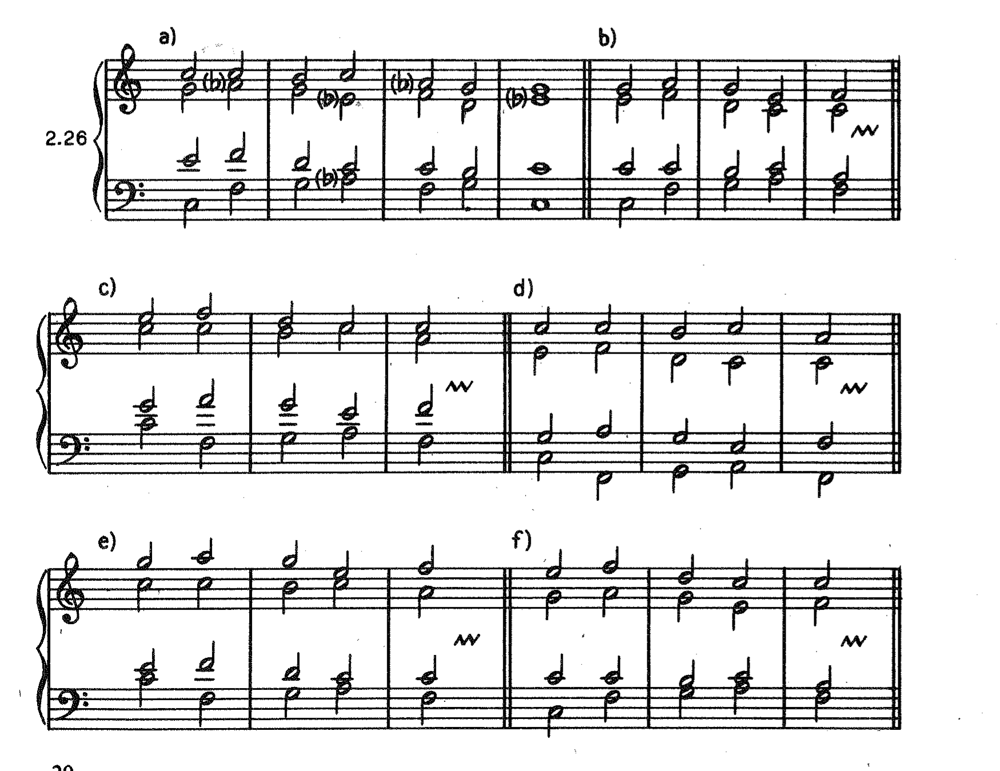

*Primjer 2.26. Varijante proširene formule. Izvor: tiskana stranica 20.*

MuseScore prijepis: *bit će dodan.*

U spoju V–VI vođica se može kretati i u protupomaku spram basa kada se ne nalazi u najgornjem glasu, ali samo u duru. U molu bi došlo do nemelodičkoga pomaka za povećanu sekundu, koji se, kao i pomaci za sve povećane intervale uopće, izbjegava (primjer 2.27). Iz istoga razloga treba kod spoja VI–V u molu unaprijed udvojiti tercu u glasu u kojem bi inače bio udvojen temeljni ton. Nakon toga jedna od te dvije terce ide paralelno s basom, silazi na vođicu, a ostala se dva glasa kreću u protupomaku, opet na najbliža mjesta (primjer 2.28).

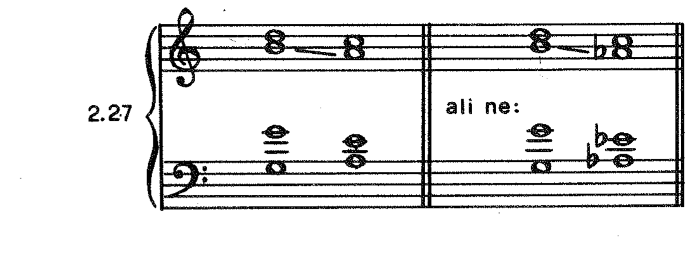

*Primjer 2.27. Dopušteni i nedopušteni spoj V–VI. Izvor: tiskana stranica 21.*

MuseScore prijepis: *bit će dodan.*

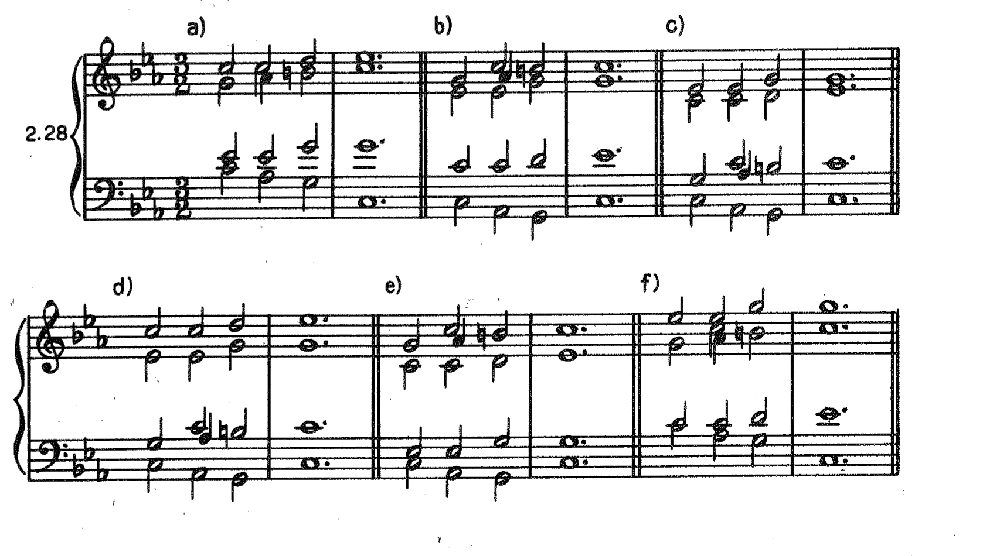

*Primjer 2.28. Spoj VI–V u molu. Izvor: tiskana stranica 21.*

MuseScore prijepis: *bit će dodan.*

Vođenje gornjih glasova iz spoja V–VI može se prenijeti i na druge parove nesrodnih kvintakorda (primjer 2.29), kao i analogno primijeniti na parove kvintno-srodnih kvintakorda gdje temeljni ton prvoga akorda uzlazi za kvartu (primjer 2.30). Kvintno-srodni kvintakordi mogu se međusobno spajati i slobodno, pri čemu se gornji glasovi kreću u protupomaku spram basa (primjer 2.31).

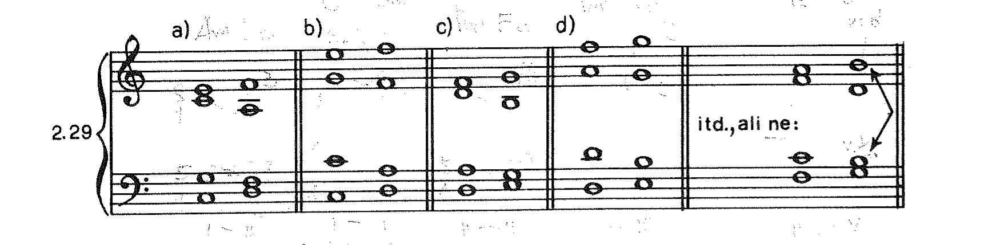

*Primjer 2.29. Slobodni spojevi nesrodnih kvintakorda. Izvor: tiskana stranica 22.*

MuseScore prijepis: *bit će dodan.*

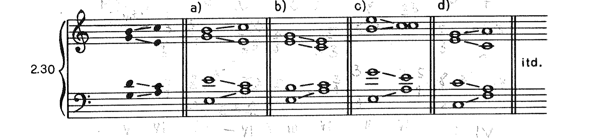

*Primjer 2.30. Slobodni spojevi kvintno-srodnih kvintakorda. Izvor: tiskana stranica 22.*

MuseScore prijepis: *bit će dodan.*

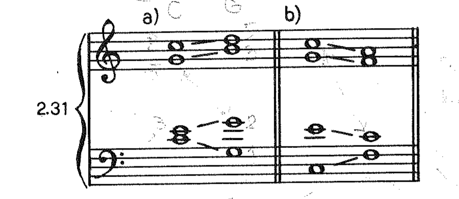

*Primjer 2.31. Slobodni spoj kvintno-srodnih kvintakorda. Izvor: tiskana stranica 22.*

MuseScore prijepis: *bit će dodan.*

Kad iza kvintakorda u tijesnom slogu dolazi neki kvintakord u širokom slogu ili obratno, pri spajanju akorda dolazi do promjene sloga. U gornjim se glasovima tada redovito pojavljuju veći skokovi za kvartu, kvintu ili sekstu. Da takvi skokovi ne bi narušili ravnotežu harmonijskoga kretanja, treba ih kompenzirati tako da se istodobno u nekom od glasova zadrži zajednički ton ili sačuva postepeni pomak, ili da se glas u kojem se javlja skok i bas kreću u protupomaku (primjer 2.32.a). Promjena sloga može se izvršiti i unutar istoga akorda (primjer 2.32.b).

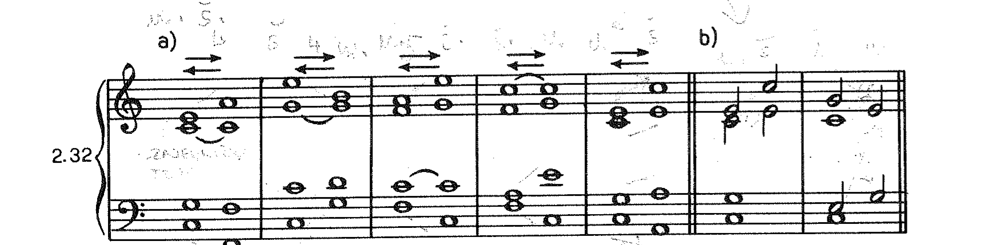

*Primjer 2.32. Promjena sloga. Izvor: tiskana stranica 22.*

MuseScore prijepis: *bit će dodan.*

U primjerima 2.22–2.32 prikazani su neki tipični i standardni spojevi kvintakorda, ali time nisu ni izdaleka obuhvaćene sve varijante i mogućnosti do kojih u praksi može doći. Nije ih ni moguće ni potrebno potpuno obuhvatiti. Treba se pridržavati ograničenja i zabrana kojima se zapravo kontrolira vođenje glasova i spojevi akorda te isključuju pogrešna rješenja. Ograničenja i zabrane odnose se uglavnom na kretanje jednoga glasa samog i na kretanje dvaju ili više glasova istodobno.

U kretanju pojedinoga glasa ne dopuštaju se skokovi za povećane intervale (primjer 2.33). Skokovi za smanjene intervale dopušteni su ako poslije njih dolazi postepeni pomak u suprotnom smjeru (primjer 2.34). Izbjegavaju se dva skoka za redom u istom smjeru u intervalu kvarte ili kvinte; u oba slučaja nastaje nemelodičko kretanje koje se svojim krajnjim točkama poklapa s disonantnim intervalom septime odnosno none (primjer 2.35).

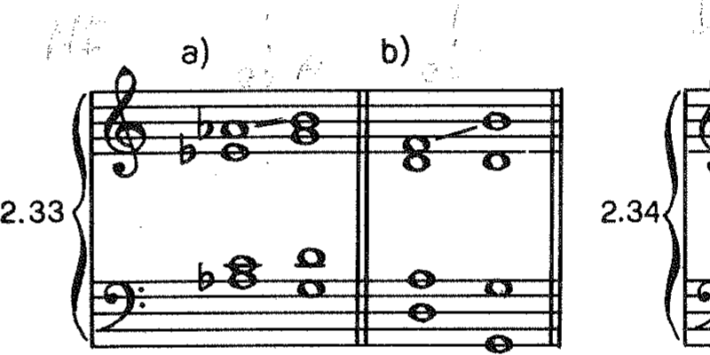

*Primjer 2.33. Nedopušteni skokovi za povećane intervale. Izvor: tiskana stranica 23.*

MuseScore prijepis: *bit će dodan.*

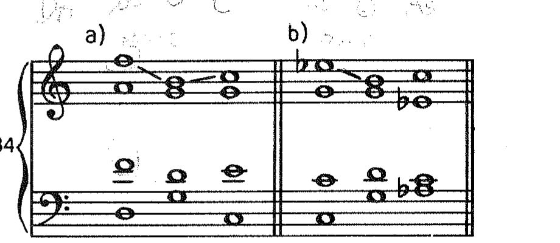

*Primjer 2.34. Dopušteni skokovi za smanjene intervale. Izvor: tiskana stranica 23.*

MuseScore prijepis: *bit će dodan.*

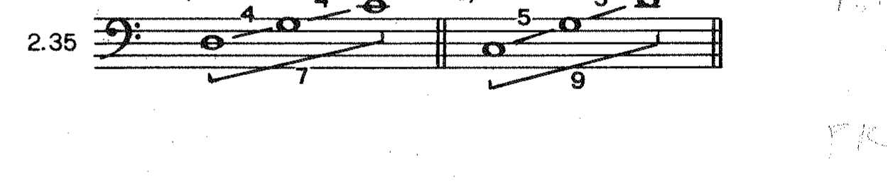

*Primjer 2.35. Dva uzastopna skoka. Izvor: tiskana stranica 23.*

MuseScore prijepis: *bit će dodan.*

U paralelnom kretanju susjednih glasova izbjegava se tzv. preskok. Pri uzlaznom kretanju preskok nastaje kada niži glas dolazi na ton viši od tona što ga je prije skoka imao susjedni viši glas (primjer 2.36.a), a pri silaznom kretanju kada viši glas dolazi na ton niži od tona što ga je prije skoka imao susjedni niži glas (primjer 2.36.b). Ovamo spadaju i slučajevi u primjerima 2.37.a i b, koji se obično formuliraju kao posebna zabrana paralelnoga pomaka u unisono, odnosno paralelnoga pomaka iz unisona.

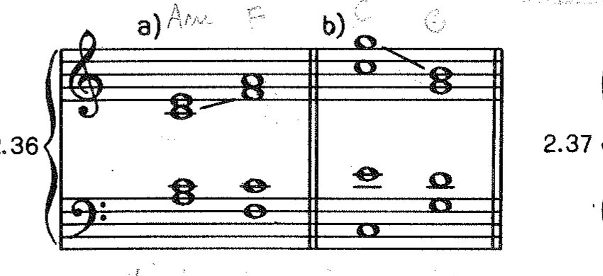

*Primjer 2.36. Preskok u paralelnom kretanju. Izvor: tiskana stranica 23.*

MuseScore prijepis: *bit će dodan.*

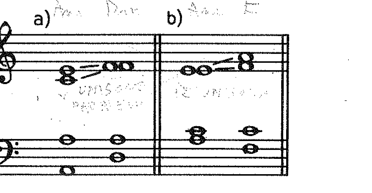

*Primjer 2.37. Paralelni pomak u unisono i iz unisona. Izvor: tiskana stranica 23.*

MuseScore prijepis: *bit će dodan.*

Istodobno kretanje svih glasova u istom smjeru narušava homogenost harmonijskoga stavka. Međutim, ne smeta kod slijeda dvaju različitih položaja istoga akorda (primjer 2.38). Paralelne oktave i kvinte, kao i neke druge njima srodne pojave, predmet su različitih ograničenja i zabrana.

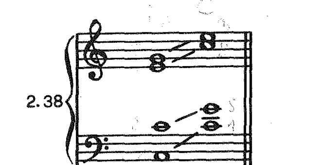

*Primjer 2.38. Istodobno kretanje u različitim položajima istoga akorda. Izvor: tiskana stranica 24.*

MuseScore prijepis: *bit će dodan.*

### 2.1.5. Oktave i kvinte

Paralelne oktave i kvinte nastaju kada se dva glasa kreću paralelnim pomakom iz jedne čiste oktave u drugu čistu oktavu, odnosno iz jedne čiste kvinte u drugu čistu kvintu.

Paralelne oktave smatraju se pogrešnima kada se pojave u stavku u kojem se inače glasovi samostalno kreću. One oduzimaju jednom od glasova samostalnost, smanjuju broj realnih glasova i uzrokuju nemotivirano isticanje jednoga pomaka, što narušava ravnotežu kretanja glasova i stvara neujednačenost stila stavka (primjer 2.39.a). Iz istih razloga pogrešan je i paralelni pomak u unisonu, odnosno paralelne prime (primjer 2.39.b). Nisu pogrešni oni paralelni pomaci u oktavama ili u unisonu kojima je svrha namjerno isticanje i pojačavanje neke melodijske linije (primjer 2.7).

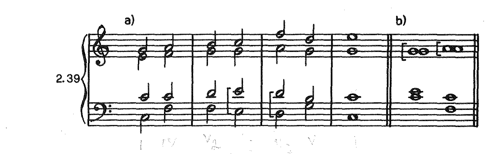

*Primjer 2.39. Paralelne oktave i prime. Izvor: tiskana stranica 24.*

MuseScore prijepis: *bit će dodan.*

Budući da se čista kvinta, za razliku od čiste oktave, ne doima kao jedan ton, paralelne čiste kvinte znatno manje smanjuju samostalnost glasova nego paralelne oktave. Ipak, pogrešne su one paralelne kvinte koje se pojavljuju između temeljnih tonova i kvinta dvaju akorda, osobito između nesrodnih akorda cjelostepenim pomakom (primjer 2.40.a); učinak je ublažen kod skoka između srodnih akorda (primjer 2.40.b). Scarlattijeve kvinte i Mozartove kvinte redovito se ne smatraju pogrešnima (primjer 2.41). Paralelne kvinte mogu u umjetničkom muzičkom kontekstu djelovati dobro kada skladatelj njihovim namjernim isticanjem postiže poseban efekt (primjer 2.42).

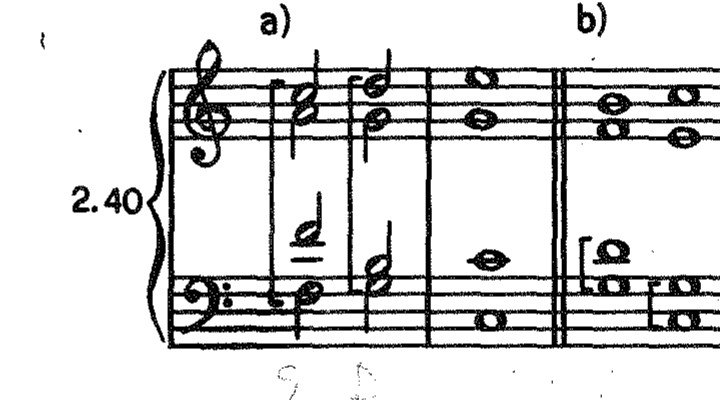

*Primjer 2.40. Paralelne kvinte. Izvor: tiskana stranica 25.*

MuseScore prijepis: *bit će dodan.*

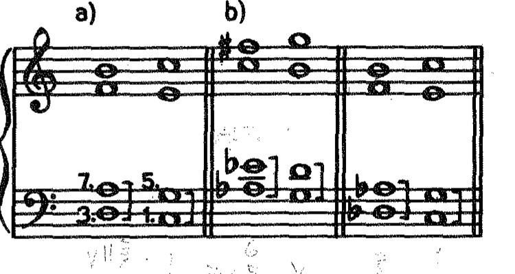

*Primjer 2.41. Scarlattijeve i Mozartove kvinte. Izvor: tiskana stranica 25.*

MuseScore prijepis: *bit će dodan.*

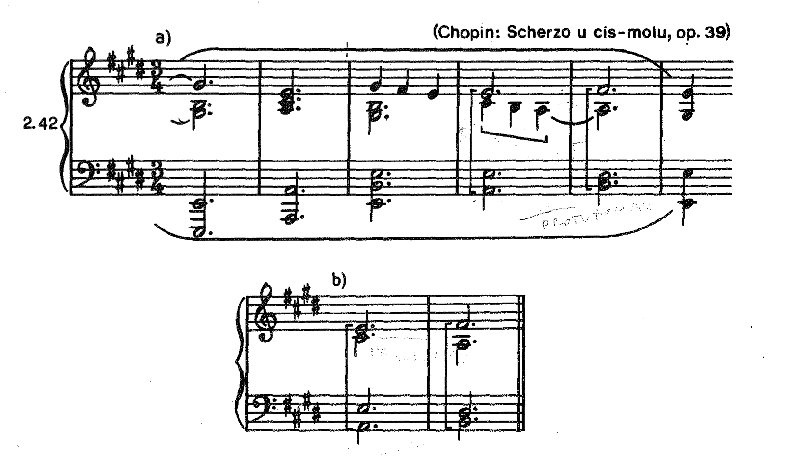

*Primjer 2.42. Namjerno istaknute paralelne kvinte. Izvor: tiskana stranica 25.*

MuseScore prijepis: *bit će dodan.*

Od paralelnih nejednakih kvinta, koje nastaju kada iza čiste kvinte slijedi smanjena ili povećana i obratno, pogrešne su one kod kojih je druga kvinta čista. Nasljedne oktave i kvinte jednako su pogrešne kao i paralelne; nastaju kada se druga oktava ili kvinta formira naknadno, rješenjem zaostajalice ili promjenom položaja druge harmonije. Oktave i kvinte u protupomaku dobre su kada su skokovi u oba glasa podjednaki; kod nejednakih skokova djeluju neugodno.

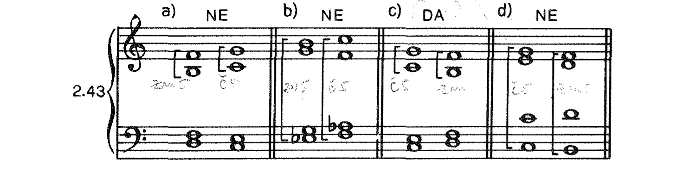

*Primjer 2.43. Nejednake paralelne kvinte. Izvor: tiskana stranica 26.*

MuseScore prijepis: *bit će dodan.*

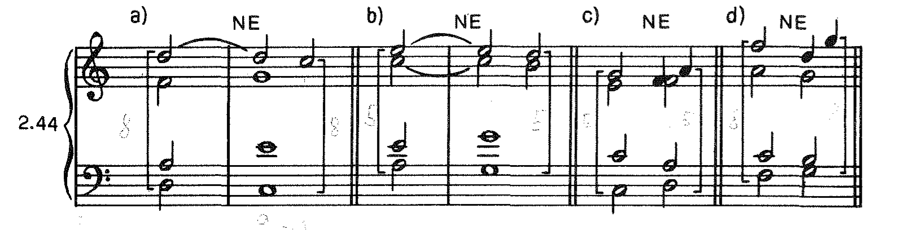

*Primjer 2.44. Nasljedne oktave i kvinte. Izvor: tiskana stranica 26.*

MuseScore prijepis: *bit će dodan.*

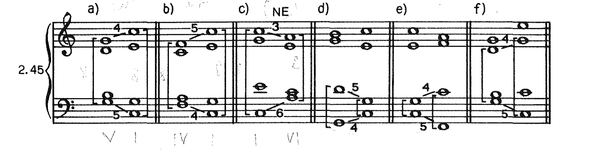

*Primjer 2.45. Oktave i kvinte u protupomaku. Izvor: tiskana stranica 26.*

MuseScore prijepis: *bit će dodan.*

Akcentne oktave i kvinte loše su kada se na nenaglašenoj dobi između njih ne pojavljuje nova harmonija, nego se samo mijenja položaj prvoga akorda. Sakrite oktave i kvinte nastaju kada se dva glasa paralelno kreću iz nekoga drugog intervala u oktavu odnosno kvintu. Sakrite oktave nastale pomakom sa septime ili none ne dopuštaju se; sakrite kvinte podliježu blažim ogradama.

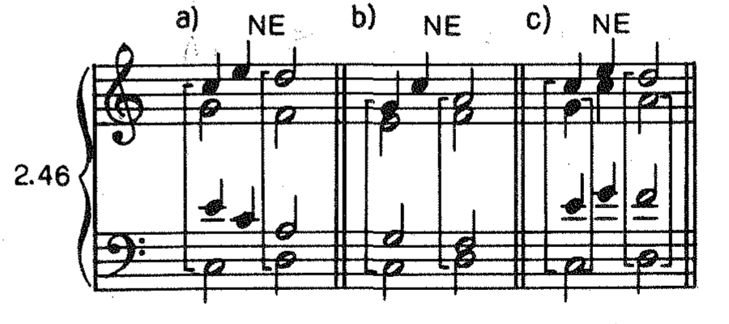

*Primjer 2.46. Akcentne oktave i kvinte. Izvor: tiskana stranica 27.*

MuseScore prijepis: *bit će dodan.*

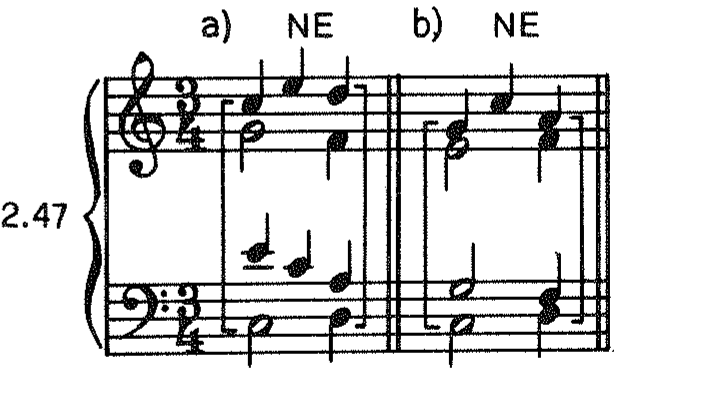

*Primjer 2.47. Promjena položaja. Izvor: tiskana stranica 27.*

MuseScore prijepis: *bit će dodan.*

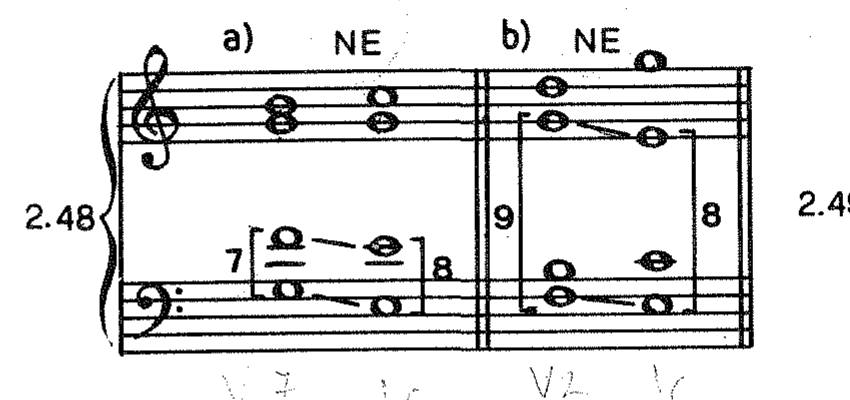

*Primjer 2.48. Sakrite oktave. Izvor: tiskana stranica 27.*

MuseScore prijepis: *bit će dodan.*

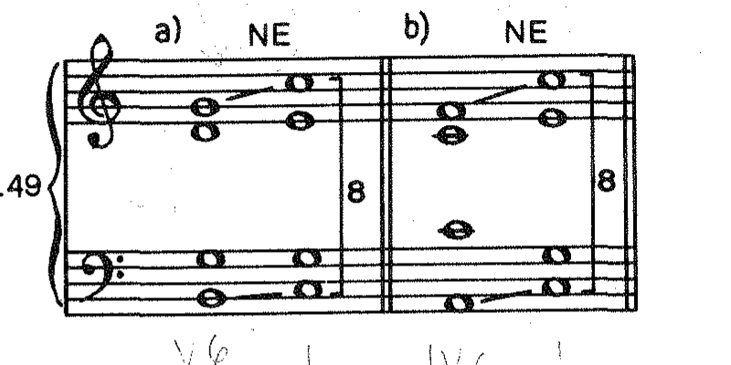

*Primjer 2.49. Sakrite oktave u vanjskim glasovima. Izvor: tiskana stranica 27.*

MuseScore prijepis: *bit će dodan.*

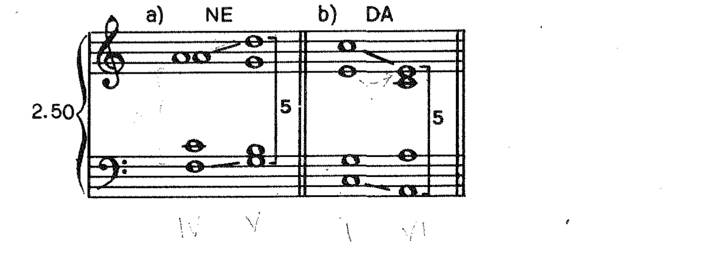

*Primjer 2.50. Sakrite kvinte. Izvor: tiskana stranica 27.*

MuseScore prijepis: *bit će dodan.*

Slušne kvinte nastaju kada jedan od dva glasa što čine kvintu u sljedećem akordu s nekim trećim glasom opet tvori kvintu. Čuju se kao paralelne samo ako se pojedini glasovi ne mogu međusobno razlikovati ni bojom ni dinamikom (primjer 2.51.a). Čim je razlikovanje glasova jasno, privid paralelizma se gubi (primjeri 2.51.b i c).

*Primjer 2.51. Slušne kvinte. Izvor: tiskana stranica 28.*

MuseScore prijepis: *bit će dodan.*

### 2.1.6. Harmonizacija basa konsonantnim kvintakordima

Kod harmonizacije zadanoga basa, gdje će svaki ton basove dionice biti temeljni ton nekoga kvintakorda, uz korektno vođenje glasova i spajanje akorda nameće se zahtjev da linija sopranove dionice bude estetski prihvatljiva. U primjeru 2.52 harmonizacija je korektna, ali dobivena sopranova linija nema posebnu fizionomiju i svodi se na izmjenjivanje dvaju tonova.

*Primjer 2.52. Harmonizacija zadanoga basa. Izvor: tiskana stranica 28.*

MuseScore prijepis: *bit će dodan.*

Linija soprana u drugoj realizaciji znatno je razvijenija. To se postiže promjenom položaja, promjenom sloga i slobodnim spojem srodnih kvintakorda (primjer 2.53). Završetak dopušta i slobodnija rješenja: vođica u unutarnjem glasu može skakati za kvartu prema gore ili sva četiri glasa mogu silaziti, ako ih opravdava uvjerljivi završni silazni pomak soprana na toniku (primjer 2.54).

*Primjer 2.53. Razvijenija sopranova linija. Izvor: tiskana stranica 29.*

MuseScore prijepis: *bit će dodan.*

*Primjer 2.54. Završne varijante harmonizacije basa. Izvor: tiskana stranica 29.*

MuseScore prijepis: *bit će dodan.*

Primjeri 2.55 i 2.56 donose dvije razne izradbe zadanoga basa u molu. U prvoj se verziji gornji glasovi kreću u istim notnim vrijednostima kao zadani glas, što stvara stanovitu monotoniju; u drugoj je verziji ona izbjegnuta polovinskim pomakom gornjih glasova u prvome i četvrtome taktu te cijelom notom u sopranu u trećem taktu.

*Primjer 2.55. Prva izradba zadanoga basa u molu. Izvor: tiskana stranica 30.*

MuseScore prijepis: *bit će dodan.*

*Primjer 2.56. Druga izradba zadanoga basa u molu. Izvor: tiskana stranica 30.*

MuseScore prijepis: *bit će dodan.*

### 2.1.7. Kadence

Slijed harmonija na kraju neke manje ili veće muzičke cjeline čini kadencu; prema tome kadenca je neka vrsta zaključka određenoga harmonijskog kretanja, a taj zaključak može biti konačan ili privremen. Kadence se u klasičnom harmonijskom sistemu dijele na dvije glavne grupe. U jednu spadaju autentična i plagalna kadenca, u kojima je posljednji akord tonički kvintakord i kojima se redovito izvodi definitivni harmonijski završetak; sve ostale vrste kadenca čine drugu grupu.

Autentičnu kadencu čine dominantni i tonički kvintakord, a plagalnu kadencu subdominantni i tonički kvintakord. Savršene su kada su oba akorda u temeljnom obliku, posljednji tonički kvintakord u oktavnom položaju i nastupa na naglašenoj dobi (primjer 2.57). U autentične kadence spada i mješovita ili složena kadenca, redoslijed IV–V–I; dominantnom kvintakordu često prethodi kadencirajući kvartsekstakord na V stupnju, koji se kao zaostajalica rješava u kvintakord na istome stupnju (primjer 2.58).

*Primjer 2.57. Savršene autentične i plagalne kadence. Izvor: tiskana stranica 32.*

MuseScore prijepis: *bit će dodan.*

*Primjer 2.58. Mješovita kadenca. Izvor: tiskana stranica 32.*

MuseScore prijepis: *bit će dodan.*

Nesavršena autentična i plagalna kadenca razlikuje se od savršene po tome što tonički kvintakord ne nastupa u oktavnom nego u nekom drugom položaju (primjer 2.59). U nesavršene kadence spadaju i one u kojima se jedan od akorda, najčešće pretposljednji, pojavljuje u obratu; takve se kadence nazivaju i nepotpunima (primjer 2.60). Autentične i plagalne kadence u molu često završavaju dur-varijantom toničkoga kvintakorda, tzv. pikardijskom tercom (primjer 2.61).

*Primjer 2.59. Nesavršene kadence. Izvor: tiskana stranica 32.*

MuseScore prijepis: *bit će dodan.*

*Primjer 2.60. Nepotpune kadence. Izvor: tiskana stranica 32.*

MuseScore prijepis: *bit će dodan.*

*Primjer 2.61. Pikardijska terca. Izvor: tiskana stranica 33.*

MuseScore prijepis: *bit će dodan.*

Polovična kadenca završava s kvintakordom V ili IV stupnja, najčešće s kvintakordom V stupnja. Polovična kadenca na V stupnju često se pojavljuje u periodičkim muzičkim konstrukcijama, na kraju prve rečenice periode, koja u drugoj rečenici zahtijeva odgovor. Polovična kadenca u molu koja završava s kvintakordom V stupnja u oktavnom položaju, a kojoj prethodi kvintakord ili sekstakord IV stupnja, naziva se frigijskom kadencom (primjer 2.62).

*Primjer 2.62. Polovične kadence. Izvor: tiskana stranica 33.*

MuseScore prijepis: *bit će dodan.*

U varavoj kadenci poslije dominantne harmonije, umjesto toničkoga kvintakorda, dolazi neki drugi akord, najčešće kvintakord VI stupnja (primjer 2.63). Ako je taj drugi akord alterirani ili uopće disonantni suzvuk, koji obično priprema i modulaciju u novi tonalitet, takva se kadenca naziva izbjegnuta (primjer 2.64).

*Primjer 2.63. Varava kadenca. Izvor: tiskana stranica 33.*

MuseScore prijepis: *bit će dodan.*

*Primjer 2.64. Izbjegnuta kadenca. Izvor: tiskana stranica 33.*

MuseScore prijepis: *bit će dodan.*
