# 2. Dijatonika

> Napomena digitalnog izdanja: na pojedinim slikama primjera ručno su uklonjeni rukopisni dodaci sa skena ili okolni tekst koji nije moguće odvojiti pravokutnim izrezom bez gubitka notacije. Te su izvedenice zasebno pregledane i pohranjene u `images/02-dijatonika-a/retouched/`; izvorni izrezi sačuvani su bez retuširanja. Popis i rezultati pregleda nalaze se u [izvještaju o slikama](../images/02-dijatonika-a/REVIEW.md).

## 2.1. Kvintakordi

Tri tona, postavljena jedan iznad drugoga u intervalima terce, ili »po tercama«, čine trozvuk, osnovni akord klasičnoga harmonijskog sistema. Najviši ton trozvuka čini s najdubljim interval kvinte, i zato se naziva kvintom, a po njemu cijeli akord još i kvintakordom. Drugi po redu, srednji ton čini s najdubljim interval terce, pa se naziva tercom, a najdublji, koji je — intervalški gledan — prima, ujedno je temeljni ton kvintakorda. Umjesto naziva *trozvuk* upotrebljavat ćemo naziv *kvintakord*, jer ta riječ svojim značenjem već upućuje na okvirnu intervalsku određenost akorda.

### 2.1.1. Podjela kvintakorda

O vrsti (kvaliteti) intervala kvinte i terce ovisi i vrsta kvintakorda. Velika terca i čista kvinta čine veliki ili dur-kvintakord (primjer 2.1.a), mala terca i čista kvinta čine mali ili mol-kvintakord (primjer 2.1.b), mala terca i smanjena kvinta čine smanjeni kvintakord (primjer 2.1.c), a velika terca i povećana kvinta povećani kvintakord (primjer 2.1.d).

*Primjer 2.1. Vrste kvintakorda. Izvor: tiskana stranica 11.*

MuseScore prijepis: *bit će dodan.*

U duru se dur-kvintakord nalazi na I, IV i V stupnju, mol-kvintakord na II, III i VI stupnju, a smanjeni kvintakord na VII stupnju. U harmonijskom molu nalazi se mol-kvintakord na I i IV stupnju, dur-kvintakord na V i VI stupnju, smanjeni kvintakord na II i VII stupnju, a povećani kvintakord na III stupnju. Prema tome, u harmonijskom molu imamo sve četiri vrste kvintakorda, a u duru se povećani kvintakord ne pojavljuje (primjer 2.2).

*Primjer 2.2. Kvintakordi u duru i harmonijskom molu. Izvor: tiskana stranica 11.*

MuseScore prijepis: *bit će dodan.*

Kvintakordi koji sadrže bilo koji disonantni interval jesu disonantni. Kako su uz sekunde i septime disonantni svi smanjeni i povećani intervali, smanjeni kvintakord, koji sadrži smanjenu kvintu, i povećani kvintakord, koji sadrži povećanu kvintu, disonantni su kvintakordi. Dur-kvintakord i mol-kvintakord, naprotiv, konsonantni su kvintakordi, a to su ujedno i jedini konsonantni akordi u čitavom harmonijskom sistemu. Konsonantni kvintakordi nalaze se stoga u duru na svim stupnjevima osim na VII, a u molu samo na I, IV, V i VI stupnju.

Među svim kvintakordima najvažnije mjesto pripada kvintakordu na I stupnju. On predstavlja polaznu i završnu točku harmonijskoga kretanja unutar tonaliteta, odnosno središte oko kojega se druge harmonije kreću. Harmonijsku funkciju kvintakorda I stupnja nazivamo toničkom funkcijom, a sam kvintakord također toničkim kvintakordom (*tonika* — isto što i prvi stupanj; ton po kojem se naziva tonalitet, kao C-dur, c-mol, G-dur itd.).

Uz bok kvintakordu I stupnja stoje još dva posebno važna kvintakorda: kvintakord na V stupnju i kvintakord na IV stupnju.

Kvintakord na V stupnju, odnosno na dominanti, ili dominantni kvintakord nosilac je dominantne funkcije (lat. *dominans* — gospodujući). Njegova je terca vođica, tj. ton koji se u dur-ljestvici i u harmonijskoj mol-ljestvici nalazi pola stepena ispod tonike i koji teži naviše, dakle »vodi« u toniku. Težnja vođice ka tonici prenosi se i na dominantni kvintakord, tako da on teži ka toničkom kvintakordu; u tome je njegova osnovna karakteristika.

Kvintakord na IV stupnju, odnosno na subdominanti (lat. *sub* — ispod), ili subdominantni kvintakord predstavlja subdominantnu funkciju. On stoji prema toničkom kvintakordu u obrnutom odnosu nego dominantni kvintakord: dominantni kvintakord nalazi se kvintu više od toničkoga, a subdominantni kvintu niže (primjer 2.3).

*Primjer 2.3. Odnos dominantnoga, toničkoga i subdominantnoga kvintakorda. Izvor: tiskana stranica 12.*

MuseScore prijepis: *bit će dodan.*

Dok dominantni kvintakord vodi u tonički kvintakord, subdominantni kvintakord nema te težnje, nego bi se prije moglo reći da tonički kvintakord vodi u subdominantni — po analogiji na dominantni kvintakord, koji vodi u tonički — jer su tu odnosi isti (primjer 2.4.a i b). Ali zato terca subdominantnog kvintakorda u molu, koji je mol-kvintakord, teži polustepenim pomakom naniže, u V stupanj, odnosno u dominantu, pa se ona smatra nekom vrstom silazne vođice (primjer 2.4.c).

*Primjer 2.4. Odnosi toničkoga i subdominantnoga kvintakorda. Izvor: tiskana stranica 12.*

MuseScore prijepis: *bit će dodan.*

Tonički, subdominantni i dominantni kvintakord, odnosno sveukupnost njihovih međusobnih odnosa, određuje tonalitet, i stoga ih smatramo glavnim kvintakordima, a I, IV i V stupanj glavnim stupnjevima. Glavni kvintakordi ujedno su i glavni nosioci triju harmonijskih funkcija: toničke, subdominantne i dominantne. Tonička se funkcija označuje s »T«, subdominantna sa »S«, a dominantna s »D«.

Kvintakordi II, III, VI i VII stupnja sporedni su kvintakordi, a II, III, VI i VII stupanj sporedni stupnjevi. Sporedni kvintakordi nemaju posebnih funkcija, ali mogu zamjenjivati glavne kvintakorde i poprimati njihove funkcije. Glavni kvintakord može zamijeniti njegova paralela, tj. kvintakord koji se nalazi tercu niže i koji s njime ima dva zajednička tona: temeljni ton i terca glavnog kvintakorda identični su s tercom i kvintom kvintakorda koji ga zamjenjuje. Tako kvintakord VI stupnja može zamjenjivati tonički, kvintakord II stupnja subdominantni, a kvintakord III stupnja dominantni kvintakord (primjer 2.5). Dominantni kvintakord ima osim toga i vrlo uvjerljivog zamjenika u kvintakordu VII stupnja, koji se nalazi tercu više od njega; on doduše ne sadrži temeljni ton dominantnog kvintakorda, ali se u njemu pojavljuje vođica kao njegova prima — dakle karakterističan ton za dominantnu funkciju (primjer 2.6).

*Primjer 2.5. Zamjene glavnih kvintakorda. Izvor: tiskana stranica 13.*

MuseScore prijepis: *bit će dodan.*

*Primjer 2.6. Kvintakord VII stupnja kao zamjena dominante. Izvor: tiskana stranica 13.*

MuseScore prijepis: *bit će dodan.*

Potreba za vođicom i za dominantnom funkcijom kao neophodnim predikatima tonaliteta dovela je u harmoniji, kada se radi o mol-tonalitetu, u prvi plan harmonijsku mol-ljestvicu, dakle onu varijantu mol-ljestvice koja u obliku povišenoga VII stupnja sadrži vođicu.

### 2.1.2. Postavljanje kvintakorda u četveroglasju

Od 17. stoljeća dalje četveroglasje postaje najčešćom i općom osnovom višeglasne muzike, stoga se četveroglasni stavak također primjenjuje i u teoretskim eksplikacijama harmonijskih zbivanja kao i u izradbi školskih harmonijskih zadataka. Pri tome se uvijek misli na četiri realna glasa; broj realnih glasova u primjeru 2.7 nije pet nego četiri, jer je jedan od glasova, drugi odozdo, samo udvajanje, odnosno pojačanje vodećega, najgornjeg, u njegovoj donjoj oktavi.

*Primjer 2.7. Četveroglasni stavak. Izvor: tiskana stranica 14.*

MuseScore prijepis: *bit će dodan.*

Što se tiče opsega pojedinih glasova, primjenjuju se norme koje vrijede za glasove mješovitog zbora; odande se preuzimaju i njihovi nazivi: sopran, alt, tenor i bas (primjer 2.8).

*Primjer 2.8. Opsezi glasova mješovitoga zbora. Izvor: tiskana stranica 14.*

MuseScore prijepis: *bit će dodan.*

Vanjski glasovi su bas i sopran, a unutarnji ili srednji tenor i alt; tenor, alt i sopran u odnosu prema basu preuzimaju ulogu gornjih glasova. Kod kvintakorda, kao i kod svih akorda uopće, prvo se postavlja basov ton, ili kraće bas, a zatim sopran, pa alt i na kraju tenor. Ako je bas već dan, redoslijed postavljanja ostalih glasova jest sopran–alt–tenor, a ako je dan sopran, redoslijed je bas–alt–tenor.

Budući da je kvintakord po sastavu troglasan akord, njegova će upotreba u četveroglasnom stavku nužno iziskivati udvajanje pojedinih tonova. Kod konsonantnih kvintakorda, dakle kod dur-kvintakorda i mol-kvintakorda, udvaja se u prvom redu temeljni ton, tj. onaj koji je najdublji kad su svi tonovi kvintakorda raspoređeni po tercama; to znači da se kvintakord tada pojavljuje u temeljnom obliku (primjer 2.9.a). Raspored tonova po tercama, koji je osnovno načelo gradnje akorda u klasičnoj harmoniji, ostvaruje se doslovno i u cijelosti samo kada se akordi pojavljuju potpuni, bez udvajanja i u tijesnom slogu. Kod akorda koji se pojavljuju nepotpuni (primjer 2.9.b), u širokom slogu (primjer 2.9.c), s udvajanjima (primjer 2.9.d) ili u kojem obratu (primjer 2.9.e), nastaju između susjednih tonova ne samo terce, već i drugi intervali. Time se ipak ne narušava osnovni princip rasporeda po tercama, jer se on uvijek odnosi na temeljni oblik potpunoga akorda, postavljenoga u tijesnom slogu i bez udvajanja (primjer 2.9.a).

*Primjer 2.9. Rasporedi tonova kvintakorda. Izvor: tiskana stranica 14.*

MuseScore prijepis: *bit će dodan.*

Teoretska podloga najčešćega udvajanja temeljnog tona u prirodi je niz alikvotnih, parcijalnih ili harmonijskih tonova. Prvih šest tonova niza daje dur-kvintakord, u kojem se temeljni ton pojavljuje triput, kvinta dvaput, a terca samo jedanput (primjer 2.10). Iz toga bi nadalje logično proizlazilo da se terca udvaja najrjeđe, a udvajanje kvinte nalazi negdje na sredini između udvajanja temeljnog tona i udvajanja terce.

*Primjer 2.10. Alikvotni niz. Izvor: tiskana stranica 15.*

MuseScore prijepis: *bit će dodan.*

Međutim, u praksi se češće sreće udvajanje terce nego kvinte, ali to ne proturječi zakonitosti alikvotnoga niza, jer je ona mjerodavna kod izoliranih akorda, dok se relativno često udvajanje terce pojavljuje kao rezultat vođenja glasova u slijedu više akorda, a također i tamo gdje se ne radi o konsonantnim nego o disonantnim kvintakordima.

Terca dominantnog kvintakorda ne udvaja se jer je ona vođica; kao takva ističe se više od ostalih tonova, pa bi njezino udvajanje stvaralo zvukovnu prezasićenost koja neugodno djeluje. Naprotiv, kvinta u kvintakordu III stupnja u duru — premda je to isti ton kao i terca dominantnog kvintakorda — podnosi udvajanje jer kvinta, kao i temeljni ton, spada u statičke elemente konsonantnih kvintakorda, za razliku od terce, koja je dinamična i karakteristična. To se najbolje vidi pri suprotstavljanju istoimenih dur-kvintakorda i mol-kvintakorda, koji se međusobno razlikuju isključivo po terci (primjer 2.11).

*Primjer 2.11. Dur-kvintakord i mol-kvintakord. Izvor: tiskana stranica 15.*

MuseScore prijepis: *bit će dodan.*

Terca subdominantnog kvintakorda u molu, koja ima karakter silazne vođice, također se u pravilu ne udvaja, ali u određenim uvjetima i njezino udvajanje može biti opravdano logičnim vođenjem glasova. Bez daljnjega može se udvajati temeljni ton kvintakorda VI stupnja u molu — iako je to inače isti ton kao i terca subdominantnog kvintakorda — jer on opet predstavlja statički element akorda.

Vođenje glasova može dovesti i do nastupa kvintakorda u nepotpunom obliku, odnosno do izostavljanja jednoga od akordičkih tonova. Tada se redovito izostavlja kvinta, a temeljni se ton u tom slučaju utrostručuje (primjer 2.12.a), čime se nimalo ne poremećuje zvučna izbalansiranost akorda, jer utrostručenje logično proizlazi iz niza alikvotnih tonova (primjer 2.10).

Ako bi u nepotpunom kvintakordu temeljni ton i terca bili podjednako zastupljeni, udvajanje terce bilo bi suviše nametljivo (primjer 2.12.b). Nepotpuni kvintakord bez terce zvuči prazno, a osim toga mu nedostaje tonalna određenost koju daje terca (primjer 2.12.c). Izostavljanje temeljnog tona lišilo bi kvintakord osobenosti: suzvučje e–g–e¹–g¹ (primjer 2.12.d), koje bi trebalo predstavljati kvintakord (c)–e–g, potpuno je neodređeno i prije bi se moglo shvatiti kao kvintakord e–g–(h), premda bi i za takvu interpretaciju nedostajala prevaga temeljnoga tona e nad tercom g.

*Primjer 2.12. Potpuni i nepotpuni kvintakordi. Izvor: tiskana stranica 16.*

MuseScore prijepis: *bit će dodan.*

Kvintakord se može pojaviti u oktavnom, kvintnom i tercnom položaju, već prema tome koji se od njegovih tonova nalazi u najvišem glasu, sopranu: udvojeni temeljni ton, kvinta ili terca. Svaki položaj može biti izveden u tijesnom i u širokom slogu. U tijesnom slogu gornji su glasovi tako postavljeni da se između njih ne bi mogao umetnuti više nijedan akordički ton (primjer 2.13), a u širokom slogu to je moguće (primjer 2.14). Ako između gornjih glasova postoje i elementi tijesnog i širokog sloga, oni zajedno tvore mješoviti slog. Mješoviti se slog redovito javlja kod nepotpunoga oblika kvintakorda (primjer 2.15.a), te kada se u kvintakordu udvaja terca (primjer 2.15.b) ili kvinta (primjer 2.15.c). U obilježavanju, šifraži akorda, oktavni se položaj označuje s »(8)«, kvintni s »(5)«, a tercni s »(3)«, bez obzira na slog.

*Primjer 2.13. Tijesni slog. Izvor: tiskana stranica 16.*

MuseScore prijepis: *bit će dodan.*

*Primjer 2.14. Široki slog. Izvor: tiskana stranica 16.*

MuseScore prijepis: *bit će dodan.*

*Primjer 2.15. Mješoviti slog. Izvor: tiskana stranica 16.*

MuseScore prijepis: *bit će dodan.*

Da bi se sačuvala homogenost zvuka akorda, uzima se između gornjih glasova oktava kao maksimalni dozvoljeni razmak (primjer 2.16.a); razmak između basa i tenora može biti i veći jer suzvučanje alikvotnih tonova, što ih proizvodi basov ton, ispunjava eventualnu prazninu (primjer 2.16.b). Iznimno se i sopran može udaljiti od alta preko oktave, do decime, ako je njegovo udaljavanje uvjetovano i opravdano logičnim vođenjem glasova. Susjedni glasovi mogu tvoriti i unisono, ali se ne smiju križati, prelaziti jedan iznad odnosno ispod drugoga.

*Primjer 2.16. Najveći razmaci među glasovima. Izvor: tiskana stranica 17.*

MuseScore prijepis: *bit će dodan.*

### 2.1.3. Srodnost kvintakorda

Srodnost kvintakorda očituje se u postojanju zajedničkih tonova, a može biti kvintna ili tercna.

Kvintna srodnost postoji između kvintakorda kojima su temeljni tonovi udaljeni za čistu kvintu, odnosno za čistu kvartu, prema gore ili prema dolje, tako da je kvinta jednoga identična s temeljnim tonom drugoga i obratno. Kvintakordi koji međusobno stoje u kvintnoj srodnosti imaju jedan zajednički ton (primjer 2.17).

Tercna srodnost postoji između kvintakorda kojima su temeljni tonovi udaljeni za veliku ili malu tercu prema gore ili prema dolje, tako da su terca i kvinta jednoga identične s temeljnim tonom i tercom drugoga. Kvintakordi koji su u tercnoj srodnosti imaju dva zajednička tona (primjer 2.18).

Nesrodni kvintakordi nemaju zajedničkih tonova; njihovi su temeljni tonovi udaljeni za veliku ili malu sekundu prema gore ili prema dolje (primjer 2.19).

*Primjer 2.17. Kvintna srodnost. Izvor: tiskana stranica 17.*

MuseScore prijepis: *bit će dodan.*

*Primjer 2.18. Tercna srodnost. Izvor: tiskana stranica 17.*

MuseScore prijepis: *bit će dodan.*

*Primjer 2.19. Nesrodni kvintakordi. Izvor: tiskana stranica 17.*

MuseScore prijepis: *bit će dodan.*

Kod glavnih kvintakorda postoji kvintna srodnost između toničkoga i dominantnog kvintakorda kao i između toničkoga i subdominantnog kvintakorda, dok između subdominantnog i dominantnog kvintakorda srodstva nema. Analogni odnosi postoje i između sporednih kvintakorda, dok se tercna srodnost javlja uvijek samo između jednoga glavnog i jednoga sporednog kvintakorda, kao, primjerice, između kvintakorda I i VI stupnja.

Smanjeni kvintakordi ne mogu se direktno uključivati u odnose srodstva s drugim konsonantnim kvintakordima jer su u pravilu izvedeni iz nekih drugih, primarnih akordičkih formacija. Smanjeni kvintakord na VII stupnju može se tako smatrati septakordom V stupnja kojem nedostaje temeljni ton, pa se odnos između kvintakorda IV stupnja i kvintakorda VII stupnja može eventualno valorizirati samo kao septimna srodnost, gdje je temeljni ton prvoga identičan sa septimom drugoga (primjer 2.20). Još složeniji oblik srodstva postoji između kvintakorda VI stupnja i smanjenoga kvintakorda II stupnja u molu, koji također imaju jedan zajednički ton. Osnova njihove srodnosti zapravo je odnos VI–IV, tercna srodnost (primjer 2.21.a), samo što je u harmoniji IV stupnja kvinta zamijenjena sekstom (primjer 2.21.b), koja, kad se tonovi slože po tercama, postaje temeljnim tonom kvintakorda II stupnja (primjer 2.21.c).

*Primjer 2.20. Septimna srodnost. Izvor: tiskana stranica 18.*

MuseScore prijepis: *bit će dodan.*

*Primjer 2.21. Odnos VI–IV i smanjeni kvintakord II stupnja. Izvor: tiskana stranica 18.*

MuseScore prijepis: *bit će dodan.*

### 2.1.4. Spajanje kvintakorda

Standardni oblici spajanja kvintakorda jesu strogi i slobodni spoj.

Strogi spoj moguć je samo između srodnih kvintakorda. Izvodi se tako da se zajednički tonovi zadrže u istim glasovima, a ostali se glasovi kreću na najbliže tonove sljedećega akorda (primjer 2.22). Pri tome se između pojedinih glasova formiraju tri različite vrste pomaka: paralelni pomak, kada se glasovi kreću u istom smjeru; protupomak, kada jedan glas uzlazi a drugi silazi; i jednostrani pomak, kada se samo jedan glas kreće, a drugi zadržava ili ponavlja isti ton. Kombinacijama tih triju vrsta pomaka ostvaruje se čvrsta veza između akorda i osigurava miran tok harmonijskoga kretanja. Ne moraju se u svakom spoju naći sve tri vrste, ali ako je prisutan samo paralelni pomak koji rezultira kretanjem svih glasova u istom smjeru, veza između harmonija postat će labava. Zato se paralelni pomak svih glasova redovito izbjegava.

*Primjer 2.22. Strogi spoj kvintakorda. Izvor: tiskana stranica 18.*

MuseScore prijepis: *bit će dodan.*

Pri spajanju nesrodnih kvintakorda otpada zadržavanje zajedničkih tonova jer ih nema. Ne dolazi u obzir ni kretanje na apsolutno najbliže tonove sljedećega akorda jer bi ono rezultiralo paralelnim pomakom svih glasova, a još i pogrešnim paralelnim kvintama i oktavama (primjer 2.23.a). Zato se nesrodni kvintakordi spajaju tako da se gornji glasovi vode u protupomaku spram basa na najbliže moguće tonove sljedećega akorda, koji nisu uvijek apsolutno najbliži, nego najbliži pri kretanju u suprotnom smjeru basa. Na taj se način ostvaruje slobodni spoj akorda (primjeri 2.23.b i c).

*Primjer 2.23. Slobodni spoj kvintakorda. Izvor: tiskana stranica 19.*

MuseScore prijepis: *bit će dodan.*

U klasičnoj školskoj formuli I–IV–V–I, koja ujedinjuje u logičnom slijedu, odnosno progresiji, sve glavne kvintakorde, pojavljuju se oba standardna spoja: strogi, I–IV i V–I, te slobodni, IV–V. Formula se može izvesti u svakom slogu na tri različita načina tako da svaki započne s drugim položajem prvoga akorda (primjer 2.24).

*Primjer 2.24. Progresija I–IV–V–I. Izvor: tiskana stranica 19.*

MuseScore prijepis: *bit će dodan.*

Ako se u prethodnoj formuli posljednji akord, I, zamijeni kvintakordom VI stupnja, promjena iziskuje nastavak IV–V–I da bi čitav slijed harmonija opet logično završio s toničkim kvintakordom. Slijed tada sadrži sedam kvintakorda: I–IV–V–VI–IV–V–I, a nastaje i spoj nesrodnih kvintakorda V–VI. Budući da terca dominantnog kvintakorda, vođica, zadržava tendenciju kretanja naviše i uzlazi polustepenim pomakom, vođica ide paralelno s basom, a samo se dva preostala glasa kreću u protupomaku na najbliža mjesta. Kvintakord VI stupnja pojavljuje se s udvojenom tercom (primjer 2.25.a). Tako postavljen kvintakord nemoguće je spojiti sa sljedećim, koji je s njime u tercnoj srodnosti, tako da se oba zajednička tona zadrže, jer se jedan od njih nalazi u basu i kreće se; slijedi ga jedan od gornjih glasova, dok drugi skače (primjer 2.25.b). Proširena formula može se izvesti na šest raznih načina (primjer 2.26).

*Primjer 2.25. Spoj V–VI. Izvor: tiskana stranica 20.*

MuseScore prijepis: *bit će dodan.*

*Primjer 2.26. Varijante proširene formule. Izvor: tiskana stranica 20.*

MuseScore prijepis: *bit će dodan.*

U spoju V–VI vođica se može kretati i u protupomaku spram basa kada se ne nalazi u najgornjem glasu, ali samo u duru. U molu bi došlo do nemelodičkoga pomaka za povećanu sekundu, koji se, kao i pomaci za sve povećane intervale uopće, izbjegava (primjer 2.27). Iz istoga razloga treba kod spoja VI–V u molu unaprijed udvojiti tercu u glasu u kojem bi inače bio udvojen temeljni ton. Nakon toga jedna od te dvije terce ide paralelno s basom, silazi na vođicu, a ostala se dva glasa kreću u protupomaku, opet na najbliža mjesta (primjer 2.28).

*Primjer 2.27. Dopušteni i nedopušteni spoj V–VI. Izvor: tiskana stranica 21.*

MuseScore prijepis: *bit će dodan.*

*Primjer 2.28. Spoj VI–V u molu. Izvor: tiskana stranica 21.*

MuseScore prijepis: *bit će dodan.*

Vođenje gornjih glasova iz spoja V–VI može se prenijeti i na druge parove nesrodnih kvintakorda (primjer 2.29), kao i analogno primijeniti na parove kvintno-srodnih kvintakorda gdje temeljni ton prvoga akorda uzlazi za kvartu (primjer 2.30). Kvintno-srodni kvintakordi mogu se međusobno spajati i slobodno, pri čemu se gornji glasovi kreću u protupomaku spram basa (primjer 2.31).

*Primjer 2.29. Slobodni spojevi nesrodnih kvintakorda. Izvor: tiskana stranica 22.*

MuseScore prijepis: *bit će dodan.*

*Primjer 2.30. Slobodni spojevi kvintno-srodnih kvintakorda. Izvor: tiskana stranica 22.*

MuseScore prijepis: *bit će dodan.*

*Primjer 2.31. Slobodni spoj kvintno-srodnih kvintakorda. Izvor: tiskana stranica 22.*

MuseScore prijepis: *bit će dodan.*

Kad iza kvintakorda u tijesnom slogu dolazi neki kvintakord u širokom slogu ili obratno, pri spajanju akorda dolazi do promjene sloga. U gornjim se glasovima tada redovito pojavljuju veći skokovi za kvartu, kvintu ili sekstu. Da takvi skokovi ne bi narušili ravnotežu harmonijskoga kretanja, treba ih kompenzirati tako da se istodobno u nekom od glasova zadrži zajednički ton ili sačuva postepeni pomak, ili da se glas u kojem se javlja skok i bas kreću u protupomaku (primjer 2.32.a). Promjena sloga može se izvršiti i unutar istoga akorda (primjer 2.32.b).

*Primjer 2.32. Promjena sloga. Izvor: tiskana stranica 22.*

MuseScore prijepis: *bit će dodan.*

U primjerima 2.22–2.32 prikazani su neki tipični i standardni spojevi kvintakorda, ali time nisu ni izdaleka obuhvaćene sve varijante i mogućnosti do kojih u praksi može doći. Nije ih ni moguće ni potrebno potpuno obuhvatiti. Treba se pridržavati ograničenja i zabrana kojima se zapravo kontrolira vođenje glasova i spojevi akorda te isključuju pogrešna rješenja. Ograničenja i zabrane odnose se uglavnom na kretanje jednoga glasa samog i na kretanje dvaju ili više glasova istodobno.

U kretanju pojedinoga glasa ne dopuštaju se skokovi za povećane intervale (primjer 2.33). Skokovi za smanjene intervale dopušteni su ako poslije njih dolazi postepeni pomak u suprotnom smjeru (primjer 2.34). Izbjegavaju se dva skoka za redom u istom smjeru u intervalu kvarte ili kvinte; u oba slučaja nastaje nemelodičko kretanje koje se svojim krajnjim točkama poklapa s disonantnim intervalom septime odnosno none (primjer 2.35).

*Primjer 2.33. Nedopušteni skokovi za povećane intervale. Izvor: tiskana stranica 23.*

MuseScore prijepis: *bit će dodan.*

*Primjer 2.34. Dopušteni skokovi za smanjene intervale. Izvor: tiskana stranica 23.*

MuseScore prijepis: *bit će dodan.*

*Primjer 2.35. Dva uzastopna skoka. Izvor: tiskana stranica 23.*

MuseScore prijepis: *bit će dodan.*

U paralelnom kretanju susjednih glasova izbjegava se tzv. preskok. Pri uzlaznom kretanju preskok nastaje kada niži glas dolazi na ton viši od tona što ga je prije skoka imao susjedni viši glas (primjer 2.36.a), a pri silaznom kretanju kada viši glas dolazi na ton niži od tona što ga je prije skoka imao susjedni niži glas (primjer 2.36.b). Ovamo spadaju i slučajevi u primjerima 2.37.a i b, koji se obično formuliraju kao posebna zabrana paralelnoga pomaka u unisono, odnosno paralelnoga pomaka iz unisona.

*Primjer 2.36. Preskok u paralelnom kretanju. Izvor: tiskana stranica 23.*

MuseScore prijepis: *bit će dodan.*

*Primjer 2.37. Paralelni pomak u unisono i iz unisona. Izvor: tiskana stranica 23.*

MuseScore prijepis: *bit će dodan.*

Istodobno kretanje svih glasova u istom smjeru narušava homogenost harmonijskoga stavka. Međutim, ne smeta kod slijeda dvaju različitih položaja istoga akorda (primjer 2.38). Paralelne oktave i kvinte, kao i neke druge njima srodne pojave, predmet su različitih ograničenja i zabrana.

*Primjer 2.38. Istodobno kretanje u različitim položajima istoga akorda. Izvor: tiskana stranica 24.*

MuseScore prijepis: *bit će dodan.*

### 2.1.5. Oktave i kvinte

Paralelne oktave i kvinte nastaju kada se dva glasa kreću paralelnim pomakom iz jedne čiste oktave u drugu čistu oktavu, odnosno iz jedne čiste kvinte u drugu čistu kvintu.

Paralelne oktave smatraju se pogrešnima kada se pojave u stavku u kojem se inače glasovi samostalno kreću. One oduzimaju jednom od glasova samostalnost, smanjuju broj realnih glasova i uzrokuju nemotivirano isticanje jednoga pomaka, što narušava ravnotežu kretanja glasova i stvara neujednačenost stila stavka (primjer 2.39.a). Iz istih razloga pogrešan je i paralelni pomak u unisonu, odnosno paralelne prime (primjer 2.39.b). Nisu pogrešni oni paralelni pomaci u oktavama ili u unisonu kojima je svrha namjerno isticanje i pojačavanje neke melodijske linije (primjer 2.7).

*Primjer 2.39. Paralelne oktave i prime. Izvor: tiskana stranica 24.*

MuseScore prijepis: *bit će dodan.*

Budući da se čista kvinta, za razliku od čiste oktave, ne doima kao jedan ton, paralelne čiste kvinte znatno manje smanjuju samostalnost glasova nego paralelne oktave. Ipak, pogrešne su one paralelne kvinte koje se pojavljuju između temeljnih tonova i kvinta dvaju akorda, osobito između nesrodnih akorda cjelostepenim pomakom (primjer 2.40.a); učinak je ublažen kod skoka između srodnih akorda (primjer 2.40.b). Scarlattijeve kvinte i Mozartove kvinte redovito se ne smatraju pogrešnima (primjer 2.41). Paralelne kvinte mogu u umjetničkom muzičkom kontekstu djelovati dobro kada skladatelj njihovim namjernim isticanjem postiže poseban efekt (primjer 2.42).

*Primjer 2.40. Paralelne kvinte. Izvor: tiskana stranica 25.*

MuseScore prijepis: *bit će dodan.*

*Primjer 2.41. Scarlattijeve i Mozartove kvinte. Izvor: tiskana stranica 25.*

MuseScore prijepis: *bit će dodan.*

*Primjer 2.42. Namjerno istaknute paralelne kvinte. Izvor: tiskana stranica 25.*

MuseScore prijepis: *bit će dodan.*

Od paralelnih nejednakih kvinta, koje nastaju kada iza čiste kvinte slijedi smanjena ili povećana i obratno, pogrešne su one kod kojih je druga kvinta čista. Nasljedne oktave i kvinte jednako su pogrešne kao i paralelne; nastaju kada se druga oktava ili kvinta formira naknadno, rješenjem zaostajalice ili promjenom položaja druge harmonije. Oktave i kvinte u protupomaku dobre su kada su skokovi u oba glasa podjednaki; kod nejednakih skokova djeluju neugodno.

*Primjer 2.43. Nejednake paralelne kvinte. Izvor: tiskana stranica 26.*

MuseScore prijepis: *bit će dodan.*

*Primjer 2.44. Nasljedne oktave i kvinte. Izvor: tiskana stranica 26.*

MuseScore prijepis: *bit će dodan.*

*Primjer 2.45. Oktave i kvinte u protupomaku. Izvor: tiskana stranica 26.*

MuseScore prijepis: *bit će dodan.*

Akcentne oktave i kvinte loše su kada se na nenaglašenoj dobi između njih ne pojavljuje nova harmonija, nego se samo mijenja položaj prvoga akorda. Sakrite oktave i kvinte nastaju kada se dva glasa paralelno kreću iz nekoga drugog intervala u oktavu odnosno kvintu. Sakrite oktave nastale pomakom sa septime ili none ne dopuštaju se; sakrite kvinte podliježu blažim ogradama.

*Primjer 2.46. Akcentne oktave i kvinte. Izvor: tiskana stranica 27.*

MuseScore prijepis: *bit će dodan.*

*Primjer 2.47. Promjena položaja. Izvor: tiskana stranica 27.*

MuseScore prijepis: *bit će dodan.*

*Primjer 2.48. Sakrite oktave. Izvor: tiskana stranica 27.*

MuseScore prijepis: *bit će dodan.*

*Primjer 2.49. Sakrite oktave u vanjskim glasovima. Izvor: tiskana stranica 27.*

MuseScore prijepis: *bit će dodan.*

*Primjer 2.50. Sakrite kvinte. Izvor: tiskana stranica 27.*

MuseScore prijepis: *bit će dodan.*

Slušne kvinte nastaju kada jedan od dva glasa što čine kvintu u sljedećem akordu s nekim trećim glasom opet tvori kvintu. Čuju se kao paralelne samo ako se pojedini glasovi ne mogu međusobno razlikovati ni bojom ni dinamikom (primjer 2.51.a). Čim je razlikovanje glasova jasno, privid paralelizma se gubi (primjeri 2.51.b i c).

*Primjer 2.51. Slušne kvinte. Izvor: tiskana stranica 28.*

MuseScore prijepis: *bit će dodan.*

### 2.1.6. Harmonizacija basa konsonantnim kvintakordima

Kod harmonizacije zadanoga basa, gdje će svaki ton basove dionice biti temeljni ton nekoga kvintakorda, uz korektno vođenje glasova i spajanje akorda nameće se zahtjev da linija sopranove dionice bude estetski prihvatljiva. U primjeru 2.52 harmonizacija je korektna, ali dobivena sopranova linija nema posebnu fizionomiju i svodi se na izmjenjivanje dvaju tonova.

*Primjer 2.52. Harmonizacija zadanoga basa. Izvor: tiskana stranica 28.*

MuseScore prijepis: *bit će dodan.*

Linija soprana u drugoj realizaciji znatno je razvijenija. To se postiže promjenom položaja, promjenom sloga i slobodnim spojem srodnih kvintakorda (primjer 2.53). Završetak dopušta i slobodnija rješenja: vođica u unutarnjem glasu može skakati za kvartu prema gore ili sva četiri glasa mogu silaziti, ako ih opravdava uvjerljivi završni silazni pomak soprana na toniku (primjer 2.54).

*Primjer 2.53. Razvijenija sopranova linija. Izvor: tiskana stranica 29.*

MuseScore prijepis: *bit će dodan.*

*Primjer 2.54. Završne varijante harmonizacije basa. Izvor: tiskana stranica 29.*

MuseScore prijepis: *bit će dodan.*

Primjeri 2.55 i 2.56 donose dvije razne izradbe zadanoga basa u molu. U prvoj se verziji gornji glasovi kreću u istim notnim vrijednostima kao zadani glas, što stvara stanovitu monotoniju; u drugoj je verziji ona izbjegnuta polovinskim pomakom gornjih glasova u prvome i četvrtome taktu te cijelom notom u sopranu u trećem taktu.

*Primjer 2.55. Prva izradba zadanoga basa u molu. Izvor: tiskana stranica 30.*

MuseScore prijepis: *bit će dodan.*

*Primjer 2.56. Druga izradba zadanoga basa u molu. Izvor: tiskana stranica 30.*

MuseScore prijepis: *bit će dodan.*

### 2.1.7. Kadence

Slijed harmonija na kraju neke manje ili veće muzičke cjeline čini kadencu; prema tome kadenca je neka vrsta zaključka određenoga harmonijskog kretanja, a taj zaključak može biti konačan ili privremen. Kadence se u klasičnom harmonijskom sistemu dijele na dvije glavne grupe. U jednu spadaju autentična i plagalna kadenca, u kojima je posljednji akord tonički kvintakord i kojima se redovito izvodi definitivni harmonijski završetak; sve ostale vrste kadenca čine drugu grupu.

Autentičnu kadencu čine dominantni i tonički kvintakord, a plagalnu kadencu subdominantni i tonički kvintakord. Savršene su kada su oba akorda u temeljnom obliku, posljednji tonički kvintakord u oktavnom položaju i nastupa na naglašenoj dobi (primjer 2.57). U autentične kadence spada i mješovita ili složena kadenca, redoslijed IV–V–I; dominantnom kvintakordu često prethodi kadencirajući kvartsekstakord na V stupnju, koji se kao zaostajalica rješava u kvintakord na istome stupnju (primjer 2.58).

*Primjer 2.57. Savršene autentične i plagalne kadence. Izvor: tiskana stranica 32.*

MuseScore prijepis: *bit će dodan.*

*Primjer 2.58. Mješovita kadenca. Izvor: tiskana stranica 32.*

MuseScore prijepis: *bit će dodan.*

Nesavršena autentična i plagalna kadenca razlikuje se od savršene po tome što tonički kvintakord ne nastupa u oktavnom nego u nekom drugom položaju (primjer 2.59). U nesavršene kadence spadaju i one u kojima se jedan od akorda, najčešće pretposljednji, pojavljuje u obratu; takve se kadence nazivaju i nepotpunima (primjer 2.60). Autentične i plagalne kadence u molu često završavaju dur-varijantom toničkoga kvintakorda, tzv. pikardijskom tercom (primjer 2.61).

*Primjer 2.59. Nesavršene kadence. Izvor: tiskana stranica 32.*

MuseScore prijepis: *bit će dodan.*

*Primjer 2.60. Nepotpune kadence. Izvor: tiskana stranica 32.*

MuseScore prijepis: *bit će dodan.*

*Primjer 2.61. Pikardijska terca. Izvor: tiskana stranica 33.*

MuseScore prijepis: *bit će dodan.*

Polovična kadenca završava s kvintakordom V ili IV stupnja, najčešće s kvintakordom V stupnja. Polovična kadenca na V stupnju često se pojavljuje u periodičkim muzičkim konstrukcijama, na kraju prve rečenice periode, koja u drugoj rečenici zahtijeva odgovor. Polovična kadenca u molu koja završava s kvintakordom V stupnja u oktavnom položaju, a kojoj prethodi kvintakord ili sekstakord IV stupnja, naziva se frigijskom kadencom (primjer 2.62).

*Primjer 2.62. Polovične kadence. Izvor: tiskana stranica 33.*

MuseScore prijepis: *bit će dodan.*

U varavoj kadenci poslije dominantne harmonije, umjesto toničkoga kvintakorda, dolazi neki drugi akord, najčešće kvintakord VI stupnja (primjer 2.63). Ako je taj drugi akord alterirani ili uopće disonantni suzvuk, koji obično priprema i modulaciju u novi tonalitet, takva se kadenca naziva izbjegnuta (primjer 2.64).

*Primjer 2.63. Varava kadenca. Izvor: tiskana stranica 33.*

MuseScore prijepis: *bit će dodan.*

*Primjer 2.64. Izbjegnuta kadenca. Izvor: tiskana stranica 33.*

MuseScore prijepis: *bit će dodan.*

Posljednji akord kadence redovito pada na naglašenu dobu, što predstavlja muški završetak. Padne li posljednji akord na nenaglašenu dobu, kadenca se naziva ženskom kadencom ili ženskim završetkom (primjer 2.65). Ženski su završeci rijetki u baroku i klasici, ali su ih romantički skladatelji rado upotrebljavali.

*Primjer 2.65. Ženska kadenca. Izvor: tiskana stranica 34.*

MuseScore prijepis: *bit će dodan.*

Sve prethodne kadence bile su prikazane shematski, najjednostavnijim akordima i u najjednostavnijem ritmičkom obliku. U praksi mogu imati složeniji izgled: dominantne i subdominantne harmonije mogu se pojaviti kao disonantni akordi ili njihove zamjene, pojedini se tonovi mogu alterirati, a cijelo se zbivanje može obogatiti neakordičkim tonovima. Primjer 2.66 donosi složenije varijante autentične kadence iz umjetničke muzičke literature.

*Primjer 2.66. Autentične kadence. Izvor: tiskane stranice 34–35.*

MuseScore prijepis: *bit će dodan.*

Polovične, varave, izbjegnute i ženske kadence mogu se pojaviti i u složenijim oblicima umjetničke muzičke literature. Primjeri 2.68–2.71 prikazuju po dvije takve varijante: polovičnu, varavu, izbjegnutu i žensku kadencu.

*Primjer 2.68. Polovične kadence (Beethoven i J. S. Bach). Izvor: tiskana stranica 36.*

MuseScore prijepis: *bit će dodan.*

*Primjer 2.69. Varave kadence (J. S. Bach i Debussy). Izvor: tiskane stranice 36–37.*

MuseScore prijepis: *bit će dodan.*

*Primjer 2.70. Izbjegnute kadence (J. S. Bach i Chopin). Izvor: tiskana stranica 37.*

MuseScore prijepis: *bit će dodan.*

*Primjer 2.71. Ženska kadenca (Schumann). Izvor: tiskana stranica 37.*

MuseScore prijepis: *bit će dodan.*

Plagalne kadence iz umjetničke literature prikazane su u primjeru 2.67. Budući da se tiskani primjer proteže preko dvije izvorne stranice, sačuvan je u tri odvojena, neizmijenjena izvorna isječka umjesto spajanja ili umjetnog popunjavanja slike.

*Primjer 2.67. Plagalne kadence. Izvor: tiskane stranice 35–36.*

MuseScore prijepis: *bit će dodan.*

### 2.1.8. Harmonizacija soprana konsonantnim kvintakordima

<!-- Izvor teksta: tiskana stranica 38, PDF stranica 20. -->

Svaki ton melodije može se — teoretski — harmonizirati s tri razna kvintakorda tako da bude u dotičnom kvintakordu ili njegovom primom ili tercom ili kvintom. Konkretan izbor između tih mogućnosti uvjetovan je s jedne strane već učinjenim izborom prethodnog akorda, a s druge slijedećim tonom u melodiji, tako da uvjetovanost kontekstom može izbor akorda svesti u određenom slučaju čak i na jedno jedino rješenje. Primjer 2.72.a sadrži najjednostavniji melodijski fragment od tri tona, u C-duru. Želimo li ga harmonizirati samo konsonantnim kvintakordima, i ako prvi ton (»c«) harmoniziramo kvintakordom I stupnja, kao što je na početku melodije i normalno, onda je najbolje rješenje za slijedeći ton (»d«) da on bude kvintom kvintakorda V stupnja, jer slijed I-V daje tonalno jasno određeni početak (pr. 2.72.b). Osim toga, solucija s kvintakordom V stupnja na ovome je mjestu i jedina moguća; ako bismo »d« harmonizirali s kvintakordom II stupnja (dakle, ako bismo ga shvatili kao primu kvintakorda), onda bi spoj I-II rezultirao paralelnim kvintama i oktavama (pr. 2.72.c), a harmonizacija s kvintakordom VII stupnja (gdje bi »d« bio terca) također ne dolazi u obzir, jer je kvintakord VII stupnja smanjeni kvintakord, a taj bi ovdje i loše zvučao i ne bi se dao dobro riješiti (pr. 2.72.d). I dalje, kvintakord V stupnja opet uvjetuje izbor akorda za slijedeći ton (»e«) time što isključuje rješenje gdje bi »e« bio kvintom u kvintakordu VI stupnja, jer bi spoj V—VI na ovom mjestu doveo opet do paralelnih kvinta (pr. 2.72.e). Dakle ostaju još dvije mogućnosti, da »e« bude tercom u kvintakordu I stupnja (pr. 2.72.f) ili primom u kvintakordu III stupnja (pr. 2.72.g). A ako se pojedini tonovi melodije harmoniziraju s više akorda, broj mogućnosti ponovo se povećava (pr. 2.73), a konkretan izbor između njih bit će konačno predmetom slobodne odluke, individualnoga harmonijskog htijenja, mišljenja i ukusa.

*Primjer 2.72. Izbor kvintakorda pri harmonizaciji soprana, varijante a–g. Izvor: tiskana stranica 38.*

MuseScore prijepis: *bit će dodan.*

<!-- Izvor teksta: tiskana stranica 39, PDF stranica 20. -->

*Primjer 2.73. Harmonizacija s više akorda po melodijskom tonu, varijante a–b. Izvor: tiskana stranica 39.*

MuseScore prijepis: *bit će dodan.*

Očito je već i iz ovako jednostavnog primjera da izbor harmonija ne znači samo izbor konkretnoga akorda, izolirano promatranoga, nego je to i izbor određenoga slijeda u kojemu se harmonije međusobno uvjetuju. Nema nikakovih pravila koja bi takav izbor normirala. Postoje samo neki više ili manje standardni slijedovi, odnosno progresije, od dva ili više akorda, koje su dobrim dijelom sadržane već u pojedinim vrstama kadenca (v. odsjek 2.1.7) i koje se analogno primjenjuju i na drugim mjestima i na drugim stupnjevima.

To je prije svega slijed »za kvartu gore« ili »za kvintu dolje«, kao u autentičnoj kadenci (pr. 2.74.a), i slijed za »kvintu gore« ili »za kvartu dolje«, kao u plagalnoj kadenci (pr. 2.74.b). Ako se u progresiji, kakvu nalazimo u mješovitoj kadenci, subdominantni kvintakord zamijeni kvintakordom II stupnja, onda ta, također vrlo uobičajena varijanta, sadrži dva pomaka iste kvalitete, tj. pomak »za kvartu gore« i »za kvintu dolje« (pr. 2.75). U obje progresije (IV-V-I i II-V-I) težnja je vođice (terce dominantnog kvintakorda) za pomakom u toniku prilično istaknuta, ali nju jednako zadovoljava i nastavak s kvintakordom I stupnja, kao i s njegovim zamjenikom, tj. s kvintakordom VI stupnja (pr. 2.76). Ako poslije dominantnog kvintakorda uslijedi njegov zamjenik, kvintakord III stupnja, tada ton koji je bio terca dominantnog kvintakorda, dakle vođica, postaje u novom akordu kvintom i gubi uzlaznu tendenciju, pa i njegov silazni pomak također može sada djelovati logično (pr. 2.77).

*Primjer 2.74. Akordički slijedovi po uzoru na autentičnu i plagalnu kadencu, varijante a–b. Izvor: tiskana stranica 39.*

MuseScore prijepis: *bit će dodan.*

*Primjer 2.75. Progresija II–V–I. Izvor: tiskana stranica 39.*

MuseScore prijepis: *bit će dodan.*

*Primjer 2.76. Nastavak progresije s kvintakordom VI stupnja, varijante a–b. Izvor: tiskana stranica 40.*

MuseScore prijepis: *bit će dodan.*

*Primjer 2.77. Kvintakord III stupnja kao zamjena dominante. Izvor: tiskana stranica 40.*

MuseScore prijepis: *bit će dodan.*

<!-- Izvor teksta: tiskana stranica 40, PDF stranica 21. -->

Progresija I—VI zvuči vrlo uvjerljivo, jer u njoj drugi akord, kao zamjenik prvoga, ponavlja njegova dva najvažnija tona (primu i tercu) i donosi kao novi sam VI stupanj u obliku temeljnog tona kvintakorda, i stoga nastup toga akorda intenzivira zvučno zbivanje. Obratni redoslijed (VI—I) također je upotrebljiv premda kod njega intenzitet zvučnog zbivanja opada, ali to opadanje opet je manje kada se sopran pri tom kreće i kada prvi akord nastupa na naglašenoj dobi, a drugi na nenaglašenoj (pr. 2.78). A kada drugi akord nastupa u obliku sekstakorda, onda je svaki eventualni prigovor neumjestan, jer tada bas izvodi pomak »za kvartu dolje« i uvjerljivo simulira spoj glavnih kvintakorda poput IV—I ili I—V (pr. 2.79). Isto što je ovdje bilo rečeno za spojeve I—VI i VI—I vrijedi za svaku analognu progresiju kvintakorda, tako da se može postaviti da su i one progresije gdje se bas kreće »za tercu dolje«, kao i one gdje ide »za tercu gore«, dobre, ali da su općenito one prve bolje od drugih.

*Primjer 2.78. Progresija VI–I, varijante a–c. Izvor: tiskana stranica 40.*

MuseScore prijepis: *bit će dodan.*

*Primjer 2.79. Nastavak progresije sekstakordom. Izvor: tiskana stranica 40.*

MuseScore prijepis: *bit će dodan.*

Što se tiče progresija nesrodnih kvintakorda, dakle onih kod kojih se bas kreće »za sekundu gore« ili »za sekundu dolje«, sve one dolaze u obzir, premda će se neke od njih, izolirano uzete, doimati slabije, kao II—III ili IV—III u konkretnim spojevima u pr. 2.80.a. Ali već drukčije vođenje unutarnjih glasova — po analogiji na spojeve V—VI i VI—V — poboljšava zvučni dojam (pr. 2.80.b), a u kontekstu s harmonijama koji tim progresijama prethode i slijede one mogu biti jednako upotrebljive i uvjerljive kao npr. progresije I—II, IV—V ili V—VI. Izuzetno mjesto pripada progresiji V—IV, koja čini snažan kontrast uobičajenom slijedu u progresiji IV—V—(I) i koja se zbog svoga arhaičnog prizvuka starih načina (v. poglavlje 2. 10) — jednako kao i progresija V—II — upotrebljava rijetko, s posebnom namjenom i za postizanje naročitog efekta (pr. 2.80.c i d).

*Primjer 2.80. Progresije nesrodnih kvintakorda, varijante a–d. Izvor: tiskana stranica 41.*

MuseScore prijepis: *bit će dodan.*

<!-- Izvor teksta: tiskana stranica 41, PDF stranica 21. -->

Prvi korak u harmonizaciji zadane melodije (soprana) sastoji se u određivanju tonaliteta melodije, zatim u uočavanju manjih zaokruženih cjelina (fraza) i u određivanju kadence na kraju svake fraze. Ako melodija čini nedjeljivu cjelinu, određuje se samo kadenca na kraju.

Sopran u pr. 2.81. je u G-duru i ima dvije fraze; prva može završiti s polovičnom kadencom na subdominanti, a druga sa savršenom autentičnom kadencom. Nakon fiksiranja kadenca slijedi druga faza, gdje se izrađuje basova dionica, kojom se u isti mah i određuje slijed kvintakorda, odnosno izbor harmonija (pr. 2.82). U posljednjoj fazi izrađuju se unutarnji glasovi, pri čemu su uvijek moguće i naknadne modifikacije basove dionice i — kao posljedica toga — modifikacije u slijedu akorda. Tako je u 2. taktu u konačnoj verziji kvintakord I stupnja pomaknut sa zadnje na predzadnju četvrtinku (što sopran dopušta), da bi se na tom mjestu postigla ritmička raznolikost, a isto tako u predzadnjem taktu bas u konačnoj verziji skače još za oktavu dolje da bi se izbjegao zastoj u ritmu (pr. 2.83).

[^primjer-2-83]: Prijelaz u tijesni slog omogućuje bolju liniju tenora.

*Primjer 2.81. Zadani sopran i mjesta kadenca. Izvor: tiskana stranica 41.*

MuseScore prijepis: *bit će dodan.*

*Primjer 2.82. Izradba basove dionice. Izvor: tiskana stranica 41.*

MuseScore prijepis: *bit će dodan.*

*Primjer 2.83. Konačna četveroglasna harmonizacija.[^primjer-2-83] Izvor: tiskana stranica 41.*

MuseScore prijepis: *bit će dodan.*

<!-- Izvor teksta: tiskana stranica 42, PDF stranica 22. -->

Završetak prve fraze može se izvesti i drukčijom kadencom — kadencom koju će činiti kvintakordi VI i II stupnja (pr. 2.84). Ne bi bilo ispravno tu kadencu tumačiti također kao polovičnu kadencu na subdominanti zbog toga što je kvintakord II stupnja zamjenik subdominantnog kvintakorda. Utisak subdominantne funkcije ovdje se gubi jer sporednom kvintakordu (II) prethodi također sporedni kvintakord (VI), pa progresija VI—II simulira slijed glavnih kvintakorda u jednom drugom tonalitetu, tj. slijed I—IV u e-molu. Međutim, iz konteksta cjelokupne harmonizacije proizlazi da se ovdje ne radi niti o e-molu; to je progresija sporednih kvintakorda u G-duru, načinjena po analogiji na progresiju glavnih kvintakorda i zato, naprosto, dobro zvuči. Takav slučaj je jedan od primjera (kojih će biti i više) kako se ne može svako, makar strogo tonalno, harmonijsko zbivanje svoditi bez dogmatičke prisile na odnose harmonijskih funkcija. Ovdje je glavnu riječ imala primjena harmonijske progresije *po analogiji*. (Uostalom, i principi postavljanja dur-kvintakorda, koji proizlaze iz prirodne akustičke pojave niza alikvotnih tonova, prenose se samo *analogijom* na mol-kvintakord, jer njegova egzistencija nije osnovana ni na kakovom prirodnom akustičkom fenomenu.)

*Primjer 2.84. Drukčiji završetak prve fraze, kadenca VI–II. Izvor: tiskana stranica 42.*

MuseScore prijepis: *bit će dodan.*

Primjer 2.85. donosi melodiju u e-molu, s dvije fraze kojima odgovaraju autentične kadence: prva nesavršena, a druga savršena. Posebnu pažnju zahtijeva istaknuti skok za oktavu prema gore na početku druge fraze. On je zbog sinkopiranoga ritma još više potenciran, pa bi unio i suviše nemira u tok stavka ako bi istodobno s njime uslijedila i promjena harmonije. Stoga za vrijeme skoka bas — a s njime i odgovarajuća harmonija — miruje (pr. 2.86). U konačnoj realizaciji kvintakord IV stupnja (u taktu gdje se nalazi i spomenuti skok) pomaknut je još sa 4. na 3. četvrtinku, čime se dobiva dobar komplementarni ritam sa sinkopom (pr. 2.87).

*Primjer 2.85. Zadana melodija u e-molu i mjesta kadenca. Izvor: tiskana stranica 42.*

MuseScore prijepis: *bit će dodan.*

*Primjer 2.86. Basova dionica uz zadanu melodiju u e-molu. Izvor: tiskana stranica 42.*

MuseScore prijepis: *bit će dodan.*

*Primjer 2.87. Konačna harmonizacija melodije u e-molu.[^primjer-2-87] Izvor: tiskana stranica 43.*

MuseScore prijepis: *bit će dodan.*

[^primjer-2-87]: Terca e-g između alta i soprana zvuči punije od kvinte c-g.

<!-- Izvor teksta: tiskana stranica 43, PDF stranica 22. -->

Prva fraza mogla bi imati i drukčiju kadencu, tj. polovičnu na subdominanti, ali ova solucija bila bi slaba jer bismo tada u nastavku dobili neuvjerljivu progresiju »za tercu gore«, sa sopranom koji ponavlja ton, i k tome još u nepovoljnom ritmičkom odnosu, s nenaglašene na naglašenu dobu (pr. 2.88).

*Primjer 2.88. Slabiji završetak prve fraze polovičnom kadencom na subdominanti. Izvor: tiskana stranica 43.*

MuseScore prijepis: *bit će dodan.*

Ovdje smo se prvi put sreli s jednim velikim skokom u zadanoj melodiji, a slični, ulazni i silazni skokovi pojavljivat će se neprestano i kasnije u raznim zadacima. Neće stoga biti naodmet usvajanje vrlo korisnoga postupka pri vođenju glasova u takvim slučajevima. Naime, da bi se kod velikog skoka u sopranu izbjegli istodobni veliki skokovi i preskoci u unutarnjim glasovima — koji bi im samo narušili logično kretanje — potrebno je: a) prije ulaznoga skoka u sopranu voditi glasove u tijesnom slogu, a kod skoka prijeći u široki slog (pr. 2.89.a), b) prije silaznoga skoka u sopranu voditi glasove u širokom slogu, a kod skoka prijeći u tijesni slog (pr. 2.89.b). U obratnom postupku neizbježno bi se pojavila neželjena kretanja unutarnjih glasova (pr. 2.89.c i d).

*Primjer 2.89. Promjena sloga pri skoku u sopranu, varijante a–d. Izvor: tiskana stranica 43.*

MuseScore prijepis: *bit će dodan.*

U tijesnoj vezi sa slijedom harmonija je tzv. **harmonijski ritam**, tj. ritam u kojem se izmjenjuju harmonije. Harmonijski se ritam može podudarati s ritmom melodije (pr. 2.90), a može se od njega u manjoj ili većoj mjeri i odvajati (pr. 2.91). Loše može djelovati nastup tzv. **sinkopirane harmonije**; ona nastaje kada se harmonija, koja je nastupila na nenaglašenoj dobi, ponavlja i na slijedećoj naglašenoj dobi (pr. 2.92.a), a proturječi prirodnom odvijanju harmonijskoga ritma gdje s naglašenom dobom normalno nastupa i promjena harmonije (pr. 2.92.b).

<!-- Izvor teksta: tiskana stranica 44, PDF stranica 23. -->

*Primjer 2.90. Podudaranje melodijskog i harmonijskog ritma. Izvor: tiskana stranica 44.*

MuseScore prijepis: *bit će dodan.*

*Primjer 2.91. Odvajanje harmonijskog od melodijskog ritma. Izvor: tiskana stranica 44.*

MuseScore prijepis: *bit će dodan.*

*Primjer 2.92. Sinkopirana harmonija i njezino izbjegavanje, varijante a–b. Izvor: tiskana stranica 44.*

MuseScore prijepis: *bit će dodan.*

Ponovni nastup iste harmonije na simetričnim naglašenim dobama djeluje monotono, kao u pr. 2.93.a; u konkretnom slučaju njega ćemo lako izbjeći uvođenjem dviju harmonija u prvoj polovici 2. takta (pr. 2.93.b), a time ćemo ujedno i oživjeti harmonijski ritam. Tako i u primjeru 2.94.a (gdje sopran izvodi standardni melodijski završetak) tonički kvintakord na početku predzadnjeg takta znatno oslabljuje efekt nastupa istoga akorda na istom mjestu u zadnjem taktu. Rješenje u pr. 2.94.b otklanja dvokratno pojavljivanje toničkoga kvintakorda i, osim toga, donosi najčvršći harmonijski završetak, tj. kadencu u kojoj se pojavljuju sva tri glavna kvintakorda.

*Primjer 2.93. Izbjegavanje monotonog ponavljanja iste harmonije, varijante a–b. Izvor: tiskana stranica 44.*

MuseScore prijepis: *bit će dodan.*

*Primjer 2.94. Jačanje završne kadence izbjegavanjem preranog nastupa tonike, varijante a–b. Izvor: tiskana stranica 44.*

MuseScore prijepis: *bit će dodan.*

#### Zadaci

<!-- Izvor: tiskana stranica 45, PDF stranica 23. -->

*Zadatak 1. Melodija za harmonizaciju. Izvor: tiskana stranica 45.*

MuseScore prijepis: *bit će dodan.*

*Zadatak 2. Melodija za harmonizaciju. Izvor: tiskana stranica 45.*

MuseScore prijepis: *bit će dodan.*

*Zadatak 3. Melodija za harmonizaciju. Izvor: tiskana stranica 45.*

MuseScore prijepis: *bit će dodan.*

*Zadatak 4. Melodija za harmonizaciju. Izvor: tiskana stranica 45.*

MuseScore prijepis: *bit će dodan.*

*Zadatak 5. Melodija za harmonizaciju. Izvor: tiskana stranica 45.*

MuseScore prijepis: *bit će dodan.*

*Zadatak 6. Melodija za harmonizaciju. Izvor: tiskana stranica 45.*

MuseScore prijepis: *bit će dodan.*

*Zadatak 7. Melodija za harmonizaciju. Izvor: tiskana stranica 45.*

MuseScore prijepis: *bit će dodan.*

*Zadatak 8. Melodija za harmonizaciju. Izvor: tiskana stranica 45.*

MuseScore prijepis: *bit će dodan.*

*Zadatak 9. Melodija za harmonizaciju. Izvor: tiskana stranica 45.*

MuseScore prijepis: *bit će dodan.*

*Zadatak 10. Melodija za harmonizaciju. Izvor: tiskana stranica 45.*

MuseScore prijepis: *bit će dodan.*

### 2.1.9. Kvintakord III stupnja u molu (povećani kvintakord)

<!-- Izvor teksta: tiskana stranica 46, PDF stranica 24. -->

Na III stupnju u molu nalazi se povećani kvintakord. Čine ga dvije velike terce, koje zajedno daju interval povećane kvinte (pr. 2.95).

*Primjer 2.95. Građa povećanog kvintakorda. Izvor: tiskana stranica 46.*

MuseScore prijepis: *bit će dodan.*

Zbog disonantnog intervala povećane kvinte on je disonantan akord, a kako je njegova kvinta i vođica, a uz to i povećan interval, povećani kvintakord ima izrazitu dominantnu funkciju. Prvenstveno mu se udvaja terca (dominanta!), a i temeljni ton, samo kvinta ne. Rješava se prije svega u harmoniju I i VI stupnja, pri čemu vođica uvijek uzlazi za pola stepena (pr. 2.96.a i b). Kada nastupa s udvojenim temeljnim tonom, on se dobro spaja i s kvintakordom V stupnja (pr. 2.96.c). Rješenje u kvintakord IV stupnja ne dolazi u obzir zbog paralelnih kvinta (pr. 2.97.a), ali rješenje u sekstakord istoga stupnja bit će moguće (pr. 2.97.b).

*Primjer 2.96. Rješenja povećanog kvintakorda, varijante a–c. Izvor: tiskana stranica 46.*

MuseScore prijepis: *bit će dodan.*

*Primjer 2.97. Spoj povećanog kvintakorda s harmonijom IV stupnja, varijante a–b. Izvor: tiskana stranica 46.*

MuseScore prijepis: *bit će dodan.*

U sopranu u pr. 2.98. prva fraza može završiti s varavom ili (nesavršenom) autentičnom kadencom, a u oba slučaja predzadnji akord može biti kvintakord III stupnja. Progresija IV—VI u 2. taktu posve je u redu (kretanje soprana uz dobar ritmički odnos), a eventualno zadržavanje harmonije IV stupnja kroz cijeli takt prouzročilo bi teškoće u nastavku harmonizacije: ako bi se zadržao tijesni slog, nastale bi pogrešne akcentne oktave i kvinte (pr. 2.99.a), a prijelaz u široki slog rezultirao bi u slijedećem taktu paralelnim velikim skokovima u svim gornjim glasovima (pr. 2.99.b).

<!-- source-page: 047; pdf-page: 24 -->

> **Napomena integracije, tiskane stranice 47–63:** slike označene **PROVISIONAL — needs handwriting cleanup / potrebno uklanjanje rukopisnih dodataka** prikazuju izvorne izreze samo radi pregleda; nisu odobrene. Neovisni pregled prošlo je 49 od 69 ovdje dodanih slika; preostalih 20 zahtijeva čišćenje i ponovni neovisni pregled. [Detaljni statusi i izvori](../review-candidates/book/M02/INTEGRATION.md).

<!-- integrated-visual: primjer-2-98; page 047 -->
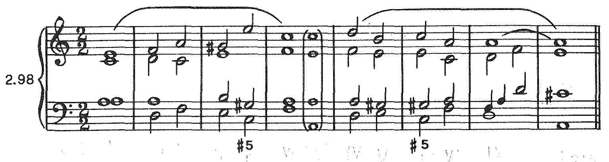

*Primjer 2.98. Izvor: tiskana stranica 47.*

> **PROVISIONAL — needs handwriting cleanup / potrebno uklanjanje rukopisnih dodataka.** Nije odobreno; prikaz samo za pregled.

MuseScore prijepis: *bit će dodan.*

<!-- integrated-visual: primjer-2-99; page 047 -->
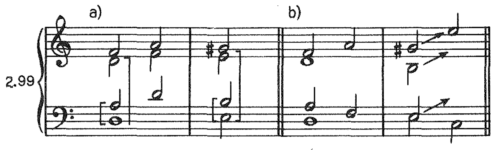

*Primjer 2.99. Izvor: tiskana stranica 47.*

MuseScore prijepis: *bit će dodan.*

Povećani kvintakord označuje se brojkom 5, ispred koje se stavlja predznak.

#### Zadaci

<!-- integrated-visual: zadatak-2-47-1; page 047 -->
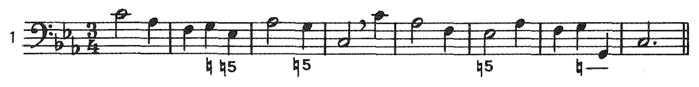

*Zadatak 1. Izvor: tiskana stranica 47.*

MuseScore prijepis: *bit će dodan.*

<!-- integrated-visual: zadatak-2-47-2; page 047 -->
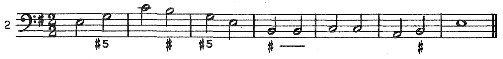

*Zadatak 2. Izvor: tiskana stranica 47.*

MuseScore prijepis: *bit će dodan.*

<!-- integrated-visual: zadatak-2-47-3; page 047 -->
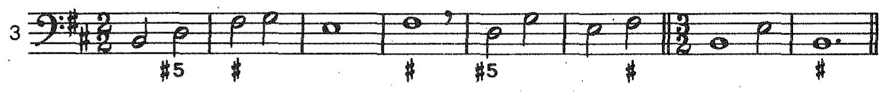

*Zadatak 3. Izvor: tiskana stranica 47.*

MuseScore prijepis: *bit će dodan.*

<!-- integrated-visual: zadatak-2-47-4; page 047 -->
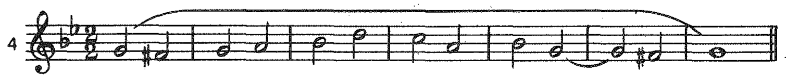

*Zadatak 4. Izvor: tiskana stranica 47.*

MuseScore prijepis: *bit će dodan.*

<!-- integrated-visual: zadatak-2-47-5; page 047 -->
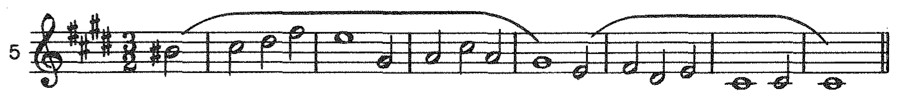

*Zadatak 5. Izvor: tiskana stranica 47.*

MuseScore prijepis: *bit će dodan.*

<!-- integrated-visual: zadatak-2-47-6; page 047 -->
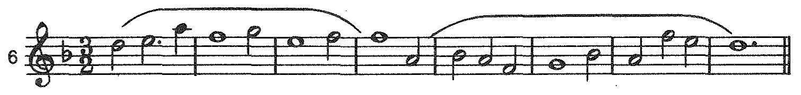

*Zadatak 6. Izvor: tiskana stranica 47.*

MuseScore prijepis: *bit će dodan.*

<!-- source-page: 048; pdf-page: 25 -->

## 2.2. Sekstakordi

Sekstakord je prvi obrat kvintakorda; sastoji se od terce i sekste, a označuje brojkom 6. Kod sekstakorda terca kvintakorda postaje basovim tonom, temeljni ton sekstom (otuda i naziv akorda), a kvinta tercom (pr. 2.100).

<!-- integrated-visual: primjer-2-100; page 048 -->
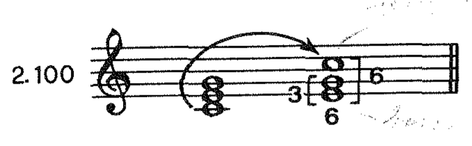

*Primjer 2.100. Izvor: tiskana stranica 48.*

> **PROVISIONAL — needs handwriting cleanup / potrebno uklanjanje rukopisnih dodataka.** Nije odobreno; prikaz samo za pregled.

MuseScore prijepis: *bit će dodan.*

Dur-sekstakordi, izvedeni iz dur-kvintakorda, sadrže malu tercu i malu sekstu; to su sekstakordi I, IV i V stupnja u duru i sekstakordi V i VI stupnja u molu. Mol-sekstakordi, izvedeni iz mol-kvintakorda, sadrže veliku tercu i veliku sekstu (sekstakordi II, III i VI stupnja u duru i sekstakordi I i IV stupnja u molu). Sekstakordi, izvedeni iz smanjenog kvintakorda, imaju malu tercu i veliku sekstu (sekstakordi VII stupnja u duru i sekstakordi II i VII stupnja u molu), a sekstakord III stupnja u molu, koji je izveden iz povećanog kvintakorda, ima veliku tercu i malu sekstu (pr. 2.101).

<!-- integrated-visual: primjer-2-101; page 048 -->
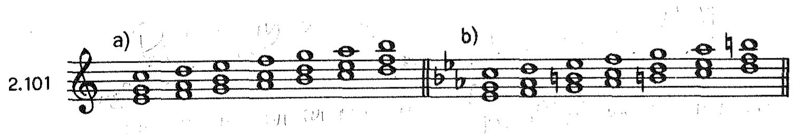

*Primjer 2.101. Izvor: tiskana stranica 48.*

> **PROVISIONAL — needs handwriting cleanup / potrebno uklanjanje rukopisnih dodataka.** Nije odobreno; prikaz samo za pregled.

MuseScore prijepis: *bit će dodan.*

### 2.2.1. Postavljanje konsonantnih sekstakorda

U konsonantnim sekstakordima, tj. u dur-sekstakordu i mol-sekstakordu redovito se udvaja seksta (temeljni ton) ili terca (kvinta kvintakorda iz koga je sekstakord izveden) (pr. 2.102).

<!-- integrated-visual: primjer-2-102; page 048 -->
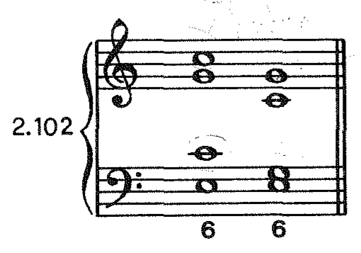

*Primjer 2.102. Izvor: tiskana stranica 48.*

> **PROVISIONAL — needs handwriting cleanup / potrebno uklanjanje rukopisnih dodataka.** Nije odobreno; prikaz samo za pregled.

MuseScore prijepis: *bit će dodan.*

<!-- source-page: 049; pdf-page: 25 -->

Basov ton dur-sekstakorda i mol-sekstakorda karakterističan je ton akorda — jednako kao i terca kod kvintakorda — koji se još više ističe, jer je to sada basov ton. Zbog toga se udvajanje basova tona dur-sekstakorda i mol-sekstakorda tolerira samo kada ne prouzrokuje zvukovnu prezasićenost, zvukovnu oštrinu, a to je: a) kada iza kvintakorda slijedi sekstakord istoga stupnja, a pri tome terca kvintakorda leži, jer tada udvajanje ne nastupa istodobno (pr. 2.103), b) kada se basov ton i njegovo udvajanje uvodi i napušta postepenim pomakom, jer je tada ono opravdano vođenjem glasova — — dvjema linijama u protupomaku i bez skokova (pr. 2.104), c) kada je basov ton sekstakorda neki glavni stupanj (dakle u sekstakordima II, III i VI stupnja), pa je tada to udvajanje zapravo udvajanje temeljnoga tona glavne harmonije koju dotični sekstakord zamjenjuje.

<!-- integrated-visual: primjer-2-103; page 049 -->
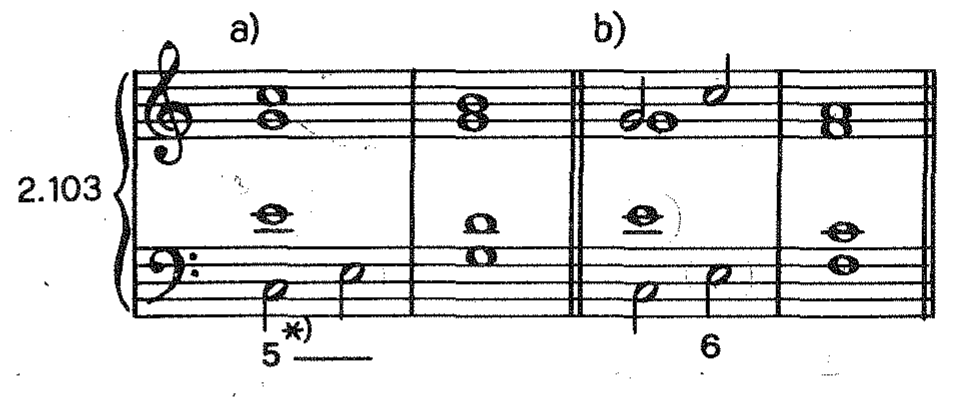

*Primjer 2.103. Izvor: tiskana stranica 49. Zvjezdasta bilješka prenesena je niže.*

> **PROVISIONAL — needs handwriting cleanup / potrebno uklanjanje rukopisnih dodataka.** Nije odobreno; prikaz samo za pregled.

MuseScore prijepis: *bit će dodan.*

<!-- integrated-visual: primjer-2-104; page 049 -->
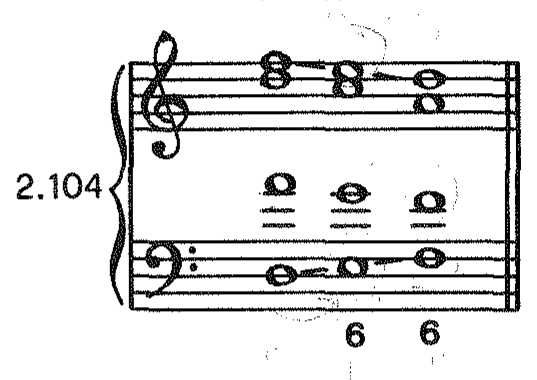

*Primjer 2.104. Izvor: tiskana stranica 49.*

> **PROVISIONAL — needs handwriting cleanup / potrebno uklanjanje rukopisnih dodataka.** Nije odobreno; prikaz samo za pregled.

MuseScore prijepis: *bit će dodan.*

> **Bilješka uz primjer 2.103 (tiskana stranica 49):**
>
> \* Šifraža »5 ———« označuje situaciju u kojoj tonovi kvintakorda (bez obzira na položaj) u gornjim glasovima leže dok se bas kreće.

Međutim, kada je riječ o toničkoj harmoniji — o centralnoj među glavnima — ipak je često uvjerljivije da je predstavimo toničkim kvintakordom s udvojenim temeljnim tonom nego sekstakordom VI stupnja s udvojenim basovim tonom.

Ako je basov ton sekstakorda vođica, onda se izuzima od udvajanja, dakle uvijek u sekstakordu V stupnja u duru i molu i redovito u sekstakordu IV stupnja u molu gdje je on silazna vođica.

### 2.2.2. Sekstakord VII stupnja; postavljanje i rješenja

Sekstakord VII stupnja (u duru i molu) je disonantan akord, jer njegova terca i seksta čine između sebe disonantan interval povećane kvarte (tritonus), odnosno njegov obrat, interval smanjene kvinte (pr. 2.105.). Njegov basov ton zapravo je kvinta nekompletnoga dominantnog septakorda (v. odsjek 2. 1. 3) i prema tome nije karakterističan ton akorda, pa se stoga

<!-- integrated-visual: primjer-2-105; page 049 -->
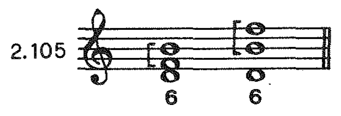

*Primjer 2.105. Izvor: tiskana stranica 49.*

MuseScore prijepis: *bit će dodan.*

<!-- continuation: prose continues on page 050 -->
<!-- source-page: 050; pdf-page: 26 -->

može udvojiti (premda se i to katkada izbjegava — po analogiji na dur-sekstakorde i mol-sekstakorde). Naprotiv, seksta je vođica, i zato se ona ne udvaja. Terca, iako čini sa sekstom disonantan interval, može se također udvojiti, ali ne tako da se obje terce nađu iznad sekste jer to rezultira dvjema smanjenim kvintama, a to ne zvuči dobro i onemogućuje korektno rješenje akorda (pr. 2.106). U svakom pojedinom slučaju posebnu pažnju treba obratiti vođenju onih glasova koji će tvoriti između sebe interval povećane kvarte ili smanjene kvinte, dakle onih u kojima će se pojaviti terca i seksta sekstakorda. Seksta teži za polustepenim pomakom naviše, a terca, koju treba shvatiti kao septimu dominantnog septakorda, za postepenim pomakom naniže, tako da će povećana kvarta težiti za rješenjem u sekstu, a smanjena kvinta za rješenjem u tercu (pr. 2.107). Ali toj težnji dovoljno je i djelomično udovoljiti, pa onda može samo jedan od kritičnih tonova slijediti svoj prirodni pomak, dok se drugi može s njime kretati paralelno postepeno ili za interval terce, a iznimno kvarte, ili može ležati (v. razna rješenja u pr. 2.108). Sekstakord VII stupnja, kao akord dominantne funkcije, prvenstveno tendira ka toničkom kvintakordu ili sekstakordu (pr. 2.108.a i b), što, međutim, ne isključuje i rješenja u druge harmonije (pr. 2.108.c i d).

<!-- integrated-visual: primjer-2-106; page 050 -->
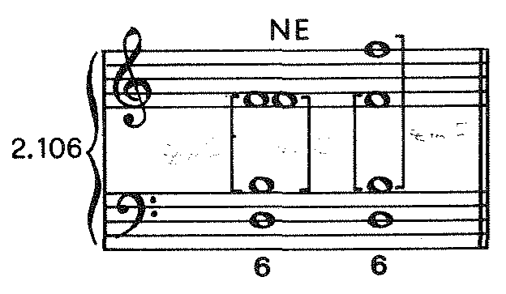

*Primjer 2.106. Izvor: tiskana stranica 50.*

> **PROVISIONAL — needs handwriting cleanup / potrebno uklanjanje rukopisnih dodataka.** Nije odobreno; prikaz samo za pregled.

MuseScore prijepis: *bit će dodan.*

<!-- integrated-visual: primjer-2-107; page 050 -->
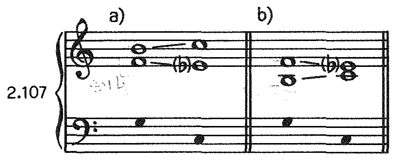

*Primjer 2.107. Izvor: tiskana stranica 50.*

> **PROVISIONAL — needs handwriting cleanup / potrebno uklanjanje rukopisnih dodataka.** Nije odobreno; prikaz samo za pregled.

MuseScore prijepis: *bit će dodan.*

<!-- integrated-visual: primjer-2-108; page 050 -->
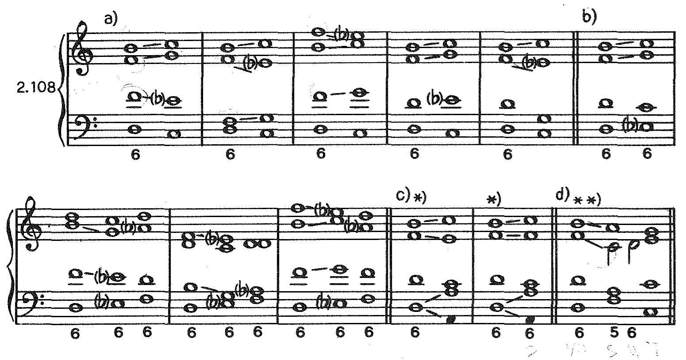

*Primjer 2.108. Izvor: tiskana stranica 50. Zvjezdaste bilješke prenesene su niže.*

> **PROVISIONAL — needs handwriting cleanup / potrebno uklanjanje rukopisnih dodataka.** Nije odobreno; prikaz samo za pregled.

MuseScore prijepis: *bit će dodan.*

> **Bilješke uz primjer 2.108 (tiskana stranica 50):**
>
> \* Ti spojevi dolaze u obzir samo u duru; u molu bi bas činio skok za smanjenu kvintu, odnosno za povećanu kvartu, koji ne bi davao dojam rješenja.
>
> \*\* Također samo u duru; u molu bi sopran činio pomak za povećanu sekundu, a tenor za povećanu kvartu; preskok u altu (sa »f« na »c«) opravdan je naknadnim vraćanjem na »d«.

<!-- source-page: 051; pdf-page: 26 -->

Kada se kritični tonovi kreću paralelno i postepeno, seksta mora biti iznad terce, u intervalu kvarte, pa se postepeni paralelni pomak onda odvija u kvartama; u obratnom slučaju ispale bi pogrešne paralelne kvinte — iz smanjene u čistu. Jedino kada sekstakord VII stupnja ima ulogu prohodnog akorda između dvije harmonije I stupnja, pri čemu se svi glasovi kreću postepeno, te paralelne kvinte neće smetati. Njih će opravdavati linije vanjskih glasova: kretanje u paralelnim decimama (pr. 2.109.a) ili u protupomaku (pr. 2.109.b).

<!-- integrated-visual: primjer-2-109; page 051 -->
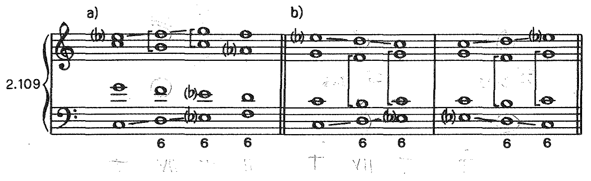

*Primjer 2.109. Izvor: tiskana stranica 51.*

> **PROVISIONAL — needs handwriting cleanup / potrebno uklanjanje rukopisnih dodataka.** Nije odobreno; prikaz samo za pregled.

MuseScore prijepis: *bit će dodan.*

### 2.2.3. Sekstakord II stupnja u molu; postavljanje i rješenja

Sekstakord II stupnja u molu također je disonantan jer i u njemu terca čini sa sekstom povećanu kvartu ili smanjenu kvintu (pr. 2.110). Funkcija mu je — kao i sekstakordu II stupnja u duru — subdominantna, a njegova

<!-- integrated-visual: primjer-2-110; page 051 -->
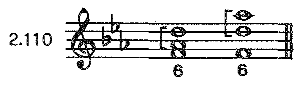

*Primjer 2.110. Izvor: tiskana stranica 51.*

MuseScore prijepis: *bit će dodan.*

terca, kao silazna vođica, teži za silaznim polustepenim pomakom u dominantu. Zbog toga i sekstakord kao cjelina teži prvenstveno za rješenjem u dominantni kvintakord, ali se dobro spaja i s drugim harmonijama, pri čemu se kritični tonovi tretiraju analogno kao i kritični tonovi u sekstakordu VII stupnja (pr. 2.111).

<!-- integrated-visual: primjer-2-111; page 051 -->
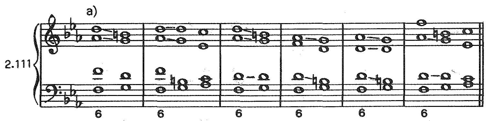

*Primjer 2.111 a. Izvor: tiskana stranica 51. Nastavak b–d slijedi na tiskanoj stranici 52.*

MuseScore prijepis: *bit će dodan.*

<!-- source-page: 052; pdf-page: 27 -->

<!-- integrated-visual: primjer-2-111-nastavak; page 052 -->
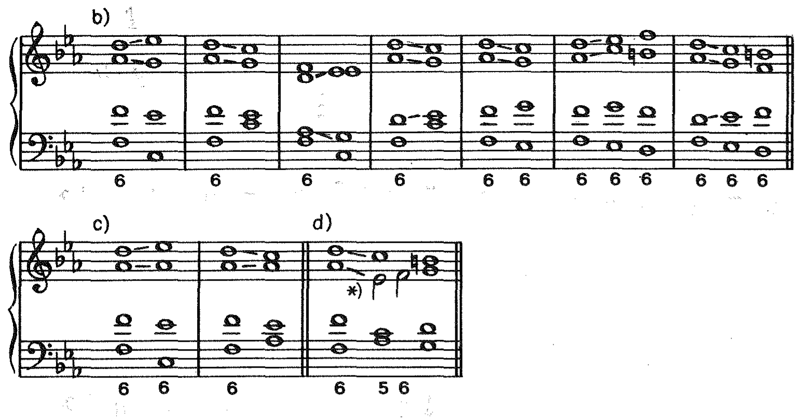

*Primjer 2.111 b–d (nastavak). Izvor: tiskana stranica 52. Zvjezdasta bilješka prenesena je niže.*

> **PROVISIONAL — needs handwriting cleanup / potrebno uklanjanje rukopisnih dodataka.** Nije odobreno; prikaz samo za pregled.

MuseScore prijepis: *bit će dodan.*

> **Bilješka uz primjer 2.111 (tiskana stranica 52):**
>
> \* Preskok u altu (sa »as« na »es«) opravdan je naknadnim vraćanjem na »f«.

### 2.2.4. Sekstakord III stupnja u molu; postavljanje i rješenja

I sekstakord III stupnja u molu, koji je izveden iz povećanog kvintakorda, sadrži disonantni interval: smanjenu kvartu, odnosno povećanu kvintu (pr. 2.112). Njegova terca je vođica i prema tome se ne udvaja ona, nego

<!-- integrated-visual: primjer-2-112; page 052 -->
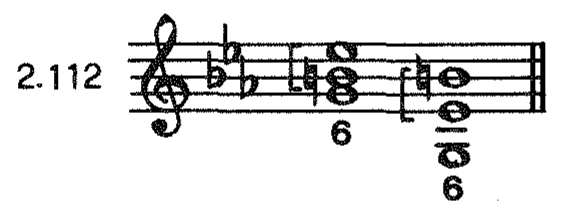

*Primjer 2.112. Izvor: tiskana stranica 52.*

MuseScore prijepis: *bit će dodan.*

basov ton (koji je glavni stupanj, tj. dominanta) ili seksta. Taj sekstakord ima dominantnu funkciju, pa se najprije rješava u harmonije I i VI stupnja, ali se također dobro spaja i sa sekstakordom IV stupnja. U svim rješenjima vođica zadržava uzlazno polustepeno kretanje (v. odsjek 2. 1. 9) (pr. 2.113).

<!-- integrated-visual: primjer-2-113; page 052 -->
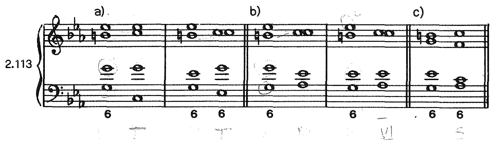

*Primjer 2.113. Izvor: tiskana stranica 52.*

> **PROVISIONAL — needs handwriting cleanup / potrebno uklanjanje rukopisnih dodataka.** Nije odobreno; prikaz samo za pregled.

MuseScore prijepis: *bit će dodan.*

<!-- source-page: 053; pdf-page: 27 -->

### 2.2.5. Sekstakord II stupnja u kadenci

Značajno mjesto u klasičnom harmonijskom sistemu ima sekstakord II stupnja (II₆) zbog svoje uloge u najčešćoj od svih kadenca — u mješovitoj — gdje se, kao zamjenik subdominantnog kvintakorda, pojavljuje ispred dominantnog kvintakorda ili septakorda (pr. 2.114.a). Kad usporedimo tu kadencu s kadencom IV—V—I (pr. 2.114.b), vidimo da u prvom slučaju imamo bolju liniju soprana, a osim toga, sada su prva dva akorda srodna (jer imaju jedan zajednički ton) i zato je njihov međusobni spoj čvršći od spoja IV—V.

<!-- integrated-visual: primjer-2-114; page 053 -->
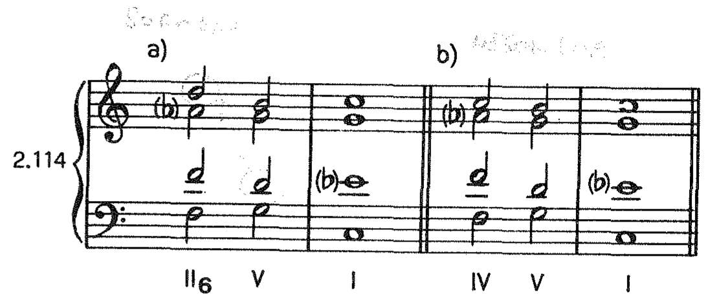

*Primjer 2.114. Izvor: tiskana stranica 53.*

> **PROVISIONAL — needs handwriting cleanup / potrebno uklanjanje rukopisnih dodataka.** Nije odobreno; prikaz samo za pregled.

MuseScore prijepis: *bit će dodan.*

Ako sekstakord II stupnja uvedemo u progresiju I—IV—V—I (v. pr. 2.24), koja se od mješovite kadence razlikuje samo po tome što ima tonički kvintakord i na početku, onda ćemo u spoju I—II₆ imati paralelno kretanje u svim glasovima (pr. 2.115.a). Ono se može izbjeći udvajanjem sekste u tenoru u sekstakordu II stupnja ili tako da bas na početku pođe u protupomaku spram gornjih glasova, ali sve to nije potrebno, jer ovdje seksta zapravo samo zamjenjuje kvintu, a da se pritom u odnosu dviju harmonija (I—II₆) ništa ne mijenja. Supstitucija kvinte sekstom nije moguća u svim varijantama progresije jer bi npr. u varijanti b) primjera 2.24. tada došlo do paralelnih kvinta (pr. 2.115.b), a isto bi se dogodilo i u varijantama e) i f) premda bi paralelne kvinte bile pogrešne samo u duru, a u molu ne (s čiste na smanjenu).

<!-- integrated-visual: primjer-2-115; page 053 -->
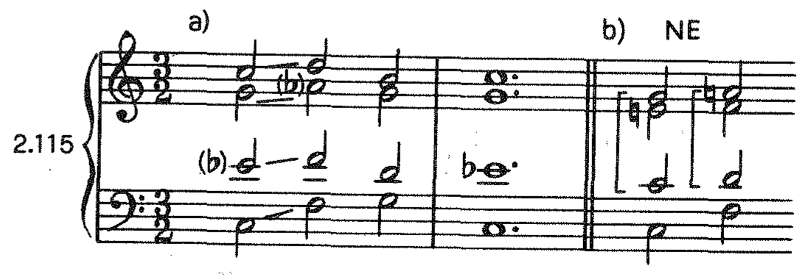

*Primjer 2.115. Izvor: tiskana stranica 53.*

MuseScore prijepis: *bit će dodan.*

ZADACI: Izradba progresije I—II₆—V—I u raznim tonalitetima u svim mogućim varijantama.

<!-- source-page: 054; pdf-page: 28 -->

### 2.2.6. Spajanje sekstakorda i kvintakorda; spajanje sekstakorda međusobno

Pri spajanju sekstakorda s kvintakordima i obratno, kao i pri spajanju sekstakorda međusobno, primjenjuju se isti principi kao i pri spajanju kvintakorda tj. princip zadržavanja zajedničkog tona u istom glasu (što bi odgovaralo principu strogoga spoja kvintakorda) i princip obaveznog protupomaka barem u jednom glasu kada nema zajedničkih tonova ili kada se oni u istom glasu ne zadržavaju (što bi odgovaralo principu slobodnoga spoja kvintakorda). Iako se, dakle, radi i tu i tamo o istim principima, spojevi u kojima se pojavljuju sekstakordi donose neke nove mogućnosti vođenja glasova koje pri spajanju kvintakorda nisu mogle doći u obzir.

U spoju kvintno-srodnih kvintakorda bas se kreće samo u skokovima: za kvintu, odnosno kvartu, prema gore ili prema dolje. To će se doduše događati i kada obje takve harmonije nastupe u obliku sekstakorda (pr. 2.116), ali čim se jedna od njih pojavi kao sekstakord, a druga kao kvintakord, bas se kreće postepeno ili čini manji skok, tj. za tercu (pr. 2.117). Nadalje, kod spoja kvintakorda, bez obzira jesu li srodni ili nesrodni, nijedan od gornjih

<!-- integrated-visual: primjer-2-116; page 054 -->
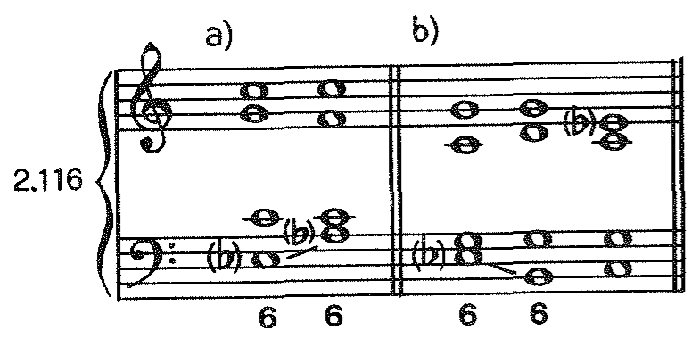

*Primjer 2.116. Izvor: tiskana stranica 54.*

MuseScore prijepis: *bit će dodan.*

<!-- integrated-visual: primjer-2-117; page 054 -->
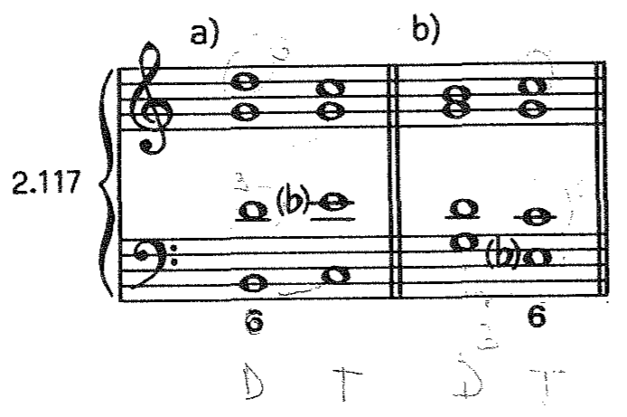

*Primjer 2.117. Izvor: tiskana stranica 54.*

> **PROVISIONAL — needs handwriting cleanup / potrebno uklanjanje rukopisnih dodataka.** Nije odobreno; prikaz samo za pregled.

MuseScore prijepis: *bit će dodan.*

glasova nije mogao izvoditi pomak s prime na primu ili s kvinte na kvintu jer bi tada nastale paralelne oktave ili kvinte s basom, odnosno oktave ili kvinte u protupomaku koje su dopuštene samo u malom broju posebno uvjetovanih slučajeva (v. odsjek 2. 1. 5). Ali čim barem jedna od dviju harmonija nastupi u obliku sekstakorda, takvi su pomaci u gornjim glasovima izvedivi, a to donosi i nove mogućnosti vođenja sopranske dionice (pr. 2.118). I, konačno, sekstakord, postavljen u mješovitom slogu, vrlo dobro služi za izvedbu glatkog prijelaza iz sloga u slog (pr. 2.119).

<!-- integrated-visual: primjer-2-118; page 054 -->
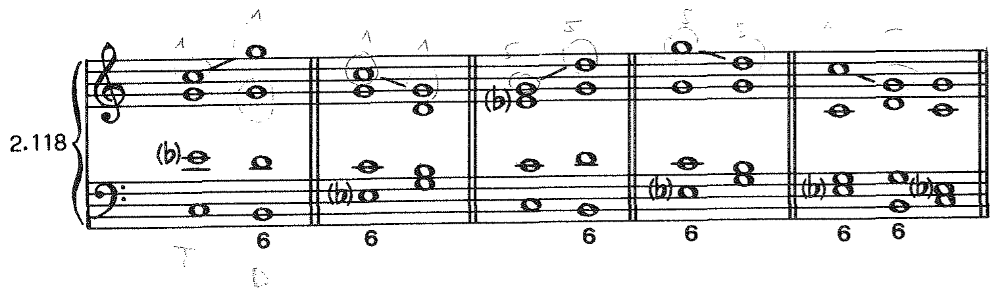

*Primjer 2.118 (početak). Izvor: tiskana stranica 54. Nastavak slijedi na tiskanoj stranici 55.*

> **PROVISIONAL — needs handwriting cleanup / potrebno uklanjanje rukopisnih dodataka.** Nije odobreno; prikaz samo za pregled.

MuseScore prijepis: *bit će dodan.*

<!-- source-page: 055; pdf-page: 28 -->

<!-- integrated-visual: primjer-2-118-nastavak; page 055 -->
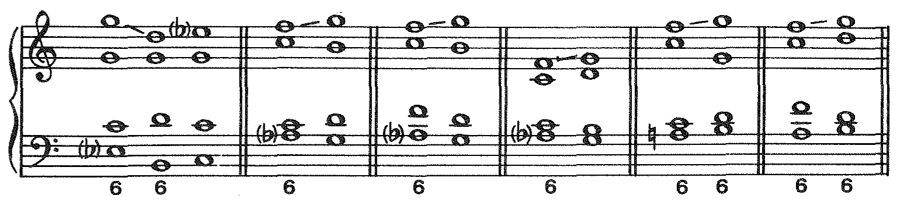

*Primjer 2.118 (nastavak). Izvor: tiskana stranica 55.*

MuseScore prijepis: *bit će dodan.*

<!-- integrated-visual: primjer-2-119; page 055 -->
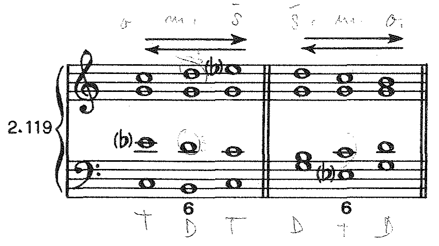

*Primjer 2.119. Izvor: tiskana stranica 55.*

> **PROVISIONAL — needs handwriting cleanup / potrebno uklanjanje rukopisnih dodataka.** Nije odobreno; prikaz samo za pregled.

MuseScore prijepis: *bit će dodan.*

Kvintakord i sekstakord mogu se izmijeniti i na zajedničkom basovu tonu. U slijedu sekstakord-kvintakord seksta se redovito doima kao zaostajalica (ako je pripravljena, kao u pr. 2.120.a) ili kao appoggiatura (kada nije pripravljena, kao u pr. 2.120.b), ali to mogu biti i dva samostalna akorda (kada seksta ne ide u istom glasu na kvintu, kao u pr. 2.120.c). No u sva tri slučaja šifraža će biti ista, tj. »6—5«. U slijedu kvintakord-sekstakord

<!-- integrated-visual: primjer-2-120; page 055 -->
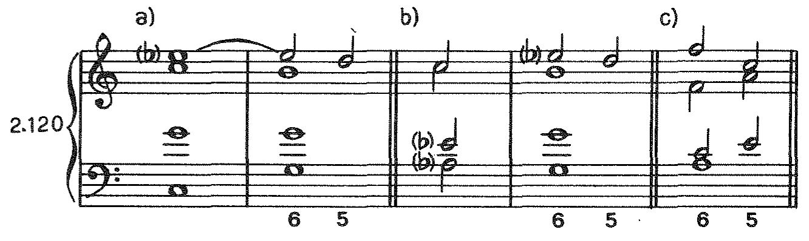

*Primjer 2.120. Izvor: tiskana stranica 55.*

MuseScore prijepis: *bit će dodan.*

seksta je redovito prohod s kvinte na neki novi akordički ton (pr. 2.121.a), no ona može biti i slobodna u svom kretanju (pr. 2.121.b), a mogu to biti i opet dva samostalna akorda u slučaju kada seksta ne dolazi u istom glasu poslije kvinte (pr. 2.121.c). A šifraža je ponovno za sve slučajeve jednaka: »5—6«. Kada se seksta vraća na kvintu (5—6—5), dobiva ulogu izmjeničnog tona (pr. 2.121.d).

<!-- integrated-visual: primjer-2-121; page 055 -->
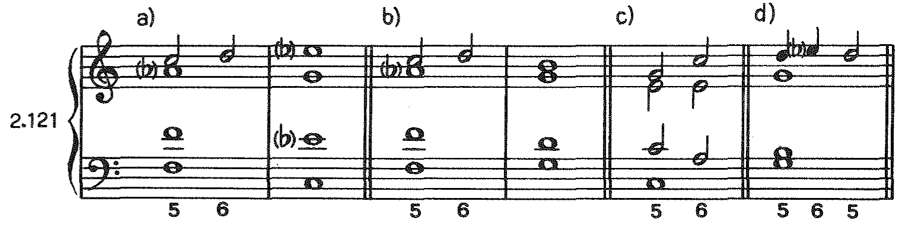

*Primjer 2.121. Izvor: tiskana stranica 55.*

MuseScore prijepis: *bit će dodan.*

<!-- source-page: 056; pdf-page: 29 -->

Niz od više nesrodnih sekstakorda, odnosno slijed sekstakorda koji se kreću »po sekundama«, zahtijeva obzirno vođenje glasova tako da ni na jednom mjestu ne dođe do paralelnog kretanja u svim glasovima. To, konkretno, znači da kod niza gdje bas uzlazi treba na početku gornje glasove postaviti dovoljno visoko (ali u granicama opsega), kako bi do kraja niza bilo »manevarskog prostora« da uvijek barem jedan glas može silaziti (pr. 2.122.a). U obratnom slučaju gornji glasovi moraju biti na početku dovoljno duboko da bi do kraja niza mogao uvijek barem jedan glas uzlaziti, a da se pritom ponovno ne prijeđe granica opsega (gornjih) glasova (pr. 2.122.b).

<!-- integrated-visual: primjer-2-122; page 056 -->
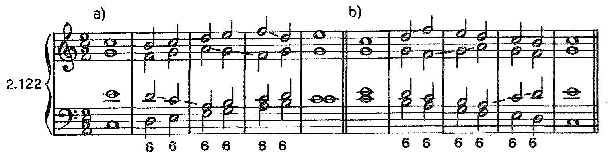

*Primjer 2.122. Izvor: tiskana stranica 56.*

MuseScore prijepis: *bit će dodan.*

Uzastopna pojava unisona u dva susjedna akorda, koja se naročito lako može dogoditi u spoju nesrodnih sekstakorda (pr. 2.123), uvijek se izbjegava jer se tada stvara dojam troglasnoga stavka.

<!-- integrated-visual: primjer-2-123; page 056 -->
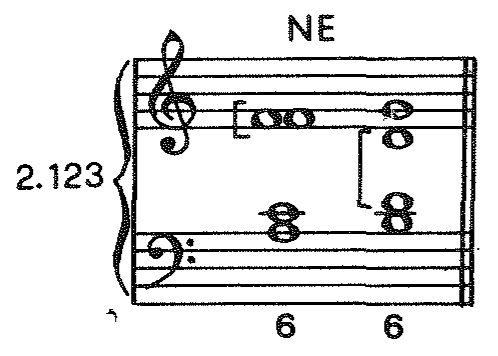

*Primjer 2.123. Izvor: tiskana stranica 56.*

MuseScore prijepis: *bit će dodan.*

### 2.2.7. Primjena sekstakorda u harmonizaciji

U stavku, rađenom isključivo kvintakordima, basova je dionica ograničena u kretanju. Bas se može kretati postepeno samo kod slijeda nesrodnih kvintakorda — a takve su progresije redovito kratkoga daha — dok inače mora činiti skokove: kod slijeda kvintno-srodnih kvintakorda skokove za kvintu ili kvartu, a kod slijeda tercno-srodnih kvintakorda za tercu ili eventualno za sekstu. Zbog toga je na »kvintakordskom nivou« harmonizacije vrlo teško dobiti basovu dionicu koja bi osigurala dobru harmonijsku progresiju i u isti mah zadovoljila zahtjeve dobre linije, nego se često jedno od toga žrtvuje u korist drugoga, kao u pr. 2.124.a, gdje imamo dobar izbor harmonija,

<!-- continuation: prose continues on page 057 -->
<!-- source-page: 057; pdf-page: 29 -->

a nikakvu liniju basa, ili u pr. 2.124.b, gdje je dobivena bolja linija basove dionice, ali uz cijenu slabije harmonijske progresije. Uključivanjem sekstakorda »u igru«, situacija se bitno mijenja, jer oni omogućuju i dobar izbor harmonija i logičnu liniju basa (pr. 2.124.c).

<!-- integrated-visual: primjer-2-124; page 057 -->
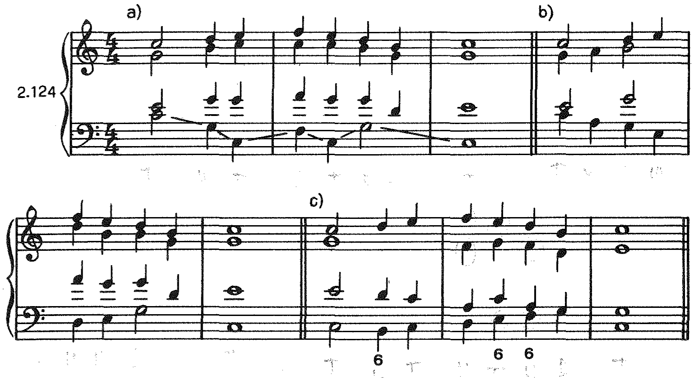

*Primjer 2.124. Izvor: tiskana stranica 57.*

> **PROVISIONAL — needs handwriting cleanup / potrebno uklanjanje rukopisnih dodataka.** Nije odobreno; prikaz samo za pregled.

MuseScore prijepis: *bit će dodan.*

Ima i takvih melodijskih progresija koje se samo kvintakordima ne daju uopće realizirati, npr. tipični uzlazni završni pomak po tonovima gornjeg tetrakorda ljestvice kada se on nalazi u basu (pr. 2.125.a i b). A i kada se taj pomak nalazi u sopranu, najuvjerljivije opet djeluje harmonizacija u kojoj sekstakord (VII stupnja) nastupa kao predzadnji akord (2.125.c i d).

<!-- integrated-visual: primjer-2-125; page 057 -->
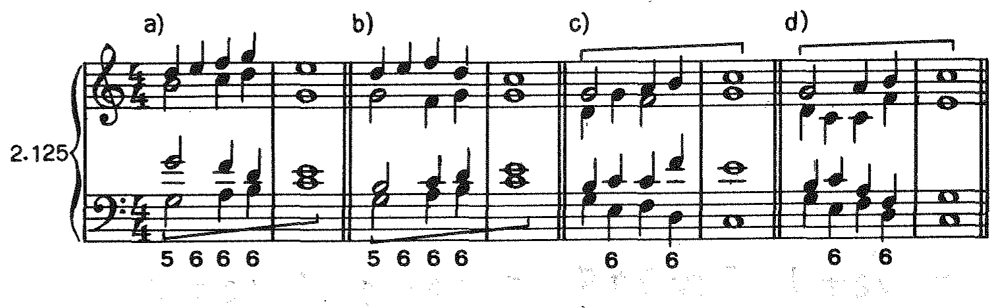

*Primjer 2.125. Izvor: tiskana stranica 57.*

> **PROVISIONAL — needs handwriting cleanup / potrebno uklanjanje rukopisnih dodataka.** Nije odobreno; prikaz samo za pregled.

MuseScore prijepis: *bit će dodan.*

Terca konsonantnog kvintakorda je dinamičan element — nasuprot statičnome temeljnom tonu i kvinti — a kada ona postane basovim tonom sekstakorda istoga stupnja, njena se dinamičnost prenosi na sekstakord u cjelini. Tako i slijed kvintakord-sekstakord (kada se radi o istome stupnju i o konsonantnim kvintakordima) znači povišenje, a slijed sekstakord-kvintakord opadanje intenziteta harmonijskoga zbivanja. Stoga je npr. moguće slijedom kvintakord-sekstakord, pogotovo ako je on kombiniran s pomakom soprana, potpuno anulirati slab učinak sinkopirane harmonije (v. odsjek 2. 1. 8) (pr. 2.126).

<!-- source-page: 058; pdf-page: 30 -->

<!-- integrated-visual: primjer-2-126; page 058 -->
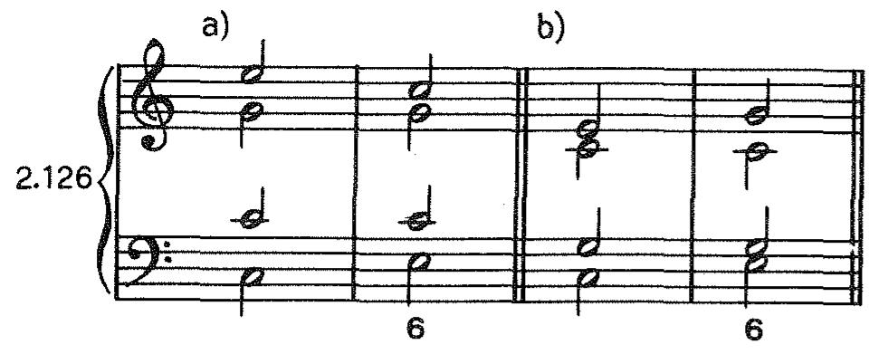

*Primjer 2.126. Izvor: tiskana stranica 58.*

MuseScore prijepis: *bit će dodan.*

Ovo je bilo nekoliko tipičnih primjera primjene sekstakorda u harmonizaciji zadanoga glasa koji treba da budu samo podstrekom za otkrivanje i pronalaženje mnogih drugih mogućnosti iskorištavanja toga vrlo osjetljivog i vrlo fleksibilnog akorda.

### 2.2.8. Smanjeni kvintakordi u vezi sa sekstakordima; smanjeni kvintakordi kao samostalni akordi

Smanjeni kvintakord nalazi se na VII stupnju u duru i molu i na II stupnju u molu (v. odsjek 2. 1. 1). Za razliku od sekstakorda istih stupnjeva, smanjeni kvintakord zvuči slabo, i to zato što disonantni interval smanjene kvinte (koji se kod sekstakorda pojavljuje samo među gornjim glasovima) kod njega nastupa uvijek između jednog od gornjih glasova i basa, pa je stoga smanjena kvinta ovdje suviše eksponirana. Zato treba svaki nastup smanjenog kvintakorda tako pripraviti da se neugodan dojam smanjene kvinte izgubi, što se postiže na dva načina: a) smanjeni kvintakord VII stupnja nastupa u progresiji 6—5 kao rezultat pomake sekste na kvintu; u sektakordu V stupnja, koji će prethoditi smanjenom kvintakordu, udvaja se u tom slučaju terca (pr. 2.127); (kvintakord II stupnja u harmonijskom molu ne može se na takav način uvesti zbog intervala povećane sekunde koji bi se pojavio u pomaku sekste na kvintu); b) smanjeni kvintakord može nastupiti i kao samostalan akord, ali mu tada treba u prethodnom akordu i u istom glasu pripraviti kvintu i opet udvojiti tercu (pr. 2.128). Na taj način može se upotrebljavati i kvintakord II stupnja u molu, a taj ima i više mogućnosti rješenja od kvintakorda VII stupnja jer mu temeljni ton nije vođica (pr. 2.129).

<!-- integrated-visual: primjer-2-127; page 058 -->
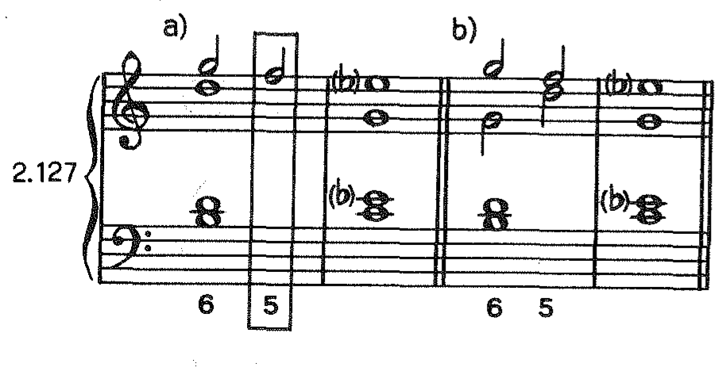

*Primjer 2.127. Izvor: tiskana stranica 58.*

MuseScore prijepis: *bit će dodan.*

<!-- integrated-visual: primjer-2-128; page 058 -->
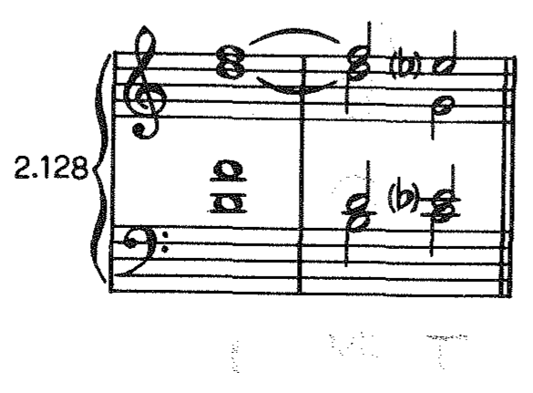

*Primjer 2.128. Izvor: tiskana stranica 58.*

> **PROVISIONAL — needs handwriting cleanup / potrebno uklanjanje rukopisnih dodataka.** Nije odobreno; prikaz samo za pregled.

MuseScore prijepis: *bit će dodan.*

<!-- source-page: 059; pdf-page: 30 -->

<!-- integrated-visual: primjer-2-129; page 059 -->
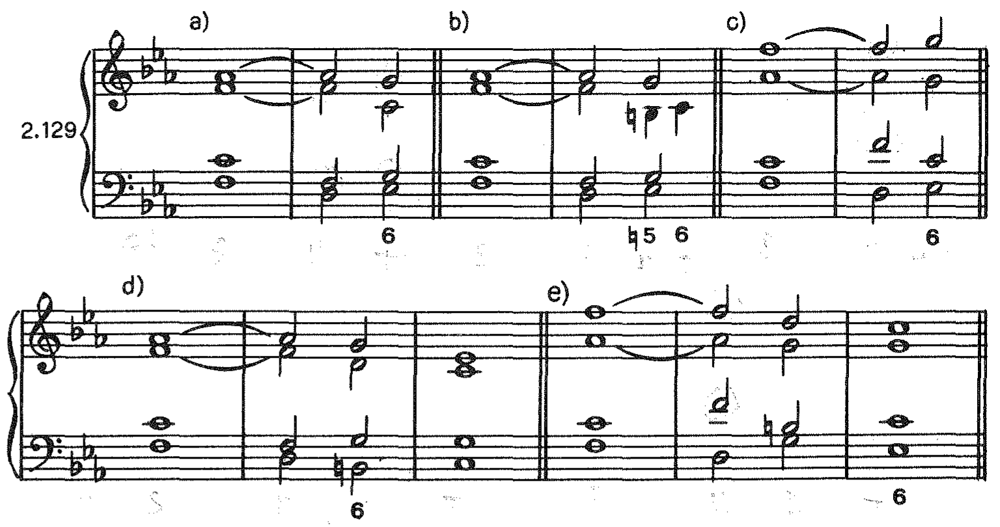

*Primjer 2.129. Izvor: tiskana stranica 59.*

> **PROVISIONAL — needs handwriting cleanup / potrebno uklanjanje rukopisnih dodataka.** Nije odobreno; prikaz samo za pregled.

MuseScore prijepis: *bit će dodan.*

Interval smanjene kvinte, kada ona nastupa s primom u basu (a to znači u smanjenom kvintakordu), ne udvaja se zbog lošeg zvuka nikada, a pridržavanjem gornjih uputa to će se automatski izbjeći.

### 2.2.9. Obilježavanje basa

Zadani bas može biti dvojak: a) **obilježeni ili šifrirani bas**, gdje se osim nota basove dionice daju i akordi koje treba upotrijebiti, a oni se označuju brojkama i b) **neobilježeni bas**, gdje se daju samo note basove dionice, a izbor harmonija prepušta se izvođiocu zadatka.

Dok se basovi izrađuju samo kvintakordima, razlika između obilježenog i neobilježenog basa ne postoji, jer svaki ton zadanoga basa predstavlja i temeljni ton nekog kvintakorda, jedino što se kod primjera u molu predznakom označuje povišenje terce kvintakorda V stupnja, a brojkom 5 s odgovarajućim predznakom povećani kvintakord na III stupnju. Ali čim se uz kvintakorde pojavljuju i sekstakordi, treba u obilježeni bas uvesti i odgovarajuće brojčane oznake:

**Kvintakord** se označuje samo u specijalnim slučajevima (progresijama), kao što su 6—5 (pomak sekstakord-kvintakord, odnosno pomak sekste na kvintu iznad istoga basova tona), zatim 5—6 (pomak kvintakord-sekstakord, odnosno pomak kvinte na sekstu iznad istoga basova tona), te 5 — (slučaj kada iza kvintakorda slijedi bilo koji obrat harmonije istoga stupnja kao rezultat kretanja basa s temeljnoga tona na neki drugi akordički ton iste harmonije) (pr. 2.130); inače se kvintakord u pravilu ne označuje.

**Predznak**, kada stoji u šifraži sam za sebe, odnosi se na tercu, računajući od basova tona pod kojim se nalazi. Budući da odsustvo svake brojke pretpostavlja kvintakord, onda sam predznak znači da se na odnosnom mjestu podrazumijeva kvintakord s tercom, promijenjenom u smislu navedenog predznaka (pr. 2.131.a), ali kromatska promjena svakog drugog intervala zahtijeva predznak i iza njega brojku (pr. 2.131.b).

<!-- source-page: 060; pdf-page: 31 -->

**Sekstakord** se označuje brojkom 6. Ako se želi označiti sekstakord s kromatski promijenjenom tercom, onda se ispod brojke 6 stavlja odgovarajući predznak. Sekstakord s kromatski promijenjenom sekstom označuje se tako da se odgovarajući predznak stavi ispred brojke 6, a sekstakord koji bi imao kromatski promijenjenu i tercu i sekstu dobio bi obje oznake, postavljene jednu iznad druge — gore za sekstu, a dolje za tercu. (Princip ranga intervala, od najvećeg-najgornjeg, pa redom do najmanjeg-najdonjeg, provodi se u šifraži svih akorda.) (pr. 2.132)

**Položaj akorda** ne propisuje se niti označuje; ako se ipak na nekom mjestu želi sugerirati određeni položaj, to se čini odgovarajućom brojkom u zagradama (pr. 2.133).

<!-- integrated-visual: primjer-2-130; page 060 -->
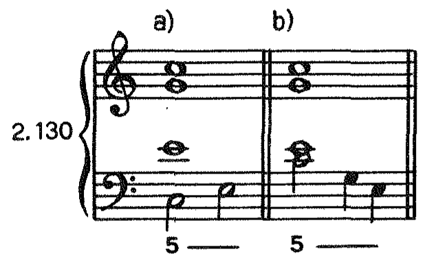

*Primjer 2.130. Izvor: tiskana stranica 60.*

MuseScore prijepis: *bit će dodan.*

<!-- integrated-visual: primjer-2-131; page 060 -->
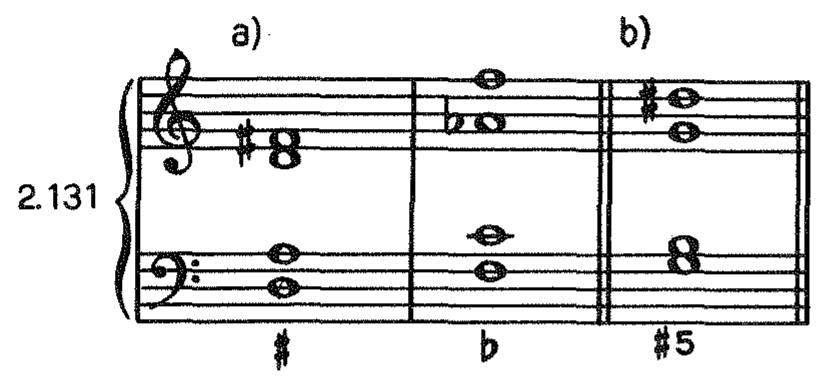

*Primjer 2.131. Izvor: tiskana stranica 60.*

MuseScore prijepis: *bit će dodan.*

<!-- integrated-visual: primjer-2-132; page 060 -->
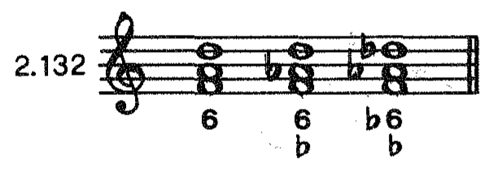

*Primjer 2.132. Izvor: tiskana stranica 60.*

MuseScore prijepis: *bit će dodan.*

<!-- integrated-visual: primjer-2-133; page 060 -->
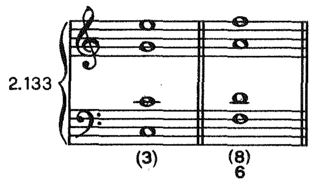

*Primjer 2.133. Izvor: tiskana stranica 60.*

MuseScore prijepis: *bit će dodan.*

NAPOMENA: U svim zadacima koji slijede zadani basovi bez šifraže mišljeni su kao neobilježeni, što znači da je izbor harmonija u njima slobodan, a ne kao basovi koji se harmoniziraju samo kvintakordima.

#### Zadaci

<!-- integrated-visual: zadatak-2-60-1; page 060 -->
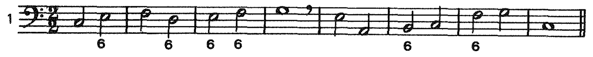

*Zadatak 1. Izvor: tiskana stranica 60.*

MuseScore prijepis: *bit će dodan.*

<!-- integrated-visual: zadatak-2-60-2; page 060 -->
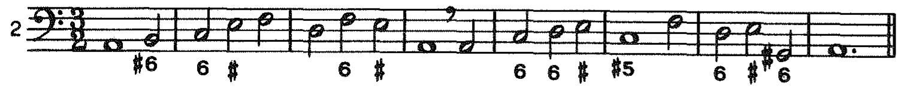

*Zadatak 2. Izvor: tiskana stranica 60.*

MuseScore prijepis: *bit će dodan.*

<!-- integrated-visual: zadatak-2-60-3; page 060 -->
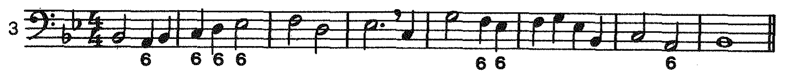

*Zadatak 3. Izvor: tiskana stranica 60.*

MuseScore prijepis: *bit će dodan.*

<!-- source-page: 061; pdf-page: 31 -->

<!-- integrated-visual: zadatak-2-61-4; page 061 -->
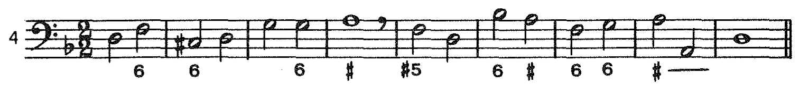

*Zadatak 4. Izvor: tiskana stranica 61.*

MuseScore prijepis: *bit će dodan.*

<!-- integrated-visual: zadatak-2-61-5; page 061 -->
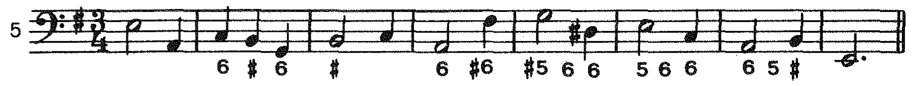

*Zadatak 5. Izvor: tiskana stranica 61.*

MuseScore prijepis: *bit će dodan.*

<!-- integrated-visual: zadatak-2-61-6; page 061 -->
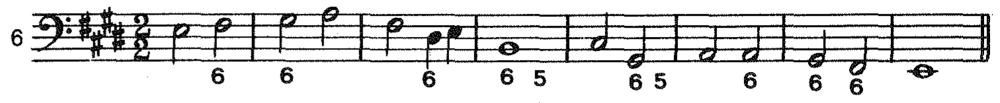

*Zadatak 6. Izvor: tiskana stranica 61.*

MuseScore prijepis: *bit će dodan.*

<!-- integrated-visual: zadatak-2-61-7; page 061 -->

*Zadatak 7. Izvor: tiskana stranica 61.*

MuseScore prijepis: *bit će dodan.*

<!-- integrated-visual: zadatak-2-61-8; page 061 -->

*Zadatak 8. Izvor: tiskana stranica 61.*

MuseScore prijepis: *bit će dodan.*

<!-- integrated-visual: zadatak-2-61-9; page 061 -->

*Zadatak 9. Izvor: tiskana stranica 61.*

MuseScore prijepis: *bit će dodan.*

<!-- integrated-visual: zadatak-2-61-10; page 061 -->

*Zadatak 10. Izvor: tiskana stranica 61.*

MuseScore prijepis: *bit će dodan.*

<!-- integrated-visual: zadatak-2-61-11; page 061 -->

*Zadatak 11. Izvor: tiskana stranica 61.*

MuseScore prijepis: *bit će dodan.*

<!-- integrated-visual: zadatak-2-61-12; page 061 -->

*Zadatak 12. Izvor: tiskana stranica 61.*

MuseScore prijepis: *bit će dodan.*

<!-- integrated-visual: zadatak-2-61-13; page 061 -->

*Zadatak 13. Izvor: tiskana stranica 61.*

MuseScore prijepis: *bit će dodan.*

<!-- integrated-visual: zadatak-2-61-14; page 061 -->

*Zadatak 14. Izvor: tiskana stranica 61.*

MuseScore prijepis: *bit će dodan.*

<!-- integrated-visual: zadatak-2-61-15; page 061 -->

*Zadatak 15. Izvor: tiskana stranica 61.*

MuseScore prijepis: *bit će dodan.*

<!-- source-page: 062; pdf-page: 32 -->

<!-- integrated-visual: zadatak-2-62-16; page 062 -->

*Zadatak 16. Izvor: tiskana stranica 62.*

MuseScore prijepis: *bit će dodan.*

<!-- integrated-visual: zadatak-2-62-17; page 062 -->

*Zadatak 17. Izvor: tiskana stranica 62.*

MuseScore prijepis: *bit će dodan.*

<!-- integrated-visual: zadatak-2-62-18; page 062 -->

*Zadatak 18. Izvor: tiskana stranica 62.*

MuseScore prijepis: *bit će dodan.*

<!-- integrated-visual: zadatak-2-62-19; page 062 -->

*Zadatak 19. Izvor: tiskana stranica 62.*

MuseScore prijepis: *bit će dodan.*

<!-- integrated-visual: zadatak-2-62-20; page 062 -->

*Zadatak 20. Izvor: tiskana stranica 62.*

MuseScore prijepis: *bit će dodan.*

<!-- integrated-visual: zadatak-2-62-21; page 062 -->

*Zadatak 21. Izvor: tiskana stranica 62.*

MuseScore prijepis: *bit će dodan.*

<!-- integrated-visual: zadatak-2-62-22; page 062 -->

*Zadatak 22. Izvor: tiskana stranica 62.*

MuseScore prijepis: *bit će dodan.*

<!-- integrated-visual: zadatak-2-62-23; page 062 -->

*Zadatak 23. Izvor: tiskana stranica 62.*

MuseScore prijepis: *bit će dodan.*

Realizacija zadatka 12.

<!-- integrated-visual: zadatak-2-62-12-realizacija; page 062 -->

*Realizacija zadatka 12. Izvor: tiskana stranica 62.*

MuseScore prijepis: *bit će dodan.*

<!-- source-page: 063; pdf-page: 32 -->

Realizacija zadatka 13.

<!-- integrated-visual: zadatak-2-63-13-realizacija; page 063 -->

*Realizacija zadatka 13. Izvor: tiskana stranica 63.*

MuseScore prijepis: *bit će dodan.*
