# 2. Dijatonika — nastavak

> Napomena digitalnog izdanja: ovaj dio obuhvaća samo tiskane stranice 64–81 (PDF 33–41). Neovisni agentski pregled prihvatio je 35 slika; preostala 33 mjesta označena su **PROVISIONAL — needs handwriting cleanup** i povezana s izvornim, neodobrenim izrezima. Nisu retuširana niti odobrena. Putanje su navedene u odnosu na korijen repozitorija. Pojedinačni rezultati nalaze se u `images/02-dijatonika-b/REVIEW.md`. Ovo nije ljudsko odobrenje niti dovršetak miljokaza.

<!-- source-page: 064; pdf-page: 33 -->

## 2.3. Kvartsekstakordi

Drugi obrat kvintakorda je kvartsekstakord. Čine ga intervali kvarte i sekste, a oznaka mu je ⁶₄. Kvinta kvintakorda postaje u kvartsekstakordu basovim tonom, terca sekstom, a temeljni ton kvartom (pr. 2.134). Interval

<!-- visual: 2.134; page 064 -->

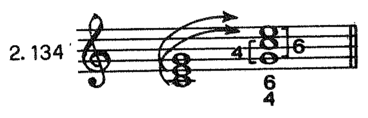

*Primjer 2.134. Tiskana str. 64.*

MuseScore prijepis: *bit će dodan.*

kvarte, koji bi kao obrat intervala kvinte trebao da bude jednako konsonantan, ipak se doima — izolirano uzet, a u usporedbi s također izolirano uzetim drugim konsonantnim intervalima (tercom, kvintom, sekstom, oktavom) — pomalo disonantno, te zvuči zapravo kao oslabljena ili ublažena disonanca. Disonantni prizvuk kvarte ne primjećuje se unutar višeglasnog akorda ako se kvarta pojavljuje među gornjim glasovima (npr. kod sekstakorda), ali postaje evidentan čim se kvarta formira između nekoga gornjeg glasa i basa. I upravo eksponirana pozicija kvarte u kvartsekstakordu razlogom je što se taj akord ne pojavljuje tako slobodno i samostalno kao kvintakord ili sekstakord, nego je svaki njegov nastup uvjetovan određenim vođenjem glasova ili izborom određenih akorda koji mu prethode ili slijede, već prema njegovoj konkretnoj ulozi i namjeni.

### 2.3.1. Zaostajalični kvartsekstakord

Zaostajalični kvartsekstakord ili »kvartsekstakord kao zaostajalica« je kvartsekstakord koji se rješava u kvintakord na istome basovu tonu tako da kvarta silazi na tercu, seksta na kvintu, a basov ton ostaje ležati. Na taj način basov ton kvartsekstakorda postaje temeljnim tonom kvintakorda u koji se zaostajalični kvartsekstakord rješava, pa je prema tome logično da on bude već i u kvartsekstakordu udvojen. Zaostajalični kvartsekstakord — — kao i svaka zaostajalica — nastupa na naglašenoj dobi, a rješava se na nenaglašenoj (pr. 2.135.a—c); u trodijelnoj mjeri može nastupiti i na drugoj, a riješiti se na trećoj dobi (pr. 2.135.d), ali ne smije nastupiti na nenaglašenoj dobi, a riješiti se na naglašenoj (pr. 2.135.e i f). Budući da zaostajalični kvartsekstakord nije samostalna harmonija nego zaostajalica, on se imenuje po stupnju na kome nastupa, a ne po stupnju svoga temeljnog tona (kvarte);

<!-- continuation: rečenica se nastavlja na stranici 065, nakon primjera 2.135 -->

<!-- source-page: 065; pdf-page: 33 -->

<!-- visual: 2.135; page 065 -->

> **PROVISIONAL — needs handwriting cleanup.** Primjer 2.135 nije odobren; izvorni izrez sadrži rukopisne dodatke.

[Izvorni neodobreni izrez: primjer 2.135](../images/02-dijatonika-b/primjer-2-135.png)

*Primjer 2.135. Tiskana str. 65.*

MuseScore prijepis: *bit će dodan.*

za kvartsekstakord u gornjem primjeru kažemo stoga »zaostajalični kvartsekstakord na I stupnju«, a ne »zaostajalični kvartsekstakord IV stupnja« iako je formiran od tonova kvintakorda IV stupnja. Kvarta i seksta zaostajaličnog kvartsekstakorda mogu biti pripravljene, kao prave zaostajalice; to su tonovi koji »zaostaju« od prethodne harmonije (pr. 2.136.a), a mogu nastupiti i bez prethodne priprave, poput appoggiatura (pr. 2.135.c i d, pr. 2.136.b). Kada su kvarta i seksta pripravljene i vezane ligaturom, onda trajanje priprave ne smije biti kraće od trajanja kvartsekstakorda jer se tada stvara ničim motivirana nepravilna sinkopa (pr. 2.136.c).

<!-- visual: 2.136; page 065 -->

> **PROVISIONAL — needs handwriting cleanup.** Primjer 2.136 nije odobren; izvorni izrez sadrži rukopisne dodatke.

[Izvorni neodobreni izrez: primjer 2.136](../images/02-dijatonika-b/primjer-2-136.png)

*Primjer 2.136. Tiskana str. 65.*

MuseScore prijepis: *bit će dodan.*

\* Nastup zaostajaličkog kvartsekstakorda uvjerljivo neutralizira težnju vođice u prethodnom akordu za uzlaznim pomakom.

<!-- visual: 2.137; page 065 -->

> **PROVISIONAL — needs handwriting cleanup.** Primjer 2.137 nije odobren; izvorni izrez sadrži rukopisne dodatke.

[Izvorni neodobreni izrez: primjer 2.137](../images/02-dijatonika-b/primjer-2-137.png)

*Primjer 2.137. Tiskana str. 65.*

MuseScore prijepis: *bit će dodan.*

<!-- source-page: 066; pdf-page: 34 -->

Zaostajalični kvartsekstakord može se rješavati i »u fazama«: najprije se riješi kvarta, zatim seksta (pr. 2.138.a), a to može biti još i kombinirano s promjenom položaja (pr. 2.138.b). U oba slučaja i kvarta i seksta riješile su se normalno, ali one mogu svoja rješenja i zamijeniti (pr. 2.138.c i d).

<!-- visual: 2.138; page 066 -->

> **PROVISIONAL — needs handwriting cleanup.** Primjer 2.138 nije odobren; izvorni izrez sadrži rukopisne dodatke.

[Izvorni neodobreni izrez: primjer 2.138](../images/02-dijatonika-b/primjer-2-138.png)

*Primjer 2.138. Tiskana str. 66.*

MuseScore prijepis: *bit će dodan.*

U zaostajaličnom kvartsekstakordu iznimno se može udvojiti i seksta, kao u primjeru 2.139.a, gdje je to učinjeno da bi se izbjegle paralelne kvinte u unutarnjim glasovima, pa i kvarta, ali tada treba obje pripraviti (pr. 2.139.b).

<!-- visual: 2.139; page 066 -->

> **PROVISIONAL — needs handwriting cleanup.** Primjer 2.139 nije odobren; izvorni izrez sadrži rukopisne dodatke.

[Izvorni neodobreni izrez: primjer 2.139](../images/02-dijatonika-b/primjer-2-139.png)

*Primjer 2.139. Tiskana str. 66.*

MuseScore prijepis: *bit će dodan.*

Najčešće se u praksi pojavljuje zaostajalični kvartsekstakord na V stupnju, i to naročito u kadenci kada se naziva **kadencirajući kvartsekstakord**. Ako u već dobro poznate kadence, IV-V-I i II₆-V-I uvrstimo i kadencirajući kvartsekstakord, dobit ćemo vrlo uobičajenu zaključnu formulu s kojom završavaju mnoge kompozicije prošlih razdoblja (pr. 2.140). U spoju kvintakorda ili sekstakorda IV stupnja s kadencirajućim kvartsekstakordom mogu lako nastati nasljedne kvinte (pr. 2.141), koje su jednako pogrešne kao i paralelne.

<!-- visual: 2.140.a–b; page 066 -->

> **PROVISIONAL — needs handwriting cleanup.** Primjer 2.140.a–b nije odobren; izvorni izrez sadrži rukopisne dodatke. Nastavak c nalazi se na tiskanoj stranici 67.

[Izvorni neodobreni izrez: primjer 2.140.a–b](../images/02-dijatonika-b/primjer-2-140-p66.png)

*Primjer 2.140.a–b. Tiskana str. 66.*

MuseScore prijepis: *bit će dodan.*

<!-- source-page: 067; pdf-page: 34 -->

<!-- visual: 2.140.c; page 067 -->

> **PROVISIONAL — needs handwriting cleanup.** Primjer 2.140.c nije odobren; izvorni izrez sadrži rukopisne dodatke. Ovo je nastavak primjera 2.140 sa stranice 66; broj je otisnut na prethodnoj stranici.

[Izvorni neodobreni izrez: primjer 2.140.c](../images/02-dijatonika-b/primjer-2-140-p67.png)

*Primjer 2.140.c. Tiskana str. 67.*

MuseScore prijepis: *bit će dodan.*

<!-- visual: 2.141; page 067 -->

> **PROVISIONAL — needs handwriting cleanup.** Primjer 2.141 nije odobren; izvorni izrez sadrži rukopisne dodatke.

[Izvorni neodobreni izrez: primjer 2.141](../images/02-dijatonika-b/primjer-2-141.png)

*Primjer 2.141. Tiskana str. 67.*

MuseScore prijepis: *bit će dodan.*

Kadencirajući kvartsekstakord može se riješiti i slobodno, čime se, u pojedinim slučajevima, dobiva bolja linija sopranove dionice (pr. 2.142). Njegovo rješenje može se i odgoditi, odnosno ono može nastupiti naknadno na taj način da se između kvartsekstakorda i rješenja umetne jedan ili više akorda (pr. 2.143.a), a može se i harmonijski tok nakon umetnutih akorda opet vratiti na kvartsekstakord i tada tek proslijediti s rješenjem (pr. 143.b i c). Veoma omiljenu primjenu naknadnog rješenja kadencirajućeg kvartsekstakorda nalazimo u klasičnom instrumentalnom koncertu na kraju stavka (najčešće prvoga i zadnjeg), gdje se nakon kvartsekstakorda umeće čitava solistička kadenca, ali ne u harmonijskom smislu, nego kao virtuozni umetak improvizatorskoga karaktera.

<!-- visual: 2.142; page 067 -->

> **PROVISIONAL — needs handwriting cleanup.** Primjer 2.142 nije odobren; izvorni izrez sadrži rukopisne dodatke.

[Izvorni neodobreni izrez: primjer 2.142](../images/02-dijatonika-b/primjer-2-142.png)

*Primjer 2.142. Tiskana str. 67.*

MuseScore prijepis: *bit će dodan.*

<!-- visual: 2.143.a–b; page 067 -->

> **PROVISIONAL — needs handwriting cleanup.** Primjer 2.143.a–b nije odobren; izvorni izrez sadrži rukopisne dodatke. Nastavak c nalazi se na tiskanoj stranici 68.

[Izvorni neodobreni izrez: primjer 2.143.a–b](../images/02-dijatonika-b/primjer-2-143-p67.png)

*Primjer 2.143.a–b. Tiskana str. 67.*

MuseScore prijepis: *bit će dodan.*

<!-- source-page: 068; pdf-page: 35 -->

<!-- visual: 2.143.c; page 068 -->

> **PROVISIONAL — needs handwriting cleanup.** Primjer 2.143.c nije odobren; izvorni izrez sadrži rukopisne dodatke. Ovo je nastavak primjera 2.143 sa stranice 67; broj je otisnut na prethodnoj stranici.

[Izvorni neodobreni izrez: primjer 2.143.c](../images/02-dijatonika-b/primjer-2-143-p68.png)

*Primjer 2.143.c. Tiskana str. 68.*

MuseScore prijepis: *bit će dodan.*

Zaostajalični kvartsekstakord može nastupiti i na nekom sporednom stupnju, ali se takav stupanj u istom momentu doima kao neki glavni, redovito kao V stupanj, a to znači da zahtijeva i odgovarajuće rješenje, tako da kao rezultat toga rješenja nastaje i modulacija u neki novi tonalitet (pr. 2.144).

<!-- visual: 2.144; page 068 -->

> **PROVISIONAL — needs handwriting cleanup.** Primjer 2.144 nije odobren; izvorni izrez sadrži rukopisne dodatke.

[Izvorni neodobreni izrez: primjer 2.144](../images/02-dijatonika-b/primjer-2-144.png)

*Primjer 2.144. Tiskana str. 68.*

MuseScore prijepis: *bit će dodan.*

**ZADACI: Izradba progresije**

<!-- visual: ZADACI: progresija I—II₆—V—I s kadencirajućim kvartsekstakordom; page 068 -->

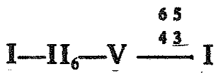

*ZADACI: progresija I—II₆—V—I s kadencirajućim kvartsekstakordom Tiskana str. 68.*

MuseScore prijepis: *bit će dodan.*

i

<!-- visual: ZADACI: progresija I—II₆—V—VI—II₆—V—I s kadencirajućim kvartsekstakordom; page 068 -->

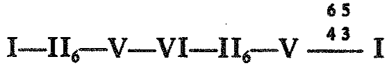

*ZADACI: progresija I—II₆—V—VI—II₆—V—I s kadencirajućim kvartsekstakordom Tiskana str. 68.*

MuseScore prijepis: *bit će dodan.*

**u raznim tonalitetima, u svim mogućim varijantama.**

<!-- source-page: 069; pdf-page: 35 -->

### 2.3.2. Izmjenični kvartsekstakord

Izmjenični kvartsekstakord može nastupiti na basu koji leži i na basu koji se kreće.

**Izmjenični kvartsekstakord na basu koji leži** nastupa poslije kvintakorda na nenaglašenoj dobi i vraća se na isti kvintakord. U tom je slučaju kvarta izmjenični ton terce, a seksta izmjenični ton kvinte kvintakorda, pa obje dolaze i vraćaju se postepenim pomakom (pr. 2.145.a). Ali seksta može također doći skokom s terce i proslijediti postepeno na kvintu, a tada kvarta dolazi postepeno s kvinte i postepeno nastavlja u istom pravcu na tercu (pr. 2.145.b i c). I u jednom i drugom slučaju samostalna harmonija je kvintakord, a ne kvartsekstakord, pa je opet logično da basov ton bude kroz cijelu progresiju udvojen.

<!-- visual: 2.145; page 069 -->

> **PROVISIONAL — needs handwriting cleanup.** Primjer 2.145 nije odobren; izvorni izrez sadrži rukopisne dodatke.

[Izvorni neodobreni izrez: primjer 2.145](../images/02-dijatonika-b/primjer-2-145.png)

*Primjer 2.145. Tiskana str. 69.*

MuseScore prijepis: *bit će dodan.*

Izmjenični kvartsekstakord te vrste najčešće se pojavljuje na glavnim stupnjevima, ali može nastupiti i na sporednima, osim tamo gdje bi se morao izmjenjivati sa smanjenim kvintakordom (koji bi loše zvučao); njegova primjena ne dolazi u obzir ni u molu tamo gdje bi rezultirala pomacima u intervalu povećane sekunde (pr. 2.146). On se vrlo rado upotrebljavao u plagalnoj kadenci koja nastupa kao dodatak prethodnoj autentičnoj (pr. 2.147).

<!-- visual: 2.146; page 069 -->

> **PROVISIONAL — needs handwriting cleanup.** Primjer 2.146 nije odobren; izvorni izrez sadrži rukopisne dodatke.

[Izvorni neodobreni izrez: primjer 2.146](../images/02-dijatonika-b/primjer-2-146.png)

*Primjer 2.146. Tiskana str. 69.*

MuseScore prijepis: *bit će dodan.*

<!-- visual: 2.147; page 069 -->

> **PROVISIONAL — needs handwriting cleanup.** Primjer 2.147 nije odobren; izvorni izrez sadrži rukopisne dodatke.

[Izvorni neodobreni izrez: primjer 2.147](../images/02-dijatonika-b/primjer-2-147.png)

*Primjer 2.147. Tiskana str. 69.*

MuseScore prijepis: *bit će dodan.*

<!-- source-page: 070; pdf-page: 36 -->

**Izmjenični kvartsekstakord na basu koji se kreće** pojavljuje se opet između dva akorda; pritom bas dolazi postepenim pomakom i vraća se postepenim pomakom, pa se sada on ponaša kao izmjenični ton. U tom slučaju kvartsekstakord se može izmjenjivati s kvintakordom (pr. 2.148.a), sekstakordom (pr. 2.148.b i c), septakordom ili njegovim obratima (pr. 2.148.d i e), kao i s raznim kombinacijama kvintakorda i septakorda, uz uvjet postepenog pomaka u svim glasovima (pr. 2.148.f i g). Njegova kvarta mora biti pripravljena, a i ovdje je basov ton taj koji se u kvartsekstakordu udvaja, tako da u glasu gdje je udvojen nastaje izmjenični ton obratnoga smjera od onoga u basovoj dionici. Taj izmjenični kvartsekstakord može nastupiti i na naglašenoj dobi (pr. 2.148.h), ali ne na sinkopi ili u dužem trajanju od trajanja prethodnog akorda (pr. 2.148.i i j) jer tada dobiva težinu i karakter zaostajaličnog kvartsekstakorda, pa zahtijeva i njemu odgovarajuće rješenje.

<!-- visual: 2.148; page 070 -->

> **PROVISIONAL — needs handwriting cleanup.** Primjer 2.148 nije odobren; izvorni izrez sadrži rukopisne dodatke.

[Izvorni neodobreni izrez: primjer 2.148](../images/02-dijatonika-b/primjer-2-148.png)

*Primjer 2.148. Tiskana str. 70.*

MuseScore prijepis: *bit će dodan.*

Izmjenični kvartsekstakord na basu koji se kreće nastupa — u odnosu prema prethodnom akordu — s novim basovim tonom i zato se imenuje kao obrat kvintakorda od koga je nastao: za kvartsekstakord u primjeru 2.148.a stoga kažemo »kvartsekstakord V stupnja«, a ne (»kvartsekstakord na II stupnju«).

### 2.3.3. Prohodni kvartsekstakord

**Prohodni kvartsekstakord na basu koji leži** nastupa poslije kvintakorda i na nenaglašenoj dobi (pa je u tome sličan izmjeničnom kvartsekstakordu na basu koji leži), pri čemu kvarta i seksta čine paralelne prohode, a to znači postepene pomake u istom pravcu, s terce i kvinte prethodnoga kvintakorda na akordičke tonove slijedećeg akorda. Kvarta i seksta imaju ovdje strogo određena kretanja, zato se i opet ne udvajaju (jer bi se tada udvajala i kretanja — u paralelnim oktavama ili primama), nego se i tu udvaja basov ton kvartsekstakorda koji, uostalom, u pravilu već udvojen leži otprije (pr. 2.149).

<!-- source-page: 071; pdf-page: 36 -->

<!-- visual: 2.149; page 071 -->

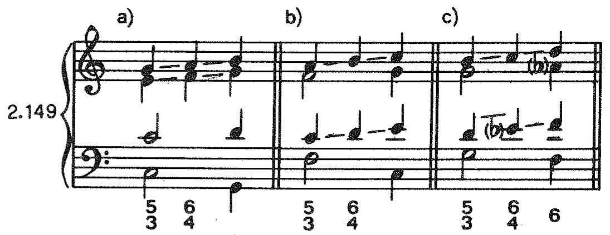

*Primjer 2.149. Tiskana str. 71.*

MuseScore prijepis: *bit će dodan.*

I taj kvartsekstakord može biti upotrijebljen na svim stupnjevima osim tamo gdje bi prethodni akord bio smanjeni kvintakord i tamo gdje bi moralo nastati kretanje u intervalu povećane sekunde. Prohodni kvartsekstakord na basu koji leži ima i varijantu u kojoj samo seksta nastavlja postepeni pomak u istom pravcu (dakle dovršava prohod), dok kvarta ostaje ležati kao zajednički ton sa slijedećim akordom, pa se u tom slučaju pojavljuje kao neka vrsta anticipacije (pr. 2.150).

<!-- visual: 2.150; page 071 -->

> **PROVISIONAL — needs handwriting cleanup.** Primjer 2.150 nije odobren; izvorni izrez sadrži rukopisne dodatke.

[Izvorni neodobreni izrez: primjer 2.150](../images/02-dijatonika-b/primjer-2-150.png)

*Primjer 2.150. Tiskana str. 71.*

MuseScore prijepis: *bit će dodan.*

**Prohodni kvartsekstakord na basu koji se kreće** pojavljuje se između dva akorda, u čemu je sličan izmjeničnom kvartsekstakordu na pokretnom basu. Samo ovdje se bas ne vraća svome ishodištu, nego nastavlja postepeni pomak u istom pravcu, tj. izvodi prohod tako da ni okvirni akordi nisu isti, već se pojavljuju u kombinaciji kvintakord-sekstakord istoga stupnja ili obratno (pr. 2.151.a—c). I kod tog kvartsekstakorda mora kvarta biti pripravljena, a basov ton udvojen, a i ovdje u glasu, gdje se basov ton udvaja, nastaje pomak obratnoga smjera od onoga što ga čini bas. I taj kvartsekstakord može nastupiti na naglašenoj dobi (pr. 2.151.d), ali ne na sinkopi niti u dužem trajanju

<!-- visual: 2.151.a–d; page 071 -->

> **PROVISIONAL — needs handwriting cleanup.** Primjer 2.151.a–d nije odobren; izvorni izrez sadrži rukopisne dodatke. Nastavak e–g nalazi se na tiskanoj stranici 72.

[Izvorni neodobreni izrez: primjer 2.151.a–d](../images/02-dijatonika-b/primjer-2-151-p71.png)

*Primjer 2.151.a–d. Tiskana str. 71.*

MuseScore prijepis: *bit će dodan.*

<!-- continuation: rečenica se nastavlja na stranici 072, nakon nastavka primjera 2.151 -->

<!-- source-page: 072; pdf-page: 37 -->

<!-- visual: 2.151.e–g; page 072 -->

> **PROVISIONAL — needs handwriting cleanup.** Primjer 2.151.e–g nije odobren; izvorni izrez sadrži rukopisne dodatke. Ovo je nastavak primjera 2.151 sa stranice 71; broj je otisnut na prethodnoj stranici.

[Izvorni neodobreni izrez: primjer 2.151.e–g](../images/02-dijatonika-b/primjer-2-151-p72.png)

*Primjer 2.151.e–g. Tiskana str. 72.*

MuseScore prijepis: *bit će dodan.*

od trajanja prethodnoga akorda, a i on može povezivati, osim kvintakorda i sekstakorda istoga stupnja, i dva obrata septakorda istoga stupnja, kao i razne kombinacije kvintakorda i septakorda, uz uvjet postepenoga pomaka u svim glasovima (pr. 2.151.e-g). I, konačno, on također može biti uokviren kvintakordom i sekstakordom svih stupnjeva osim onih na kojima se pojavljuju smanjeni kvintakordi, a jednako niti on ne dolazi u obzir tamo gdje bi se morali pojavljivati pomaci u intervalu povećane sekunde.

### 2.3.4. Kvartsekstakord kao obrat

Kvartsekstakord kao obrat jedini je kvartsekstakord koji ne predstavlja ništa drugo nego obrat kvintakorda, gdje je, dakle, ravnopravan akordima koji ga uokviruju. Pojavljuje se uokviren obratima kvintakorda istoga stupnja, pa prema tome njegov basov ton nužno dolazi i odlazi skokom (pr. 2.152.a). Ali iza njega može uslijediti i nova harmonija, a u tom slučaju njegov basov ton obavezno nastavlja kretanje postepenim pomakom (pr. 2.152.b i c).

<!-- visual: 2.152; page 072 -->

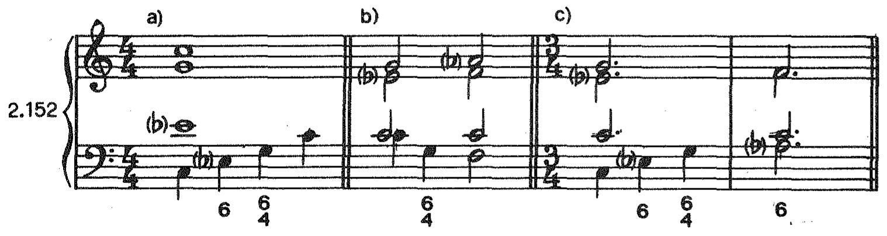

*Primjer 2.152. Tiskana str. 72.*

MuseScore prijepis: *bit će dodan.*

#### ZADACI

<!-- visual: ZADACI 1; page 072 -->

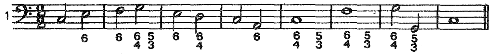

*ZADACI 1 Tiskana str. 72.*

MuseScore prijepis: *bit će dodan.*

<!-- visual: ZADACI 2; page 072 -->

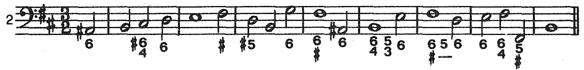

*ZADACI 2 Tiskana str. 72.*

MuseScore prijepis: *bit će dodan.*

<!-- source-page: 073; pdf-page: 37 -->

<!-- visual: ZADACI 3; page 073 -->

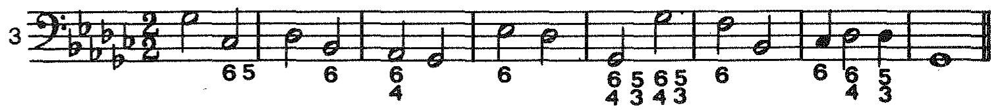

*ZADACI 3 Tiskana str. 73.*

MuseScore prijepis: *bit će dodan.*

<!-- visual: ZADACI 4; page 073 -->

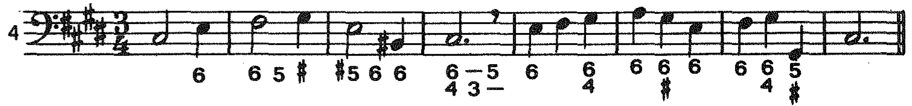

*ZADACI 4 Tiskana str. 73.*

MuseScore prijepis: *bit će dodan.*

<!-- visual: ZADACI 5; page 073 -->

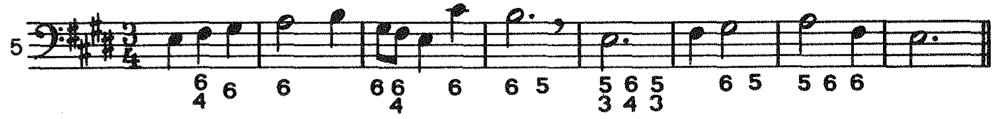

*ZADACI 5 Tiskana str. 73.*

MuseScore prijepis: *bit će dodan.*

<!-- visual: ZADACI 6; page 073 -->

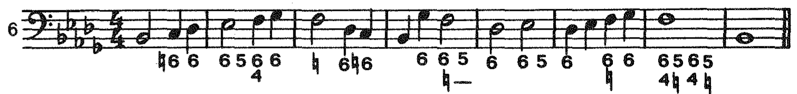

*ZADACI 6 Tiskana str. 73.*

MuseScore prijepis: *bit će dodan.*

<!-- visual: ZADACI 7; page 073 -->

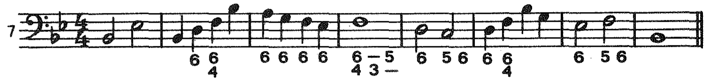

*ZADACI 7 Tiskana str. 73.*

MuseScore prijepis: *bit će dodan.*

<!-- visual: ZADACI 8; page 073 -->

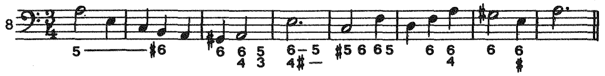

*ZADACI 8 Tiskana str. 73.*

MuseScore prijepis: *bit će dodan.*

<!-- visual: ZADACI 9; page 073 -->

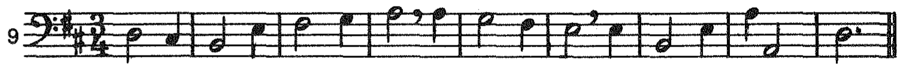

*ZADACI 9 Tiskana str. 73.*

MuseScore prijepis: *bit će dodan.*

<!-- visual: ZADACI 10; page 073 -->

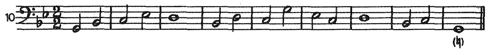

*ZADACI 10 Tiskana str. 73.*

MuseScore prijepis: *bit će dodan.*

<!-- visual: ZADACI 11; page 073 -->

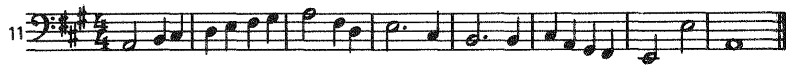

*ZADACI 11 Tiskana str. 73.*

MuseScore prijepis: *bit će dodan.*

<!-- visual: ZADACI 12; page 073 -->

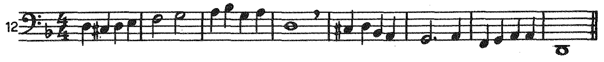

*ZADACI 12 Tiskana str. 73.*

MuseScore prijepis: *bit će dodan.*

<!-- visual: ZADACI 13; page 073 -->

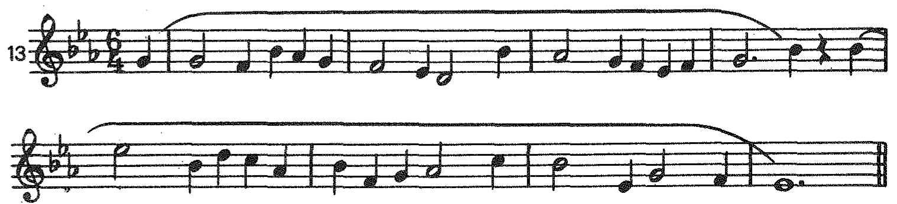

*ZADACI 13 Tiskana str. 73.*

MuseScore prijepis: *bit će dodan.*

<!-- source-page: 074; pdf-page: 38 -->

<!-- visual: ZADACI 14; page 074 -->

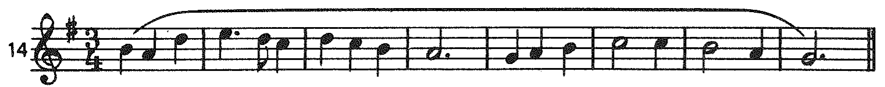

*ZADACI 14 Tiskana str. 74.*

MuseScore prijepis: *bit će dodan.*

<!-- visual: ZADACI 15; page 074 -->

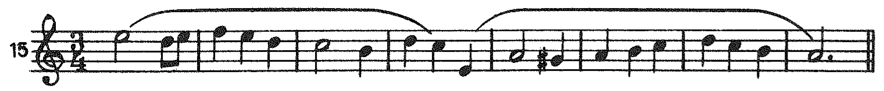

*ZADACI 15 Tiskana str. 74.*

MuseScore prijepis: *bit će dodan.*

<!-- visual: ZADACI 16; page 074 -->

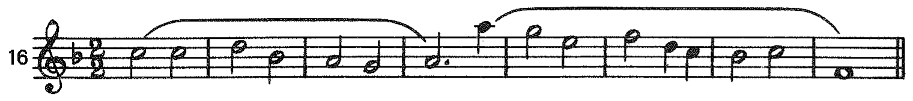

*ZADACI 16 Tiskana str. 74.*

MuseScore prijepis: *bit će dodan.*

<!-- visual: ZADACI 17; page 074 -->

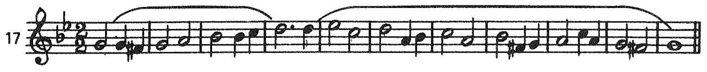

*ZADACI 17 Tiskana str. 74.*

MuseScore prijepis: *bit će dodan.*

<!-- visual: ZADACI 18; page 074 -->

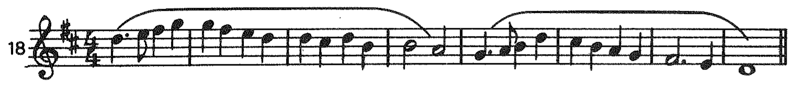

*ZADACI 18 Tiskana str. 74.*

MuseScore prijepis: *bit će dodan.*

<!-- visual: ZADACI 19; page 074 -->

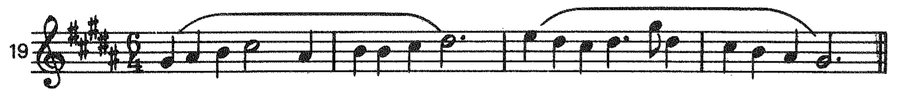

*ZADACI 19 Tiskana str. 74.*

MuseScore prijepis: *bit će dodan.*

<!-- visual: ZADACI 20; page 074 -->

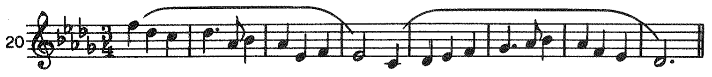

*ZADACI 20 Tiskana str. 74.*

MuseScore prijepis: *bit će dodan.*

<!-- visual: ZADACI 21; page 074 -->

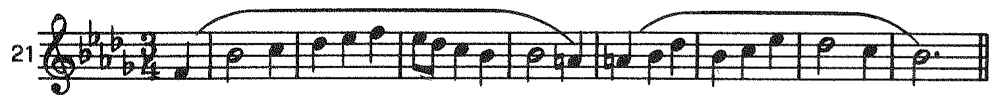

*ZADACI 21 Tiskana str. 74.*

MuseScore prijepis: *bit će dodan.*

<!-- visual: ZADACI 22; page 074 -->

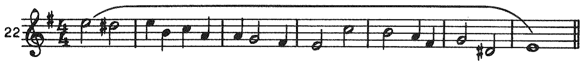

*ZADACI 22 Tiskana str. 74.*

MuseScore prijepis: *bit će dodan.*

Realizacija zadatka 8.

<!-- visual: Realizacija zadatka 8.; page 074 -->

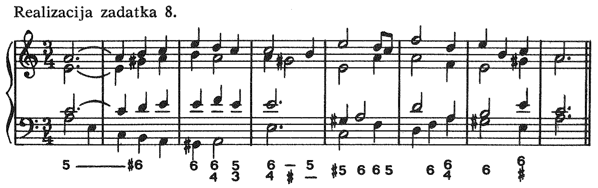

*Realizacija zadatka 8. Tiskana str. 74.*

MuseScore prijepis: *bit će dodan.*

<!-- source-page: 075; pdf-page: 38 -->

Realizacija zadatka 13.

<!-- visual: Realizacija zadatka 13.; page 075 -->

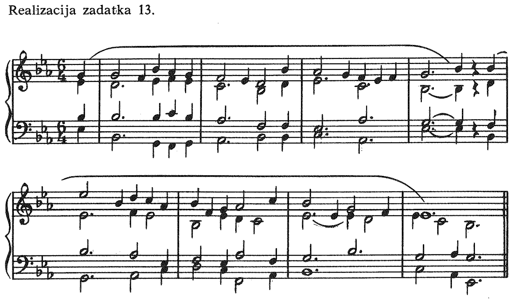

*Realizacija zadatka 13. Tiskana str. 75.*

MuseScore prijepis: *bit će dodan.*

<!-- source-page: 076; pdf-page: 39 -->

## 2.4. Melodijski mol

### 2.4.1. Kvintakordi i obrati kvintakorda u melodijskom molu

Melodijska mol-ljestvica razlikuje se od harmonijske u svome uzlaznom obliku po povišenom VI stupnju, a u silaznome po sniženom, odnosno prirodnom VII stupnju. A razlika u ljestvičnim stupnjevima donosi i razlike u akordima gdje se ti stupnjevi pojavljuju kao akordički tonovi. Povišeni VI stupanj ljestvice uvjetuje na II stupnju mol-kvintakord, na IV stupnju dur-kvintakord, a na VI stupnju smanjeni kvintakord, dok prirodni VII stupanj uvjetuje dur-kvintakord na III stupnju, mol-kvintakord na V stupnju i dur-kvintakord na VII stupnju (pr. 2.153).

<!-- visual: 2.153; page 076 -->

> **PROVISIONAL — needs handwriting cleanup.** Primjer 2.153 nije odobren; izvorni izrez sadrži rukopisne dodatke.

[Izvorni neodobreni izrez: primjer 2.153](../images/02-dijatonika-b/primjer-2-153.png)

*Primjer 2.153. Tiskana str. 76.*

MuseScore prijepis: *bit će dodan.*

Povišeni VI stupanj zapravo je alterirani ton prirodne mol-ljestvice koji — kao i svaki alterirani ton — teži za postepenim pomakom u smjeru u kome je alteriran. On zadržava tendenciju uzlaznoga postepenog kretanja (u povišeni VII stupanj) i kao akordički ton akorda u kojima se pojavljuje, pa se stoga i ne udvaja (pr. 2.154). Smanjeni kvintakord na povišenom VI stupnju redovito nastupa u prvom obratu kao sekstakord kojemu se udvaja basov ton ili terca (pr. 2.154.d i e), a kada se upotrebljava u temeljnom obliku, onda mu se pripravlja kvinta, a terca udvaja (pr. 2.154.f), no može se također uvesti i pomakom sekste sekstakorda IV stupnja na kvintu, naravno, opet uz udvajanje terce (pr. 2.154.g).

<!-- visual: 2.154.a–e; page 076 -->

> **PROVISIONAL — needs handwriting cleanup.** Primjer 2.154.a–e nije odobren; izvorni izrez sadrži rukopisne dodatke. Nastavak f–g nalazi se na tiskanoj stranici 77.

[Izvorni neodobreni izrez: primjer 2.154.a–e](../images/02-dijatonika-b/primjer-2-154-p76.png)

*Primjer 2.154.a–e. Tiskana str. 76.*

MuseScore prijepis: *bit će dodan.*

<!-- source-page: 077; pdf-page: 39 -->

<!-- visual: 2.154.f–g; page 077 -->

> **PROVISIONAL — needs handwriting cleanup.** Primjer 2.154.f–g nije odobren; izvorni izrez sadrži rukopisne dodatke. Ovo je nastavak primjera 2.154 sa stranice 76; broj je otisnut na prethodnoj stranici.

[Izvorni neodobreni izrez: primjer 2.154.f–g](../images/02-dijatonika-b/primjer-2-154-p77.png)

*Primjer 2.154.f–g. Tiskana str. 77.*

MuseScore prijepis: *bit će dodan.*

Prirodni VII stupanj (koji nastupa u silaznom obliku melodijske mol-ljestvice) nije nikakva vođica, ali on teži ipak i kao akordički ton — naročito kada je u sopranu — postepenom kretanju, koje može biti u oba smjera, premda prvenstveno u silaznome (pr. 2.155).

<!-- visual: 2.155; page 077 -->

> **PROVISIONAL — needs handwriting cleanup.** Primjer 2.155 nije odobren; izvorni izrez sadrži rukopisne dodatke.

[Izvorni neodobreni izrez: primjer 2.155](../images/02-dijatonika-b/primjer-2-155.png)

*Primjer 2.155. Tiskana str. 77.*

MuseScore prijepis: *bit će dodan.*

U melodijskoj mol-ljestvici nema između VI i VII stupnja intervala povećane sekunde, kao što je to slučaj u harmonijskoj mol-ljestvici, pa je stoga sada moguće upotrijebiti zaostajalični i izmjenični kvartsekstakord na IV stupnju, kao i uvesti smanjeni kvintakord na drugom stupnju progresijom 6 — 5 (pr. 2.156).

<!-- visual: 2.156; page 077 -->

> **PROVISIONAL — needs handwriting cleanup.** Primjer 2.156 nije odobren; izvorni izrez sadrži rukopisne dodatke.

[Izvorni neodobreni izrez: primjer 2.156](../images/02-dijatonika-b/primjer-2-156.png)

*Primjer 2.156. Tiskana str. 77.*

MuseScore prijepis: *bit će dodan.*

### 2.4.2. Primjena akordičkih elemenata melodijskog mola u harmonizaciji

Varijante kvintakorda i njihovih obrata, koje smo dobili uvođenjem povišenog VI i prirodnog VII stupnja, primjenjuju se u harmonizaciji prvenstveno tamo gdje se povišeni VI i prirodni VII stupanj pojavljuju u samome zadanom glasu. Ali one se mogu vrlo dobro upotrijebiti i u harmonizaciji neutralnih melodijskih fragmenata, tj. takvih koji se kreću unutar granica donjega tetrakorda, pa se mogu jednako tumačiti i u harmonijskom, kao i u melodijskom molu. U primjeru 2.157. harmoniziran je takav fragment na

<!-- continuation: rečenica se nastavlja na stranici 078 -->

<!-- source-page: 078; pdf-page: 40 -->

tri različita načina: a) akordima izvedenim iz tonova harmonijske mol-ljestvice, b) akordima izvedenim iz tonova silazne melodijske mol-ljestvice i c) akordima izvedenim iz tonova uzlazne melodijske mol-ljestvice. Na taj način proširuje se i obogaćuje akordički repertoar koji je u harmonijskom molu zbog svega četiri konsonantna kvintakorda bio relativno skučen.

<!-- visual: 2.157; page 078 -->

> **PROVISIONAL — needs handwriting cleanup.** Primjer 2.157 nije odobren; izvorni izrez sadrži rukopisne dodatke.

[Izvorni neodobreni izrez: primjer 2.157](../images/02-dijatonika-b/primjer-2-157.png)

*Primjer 2.157. Tiskana str. 78.*

MuseScore prijepis: *bit će dodan.*

Primjer 2.158. donosi i harmonizaciju melodijske mol-ljestvice (u sopranu), gdje je uzlazni oblik izrađen isključivo akordima izvedenim iz uzlazne, a silazni akordima izvedenim iz silazne ljestvice, s izuzetkom kadence kada se radi uvjerljivosti završetka uvodi vođica, tj. povišeni VII stupanj.

<!-- visual: 2.158; page 078 -->

> **PROVISIONAL — needs handwriting cleanup.** Primjer 2.158 nije odobren; izvorni izrez sadrži rukopisne dodatke.

[Izvorni neodobreni izrez: primjer 2.158](../images/02-dijatonika-b/primjer-2-158.png)

*Primjer 2.158. Tiskana str. 78.*

MuseScore prijepis: *bit će dodan.*

Kod prijelaza iz jedne vrste mola u drugu treba izbjegavati **opreku**, tj. odnos između nekog tona i tona koji predstavlja njegovu kromatsku promjenu, kada se oni pojavljuju u susjednim akordima u različitim glasovima (pr. 2.159.a). Neugodan dojam opreke ostaje i onda kada su odnosni akordi razdvojeni nekim nesamostalnim akordom, kao što je npr. prohodni kvartsekstakord (pr. 2.159.b). Naprotiv, nastup tona »h« u primjeru 2.160, u 2. taktu uopće ne djeluje »oprečno« u odnosu prema tonu »b« koji je nastupio na prvoj dobi u 1. taktu, jer se ovdje radi o spoju kvintakorda IV i V stupnja (između kojih uopće nema opreke), a »b« je samo neakordički ton (zaostajalica), pa ima prvenstveno melodijski, a ne harmonijski značaj.

<!-- visual: 2.159; page 078 -->

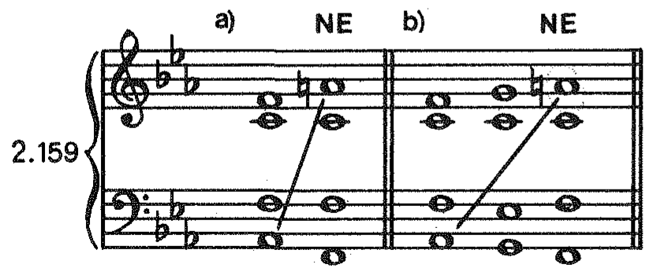

*Primjer 2.159. Tiskana str. 78.*

MuseScore prijepis: *bit će dodan.*

<!-- visual: 2.160; page 078 -->

> **PROVISIONAL — needs handwriting cleanup.** Primjer 2.160 nije odobren; izvorni izrez sadrži rukopisne dodatke.

[Izvorni neodobreni izrez: primjer 2.160](../images/02-dijatonika-b/primjer-2-160.png)

*Primjer 2.160. Tiskana str. 78.*

MuseScore prijepis: *bit će dodan.*

<!-- source-page: 079; pdf-page: 40 -->

### 2.4.3. Frigijska kadenca

Gornji tetrakord silazne melodijske mol-ljestvice identičan je s donjim tretrakordom frigijske ljestvice ili frigijskog načina (pr. 2.161.a i b).[^2] Prema

<!-- visual: 2.161; page 079 -->

> **PROVISIONAL — needs handwriting cleanup.** Primjer 2.161 nije odobren; izvorni izrez sadrži rukopisne dodatke.

[Izvorni neodobreni izrez: primjer 2.161](../images/02-dijatonika-b/primjer-2-161.png)

*Primjer 2.161. Tiskana str. 79.*

MuseScore prijepis: *bit će dodan.*

<!-- continuation: riječ »tome« u izvorniku je razdvojena umetnutim primjerom; ovdje je dehifenirana -->

tome je i posljednji ton gornjeg tetrakorda silazne melodijske mol-ljestvice, tj. dominanta, identičan s tonom koji je u frigijskom načinu *nota finalis*, odnosno *završna nota* ili *završni ton*. Zbog te podudarnosti došlo je i do naziva »frigijska kadenca« za određenu vrstu polovične kadence u molu, što je tvore kvintakord ili sekstakord IV stupnja i kvintakord V stupnja, pri čemu vodeći glas (bas ili sopran) čini tzv. »frigijski pomak«, tj. silazi postepenim pomakom sa šestoga stupnja na dominantu (pr. 2.162).

<!-- visual: 2.162; page 079 -->

> **PROVISIONAL — needs handwriting cleanup.** Primjer 2.162 nije odobren; izvorni izrez sadrži rukopisne dodatke.

[Izvorni neodobreni izrez: primjer 2.162](../images/02-dijatonika-b/primjer-2-162.png)

*Primjer 2.162. Tiskana str. 79.*

MuseScore prijepis: *bit će dodan.*

Ali to bi bio samo završni dio frigijske kadence, koja — kad je kompletna — donosi u vodećem glasu potpuni silazni tetrakord, u melodijskoj mol-ljestvici gornji, a u frigijskom načinu donji; on se harmonizira u raznim varijantama, ali uvijek s dvije iste posljednje harmonije — harmonije IV i V stupnja (pr. 2.163).

[^2]: Identičnost tetrakordâ prikazana je u primjeru 2.161.a u originalu, tj. između originalnoga frigijskog načina (koji završava s tonom »e« i nema nikakvih predznaka) i silazne melodijske a-mol ljestvice (koja također nema predznakâ). Međutim, u daljnjem izlaganju vraćat ćemo se na prikazivanje suprotstavljanjem istoimenih ljestvica, pa ćemo prema tome i frigijski način transponirati malu tercu više, na završni ton »g«, tako da će taj transponirani frigijski način imati iste predznake kao c-mol, ljestvica (pr. 2.161.b).

<!-- source-page: 080; pdf-page: 41 -->

<!-- visual: 2.163; page 080 -->

> **PROVISIONAL — needs handwriting cleanup.** Primjer 2.163 nije odobren; izvorni izrez sadrži rukopisne dodatke.

[Izvorni neodobreni izrez: primjer 2.163](../images/02-dijatonika-b/primjer-2-163.png)

*Primjer 2.163. Tiskana str. 80.*

MuseScore prijepis: *bit će dodan.*

Frigijska kadenca upotrebljavala se često na početku klasičnog razdoblja koje se direktno nastavlja na razdoblje starih načina (pr. 2.164), ali njen prizvuk nalazimo i u kasnijem razvoju, u progresijama koje uključuju i složenije akordičke sklopove (septakorde), pa i kromatiku (pr. 2.165. i 2.166).

<!-- visual: 2.164; page 080 -->

> **PROVISIONAL — needs handwriting cleanup.** Primjer 2.164 nije odobren; izvorni izrez sadrži rukopisne dodatke.

[Izvorni neodobreni izrez: primjer 2.164](../images/02-dijatonika-b/primjer-2-164.png)

*Primjer 2.164. Tiskana str. 80.*

MuseScore prijepis: *bit će dodan.*

<!-- visual: 2.165; page 080 -->

> **PROVISIONAL — needs handwriting cleanup.** Primjer 2.165 nije odobren; izvorni izrez sadrži rukopisne dodatke.

[Izvorni neodobreni izrez: primjer 2.165](../images/02-dijatonika-b/primjer-2-165.png)

*Primjer 2.165. Tiskana str. 80.*

MuseScore prijepis: *bit će dodan.*

<!-- visual: 2.166; page 080 -->

> **PROVISIONAL — needs handwriting cleanup.** Primjer 2.166 nije odobren; izvorni izrez sadrži rukopisne dodatke.

[Izvorni neodobreni izrez: primjer 2.166](../images/02-dijatonika-b/primjer-2-166.png)

*Primjer 2.166. Tiskana str. 80.*

MuseScore prijepis: *bit će dodan.*

<!-- source-page: 081; pdf-page: 41 -->

Neobičan završetak Lisztove Sonate za klavir u h-molu (pr. 2.167) pokazuje također osnovne obrise melodijskoga i harmonijskog frigijskog pomaka u spoju sekstakorda c-e-a (1. takt citata) sa završnim kvintakordom h-dis-fis; između njih pojavljuje se doduše i kvartsekstakord c-f-a (jer C₁ smatramo idealnim basovim tonom koji leži sve do zadnjega takta), ali on nije samostalan akord jer je ton »f« samo kromatski prohod u najgornjem glasu između »e« (akordički ton sekstakord c-e-a) i »fis« (akordički ton završnog kvintakorda).

<!-- visual: 2.167; page 081 -->

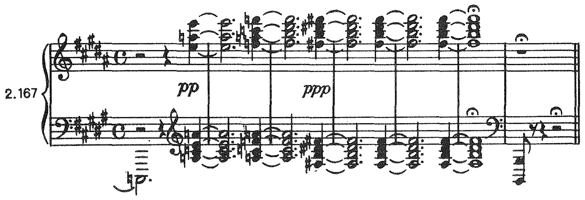

*Primjer 2.167. Tiskana str. 81.*

MuseScore prijepis: *bit će dodan.*

#### ZADACI

<!-- visual: ZADACI 1; page 081 -->

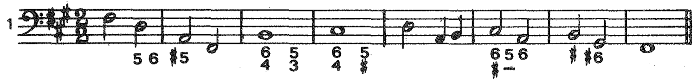

*ZADACI 1 Tiskana str. 81.*

MuseScore prijepis: *bit će dodan.*

<!-- visual: ZADACI 2; page 081 -->

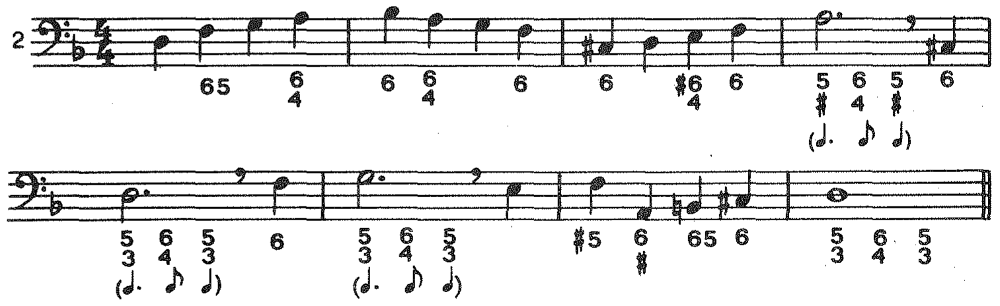

*ZADACI 2 Tiskana str. 81.*

MuseScore prijepis: *bit će dodan.*

<!-- visual: ZADACI 3; page 081 -->

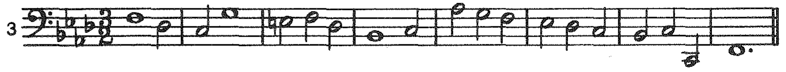

*ZADACI 3 Tiskana str. 81.*

MuseScore prijepis: *bit će dodan.*

<!-- visual: ZADACI 4; page 081 -->

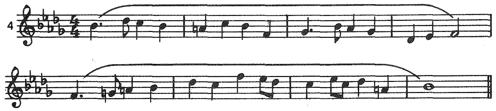

*ZADACI 4 Tiskana str. 81.*

MuseScore prijepis: *bit će dodan.*

> Nastavak digitalne obrade: ovdje se integracija zaustavlja na tiskanoj stranici 81. Provjereni tekstualni odsječci za tiskane stranice 82–136 još nisu integrirani sa slikama u ovo poglavlje. Zadaci na stranici 81 nisu proglašeni krajem izvornog odjeljka.

> Nastavak integracije, tiskane stranice 82–100: prethodna napomena o zaustavljanju na stranici 81 ostaje sačuvana kao zapis ranije predaje, ali više nije trenutačna granica. Slijedi puni provjereni tekst; 32 slike imaju neovisni PASS, a 48 izvornih izreza ostaje vidljivo PROVISIONAL / cleanup_required, bez odobrenja.

<!-- source-page: 082; pdf-page: 42 -->

<!-- visual: zadatak 5; page 082 -->

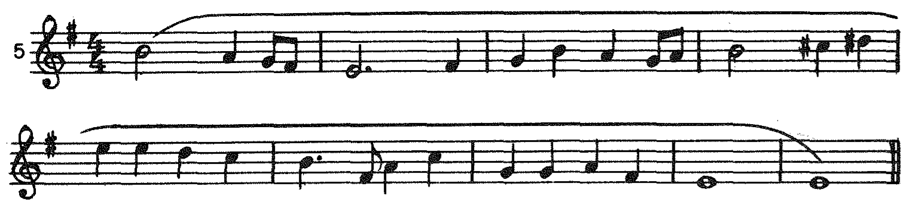

*Zadatak 5. — str. 82.*

MuseScore prijepis: *bit će dodan.*
<!-- visual: zadatak 6; page 082 -->

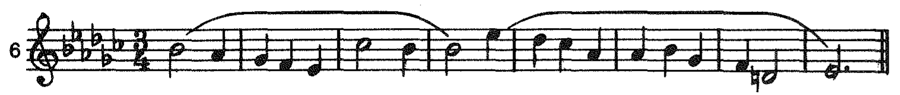

*Zadatak 6. — str. 82.*

MuseScore prijepis: *bit će dodan.*
<!-- visual: zadatak 7; page 082 -->

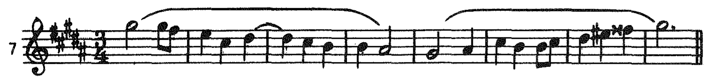

*Zadatak 7. — str. 82.*

MuseScore prijepis: *bit će dodan.*

Realizacija zadatka 4.

<!-- visual: Realizacija zadatka 4.; page 082 -->

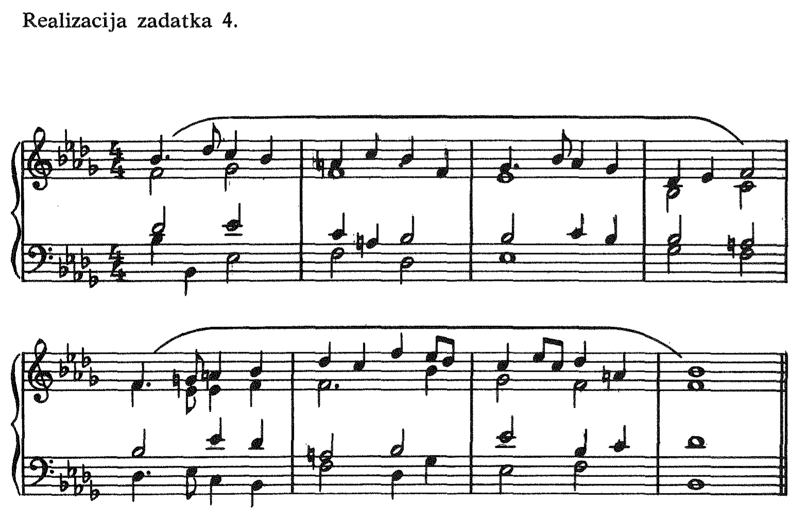

*Realizacija zadatka 4. — str. 82.*

MuseScore prijepis: *bit će dodan.*

<!-- source-page: 083; pdf-page: 42 -->

## 2.5. Septakordi

**Septakord** ili **četverozvuk** nastaje kada se kvintakordu doda još jedna terca, tako da se on sastoji od četiri tona postavljena po tercama: od temeljnog tona (prime), terce, kvinte i septime; obilježava se sa »7«. Septakord je disonantan akord jer sadrži disonantni interval septime, što ga njegov najviši ton, tj. septima, čini s temeljnim tonom (pr. 2.168).

<!-- visual: 2.168; page 083 -->

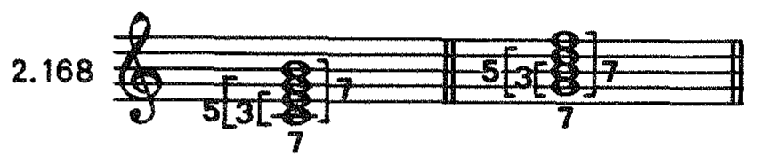

*Primjer 2.168. — str. 83.*

MuseScore prijepis: *bit će dodan.*

### 2.5.1. Dominantni septakord

Dominantni septakord nalazi se na V stupnju u duru i u harmonijskom molu. Njegova septima čini s temeljnim tonom disonantni interval male septime. Ona, osim toga, stoji i s tercom u disonantnom odnosu — u odnosu tritonusa, tj. u odnosu smanjene kvinte ili povećane kvarte (pr. 2.169). Zbog prisutnosti tritonusa septima se ne izdvaja, ne »strši« iz akorda, pa je zato ne treba pripravljati, nego je samo potrebno da interval septime nastupi u protupomaku (pr. 2.170). Dominantni septakord može biti i nepotpun. U tom se slučaju udvaja temeljni ton, a izostavlja redovito kvinta (pr. 2.171.a). Iznimno se može izostaviti i terca, ali tada otpada i tritonus, pa se septima mora pripraviti (pr. 2.171.b i c).

<!-- visual: 2.169; page 083 -->

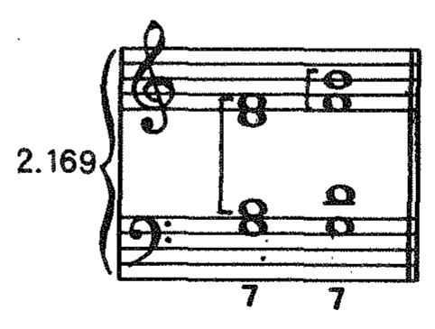

*Primjer 2.169. — str. 83.*

MuseScore prijepis: *bit će dodan.*
<!-- visual: 2.170; page 083 -->

> **PROVISIONAL — needs cleanup/review; cleanup_required; source_limited.** Primjer 2.170 nije odobren. Neovisni pregled: **RECROP_REQUIRED**; nije utvrđen siguran čist alternativni izrez. Razlog: Printed a), b), c), NE, full staves and figures are retained, but pencil parentheses around NE and pencil strokes below a) remain. Their vertical range overlaps required labels/figures; no clean rectangular recrop can remove all handwriting.

[Izvorni neodobreni izrez: Primjer 2.170](../images/02-dijatonika-b/primjer-2-170.png) · [Izvorna tiskana stranica 83](../sources/pages/page-083.png)

*Primjer 2.170. — str. 83.*

MuseScore prijepis: *bit će dodan.*
<!-- visual: 2.171; page 083 -->

> **PROVISIONAL — needs cleanup/review; cleanup_required; source_limited.** Primjer 2.171 nije odobren. Neovisni pregled: **RECROP_REQUIRED**; nije utvrđen siguran čist alternativni izrez. Razlog: All three printed variants and lower 7/6/7 analysis are present, but coherent faint pencil strokes remain above the variants and between the staves under b). The internal marks cannot be excluded by moving an edge.

[Izvorni neodobreni izrez: Primjer 2.171](../images/02-dijatonika-b/primjer-2-171.png) · [Izvorna tiskana stranica 83](../sources/pages/page-083.png)

*Primjer 2.171. — str. 83.*

MuseScore prijepis: *bit će dodan.*

<!-- source-page: 084; pdf-page: 43 -->

Disonantni interval septime rješava se tako da njegov gornji ton, tj. sama septima, postepenim pomakom silazi; kod obrata septime, dakle kod intervala sekunde, donji je ton taj koji silazi (pr. 2.172). Prema tome, pri rješenju dominantnog septakorda u tonički kvintakord, septima silazi na njegovu tercu; ako uz to vođica postepeno uzlazi, tonički kvintakord ispada nepotpun (pr. 2.173.a). Međutim, ako je vođica u unutarnjem glasu, ona može i skakati za tercu dolje, na kvintu toničkog kvintakorda, u kome će slučaju on biti potpun (pr. 2.173.b). On izlazi potpun i kada mu prethodi nepotpuni dominantni septakord (pr. 2.173.c).

<!-- visual: 2.172; page 084 -->

> **PROVISIONAL — needs cleanup/review; cleanup_required; source_limited.** Primjer 2.172 nije odobren. Neovisni pregled: **RECROP_REQUIRED**; nije utvrđen siguran čist alternativni izrez. Razlog: Number, a)/b), parenthesized flats and downward stems are intact. Faint handwritten analysis beneath a) starts at the height of b)'s lowest stems, so raising the bottom to remove it would clip printed notation; these grouped strokes are not isolated specks.

[Izvorni neodobreni izrez: Primjer 2.172](../images/02-dijatonika-b/primjer-2-172.png) · [Izvorna tiskana stranica 84](../sources/pages/page-084.png)

*Primjer 2.172. — str. 84.*

MuseScore prijepis: *bit će dodan.*
<!-- visual: 2.173; page 084 -->

> **PROVISIONAL — needs cleanup/review; cleanup_required; source_limited.** Primjer 2.173 nije odobren. Neovisni pregled: **RECROP_REQUIRED**; nije utvrđen siguran čist alternativni izrez. Razlog: All a)-c) notation and lower figures retained. Pencil writing/arrows above and alongside the upper variant labels intrude into their height range; a clean rectangular crop cannot preserve all labels while excluding those source marks.

[Izvorni neodobreni izrez: Primjer 2.173](../images/02-dijatonika-b/primjer-2-173.png) · [Izvorna tiskana stranica 84](../sources/pages/page-084.png)

*Primjer 2.173. — str. 84.*

MuseScore prijepis: *bit će dodan.*

Kada se dominantni septakord rješava u zamjenika toničkog kvintakorda, u kvintakord VI stupnja, onda se u pravilu postavlja u potpunom obliku (pr. 2.174.a); pritom može vođica, kada je u unutarnjem glasu, također silaziti, i to ovaj puta postepenim pomakom (pr. 2.174.b), ali ne kada se nalazi ispod septime, zbog paralelnih kvinta (pr. 2.174.c), i ne u molu, zbog pomaka za interval povećane sekunde (pr. 2.174.d). Moguće je i rješenje nepotpunoga dominantnog septakorda u kvintakord VI stupnja; tada glas, u kome je udvojen temeljni ton dominantnog septakorda skače za kvintu dolje (pr. 2.174.e i f). Skok za tercu dolje rezultirao bi vrlo lošim pomakom iz septime u oktavu (pr. 2.174.g) ili iz sekunde u unisono (pr. 2.174.h), a kod skoka za kvartu gore previše bi se istakla sakrita oktava iako ne bi nastupila između vanjskih glasova (pr. 2.174.i).

<!-- visual: 2.174; page 084 -->

> **PROVISIONAL — needs cleanup/review; cleanup_required; source_limited.** Primjer 2.174 nije odobren. Neovisni pregled: **RECROP_REQUIRED**; nije utvrđen siguran čist alternativni izrez. Razlog: Both systems a)-i), printed NE labels, flats, lower figures and final barlines retained; page 84 excluded. Pencil Roman numerals, question marks and strokes occupy inter-staff/inter-system areas and the lower edge. Internal handwriting makes a clean rectangular recrop impossible.

[Izvorni neodobreni izrez: Primjer 2.174](../images/02-dijatonika-b/primjer-2-174.png) · [Izvorna tiskana stranica 84](../sources/pages/page-084.png)

*Primjer 2.174. — str. 84.*

MuseScore prijepis: *bit će dodan.*

<!-- source-page: 085; pdf-page: 43 -->

Prvi obrat dominantnog septakorda je **kvintsekstakord**. Kod njega terca septakorda (vođica) postaje basovim tonom, s kojim sada septima čini interval (smanjene) kvinte, a temeljni ton interval sekste (otuda i naziv obrata), dok kvinta septakorda čini s basovim tonom interval terce. Kvintsekstakord se obilježava sa » 65 « (pr. 2.175). Dominantni kvintsekstakord rješava se redovito u kvintakord I stupnja, ali dolazi u obzir i rješenje u sekstakord VI stupnja (pr. 2.176).

<!-- visual: 2.175; page 085 -->

> **PROVISIONAL — needs cleanup/review; cleanup_required; source_limited.** Primjer 2.175 nije odobren. Neovisni pregled: **RECROP_REQUIRED**; nije utvrđen siguran čist alternativni izrez. Razlog: Printed chord, brackets and 6/5 retained, but a pencil diagonal runs from the notation toward handwritten text below/right. Its range overlaps required notation and figures, so merely trimming the lower/right margin cannot produce a clean full example.

[Izvorni neodobreni izrez: Primjer 2.175](../images/02-dijatonika-b/primjer-2-175.png) · [Izvorna tiskana stranica 85](../sources/pages/page-085.png)

*Primjer 2.175. — str. 85.*

MuseScore prijepis: *bit će dodan.*
<!-- visual: 2.176; page 085 -->

> **PROVISIONAL — needs cleanup/review; cleanup_required; source_limited.** Primjer 2.176 nije odobren. Neovisni pregled: **RECROP_REQUIRED**; nije utvrđen siguran čist alternativni izrez. Razlog: Number, a)-d), accidentals, complete staves and all bottom figures retained. Pencil circles/diagonals and analysis occur inside the grand staff as well as around the lower figures, not just in disposable margin.

[Izvorni neodobreni izrez: Primjer 2.176](../images/02-dijatonika-b/primjer-2-176.png) · [Izvorna tiskana stranica 85](../sources/pages/page-085.png)

*Primjer 2.176. — str. 85.*

MuseScore prijepis: *bit će dodan.*

Drugi obrat, **terckvartakord**, ima kvintu septakorda kao basov ton; septima čini s njime tercu, a temeljni ton kvartu (otuda i naziv akorda), dok vođica čini s basovim tonom sada sekstu. Terckvartakord se obilježava sa » 43 « (pr. 2.177). Rješava se, poput dominantnog kvintsekstakorda, u kvintakord I stupnja (pr. 2.178.a i b) ili u sekstakord VI stupnja (pr. 2.178.c), a u duru i u kvintakord VI stupnja (pr. 2.178.d). U obzir dolazi i rješenje u sekstakord I stupnja, u kojem se slučaju udvaja u sekstakordu basov ton, a to zahtijeva daljnje postepeno kretanje (u protupomaku) basa i glasa u kome je nastupilo udvajanje (pr. 2.178.e). S obzirom na osjetljivost intervala kvarte (v. poglavlje 2. 3) treba izbjegavati takav nastup terckvartakorda kod kojega bi kvarta u sopranu došla skokom (pr. 2.179).

<!-- visual: 2.177; page 085 -->

> **PROVISIONAL — needs cleanup/review; cleanup_required; source_limited.** Primjer 2.177 nije odobren. Neovisni pregled: **RECROP_REQUIRED**; nije utvrđen siguran čist alternativni izrez. Razlog: Printed 2.177, staff, bracket and 4/3 intact. Handwritten text begins below the staff to the right of 4 but above the bottom of 3; removing it by a rectangular bottom or right trim would lose the 3 or the staff ending.

[Izvorni neodobreni izrez: Primjer 2.177](../images/02-dijatonika-b/primjer-2-177.png) · [Izvorna tiskana stranica 85](../sources/pages/page-085.png)

*Primjer 2.177. — str. 85.*

MuseScore prijepis: *bit će dodan.*
<!-- visual: 2.178; page 085 -->

> **PROVISIONAL — needs cleanup/review; cleanup_required; source_limited.** Primjer 2.178 nije odobren. Neovisni pregled: **RECROP_REQUIRED**; nije utvrđen siguran čist alternativni izrez. Razlog: All a)-e), accidentals, staves and bottom figures retained; printed page number excluded. Pencil words above d), circles and analysis below d)/e), and marks within the notation area prevent a clean full rectangular extraction.

[Izvorni neodobreni izrez: Primjer 2.178](../images/02-dijatonika-b/primjer-2-178.png) · [Izvorna tiskana stranica 85](../sources/pages/page-085.png)

*Primjer 2.178. — str. 85.*

MuseScore prijepis: *bit će dodan.*

<!-- source-page: 086; pdf-page: 44 -->

<!-- visual: 2.179; page 086 -->

> **PROVISIONAL — needs cleanup/review; cleanup_required; source_limited.** Primjer 2.179 nije odobren. Neovisni pregled: **RECROP_REQUIRED**; nije utvrđen siguran čist alternativni izrez. Razlog: Printed NE, bracketed 4, bottom 4/3 and full staves intact, but a pencil circle crosses the right barline/bracket area and other pencil strokes touch the upper/bottom notation range. Cannot remove them by safe edge adjustment.

[Izvorni neodobreni izrez: Primjer 2.179](../images/02-dijatonika-b/primjer-2-179.png) · [Izvorna tiskana stranica 86](../sources/pages/page-086.png)

*Primjer 2.179. — str. 86.*

MuseScore prijepis: *bit će dodan.*

Treći obrat, **sekundakord**, ima u basu septimu, a naziva se sekundakord po intervalu što ga čini temeljni ton s basovim tonom; vođica čini s basovim tonom interval povećane kvarte, kvinta interval sekste, a akord se obilježava sa »2« (pr. 2.180). Dominantni sekundakord rješava se u sekstakord I stupnja (pr. 2.181), a rješenje u harmoniju VI stupnja ne dolazi u obzir, jer bi ona u tom slučaju morala nastupiti u obliku kvartsekstakorda, a taj ne može biti rješenje kada ga i sam zahtijeva, i to u drugom tonalitetu (v. odsjek 2. 3. 1).

<!-- visual: 2.180; page 086 -->

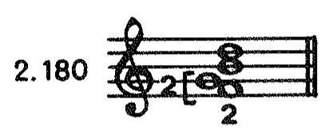

*Primjer 2.180. — str. 86.*

MuseScore prijepis: *bit će dodan.*
<!-- visual: 2.181; page 086 -->

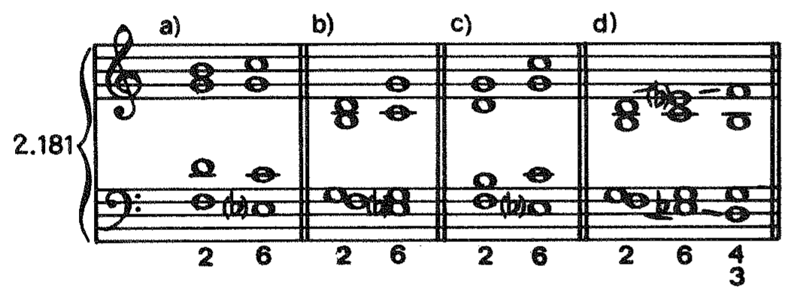

*Primjer 2.181. — str. 86.*

MuseScore prijepis: *bit će dodan.*

Kvintakord III stupnja sadrži također ton u koji septima dominantnog septakorda silazi, pa se prema tome dominantni septakord može — kao i njegovi obrati — rješavati i u odgovarajuće obrate kvintakorda III stupnja; no ta će rješenja biti u većini slučajeva nesamostalne harmonije koje će predstavljati ili prohodne akorde između dva oblika harmonije V stupnja (pr. 2.182.a—d) ili prijelazne akorde do definitivnog rješenja u harmoniji I stupnja (pr. 2.182.e i f).

<!-- visual: 2.182; page 086 -->

> **PROVISIONAL — needs cleanup/review; cleanup_required; source_limited.** Primjer 2.182 nije odobren. Neovisni pregled: **RECROP_REQUIRED**; nije utvrđen siguran čist alternativni izrez. Razlog: All a)-f), ties, accidentals and lowest printed analysis retained. Pencil Roman numerals run immediately under the figures, some beginning above the bottom of the printed 3s; no straight bottom trim can remove them all without clipping required figures.

[Izvorni neodobreni izrez: Primjer 2.182](../images/02-dijatonika-b/primjer-2-182.png) · [Izvorna tiskana stranica 86](../sources/pages/page-086.png)

*Primjer 2.182. — str. 86.*

MuseScore prijepis: *bit će dodan.*

Ako dva ili više obrata dominantnog septakorda slijede za redom, septima se rješava tek kod zadnjega u nizu, a do tada slobodno ide na druge akordičke tonove (pr. 2.183.a), ali ne tako da pri tome dođe do skoka za povećanu kvartu (pr. 2.183.b), niti tako da se interval septime izmjenjuje s intervalom none ili obratno (pr. 2.183.c).

<!-- source-page: 087; pdf-page: 44 -->

<!-- visual: 2.183; page 087 -->

> **PROVISIONAL — needs cleanup/review; cleanup_required; source_limited.** Primjer 2.183 nije odobren. Neovisni pregled: **RECROP_REQUIRED**; nije utvrđen siguran čist alternativni izrez. Razlog: Complete variants a)-c), NE labels and lowest figures retained. Pencil numerals above c) and pencil lettering between the staves under b) are embedded in the example's required bounding area.

[Izvorni neodobreni izrez: Primjer 2.183](../images/02-dijatonika-b/primjer-2-183.png) · [Izvorna tiskana stranica 87](../sources/pages/page-087.png)

*Primjer 2.183. — str. 87.*

MuseScore prijepis: *bit će dodan.*

Septima se može i naknadno priključiti dominantnom kvintakordu u silaznom prohodu s temeljnoga tona, kao tzv. **prohodna septima** (pr. 2.184.a—d), ili skokom, kao tzv. **naknadna septima** (pr. 2.184.e—h).

<!-- visual: 2.184; page 087 -->

> **PROVISIONAL — needs cleanup/review; cleanup_required; source_limited.** Primjer 2.184 nije odobren. Neovisni pregled: **RECROP_REQUIRED**; nije utvrđen siguran čist alternativni izrez. Razlog: Both systems a)-h) and lowest stacked figures retained. Coherent pencil words above a), handwriting between systems and pencil strokes around/within the staves remain; no four-edge rectangular correction removes internal marks while preserving the example.

[Izvorni neodobreni izrez: Primjer 2.184](../images/02-dijatonika-b/primjer-2-184.png) · [Izvorna tiskana stranica 87](../sources/pages/page-087.png)

*Primjer 2.184. — str. 87.*

MuseScore prijepis: *bit će dodan.*

Kada se dominantni septakord rješava u kvintakord I stupnja, onda može na I stupnju najprije nastupiti zaostajalični kvartsekstakord; u tom slučaju ton koji je bio septima postaje u kvartsekstakordu kvartom, tako da je rješenje kvarte kao zaostajalice na tercu kvintakorda ujedno i (odloženo) rješenje septime (pr. 2.185).

<!-- visual: 2.185; page 087 -->

> **PROVISIONAL — needs cleanup/review; cleanup_required; source_limited.** Primjer 2.185 nije odobren. Neovisni pregled: **RECROP_REQUIRED**; nije utvrđen siguran čist alternativni izrez. Razlog: All a)-c), printed asterisk, full staves and lowest 4/3 figures retained; footnote prose excluded. Pencil figures/arrows above and between the staves overlap the required content area and cannot be cropped out safely.

[Izvorni neodobreni izrez: Primjer 2.185](../images/02-dijatonika-b/primjer-2-185.png) · [Izvorna tiskana stranica 87](../sources/pages/page-087.png)

*Primjer 2.185. — str. 87.*

MuseScore prijepis: *bit će dodan.*

\* Istaknuti nastup sekste kao zaostajalice u sopranu opravdava silazno kretanje vođice.

<!-- source-page: 088; pdf-page: 45 -->

Sličan postupak nastaje i pri rješenju u kvintakord VI stupnja ako septimu zadržimo tako da ona s promjenom harmonije postane sekstom, koja se kao zaostajalica zatim rješava na kvintu kvintakorda (pr. 2.186.a). Ali čim se septima pretvori u sekstu, ona prestaje biti disonancom i ne mora više silaziti, nego može svoje kretanje i slobodno nastaviti (pr. 2.186.b). U tom slučaju dobivamo novo rješenje dominantnog septakorda, i to u harmoniju IV stupnja, gdje septima leži, a temeljni ton septakorda preuzima ulogu disonantnoga tona i kao takav čini uzlazni postepeni pomak; to je rješenje septime u **donjem glasu** (pr. 2.187), koji ima sada obavezni određeni pomak i ne smije se zbog toga udvajati. To rješenje može se primijeniti i kod obrata dominantnog septakorda (pr. 2.188.a—c), ali se ono — u pojedinim slučajevima — opet svodi na rješenje u zaostajalični kvartsekstakord na I stupnju, gdje se silaženje septime samo odlaže (pr. 2.188.d i e).

<!-- visual: 2.186; page 088 -->

> **PROVISIONAL — needs cleanup/review; cleanup_required; source_limited.** Primjer 2.186 nije odobren. Neovisni pregled: **RECROP_REQUIRED**; nije utvrđen siguran čist alternativni izrez. Razlog: Printed a)/b), number, full systems and figures retained, but pencil words/numerals above, circled notes between staves and lower Roman numerals are present. Lower boundary also reaches handwritten material above 2.188; internal marks make any complete clean rectangle unavailable.

[Izvorni neodobreni izrez: Primjer 2.186](../images/02-dijatonika-b/primjer-2-186.png) · [Izvorna tiskana stranica 88](../sources/pages/page-088.png)

*Primjer 2.186. — str. 88.*

MuseScore prijepis: *bit će dodan.*
<!-- visual: 2.187; page 088 -->

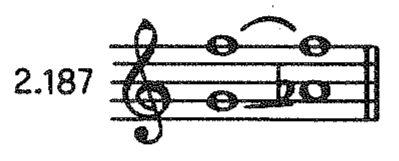

*Primjer 2.187. — str. 88.*

MuseScore prijepis: *bit će dodan.*
<!-- visual: 2.188; page 088 -->

> **PROVISIONAL — needs cleanup/review; cleanup_required; source_limited.** Primjer 2.188 nije odobren. Neovisni pregled: **RECROP_REQUIRED**; nije utvrđen siguran čist alternativni izrez. Razlog: All a)-e), complete staves and lower stacked figures retained. Pencil analysis above/below and handwritten brackets/numerals inside e)'s grand staff cannot be excluded by a rectangular recrop.

[Izvorni neodobreni izrez: Primjer 2.188](../images/02-dijatonika-b/primjer-2-188.png) · [Izvorna tiskana stranica 88](../sources/pages/page-088.png)

*Primjer 2.188. — str. 88.*

MuseScore prijepis: *bit će dodan.*

U svim slučajevima do sada septima se rješavala normalno: ona je za sekundu silazila (u rješenjima u harmonije I, VI i III stupnja) ili je ostajala ležati, a tada je temeljni ton septakorda za sekundu uzlazio (u rješenjima u harmoniju IV stupnja). Međutim, septima se može voditi i drukčije, iznimno, kada za to postoje određeni uvjeti.

Septima može uzlaziti za sekundu kada se nalazi u nekom unutarnjem glasu ako svi gornji glasovi dolaze na septakord uzlaznim pomakom i uzlaznim ga pomakom i napuštaju, dok se bas pritom kreće silazno, dakle u protupomaku (pr. 2.189).

<!-- visual: 2.189; page 088 -->

> **PROVISIONAL — needs cleanup/review; cleanup_required; source_limited.** Primjer 2.189 nije odobren. Neovisni pregled: **RECROP_REQUIRED**; nije utvrđen siguran čist alternativni izrez. Razlog: All a)-e), printed NE and lower figures retained; page 88 excluded. Pencil circle around NE, extra internal numerals/brackets and lower Roman-numeral handwriting occupy required example bounds.

[Izvorni neodobreni izrez: Primjer 2.189](../images/02-dijatonika-b/primjer-2-189.png) · [Izvorna tiskana stranica 88](../sources/pages/page-088.png)

*Primjer 2.189. — str. 88.*

MuseScore prijepis: *bit će dodan.*

<!-- source-page: 089; pdf-page: 45 -->

Septima može uzlaziti za sekundu i kada se nalazi u sopranu, u prohodnom terckvartakordu: tada se svi glasovi kreću postepeno, a vanjski, osim toga, čine pomak u paralelnim decimama, gdje ni paralelne kvinte (sa smanjene na čistu) nisu pogrešne (pr. 2.190). To je slučaj sličan prohodnome sekstakordu VII stupnja (usporedi pr. 2.109).

<!-- visual: 2.190; page 089 -->

> **PROVISIONAL — needs cleanup/review; cleanup_required; source_limited.** Primjer 2.190 nije odobren. Neovisni pregled: **RECROP_REQUIRED**; nije utvrđen siguran čist alternativni izrez. Razlog: Both printed variants, interval brackets and lower figures retained. Pencil analysis and lettering between the staves, around a), and below the figures are source handwriting, not specks; internal marks cannot be removed by cropping.

[Izvorni neodobreni izrez: Primjer 2.190](../images/02-dijatonika-b/primjer-2-190.png) · [Izvorna tiskana stranica 89](../sources/pages/page-089.png)

*Primjer 2.190. — str. 89.*

MuseScore prijepis: *bit će dodan.*

Septima **mora** uzlaziti za sekundu u spoju V₇—I₆, gdje temeljni, odnosno basov ton septakorda silazi za tercu i tako preuzima rješenje septime; septima sada ne smije biti u sopranu, a temeljni ton septakorda ne smije se udvajati (pr. 2.191). Silaženjem septime nastao bi loš pomak iz intervala septime u interval oktave (pr. 2.192).

<!-- visual: 2.191; page 089 -->

> **PROVISIONAL — needs cleanup/review; cleanup_required; source_limited.** Primjer 2.191 nije odobren. Neovisni pregled: **RECROP_REQUIRED**; nije utvrđen siguran čist alternativni izrez. Razlog: Number, a)-c), NE and complete printed figures intact. Pencil 7, circled bass accidental/chord and handwritten lower analysis overlap the printed example's vertical and horizontal bounds.

[Izvorni neodobreni izrez: Primjer 2.191](../images/02-dijatonika-b/primjer-2-191.png) · [Izvorna tiskana stranica 89](../sources/pages/page-089.png)

*Primjer 2.191. — str. 89.*

MuseScore prijepis: *bit će dodan.*
<!-- visual: 2.192; page 089 -->

> **PROVISIONAL — needs cleanup/review; cleanup_required; source_limited.** Primjer 2.192 nije odobren. Neovisni pregled: **RECROP_REQUIRED**; nije utvrđen siguran čist alternativni izrez. Razlog: Printed NE, number, both staves and 7/6 retained, but a pencil circle surrounds NE and reaches its label-height range. Removing the circle with a straight upper edge would cut the printed NE.

[Izvorni neodobreni izrez: Primjer 2.192](../images/02-dijatonika-b/primjer-2-192.png) · [Izvorna tiskana stranica 89](../sources/pages/page-089.png)

*Primjer 2.192. — str. 89.*

MuseScore prijepis: *bit će dodan.*

U spoju V43 — I₆ septima može skakati iznimno i za kvartu dolje, a tada basov ton sekstakorda preuzima rješenje septime (pr. 2.193). U Beethovenovoj Sonati za klavir u c-molu, op. 10, br. 1, nalazimo silazni skok septime za kvartu i pri rješenju dominantnog kvintsekstakorda, gdje bas ne preuzima rješenje septime, ali je tamo kretanje septime opravdano motivički, jer taj silazni skok za kvartu predstavlja odgovor na uzlazni skok za kvartu u prethodnoj frazi (pr. 2.194).

<!-- visual: 2.193; page 089 -->

> **PROVISIONAL — needs cleanup/review; cleanup_required; source_limited.** Primjer 2.193 nije odobren. Neovisni pregled: **RECROP_REQUIRED**; nije utvrđen siguran čist alternativni izrez. Razlog: Number, full staves, accidentals and 4/3/6 retained. Pencil numerals above, diagonal/circle through the staff and handwritten analysis below/right are inseparable from the complete printed example by rectangular cropping.

[Izvorni neodobreni izrez: Primjer 2.193](../images/02-dijatonika-b/primjer-2-193.png) · [Izvorna tiskana stranica 89](../sources/pages/page-089.png)

*Primjer 2.193. — str. 89.*

MuseScore prijepis: *bit će dodan.*

<!-- source-page: 090; pdf-page: 46 -->

<!-- visual: 2.194; page 090 -->

> **PROVISIONAL — needs cleanup/review; cleanup_required; source_limited.** Primjer 2.194 nije odobren. Neovisni pregled: **RECROP_REQUIRED**; nije utvrđen siguran čist alternativni izrez. Razlog: Full example and printed B: V6/5 I analysis retained. Pencil Es: V and further handwritten harmonic analysis below, together with the circle around the printed analysis, overlap the required bottom content range.

[Izvorni neodobreni izrez: Primjer 2.194](../images/02-dijatonika-b/primjer-2-194.png) · [Izvorna tiskana stranica 90](../sources/pages/page-090.png)

*Primjer 2.194. — str. 90.*

MuseScore prijepis: *bit će dodan.*

Septima može skakati za kvartu dolje i kada se nalazi u basu, u spoju V₂ — I₅, ako želimo dominantnom sekundakordu dati bifunkcionalno značenje, gdje pomak basa odgovara slijedu S—T, a pomak gornjih glasova slijedu D—T (pr. 2.195).

<!-- visual: 2.195; page 090 -->

> **PROVISIONAL — needs cleanup/review; cleanup_required; source_limited.** Primjer 2.195 nije odobren. Neovisni pregled: **RECROP_REQUIRED**; nije utvrđen siguran čist alternativni izrez. Razlog: Number, a)/b), complete staves and both lower 2s retained. Pencil D-T lettering, circles and lower Roman numerals occur above, within and below the systems; no safe rectangular correction removes all of them.

[Izvorni neodobreni izrez: Primjer 2.195](../images/02-dijatonika-b/primjer-2-195.png) · [Izvorna tiskana stranica 90](../sources/pages/page-090.png)

*Primjer 2.195. — str. 90.*

MuseScore prijepis: *bit će dodan.*

Uzlazni pomak septime u primjeru 2.196. ne znači nikakvo iznimno rješenje jer se za vrijeme toga pomaka ne mijenja harmonija; do rješenja septime dolazi naknadno, a ton »g«, na koji je septima najprije krenula, smatra se ovdje njezinim izmjeničnim tonom, koji nastupa postepenim pomakom, a odlazi skokom na novi akordički ton.

<!-- visual: 2.196; page 090 -->

> **PROVISIONAL — needs cleanup/review; cleanup_required; source_limited.** Primjer 2.196 nije odobren. Neovisni pregled: **RECROP_REQUIRED**; nije utvrđen siguran čist alternativni izrez. Razlog: Printed curved arrow, full notation and 7/8 retained. A separate pencil arrow from the prose above enters the printed arrow/note area, and handwritten V/VI remain below; removing the internal pencil arrow would require altering source pixels or clipping notation.

[Izvorni neodobreni izrez: Primjer 2.196](../images/02-dijatonika-b/primjer-2-196.png) · [Izvorna tiskana stranica 90](../sources/pages/page-090.png)

*Primjer 2.196. — str. 90.*

MuseScore prijepis: *bit će dodan.*

Dominantni septakord je najtipičniji i najuvjerljiviji predstavnik dominantne funkcije jer njegova dva karakteristična tona, vođica i septima, prirodno vode u temeljni ton i tercu toničkog kvintakorda. Zato se u autentičnim kadencama on — između svih akorda dominantne funkcije — najčešće primjenjuje, o čemu svjedoče brojni primjeri iz muzičke literature (pr. 2.197—2.199).

<!-- source-page: 091; pdf-page: 46 -->

<!-- visual: 2.197; page 091 -->

> **PROVISIONAL — needs cleanup/review; cleanup_required; source_limited.** Primjer 2.197 nije odobren. Neovisni pregled: **RECROP_REQUIRED**; nije utvrđen siguran čist alternativni izrez. Razlog: Full Bach Koral br.11 attribution, number, signatures, fermatas and lower 8/7 retained. Pencil circles on notes and handwritten harmonic figures between/under the staves remain within required content bounds.

[Izvorni neodobreni izrez: Primjer 2.197](../images/02-dijatonika-b/primjer-2-197.png) · [Izvorna tiskana stranica 91](../sources/pages/page-091.png)

*Primjer 2.197. — str. 91.*

MuseScore prijepis: *bit će dodan.*
<!-- visual: 2.198; page 091 -->

> **PROVISIONAL — needs cleanup/review; cleanup_required; source_limited.** Primjer 2.198 nije odobren. Neovisni pregled: **RECROP_REQUIRED**; nije utvrđen siguran čist alternativni izrez. Razlog: Complete Beethoven G-dur op.14 br.2 attribution and all notation retained, including the very low bass stem/note and printed 7. Pencil harmonic numerals below begin within the vertical range needed for these low printed elements; clean bottom trimming is unsafe.

[Izvorni neodobreni izrez: Primjer 2.198](../images/02-dijatonika-b/primjer-2-198.png) · [Izvorna tiskana stranica 91](../sources/pages/page-091.png)

*Primjer 2.198. — str. 91.*

MuseScore prijepis: *bit će dodan.*
<!-- visual: 2.199; page 091 -->

> **PROVISIONAL — needs cleanup/review; cleanup_required; source_limited.** Primjer 2.199 nije odobren. Neovisni pregled: **RECROP_REQUIRED**; nije utvrđen siguran čist alternativni izrez. Razlog: Schumann Jugend-Album op.68, 2 attribution, number, signature, complete staves and lower 7 retained. Pencil analysis beneath this example and handwritten material at the upper edge from the preceding example prevent a clean complete rectangle; internal/low-range marks cannot all be trimmed out.

[Izvorni neodobreni izrez: Primjer 2.199](../images/02-dijatonika-b/primjer-2-199.png) · [Izvorna tiskana stranica 91](../sources/pages/page-091.png)

*Primjer 2.199. — str. 91.*

MuseScore prijepis: *bit će dodan.*

#### ZADACI

<!-- visual: zadatak 1; page 091 -->

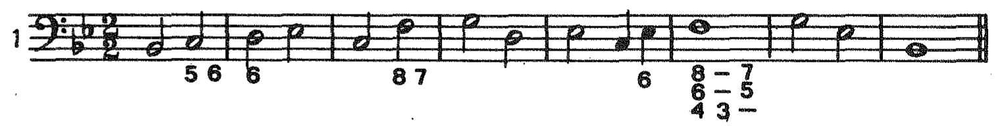

*Zadatak 1. — str. 91.*

MuseScore prijepis: *bit će dodan.*
<!-- visual: zadatak 2; page 091 -->

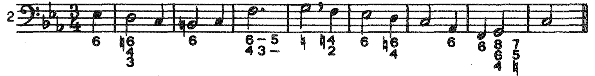

*Zadatak 2. — str. 91.*

MuseScore prijepis: *bit će dodan.*
<!-- visual: zadatak 3; page 091 -->

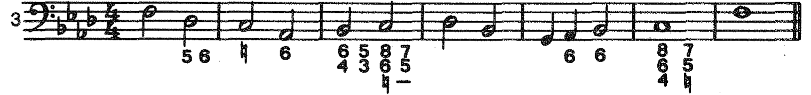

*Zadatak 3. — str. 91.*

MuseScore prijepis: *bit će dodan.*
<!-- visual: zadatak 4; page 091 -->

> **PROVISIONAL — needs cleanup/review; cleanup_required; source_limited.** Zadatak 4 nije odobren. Neovisni pregled: **RECROP_REQUIRED**; nije utvrđen siguran čist alternativni izrez. Razlog: Exercise 4's lowest 4/3 continuation reaches source y=2247, while exercise 5's high ledger-note group begins at y=2244. Current bottom 2256 admits the top of that foreign note. No horizontal bottom boundary preserves all exercise-4 figures and excludes all exercise-5 ink; side trimming would lose required exercise-4 staff/analysis.

[Izvorni neodobreni izrez: Zadatak 4](../images/02-dijatonika-b/zadatak-2-91-4.png) · [Izvorna tiskana stranica 91](../sources/pages/page-091.png)

*Zadatak 4. — str. 91.*

MuseScore prijepis: *bit će dodan.*
<!-- visual: zadatak 5; page 091 -->

> **PROVISIONAL — needs cleanup/review; cleanup_required; source_limited.** Zadatak 5 nije odobren. Neovisni pregled: **RECROP_REQUIRED**; nije utvrđen siguran čist alternativni izrez. Razlog: Current top 2245 contains lower figure fragments from exercise 4. Exercise 5's highest ledger note begins at source y=2244, above the end of exercise 4's analysis at y=2247; a lower top edge would cut that note, while an upper one retains foreign figures. No safe full-width rectangular separation exists.

[Izvorni neodobreni izrez: Zadatak 5](../images/02-dijatonika-b/zadatak-2-91-5.png) · [Izvorna tiskana stranica 91](../sources/pages/page-091.png)

*Zadatak 5. — str. 91.*

MuseScore prijepis: *bit će dodan.*

<!-- source-page: 092; pdf-page: 47 -->

<!-- visual: zadatak 6; page 092 -->

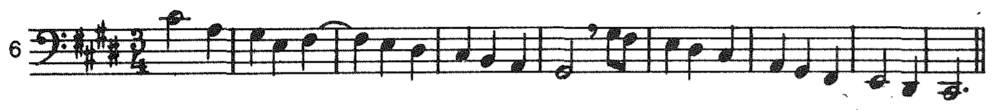

*Zadatak 6. — str. 92.*

MuseScore prijepis: *bit će dodan.*
<!-- visual: zadatak 7; page 092 -->

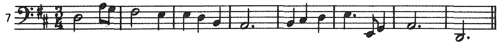

*Zadatak 7. — str. 92.*

MuseScore prijepis: *bit će dodan.*
<!-- visual: zadatak 8; page 092 -->

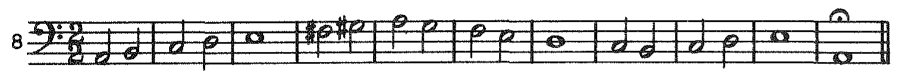

*Zadatak 8. — str. 92.*

MuseScore prijepis: *bit će dodan.*
<!-- visual: zadatak 9; page 092 -->

*Zadatak 9. — str. 92.*

MuseScore prijepis: *bit će dodan.*
<!-- visual: zadatak 10; page 092 -->

*Zadatak 10. — str. 92.*

MuseScore prijepis: *bit će dodan.*
<!-- visual: zadatak 11; page 092 -->

*Zadatak 11. — str. 92.*

MuseScore prijepis: *bit će dodan.*
<!-- visual: zadatak 12; page 092 -->

*Zadatak 12. — str. 92.*

MuseScore prijepis: *bit će dodan.*
<!-- visual: zadatak 13; page 092 -->

*Zadatak 13. — str. 92.*

MuseScore prijepis: *bit će dodan.*
<!-- visual: zadatak 14; page 092 -->

*Zadatak 14. — str. 92.*

MuseScore prijepis: *bit će dodan.*
<!-- visual: zadatak 15; page 092 -->

*Zadatak 15. — str. 92.*

MuseScore prijepis: *bit će dodan.*
<!-- visual: zadatak 16; page 092 -->

*Zadatak 16. — str. 92.*

MuseScore prijepis: *bit će dodan.*

<!-- source-page: 093; pdf-page: 47 -->

Realizacija zadatka 13.

<!-- visual: Realizacija zadatka 13.; page 093 -->

*Realizacija zadatka 13. — str. 93.*

MuseScore prijepis: *bit će dodan.*

### 2.5.2. Sporedni septakordi u duru

Svi su septakordi, osim dominantnoga, sporedni. Kod sporednih septakorda u duru (pr. 2.200) — za razliku od dominantnog septakorda — septima se, kao disonanca, pripravlja. Međutim, njihova rješenja izvode se po principima koji vrijede i pri rješavanju dominantnog septakorda. Prema tome sporedni se septakordi (i njihovi obrati) rješavaju u kvintakorde (i njihove

<!-- visual: 2.200; page 093 -->

*Primjer 2.200. — str. 93.*

MuseScore prijepis: *bit će dodan.*

<!-- continuation: prethodni odlomak nastavlja se nakon primjera 2.200. -->

obrate) koji leže: a) kvartu više (po analogiji na rješenje V₇ — I), b) sekundu više (po analogiji na rješenje V₇ — VI), c) tercu niže (po analogiji na rješenje V₇ — III), d) sekundu niže (po analogiji na rješenje V₇ — IV). U prva tri slučaja septima se pripravlja i postepenim pomakom silazi, a u slučaju d) septima se također pripravlja, ali ostaje ležati, dok temeljni ton septakorda postepenim pomakom ulazi (pr. 2.201). Posve je razumljivo da

<!-- continuation: odlomak se nastavlja na stranici 094; riječ otpa- / daju dehifenirana je na početku nastavka. -->

<!-- visual: 2.201; page 093 -->

> **PROVISIONAL — needs cleanup/review; cleanup_required; source_limited.** Primjer 2.201 nije odobren. Neovisni pregled: **RECROP_REQUIRED**; nije utvrđen siguran čist alternativni izrez. Razlog: All a)-d), ties, lowest stems and 7/2/6 analysis retained; page 93 excluded. Pencil Roman numerals below and circles/strokes in the upper notation range remain within the required printed bounds.

[Izvorni neodobreni izrez: Primjer 2.201](../images/02-dijatonika-b/primjer-2-201.png) · [Izvorna tiskana stranica 93](../sources/pages/page-093.png)

*Primjer 2.201. — str. 93.*

MuseScore prijepis: *bit će dodan.*

<!-- source-page: 094; pdf-page: 48 -->

<!-- continuation: nastavak sa stranice 093; riječ otpa- / daju spojena je kao otpadaju. -->

otpadaju pojedinačna rješenja koja bi rezultirala udvajanjem vođice ili pomakom u intervalu povećane kvarte, kao i rješenja u nepripravljeni smanjeni kvintakord, poput IV₇ — VII ili VI₇ — VII (pr. 2.202). Naprotiv, spoj II₂ — VII je izvodiv jer je ovdje moguće pripraviti smanjenu kvintu kvintakorda VII stupnja, a također su bez prigovora i rješenja u kojima se harmonija VII stupnja pojavljuje u obliku sekstakorda (pr. 2.203. i 2.201.d).

<!-- visual: 2.202; page 094 -->

> **PROVISIONAL — needs cleanup/review; cleanup_required; source_limited.** Primjer 2.202 nije odobren. Neovisni pregled: **RECROP_REQUIRED**; nije utvrđen siguran čist alternativni izrez. Razlog: Number, a)/b), both NE labels, full staves and lower 7s intact. Pencil lettering above and Roman-numeral analysis below overlap required labels/low stems, so a clean complete rectangle cannot be selected.

[Izvorni neodobreni izrez: Primjer 2.202](../images/02-dijatonika-b/primjer-2-202.png) · [Izvorna tiskana stranica 94](../sources/pages/page-094.png)

*Primjer 2.202. — str. 94.*

MuseScore prijepis: *bit će dodan.*
<!-- visual: 2.203; page 094 -->

> **PROVISIONAL — needs cleanup/review; cleanup_required; source_limited.** Primjer 2.203 nije odobren. Neovisni pregled: **RECROP_REQUIRED**; nije utvrđen siguran čist alternativni izrez. Razlog: Printed DA, number, complete notation and lowest 2 retained. Pencil circle around DA, circle/strokes between staves and lower Roman numerals lie inside the required example envelope.

[Izvorni neodobreni izrez: Primjer 2.203](../images/02-dijatonika-b/primjer-2-203.png) · [Izvorna tiskana stranica 94](../sources/pages/page-094.png)

*Primjer 2.203. — str. 94.*

MuseScore prijepis: *bit će dodan.*

I iznimna rješenja septime nastaju kod sporednih septakorda uz iste uvjete kao i kod dominantnog septakorda, jedino što kod sporednih ne dolaze u obzir slučajevi izneseni u primjeru 2.189 (jer se tamo radi o septimi koja nije pripravljena) i u primjeru 2.190 — iako je tamo septima pripravljena u donjem glasu — jer bi u toj progresiji, transponiranoj na neki drugi stupanj, nastale pogrešne paralelne kvinte, tj. pomak s čiste kvinte na čistu kvintu. Prohodna septima kod sporednih septakorda upotrebljava se jednako kao i kod dominantnog septakorda, a kad nastupa u basu, može istodobno s njom nastupiti u nekom gornjem glasu u protupomaku i temeljni ton, što se redovito zbiva kod promjene položaja unutar te iste harmonije (pr. 2.204). Za razliku od dominantnog septakorda, kod sporednih se može, kada nastupaju u nepotpunom obliku, udvajati ne samo temeljni ton nego i terca (pr. 2.205).

<!-- visual: 2.204; page 094 -->

> **PROVISIONAL — needs cleanup/review; cleanup_required; source_limited.** Primjer 2.204 nije odobren. Neovisni pregled: **RECROP_REQUIRED**; nije utvrđen siguran čist alternativni izrez. Razlog: Number, full staves, bass motion and complete 5-continuation-6 analysis retained. Pencil arrow, inter-staff word and circled bass/analysis are internal source handwriting that no edge-only recrop can exclude.

[Izvorni neodobreni izrez: Primjer 2.204](../images/02-dijatonika-b/primjer-2-204.png) · [Izvorna tiskana stranica 94](../sources/pages/page-094.png)

*Primjer 2.204. — str. 94.*

MuseScore prijepis: *bit će dodan.*
<!-- visual: 2.205; page 094 -->

> **PROVISIONAL — needs cleanup/review; cleanup_required; source_limited.** Primjer 2.205 nije odobren. Neovisni pregled: **RECROP_REQUIRED**; nije utvrđen siguran čist alternativni izrez. Razlog: Number, all chord positions, lowest 7 figures and barline retained. Pencil arrow above, numerals/circles around notes within the grand staff and handwritten Roman numerals below prevent a clean rectangular extraction.

[Izvorni neodobreni izrez: Primjer 2.205](../images/02-dijatonika-b/primjer-2-205.png) · [Izvorna tiskana stranica 94](../sources/pages/page-094.png)

*Primjer 2.205. — str. 94.*

MuseScore prijepis: *bit će dodan.*

Posebno mjesto među sporednim septakordima — i u duru i u molu — — zauzimao je nekoć kvintsekstakord II stupnja, koji je francuski kompozitor i teoretičar J. Ph. Rameau (1683—1764) nazvao »sixte ajoutée« — — **dodana seksta**. Tim se nazivom željelo naglasiti subdominantni karakter akorda, jer se on može interpretirati i kao subdominantni kvintakord s dodanom sekstom, odnosno kao kvintsekstakord na IV stupnju ili na subdominanti (pr. 2.206.a) i to kada nastupa u progresiji II65 — I, gdje se

<!-- continuation: odlomak nastavlja se na stranici 095. -->

<!-- source-page: 095; pdf-page: 48 -->

<!-- continuation: nastavak odlomka sa stranice 094. -->

septima, tj. kvinta kvintsekstakorda, ponaša upravo kao što bi se ponašala i kvinta subdominantnog kvintakorda u analognom spoju IV — I, naime, ona ostaje ležati (pr. 2.206.b i c). Zanimljivo je da s takvim akordom počinje i jedna od najpopularnijih Beethovenovih klavirskih kompozicija (pr. 2.207).

<!-- visual: 2.206; page 095 -->

> **PROVISIONAL — needs cleanup/review; cleanup_required; source_limited.** Primjer 2.206 nije odobren. Neovisni pregled: **RECROP_REQUIRED**; nije utvrđen siguran čist alternativni izrez. Razlog: All a)-c), number, brackets, accidentals and complete 6/5 analysis retained. A faint but coherent handwritten 7 directly above b)'s first bass note is inside the grand staff; it is not a speck and cannot be removed by changing crop edges.

[Izvorni neodobreni izrez: Primjer 2.206](../images/02-dijatonika-b/primjer-2-206.png) · [Izvorna tiskana stranica 95](../sources/pages/page-095.png)

*Primjer 2.206. — str. 95.*

MuseScore prijepis: *bit će dodan.*
<!-- visual: 2.207; page 095 -->

> **PROVISIONAL — needs cleanup/review; cleanup_required; source_limited.** Primjer 2.207 nije odobren. Neovisni pregled: **RECROP_REQUIRED**; nije utvrđen siguran čist alternativni izrez. Razlog: Full Beethoven Es-dur op.31 br.3 attribution, signatures, low ledger chords and final accidental retained. Pencil analysis below the left bass starts before the vertical end of the required rightmost low accidental, so a clean bottom trim would clip printed content; lower-right handwriting also remains.

[Izvorni neodobreni izrez: Primjer 2.207](../images/02-dijatonika-b/primjer-2-207.png) · [Izvorna tiskana stranica 95](../sources/pages/page-095.png)

*Primjer 2.207. — str. 95.*

MuseScore prijepis: *bit će dodan.*

Septakordi se mogu spajati i međusobno, i to opet po analogiji na spojeve dominantnog septakorda s kvintakordima: a) septakord sa septakordom koji leži kvartu više; b) septakord sa septakordom koji leži sekundu više; c) septakord sa septakordom koji leži tercu niže. Ako je u spoju septakorda sa septakordom, koji leži kvartu više prvi septakord potpun, drugi ispada nepotpun i obratno (pr. 2.208.a i b). Međutim, u spoju II₇ — V₇ može septakord V stupnja uvijek biti potpun jer kod njega ne treba pripraviti septimu (2.208.c). U obratima se septakord sa septakordom, koji leži kvartu više, spaja tako da zajednički tonovi (a to su uvijek prima i terca prvoga) leže, dok druga dva postepenim pomakom silaze, pa se pritom dobivaju simetrični odnosi obrata: ₇ — 43 ili 43 — ₇ i 65 — ₂ ili ₂ — 65 (pr. 2.209).

<!-- visual: 2.208; page 095 -->

> **PROVISIONAL — needs cleanup/review; cleanup_required; source_limited.** Primjer 2.208 nije odobren. Neovisni pregled: **RECROP_REQUIRED**; nije utvrđen siguran čist alternativni izrez. Razlog: All a)-c), complete systems, lowest stems and 7/4/3 analysis retained. Pencil words/analysis above and below and strokes around the upper notes are coherent source handwriting within the complete example bounds.

[Izvorni neodobreni izrez: Primjer 2.208](../images/02-dijatonika-b/primjer-2-208.png) · [Izvorna tiskana stranica 95](../sources/pages/page-095.png)

*Primjer 2.208. — str. 95.*

MuseScore prijepis: *bit će dodan.*

<!-- source-page: 096; pdf-page: 49 -->

<!-- visual: 2.209; page 096 -->

> **PROVISIONAL — needs cleanup/review; cleanup_required; source_limited.** Primjer 2.209 nije odobren. Neovisni pregled: **RECROP_REQUIRED**; nije utvrđen siguran čist alternativni izrez. Razlog: All a)-d), full notation and lower 7/4/3/6/5/2 analysis retained. Faint pencil diagonals and small handwritten figures occur within a)'s staves and near b)'s upper notation; these internal strokes cannot be excluded by safe edge changes.

[Izvorni neodobreni izrez: Primjer 2.209](../images/02-dijatonika-b/primjer-2-209.png) · [Izvorna tiskana stranica 96](../sources/pages/page-096.png)

*Primjer 2.209. — str. 96.*

MuseScore prijepis: *bit će dodan.*

Kod spoja septakorda sa septakordom, koji leži sekundu više, u prvom septakordu mora se udvojiti temeljni ton, jer se njime pripravlja septima drugoga (pr. 2.210.a). Ali u spoju IV₇ — V₇ to nije potrebno, jer se u septakordu V stupnja opet septima ne mora pripraviti (pr. 2.210.b) — iako spoj bolje zvuči kada je ona pripravljena. Udvajanje temeljnoga tona u prvom septakordu nužno je samo kad oba nastupaju u temeljnom obliku. U spojevima gdje su uključeni i obrati udvajanje nije potrebno (pr. 2.210.c—g).

<!-- visual: 2.210; page 096 -->

> **PROVISIONAL — needs cleanup/review; cleanup_required; source_limited.** Primjer 2.210 nije odobren. Neovisni pregled: **RECROP_REQUIRED**; nije utvrđen siguran čist alternativni izrez. Razlog: Both systems a)-h), NE/asterisk labels and complete lowest figures/stems retained; footnote prose excluded. Pencil circles, Roman numerals, DA and additional brackets/figures are embedded between and inside the staves, making a clean rectangular recrop impossible.

[Izvorni neodobreni izrez: Primjer 2.210](../images/02-dijatonika-b/primjer-2-210.png) · [Izvorna tiskana stranica 96](../sources/pages/page-096.png)

*Primjer 2.210. — str. 96.*

MuseScore prijepis: *bit će dodan.*

\* Paralelne kvarte u vanjskim glasovima ne zvuče dobro.

Najjednostavnije se izvodi spoj septakorda sa septakordom koji leži tercu niže, jer septima prvog septakorda silazi, a svi ostali tonovi leže, pa drugi septakord onda automatski ispada u drugom obratu po redu, tako da se dobivaju ovi parovi spojeva: ₇ — 65, 65 — 43, 43 — ₂, ₂ — ₇ (pr. 2.211).

<!-- source-page: 097; pdf-page: 49 -->

<!-- visual: 2.211; page 097 -->

> **PROVISIONAL — needs cleanup/review; cleanup_required; source_limited.** Primjer 2.211 nije odobren. Neovisni pregled: **RECROP_REQUIRED**; nije utvrđen siguran čist alternativni izrez. Razlog: All a)-d), full staves and lowest analysis retained. Pencil arrows above the upper notes, strokes touching notation and Roman numerals below are source handwriting in the required example envelope.

[Izvorni neodobreni izrez: Primjer 2.211](../images/02-dijatonika-b/primjer-2-211.png) · [Izvorna tiskana stranica 97](../sources/pages/page-097.png)

*Primjer 2.211. — str. 97.*

MuseScore prijepis: *bit će dodan.*

Septakord I stupnja ima veliku septimu kojoj je bliži uzlazni nego silazni postepeni pomak, to više što je ona osim toga i vođica. Stoga se ona može voditi i postepenim pomakom naviše. U tom se slučaju doima kao uzlazna zaostajalica, ali se tada mora nalaziti uvijek iznad temeljnoga tona (pr. 2.212.a). U protivnom slučaju temeljni ton bi zvučio iznad septime i na neki način priječio joj uzlazno kretanje (pr. 2.212.b). Prema tome se septakord I stupnja — analogno i septakord IV stupnja jer i on ima veliku septimu — može rješavati u kvintakorde i u druge septakorde i tako da pritom njegova septima uzlazi, umjesto da silazi (pr. 2.213). Naravno, varijanta s uzlaznom septimom ne dolazi u obzir kod sekundakorda, jer je tamo temeljni ton uvijek iznad septime.

<!-- visual: 2.212; page 097 -->

> **PROVISIONAL — needs cleanup/review; cleanup_required; source_limited.** Primjer 2.212 nije odobren. Neovisni pregled: **RECROP_REQUIRED**; nije utvrđen siguran čist alternativni izrez. Razlog: Number, a)/b), low notes/stems and printed 7/8 retained. Pencil DOBRO/SLABO/NE-type annotations above and pencil circle around the lower 7/8 overlap printed label/figure ranges; clean full rectangular recropping is unavailable.

[Izvorni neodobreni izrez: Primjer 2.212](../images/02-dijatonika-b/primjer-2-212.png) · [Izvorna tiskana stranica 97](../sources/pages/page-097.png)

*Primjer 2.212. — str. 97.*

MuseScore prijepis: *bit će dodan.*
<!-- visual: 2.213.a—m; page 097 -->

> **PROVISIONAL — needs cleanup/review; cleanup_required; source_limited.** Primjer 2.213.a—m nije odobren. Neovisni pregled: **RECROP_REQUIRED**; nije utvrđen siguran čist alternativni izrez. Razlog: Printed 2.213 and all first-page variants a)-m), both systems, starred figures and lowest stacked analysis retained; footnote prose and page 97 excluded. Pencil circles/analysis inside and between systems and along the bottom prevent a clean rectangle. This is the first portion, not the entire cross-page example; n)-t) continue on page 98.

[Izvorni neodobreni izrez: Primjer 2.213.a—m](../images/02-dijatonika-b/primjer-2-213-p97.png) · [Izvorna tiskana stranica 97](../sources/pages/page-097.png)

*Primjer 2.213.a—m. — str. 97.*

MuseScore prijepis: *bit će dodan.*

\* U šifraži se interval uzlazne septime stavlja iznad intervala temeljnog tona (iako je to manja brojka) da bi se time naglasila neophodnost postavljanja septime iznad temeljnog tona.

<!-- source-page: 098; pdf-page: 50 -->

<!-- visual: 2.213.n—t (nastavak); page 098 -->

> **PROVISIONAL — needs cleanup/review; cleanup_required; source_limited.** Primjer 2.213.n—t (nastavak) nije odobren. Neovisni pregled: **RECROP_REQUIRED**; nije utvrđen siguran čist alternativni izrez. Razlog: All source continuation labels n), o), p), r), s), t), full staves, t)'s 2/2 signatures and lowest stacked figures retained. No repeated 2.213 is printed here, so its absence is not a clipping defect. Pencil circles/Roman numerals beneath and touching the figure-height range prevent a clean full rectangle; use with page-97 portion.

[Izvorni neodobreni izrez: Primjer 2.213.n—t (nastavak)](../images/02-dijatonika-b/primjer-2-213-p98.png) · [Izvorna tiskana stranica 98](../sources/pages/page-098.png)

*Primjer 2.213.n—t (nastavak). — str. 98.*

MuseScore prijepis: *bit će dodan.*

Septakordima se dobiva čvršća međusobna povezanost harmonija koja proizlazi iz pripravljanja septime, kao i iz težnje za određenim rješenjem akorda u kome se ona pojavljuje. Uključivanje kvintsekstakorda II stupnja u mješovitu kadencu, na mjestu subdominantne harmonije, daje takvoj kadenci naročitu uvjerljivost, jer kvintsekstakord II stupnja ne samo da vrlo dobro zastupa subdominantnu funkciju nego i kao disonantni akord određenije traži nastavak dominantnim kvintakordom (pr. 2.214.a). Umjesto direktnog nastupa dominantnog kvintakorda poslije kvintsekstakorda II stupnja može uslijediti najprije kadencirajući kvartsekstakord, tako da će se onda kvinta kvintsekstakorda II stupnja, tj. septima, riješiti naknadno, kao zaostajalica na tercu dominantnog kvintakorda (pr. 2.214.b).

<!-- visual: 2.214.a; page 098 -->

> **PROVISIONAL — needs cleanup/review; cleanup_required; source_limited.** Primjer 2.214.a nije odobren. Neovisni pregled: **RECROP_REQUIRED**; nije utvrđen siguran čist alternativni izrez. Razlog: Printed 2.214, a), full Bach Koral br.7 attribution, sharp/time signatures, fermatas and 6/5 retained. Pencil harmonic letters above/around the attribution and Roman numerals below overlap the required label/notation envelope; cannot safely crop all handwriting away.

[Izvorni neodobreni izrez: Primjer 2.214.a](../images/02-dijatonika-b/primjer-2-214-a.png) · [Izvorna tiskana stranica 98](../sources/pages/page-098.png)

*Primjer 2.214.a. — str. 98.*

MuseScore prijepis: *bit će dodan.*
<!-- visual: 2.214.b; page 098 -->

> **PROVISIONAL — needs cleanup/review; cleanup_required; source_limited.** Primjer 2.214.b nije odobren. Neovisni pregled: **RECROP_REQUIRED**; nije utvrđen siguran čist alternativni izrez. Razlog: Printed b), Bach Koral br.71 attribution, complete signatures, low bass stems/fermata and full figured bass retained. The example number is printed only with part a), not clipped here. Pencil words above, arrows inside the staves and analysis below make the split part source-limited; retain association with 2.214.a.

[Izvorni neodobreni izrez: Primjer 2.214.b](../images/02-dijatonika-b/primjer-2-214-b.png) · [Izvorna tiskana stranica 98](../sources/pages/page-098.png)

*Primjer 2.214.b. — str. 98.*

MuseScore prijepis: *bit će dodan.*

Mješovita kadenca može se izvesti i pomoću septakorda IV i V stupnja (pr. 2.215.a); ali ona najbolje djeluje ako je septakord IV stupnja u tom kontekstu nepotpun i ako mu je septima u sopranu (pr. 2.215.b). Ako je ipak potpun, onda može septakord V stupnja uslijediti s nepripravljenom

<!-- continuation: odlomak nastavlja se na stranici 099. -->

<!-- source-page: 099; pdf-page: 50 -->

<!-- continuation: nastavak odlomka sa stranice 098. -->

septimom, što opet zvuči tvrdo (pr. 2.215.c), ali se i to može izbjeći ili spretnim vođenjem unutarnjih glasova (2.215.d) ili upotrebom sekste kao zaostajalice na kvintu septakorda V stupnja, s time da septima nastupi u prohodu, zajedno s rješenjem zaostajalice (pr. 2.215.e—g), a naročito je elegantno rješenje, gdje je moguće upotrijebiti i na IV i na V stupnju prohodnu septimu (pr. 2.215.h).

<!-- visual: 2.215; page 099 -->

> **PROVISIONAL — needs cleanup/review; cleanup_required; source_limited.** Primjer 2.215 nije odobren. Neovisni pregled: **RECROP_REQUIRED**; nije utvrđen siguran čist alternativni izrez. Razlog: All a)-h), both complete systems, accidentals and lowest figured-bass stacks retained. Pencil words, circled notes, arrows and harmonic analysis lie within and between the systems; full four-edge inspection confirms no clean rectangular correction can remove these internal marks.

[Izvorni neodobreni izrez: Primjer 2.215](../images/02-dijatonika-b/primjer-2-215.png) · [Izvorna tiskana stranica 99](../sources/pages/page-099.png)

*Primjer 2.215. — str. 99.*

MuseScore prijepis: *bit će dodan.*

Najlakša primjena septakorda u harmonizaciji zadanoga glasa je ona kod koje se mogu međusobni spojevi septakorda i njihovih obrata, kao i spojevi septakorda s kvintakordima iskoristiti na način sekvence (v. poglavlje 2. 7). To je npr. uvijek slučaj kod melodijskih fragmenata u kojima se zadani glas kreće u silaznim postepenim pomacima u notama jednakog trajanja, dovoljno dugog da se na svakoj noti mogu izmijeniti dva (ili više) akorda. U primjerima 2.216 — 2.221. navedeno je nekoliko takvih tipičnih sekventnih harmonijskih progresija. One se mogu lako melodijski modificirati (npr. s promjenom položaja) i ritmički varirati, te korisno upotrijebiti u izradbi zadatka, ali njihovo trajanje ne smije biti predugo, jer onda one postaju manirom i gube na djelovanju.

<!-- visual: 2.216; page 099 -->

> **PROVISIONAL — needs cleanup/review; cleanup_required; source_limited.** Primjer 2.216 nije odobren. Neovisni pregled: **RECROP_REQUIRED**; nije utvrđen siguran čist alternativni izrez. Razlog: Number, a)/b), 4/4 signatures, phrase brackets, full staves and lower 7s retained; printed page 99 excluded. Dense pencil harmonic names above the brackets and Roman numerals beneath/within the notation envelope are not removable with a safe full-example rectangle.

[Izvorni neodobreni izrez: Primjer 2.216](../images/02-dijatonika-b/primjer-2-216.png) · [Izvorna tiskana stranica 99](../sources/pages/page-099.png)

*Primjer 2.216. — str. 99.*

MuseScore prijepis: *bit će dodan.*

<!-- source-page: 100; pdf-page: 51 -->

<!-- visual: 2.217; page 100 -->

> **PROVISIONAL — needs cleanup/review; cleanup_required; source_limited.** Primjer 2.217 nije odobren. Neovisni pregled: **RECROP_REQUIRED**; nije utvrđen siguran čist alternativni izrez. Razlog: Number, a)/b), 3/2 signatures, all phrase brackets, lowest stems and complete figures retained. Pencil circles over bass notes and handwritten Roman numerals below overlap the required printed area; a bottom trim alone would not remove the internal circles.

[Izvorni neodobreni izrez: Primjer 2.217](../images/02-dijatonika-b/primjer-2-217.png) · [Izvorna tiskana stranica 100](../sources/pages/page-100.png)

*Primjer 2.217. — str. 100.*

MuseScore prijepis: *bit će dodan.*
<!-- visual: 2.218; page 100 -->

*Primjer 2.218. — str. 100.*

MuseScore prijepis: *bit će dodan.*
<!-- visual: 2.219; page 100 -->

*Primjer 2.219. — str. 100.*

MuseScore prijepis: *bit će dodan.*
<!-- visual: 2.220; page 100 -->

*Primjer 2.220. — str. 100.*

MuseScore prijepis: *bit će dodan.*
<!-- visual: 2.221; page 100 -->

*Primjer 2.221. — str. 100.*

MuseScore prijepis: *bit će dodan.*

#### ZADACI

<!-- visual: zadatak 1; page 100 -->

*Zadatak 1. — str. 100.*

MuseScore prijepis: *bit će dodan.*
<!-- visual: zadatak 2; page 100 -->

*Zadatak 2. — str. 100.*

MuseScore prijepis: *bit će dodan.*
<!-- visual: zadatak 3; page 100 -->

*Zadatak 3. — str. 100.*

MuseScore prijepis: *bit će dodan.*

> Nastavak digitalne obrade: ova integracija završava na tiskanoj stranici 100 (PDF 51). Zadaci se nastavljaju u izvorniku; ovo nije kraj izvornog odjeljka. Stranice 101–136 nisu dio ove integracije. Otvoreno je 48 source_limited / cleanup_required mjesta iz ove serije; miljokaz nije dovršen niti ljudski odobren.

> Nastavak digitalne obrade: slijedi provjereni tekst tiskanih stranica 101–118 (PDF 51–60). Ova serija zamjenjuje prethodnu radnu granicu 100, ne mijenjajući prethodni zapis: 61 izrez ima neovisni PASS (uključujući pet ponovno pregledanih izreza), a 34 source_limited / cleanup_required mjesta ostaju vidljivo PROVISIONAL i neodobrena. Ovo nije dovršetak miljokaza niti ljudsko odobrenje.

<!-- source-page: 101; pdf-page: 51 -->

<!-- visual: zadatak 4; page 101 -->

*Zadatak 4. — tiskana str. 101.*

MuseScore prijepis: *bit će dodan.*

<!-- visual: zadatak 5; page 101 -->

*Zadatak 5. — tiskana str. 101.*

MuseScore prijepis: *bit će dodan.*

<!-- visual: zadatak 6; page 101 -->

*Zadatak 6. — tiskana str. 101.*

MuseScore prijepis: *bit će dodan.*

<!-- visual: zadatak 7; page 101 -->

*Zadatak 7. — tiskana str. 101.*

MuseScore prijepis: *bit će dodan.*

<!-- visual: zadatak 8; page 101 -->

*Zadatak 8. — tiskana str. 101.*

MuseScore prijepis: *bit će dodan.*

<!-- visual: zadatak 9; page 101 -->

*Zadatak 9. — tiskana str. 101.*

MuseScore prijepis: *bit će dodan.*

<!-- visual: zadatak 10; page 101 -->

*Zadatak 10. — tiskana str. 101.*

MuseScore prijepis: *bit će dodan.*

<!-- visual: zadatak 11; page 101 -->

*Zadatak 11. — tiskana str. 101.*

MuseScore prijepis: *bit će dodan.*

<!-- visual: zadatak 12; page 101 -->

*Zadatak 12. — tiskana str. 101.*

MuseScore prijepis: *bit će dodan.*

<!-- visual: zadatak 13; page 101 -->

*Zadatak 13. — tiskana str. 101.*

MuseScore prijepis: *bit će dodan.*

<!-- visual: zadatak 14; page 101 -->

*Zadatak 14. — tiskana str. 101.*

MuseScore prijepis: *bit će dodan.*

<!-- visual: zadatak 15; page 101 -->

*Zadatak 15. — tiskana str. 101.*

MuseScore prijepis: *bit će dodan.*

<!-- source-page: 102; pdf-page: 52 -->

<!-- visual: zadatak 16; page 102 -->

*Zadatak 16. — tiskana str. 102.*

MuseScore prijepis: *bit će dodan.*

<!-- visual: zadatak 17; page 102 -->

*Zadatak 17. — tiskana str. 102.*

MuseScore prijepis: *bit će dodan.*

<!-- visual: zadatak 18; page 102 -->

*Zadatak 18. — tiskana str. 102.*

MuseScore prijepis: *bit će dodan.*

<!-- visual: zadatak 19; page 102 -->

*Zadatak 19. — tiskana str. 102.*

MuseScore prijepis: *bit će dodan.*

<!-- visual: zadatak 20; page 102 -->

*Zadatak 20. — tiskana str. 102.*

MuseScore prijepis: *bit će dodan.*

<!-- visual: zadatak 21; page 102 -->

*Zadatak 21. — tiskana str. 102.*

MuseScore prijepis: *bit će dodan.*

<!-- visual: zadatak 22; page 102 -->

*Zadatak 22. — tiskana str. 102.*

MuseScore prijepis: *bit će dodan.*

<!-- visual: zadatak 23; page 102 -->

*Zadatak 23. — tiskana str. 102.*

MuseScore prijepis: *bit će dodan.*

Realizacija zadatka 17.

<!-- visual: Realizacija zadatka 17 (početak); page 102 -->

*Realizacija zadatka 17 (početak). — tiskana str. 102.*

MuseScore prijepis: *bit će dodan.*

<!-- source-page: 103; pdf-page: 52 -->

<!-- visual: Realizacija zadatka 17 (nastavak); page 103 -->

*Realizacija zadatka 17 (nastavak). — tiskana str. 103.*

MuseScore prijepis: *bit će dodan.*

\* Pripravom septime u septakordu VI stupnja smatra se ton »fis«, koji je nastupio na 1. dobi, jer ton »ais« (koji za njim slijedi) ne donosi još novu harmoniju.

### 2.5.3. Sporedni septakordi u molu

Kod sporednih septakorda u molu septima se — uz neke iznimke o kojima će dalje biti riječi — također pripravlja, a njihova rješenja u kvintakorde te njihovi međusobni spojevi izvode se jednako kao i kod sporednih septakorda u duru. Postoje i neke razlike, ali ne u postupku, nego u ograničenjima, odnosno u manjim mogućnostima kretanja septakorda u molu, zbog same prirode harmonijske i melodijske mol-ljestvice.

Svi sporedni septakordi u harmonijskom molu (pr. 2.222) na stanovit su način hendikepirani u kretanju »pukotinom« povećane sekunde između VI i VII stupnja ljestvice, koja priječi šestom stupnju uzlazni, a sedmome silazni postepeni pomak, što se kod svakog pojedinog septakorda na poseban način očituje.

<!-- visual: 2.222; page 103 -->

> **PROVISIONAL — needs cleanup/review; cleanup_required; source_limited.** Primjer 2.222 nije odobren. Neovisni pregled: **RECROP_REQUIRED**; nije utvrđen siguran čist alternativni izrez. Razlog: Source pencil markings lie below/against the right-hand chords and inside the notation area. Number, staff and printed Roman numerals survive, but the crop is not handwriting-free.

[Izvorni neodobreni izrez: Primjer 2.222](../images/02-dijatonika-b/primjer-2-222.png) · [Izvorna tiskana stranica 103](../sources/pages/page-103.png)

*Primjer 2.222. — tiskana str. 103.*

MuseScore prijepis: *bit će dodan.*

Kod septakorda I stupnja septima može samo uzlaziti, pa se on rješava po analogiji na septakord istoga stupnja u duru kada njegova septima uzlazi (v. pr. 2.213).

U septakordu II stupnja kvinta je smanjena, a ujedno je i silazna vodica i zato ona uvijek teži za postepenim pomakom naniže (pr. 2.223).

<!-- visual: 2.223; page 103 -->

> **PROVISIONAL — needs cleanup/review; cleanup_required; source_limited.** Primjer 2.223 nije odobren. Neovisni pregled: **RECROP_REQUIRED**; nije utvrđen siguran čist alternativni izrez. Razlog: Source handwriting occurs above and inside both staves and below the printed 7–6 figures. A rectangle cannot exclude it while retaining the entire example.

[Izvorni neodobreni izrez: Primjer 2.223](../images/02-dijatonika-b/primjer-2-223.png) · [Izvorna tiskana stranica 103](../sources/pages/page-103.png)

*Primjer 2.223. — tiskana str. 103.*

MuseScore prijepis: *bit će dodan.*

<!-- source-page: 104; pdf-page: 53 -->

Septakord III stupnja ima veliku septimu, koja se može voditi postepenim pomakom u oba smjera, i povećanu kvintu, koja dopušta samo spojeve gdje ona može postepeno uzlaziti.

Terca septakorda IV stupnja je silazna vodica. Zbog toga se taj septakord u nepotpunom obliku pojavljuje samo s udvojenim temeljnim tonom, a kod ostalih sporednih septakorda — jednako kao i u duru — može se udvajati i terca.

I septakord VI stupnja ima veliku septimu, koja se također može voditi postepenim pomakom i naviše i naniže; taj se septakord zbog povećane sekunde, koja ga dijeli od septakorda VII stupnja, ne može spajati tako da pritom oba budu u temeljnom obliku.

Izuzetni položaj među sporednim septakordima u molu pripada tzv. **smanjenom septakordu**, koji se nalazi na VII stupnju harmonijske mol-ljestvice. Svi tonovi smanjenog septakorda raspoređeni su u intervalima male terce, a one zajedno tvore interval smanjene septime (pr. 2.224.a). Smanjeni septakord — a i septakord VII stupnja u duru — može se tumačiti i kao dominantni nonakord kojemu nedostaje temeljni ton (pr. 2.224.b). Naziva se smanjenim po intervalu smanjene septime, što ga njegov najviši ton (septima) čini s temeljnim tonom. Septima smanjenog septakorda ne mora se pripravljati zato što interval smanjene septime zapravo i nije disonantan, jer je enharmonijski identičan s konsonantnim intervalom velike sekste, pa u temperiranom sistemu jednako poput nje i zvuči (pr. 2.224.c). Osim toga, septima smanjenog septakorda, kao i septima dominantnog septakorda, čini s tercom tritonus (smanjenu kvintu), kojemu se pridružuje još jedan, između kvinte i temeljnog tona (pr. 2.224.d). To stvara toliku homogenost zvuka akorda kao cjeline da se ne samo iz njega ne ističe posebno nijedan njegov ton nego ga ta homogenost čini najelastičnijim i najprilagodljivijim od svih disonantnih akorda.

<!-- visual: 2.224; page 104 -->

*Primjer 2.224. — tiskana str. 104.*

MuseScore prijepis: *bit će dodan.*

A pravilnost njegove konstrukcije (same male terce) i enharmonijska obrtljivost njegove septime u veliku sekstu (koja je opet obrat male terce) čine ga neobično zahvalnim sredstvom enharmonijske modulacije (v. poglavlje 3. 7). Smanjeni septakord VII stupnja ima dominantnu funkciju, pa se stoga rješava prije svega u tonički kvintakord (pr. 2.225), ali su jednako moguća i druga rješenja (pr. 2.226). Tipično je također rješenje smanjenog septakorda

<!-- visual: 2.225; page 104 -->

> **PROVISIONAL — needs cleanup/review; cleanup_required; source_limited.** Primjer 2.225 nije odobren. Neovisni pregled: **RECROP_REQUIRED**; nije utvrđen siguran čist alternativni izrez. Razlog: Pencil figures/lettering overlap variant a and continue beneath the printed figures across the example. All a–g variants are retained, but source handwriting requires cleanup resolution.

[Izvorni neodobreni izrez: Primjer 2.225](../images/02-dijatonika-b/primjer-2-225.png) · [Izvorna tiskana stranica 104](../sources/pages/page-104.png)

*Primjer 2.225. — tiskana str. 104.*

MuseScore prijepis: *bit će dodan.*

<!-- source-page: 105; pdf-page: 53 -->

<!-- visual: 2.226; page 105 -->

> **PROVISIONAL — needs cleanup/review; cleanup_required; source_limited.** Primjer 2.226 nije odobren. Neovisni pregled: **RECROP_REQUIRED**; nije utvrđen siguran čist alternativni izrez. Razlog: Pencil harmonic names occur alongside the upper variant labels and beneath the bass figures. The upper/lower handwritten material is not harmless scan speckling.

[Izvorni neodobreni izrez: Primjer 2.226](../images/02-dijatonika-b/primjer-2-226.png) · [Izvorna tiskana stranica 105](../sources/pages/page-105.png)

*Primjer 2.226. — tiskana str. 105.*

MuseScore prijepis: *bit će dodan.*

<!-- continuation: prethodni odlomak sa str. 104; riječ septakorda spojena na prethodnoj stranici -->
u dominantni septakord, pri čemu samo septima silazi, a drugi tonovi leže, tako da se tada septima smanjenog septakorda doima kao zaostajalica na temeljni ton dominantnog septakorda (pr. 2.227.a—d). Isto bi se, doduše, moglo reći i za analogno rješenje septakorda VII stupnja u duru, ali tamo njegova septima silazi cjelostepenim pomakom koji ne daje tako snažan dojam vezanosti i »zaostajaličnog« odnosa prema temeljnom tonu dominantnog septakorda, kao što to čini polustepeni silazni pomak septime smanjenoga septakorda (pr. 2.227.e).

<!-- visual: 2.227; page 105 -->

> **PROVISIONAL — needs cleanup/review; cleanup_required; source_limited.** Primjer 2.227 nije odobren. Neovisni pregled: **RECROP_REQUIRED**; nije utvrđen siguran čist alternativni izrez. Razlog: Handwritten harmonic names and pencil strokes accompany the a–e variants, including near the upper staff and lower figures; the left edge also retains part of a large pencil enclosure. No clean complete rectangle established.

[Izvorni neodobreni izrez: Primjer 2.227](../images/02-dijatonika-b/primjer-2-227.png) · [Izvorna tiskana stranica 105](../sources/pages/page-105.png)

*Primjer 2.227. — tiskana str. 105.*

MuseScore prijepis: *bit će dodan.*

Zbog prisutnosti tritonusâ u smanjenom septakordu, treba nastojati sve njegove tonove voditi postepenim pomacima. Odstupanje od toga principa u spoju VII₄₃ — I₅ analogno je odstupanju u spoju V₂ — I₅ (usp. primjer 2.195), a može se pojaviti i u duru (pr. 2.228).

<!-- visual: 2.228; page 105 -->

> **PROVISIONAL — needs cleanup/review; cleanup_required; source_limited.** Primjer 2.228 nije odobren. Neovisni pregled: **RECROP_REQUIRED**; nije utvrđen siguran čist alternativni izrez. Razlog: Handwritten words above the treble staff extend down to the level of the clef top. Removing them with a rectangular top cut would clip the clef or remove its feasible margin.

[Izvorni neodobreni izrez: Primjer 2.228](../images/02-dijatonika-b/primjer-2-228.png) · [Izvorna tiskana stranica 105](../sources/pages/page-105.png)

*Primjer 2.228. — tiskana str. 105.*

MuseScore prijepis: *bit će dodan.*

Nove varijante sporednih septakorda daje uzlazna i silazna melodijska mol-ljestvica. Povišeni šesti stupanj uzlazne melodijske mol-ljestvice rezultira septakordom II stupnja s povišenom kvintom, septakordom IV stupnja s povišenom tercom i septakordom VI stupnja s povišenom primom — u odnosu prema istoimenim septakordima u harmonijskom molu (pr. 2.229).

<!-- source-page: 106; pdf-page: 54 -->

<!-- visual: 2.229; page 106 -->

*Primjer 2.229. — tiskana str. 106.*

MuseScore prijepis: *bit će dodan.*

U svakom od ta tri septakorda povišeni šesti stupanj teži naviše za pomakom na povišeni sedmi stupanj, odnosno na vodicu, tako da svi oni prirodno vode ili u harmoniju V ili u harmoniju VII stupnja, dakle u harmonije koje imaju dominantnu funkciju.

Kod septakorda II stupnja s povišenom kvintom njegova će kvinta u pravilu uzlaziti samo kada septima ostaje ležati (pr. 2.230.a), jer bi istodobno silaženje septime rezultiralo udvajanjem vodice u slijedećem akordu. Ako pak septima silazi, morat će kvinta — iako povišena — također silaziti. A budući da silazno kretanje te kvinte izaziva asocijaciju istoimenoga dur-tonaliteta, treba nastojati da njezin silazni pomak bude što neupadljiviji, tj. da bude u unutarnjem glasu (pr. 2.230.b).

<!-- visual: 2.230; page 106 -->

> **PROVISIONAL — needs cleanup/review; cleanup_required; source_limited.** Primjer 2.230 nije odobren. Neovisni pregled: **RECROP_REQUIRED**; nije utvrđen siguran čist alternativni izrez. Razlog: Source pencil chord names above variants a/b and pencil analysis below/among the figures remain, including handwriting alongside the lowest accidental/figures. No clean rectangle can preserve all printed content.

[Izvorni neodobreni izrez: Primjer 2.230](../images/02-dijatonika-b/primjer-2-230.png) · [Izvorna tiskana stranica 106](../sources/pages/page-106.png)

*Primjer 2.230. — tiskana str. 106.*

MuseScore prijepis: *bit će dodan.*

Septakord IV stupnja s povišenom tercom ima istu strukturu kao i dominantni septakord (jer se sastoji od velike terce, čiste kvinte i male septime), pa mu zato septimu ne treba pripravljati. Njime se mogu izvesti spojevi IV₇ — V₇ i IV₇ — VII₅ u raznim obratima (pr. 2.231), analogno odgovarajućim spojevima u duru (usp. primjere 2.210. i 2.215).

<!-- visual: 2.231; page 106 -->

> **PROVISIONAL — needs cleanup/review; cleanup_required; source_limited.** Primjer 2.231 nije odobren. Neovisni pregled: **RECROP_REQUIRED**; nije utvrđen siguran čist alternativni izrez. Razlog: Pencil analysis appears above variants a/f, between the two systems and below the final figures. Both systems and all a–i labels are present, but handwriting is interleaved with required content.

[Izvorni neodobreni izrez: Primjer 2.231](../images/02-dijatonika-b/primjer-2-231.png) · [Izvorna tiskana stranica 106](../sources/pages/page-106.png)

*Primjer 2.231. — tiskana str. 106.*

MuseScore prijepis: *bit će dodan.*

<!-- source-page: 107; pdf-page: 54 -->

U primjeru 2.232. navedena su neka tipična rješenja septakorda VI stupnja s povišenom primom, odnosno septakorda na povišenom VI stupnju. Opreka a-as u pr. 2.232.b, ne smeta jer je nastala između tonova koji zauzimaju različita mjesta u akordima (»a« je prima u prvom, a »as« septima u drugom septakordu), to više, što se »as« pojavljuje u unutarnjem glasu. Ali rješenje u pr. 2.232.c, gdje je prvi septakord nepotpun s udvojenim temeljnim tonom, i gdje se septima smanjenog septakorda uvodi kromatski u protupomaku spram basa, svakako je najbolje.

<!-- visual: 2.232; page 107 -->

> **PROVISIONAL — needs cleanup/review; cleanup_required; source_limited.** Primjer 2.232 nije odobren. Neovisni pregled: **RECROP_REQUIRED**; nije utvrđen siguran čist alternativni izrez. Razlog: Extensive handwritten chord names, Roman numerals, circles and enclosure strokes overlap the three systems and their a–h variants. Full printed layout is present but is not clean source-only notation.

[Izvorni neodobreni izrez: Primjer 2.232](../images/02-dijatonika-b/primjer-2-232.png) · [Izvorna tiskana stranica 107](../sources/pages/page-107.png)

*Primjer 2.232. — tiskana str. 107.*

MuseScore prijepis: *bit će dodan.*

Ovamo bi teoretski spadao još i septakord na povišenom VII stupnju s povišenom septimom (pr. 233.a), ali to je akordička formacija koja više pripada istoimenome dur-tonalitetu, a u molu se vrlo rijetko može sresti (pr. 2.233.b).

<!-- visual: 2.233; page 107 -->

> **PROVISIONAL — needs cleanup/review; cleanup_required; source_limited.** Primjer 2.233 nije odobren. Neovisni pregled: **RECROP_REQUIRED**; nije utvrđen siguran čist alternativni izrez. Razlog: Handwritten chord names above variant b and Roman numerals below the figures remain. Complete a/b notation is retained, but source handwriting is not excluded.

[Izvorni neodobreni izrez: Primjer 2.233](../images/02-dijatonika-b/primjer-2-233.png) · [Izvorna tiskana stranica 107](../sources/pages/page-107.png)

*Primjer 2.233. — tiskana str. 107.*

MuseScore prijepis: *bit će dodan.*

<!-- source-page: 108; pdf-page: 55 -->

Sporedni septakordi, građeni od tonova silazne melodijske mol-ljestvice, predstavljaju već poznati total septakordâ u duru, ili točnije, u paralelnom dur-tonalitetu. Pr. 2.234 prikazuje takve septakorde u c-molu, a oni su identični sa septakordima u paralelnome Es-duru, naravno, uz razliku u numeraciji stupnjeva. Septakord na (prirodnom) VII stupnju u molu ima strukturu poput dominantnog septakorda, pa mu ne bi trebalo septimu pripravljati, ali to se ipak izbjegava, jer nepripravljen nastup toga septakorda uzrokuje težnju za prijelazom (modulacijom) u paralelni dur-tonalitet (pr. 2.235). Svi ti septakordi postavljaju se i rješavaju inače jednako kao sporedni septakordi u duru, samo što u molu ni u jednome od njih nema vodice. Prema tome se u septakordu II stupnja (u molu) može udvojiti temeljni ton, dok se to u septakordu VII stupnja u paralelnome duru ne može, iako su u oba slučaja iste note.

<!-- visual: 2.234; page 108 -->

> **PROVISIONAL — needs cleanup/review; cleanup_required; source_limited.** Primjer 2.234 nije odobren. Neovisni pregled: **RECROP_REQUIRED**; nije utvrđen siguran čist alternativni izrez. Razlog: Top edge contains a partial body-text character at the left, clipped handwritten chord names, and virtually no whitespace above the clef/highest chord. Pencil circles/marks also occur among the Roman labels. Tight layout precludes a certified clean rectangular replacement.

[Izvorni neodobreni izrez: Primjer 2.234](../images/02-dijatonika-b/primjer-2-234.png) · [Izvorna tiskana stranica 108](../sources/pages/page-108.png)

*Primjer 2.234. — tiskana str. 108.*

MuseScore prijepis: *bit će dodan.*

<!-- visual: 2.235; page 108 -->

> **PROVISIONAL — needs cleanup/review; cleanup_required; source_limited.** Primjer 2.235 nije odobren. Neovisni pregled: **RECROP_REQUIRED**; nije utvrđen siguran čist alternativni izrez. Razlog: Handwritten chord names above the staff, pencil analysis below it and an arrow near the lower-right voice remain. The printed Es: V7 is complete: its last dark pixels are at source y=1346, followed by blank y=1347–1348 before body text begins at y=1349. Do not crop off that printed label; the failure is handwriting, not missing bass stems or Es: V7.

[Izvorni neodobreni izrez: Primjer 2.235](../images/02-dijatonika-b/primjer-2-235.png) · [Izvorna tiskana stranica 108](../sources/pages/page-108.png)

*Primjer 2.235. — tiskana str. 108.*

MuseScore prijepis: *bit će dodan.*

Ti su septakordi naročito prikladni za sekventne harmonijske progresije, jer je silazna septima pokretna sila tih progresija, a silazna melodijska mol-ljestvica ne sadrži pomaka u intervalu povećane sekunde koji bi u bilo kojem spoju sprečavao postepeno silaženje septime (pr. 2.236. i 2.237).

<!-- visual: 2.236; page 108 -->

> **PROVISIONAL — needs cleanup/review; cleanup_required; source_limited.** Primjer 2.236 nije odobren. Neovisni pregled: **RECROP_REQUIRED**; nije utvrđen siguran čist alternativni izrez. Razlog: Pencil chord names sit above the printed sequence brackets, and handwritten numerals/strokes occur between/below the staves. Lowest printed stacked figures and all staff ends are retained, but the crop contains source handwriting.

[Izvorni neodobreni izrez: Primjer 2.236](../images/02-dijatonika-b/primjer-2-236.png) · [Izvorna tiskana stranica 108](../sources/pages/page-108.png)

*Primjer 2.236. — tiskana str. 108.*

MuseScore prijepis: *bit će dodan.*

<!-- visual: 2.237; page 108 -->

*Primjer 2.237. — tiskana str. 108.*

MuseScore prijepis: *bit će dodan.*

<!-- source-page: 109; pdf-page: 55 -->

#### ZADACI

<!-- visual: zadatak 1; page 109 -->

*Zadatak 1. — tiskana str. 109.*

MuseScore prijepis: *bit će dodan.*

<!-- visual: zadatak 2; page 109 -->

*Zadatak 2. — tiskana str. 109.*

MuseScore prijepis: *bit će dodan.*

<!-- visual: zadatak 3; page 109 -->

*Zadatak 3. — tiskana str. 109.*

MuseScore prijepis: *bit će dodan.*

<!-- visual: zadatak 4; page 109 -->

*Zadatak 4. — tiskana str. 109.*

MuseScore prijepis: *bit će dodan.*

<!-- visual: zadatak 5; page 109 -->

*Zadatak 5. — tiskana str. 109.*

MuseScore prijepis: *bit će dodan.*

<!-- visual: zadatak 6; page 109 -->

> **PROVISIONAL — needs cleanup/review; cleanup_required; source_limited.** Zadatak 6 nije odobren. Neovisni pregled: **RECROP_REQUIRED**; nije utvrđen siguran čist alternativni izrez. Razlog: A long diagonal non-example pencil/scratch line crosses this exercise and its crop boundaries on the source page (continuing through exercises 6–10). The exercise number, notation and figures are complete, but a rectangle cannot remove the crossing mark without cutting music. Source-mark cleanup required; this is not erasure permission.

[Izvorni neodobreni izrez: Zadatak 6](../images/02-dijatonika-b/zadatak-2-109-6.png) · [Izvorna tiskana stranica 109](../sources/pages/page-109.png)

*Zadatak 6. — tiskana str. 109.*

MuseScore prijepis: *bit će dodan.*

<!-- visual: zadatak 7; page 109 -->

> **PROVISIONAL — needs cleanup/review; cleanup_required; source_limited.** Zadatak 7 nije odobren. Neovisni pregled: **RECROP_REQUIRED**; nije utvrđen siguran čist alternativni izrez. Razlog: A long diagonal non-example pencil/scratch line crosses this exercise and its crop boundaries on the source page (continuing through exercises 6–10). The exercise number, notation and figures are complete, but a rectangle cannot remove the crossing mark without cutting music. Source-mark cleanup required; this is not erasure permission.

[Izvorni neodobreni izrez: Zadatak 7](../images/02-dijatonika-b/zadatak-2-109-7.png) · [Izvorna tiskana stranica 109](../sources/pages/page-109.png)

*Zadatak 7. — tiskana str. 109.*

MuseScore prijepis: *bit će dodan.*

<!-- visual: zadatak 8; page 109 -->

> **PROVISIONAL — needs cleanup/review; cleanup_required; source_limited.** Zadatak 8 nije odobren. Neovisni pregled: **RECROP_REQUIRED**; nije utvrđen siguran čist alternativni izrez. Razlog: A long diagonal non-example pencil/scratch line crosses this exercise and its crop boundaries on the source page (continuing through exercises 6–10). The exercise number, notation and figures are complete, but a rectangle cannot remove the crossing mark without cutting music. Source-mark cleanup required; this is not erasure permission.

[Izvorni neodobreni izrez: Zadatak 8](../images/02-dijatonika-b/zadatak-2-109-8.png) · [Izvorna tiskana stranica 109](../sources/pages/page-109.png)

*Zadatak 8. — tiskana str. 109.*

MuseScore prijepis: *bit će dodan.*

<!-- visual: zadatak 9; page 109 -->

> **PROVISIONAL — needs cleanup/review; cleanup_required; source_limited.** Zadatak 9 nije odobren. Neovisni pregled: **RECROP_REQUIRED**; nije utvrđen siguran čist alternativni izrez. Razlog: A long diagonal non-example pencil/scratch line crosses this exercise and its crop boundaries on the source page (continuing through exercises 6–10). The exercise number, notation and figures are complete, but a rectangle cannot remove the crossing mark without cutting music. Source-mark cleanup required; this is not erasure permission.

[Izvorni neodobreni izrez: Zadatak 9](../images/02-dijatonika-b/zadatak-2-109-9.png) · [Izvorna tiskana stranica 109](../sources/pages/page-109.png)

*Zadatak 9. — tiskana str. 109.*

MuseScore prijepis: *bit će dodan.*

<!-- visual: zadatak 10; page 109 -->

> **PROVISIONAL — needs cleanup/review; cleanup_required; source_limited.** Zadatak 10 nije odobren. Neovisni pregled: **RECROP_REQUIRED**; nije utvrđen siguran čist alternativni izrez. Razlog: A long diagonal non-example pencil/scratch line crosses this exercise and its crop boundaries on the source page (continuing through exercises 6–10). The exercise number, notation and figures are complete, but a rectangle cannot remove the crossing mark without cutting music. Source-mark cleanup required; this is not erasure permission.

[Izvorni neodobreni izrez: Zadatak 10](../images/02-dijatonika-b/zadatak-2-109-10.png) · [Izvorna tiskana stranica 109](../sources/pages/page-109.png)

*Zadatak 10. — tiskana str. 109.*

MuseScore prijepis: *bit će dodan.*

<!-- source-page: 110; pdf-page: 56 -->

<!-- visual: zadatak 11; page 110 -->

*Zadatak 11. — tiskana str. 110.*

MuseScore prijepis: *bit će dodan.*

<!-- visual: zadatak 12; page 110 -->

*Zadatak 12. — tiskana str. 110.*

MuseScore prijepis: *bit će dodan.*

<!-- visual: zadatak 13; page 110 -->

*Zadatak 13. — tiskana str. 110.*

MuseScore prijepis: *bit će dodan.*

<!-- visual: zadatak 14; page 110 -->

*Zadatak 14. — tiskana str. 110.*

MuseScore prijepis: *bit će dodan.*

<!-- visual: zadatak 15; page 110 -->

*Zadatak 15. — tiskana str. 110.*

MuseScore prijepis: *bit će dodan.*

<!-- visual: zadatak 16; page 110 -->

*Zadatak 16. — tiskana str. 110.*

MuseScore prijepis: *bit će dodan.*

<!-- visual: zadatak 17; page 110 -->

*Zadatak 17. — tiskana str. 110.*

MuseScore prijepis: *bit će dodan.*

<!-- visual: zadatak 18; page 110 -->

*Zadatak 18. — tiskana str. 110.*

MuseScore prijepis: *bit će dodan.*

<!-- visual: zadatak 19; page 110 -->

*Zadatak 19. — tiskana str. 110.*

MuseScore prijepis: *bit će dodan.*

<!-- visual: zadatak 20; page 110 -->

*Zadatak 20. — tiskana str. 110.*

MuseScore prijepis: *bit će dodan.*

<!-- visual: zadatak 21; page 110 -->

*Zadatak 21. — tiskana str. 110.*

MuseScore prijepis: *bit će dodan.*

<!-- visual: zadatak 22; page 110 -->

*Zadatak 22. — tiskana str. 110.*

MuseScore prijepis: *bit će dodan.*

<!-- source-page: 111; pdf-page: 56 -->

<!-- visual: zadatak 23; page 111 -->

*Zadatak 23. — tiskana str. 111.*

MuseScore prijepis: *bit će dodan.*

Realizacija zadatka 16.

<!-- visual: Realizacija zadatka 16; page 111 -->

*Realizacija zadatka 16. — tiskana str. 111.*

MuseScore prijepis: *bit će dodan.*

### 2.5.4. Dodatna rješenja septakordâ

Princip zadržavanja septime do sada se primjenjivao samo pri rješavanju septakorda u kvintakord koji leži sekundu niže, kao u spojevima V₇ — IV₆, II₆₅ — I₅ i sl. No on se može primijeniti i na još neka rješavanja septakorda u kvintakorde (pr. 2.238), kao i na još neka spajanja septakorda međusobno (pr. 2.239).

<!-- visual: 2.238; page 111 -->

> **PROVISIONAL — needs cleanup/review; cleanup_required; source_limited.** Primjer 2.238 nije odobren. Neovisni pregled: **RECROP_REQUIRED**; nije utvrđen siguran čist alternativni izrez. Razlog: Light pencil circles/arcs surround notes in variant a, including within the upper and lower staves. These are meaningful source annotations rather than isolated scan specks.

[Izvorni neodobreni izrez: Primjer 2.238](../images/02-dijatonika-b/primjer-2-238.png) · [Izvorna tiskana stranica 111](../sources/pages/page-111.png)

*Primjer 2.238. — tiskana str. 111.*

MuseScore prijepis: *bit će dodan.*

<!-- visual: 2.239; page 111 -->

> **PROVISIONAL — needs cleanup/review; cleanup_required; source_limited.** Primjer 2.239 nije odobren. Neovisni pregled: **RECROP_REQUIRED**; nije utvrđen siguran čist alternativni izrez. Razlog: Pencil arrows above variants a and b remain adjacent to their labels and upper notes. All a–f labels and figures are present; handwriting cleanup resolution is required.

[Izvorni neodobreni izrez: Primjer 2.239](../images/02-dijatonika-b/primjer-2-239.png) · [Izvorna tiskana stranica 111](../sources/pages/page-111.png)

*Primjer 2.239. — tiskana str. 111.*

MuseScore prijepis: *bit će dodan.*

<!-- source-page: 112; pdf-page: 57 -->

Rezimirajući sve mogućnosti, vidimo da se septakordi općenito mogu rješavati u kvintakorde koji leže: a) kvartu više, b) sekundu više, c) tercu niže, d) sekundu niže, e) kvartu niže. U prva tri slučaja septima silazi, a u posljednja dva septima ostaje ležati, dok temeljni ton — koji se sada ne smije udvajati — postepenim pomakom uzlazi. Prema tome, u kategoriji spojeva septakord-kvintakord ne postoji jedino mogućnost rješavanja septakorda u kvintakord koji bi ležao tercu više (pr. 2.240).

<!-- visual: 2.240; page 112 -->

> **PROVISIONAL — needs cleanup/review; cleanup_required; source_limited.** Primjer 2.240 nije odobren. Neovisni pregled: **RECROP_REQUIRED**; nije utvrđen siguran čist alternativni izrez. Razlog: Handwritten headings, numbers, arrows and circles appear above/inside/below variants a–f. The printed question mark in f belongs to the source example and must remain; handwritten analysis does not.

[Izvorni neodobreni izrez: Primjer 2.240](../images/02-dijatonika-b/primjer-2-240.png) · [Izvorna tiskana stranica 112](../sources/pages/page-112.png)

*Primjer 2.240. — tiskana str. 112.*

MuseScore prijepis: *bit će dodan.*

Rezime međusobnih spojeva septakordâ pokazuje naprotiv da se svaki septakord može spojiti sa svakim, i to tako: a) kada septima silazi, septakord se može spajati sa septakordima koji leže kvartu više, sekundu više ili tercu niže (pr. 2.241.a—c), b) kada septima leži, septakord se može spajati sa septakordima koji leže sekundu niže, kvartu niže ili tercu više (pr. 2.241.d—f), a tada dolazi do pripravljanja septime u njenom donjem glasu (pr. 2.242).

<!-- visual: 2.241; page 112 -->

> **PROVISIONAL — needs cleanup/review; cleanup_required; source_limited.** Primjer 2.241 nije odobren. Neovisni pregled: **RECROP_REQUIRED**; nije utvrđen siguran čist alternativni izrez. Razlog: Pencil chord names, arrows and circles remain above/within/below variants a–f. All printed Roman numerals are retained, but rectangular cropping cannot remove the overlapping handwriting.

[Izvorni neodobreni izrez: Primjer 2.241](../images/02-dijatonika-b/primjer-2-241.png) · [Izvorna tiskana stranica 112](../sources/pages/page-112.png)

*Primjer 2.241. — tiskana str. 112.*

MuseScore prijepis: *bit će dodan.*

<!-- visual: 2.242; page 112 -->

*Primjer 2.242. — tiskana str. 112.*

MuseScore prijepis: *bit će dodan.*

I, na kraju, još jedno iznimno rješenje septime, u progresiji IV₇ — I₅ u molu, gdje septima leži, a temeljni ton, odnosno basov ton analogno basovu tonu u progresiji II₆₅ — I₅, skače za kvartu dolje (pr. 2.243).

<!-- source-page: 113; pdf-page: 57 -->

<!-- visual: 2.243; page 113 -->

> **PROVISIONAL — needs cleanup/review; cleanup_required; source_limited.** Primjer 2.243 nije odobren. Neovisni pregled: **RECROP_REQUIRED**; nije utvrđen siguran čist alternativni izrez. Razlog: Pencil circles/strokes overlap variants a/b and a handwritten numeral lies beside variant c. The complete a–c notation and printed labels survive; handwriting makes the crop fail.

[Izvorni neodobreni izrez: Primjer 2.243](../images/02-dijatonika-b/primjer-2-243.png) · [Izvorna tiskana stranica 113](../sources/pages/page-113.png)

*Primjer 2.243. — tiskana str. 113.*

MuseScore prijepis: *bit će dodan.*

#### ZADACI

<!-- visual: zadatak 1; page 113 -->

*Zadatak 1. — tiskana str. 113.*

MuseScore prijepis: *bit će dodan.*

<!-- visual: zadatak 2; page 113 -->

*Zadatak 2. — tiskana str. 113.*

MuseScore prijepis: *bit će dodan.*

<!-- visual: zadatak 3; page 113 -->

*Zadatak 3. — tiskana str. 113.*

MuseScore prijepis: *bit će dodan.*

<!-- visual: zadatak 4; page 113 -->

*Zadatak 4. — tiskana str. 113.*

MuseScore prijepis: *bit će dodan.*

<!-- visual: zadatak 5; page 113 -->

*Zadatak 5. — tiskana str. 113.*

MuseScore prijepis: *bit će dodan.*

<!-- visual: zadatak 6; page 113 -->

*Zadatak 6. — tiskana str. 113.*

MuseScore prijepis: *bit će dodan.*

<!-- visual: zadatak 7; page 113 -->

*Zadatak 7. — tiskana str. 113.*

MuseScore prijepis: *bit će dodan.*

<!-- source-page: 114; pdf-page: 58 -->

Realizacija zadatka 4.

<!-- visual: Realizacija zadatka 4; page 114 -->

*Realizacija zadatka 4. — tiskana str. 114.*

MuseScore prijepis: *bit će dodan.*

\* Septima »h« u septakordu VI stupnja nastupa slobodno, ali u protupomaku spram basa i indirektno pripravljena na prethodnoj dobi tonom »h« u sopranu.

<!-- source-page: 115; pdf-page: 58 -->

## 2.6. Mol-dur

**Mol-dur** je varijanta dur-ljestvice u kojoj je snižen VI stupanj, tako da je gornji tetrakord mol-dura identičan s gornjim tetrakordom istoimene harmonijske mol-ljestvice (pr. 2.244). Sniženi šesti stupanj ima u mol-duru

<!-- visual: 2.244; page 115 -->

> **PROVISIONAL — needs cleanup/review; cleanup_required; source_limited.** Primjer 2.244 nije odobren. Neovisni pregled: **RECROP_REQUIRED**; nije utvrđen siguran čist alternativni izrez. Razlog: Handwritten parenthetic key names and pencil brackets remain alongside the printed Mol-dur/Harmonijski mol titles and staves. Both printed titles and all notes are retained; source handwriting requires resolution.

[Izvorni neodobreni izrez: Primjer 2.244](../images/02-dijatonika-b/primjer-2-244.png) · [Izvorna tiskana stranica 115](../sources/pages/page-115.png)

*Primjer 2.244. — tiskana str. 115.*

MuseScore prijepis: *bit će dodan.*

— kao i šesti stupanj u harmonijskom molu — karakter silazne vodice, koji zadržava u svim akordima gdje se pojavljuje kao akordički ton. Ako se uzmu sve kombinacije u obzir, sniženi šesti stupanj daje nove varijante kvintakorda i septakorda na II, IV, VI i VII stupnju mol-dura, ali se primjenjuju samo kvintakord i septakord II stupnja, kvintakord i septakord IV stupnja i (smanjeni) septakord VII stupnja (pr. 2.245). Primjeni kvintakorda i septakorda na sniženom šestom stupnju ne stoje nikakve tehničke prepreke na putu, ali njihova pojava u svojstvu samostalnih harmonija bliža je mol tonalitetu, u kome bi nastupali na III stupnju, pa bi ona logično zahtijevala i odgovarajuću modulaciju (pr. 2.246).

<!-- visual: 2.245; page 115 -->

> **PROVISIONAL — needs cleanup/review; cleanup_required; source_limited.** Primjer 2.245 nije odobren. Neovisni pregled: **RECROP_REQUIRED**; nije utvrđen siguran čist alternativni izrez. Razlog: Handwritten chord names extend directly above and alongside the highest chord/clef area. Printed II/IV/VI/VII chord labels are complete, but no clean complete rectangle was established.

[Izvorni neodobreni izrez: Primjer 2.245](../images/02-dijatonika-b/primjer-2-245.png) · [Izvorna tiskana stranica 115](../sources/pages/page-115.png)

*Primjer 2.245. — tiskana str. 115.*

MuseScore prijepis: *bit će dodan.*

<!-- visual: 2.246; page 115 -->

> **PROVISIONAL — needs cleanup/review; cleanup_required; source_limited.** Primjer 2.246 nije odobren. Neovisni pregled: **RECROP_REQUIRED**; nije utvrđen siguran čist alternativni izrez. Razlog: Handwritten chord names above a/b and pencil analysis below the bass staff remain interleaved with printed labels f: III6 and f: III7. Do not remove the printed modulation labels.

[Izvorni neodobreni izrez: Primjer 2.246](../images/02-dijatonika-b/primjer-2-246.png) · [Izvorna tiskana stranica 115](../sources/pages/page-115.png)

*Primjer 2.246. — tiskana str. 115.*

MuseScore prijepis: *bit će dodan.*

<!-- source-page: 116; pdf-page: 59 -->

Prijelaz iz dura u istoimeni mol-dur često se izvodi kromatski (pr. 2.247.a i b). Ako je pritom šesti, još nesniženi, stupanj udvojen, treba glasove, u kojima se on pojavljuje, voditi u protupomaku, jer bi paralelno kretanje, praćeno kromatskim pomakom u jednom od odnosnih glasova, loše zvučalo (pr. 2.247.c). Kromatski povratak iz mol-dura u istoimeni dur je rjeđi, a u takvom slučaju treba šesti stupanj nakon njegova kromatskog povišenja voditi postepenim pomakom naviše (pr. 2.248). Prijelazi iz dura u mol-dur i obratno, koji bi rezultirali oprekom, redovito su loši (pr. 2.249).

<!-- visual: 2.247; page 116 -->

> **PROVISIONAL — needs cleanup/review; cleanup_required; source_limited.** Primjer 2.247 nije odobren. Neovisni pregled: **RECROP_REQUIRED**; nije utvrđen siguran čist alternativni izrez. Razlog: Pencil harmonic names, circles and a large arrow near printed NE remain, with lower handwritten analysis adjoining the figures. All a–c variants and NE are retained but the source is annotated.

[Izvorni neodobreni izrez: Primjer 2.247](../images/02-dijatonika-b/primjer-2-247.png) · [Izvorna tiskana stranica 116](../sources/pages/page-116.png)

*Primjer 2.247. — tiskana str. 116.*

MuseScore prijepis: *bit će dodan.*

<!-- visual: 2.248; page 116 -->

> **PROVISIONAL — needs cleanup/review; cleanup_required; source_limited.** Primjer 2.248 nije odobren. Neovisni pregled: **RECROP_REQUIRED**; nije utvrđen siguran čist alternativni izrez. Razlog: Handwritten harmonic names above the staff and Roman analysis beside the lowest printed figures remain. A rectangular crop cannot isolate all printed figures from the pencil annotations.

[Izvorni neodobreni izrez: Primjer 2.248](../images/02-dijatonika-b/primjer-2-248.png) · [Izvorna tiskana stranica 116](../sources/pages/page-116.png)

*Primjer 2.248. — tiskana str. 116.*

MuseScore prijepis: *bit će dodan.*

<!-- visual: 2.249; page 116 -->

> **PROVISIONAL — needs cleanup/review; cleanup_required; source_limited.** Primjer 2.249 nije odobren. Neovisni pregled: **RECROP_REQUIRED**; nije utvrđen siguran čist alternativni izrez. Razlog: Pencil names above variant b, marks beside a/NE and handwritten analysis below the bass staff remain. Both a/b and both printed NE labels must be preserved.

[Izvorni neodobreni izrez: Primjer 2.249](../images/02-dijatonika-b/primjer-2-249.png) · [Izvorna tiskana stranica 116](../sources/pages/page-116.png)

*Primjer 2.249. — tiskana str. 116.*

MuseScore prijepis: *bit će dodan.*

Primjenu mol-dura nalazimo kroz čitav vijek klasične harmonije, a naročito u različitim varijantama plagalne kadence (pr. 2.250 — 2.252).

<!-- visual: 2.250; page 116 -->

> **PROVISIONAL — needs cleanup/review; cleanup_required; source_limited.** Primjer 2.250 nije odobren. Neovisni pregled: **RECROP_REQUIRED**; nije utvrđen siguran čist alternativni izrez. Razlog: Handwritten chord names/analysis occur above, within and beneath the Bach example. The Bach attribution and complete lower stems are present, but handwritten content is included.

[Izvorni neodobreni izrez: Primjer 2.250](../images/02-dijatonika-b/primjer-2-250.png) · [Izvorna tiskana stranica 116](../sources/pages/page-116.png)

*Primjer 2.250. — tiskana str. 116.*

MuseScore prijepis: *bit će dodan.*

<!-- visual: 2.251; page 116 -->

> **PROVISIONAL — needs cleanup/review; cleanup_required; source_limited.** Primjer 2.251 nije odobren. Neovisni pregled: **RECROP_REQUIRED**; nije utvrđen siguran čist alternativni izrez. Razlog: The upper edge clips the top of the Chopin attribution and retains fragments of the preceding example’s pencil analysis. Expanding upward is needed for the full attribution but encounters that handwriting; no certified clean rectangle is supplied. The lowest bass notes, ledger lines and stems are intact.

[Izvorni neodobreni izrez: Primjer 2.251](../images/02-dijatonika-b/primjer-2-251.png) · [Izvorna tiskana stranica 116](../sources/pages/page-116.png)

*Primjer 2.251. — tiskana str. 116.*

MuseScore prijepis: *bit će dodan.*

<!-- source-page: 117; pdf-page: 59 -->

<!-- visual: 2.252; page 117 -->

*Primjer 2.252. — tiskana str. 117.*

MuseScore prijepis: *bit će dodan.*

### ZADACI

<!-- visual: zadatak 1; page 117 -->

*Zadatak 1. — tiskana str. 117.*

MuseScore prijepis: *bit će dodan.*

<!-- visual: zadatak 2; page 117 -->

*Zadatak 2. — tiskana str. 117.*

MuseScore prijepis: *bit će dodan.*

<!-- visual: zadatak 3; page 117 -->

*Zadatak 3. — tiskana str. 117.*

MuseScore prijepis: *bit će dodan.*

<!-- visual: zadatak 4; page 117 -->

*Zadatak 4. — tiskana str. 117.*

MuseScore prijepis: *bit će dodan.*

<!-- visual: zadatak 5; page 117 -->

*Zadatak 5. — tiskana str. 117.*

MuseScore prijepis: *bit će dodan.*

<!-- visual: zadatak 6; page 117 -->

*Zadatak 6. — tiskana str. 117.*

MuseScore prijepis: *bit će dodan.*

Realizacija zadatka 4.

<!-- visual: Realizacija zadatka 4; page 117 -->

*Realizacija zadatka 4. — tiskana str. 117.*

MuseScore prijepis: *bit će dodan.*

<!-- source-page: 118; pdf-page: 60 -->

## 2.7. Sekvence

Sekvenca (od lat. sequentia—*slijed*) je neposredno ponavljanje nekog motiva, odnosno **modela**, na višem ili nižem stupnju od onoga na kojemu se on prvi put javlja. Ponavljanje melodijskog modela daje **melodijsku sekvencu**, kao u pr. 2.253, gdje je ona izvedena u sopranu, dok ponavljanjem harmonijskog modela nastaje **harmonijska sekvenca**, a ova zapravo predstavlja istodobnost melodijskih sekvenca u svim glasovima (pr. 2.254 i 2.255). Prema tome je i harmonijska sekvenca prvenstveno **melodijska kategorija**.

<!-- visual: 2.253; page 118 -->

> **PROVISIONAL — needs cleanup/review; cleanup_required; source_limited.** Primjer 2.253 nije odobren. Neovisni pregled: **RECROP_REQUIRED**; nije utvrđen siguran čist alternativni izrez. Razlog: Handwritten harmonic names above and Roman analysis below the staves, plus pencil marks at the sides/inside the notation, remain. The sequence brackets, number and lowest stems are retained; source handwriting prevents approval.

[Izvorni neodobreni izrez: Primjer 2.253](../images/02-dijatonika-b/primjer-2-253.png) · [Izvorna tiskana stranica 118](../sources/pages/page-118.png)

*Primjer 2.253. — tiskana str. 118.*

MuseScore prijepis: *bit će dodan.*

<!-- visual: 2.254; page 118 -->

> **PROVISIONAL — needs cleanup/review; cleanup_required; source_limited.** Primjer 2.254 nije odobren. Neovisni pregled: **RECROP_REQUIRED**; nije utvrđen siguran čist alternativni izrez. Razlog: Handwritten harmonic analysis and a pencil side stroke remain around and between the printed solid/dashed sequence brackets. Tight neighboring examples require individual boundaries; no clean complete rectangle was established.

[Izvorni neodobreni izrez: Primjer 2.254](../images/02-dijatonika-b/primjer-2-254.png) · [Izvorna tiskana stranica 118](../sources/pages/page-118.png)

*Primjer 2.254. — tiskana str. 118.*

MuseScore prijepis: *bit će dodan.*

<!-- visual: 2.255; page 118 -->

> **PROVISIONAL — needs cleanup/review; cleanup_required; source_limited.** Primjer 2.255 nije odobren. Neovisni pregled: **RECROP_REQUIRED**; nije utvrđen siguran čist alternativni izrez. Razlog: Pencil writing overlaps the lower-left bass/bracket area, with adjacent analysis near the upper sequence brackets. The complete printed solid/dashed brackets and notation remain, but source handwriting requires resolution.

[Izvorni neodobreni izrez: Primjer 2.255](../images/02-dijatonika-b/primjer-2-255.png) · [Izvorna tiskana stranica 118](../sources/pages/page-118.png)

*Primjer 2.255. — tiskana str. 118.*

MuseScore prijepis: *bit će dodan.*

Pri premještanju modela na razne ljestvične stupnjeve dolazi u pojedinim glasovima do melodijskih (horizontalnih) varijanti, a u pojedinim akordima do harmonijskih (vertikalnih) varijanti, uzrokovanih rasporedom cijelih stepena i polustepena unutar ljestvice. Tako kod sekvence u

<!-- continuation: odlomak se nastavlja na str. 119, izvan dodijeljenog raspona -->

> Nastavak digitalne obrade: ova integracija završava na tiskanoj stranici 118 (PDF 60). Završni odlomak nastavlja se na stranici 119; nastavak nije dio ove serije. Otvorena su 34 source_limited / cleanup_required mjesta iz ove serije, ukupno 115 u integriranom dijelu. Miljokaz nije dovršen niti ljudski odobren; human_approved=false; milestone_complete=false.

<!-- integration-batch: printed 119–136; PDF 60–69 -->

> Nastavak digitalne obrade: sljedeći dodatak nastavlja odlomak sa str. 118 i obuhvaća samo tiskane stranice 119–136 (PDF 60–69). Prethodne bilješke o radnoj granici povijesni su zapisi i ostaju neizmijenjene. Slijedi 67 točno povezanih vizualnih mjesta: 30 neovisno odobrenih izreza (uključujući ponovno pregledani izrez 2.265) i 37 izričito neodobrenih PROVISIONAL / needs cleanup/review poveznica. PDF metapodaci za 35 mjesta ispravljeni su prema `sources/index.json`; izvorni manifest i raniji pregled nisu mijenjani.

<!-- source-page: 119; pdf-page: 60 -->
<!-- Nastavak rečenice sa str. 118, koja završava: »Tako kod sekvence u«. -->

pr. 2.255. sopran u modelu, u 1. taktu, izvodi pomak za uzlaznu veliku sekundu, koji ponavlja i u prvom premještanju modela, dok u drugom premještanju, u 3. taktu, nastaje varijanta, tj. pomak za uzlaznu malu sekundu. U istoj sekvenci prvi akord u 1. taktu je dur-kvintakord, a već pri prvom premještanju, u 2. taktu, na istom se mjestu nalazi mol-kvintakord itd. Premještanjem modela mogu nastati i takve melodijske i harmonijske varijante koje — same za sebe — nisu dobre (pomak za povećanu kvartu, nepripravljeni nastup smanjenog kvintakorda, udvojena vođica i sl.), ali njih u sekvenci opravdava dosljednost ponavljanja motiva u svakom pojedinom glasu, koja potvrđuje melodijsku određenost svake sekvence. Potrebno je samo da model na početku, kada se prvi put javlja, bude korektno izveden.

Ako bismo u primjeru 2.254. htjeli sekvencu dalje produžiti, onda bi u prvom akordu u 4. taktu došlo do udvajanja vođice (pr. 2.256.a); to je, doduše, ovdje dopušteno, ali je ipak bolje ako se to malom izmjenom u tenoru izbjegne (pr. 2.256.b). Isto bi tako produženje sekvence u primjeru 2.255. dovelo u 4. taktu do pomaka za povećanu kvartu u basu (što je u sekvenci sasvim u redu), ali i do udvajanja vođice u drugom akordu, koje ovdje usprkos sekvenci jako smeta, jer se ono ne pojavljuje više u sekstakordu, nego u smanjenom kvintakordu, i jer se na nj dolazi paralelnim pomakom (pr. 2.256.c); zbog toga nije naodmet da se ovo udvajanje izbjegne, premda to ovaj put zahtijeva veći zahvat (pr. 2.256.d). On predstavlja priličnu slobodu vođenja glasova (skok septime »a« na »c«, tj. na gornji izmjenični ton slijedećeg tona »h«) i u priličnoj mjeri narušava pravilnost sekvence. U takvu slučaju već govorimo o »slobodnoj sekvenci«, ali bolje to nego očito griješiti protiv principa dobroga zvuka, to više što sekvenca ne treba da bude sama sebi svrhom, već samo sredstvom glatkoga, motivički fundiranog prijelaza do neke nove situacije, a taj se cilj i slobodnom sekvencom vrlo dobro postiže.

<!-- visual: 2.256; page 119 -->

> **PROVISIONAL — needs cleanup/review; cleanup_required; source_limited.** Primjer 2.256 nije odobren. Neovisni pregled: **RECROP_REQUIRED**; nije utvrđen siguran čist alternativni izrez. Razlog: All a–d variants and printed notation are present, but pencil arrows enter through the top/left edges and handwritten Roman numerals run along the bottom; some marks overlap the music. No clean complete rectangular isolation.

[Izvorni neodobreni izrez: Primjer 2.256](../images/02-dijatonika-b/primjer-2-256.png) · [Izvorna tiskana stranica 119](../sources/pages/page-119.png)

*Primjer 2.256. — tiskana str. 119.*

MuseScore prijepis: *bit će dodan.*

Prema smjeru premještanja modela, sekvence su silazne (pr. 2.254) ili uzlazne (pr. 2.255), a interval premještanja može biti, osim sekunde (kao u oba spomenuta primjera), i terca ili kvarta (pr. 2.257 — 2.259).

<!-- visual: 2.257; page 119 -->

> **PROVISIONAL — needs cleanup/review; cleanup_required; source_limited.** Primjer 2.257 nije odobren. Neovisni pregled: **RECROP_REQUIRED**; nije utvrđen siguran čist alternativni izrez. Razlog: Printed number, brackets, and both staves are complete. Coherent handwritten harmonic letters/figures appear above and below, including between printed bracket heights; not isolated scan specks.

[Izvorni neodobreni izrez: Primjer 2.257](../images/02-dijatonika-b/primjer-2-257.png) · [Izvorna tiskana stranica 119](../sources/pages/page-119.png)

*Primjer 2.257. — tiskana str. 119.*

MuseScore prijepis: *bit će dodan.*

<!-- source-page: 120; pdf-page: 61 -->

<!-- visual: 2.258; page 120 -->

> **PROVISIONAL — needs cleanup/review; cleanup_required; source_limited.** Primjer 2.258 nije odobren. Neovisni pregled: **RECROP_REQUIRED**; nije utvrđen siguran čist alternativni izrez. Razlog: Complete printed system, but handwritten harmonic letters and Roman numerals occupy the upper/lower margins, with writing extending into the brackets' vertical range and through crop boundaries.

[Izvorni neodobreni izrez: Primjer 2.258](../images/02-dijatonika-b/primjer-2-258.png) · [Izvorna tiskana stranica 120](../sources/pages/page-120.png)

*Primjer 2.258. — tiskana str. 120.*

MuseScore prijepis: *bit će dodan.*

<!-- visual: 2.259; page 120 -->

> **PROVISIONAL — needs cleanup/review; cleanup_required; source_limited.** Primjer 2.259 nije odobren. Neovisni pregled: **RECROP_REQUIRED**; nije utvrđen siguran čist alternativni izrez. Razlog: Printed staves and lowest bass stems survive. Handwritten letters/figures above the brackets and beneath the bass are retained and partly cut at the horizontal edges; handwriting intrudes into the complete music's bounding rectangle.

[Izvorni neodobreni izrez: Primjer 2.259](../images/02-dijatonika-b/primjer-2-259.png) · [Izvorna tiskana stranica 120](../sources/pages/page-120.png)

*Primjer 2.259. — tiskana str. 120.*

MuseScore prijepis: *bit će dodan.*

Kada se model premješta tako da se doslovno transponiraju svi njegovi horizontalni i vertikalni elementi, nastaje tzv. **izvantonalna sekvenca** (pr. 2.260. i 2.261), gdje se svako slijedeće ponavljanje modela odvija u novom tonalitetu, udaljenom od prethodnoga za interval za koji se premješta i model. Monotonija potpuno istih pomaka i potpuno istih akorda, kod svakog premještanja modela, kompenzira se u izvantonalnoj sekvenci svježinom što je donosi novi tonalitet, ali taj efekt ipak naglo gubi na djelovanju, pa su stoga izvantonalne sekvence, u kojima se model doslovno ponavlja više nego jedanput, rijetko opravdane.

<!-- visual: 2.260; page 120 -->

> **PROVISIONAL — needs cleanup/review; cleanup_required; source_limited.** Primjer 2.260 nije odobren. Neovisni pregled: **RECROP_REQUIRED**; nije utvrđen siguran čist alternativni izrez. Razlog: The open-ended printed excerpt is complete as printed. Handwritten tonal labels/Roman numerals remain above and below; their vertical range overlaps printed brackets and descending stems.

[Izvorni neodobreni izrez: Primjer 2.260](../images/02-dijatonika-b/primjer-2-260.png) · [Izvorna tiskana stranica 120](../sources/pages/page-120.png)

*Primjer 2.260. — tiskana str. 120.*

MuseScore prijepis: *bit će dodan.*

<!-- visual: 2.261; page 120 -->

> **PROVISIONAL — needs cleanup/review; cleanup_required; source_limited.** Primjer 2.261 nije odobren. Neovisni pregled: **RECROP_REQUIRED**; nije utvrđen siguran čist alternativni izrez. Razlog: Number, open staff ends, and printed ties survive. Pencil harmonic lettering above and below is unmistakable, with foreign fragments at the top edge; complete isolation is not possible by a rectangle.

[Izvorni neodobreni izrez: Primjer 2.261](../images/02-dijatonika-b/primjer-2-261.png) · [Izvorna tiskana stranica 120](../sources/pages/page-120.png)

*Primjer 2.261. — tiskana str. 120.*

MuseScore prijepis: *bit će dodan.*

<!-- source-page: 121; pdf-page: 61 -->

S izvantonalnim sekvencama ne smije se brkati npr. sekvenca s kojom počinje druga fraza zadnjeg stavka Beethovenove Sonate za klavir u D-duru, op. 10, br. 3 (pr. 2.262). Ona se čitava odvija u jednom tonalitetu, tj. u D-duru, u kome kvintakord III stupnja s povišenom tercom, na početku prvog premještanja modela, ima samo funkciju dominante VI stupnja. A ako bi se htjelo svaki nastup modela tumačiti u posebnom tonalitetu — što je moguće, iako pomalo sitničavo — onda je prvi tonalitet D-dur, drugi h-mol, a treći opet D-dur, a doslovna izvantonalna sekvenca morala bi dati uvijek isti tonski rod, tj. uvijek dur ili uvijek mol i uvijek isti interval udaljenosti tonaliteta kao što je interval za koji se model premješta.

<!-- visual: 2.262; page 121 -->

> **PROVISIONAL — needs cleanup/review; cleanup_required; source_limited.** Primjer 2.262 nije odobren. Neovisni pregled: **RECROP_REQUIRED**; nije utvrđen siguran čist alternativni izrez. Razlog: Complete printed notation and slurs, but handwritten tonal labels above and harmonic analysis beneath the slurs/stems are retained, partly intersecting the bottom boundary.

[Izvorni neodobreni izrez: Primjer 2.262](../images/02-dijatonika-b/primjer-2-262.png) · [Izvorna tiskana stranica 121](../sources/pages/page-121.png)

*Primjer 2.262. — tiskana str. 121.*

MuseScore prijepis: *bit će dodan.*

Sekvence, koje su do sada prikazane, kreću se na terenu dijatonike, a realizirane su samo akordima, odnosno samo akordičkim tonovima. Međutim, one se mogu izvoditi isto tako i u okviru kromatike (pr. 2.263) i enharmonije (pr. 2.264), kao i uz upotrebu neakordičkih tonova (pr. 2.265).

<!-- visual: 2.263; page 121 -->

> **PROVISIONAL — needs cleanup/review; cleanup_required; source_limited.** Primjer 2.263 nije odobren. Neovisni pregled: **RECROP_REQUIRED**; nije utvrđen siguran čist alternativni izrez. Razlog: Printed example is complete. Large pencil arrows from surrounding prose enter the top/side edges, and handwritten analysis is present above/below the systems. Foreign ink occupies the required notation rectangle.

[Izvorni neodobreni izrez: Primjer 2.263](../images/02-dijatonika-b/primjer-2-263.png) · [Izvorna tiskana stranica 121](../sources/pages/page-121.png)

*Primjer 2.263. — tiskana str. 121.*

MuseScore prijepis: *bit će dodan.*

<!-- visual: 2.264; page 121 -->

> **PROVISIONAL — needs cleanup/review; cleanup_required; source_limited.** Primjer 2.264 nije odobren. Neovisni pregled: **RECROP_REQUIRED**; nije utvrđen siguran čist alternativni izrez. Razlog: Both printed staves, brackets, and ties survive, but a pencil arrow is cut at the left edge; handwritten harmonic marks also occur between staves and below the bass. Removing only outer writing would not make it clean.

[Izvorni neodobreni izrez: Primjer 2.264](../images/02-dijatonika-b/primjer-2-264.png) · [Izvorna tiskana stranica 121](../sources/pages/page-121.png)

*Primjer 2.264. — tiskana str. 121.*

MuseScore prijepis: *bit će dodan.*

<!-- visual: 2.265; page 121 -->

*Primjer 2.265. — tiskana str. 121.*

MuseScore prijepis: *bit će dodan.*

<!-- source-page: 122; pdf-page: 62 -->

U kompozicijskoj praksi sekvence se vrlo rijetko pojavljuju u obliku zatvorenih cjelina, nego redovito kao manji ili veći fragmenti (što ovisi o dimenzijama modela) unutar nekoga formalnog odsjeka. Jedino se u harmoniji, kao školskoj disciplini, izrađuju tako da prijeđu po mogućnosti sve stupnjeve ljestvice i da završe s kadencom. Umjetnička muzička literatura pruža nevjerojatno mnoštvo najrazličitijih oblika sekvenca, od veoma jednostavnih do onih izuzetno složene fakture (pr. 2.266 — 2.270).

<!-- visual: 2.266; page 122 -->

> **PROVISIONAL — needs cleanup/review; cleanup_required; source_limited.** Primjer 2.266 nije odobren. Neovisni pregled: **RECROP_REQUIRED**; nije utvrđen siguran čist alternativni izrez. Razlog: Bach attribution and all three staves survive. A coherent handwritten star/check-like mark remains below the last bass note; it begins at y=1235 while required lower beams elsewhere extend through y=1241. A horizontal trim would clip music, and its x-position lies inside the required system width.

[Izvorni neodobreni izrez: Primjer 2.266](../images/02-dijatonika-b/primjer-2-266.png) · [Izvorna tiskana stranica 122](../sources/pages/page-122.png)

*Primjer 2.266. — tiskana str. 122.*

MuseScore prijepis: *bit će dodan.*

<!-- visual: 2.267; page 122 -->

> **PROVISIONAL — needs cleanup/review; cleanup_required; source_limited.** Primjer 2.267 nije odobren. Neovisni pregled: **RECROP_REQUIRED**; nije utvrđen siguran čist alternativni izrez. Razlog: Mozart attribution and both continuation systems are complete; page number excluded. Enlarged inter-system source inspection shows coherent pencil analysis/strokes immediately below the first bass staff on the left and right. These internal marks cannot be excluded by recropping the complete two-system example.

[Izvorni neodobreni izrez: Primjer 2.267](../images/02-dijatonika-b/primjer-2-267.png) · [Izvorna tiskana stranica 122](../sources/pages/page-122.png)

*Primjer 2.267. — tiskana str. 122.*

MuseScore prijepis: *bit će dodan.*

<!-- source-page: 123; pdf-page: 62 -->

<!-- visual: 2.268; page 123 -->

*Primjer 2.268. — tiskana str. 123.*

MuseScore prijepis: *bit će dodan.*

<!-- visual: 2.269; page 123 -->

> **PROVISIONAL — needs cleanup/review; cleanup_required; source_limited.** Primjer 2.269 nije odobren. Neovisni pregled: **RECROP_REQUIRED**; nije utvrđen siguran čist alternativni izrez. Razlog: Chopin attribution and all printed notation are complete. A dotted diagonal foreign source line crosses the left margin near the number and exits below the bass staff at the bottom edge. This is a coherent line, not a letter or isolated dust specks; a complete rectangle cannot exclude its internal path.

[Izvorni neodobreni izrez: Primjer 2.269](../images/02-dijatonika-b/primjer-2-269.png) · [Izvorna tiskana stranica 123](../sources/pages/page-123.png)

*Primjer 2.269. — tiskana str. 123.*

MuseScore prijepis: *bit će dodan.*

<!-- visual: 2.270; page 123 -->

*Primjer 2.270. — tiskana str. 123.*

MuseScore prijepis: *bit će dodan.*

<!-- source-page: 124; pdf-page: 63 -->

## 2.8. Nonakordi

### 2.8.1. Dominantni nonakord

Kada se septakordu doda još jedna terca, nastaje **nonakord** ili **peterozvuk**, koji se sastoji od pet tonova, postavljenih po tercama, tj. od temeljnog tona (prime), terce, kvinte, septime i none. Nonakord sadrži dva disonantna intervala: interval septime i interval none, koji njegov najviši ton, tj. nona, tvori s temeljnim tonom.

Nona **dominantnog nonakorda**, odnosno nonakorda V stupnja, čini u duru s temeljnim tonom interval velike none, a u molu i mol-duru interval male none (pr. 2.271.a). U dosljedno provođenom četveroglasju nonakord se nužno pojavljuje nepotpun. Ton koji se izostavlja redovito je kvinta, ali osim nje može se još izostaviti ili septima ili terca; u prvom bi slučaju precizna šifraža bila $\begin{smallmatrix}9\\7\\3\end{smallmatrix}$, u drugom $\begin{smallmatrix}9\\5\\3\end{smallmatrix}$, a u trećem $\begin{smallmatrix}9\\7\\5\end{smallmatrix}$, ali se u praksi prvi slučaj (nonakord bez kvinte) obično obilježava samo s $\begin{smallmatrix}9\\7\end{smallmatrix}$ (pr. 2.271.b). Nona i septima

<!-- visual: 2.271; page 124 -->

> **PROVISIONAL — needs cleanup/review; cleanup_required; source_limited.** Primjer 2.271 nije odobren. Neovisni pregled: **RECROP_REQUIRED**; nije utvrđen siguran čist alternativni izrez. Razlog: Both variants and every printed stacked figure survive. Pencil arrows begin inside the staff/figure area and lead to handwritten labels below; handwriting is also cut at the bottom/right margins. It cannot be removed with a complete rectangular crop.

[Izvorni neodobreni izrez: Primjer 2.271](../images/02-dijatonika-b/primjer-2-271.png) · [Izvorna tiskana stranica 124](../sources/pages/page-124.png)

*Primjer 2.271. — tiskana str. 124.*

MuseScore prijepis: *bit će dodan.*

<!-- Nastavak odlomka nakon primjera 2.271. -->

ne moraju se pripravljati ako je u akordu prisutna i terca, odnosno tritonus, što ga terca i septima čine između sebe; tada jedino treba da intervali septime i none nastupe protupomakom (pr. 2.272). Ako manjka septima, mora se pripraviti nona, a ako nedostaje terca, moraju se pripraviti i septima i nona (pr. 2.273).

<!-- visual: 2.272; page 124 -->

*Primjer 2.272. — tiskana str. 124.*

MuseScore prijepis: *bit će dodan.*

<!-- visual: 2.273; page 124 -->

> **PROVISIONAL — needs cleanup/review; cleanup_required; source_limited.** Primjer 2.273 nije odobren. Neovisni pregled: **RECROP_REQUIRED**; nije utvrđen siguran čist alternativni izrez. Razlog: Variants a/b and lowest 9/5/3 and 9/7/5 figures are complete. A long pencil arrow enters from the top-left and runs onto the staff; handwritten tonal labels/arrows above both variants remain. Embedded ink prevents a clean rectangle.

[Izvorni neodobreni izrez: Primjer 2.273](../images/02-dijatonika-b/primjer-2-273.png) · [Izvorna tiskana stranica 124](../sources/pages/page-124.png)

*Primjer 2.273. — tiskana str. 124.*

MuseScore prijepis: *bit će dodan.*

<!-- source-page: 125; pdf-page: 63 -->

Disonantni interval none rješava se tako da njegov gornji ton, tj. nona, postepenim pomakom silazi (pr. 2.274.a). Samo za razliku od intervala septime, koji se jednako rješava i kada septima nastupa u obratu, tj. u intervalu sekunde (pr. 2.172). kod intervala none to nije moguće. Od njega obratom nastaje interval septime, gdje bi sada donji ton (prvotna nona) morao silaziti, a taj bi pomak bio pogrešno rješenje septime u oktavu u donjem glasu, odnosno nikakvo rješenje (pr. 2.274.b), kao što ni redukcija intervala none na sekundu ne dopušta rješenje u unisono (pr. 2.274.c). Zbog toga se kod nonakorda

<!-- visual: 2.274; page 125 -->

*Primjer 2.274. — tiskana str. 125.*

MuseScore prijepis: *bit će dodan.*

<!-- Nastavak odlomka nakon primjera 2.274; riječ »nonakorda«, u tisku prelomljena oko primjera, spojena je prije oznake primjera. -->

i njegovih obrata nona — da bi se uzmogla riješiti mora uvijek nalaziti **iznad temeljnoga tona i u intervalu realne none** (ili u intervalu none, uvećanom za oktavu), iz čega proizlazi i to da se posljednji obrat nonakorda ne može iskoristiti, jer bi kod njega nona bila u basu i tako bi se u svakom slučaju nalazila ispod temeljnoga tona. Nona je zvučno najbolje iskorištena u sopranu, ali nema nikakve zapreke da se ne pojavi i u nekom unutarnjem glasu, naravno, opet iznad temeljnoga tona i u intervalu realne none.

Obrati nonakorda nemaju svoje posebne nazive, a u njihovu šifražu ulaze uvijek brojke koje označuju intervale što ih čine temeljni ton, nona i septima s basovim tonom. Ako se pri obilježavanju obrata nonakorda svi intervali reduciraju u raspon oktave — kao što se to radi pri obilježavanju obrata kvintakorda ili septakorda — onda se za prvi obrat dobiva šifraža $\begin{smallmatrix}7\\6\\5\end{smallmatrix}$, za drugi $\begin{smallmatrix}5\\4\\3\end{smallmatrix}$, a za treći $\begin{smallmatrix}3\\2\end{smallmatrix}$. Međutim, iz tih oznaka nije vidljivo da između none i temeljnoga tona mora postojati interval realne none; zato je ispravnije brojku, koja se odnosi na nonu, povećati za 7, pa se dobivaju oznake: $\begin{smallmatrix}14\\6\\5\end{smallmatrix}$, $\begin{smallmatrix}12\\4\\3\end{smallmatrix}$, i $\begin{smallmatrix}10\\2\end{smallmatrix}$ (pr. 2.275). Kada se u četveroglasno postavljenom obratu umjesto kvinte izostavlja septima ili terca, onda se i u šifraži vrši odgovarajuća izmjena.

<!-- visual: 2.275; page 125 -->

> **PROVISIONAL — needs cleanup/review; cleanup_required; source_limited.** Primjer 2.275 nije odobren. Neovisni pregled: **RECROP_REQUIRED**; nije utvrđen siguran čist alternativni izrez. Razlog: All a/b/c variants, bracketed nines, and lowest printed 14/6/5, 12/4/3, 10/2 figures survive. Handwritten arithmetic and small analysis marks occupy the spaces beside/between those printed figures and the staff; these are coherent numbers, not dust.

[Izvorni neodobreni izrez: Primjer 2.275](../images/02-dijatonika-b/primjer-2-275.png) · [Izvorna tiskana stranica 125](../sources/pages/page-125.png)

*Primjer 2.275. — tiskana str. 125.*

MuseScore prijepis: *bit će dodan.*

Dominantni nonakord i njegovi obrati rješavaju se u kvintakord I stupnja, odnosno u njegove obrate (pri čemu nona i septima silaze postepenim pomakom), a u većini slučajeva moguća su i rješenja u septakord I stupnja i u njegove obrate (pr. 2.276 — 2.278).

<!-- source-page: 126; pdf-page: 64 -->

<!-- visual: 2.276; page 126 -->

> **PROVISIONAL — needs cleanup/review; cleanup_required; source_limited.** Primjer 2.276 nije odobren. Neovisni pregled: **RECROP_REQUIRED**; nije utvrđen siguran čist alternativni izrez. Razlog: All a–e variants and printed stacked figures are complete. Handwritten G9/C labels, a cross, Roman numerals, added figures, and curved pencil marks are present inside the staff/figure rectangle and at horizontal boundaries.

[Izvorni neodobreni izrez: Primjer 2.276](../images/02-dijatonika-b/primjer-2-276.png) · [Izvorna tiskana stranica 126](../sources/pages/page-126.png)

*Primjer 2.276. — tiskana str. 126.*

MuseScore prijepis: *bit će dodan.*

<!-- visual: 2.277; page 126 -->

> **PROVISIONAL — needs cleanup/review; cleanup_required; source_limited.** Primjer 2.277 nije odobren. Neovisni pregled: **RECROP_REQUIRED**; nije utvrđen siguran čist alternativni izrez. Razlog: Both systems, variants a–e, and all lowest figures survive. A curved pencil line remains beside top label a), and a coherent dotted diagonal foreign source line exits the lower-right edge. Their vertical ranges overlap required labels/figures; trimming margins alone cannot isolate the full example.

[Izvorni neodobreni izrez: Primjer 2.277](../images/02-dijatonika-b/primjer-2-277.png) · [Izvorna tiskana stranica 126](../sources/pages/page-126.png)

*Primjer 2.277. — tiskana str. 126.*

MuseScore prijepis: *bit će dodan.*

<!-- visual: 2.278; page 126 -->

> **PROVISIONAL — needs cleanup/review; cleanup_required; source_limited.** Primjer 2.278 nije odobren. Neovisni pregled: **RECROP_REQUIRED**; nije utvrđen siguran čist alternativni izrez. Razlog: Both systems, variants a–d, NE, and lowest 10/6/2 are present. Bottom edge includes the top fragment of the following paragraph's dotted j; enlarged source inspection confirms lettering, not dust. A dotted diagonal foreign line also enters the top-right margin within the required a–c label/staff range. No completely clean rectangular replacement certified.

[Izvorni neodobreni izrez: Primjer 2.278](../images/02-dijatonika-b/primjer-2-278.png) · [Izvorna tiskana stranica 126](../sources/pages/page-126.png)

*Primjer 2.278. — tiskana str. 126.*

MuseScore prijepis: *bit će dodan.*

Vrlo je uobičajena progresija gdje nona i septima silaze na oktavu i sekstu, a ove dalje na septimu i kvintu, dok temeljni ton i terca leže (pr. 2.279).

<!-- source-page: 127; pdf-page: 64 -->

<!-- visual: 2.279; page 127 -->

*Primjer 2.279. — tiskana str. 127.*

MuseScore prijepis: *bit će dodan.*

Analogno rješenju septakorda VII stupnja, i dominantni nonakord može se rješavati kao zaostajalica na dominantni septakord (pr. 2.280.a), a ako se pri tome nona pripravlja (što, naravno, ne mora biti), treba paziti da ne dođe do nasljednih oktava (pr. 2.280.b). Upotreba dominantnog nonakorda kao

<!-- visual: 2.280; page 127 -->

> **PROVISIONAL — needs cleanup/review; cleanup_required; source_limited.** Primjer 2.280 nije odobren. Neovisni pregled: **RECROP_REQUIRED**; nije utvrđen siguran čist alternativni izrez. Razlog: Both printed variants, NE, brackets, staff ends, and figures survive. Handwritten tonal labels, a circle around NE, a circled printed figure, and a diagonal foreign source line inside the right staff area remain; no isolated complete rectangle.

[Izvorni neodobreni izrez: Primjer 2.280](../images/02-dijatonika-b/primjer-2-280.png) · [Izvorna tiskana stranica 127](../sources/pages/page-127.png)

*Primjer 2.280. — tiskana str. 127.*

MuseScore prijepis: *bit će dodan.*

<!-- Nastavak odlomka nakon primjera 2.280. -->

zaostajalice na dominantni septakord redoviti je način primjene toga akorda u razdoblju muzičkog baroka i klasike (pr. 2.281), dok se on kao samostalna harmonija u to vrijeme sreće iznimno (pr. 2.282 i 2.283); tek u romantičkom razdoblju dolazi do intenzivnijeg korištenja dominantnog nonakorda kao samostalne harmonije (pr. 2.284), jednako kao što se tek tada pojavljuju i sporedni nonakordi.

<!-- visual: 2.281; page 127 -->

> **PROVISIONAL — needs cleanup/review; cleanup_required; source_limited.** Primjer 2.281 nije odobren. Neovisni pregled: **RECROP_REQUIRED**; nije utvrđen siguran čist alternativni izrez. Razlog: Full Beethoven attribution, notation, footnote markers, and printed lower analytical lines are present. Pencil harmonic labels/numbers/arrows above the staff occupy the same vertical range as the attribution and high notes; foreign diagonal line remnants also remain at the bottom.

[Izvorni neodobreni izrez: Primjer 2.281](../images/02-dijatonika-b/primjer-2-281.png) · [Izvorna tiskana stranica 127](../sources/pages/page-127.png)

*Primjer 2.281. — tiskana str. 127.*

MuseScore prijepis: *bit će dodan.*

\* »G« se smatra basovim tonom koji leži kroz cijelo vrijeme trajanja dominantne harmonije.

<!-- source-page: 128; pdf-page: 65 -->

<!-- visual: 2.282; page 128 -->

> **PROVISIONAL — needs cleanup/review; cleanup_required; source_limited.** Primjer 2.282 nije odobren. Neovisni pregled: **RECROP_REQUIRED**; nije utvrđen siguran čist alternativni izrez. Razlog: Haydn attribution, complete notation, and printed C:V9/7 survive. Handwritten chord letters, a curved arrow over a chord, and pencil analysis below remain inside the complete attribution-to-figures rectangle.

[Izvorni neodobreni izrez: Primjer 2.282](../images/02-dijatonika-b/primjer-2-282.png) · [Izvorna tiskana stranica 128](../sources/pages/page-128.png)

*Primjer 2.282. — tiskana str. 128.*

MuseScore prijepis: *bit će dodan.*

<!-- visual: 2.283; page 128 -->

> **PROVISIONAL — needs cleanup/review; cleanup_required; source_limited.** Primjer 2.283 nije odobren. Neovisni pregled: **RECROP_REQUIRED**; nije utvrđen siguran čist alternativni izrez. Razlog: Mozart attribution, number, staff ends, and printed F:V10/2 I6 are complete. Handwritten chord letters immediately above the notes and Roman numerals below remain; the upper writing lies below the required attribution and cannot be excluded with a rectangle.

[Izvorni neodobreni izrez: Primjer 2.283](../images/02-dijatonika-b/primjer-2-283.png) · [Izvorna tiskana stranica 128](../sources/pages/page-128.png)

*Primjer 2.283. — tiskana str. 128.*

MuseScore prijepis: *bit će dodan.*

<!-- visual: 2.284; page 128 -->

> **PROVISIONAL — needs cleanup/review; cleanup_required; source_limited.** Primjer 2.284 nije odobren. Neovisni pregled: **RECROP_REQUIRED**; nije utvrđen siguran čist alternativni izrez. Razlog: Both Grieg attributions, variants a/b, continuation, all printed figures, and footnote marker survive. Handwritten harmonic lettering above variant a, numerals between systems, and pencil circles/arrows within the continuation remain; a check-like foreign mark is also cut at the bottom.

[Izvorni neodobreni izrez: Primjer 2.284](../images/02-dijatonika-b/primjer-2-284.png) · [Izvorna tiskana stranica 128](../sources/pages/page-128.png)

*Primjer 2.284. — tiskana str. 128.*

MuseScore prijepis: *bit će dodan.*

\* Ton »d« u sopranu je prohod na akordički ton »e«.

Kada dominantni nonakord s velikom nonom nastupa bez terce, nona se može kretati i postepenim uzlaznim pomakom na tercu nonakorda, dok će ostali glasovi ležati; nona će tada biti uzlazna zaostajalica, a ona se — — kao i septima — mora pri tome pripraviti. To rješenje none analogno je rješenju septakorda gdje septima leži, a temeljni ton uzlazi (pr. 2.285.a), samo što su sada uloge izmijenjene utoliko što temeljni ton nonakorda leži, dok uzlazi nona (pr. 2.285.b). U tom slučaju nona i temeljni ton ne

<!-- Nastavak rečenice na str. 129. -->

<!-- source-page: 129; pdf-page: 65 -->

<!-- visual: 2.285; page 129 -->

> **PROVISIONAL — needs cleanup/review; cleanup_required; source_limited.** Primjer 2.285 nije odobren. Neovisni pregled: **RECROP_REQUIRED**; nije utvrđen siguran čist alternativni izrez. Razlog: Both variants and complete printed note/tie content survive. Numerous coherent handwritten letters and stacked figures above/below, plus a pencil connector between upper notes, lie inside the required notation rectangle.

[Izvorni neodobreni izrez: Primjer 2.285](../images/02-dijatonika-b/primjer-2-285.png) · [Izvorna tiskana stranica 129](../sources/pages/page-129.png)

*Primjer 2.285. — tiskana str. 129.*

MuseScore prijepis: *bit će dodan.*

<!-- Nastavak odlomka sa str. 128. -->

treba više da čine interval none, niti nona mora biti iznad temeljnoga tona, tako da ovdje dolazi u obzir i upotreba četvrtog obrata nonakorda, s nonom u basu (pr. 2.286), a niti šifraža ne mora više izražavati interval none, pa bi se primjer 2.286.a mogao mirne duše šifrirati i sa $\begin{smallmatrix}7&—\\5&—\\2&3\end{smallmatrix}$ umjesto sa $\begin{smallmatrix}9&10\\7&—\\5&—\end{smallmatrix}$. Pri obilježavanju rješenja none u basu upotrebljava se sistem šifriranja zaostajalica u basu: šifrira se akord koji nastupa kao rezultat rješenja none, a od brojaka se povuku unatrag horizontalne linije (pr. 2.286.d).[^3] Ako se pri rješenju none kao uzlazne zaostajalice na tercu dominantnog nonakorda istodobno rješava i septima silaznim postepenim pomakom, dobiva se odgovarajući obrat septakorda III stupnja (pr. 2.287).

<!-- visual: 2.286; page 129 -->

> **PROVISIONAL — needs cleanup/review; cleanup_required; source_limited.** Primjer 2.286 nije odobren. Neovisni pregled: **RECROP_REQUIRED**; nije utvrđen siguran čist alternativni izrez. Razlog: All a–d variants, low stems, and complete stacked figures survive. Pencil labels/circles/arrows above and within the staves remain; the bottom also catches handwriting above the following example. A simple outer trim would not remove the internal marks.

[Izvorni neodobreni izrez: Primjer 2.286](../images/02-dijatonika-b/primjer-2-286.png) · [Izvorna tiskana stranica 129](../sources/pages/page-129.png)

*Primjer 2.286. — tiskana str. 129.*

MuseScore prijepis: *bit će dodan.*

<!-- visual: 2.287; page 129 -->

> **PROVISIONAL — needs cleanup/review; cleanup_required; source_limited.** Primjer 2.287 nije odobren. Neovisni pregled: **RECROP_REQUIRED**; nije utvrđen siguran čist alternativni izrez. Razlog: All a–d variants and printed notation are present. The top cuts through handwritten analysis, while a circled handwritten 2–3, pencil arrows inside the staves, and coherent handwritten figures below the bass remain. No clean rectangular isolation.

[Izvorni neodobreni izrez: Primjer 2.287](../images/02-dijatonika-b/primjer-2-287.png) · [Izvorna tiskana stranica 129](../sources/pages/page-129.png)

*Primjer 2.287. — tiskana str. 129.*

MuseScore prijepis: *bit će dodan.*

[^3]: U starijem načinu šifriranja umjesto horizontalnih linija stavlja se kosa linija: / $\begin{smallmatrix}6\\5\end{smallmatrix}$

<!-- source-page: 130; pdf-page: 66 -->

#### ZADACI

<!-- visual: Zadatak 1; page 130 -->

*Zadatak 1. — tiskana str. 130.*

MuseScore prijepis: *bit će dodan.*

<!-- visual: Zadatak 2; page 130 -->

*Zadatak 2. — tiskana str. 130.*

MuseScore prijepis: *bit će dodan.*

<!-- visual: Zadatak 3; page 130 -->

*Zadatak 3. — tiskana str. 130.*

MuseScore prijepis: *bit će dodan.*

<!-- visual: Zadatak 4; page 130 -->

*Zadatak 4. — tiskana str. 130.*

MuseScore prijepis: *bit će dodan.*

<!-- visual: Zadatak 5; page 130 -->

> **PROVISIONAL — needs cleanup/review; cleanup_required; source_limited.** Zadatak 5 nije odobren. Neovisni pregled: **RECROP_REQUIRED**; nije utvrđen siguran čist alternativni izrez. Razlog: Exercise 5's notation and low figures are retained, but its bottom edge contains exercise 6's long slur. Enlarged authoritative source shows exercise 5's lowest x-like figure at the left and lowest 3 at the right touching that slur. No horizontal or full rectangular separation preserves all figures while excluding the foreign slur; not handwriting or dust.

[Izvorni neodobreni izrez: Zadatak 5](../images/02-dijatonika-b/zadatak-2-130-5.png) · [Izvorna tiskana stranica 130](../sources/pages/page-130.png)

*Zadatak 5. — tiskana str. 130.*

MuseScore prijepis: *bit će dodan.*

<!-- visual: Zadatak 6; page 130 -->

> **PROVISIONAL — needs cleanup/review; cleanup_required; source_limited.** Zadatak 6 nije odobren. Neovisni pregled: **RECROP_REQUIRED**; nije utvrđen siguran čist alternativni izrez. Razlog: Number, melody, key/time, low notes, staff ends/barline survive, but the top cuts exercise 6's long slur and retains foreign exercise-5 figure fragments. Enlarged source confirms the lowest x-like figure and right-hand 3 of exercise 5 physically meet this slur. Lowering the edge loses the required slur; raising it admits more exercise-5 figures. No safe isolated rectangle.

[Izvorni neodobreni izrez: Zadatak 6](../images/02-dijatonika-b/zadatak-2-130-6.png) · [Izvorna tiskana stranica 130](../sources/pages/page-130.png)

*Zadatak 6. — tiskana str. 130.*

MuseScore prijepis: *bit će dodan.*

<!-- visual: Zadatak 7; page 130 -->

*Zadatak 7. — tiskana str. 130.*

MuseScore prijepis: *bit će dodan.*

<!-- visual: Zadatak 8; page 130 -->

*Zadatak 8. — tiskana str. 130.*

MuseScore prijepis: *bit će dodan.*

<!-- visual: Zadatak 9; page 130 -->

*Zadatak 9. — tiskana str. 130.*

MuseScore prijepis: *bit će dodan.*

<!-- visual: Zadatak 10; page 130 -->

*Zadatak 10. — tiskana str. 130.*

MuseScore prijepis: *bit će dodan.*

<!-- source-page: 131; pdf-page: 66 -->

Realizacija zadatka 6.

<!-- visual: Realizacija zadatka 6; page 131 -->

*Realizacija zadatka 6. — tiskana str. 131.*

MuseScore prijepis: *bit će dodan.*

### 2.8.2. Sporedni nonakordi

Kod sporednih nonakorda u duru i molu pripravlja se nona i septima, izuzev kod nonakorda IV stupnja s povišenom tercom u molu, jer taj ima istu strukturu kao i dominantni nonakord, dok za nepripravljeni nastup nonakorda na VII stupnju prirodne mol-ljestvice (koji također ima strukturu dominantnog nonakorda) ostaju iste rezerve, kao i za odgovarajući septakord (v. pr. 2.235).

Sporedni nonakordi rješavaju se po analogiji na dominantni nonakord, a to znači u kvintakord ili septakord koji leži kvartu više (pr. 2.288.a), a u slučaju rješenja none kao uzlazne zaostajalice još i u septakord istoga stupnja (pr. 2.288.b) i u septakord koji leži tercu niže (pr. 2.288.c). A i kod sporednih nonakorda dolazi u obzir progresija $\begin{smallmatrix}9&8&7\\7&6&5\end{smallmatrix}$ (pr. 2.288.d).

<!-- visual: 2.288; page 131 -->

> **PROVISIONAL — needs cleanup/review; cleanup_required; source_limited.** Primjer 2.288 nije odobren. Neovisni pregled: **RECROP_REQUIRED**; nije utvrđen siguran čist alternativni izrez. Razlog: All a–d variants, staves, time signature, low stems, and stacked figures are complete. Coherent handwritten analysis remains above notes, between staves, and beneath printed figures, including foreign edge fragments; it cannot all be excluded by an outer rectangle.

[Izvorni neodobreni izrez: Primjer 2.288](../images/02-dijatonika-b/primjer-2-288.png) · [Izvorna tiskana stranica 131](../sources/pages/page-131.png)

*Primjer 2.288. — tiskana str. 131.*

MuseScore prijepis: *bit će dodan.*

Kao kod sporednih septakorda, tako i kod sporednih nonakorda otpadaju rješenja u smanjeni kvintakord u temeljnom obliku (jer se tada kvinta smanjenog kvintakorda ne bi mogla pripraviti), a otpadaju i rješenja gdje bi trebalo da se nona kreće za povećanu sekundu. Nadalje, kao što se kod septakorda s velikom septimom može septima rješavati naviše, tako je to moguće i kod nonakorda istoga stupnja, što daje nove varijante rješenja (pr. 2.289), ali ne u trećem obratu, gdje se septima pojavljuje kao basov ton. Štoviše, u nonakordima, gdje nona s tercom čini također interval velike septime, može nona uzlaziti za pola stepena i onda kada je u nonakordu prisutna i terca, samo što tada nona mora obavezno biti iznad terce (pr. 2.290).

<!-- source-page: 132; pdf-page: 67 -->

<!-- visual: 2.289; page 132 -->

*Primjer 2.289. — tiskana str. 132.*

MuseScore prijepis: *bit će dodan.*

<!-- visual: 2.290; page 132 -->

*Primjer 2.290. — tiskana str. 132.*

MuseScore prijepis: *bit će dodan.*

Od sporednih nonakorda u duru (pr. 2.291) najčešće se upotrebljavaju nonakordi IV i II stupnja (v. pr. 2.284.b), a najrjeđe nonakord VII stupnja. On, naime, sadrži i vođicu (kao temeljni ton) i toniku (kao nonu), koja predstavlja rješenje vođice, pa se stoga uvjerljivo rješenje toga nonakorda može pojaviti samo u toku sekvence (pr. 2.292.a), a eventualno i kada bi se njegova nona rješavala poput uzlazne zaostajalice (2.292.b). Nonakord IV stupnja

<!-- visual: 2.291; page 132 -->

> **PROVISIONAL — needs cleanup/review; cleanup_required; source_limited.** Primjer 2.291 nije odobren. Neovisni pregled: **RECROP_REQUIRED**; nije utvrđen siguran čist alternativni izrez. Razlog: Number, all seven printed chord columns, Roman-numeral labels and staff ends survive. Handwritten Dm9/F9-like tonal labels lie above the chords within the vertical range of the highest printed chords/clef; no clean complete rectangle can exclude them.

[Izvorni neodobreni izrez: Primjer 2.291](../images/02-dijatonika-b/primjer-2-291.png) · [Izvorna tiskana stranica 132](../sources/pages/page-132.png)

*Primjer 2.291. — tiskana str. 132.*

MuseScore prijepis: *bit će dodan.*

<!-- visual: 2.292; page 132 -->

> **PROVISIONAL — needs cleanup/review; cleanup_required; source_limited.** Primjer 2.292 nije odobren. Neovisni pregled: **RECROP_REQUIRED**; nije utvrđen siguran čist alternativni izrez. Razlog: Both variants, sequence brackets/ties, complete staves, low stems, and all printed stacked figures survive. Faint but coherent pencil harmonic numerals/letters are retained beneath the bass, with additional foreign marks above; these are not merely isolated scan flecks.

[Izvorni neodobreni izrez: Primjer 2.292](../images/02-dijatonika-b/primjer-2-292.png) · [Izvorna tiskana stranica 132](../sources/pages/page-132.png)

*Primjer 2.292. — tiskana str. 132.*

MuseScore prijepis: *bit će dodan.*

<!-- Nastavak rečenice na str. 133. -->

<!-- source-page: 133; pdf-page: 67 -->
<!-- Nastavak odlomka sa str. 132. -->

može se vrlo dobro riješiti i u septakord V stupnja jer ovome ne treba pripraviti septimu (pr. 2.293); analogno rješenje u molu pretpostavlja povišenu tercu u nonakordu, dakle uzlaznu melodijsku mol-ljestvicu kao tonsku osnovu (pr. 2.294).

<!-- visual: 2.293; page 133 -->

> **PROVISIONAL — needs cleanup/review; cleanup_required; source_limited.** Primjer 2.293 nije odobren. Neovisni pregled: **RECROP_REQUIRED**; nije utvrđen siguran čist alternativni izrez. Razlog: Variants a–c, complete staves/ties and lowest stacked figures survive. Handwritten C/F9/G7 labels and analysis inside/below the staves remain. Required musical content surrounds this foreign writing, preventing clean rectangular isolation.

[Izvorni neodobreni izrez: Primjer 2.293](../images/02-dijatonika-b/primjer-2-293.png) · [Izvorna tiskana stranica 133](../sources/pages/page-133.png)

*Primjer 2.293. — tiskana str. 133.*

MuseScore prijepis: *bit će dodan.*

<!-- visual: 2.294; page 133 -->

> **PROVISIONAL — needs cleanup/review; cleanup_required; source_limited.** Primjer 2.294 nije odobren. Neovisni pregled: **RECROP_REQUIRED**; nije utvrđen siguran čist alternativni izrez. Razlog: All a–c variants, full staves/barlines, accidentals, and lowest bass figures survive. Handwritten harmonic labels above variant a and pencil circles around notes/accidentals within variants b/c remain; top-edge pencil fragments also visible.

[Izvorni neodobreni izrez: Primjer 2.294](../images/02-dijatonika-b/primjer-2-294.png) · [Izvorna tiskana stranica 133](../sources/pages/page-133.png)

*Primjer 2.294. — tiskana str. 133.*

MuseScore prijepis: *bit će dodan.*

Ograničenje, koje široj upotrebi septakorda u harmonijskom molu predstavlja razmak povećane sekunde između VI i VII stupnja ljestvice, proteže se i na nonakorde u harmonijskom molu. Tako su kod nonakorda I stupnja moguća samo rješenja gdje septima uzlazi, a kod nonakorda VI stupnja ona gdje će nona biti uzlazna zaostajalica, dok će upotreba nonakorda VII stupnja jedva biti moguća, i to eventualno kada se nona može kretati kao uzlazna zaostajalica (pr. 2.295. i 2.296).

<!-- visual: 2.295; page 133 -->

*Primjer 2.295. — tiskana str. 133.*

MuseScore prijepis: *bit će dodan.*

<!-- visual: 2.296; page 133 -->

*Primjer 2.296. — tiskana str. 133.*

MuseScore prijepis: *bit će dodan.*

Kod varijanti nonakorda, koje nastaju prisustvom povišenoga šestog stupnja, dakle u uzlaznoj melodijskoj mol-ljestvici (pr. 2.297), otpada zapreka povećane sekunde između VI i VII stupnja ljestvice, ali dolazi obavezan uzlazni postepeni pomak povišenoga šestog stupnja. On kod nonakorda na povišenom

<!-- Nastavak rečenice na str. 134. -->

<!-- source-page: 134; pdf-page: 68 -->
<!-- Nastavak odlomka sa str. 133. -->

VI stupnju uvjetuje rješenje u fazama: najprije se rješava nona, a zatim temeljni ton — oboje postepenim uzlaznim pomakom (pr. 2.298). Nonakord na povišenom VII stupnju s povišenom septimom pripada potpuno dur-tonalitetu, tako da bi se njegova iole uvjerljiva upotreba u molu mogla opravdati eventualno naknadnim kromatskim sniženjem septime (pr. 2.299).

<!-- visual: 2.297; page 134 -->

> **PROVISIONAL — needs cleanup/review; cleanup_required; source_limited.** Primjer 2.297 nije odobren. Neovisni pregled: **RECROP_REQUIRED**; nije utvrđen siguran čist alternativni izrez. Razlog: Printed number, all chord columns and Roman-numeral figures are complete. Enlarged source confirms a coherent pencil circle around/below the final VII figure, not dust. Its side strokes share the printed label's vertical range, so a bottom trim cannot remove the whole circle while preserving the label.

[Izvorni neodobreni izrez: Primjer 2.297](../images/02-dijatonika-b/primjer-2-297.png) · [Izvorna tiskana stranica 134](../sources/pages/page-134.png)

*Primjer 2.297. — tiskana str. 134.*

MuseScore prijepis: *bit će dodan.*

<!-- visual: 2.298; page 134 -->

> **PROVISIONAL — needs cleanup/review; cleanup_required; source_limited.** Primjer 2.298 nije odobren. Neovisni pregled: **RECROP_REQUIRED**; nije utvrđen siguran čist alternativni izrez. Razlog: Both staves, ties, number, staff ends and all stacked figures survive. Pencil arrows from prose enter the top edge and continue onto the bass notes; handwritten figure/connector marks are also inside the upper staff area. No isolated complete rectangle.

[Izvorni neodobreni izrez: Primjer 2.298](../images/02-dijatonika-b/primjer-2-298.png) · [Izvorna tiskana stranica 134](../sources/pages/page-134.png)

*Primjer 2.298. — tiskana str. 134.*

MuseScore prijepis: *bit će dodan.*

<!-- visual: 2.299; page 134 -->

> **PROVISIONAL — needs cleanup/review; cleanup_required; source_limited.** Primjer 2.299 nije odobren. Neovisni pregled: **RECROP_REQUIRED**; nije utvrđen siguran čist alternativni izrez. Razlog: Printed staves, ties, accidentals and complete lowest figures survive. A pencil arrow/analysis overlaps the upper-staff notes, and faint coherent handwritten analysis remains below the figures. Trimming the lower writing alone cannot remove the internal arrow.

[Izvorni neodobreni izrez: Primjer 2.299](../images/02-dijatonika-b/primjer-2-299.png) · [Izvorna tiskana stranica 134](../sources/pages/page-134.png)

*Primjer 2.299. — tiskana str. 134.*

MuseScore prijepis: *bit će dodan.*

Primjena sporednih nonakorda u prirodnom molu ne predstavlja — kao ni primjena sporednih septakorda — nikakvih teškoća, jer su oni identični s nonakordima u paralelnom duru (pr. 2.300), pa se kao takvi i ponašaju, a vrlo dobro mogu se upotrijebiti i u sekvencama (pr. 2.301).

<!-- visual: 2.300; page 134 -->

*Primjer 2.300. — tiskana str. 134.*

MuseScore prijepis: *bit će dodan.*

<!-- visual: 2.301; page 134 -->

> **PROVISIONAL — needs cleanup/review; cleanup_required; source_limited.** Primjer 2.301 nije odobren. Neovisni pregled: **RECROP_REQUIRED**; nije utvrđen siguran čist alternativni izrez. Razlog: Printed number, all sequence brackets, ties, staves/ends, and lowest figures survive. Handwritten added figures above brackets and pencil analysis between staves are coherent foreign marks inside the required music rectangle; lower edge also catches pencil remnants.

[Izvorni neodobreni izrez: Primjer 2.301](../images/02-dijatonika-b/primjer-2-301.png) · [Izvorna tiskana stranica 134](../sources/pages/page-134.png)

*Primjer 2.301. — tiskana str. 134.*

MuseScore prijepis: *bit će dodan.*

<!-- source-page: 135; pdf-page: 68 -->

#### ZADACI

<!-- visual: Zadatak 1; page 135 -->

*Zadatak 1. — tiskana str. 135.*

MuseScore prijepis: *bit će dodan.*

<!-- visual: Zadatak 2; page 135 -->

*Zadatak 2. — tiskana str. 135.*

MuseScore prijepis: *bit će dodan.*

<!-- visual: Zadatak 3; page 135 -->

*Zadatak 3. — tiskana str. 135.*

MuseScore prijepis: *bit će dodan.*

<!-- visual: Zadatak 4; page 135 -->

*Zadatak 4. — tiskana str. 135.*

MuseScore prijepis: *bit će dodan.*

<!-- visual: Zadatak 5; page 135 -->

*Zadatak 5. — tiskana str. 135.*

MuseScore prijepis: *bit će dodan.*

<!-- visual: Zadatak 6; page 135 -->

*Zadatak 6. — tiskana str. 135.*

MuseScore prijepis: *bit će dodan.*

<!-- visual: Zadatak 7; page 135 -->

*Zadatak 7. — tiskana str. 135.*

MuseScore prijepis: *bit će dodan.*

<!-- visual: Zadatak 8; page 135 -->

*Zadatak 8. — tiskana str. 135.*

MuseScore prijepis: *bit će dodan.*

<!-- visual: Zadatak 9; page 135 -->

*Zadatak 9. — tiskana str. 135.*

MuseScore prijepis: *bit će dodan.*

<!-- source-page: 136; pdf-page: 69 -->

Realizacija zadatka 9.

<!-- visual: Realizacija zadatka 9; page 136 -->

*Realizacija zadatka 9. — tiskana str. 136.*

MuseScore prijepis: *bit će dodan.*

\* Nepripravljeni nastup none i septime u nonakordu IV stupnja opravdan je prethodnim postepenim kretanjem u protupomaku spram basa.

<!-- Str. 136 završava potpunom napomenom; nema nedovršene rečenice za nastavak na str. 137. -->

> Radna granica ove integracije: tiskana stranica 136 (PDF 69); završna napomena je potpuna i nema nedovršene rečenice za str. 137. Ukupno 310 integriranih mjesta: 158 independent_pass i 152 cleanup_required. Neodobreni izrezi ostaju PROVISIONAL i nisu ugrađeni kao slike. Miljokaz nije dovršen niti ljudski odobren; human_approved=false; milestone_complete=false.
