# 2. Dijatonika — modulacije i stari načini

> Napomena digitalnog izdanja: ovaj dio zasad obuhvaća samo tiskane stranice 137–155 (PDF 69–78, numeracija od 1). Potpuni provjereni tekst prenesen je bez sažimanja. Ukupno 72 mjesta za primjere povezana su sa 73 izvorna slikovna dijela: 65 dijelova prihvaćeno je neovisnim vizualnim pregledom i ugrađeno; 8 izvorno ograničenih dijelova ostaje **PROVISIONAL — cleanup required**, samo kao poveznice na neodobrene izvorne izreze. Primjer 2.325 ima jedno mjesto i dva dijela; prihvaćena analiza ne odobrava blokirani notni dio niti cjelinu. Putanje su relativne korijenu repozitorija. Rezultati: [pregled slika](../images/02-dijatonika-c/REVIEW.md). Ovo nije ljudsko odobrenje niti dovršetak miljokaza.

<!-- source-page: 137; pdf-page: 69 -->

## 2.9. Dijatonske modulacije

Značajno mjesto u tonalnoj muzici zauzima promjena tonaliteta. Ona je važan faktor klasične muzičke forme. Njome se postižu harmonijski kontrasti na širem planu, npr. u ekspoziciji sonatne forme, gdje se melodijski i ritmički kontrast glavnih tema podupire i kontrastom tonaliteta u kojima one nastupaju, ili u provedbi kojoj su neprestane promjene tonaliteta jedna od njenih glavnih značajki. Općenito se može kazati da se međusobna ovisnost klasične muzičke forme i harmonije najočitije očituje upravo u pojavi promjene tonaliteta.

Promjena tonaliteta može nastupiti kontinuirano ili diskontinuirano. Diskontinuirana promjena izvodi se tzv. **tonalnim skokom**, a kontinuirana **modulacijom**.

Kod tonalnog skoka nakon kretanja u jednom tonalitetu slijedi, bez ikakva prijelaza, kretanje u drugom tonalitetu. Tonalni skok se najčešće primjenjuje na granici dvaju odlomaka neke veće muzičke cjeline, u kojem slučaju prvi odlomak završava s kadencom, a nerijetko je od slijedećega odvojen i stankom (pr. 2.302). Tonalni skok se može pojaviti i unutar odlomka, a tonalni kontrast, što ga tada izaziva, naročito je jak (pr. 2.303).

<!-- visual: primjer 2.302; page 137 -->

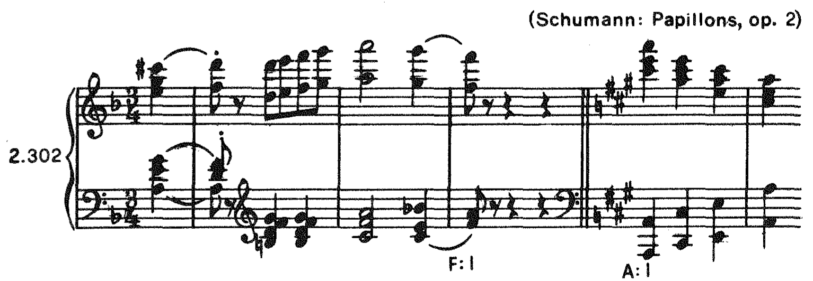

*Primjer 2.302. Tiskana str. 137 (PDF str. 69).*

MuseScore prijepis: *bit će dodan.*

<!-- visual: primjer 2.303; page 137 -->

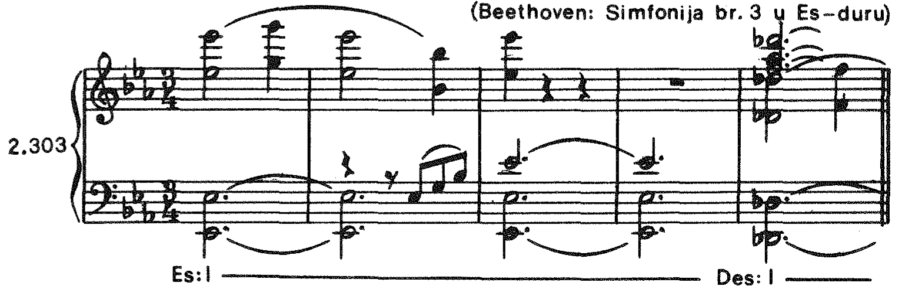

*Primjer 2.303. Tiskana str. 137 (PDF str. 69).*

MuseScore prijepis: *bit će dodan.*

<!-- source-page: 138; pdf-page: 70 -->

Nasuprot tonalnom skoku, modulacija je prijelaz iz tonaliteta u tonalitet; on može biti sporiji ili nagliji, ali će uvijek predstavljati kontinuitet postepenog napuštanja jednoga tonaliteta i postepenog uvođenja drugoga. Prema sredstvima, tj. akordima, i prema postupku, tj. dovođenju akorda u određene odnose, modulacije mogu biti **dijatonske, kromatske i enharmonijske**, a i takve gdje se te vrste međusobno kombiniraju i prožimaju.

Svaka modulacija ima **tri faze**: polazni tonalitet, odnosno **kretanje u polaznom tonalitetu**, sâm **prijelaz** i ciljni tonalitet, odnosno **potvrđivanje ciljnoga tonaliteta**.

Kod dijatonskih modulacija prijelaz se vrši pomoću **zajedničkog akorda**, koji se i u polaznome i u ciljnom tonalitetu nalazi kao dijatonska formacija, što znači da ni u jednom od oba tonaliteta nijedan od tonova zajedničkog akorda nije alteriran, izuzevši — naravno — normalno povišenje VII ili VI stupnja u molu ili sniženje VI stupnja u duru, koje rezultira mol-durom.

Što su tonaliteti, između kojih se vrši modulacija, bliži, to imaju više zajedničkih akorda. Ako uzmemo kao polazni tonalitet C-dur, onda su njemu najbliži G-dur i F-dur, koji su od C-dura udaljeni kvintu prema gore, odnosno kvintu prema dolje, i koji se od njega razlikuju samo po jednom predznaku. C-dur je vezan s G-durom preko devet zajedničkih akorda, a to su: kvintakord, septakord i nonakord I stupnja (u G-duru: kvintakord, septakord i nonakord IV stupnja), kvintakord i septakord III stupnja (u G-duru: kvintakord i septakord VI stupnja), kvintakord V stupnja (u G-duru kvintakord I stupnja), te kvintakord, septakord i nonakord VI stupnja (u G-duru: kvintakord, septakord i nonakord II stupnja). Isti broj zajedničkih akorda postoji, razumljivo, i između C-dura i F-dura, samo u obratnom odnosu (pr. 2.304). Prema tome, iz svakoga dur-tonaliteta može se izvršiti modulacija u dur-tonalitet, koji je od njega udaljen za kvintu prema gore ili prema dolje, pomoću devet raznih akorda, što međutim ne predstavlja devet harmonijskih bitno različitih načina, jer velike razlike nema npr. među modulacijama koje se vrše preko kvintakorda, septakorda ili nonakorda istoga stupnja, tako da se broj harmonijski različitih modulacija svodi u tom konkretnom slučaju na četiri, tj. na modulacije pomoću harmonija I, III, V ili VI stupnja polaznog tonaliteta kada se modulira za kvintu prema gore, a preko harmonija I, II, IV ili VI stupnja kada se modulira za kvintu prema dolje.

<!-- visual: primjer 2.304 a–b; page 138 -->

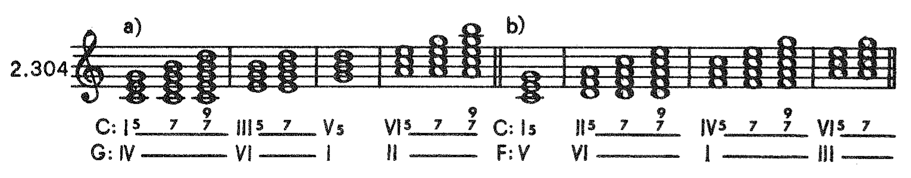

*Primjer 2.304 — varijante a–b. Tiskana str. 138 (PDF str. 70).*

MuseScore prijepis: *bit će dodan.*

Kretanje u polaznom tonalitetu (prva faza modulacije) ostvaruje se harmonijama koje će stvoriti osjećaj danoga tonaliteta. Ako bismo htjeli C-dur tonalitet predstaviti npr. kvintakordima c—e—g i f—a—c, onda dojam tog tonaliteta ne bi bio sasvim siguran, jer to mogu biti ne samo kvintakordi I i IV stupnja u C-duru nego i kvintakordi V i I stupnja u F-duru. Ni kretanje, ostvareno kvintakordima c—e—g i g—h—d, nije dovoljno, jer i to

<!-- continuation: paragraph continues on printed page 139 -->

<!-- source-page: 139; pdf-page: 70 -->
<!-- continuation: paragraph from printed page 138 -->

mogu biti jednako kvintakordi I i V stupnja u C-duru, kao i kvantakordi IV i I stupnja u G-duru. A, konačno, ni kretanje, koje bi se izvelo samo kvintakordima f—a—c i g—h—d, također ne zadovoljava, jer mu manjka tonalni harmonijski centar, tj. tonička harmonija. Ali zato kretanje, koje obuhvaća sva tri kvintakorda (c—e—g, f—a—c i g—h—d), nedvojbeno potvrđuje tonalitet C-dura, tako da možemo izvesti zaključak kako se prva faza modulacije, tj. kretanje u polaznom tonalitetu, najbolje ostvaruje harmonijama svih triju funkcija. No, taj se zaključak ne smije doslovno shvatiti zato što i progresije V₇ — I ili VII₆ — I posve jasno određuju tonalitet, jer i septakord V stupnja i sekstakord VII stupnja sadrže također i subdominantni ton kao dio akorda. Osim toga npr. spojevi g—h—d—f — c—e—g ili d—f—h — c—e—g nalaze se kao dijatonske progresije samo u jednom jedinom tonalitetu — u C-duru. Čak i spoj kvintakorda g—h—d i c—e—g, kada prvi nastupa na uzmahu, a drugi poslije njega na naglašenoj, prvoj dobi takta, daje prvom akordu jasnu dominantnu, a drugome toničku funkciju.

Potvrđivanje ciljnoga tonaliteta (treća faza modulacije) vrši se najuvjerljivije i najkonciznije mješovitom kadencom jer ona opet uključuje harmonije svih triju funkcija u poretku S—D—T. Ali, ako već na početku treće faze modulacije nastupi progresija V—I (ili VII—I), dovoljno je zaključiti tu fazu i s plagalnom kadencom.

Konkretan redoslijed harmonija i u prvoj i u trećoj fazi ravna se zapravo prema zajedničkom, prijelaznom akordu: harmonijsko kretanje logično će voditi u prvoj fazi prema zajedničkom akordu, kao prema najbližem cilju, a u trećoj fazi potvrđivat će ciljni tonalitet tako da logično vodi od zajedničkog akorda do završnoga toničkog kvintakorda.

Ako iz C-dura moduliramo u G-dur pomoću kvintakorda I stupnja polaznog tonaliteta, onda je logičan put kroz prvu fazu I—IV—V—I ili I—II₆—V—I. Kvintakord I stupnja na kraju te progresije zajednički je akord koji postaje kvintakordom IV stupnja ciljnog tonaliteta, pa će logični nastavak u ciljnom tonalitetu biti (IV)—V—I (pr. 2.305.a). U primjeru 2.305.b imamo isti redoslijed harmonija, ali ovdje dolazi na kraju prve faze do zastoja, jer kvintakord I stupnja nastupa opet na prvoj dobi takta i u istom položaju, pa se dobiva dojam vraćanja harmonijskoga toka na početak. A najbolje je rješenje — uz isti slijed harmonija — u primjeru 2.305.c, jer se tamo harmonija I stupnja na kraju prve faze pojavljuje ne samo na nenaglašenoj dobi nego i u obratu.

<!-- visual: primjer 2.305 a–b; page 139 -->

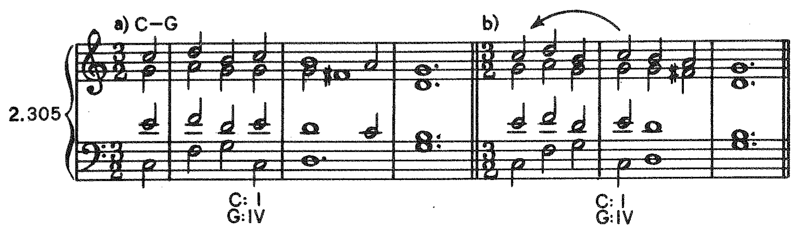

*Primjer 2.305 — varijante a–b. Tiskana str. 139 (PDF str. 70).*

MuseScore prijepis: *bit će dodan.*
<!-- continuation: primjer 2.305 c on printed page 140 -->

<!-- source-page: 140; pdf-page: 71 -->

<!-- visual: primjer 2.305 c (nastavak sa str. 139); page 140 -->

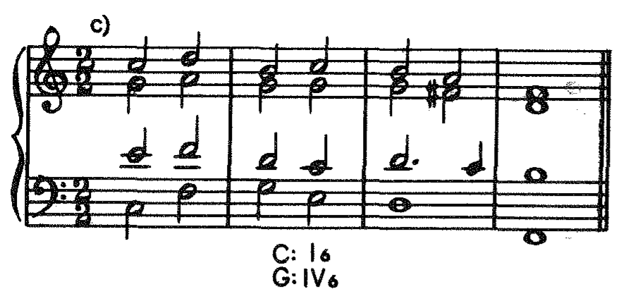

*Primjer 2.305 — varijanta c; nastavak sa str. 139. Tiskana str. 140 (PDF str. 71).*

MuseScore prijepis: *bit će dodan.*

Kada se modulacija vrši preko harmonije III stupnja polaznog tonaliteta, logičan bi početak bio I—IV—V—III; ako sada kvintakord III stupnja shvatimo kao kvintakord VI stupnja ciljnog tonaliteta i nastavimo s progresijom (VI)— II—V—I (pr. 2.306), mi, doduše, dobivamo korektnu modulaciju, ali ne pomoću onoga zajedničkog akorda koji smo sebi preduzeli. Kvintakord e—g—h u konkretnom kontekstu nije zajednički akord, jer se nastavak akordom a—c—e još uvijek doima u C-duru, tako da je tek posljednji akord prijelazni. Zajednički, odnosno prijelazni akord uvijek je onaj nakon kojega se nastavak harmonijskog kretanja već nedvojbeno osjeća u novom tonalitetu. Dakle, želimo li da nam akord e—g—h bude zaista prijelaznim akordom, onda ćemo npr. nastaviti s progresijom (VI)—II₆—V—I u ciljnom tonalitetu, jer ćemo poslije kvintakorda e—g—h nastup sekstakorda c—e—a prije čuti u G-duru nego u prilično neuvjerljivom spoju III—VI₆ u C-duru (pr. 2.307.a). A ako prvu harmoniju navedemo u obliku septakorda, a drugu u obliku kvintsekstakorda (»sixte ajoutée«), dojam G-dura bit će još izrazitiji (pr. 2.307.b).

<!-- visual: primjer 2.306; page 140 -->

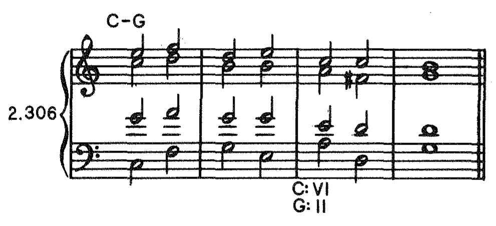

*Primjer 2.306. Tiskana str. 140 (PDF str. 71).*

MuseScore prijepis: *bit će dodan.*

<!-- visual: primjer 2.307 a–b; page 140 -->

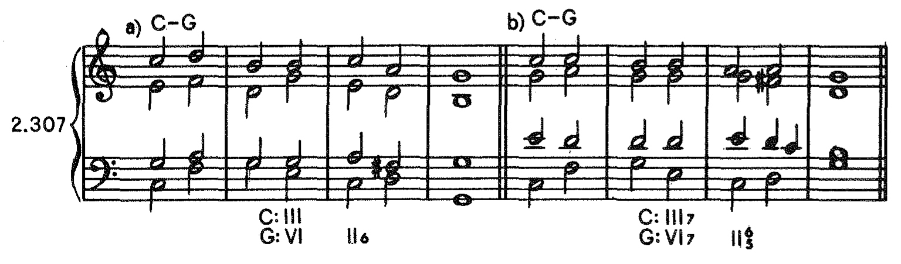

*Primjer 2.307 — varijante a–b. Tiskana str. 140 (PDF str. 71).*

MuseScore prijepis: *bit će dodan.*

<!-- source-page: 141; pdf-page: 71 -->

Kada se modulira preko kvintakorda V stupnja polaznog tonaliteta, onda on postaje kvintakordom I stupnja u ciljnom tonalitetu, pa želimo li sada da se nastavak poslije njega nedvojbeno odvija u ciljnom tonalitetu, onda ćemo u njemu produžiti harmonijom V ili VII stupnja; u takvom slučaju ne treba treću fazu završavati s mješovitom ili autentičnom kadencom — što bi značilo ponavljati još jednom dominantnu harmoniju — nego se to može sasvim uvjerljivo učiniti i s plagalnim završetkom (pr. 2.308).

<!-- visual: primjer 2.308; page 141 -->

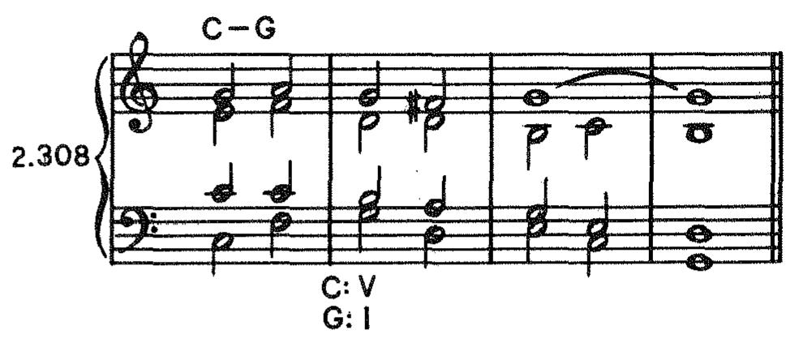

*Primjer 2.308. Tiskana str. 141 (PDF str. 71).*

MuseScore prijepis: *bit će dodan.*

Uzme li se kao zajednički akord harmonija VI stupnja polaznoga tonaliteta, onda ona postaje odgovarajućom harmonijom II stupnja u ciljnom tonalitetu, gdje će imati subdominantnu funkciju, tako da je poslije nje dovoljno navesti još samo akorde dominantne i toničke funkcije, kao što smo to učinili u primjeru 2.306.

U primjerima 2.309. — 2.312. prikazane su modulacije iz dura u dur za kvintu prema dolje, tj. iz C-dura u F-dur, pomoću harmonija I, II, IV i VI stupnja polaznog tonaliteta, koje postaju harmonijama V, VI, I i III stupnja u ciljnome tonalitetu. U prvome od ta četiri slučaja logični je nastavak (V)—VI—IV—V—I, u drugome (VI)—IV—V—I, u trećemu (I)—IV—V—I, a u četvrtome (III)—IV—VII (ili V)—I.

<!-- visual: primjer 2.309; page 141 -->

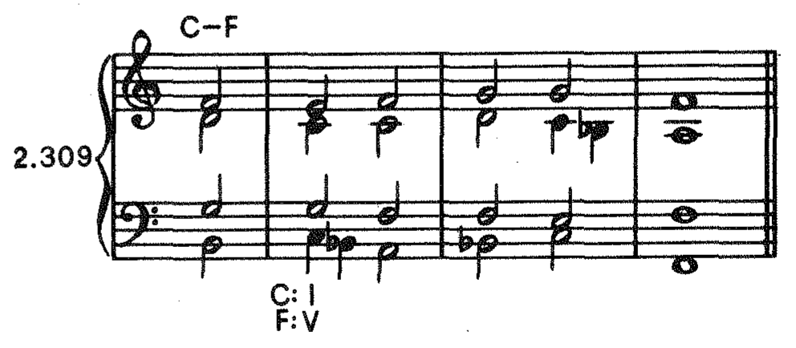

*Primjer 2.309. Tiskana str. 141 (PDF str. 71).*

MuseScore prijepis: *bit će dodan.*

<!-- visual: primjer 2.310; page 141 -->

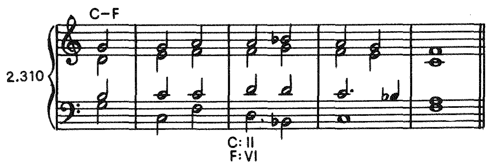

*Primjer 2.310. Tiskana str. 141 (PDF str. 71).*

MuseScore prijepis: *bit će dodan.*

<!-- source-page: 142; pdf-page: 72 -->

<!-- visual: primjer 2.311; page 142 -->

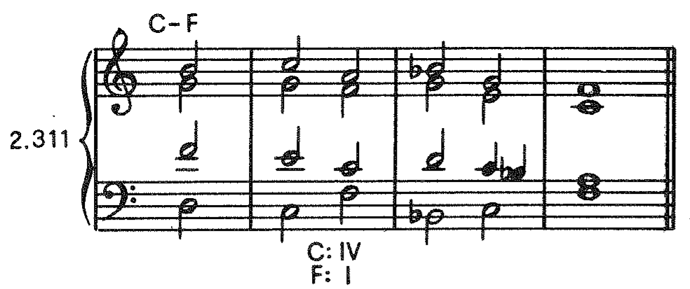

*Primjer 2.311. Tiskana str. 142 (PDF str. 72).*

MuseScore prijepis: *bit će dodan.*

<!-- visual: primjer 2.312; page 142 -->

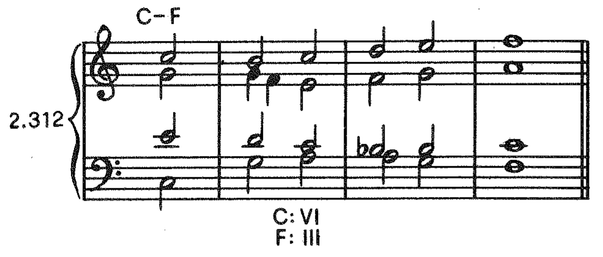

*Primjer 2.312. Tiskana str. 142 (PDF str. 72).*

MuseScore prijepis: *bit će dodan.*

Rezimirajući sve prikazane načine modulacije, vidimo da je u svakom pojedinom slučaju bilo najvažnije kako od zajedničkog akorda logično proslijediti do kraja. U obrađenim modulacijama imamo logične nastavke od zajedničkih akorda na svim stupnjevima ciljnoga tonaliteta, osim za slučaj kada bi zajednički akord bio harmonija VII stupnja ciljnog tonaliteta. Kad nastupi i taj slučaj — a to će biti kod modulacija u udaljenije tonalitete — — logična bi progresija u ciljnom tonalitetu bila (VII)—I(ili VI)—IV—I. Svi ti načini nastavljanja harmonijskim kretanjem dani su samo kao karakteristični tipovi, a ne kao jedine mogućnosti. Nove varijante dobivaju se zamjenom pojedinih harmonija (upotrebom harmonije II stupnja umjesto harmonije IV stupnja, harmonije VII stupnja umjesto harmonije V stupnja i sl.) ili umetanjem novih akorda u progresije, kao interpolacijom harmonije II stupnja u progresiju IV—V, tako da se dobije slijed IV—II—V ili interpolacijom zaostajaličnog kvartsekstakorda prije nastupa željenog kvintakorda na istome stupnju, itd. Polazeći od iznesenih principa, sistematski ćemo se pozabaviti pojedinim grupama dijatonskih modulacija, formiranim prema tonskom rodu polaznih i ciljnih tonaliteta.

### 2.9.1. Modulacije iz dura u dur

Primjeri 2.313. i 2.314. donose modulacije iz dura u dur, koji je udaljen od polaznoga dur-tonaliteta za dvije kvinte prema gore, odnosno prema dolje.

<!-- visual: primjer 2.313; page 142 -->

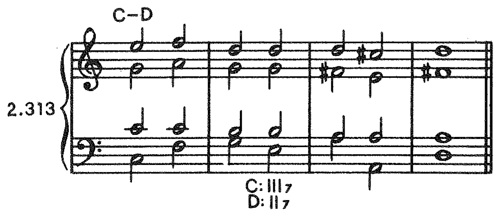

*Primjer 2.313. Tiskana str. 142 (PDF str. 72).*

MuseScore prijepis: *bit će dodan.*

<!-- source-page: 143; pdf-page: 72 -->

<!-- visual: primjer 2.314; page 143 -->

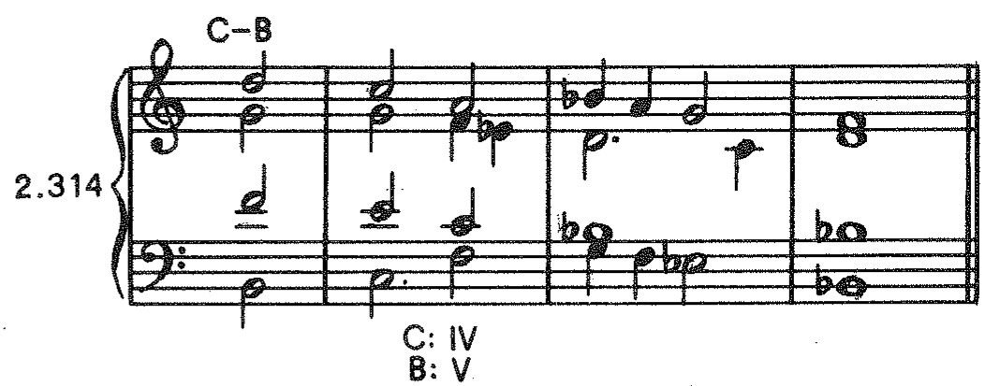

*Primjer 2.314. Tiskana str. 143 (PDF str. 72).*

MuseScore prijepis: *bit će dodan.*

Broj zajedničkih akorda u takvim odnosima sveden je svega na tri: kvintakord i septakord III stupnja, te kvintakord V stupnja u polaznom tonalitetu identični su s kvintakordom i septakordom II stupnja, te s kvintakordom IV stupnja u ciljnom tonalitetu, udaljenom za dvije kvinte prema gore, a kvintakord i septakord II stupnja, te kvintakord IV stupnja s kvintakordom i septakordom III stupnja, te s kvintakordom V stupnja u ciljnom tonalitetu, udaljenom za dvije kvinte prema dolje. A između tonaliteta, udaljenih za tri kvinte (npr. između C-dura i A-dura ili između C-dura i Es-dura), zajedničkih akorda više i nema. Tada se predbježno modulira u jedan **posredni tonalitet**, koji se po kvintnom krugu nalazi između polaznoga i ciljnoga i koji će imati i s jednim i s drugim zajedničke akorde, a zatim se iz njega konačno modulira u ciljni tonalitet, tako da tu dolazi do tzv. **lančane modulacije**. Lančana modulacija može sadržavati — već prema stepenu udaljenosti ciljnoga od polaznog tonaliteta — jedan ili više posrednih tonaliteta. Uvođenje posrednih tonaliteta u modulativni proces ima samo svrhu da se preko njih prijeđe put od jednoga do drugog »graničnog« tonaliteta, pa se stoga njih i ne potvrđuje, kao što se to čini kod polaznog i ciljnog tonaliteta; »kroz njih« se naprosto, što jednostavnije i što brže, prolazi. U primjeru 2.315. izvršena je tako modulacija iz C-dura u A-dur preko posrednoga G-dur tonaliteta, dok u primjeru 2.316., koji donosi modulaciju iz C-dura u Es-dur, ulogu posrednog tonaliteta ima B-dur.

<!-- visual: primjer 2.315; page 143 -->

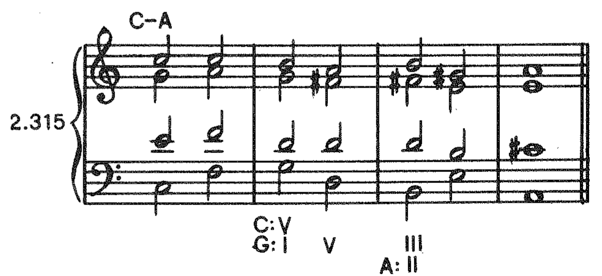

*Primjer 2.315. Tiskana str. 143 (PDF str. 72).*

MuseScore prijepis: *bit će dodan.*

<!-- visual: primjer 2.316; page 143 -->

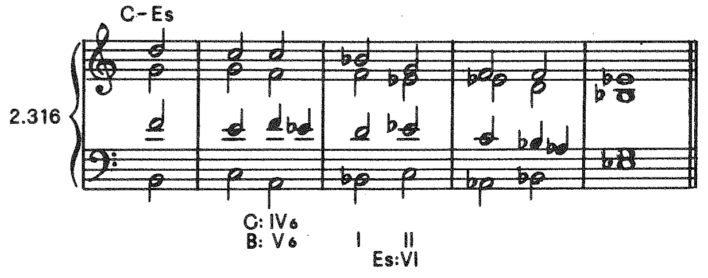

*Primjer 2.316. Tiskana str. 143 (PDF str. 72).*

MuseScore prijepis: *bit će dodan.*

<!-- source-page: 144; pdf-page: 73 -->

Kada se, međutim, poslužimo varijantom dur-tonaliteta sa sniženim VI stupnjem, odnosno s mol-durom, granica zajedničkih akorda pomiče se po uzlaznom i silaznom kvintnom krugu do uključivo pet predznaka razlike, jer su npr. kvintakord II stupnja te kvintakord i septakord VII stupnja u C-duru identični s kvintakordom IV stupnja, te kvintakordom i septakordom II stupnja u mol-dur varijanti A-dura, kvintakord VI stupnja s kvintakordom IV stupnja u mol-dur varijanti E-dura, a kvintakord III stupnja s kvintakordom IV stupnja u mol-dur varijanti H-dura. Isto su tako kvintakord i septakord II stupnja u mol-dur varijanti C-dura identični s kvintakordom i septakordom VII stupnja u Es-duru, te kvintakord IV stupnja u mol-dur varijanti C-dura s kvintakordom II stupnja u Es-duru, kvintakordom VI stupnja u As-duru i s kvintakordom III stupnja u Des-duru. Iz toga logično proizlazi da se iz dur-tonaliteta u dur-tonalitet, udaljen za 3—5 kvinta prema gore, najkraćim putem može modulirati preko kvintakorda IV stupnja mol-dur varijante ciljnog tonaliteta (pr. 2.317 — 2.319), a na jednake relacije po silaznom kvintnom krugu preko kvintakorda IV stupnja mol-dur varijante polaznog tonaliteta (pr. 2.320 — 2.322).

<!-- visual: primjer 2.317; page 144 -->

> **PROVISIONAL — cleanup required — NEODOBRENO.** Ovaj izvorni izrez nije prihvaćen za ugradnju. Neovisni pregled: **recrop required**; ograničenje izvornog skena, bez sigurnoga potpunog pravokutnog izreza. Nije retuširan niti odobren.

> [Neodobreni izvorni izrez: Primjer 2.317 — tiskana str. 144](../images/02-dijatonika-c/primjer-2-317.png)

> *Primjer 2.317. Tiskana str. 144 (PDF str. 73).*

> Razlog neovisnog pregleda: Top contains a thin fragment of the preceding prose/underline; bottom contains 2.318 C-E title, clef tip and upper marks. Its own A:IV-natural analysis and lowest bass stem overlap the following title vertically. A single rectangle cannot retain the complete numbered example and analysis while excluding 2.318; top-only trimming would not cure it.

> MuseScore prijepis: *bit će dodan; izvorni izrez ostaje neodobren.*

<!-- visual: primjer 2.318; page 144 -->

> **PROVISIONAL — cleanup required — NEODOBRENO.** Ovaj izvorni izrez nije prihvaćen za ugradnju. Neovisni pregled: **recrop required**; ograničenje izvornog skena, bez sigurnoga potpunog pravokutnog izreza. Nije retuširan niti odobren.

> [Neodobreni izvorni izrez: Primjer 2.318 — tiskana str. 144](../images/02-dijatonika-c/primjer-2-318.png)

> *Primjer 2.318. Tiskana str. 144 (PDF str. 73).*

> Razlog neovisnog pregleda: Top includes 2.317 C:II/A:IV-natural analysis and a bass-stem fragment. Required C-E title is at the same heights, so moving top below foreign ink would clip this example's title. Source also has short marks immediately above the upper staff. No safe complete single rectangle.

> MuseScore prijepis: *bit će dodan; izvorni izrez ostaje neodobren.*

<!-- visual: primjer 2.319; page 144 -->

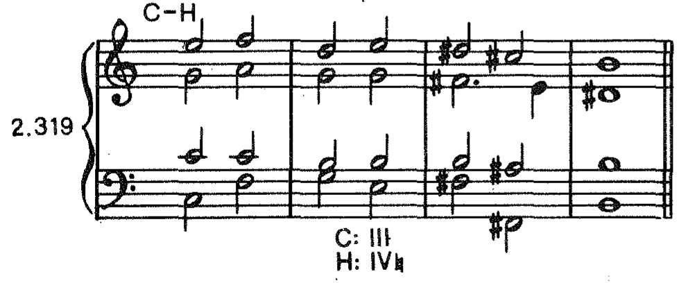

*Primjer 2.319. Tiskana str. 144 (PDF str. 73).*

MuseScore prijepis: *bit će dodan.*

<!-- visual: primjer 2.320; page 144 -->

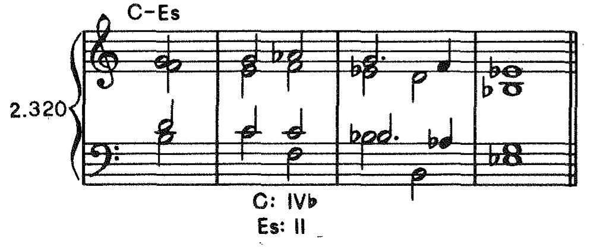

*Primjer 2.320. Tiskana str. 144 (PDF str. 73).*

MuseScore prijepis: *bit će dodan.*

<!-- source-page: 145; pdf-page: 73 -->

<!-- visual: primjer 2.321; page 145 -->

> **PROVISIONAL — cleanup required — NEODOBRENO.** Ovaj izvorni izrez nije prihvaćen za ugradnju. Neovisni pregled: **recrop required**; ograničenje izvornog skena, bez sigurnoga potpunog pravokutnog izreza. Nije retuširan niti odobren.

> [Neodobreni izvorni izrez: Primjer 2.321 — tiskana str. 145](../images/02-dijatonika-c/primjer-2-321.png)

> *Primjer 2.321. Tiskana str. 145 (PDF str. 73).*

> Razlog neovisnog pregleda: Faint deliberate angular handwritten-looking strokes to the right of As:VI are visible on enlarged source and crop, unlike isolated scan specks. Their position lies inside the required score/analysis rectangle; excluding them by an edge would clip notation or analysis. No safe single rectangle without prohibited erasure.

> MuseScore prijepis: *bit će dodan; izvorni izrez ostaje neodobren.*

<!-- visual: primjer 2.322; page 145 -->

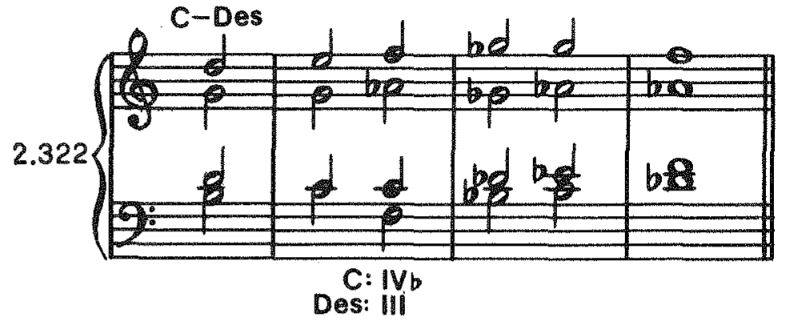

*Primjer 2.322. Tiskana str. 145 (PDF str. 73).*

MuseScore prijepis: *bit će dodan.*

Kod modulacija u još udaljenije tonalitete treba pribjeći i posrednim tonalitetima, gdje se opet mogu iskoristiti mol-dur varijante. I — da se razumijemo — najveća udaljenost po uzlaznom kvintnom krugu nije od C-dura do Cis-dura, nego od Ces-dura do Cis-dura, a po silaznom obratno. U primjerima što slijede (2.323 — 2.326) prikazano je nekoliko takvih modulacija na udaljenosti veće od pet kvinta.

<!-- visual: primjer 2.323; page 145 -->

> **PROVISIONAL — cleanup required — NEODOBRENO.** Ovaj izvorni izrez nije prihvaćen za ugradnju. Neovisni pregled: **recrop required**; ograničenje izvornog skena, bez sigurnoga potpunog pravokutnog izreza. Nije retuširan niti odobren.

> [Neodobreni izvorni izrez: Primjer 2.323 — tiskana str. 145](../images/02-dijatonika-c/primjer-2-323.png)

> *Primjer 2.323. Tiskana str. 145 (PDF str. 73).*

> Razlog neovisnog pregleda: Top clips in the descender of prose word pet, touching/overlapping the C-Cis title; bottom contains following Es-Fis title and clef tip. Own H/Cis analysis extends below that following title. No single rectangle can remove these foreign marks and retain all required title/analysis.

> MuseScore prijepis: *bit će dodan; izvorni izrez ostaje neodobren.*

<!-- visual: primjer 2.324; page 145 -->

> **PROVISIONAL — cleanup required — NEODOBRENO.** Ovaj izvorni izrez nije prihvaćen za ugradnju. Neovisni pregled: **recrop required**; ograničenje izvornog skena, bez sigurnoga potpunog pravokutnog izreza. Nije retuširan niti odobren.

> [Neodobreni izvorni izrez: Primjer 2.324 — tiskana str. 145](../images/02-dijatonika-c/primjer-2-324.png)

> *Primjer 2.324. Tiskana str. 145 (PDF str. 73).*

> Razlog neovisnog pregleda: Top contains 2.323 H/Cis analysis; bottom contains 2.325 C-Ces title, clef tip and note-stem tips. Own lower Fis analysis interleaves the following score/title, while own Es-Fis title interleaves the preceding analysis. No safe complete single rectangle.

> MuseScore prijepis: *bit će dodan; izvorni izrez ostaje neodobren.*

<!-- visual: primjer 2.325; page 145 -->

> **PROVISIONAL — cleanup required — NEODOBRENO.** Ovaj izvorni izrez nije prihvaćen za ugradnju. Neovisni pregled: **recrop required**; ograničenje izvornog skena, bez sigurnoga potpunog pravokutnog izreza. Nije retuširan niti odobren.

> [Neodobreni izvorni izrez: Primjer 2.325 — notni zapis i prvi redak analize; dio 1/2 — tiskana str. 145](../images/02-dijatonika-c/primjer-2-325-score.png)

> *Primjer 2.325 — notni zapis i prvi redak analize; dio 1/2. Tiskana str. 145 (PDF str. 73).*

> Razlog neovisnog pregleda: Top contains foreign 2.324 D:IV-flat and Fis:IV-natural analysis at the same heights as required C-Ces title and upper stems. Own number, complete score, lowest bass stem and first analysis line C:IV-flat are retained; lower-analysis split excludes footer correctly. Nevertheless no single rectangle can exclude preceding analysis without losing required own content.

> MuseScore prijepis: *bit će dodan; izvorni izrez ostaje neodobren.*

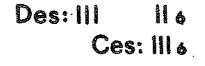

*Primjer 2.325 — nastavak analize; dio 2/2. Tiskana str. 145 (PDF str. 73).*

MuseScore prijepis: *bit će dodan.*

<!-- source-page: 146; pdf-page: 74 -->

<!-- visual: primjer 2.326; page 146 -->

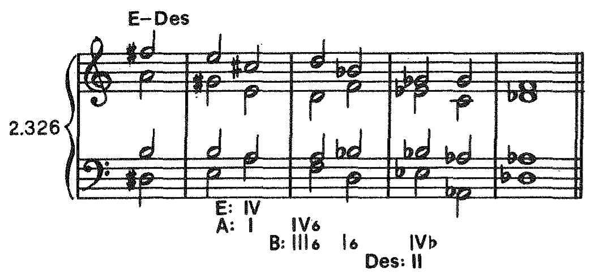

*Primjer 2.326. Tiskana str. 146 (PDF str. 74).*

MuseScore prijepis: *bit će dodan.*

Modulacije pomoću sekvenca vrlo su lagane i ležerne, ali je i njihova muzikalna kvaliteta vrlo skromna zbog imanentne monotonije, što je prouzrokuje neprestano ponavljanje istoga modela (pr. 2.327). Monotonija se može ukloniti nesimetričnim uvođenjem drukčijih obrata pojedinih harmonija ili mjestimičnim ubacivanjem još kojeg akorda u prvotni slijed (pr. 2.328).

<!-- visual: primjer 2.327; page 146 -->

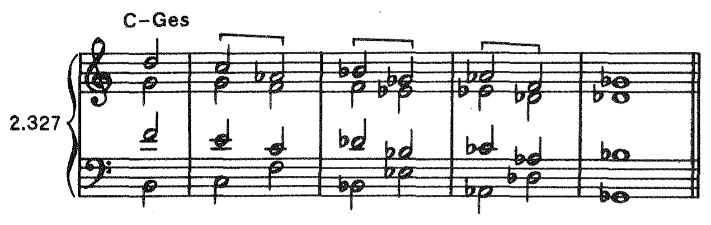

*Primjer 2.327. Tiskana str. 146 (PDF str. 74).*

MuseScore prijepis: *bit će dodan.*

<!-- visual: primjer 2.328 a–b; page 146 -->

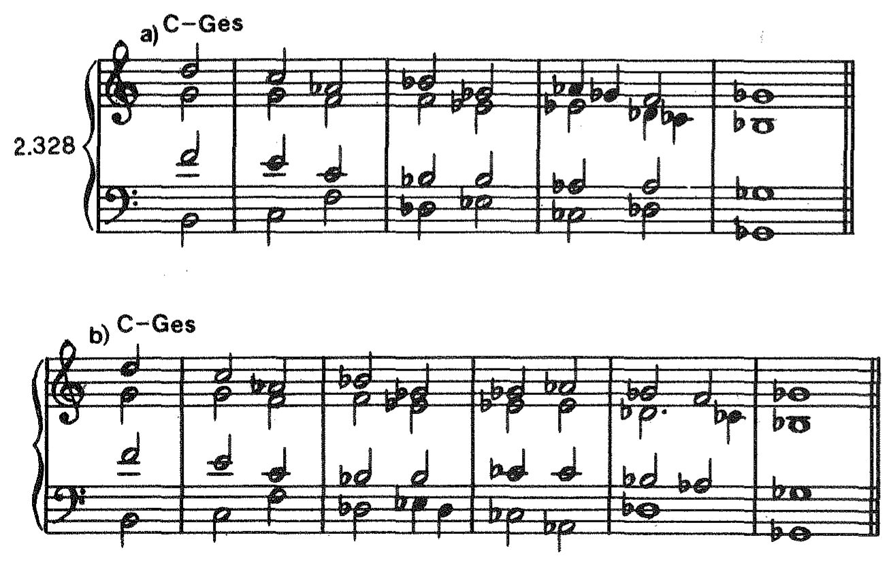

*Primjer 2.328 — varijante a–b. Tiskana str. 146 (PDF str. 74).*

MuseScore prijepis: *bit će dodan.*

ZADACI: Izradba modulacija iz dura u dur, između zadanih tonaliteta i u zadanoj mjeri.

<!-- source-page: 147; pdf-page: 74 -->

### 2.9.2. Modulacije iz dura u mol

Budući da paralelni tonaliteti imaju jednaki broj predznaka, kao i sve zajedničke akorde (kada se duru suprotstavi paralelni prirodni mol), izgleda kao da bi se između paralelnih tonaliteta moglo modulirati preko zajedničkih akorda svih sedam stupnjeva. Da to nije uvijek tako, vidjet ćemo odmah na modulaciji iz C-dura u a-mol preko zajedničkog akorda c—e—g, koji je u polaznom tonalitetu kvintakord I stupnja, a u ciljnome bi to bio kvintakord III stupnja. Prema postavci, iznesenoj u uvodu ovoga poglavlja, da iza zajedničkog akorda mora slijediti već neosporno kretanje u ciljnom tonalitetu, akord c—e—g u primjeru 2.329.a neće biti prijelazan, nego tek slijedeći, d—f—a, jer ćemo spoj tih dvaju akorda — s obzirom na kretanje koje mu je prethodilo — čuti još uvijek u C-duru kao spoj I—II, a tek kod nastupa akorda e—gis—h osjetit ćemo novi tonalitet. Ali ako u tu modulaciju unesemo neke minimalne izmjene, kao u primjeru 2.329.b, gdje smo drukčijim vođenjem sopranove dionice, dobili u njoj silazni gornji tetrakord melodijske a-mol ljestvice, a njega na neki način još i potcrtali silaznom (prohodnom) septimom »h« u tenoru, u 2. taktu, onda možemo i akord c—e—g osjetiti kao prijelazni akord.

<!-- visual: primjer 2.329 a–b; page 147 -->

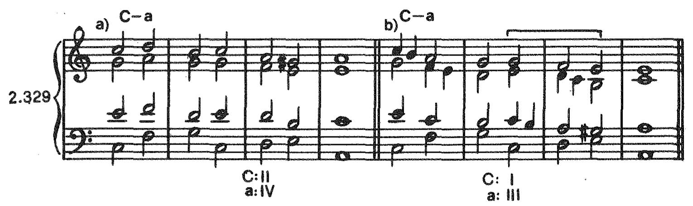

*Primjer 2.329 — varijante a–b. Tiskana str. 147 (PDF str. 74).*

MuseScore prijepis: *bit će dodan.*

Preciznu distinkciju između dura i paralelnog mola možemo imati samo suprotstavljanjem harmonijskog mola paralelnome duru, ali tada automatski smanjujemo broj zajedničkih akorda, a time suzujemo i mogućnosti modulacije. Mi to samo za volju teoretski »čistih računa« nećemo uraditi, nego ćemo svuda gdje se u modulativni proces uključuju mol-tonaliteti, uzeti ipak u obzir sve akorde na osnovi i harmonijske i melodijske uzlazne i silazne mol-ljestvice; to će nužno zahtijevati veći misaoni napor i pažljivije slušanje harmonijskih odnosa, ali će se zato kompenzirati većim bogatstvom kombinacija i većom rafiniranošću realizacije.

Kod modulacija iz dura u mol imat ćemo zajedničke akorde po uzlaznom kvintom krugu do uključivo dva predznaka razlike (pr. 2.330—2.332), a po silaznome do uključivo pet predznaka razlike (pr. 2.333—2.337); ako se kao

<!-- continuation: word and paragraph continue on printed page 148; zajednički -->

<!-- visual: primjer 2.330; page 147 -->

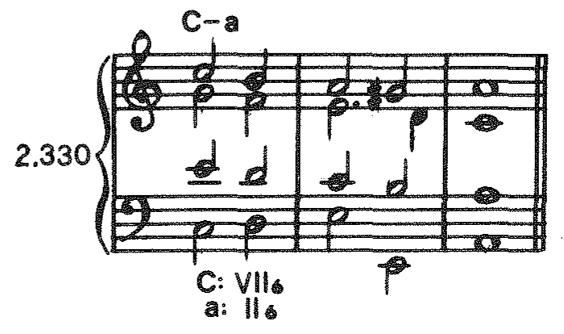

*Primjer 2.330. Tiskana str. 147 (PDF str. 74).*

MuseScore prijepis: *bit će dodan.*

<!-- visual: primjer 2.331; page 147 -->

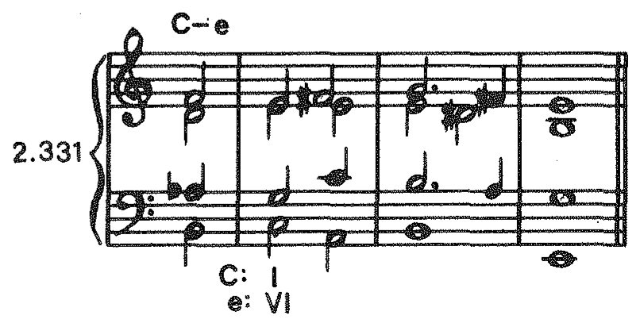

*Primjer 2.331. Tiskana str. 147 (PDF str. 74).*

MuseScore prijepis: *bit će dodan.*

<!-- source-page: 148; pdf-page: 75 -->
<!-- continuation: paragraph from printed page 147; cross-page word joined here -->

zajednički akord upotrijebi sekstakord II stupnja mol-dur varijante polaznog tonaliteta, onda se granica zajedničkih akorda po silaznom kvintnom krugu pomiče za još jedan predznak dalje (pr. 2.338).

<!-- visual: primjer 2.332; page 148 -->

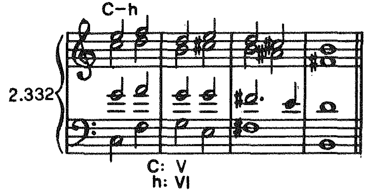

*Primjer 2.332. Tiskana str. 148 (PDF str. 75).*

MuseScore prijepis: *bit će dodan.*

<!-- visual: primjer 2.333; page 148 -->

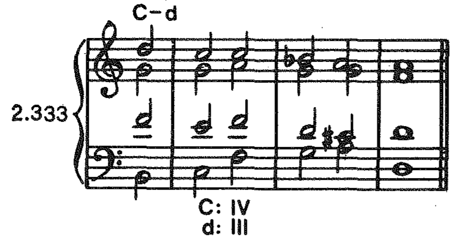

*Primjer 2.333. Tiskana str. 148 (PDF str. 75).*

MuseScore prijepis: *bit će dodan.*

<!-- visual: primjer 2.334; page 148 -->

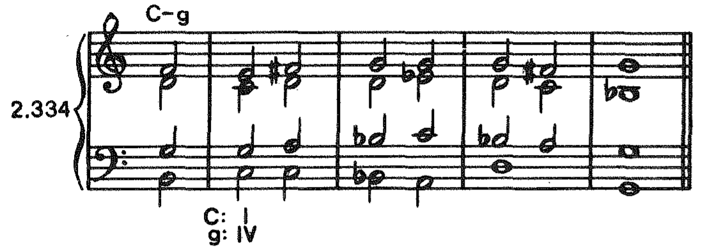

*Primjer 2.334. Tiskana str. 148 (PDF str. 75).*

MuseScore prijepis: *bit će dodan.*

<!-- visual: primjer 2.335; page 148 -->

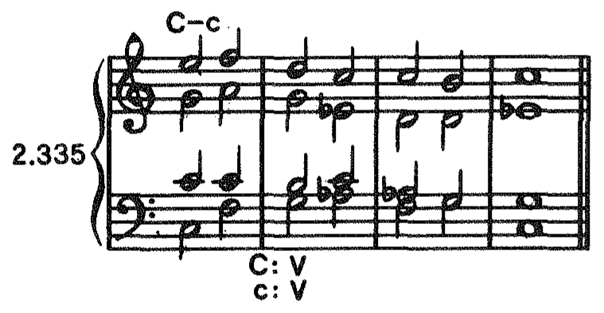

*Primjer 2.335. Tiskana str. 148 (PDF str. 75).*

MuseScore prijepis: *bit će dodan.*

<!-- visual: primjer 2.336; page 148 -->

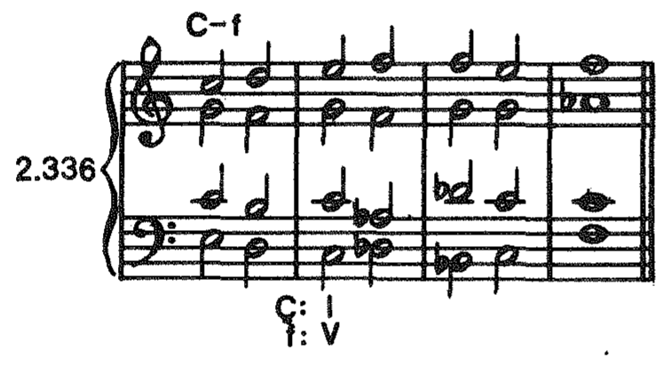

*Primjer 2.336. Tiskana str. 148 (PDF str. 75).*

MuseScore prijepis: *bit će dodan.*

<!-- visual: primjer 2.337; page 148 -->

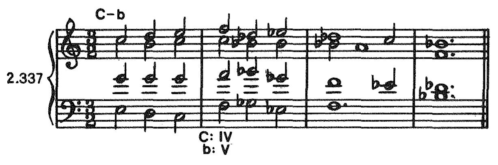

*Primjer 2.337. Tiskana str. 148 (PDF str. 75).*

MuseScore prijepis: *bit će dodan.*

<!-- visual: primjer 2.338; page 148 -->

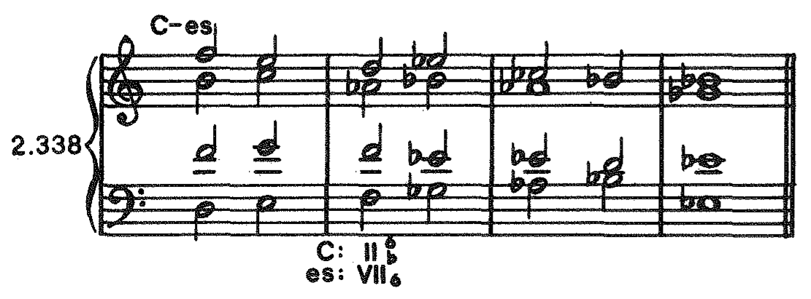

*Primjer 2.338. Tiskana str. 148 (PDF str. 75).*

MuseScore prijepis: *bit će dodan.*

<!-- source-page: 149; pdf-page: 75 -->

Za modulacije preko gornjih okvira morat ćemo se služiti posrednim tonalitetima, ali će nam i tu pomoći neki principi izvođenja najkraćih postupaka. Kada se modulira u udaljene tonalitete po uzlaznom kvintnom krugu, onda će kvintakord VI stupnja ciljnoga tonaliteta biti onaj akord koji je najbliži polaznom tonalitetu; budući da je to (u harmonijskom molu) dur-kvintakord, do njega ćemo opet najlakše doći shvatimo li ga kao kvintakord I stupnja posrednoga mol-dur tonaliteta (pr. 2.339 i 2.340).

<!-- visual: primjer 2.339; page 149 -->

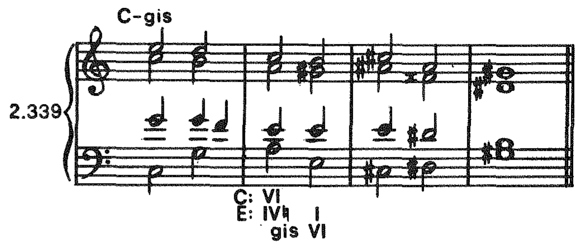

*Primjer 2.339. Tiskana str. 149 (PDF str. 75).*

MuseScore prijepis: *bit će dodan.*

<!-- visual: primjer 2.340; page 149 -->

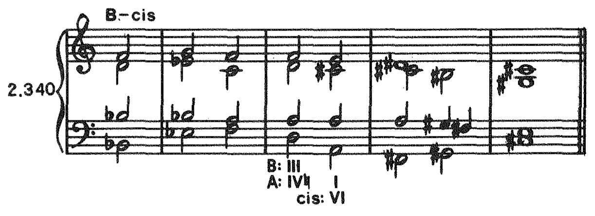

*Primjer 2.340. Tiskana str. 149 (PDF str. 75).*

MuseScore prijepis: *bit će dodan.*

A kada se izvode modulacije u neki udaljeni tonalitet po silaznom kvintnom krugu, dominantni kvintakord ciljnoga tonaliteta bit će najbliži akord polaznom tonalitetu. Stoga će kod tih modulacija prvi korak biti da se preko posrednih tonaliteta najbrže dođe do dominantnog kvintakorda ciljnog tonaliteta, a to je redovito put preko sekstakorda II stupnja ili kvintakorda IV stupnja mol-dur varijante polaznog tonaliteta ili nekoga drugog dur-tonaliteta, blizog polaznome po silaznom kvintnom krugu (pr. 2.341 i 2.342).

<!-- visual: primjer 2.341; page 149 -->

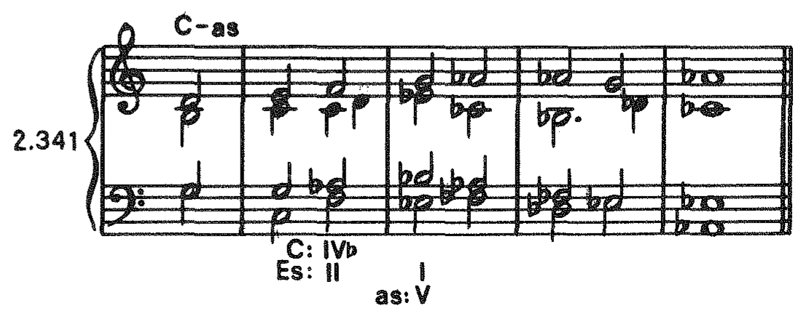

*Primjer 2.341. Tiskana str. 149 (PDF str. 75).*

MuseScore prijepis: *bit će dodan.*

<!-- source-page: 150; pdf-page: 76 -->

<!-- visual: primjer 2.342; page 150 -->

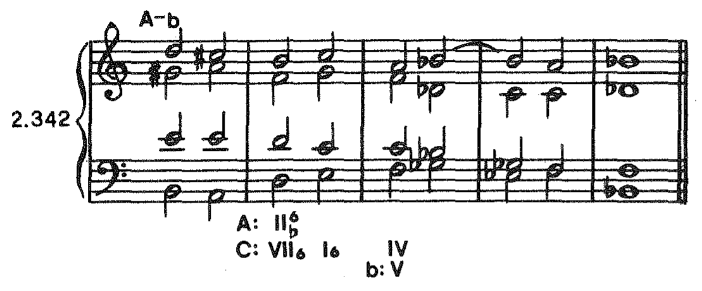

*Primjer 2.342. Tiskana str. 150 (PDF str. 76).*

MuseScore prijepis: *bit će dodan.*

ZADACI: Izradba modulacija iz dura u mol, između zadanih tonaliteta i u zadanoj mjeri.

### 2.9.3. Modulacije iz mola u mol

Modulacije iz jednoga mol-tonaliteta u drugi mogu se izvoditi bez posrednih tonaliteta do uključivo tri predznaka razlike po uzlaznom kvintnom krugu (pr. 2.343 — 2.345) i do uključivo pet predznaka razlike po silaznom kvintnom krugu (pr. 2.346 — 2.350), jer unutar tih granica postoje između odnosnih tonaliteta zajednički akordi.

<!-- visual: primjer 2.343; page 150 -->

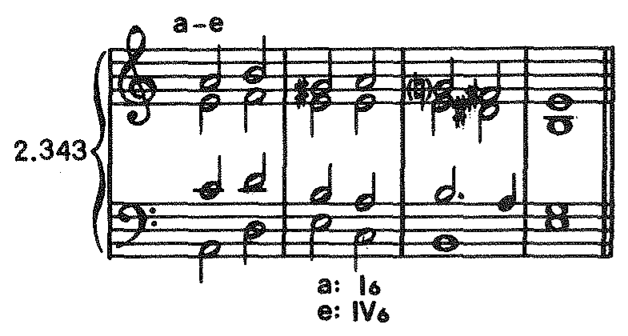

*Primjer 2.343. Tiskana str. 150 (PDF str. 76).*

MuseScore prijepis: *bit će dodan.*

<!-- visual: primjer 2.344; page 150 -->

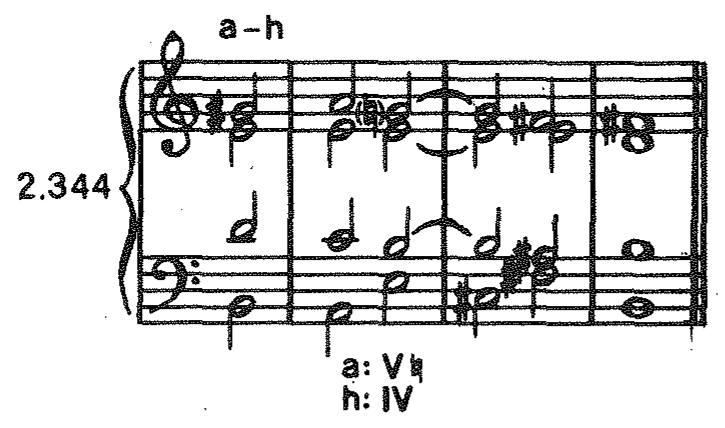

*Primjer 2.344. Tiskana str. 150 (PDF str. 76).*

MuseScore prijepis: *bit će dodan.*

<!-- visual: primjer 2.345; page 150 -->

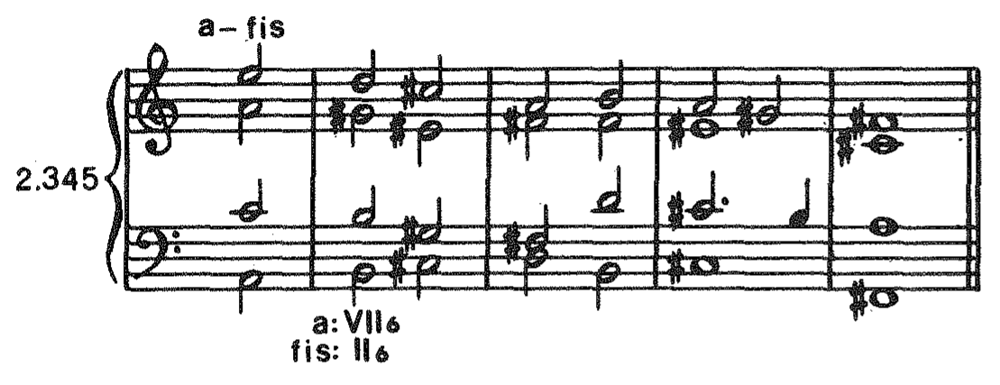

*Primjer 2.345. Tiskana str. 150 (PDF str. 76).*

MuseScore prijepis: *bit će dodan.*

<!-- visual: primjer 2.346; page 150 -->

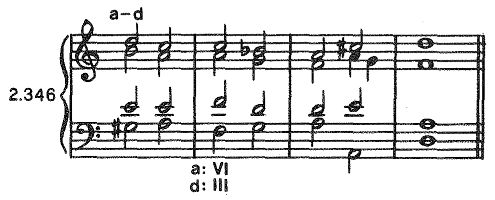

*Primjer 2.346. Tiskana str. 150 (PDF str. 76).*

MuseScore prijepis: *bit će dodan.*

<!-- source-page: 151; pdf-page: 76 -->

<!-- visual: primjer 2.347; page 151 -->

> **PROVISIONAL — cleanup required — NEODOBRENO.** Ovaj izvorni izrez nije prihvaćen za ugradnju. Neovisni pregled: **recrop required**; ograničenje izvornog skena, bez sigurnoga potpunog pravokutnog izreza. Nije retuširan niti odobren.

> [Neodobreni izvorni izrez: Primjer 2.347 — tiskana str. 151](../images/02-dijatonika-c/primjer-2-347.png)

> *Primjer 2.347. Tiskana str. 151 (PDF str. 76).*

> Razlog neovisnog pregleda: Bottom contains the upper portion of next a-c title and clef tip. Own g:V2 analysis overlaps that title vertically. Removing foreign ink with a horizontal bottom edge clips own analysis; moving a side edge clips required number/staves. No safe complete single rectangle.

> MuseScore prijepis: *bit će dodan; izvorni izrez ostaje neodobren.*

<!-- visual: primjer 2.348; page 151 -->

> **PROVISIONAL — cleanup required — NEODOBRENO.** Ovaj izvorni izrez nije prihvaćen za ugradnju. Neovisni pregled: **recrop required**; ograničenje izvornog skena, bez sigurnoga potpunog pravokutnog izreza. Nije retuširan niti odobren.

> [Neodobreni izvorni izrez: Primjer 2.348 — tiskana str. 151](../images/02-dijatonika-c/primjer-2-348.png)

> *Primjer 2.348. Tiskana str. 151 (PDF str. 76).*

> Razlog neovisnog pregleda: Top contains lower g:V2 analysis of 2.347, interleaved vertically with own required a-c title. A top edge below the previous analysis would remove part of own title. No safe complete single rectangle.

> MuseScore prijepis: *bit će dodan; izvorni izrez ostaje neodobren.*

<!-- visual: primjer 2.349; page 151 -->

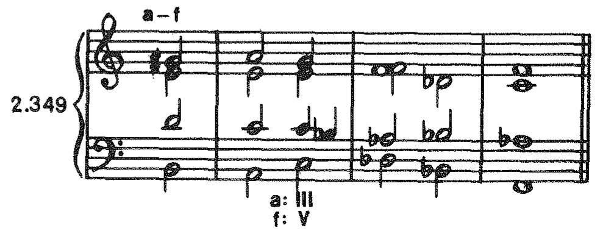

*Primjer 2.349. Tiskana str. 151 (PDF str. 76).*

MuseScore prijepis: *bit će dodan.*

<!-- visual: primjer 2.350; page 151 -->

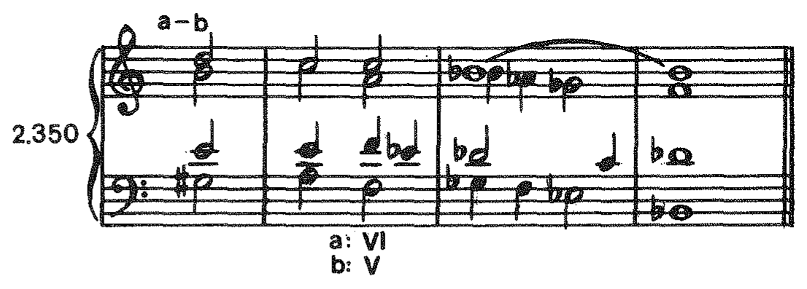

*Primjer 2.350. Tiskana str. 151 (PDF str. 76).*

MuseScore prijepis: *bit će dodan.*

Kod udaljenijih tonaliteta po uzlaznom kvintnom krugu opet će biti kvintakord VI stupnja ciljnog tonaliteta akord, najbliži polaznom tonalitetu, a najkraći put do njega vodit će od dominantnog kvintakorda polaznog tonaliteta; budući da su oba ta akorda dur-kvintakordi, mi možemo jednoga od njih, a po potrebi i oba, smatrati toničkim kvintakordima posrednih (dur-) tonaliteta i primijeniti u tom dijelu modulacije principe moduliranja iz dura u dur po uzlaznom kvintnom krugu (pr. 2.351. i 2.352).

<!-- visual: primjer 2.351; page 151 -->

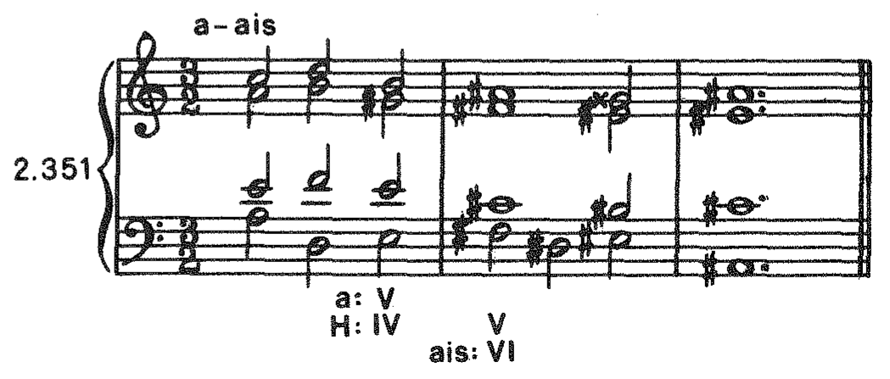

*Primjer 2.351. Tiskana str. 151 (PDF str. 76).*

MuseScore prijepis: *bit će dodan.*

<!-- source-page: 152; pdf-page: 77 -->

<!-- visual: primjer 2.352; page 152 -->

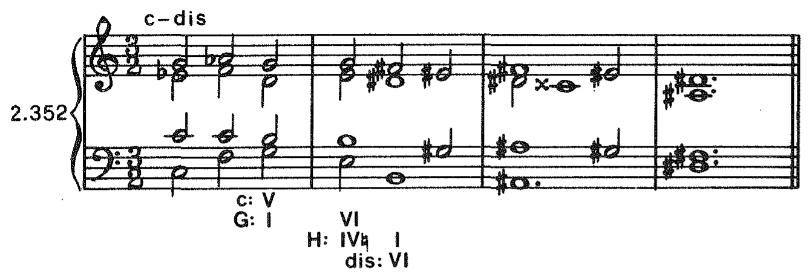

*Primjer 2.352. Tiskana str. 152 (PDF str. 77).*

MuseScore prijepis: *bit će dodan.*

Kod modulacija u udaljenije tonalitete po silaznom kvintnom krugu dominantni kvintakord ciljnog tonaliteta je akord najbliži polaznom tonalitetu, a najdirektniji modulativni put k njemu vodit će od kvintakorda VI stupnja polaznog tonaliteta (pr. 2.353. i 2.354).

<!-- visual: primjer 2.353; page 152 -->

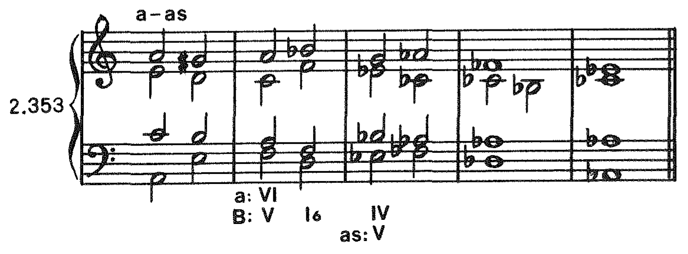

*Primjer 2.353. Tiskana str. 152 (PDF str. 77).*

MuseScore prijepis: *bit će dodan.*

<!-- visual: primjer 2.354; page 152 -->

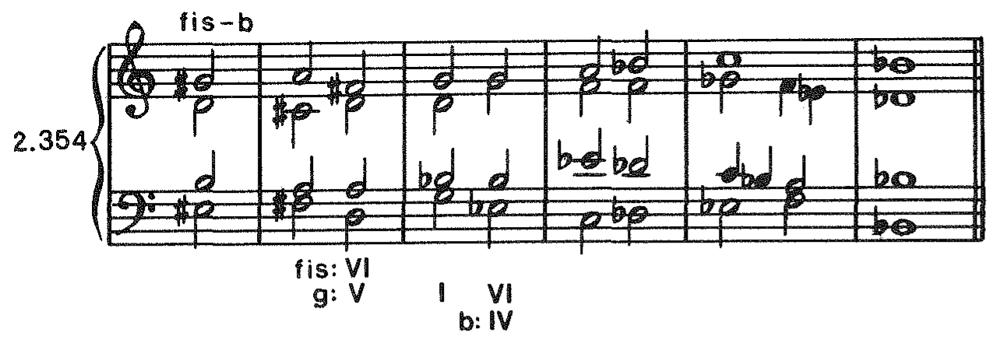

*Primjer 2.354. Tiskana str. 152 (PDF str. 77).*

MuseScore prijepis: *bit će dodan.*

ZADACI: Izradba modulacija iz mola u mol, između zadanih tonaliteta i u zadanoj mjeri.

### 2.9.4. Modulacije iz mola u dur

Granica zajedničkih akorda, a prema tome i granica direktnih modulacija iz mol-tonaliteta u dur-tonalitet, ide po uzlaznom kvintnom krugu do uključivo šest predznaka razlike ako se ciljni tonalitet upotrijebi u mol-dur varijanti (pr. 2.355 — 2.361). Po silaznom kvintnom krugu zajedničke ćemo akorde imati samo do uključivo dva predznaka razlike (pr. 2.362. i 2.363).

<!-- source-page: 153; pdf-page: 77 -->

<!-- visual: primjer 2.355; page 153 -->

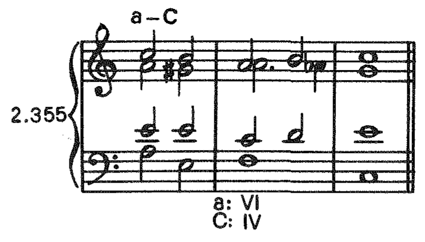

*Primjer 2.355. Tiskana str. 153 (PDF str. 77).*

MuseScore prijepis: *bit će dodan.*

<!-- visual: primjer 2.356; page 153 -->

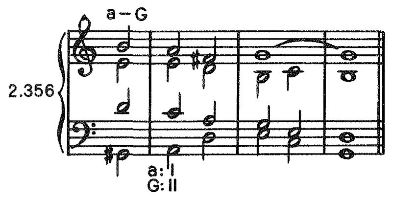

*Primjer 2.356. Tiskana str. 153 (PDF str. 77).*

MuseScore prijepis: *bit će dodan.*

<!-- visual: primjer 2.357; page 153 -->

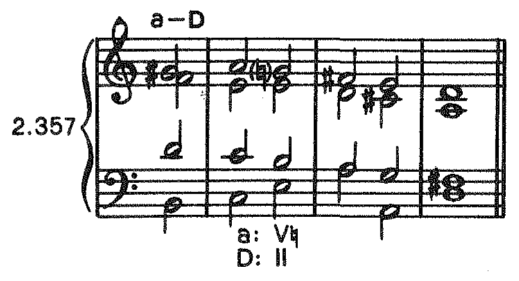

*Primjer 2.357. Tiskana str. 153 (PDF str. 77).*

MuseScore prijepis: *bit će dodan.*

<!-- visual: primjer 2.358; page 153 -->

*Primjer 2.358. Tiskana str. 153 (PDF str. 77).*

MuseScore prijepis: *bit će dodan.*

<!-- visual: primjer 2.359; page 153 -->

*Primjer 2.359. Tiskana str. 153 (PDF str. 77).*

MuseScore prijepis: *bit će dodan.*

<!-- visual: primjer 2.360; page 153 -->

*Primjer 2.360. Tiskana str. 153 (PDF str. 77).*

MuseScore prijepis: *bit će dodan.*

<!-- visual: primjer 2.361; page 153 -->

*Primjer 2.361. Tiskana str. 153 (PDF str. 77).*

MuseScore prijepis: *bit će dodan.*

<!-- visual: primjer 2.362; page 153 -->

*Primjer 2.362. Tiskana str. 153 (PDF str. 77).*

MuseScore prijepis: *bit će dodan.*

<!-- visual: primjer 2.363; page 153 -->

*Primjer 2.363. Tiskana str. 153 (PDF str. 77).*

MuseScore prijepis: *bit će dodan.*

Preko granice zajedničkih akorda najbrže ćemo modulirati po uzlaznom kvintnom krugu od dominantnog kvintakorda polaznog tonaliteta, jer ako ga shvatimo kao tonički kvintakord posrednoga (dur-)tonaliteta, onda imamo novu polaznu platformu za već poznate načine moduliranja iz dur-tonaliteta

<!-- continuation: paragraph continues on printed page 154 -->

<!-- source-page: 154; pdf-page: 78 -->
<!-- continuation: paragraph from printed page 153 -->

u dur-tonalitet po uzlaznom kvintnom krugu (pr. 2.364. i 2.365). Pri modulacijama u obratnom smjeru, bit će kvintakord VI stupnja polaznog tonaliteta, shvaćen kao tonički kvintakord posrednoga (dur-)tonaliteta, odskočnom daskom za nastavak modulacije iz dur-tonaliteta u dur-tonalitet po silaznom kvintnom krugu (pr. 2.366. i 2.367).

<!-- visual: primjer 2.364; page 154 -->

*Primjer 2.364. Tiskana str. 154 (PDF str. 78).*

MuseScore prijepis: *bit će dodan.*

<!-- visual: primjer 2.365; page 154 -->

*Primjer 2.365. Tiskana str. 154 (PDF str. 78).*

MuseScore prijepis: *bit će dodan.*

<!-- visual: primjer 2.366; page 154 -->

*Primjer 2.366. Tiskana str. 154 (PDF str. 78).*

MuseScore prijepis: *bit će dodan.*

<!-- visual: primjer 2.367; page 154 -->

*Primjer 2.367. Tiskana str. 154 (PDF str. 78).*

MuseScore prijepis: *bit će dodan.*

ZADACI: Izradba modulacija iz mola u dur, između zadanih tonaliteta i u zadanoj mjeri.

<!-- source-page: 155; pdf-page: 78 -->

### 2.9.5. Modulacije na osnovi frigijskog pomaka

Rijetko upotrebljavana progresija V—II u duru vrlo je česta u toku frigijske kadence, kao spoj VII—IV u silaznom melodijskom molu, jer su to identični odnosi (dur-kvintakord, iza kojeg dolazi mol-kvintakord, koji leži kvartu niže) (v. pr. 2. 163.c—f). Pripremljena u »frigijskom kontekstu«, ta se progresija može iskoristiti u modulacijama iz dura u mol (pr. 2.368), a i u svim modulativnim prijelazima od bilo kojega dur-kvintakorda kao ishodišne točke za kretanje prema onome mol-tonalitetu gdje se taj akord nalazi na prirodnom VII stupnju (pr. 2.369. i 2.370).

<!-- visual: primjer 2.368 a–b; page 155 -->

*Primjer 2.368 — varijante a–b. Tiskana str. 155 (PDF str. 78).*

MuseScore prijepis: *bit će dodan.*

<!-- visual: primjer 2.369; page 155 -->

*Primjer 2.369. Tiskana str. 155 (PDF str. 78).*

MuseScore prijepis: *bit će dodan.*

<!-- visual: primjer 2.370; page 155 -->

*Primjer 2.370. Tiskana str. 155 (PDF str. 78).*

MuseScore prijepis: *bit će dodan.*

Kada se umjesto sekstakorda IV stupnja, u progresiji VII—IV₆ u prirodnom molu, upotrijebi terckvartakord II stupnja, dobiva se nova varijanta, koju također svrstavamo u grupu modulacija na osnovi frigijskog pomaka (pr. 2.371. i 2.372).

<!-- visual: primjer 2.371; page 155 -->

*Primjer 2.371. Tiskana str. 155 (PDF str. 78).*

MuseScore prijepis: *bit će dodan.*

<!-- visual: primjer 2.372; page 155 -->

*Primjer 2.372. Tiskana str. 155 (PDF str. 78).*

MuseScore prijepis: *bit će dodan.*

---

> Napomena o opsegu: integracija ovdje završava tiskanom str. 155. Provjereni tekst za tiskane str. 156–174 čeka slike i njihov neovisni pregled; nije uključen u ovaj dio. Nastavak: `review-candidates/book/M04/text-156-174.md`.

---

> Nastavak integracije: prethodna napomena o završetku na str. 155 sačuvana je kao povijesni zapis. Slijedi provjereni tekst tiskanih str. 156–174 (PDF str. 79–88). U nastavku su 42 neovisno odobrena slikovna dijela i 13 izvorno blokiranih dijelova označenih **PROVISIONAL — cleanup required**, samo kao poveznice, bez odobrenja za ugradnju. Stranica 174 je prazna.

<!-- source-page: 156; pdf-page: 79 -->

Modulacije na osnovi frigijskoga pomaka također pripadaju harmonijskim pojavama, koje izmiču funkcionalnoj interpretaciji. One su primjer modalno-klasičnoga harmonijskog mišljenja, gdje klasično dominira u početnom i završnom dijelu modulacije, a modalno u srednjem dijelu, ali ne mehanički dodano jedno uz drugo, nego nerazlučivo međusobno prožeto. Rafinirani primjer takvoga modulativnog prijelaza predstavlja kraj famoznoga korala »Wenn ich einmal soll scheiden« iz Bachova oratorija »Muka po Mateju« (pr. 2.373). Tamo se na frigijski pomak basove dionice »c«-»b«-»a« — — još prije nego što bi on doveo do zaključnog akorda a-cis-e (koji, uostalom, uopće ne nastupa) — nadovezuje u sopranovoj dionici novi frigijski pomak »g«-»f«-»e«, sa zapanjujući smjelim kromatskim obratom, što ga čini spoj septakorda g-b-d-f s kvintsekstakordom gis-h-d-e (»septimna srodnost«, jer je kvinta prvog akorda identična sa septimom drugoga), kojim se harmonijski tok vraća u izvorni frigijski način s finalnom notom »e«.

<!-- visual: primjer 2.373; page 156 -->

*Primjer 2.373. Tiskana str. 156; PDF str. 79.*

MuseScore prijepis: *bit će dodan.*

### 2.9.6. Rekapitulacija dijatonskih modulacija

Sumirajući materiju dijatonskih modulacija, vidimo da one tvore dvije velike grupe: jednu, gdje između polaznog i ciljnog tonaliteta ima zajedničkih akorda, i drugu, gdje je ciljni tonalitet toliko udaljen od polaznog da između njih više zajedničkih akorda nema, pa se u njihovu izvedbu moraju uključiti i posredni tonaliteti.

Kod modulacija prve grupe dovoljno je odrediti zajednički akord (ako postoji samo jedan) ili ga izabrati (kada ih ima više) i onda logično voditi harmonijsko kretanje do njega i od njega.

U izvedbi modulacija, koje pripadaju drugoj grupi, zadatak se na izvjestan način utrostručuje. Prvo treba da se u ciljnom tonalitetu pronađe akord, koji je najbliži polaznom tonalitetu, a zatim u ovome pronaći akord, najbliži ciljnom tonalitetu, i, konačno, izraditi tri uvjerljive, međusobno povezane dionice cjelokupnoga harmonijskog toka: od početnog akorda do onoga, kojim polazni tonalitet napuštamo i koji je istodobno ciljnom tonalitetu najbliži, zatim od njega do akorda s kojim će započeti kretanje u ciljnom tonalitetu, te od toga do kraja.

Vrlo koristan za razne slučajeve modulacije bit će jedan »univerzalni« zajednički akord, što spaja tonalitete, udaljene za malu tercu, bez obzira na njihov tonski rod i na konkretnu razliku u broju predznaka. To je sekstakord VII stupnja u polaznom tonalitetu za modulacije u tonalitete, udaljene za malu tercu prema dolje, odnosno sekstakord II stupnja u polaznom mol-tonalitetu ili u mol-dur varijanti polaznog tonaliteta za modulacije u tonalitete, udaljene za malu tercu prema gore (pr. 2.374. i 2.375).

<!-- source-page: 157; pdf-page: 79 -->

<!-- visual: primjer 2.374 a–b; page 157 -->

*Primjer 2.374 a–b. Tiskana str. 157; PDF str. 79.*

MuseScore prijepis: *bit će dodan.*

<!-- visual: primjer 2.375; page 157 -->

*Primjer 2.375. Tiskana str. 157; PDF str. 79.*

MuseScore prijepis: *bit će dodan.*

U umjetničkoj kompozicijskoj praksi dijatonske su modulacije služile prvenstveno za prijelaze u blize tonalitete (pr. 2.376), ali ih nalazimo i u modulativnim prijelazima na dalje relacije (pr. 2.377) premda su tamo češće modulacije koje spadaju u domenu kromatike i enharmonije, a te će biti predmetom razmatranja u slijedećem dijelu ove knjige.

<!-- visual: primjer 2.376 (Haydn: Simfonija br. 94, u G-duru); page 157 -->

*Primjer 2.376 (Haydn: Simfonija br. 94, u G-duru). Tiskana str. 157; PDF str. 79.*

MuseScore prijepis: *bit će dodan.*

<!-- visual: primjer 2.377 (Beethoven: Koncert za klavir i orkestar u G-duru, op. 58); page 157 -->

*Primjer 2.377 (Beethoven: Koncert za klavir i orkestar u G-duru, op. 58). Tiskana str. 157; PDF str. 79.*

MuseScore prijepis: *bit će dodan.*

<!-- source-page: 158; pdf-page: 80 -->

Dobra vježba u svladavanju vještine moduliranja je izradba modulativnih stavaka u kojima se primjenjuje princip neprekinutih modulacija od polaznog tonaliteta do nekoga novog i natrag, i to tako da se harmonijsko kretanje nigdje ne prekida, tj. da ni u jednom od tonaliteta unutar stavka ne dođe do savršene autentične kadence, ali da zadržavanje u svakom zadanom tonalitetu bude tako izvedeno da on ipak bude potvrđen. Shema modulativnog stavka može se dati tako da se navedu svi tonaliteti kroz koje treba proći, kao u primjeru 2.378, gdje je zadana shema C—G—D—G—C, ili tako da se navede samo početni tonalitet i onaj do kojega treba stići i od kojega se treba opet vratiti u početni, pa tada treba samo ta dva tonaliteta potvrđivati, a izvodiocu zadatka prepušta se odluka o tome da li će prijelazi ići preko posrednih tonaliteta i kojih, ili će se — ako je to moguće — modulirati direktno. Takav modulativni stavak, sa shemom C—fis—C izrađen je u primjeru 2.379.

<!-- visual: primjer 2.378; page 158 -->

> **PROVISIONAL — cleanup required; izrez nije odobren.** [Neodobreni izvorni izrez](../images/02-dijatonika-c/primjer-2-378.png). [Izvorna stranica](../sources/pages/page-158.png).
>
> Razlog neovisnog pregleda: Bottom edge includes upper border/letter fragments of following boxed C-fis-C title. Lowest bass stems of 378 extend into that same vertical band; a horizontal cut removing the title would clip intended notation. Not scan specks.

*Primjer 2.378. Tiskana str. 158; PDF str. 80.*

MuseScore prijepis: *bit će dodan.*

<!-- visual: primjer 2.379; page 158 -->

> **PROVISIONAL — cleanup required; izrez nije odobren.** [Neodobreni izvorni izrez](../images/02-dijatonika-c/primjer-2-379.png). [Izvorna stranica](../sources/pages/page-158.png).
>
> Razlog neovisnog pregleda: Top edge contains preceding 378 bass-stem tails to the right of the boxed C-fis-C title. Retaining the entire title and complete full-width notation precludes excluding those tails with one rectangle.

*Primjer 2.379. Tiskana str. 158; PDF str. 80.*

MuseScore prijepis: *bit će dodan.*

<!-- source-page: 159; pdf-page: 80 -->

Harmonizacija zadanoga glasa, gdje dolazi do promjena tonaliteta, počinje s izradbom **tonalnoga plana**. S njime se predviđaju svi tonaliteti, kroz koje zadani glas u svome kretanju prolazi, i određuju približne granice zonâ svakoga pojedinog tonaliteta. Najočigledniji i najsigurniji pokazatelj promjene tonaliteta je nastup novih tonova u zadanom glasu, koji se u prethodnom fragmentu, u prethodnom tonalitetu, nisu pojavljivali. Ali i melodijske progresije koje ne donose stranih tonova, mogu predstavljati novi tonalitet. Premda se tako melodija u primjeru 2.380.a može, doduše, čitava mehanički tumačiti u jednom jedinom tonalitetu, tj. u prirodnom g-molu, to tumačenje ne bi bilo logično; melodijski će fragment u taktovima 4—6, gdje se za redom pojavljuju tonovi »a«, »c« i »f«, prirodnije upućivati na B-dur, jer oni tamo predstavljaju rastavljeni sekstakord V stupnja, dakle sekstakord jednoga od glavnih stupnjeva. Zbog toga ovdje predviđamo u tonalnom planu tonalitet B-dura, ali mjesta gdje smo označili početak i kraj zone toga tonaliteta smatramo približnima. Približnima zato što se prijelaz iz osnovnoga g-mol tonaliteta u B-dur tonalitet može izvršiti ili na početku ili u polovici 3. takta, ili tek u 4. taktu, a i povratak u g-mol može uslijediti ne samo u 7. taktu već npr. i u 6. taktu. Precizna mjesta tih prijelaza pokazat će se tek u slijedećim fazama rada — u izradbi basove dionice i u konačnoj kompletnoj harmonizaciji (pr. 2.380.b). Rastavljeni sekstakord u taktovima 4—6 može jednako upućivati i na tonalitet F-dura, gdje će on predstavljati harmoniju I stupnja; u tom slučaju planiramo B-dur tonalitet tek u 5. taktu, a prije toga tonalitet F-dura, tako da će sada shema tonalnog plana biti g—F—B—g, koja će rezultirati i novom harmonizacijom (pr. 2.380.c).

<!-- visual: primjer 2.380 a–c; page 159 -->

*Primjer 2.380 a–c. Tiskana str. 159; PDF str. 80.*

MuseScore prijepis: *bit će dodan.*

<!-- source-page: 160; pdf-page: 81 -->

#### ZADACI

1 Izradba modulativnih stavaka, sa zadanim tonalitetima i u zadanoj mjeri.

<!-- visual: zadatak 2; page 160 -->

*Zadatak 2. Tiskana str. 160; PDF str. 81.*

MuseScore prijepis: *bit će dodan.*

<!-- visual: zadatak 3; page 160 -->

*Zadatak 3. Tiskana str. 160; PDF str. 81.*

MuseScore prijepis: *bit će dodan.*

<!-- visual: zadatak 4; page 160 -->

*Zadatak 4. Tiskana str. 160; PDF str. 81.*

MuseScore prijepis: *bit će dodan.*

<!-- visual: zadatak 5; page 160 -->

*Zadatak 5. Tiskana str. 160; PDF str. 81.*

MuseScore prijepis: *bit će dodan.*

<!-- visual: zadatak 6; page 160 -->

*Zadatak 6. Tiskana str. 160; PDF str. 81.*

MuseScore prijepis: *bit će dodan.*

<!-- visual: zadatak 7; page 160 -->

*Zadatak 7. Tiskana str. 160; PDF str. 81.*

MuseScore prijepis: *bit će dodan.*

<!-- visual: zadatak 8; page 160 -->

*Zadatak 8. Tiskana str. 160; PDF str. 81.*

MuseScore prijepis: *bit će dodan.*

<!-- source-page: 161; pdf-page: 81 -->

<!-- visual: zadatak 9; page 161 -->

*Zadatak 9. Tiskana str. 161; PDF str. 81.*

MuseScore prijepis: *bit će dodan.*

<!-- visual: zadatak 10; page 161 -->

*Zadatak 10. Tiskana str. 161; PDF str. 81.*

MuseScore prijepis: *bit će dodan.*

<!-- visual: zadatak 11; page 161 -->

*Zadatak 11. Tiskana str. 161; PDF str. 81.*

MuseScore prijepis: *bit će dodan.*

<!-- visual: zadatak 12; page 161 -->

*Zadatak 12. Tiskana str. 161; PDF str. 81.*

MuseScore prijepis: *bit će dodan.*

<!-- visual: zadatak 13 (Allegretto); page 161 -->

*Zadatak 13 (Allegretto). Tiskana str. 161; PDF str. 81.*

MuseScore prijepis: *bit će dodan.*

<!-- visual: zadatak 14; page 161 -->

*Zadatak 14. Tiskana str. 161; PDF str. 81.*

MuseScore prijepis: *bit će dodan.*

<!-- visual: zadatak 15, početak, nastavak na stranici 162; page 161 -->

*Zadatak 15, početak, nastavak na stranici 162. Tiskana str. 161; PDF str. 81.*

MuseScore prijepis: *bit će dodan.*

<!-- source-page: 162; pdf-page: 82 -->

<!-- visual: zadatak 15, nastavak sa stranice 161; page 162 -->

*Zadatak 15, nastavak sa stranice 161. Tiskana str. 162; PDF str. 82.*

MuseScore prijepis: *bit će dodan.*

<!-- visual: zadatak 16; page 162 -->

*Zadatak 16. Tiskana str. 162; PDF str. 82.*

MuseScore prijepis: *bit će dodan.*

<!-- visual: zadatak 17; page 162 -->

*Zadatak 17. Tiskana str. 162; PDF str. 82.*

MuseScore prijepis: *bit će dodan.*

### 2.9.7. Modulacije pomoću enharmonijske zamjene kvintakorda

Modulacije pomoću enharmonijske zamjene kvintakorda zapravo spadaju u područje enharmonijskih modulacija, ali one su tako jednostavne i dijatonskima toliko bliske da se mogu apsolvirati već na ovome mjestu.

**Enharmonija** (grč. ἐν en — *unutra* i ἁρμονία harmonia — *sklad*) je identifikacija tonova, koji su, doduše, teoretski (muzički i fizikalno) različite visine i različito se notiraju, ali praktički imaju u temperiranom tonskom sistemu istu visinu, kao »cis« i »des« ili »h« i »ces« itd. U harmoniji dolazi enharmonija do izražaja u **enharmonijskoj zamjeni** i u **enharmonijskoj promjeni akorda**.

Pri enharmonijskoj zamjeni vrši se identifikacija nekoga akorda s isto takvim koji se drukčije notira (a jednako zvuči), pri čemu se svi tonovi enharmonijski mijenjaju u istom smjeru, pa se tako npr. dur-kvintakord fis-ais-cis enharmonijski zamjenjuje s akordom ges-b-des, koji je također dur-kvintakord i također jednako zvuči, dok je promjena notacije izvršena kod svih tonova u smjeru od povisilica u snizilice (pr. 2.381.a). Pri enharmonijskoj promjeni identifikacija se pak vrši tako da se samo neki tonovi akorda enharmonijski mijenjaju, a neki ne, pa se dobiva akord teoretski drukčijeg sastava. Na primjer, ako se septakord c-e-g-b tako enharmonijski izmijeni da se samo »b« zamijeni s »ais«, a »c«, »e« i »g« ostanu nepromijenjeni, onda novi akord više neće biti septakord, već povećani kvintsekstakord c-e-g-ais (pr. 2.381.b). Dakle, pri enharmonijskoj zamjeni ostaje ista vrsta akorda, dok se ona kod enharmonijske promjene mijenja.

<!-- visual: primjer 2.381 a–b; page 162 -->

> **PROVISIONAL — cleanup required; izrez nije odobren.** [Neodobreni izvorni izrez](../images/02-dijatonika-c/primjer-2-381.png). [Izvorna stranica](../sources/pages/page-162.png).
>
> Razlog neovisnog pregleda: Handwritten chord names above a/b and handwritten text below a are inside the required example bounds, with partial handwriting at top. Printed bottom 5 is complete, confirmed against doubled source detail. No complete clean rectangle can remove the interleaved handwriting.

*Primjer 2.381 a–b. Tiskana str. 162; PDF str. 82.*

MuseScore prijepis: *bit će dodan.*

<!-- source-page: 163; pdf-page: 82 -->

U primjeru 2.382.a izvedena je modulacija iz Es-dura u E-dur pomoću enharmonijske zamjene kvintakorda des-fes-as u kvintakord cis-e-gis, koji tako postaje zajedničkim akordom između posrednoga As-dur tonaliteta i ciljnoga tonaliteta. Ta modulacija nije ništa kraća od modulacije između istih tonaliteta, izvedene strogo dijatonski, u primjeru 2.382.b, ali je od nje u stanovitoj mjeri uvjerljivija, jer se druga doima prije kao modulacija u — — polaznom tonalitetu bliži — e-mol tonalitet, u kojoj je E-dur predstavljen samo završnim akordom s pikardijskom tercom!

<!-- visual: primjer 2.382 a–b; page 163 -->

> **PROVISIONAL — cleanup required; izrez nije odobren.** [Neodobreni izvorni izrez](../images/02-dijatonika-c/primjer-2-382.png). [Izvorna stranica](../sources/pages/page-163.png).
>
> Razlog neovisnog pregleda: Extensive handwriting above/between both variants and around lower analyses, including circles/arrows and right-edge writing. These are identifiable pencil annotations, not specks; cannot exclude without losing printed content.

*Primjer 2.382 a–b. Tiskana str. 163; PDF str. 82.*

MuseScore prijepis: *bit će dodan.*

Modulacije, koje se izvode pomoću enharmonijske zamjene akorda, često nisu enharmonijske, već dijatonske prirode. U primjeru 2.383.a modulacija ne zvuči onako kako je notirana, tj. kao enharmonijska modulacija iz As-dura u Fis-dur, već kao sasvim jednostavna dijatonska modulacija iz As-dura u Ges-dur (pr. 2.383.b), i to zato što smo ovdje — idući od As-dura po silaznom kvintnom krugu — začas stigli u Ges-dur tonalitet, pa ga kao takvog i čujemo, unatoč notaciji u povisilicama. Ali ako bismo modulaciju iz Es-dura u E-dur, iz primjera 2.382.a, notirali kao dijatonsku modulaciju

<!-- continuation: rečenica se nastavlja na stranici 164 -->

<!-- source-page: 164; pdf-page: 83 -->

<!-- visual: primjer 2.383 a–b; page 164 -->

> **PROVISIONAL — cleanup required; izrez nije odobren.** [Neodobreni izvorni izrez](../images/02-dijatonika-c/primjer-2-383.png). [Izvorna stranica](../sources/pages/page-164.png).
>
> Razlog neovisnog pregleda: Handwritten chord names and analyses interleave a/b and extend into left/top/bottom margins. Printed variants are present but a clean complete rectangle is impossible on this source.

*Primjer 2.383 a–b. Tiskana str. 164; PDF str. 83.*

MuseScore prijepis: *bit će dodan.*

<!-- continuation: nastavak rečenice sa stranice 163 -->

iz Es-dura u Fes-dur (pr. 2.384), svejedno je ne bismo tako čuli. Idući, naime, ovdje po silaznom kvintnom krugu do Fes-dura, prelazimo muzičkom praksom potvrđenu granicu od sedam predznaka za tonalitete (u ovom slučaju granicu od sedam snizilica), zbog koje nam je predodžba E-dur tonaliteta znatno bliža i realnija od predodžbe Fes-dur tonaliteta.

<!-- visual: primjer 2.384; page 164 -->

> **PROVISIONAL — cleanup required; izrez nije odobren.** [Neodobreni izvorni izrez](../images/02-dijatonika-c/primjer-2-384.png). [Izvorna stranica](../sources/pages/page-164.png).
>
> Razlog neovisnog pregleda: Pencil chord labels above staff and handwritten analyses below overlap the required Es-Fes title and printed lower analysis band. Not removable by a complete rectangular source crop.

*Primjer 2.384. Tiskana str. 164; PDF str. 83.*

MuseScore prijepis: *bit će dodan.*

<!-- source-page: 165; pdf-page: 83 -->

## 2.10. Stari načini

**Stari načini, modusi ili starocrkvene ljestvice** su tonski rodovi napjevâ tzv. **gregorijanskog ili rimskog korala** koji datiraju od vremena ranoga kršćanstva; ti su napjevi orijentalnoga (hebrejskog) i grčkog porijekla, a održali su se do danas u obrednim pjevanjima katoličke crkve.

Svi stari načini sadržani su u dijatonskom nizu nealteriranih tonova, koji dijeli oktavu na sedam stupnjeva. **Dorski** način (po grčkom plemenu Doranâ) počinje u tom nizu s tonom »d«, **frigijski** (po antičkoj maloazijskoj pokrajini Frigiji) tonom »e«, **lidijski** (po antičkoj maloazijskoj pokrajini Lidiji) tonom »f«, a **miksolidijski** tonom »g« (pr. 2.385).[^4]

<!-- visual: primjer 2.385; page 165 -->

*Primjer 2.385. Tiskana str. 165; PDF str. 83.*

MuseScore prijepis: *bit će dodan.*

Ta četiri načina su glavni ili **autentični načini**, a uz svakoga je od njih i sporedni, izvedeni ili **plagalni način**, koji uz naziv odgovarajućega glavnog načina dobiva prefiks »hipo« (grč. ὑπό hipo—*ispod*), dakle **hipodorski, hipofrigijski, hipolidijski i hipomiksolidijski**. Plagalni načini počinju kvartu niže od autentičnih, ali gregorijanski napjevi, koji se kreću unutar opsega nekoga plagalnog načina, također završavaju sa završnim tonom odgovarajućega autentičnog načina. Osim završnoga tona (**nota finalis**) istaknuto mjesto u svakom načinu zauzima i **dominanta ili repercussa** (lat. repercutere—*odbijati*), a to je ton koji se u napjevu najčešće javlja i oko kojega se cijela melodija najviše kreće. (Nazivi »autentični«, »plagalni« i »dominanta« pojavljuju se — kao što smo već vidjeli — i u klasičnoj harmoniji, ali u posve drugom značenju.)

U autentičnim načinima dominanta je redovito peti ton, a u plagalnima ton koji je tercu niže od dominante odnosnoga autentičnog načina. Međutim, ton »h«, kao završni ton tritonusa f-g-a-h, u starim se načinima izbjegavao,

<!-- continuation: rečenica se nastavlja na stranici 166 -->

[^4]: Nazivi starih načina preuzeti su iz muzičke teorije starih Grka, ali su pritom potpuno izmiješani: srednjovjekovni dorski način isto je što i grčka frigijska ljestvica, i obratno itd.

<!-- source-page: 166; pdf-page: 84 -->

<!-- continuation: nastavak rečenice sa stranice 165 -->

tako da dominanta u frigijskom načinu nije »h«, nego »c«, u hipofrigijskom »a« (tj. tercu niže), a u hipomiksolidijskom opet »c« (v. pr. 2.386.a—d, gdje su sve dominante zabilježene u polovinkama).

<!-- visual: primjer 2.386 a–f; page 166 -->

*Primjer 2.386 a–f. Tiskana str. 166; PDF str. 84.*

MuseScore prijepis: *bit će dodan.*

Usporedimo li raspored cjelostepenih i polustepenih razmaka u starim načinima s rasporedom razmaka u dur-ljestvici i u (prirodnoj) mol-ljestvici, konstatirat ćemo da se nijedan od načina ne poklapa s njima, ali da postoji velika srodnost dorskog i frigijskog načina s prirodnom mol-ljestvicom, kao i velika srodnost lidijskog i miksolidijskog načina s dur-ljestvicom, te da se specifična razlika u svakome pojedinom slučaju odnosi uvijek samo na intervalsku određenost jednog ljestvičnog, odnosno modalnog stupnja. Dorski način razlikuje se od mol-ljestvice po svome VI stupnju, koji je udaljen od I stupnja za interval velike sekste, pa ga stoga nazivamo **dorskom sekstom** (pr. 2.387). Karakteristični stupanj frigijskog načina je II stupanj, odnosno **frigijska sekunda**, koji je od I stupnja udaljen za interval male sekunde (pr. 2.388). U lidijskom načinu je IV stupanj onaj koji odudara od istoga stupnja dur-ljestvice; zovemo ga **lidijskom kvartom**, a od I stupnja dijeli ga interval povećane kvarte (pr. 2.389), dok je to u miksolidijskom načinu VII stupanj ili **miksolidijska septima**, udaljen od I stupnja za interval male septime (pr. 2.390).

<!-- source-page: 167; pdf-page: 84 -->

<!-- visual: primjer 2.387; page 167 -->

*Primjer 2.387. Tiskana str. 167; PDF str. 84.*

MuseScore prijepis: *bit će dodan.*

<!-- visual: primjer 2.388; page 167 -->

*Primjer 2.388. Tiskana str. 167; PDF str. 84.*

MuseScore prijepis: *bit će dodan.*

<!-- visual: primjer 2.389; page 167 -->

*Primjer 2.389. Tiskana str. 167; PDF str. 84.*

MuseScore prijepis: *bit će dodan.*

<!-- visual: primjer 2.390; page 167 -->

*Primjer 2.390. Tiskana str. 167; PDF str. 84.*

MuseScore prijepis: *bit će dodan.*

Stari načini mogu se i transponirati, pa tada u klasičnoj notaciji dobivaju i odgovarajuće predznake: a) dorski način dobiva jednu povisilicu više, odnosno jednu snizilicu, manje, od istoimene mol-ljestvice, b) frigijski način dobiva jednu povisilicu manje, odnosno jednu snizilicu više, od istoimene mol-ljestvice c) lidijski način dobiva jednu povisilicu više, odnosno jednu snizilicu manje, od istoimene dur-ljestvice, d) miksolidijski način dobiva jednu povisilicu manje, odnosno jednu snizilicu više, od istoimene dur-ljestvice. Na primjer, dorski način, transponiran na završni ton »e«, imat će jednu povisilicu, više od e-mola (dakle »fis« i »cis«), a transponiran na završni ton »c«, jednu snizilicu manje od c-mola (dakle samo »b« i »es«) itd.

U 16. st. formirala su se još dva modusa; **eolski**, koji odgovara prirodnoj mol-ljestvici, i **jonski**, koji odgovara dur-ljestvici. Oba su također sadržana u spomenutom dijatonskom nizu: eolski počinje u njemu s tonom »a«, a jonski s tonom »c« (pr. 2.385); dominanta autentičnoga eolskog načina je »e«, hipoeolskoga »c«, jonskoga »g«, a hipojonskoga »e« (pr. 2.386.e i f).

Izvorno gregorijansko pjevanje bilo je jednoglasno, a s postepenim nastajanjem višeglasne muzike, od 9. st. dalje, stvarao se postepeno i harmonijski akordički izraz na osnovi starih načina, ali taj još dugo neće poznavati harmonijske funkcije kasnijega dur-tonaliteta i mol-tonaliteta, kao ni podjele na glavne i sporedne stupnjeve. U modalnom harmonijskom jeziku postoji stanovita ravnopravnost svih stupnjeva ili — točnije — ravnopravnost svih konsonantnih kvintakorda, a među akordičkim progresijama ističu se česti spojevi nesrodnih kvintakorda, kao i spoj koji bi odgovarao u klasičnoj harmoniji vrlo rijetko upotrebljavanoj progresiji V—II u duru. Razlike među načinima očitovale su se u melodijskim linijama, karakterističnima za svaki pojedini način, i u zaključnim formulama, kadencama, kao jedinom mjestu gdje se javlja dominacija kvintakorda na završnom tonu ili — u smislu klasične harmonije — dominacija kvintakorda I stupnja.

<!-- source-page: 168; pdf-page: 85 -->

Modalni harmonijski izraz, odnosno njegov duh i njegov opći zvučni dojam, ilustrirat ćemo harmonizacijama starih načina (pr. 2.391 — 2.395) i stilskim četveroglasnim obradama triju karakterističnih gregorijanskih korala (pr. 2.396 — 2.398), a jedno i drugo u realizaciji F. Dugana st. (1874—1948).

<!-- visual: primjer 2.391 (Dorski); page 168 -->

> **PROVISIONAL — cleanup required; izrez nije odobren.** [Neodobreni izvorni izrez](../images/02-dijatonika-c/primjer-2-391.png). [Izvorna stranica](../sources/pages/page-168.png).
>
> Razlog neovisnog pregleda: Handwritten chord letters above and Roman numerals below the staff are interleaved with complete printed Dorski example; lower handwriting reaches bottom edge. These are annotations rather than scan specks. No clean complete rectangle.

*Primjer 2.391 (Dorski). Tiskana str. 168; PDF str. 85.*

MuseScore prijepis: *bit će dodan.*

<!-- visual: primjer 2.392 (Frigijski); page 168 -->

> **PROVISIONAL — cleanup required; izrez nije odobren.** [Neodobreni izvorni izrez](../images/02-dijatonika-c/primjer-2-392.png). [Izvorna stranica](../sources/pages/page-168.png).
>
> Razlog neovisnog pregleda: Top edge contains a definite handwritten numeral/tail from preceding analysis, right of Frigijski title. Doubled source detail confirms its vertical band overlaps the title, so moving top down would sacrifice the title. Not an isolated speck.

*Primjer 2.392 (Frigijski). Tiskana str. 168; PDF str. 85.*

MuseScore prijepis: *bit će dodan.*

<!-- visual: primjer 2.393 (Lidijski); page 168 -->

*Primjer 2.393 (Lidijski). Tiskana str. 168; PDF str. 85.*

MuseScore prijepis: *bit će dodan.*

<!-- visual: primjer 2.394 (Miksolidijski); page 168 -->

*Primjer 2.394 (Miksolidijski). Tiskana str. 168; PDF str. 85.*

MuseScore prijepis: *bit će dodan.*

<!-- visual: primjer 2.395 (Eolski); page 168 -->

*Primjer 2.395 (Eolski). Tiskana str. 168; PDF str. 85.*

MuseScore prijepis: *bit će dodan.*

<!-- source-page: 169; pdf-page: 85 -->

<!-- visual: primjer 2.396; page 169 -->

*Primjer 2.396. Tiskana str. 169; PDF str. 85.*

MuseScore prijepis: *bit će dodan.*

Pange lingua gloriosa Corporis mysterium, — Sanguinisque pretiosi, Quem in mundi pretium Fructus ventris generosi Rex effudit gentium. Amen.

\* Dorski završetak na završnom tonu »e«.

<!-- visual: primjer 2.397; page 169 -->

*Primjer 2.397. Tiskana str. 169; PDF str. 85.*

MuseScore prijepis: *bit će dodan.*

Salutis humanae Sator Jesu voluptas cordium, — Orbis redempti Conditor, Et casta lux amantium. Amen.

\* Frigijski završetak na završnom tonu »fis«.

<!-- source-page: 170; pdf-page: 86 -->

<!-- visual: primjer 2.398; page 170 -->

*Primjer 2.398. Tiskana str. 170; PDF str. 86.*

MuseScore prijepis: *bit će dodan.*

Ad regias Agni dapes, Stolis amicti candidis, Post transitum maris Rubri, Christo canamus Principi. Amen.

\* Miksolidijski završetak na završnom tonu »g«.

Paralelno s razvitkom višeglasne muzike rađala se i potreba za harmonijskim zaključnim formulama, koje će davati osjećaj uvjerljivog završetka, pa su tako na kraju kompozicija ili manjih zaokruženih cjelina spojevi kvintno-srodnih kvintakorda počeli sve više zamjenjivati spojeve nesrodnih kvintakorda, a polustepeni uzlazni pomaci na završni ton načina — cjelostepene uzlazne pomake. Drugim riječima, počele su se sve više afirmirati autentične i plagalne kadence u klasičnom smislu, koje su zahtijevale povišenje VII stupnja u dorskom, miksolidijskom i eolskom načinu i sniženje IV stupnja u lidijskom načinu, a također i sniženje VI stupnja u dorskom načinu, u plagalnoj kadenci. Ta sniženja i povišenja izvornih stupnjeva pojavljivala su se postepeno i izvan kadenca, sve dok nisu sasvim prevladala i dok se iz više među sobom nedovoljno izdiferenciranih načina nisu iskristalizirala dva individualna tonska roda: **mol**, koji je proizašao iz dorskog i eolskog načina, i **dur**, koji je proizašao iz lidijskog i miksolidijskog načina. Dok je uvođenje autentične kadence u dorski, eolski i miksolidijski način zahtijevalo samo povišenje njihova VII stupnja, u frigijskom bi načinu autentična kadenca iziskivala mnogo veći zahvat, tj. povišenje i VII i II stupnja, pa se zbog toga frigijski način u stanovitom smislu odupro transformacijskom procesu u mol-tonalitet. No on nije zato potpuno nestao, nego je, naprotiv, svojim bitnim dijelom ušao u repertoar klasične harmonije, u obliku frigijske kadence (v. odsjek 2. 4. 3), premjestivši se jedino sa završetaka harmonijskih zbivanja u njihovu sredinu.

Frigijska kadenca nije jedini modalni harmonijski residuum s kojim se susrećemo u razdoblju klasične harmonije. I tipične značajke drugih starih načina, kao dorska seksta, lidijska kvarta i miksolidijska septima, od vremena do vremena također zablisnu unutar nekoga klasičnog harmonijskog događanja. Ali, dok se frigijska kadenca pojavljuje vrlo često kroz sva razdoblja muzike osnovane na klasičnoj harmoniji, dotle druge modalne elemente nalazimo pretežno u romantici i, kasnije, u impresionizmu, gdje se oni

<!-- continuation: rečenica se nastavlja na stranici 171 -->

<!-- source-page: 171; pdf-page: 86 -->

<!-- continuation: nastavak rečenice sa stranice 170 -->

pojavljuju i kao reminiscencije na ranu srednjovjekovnu muziku i kao odjeci modalnih značajki onih evropskih i izvanevropskih nacionalnih muzičkih kultura kojima su također osnovom stari načini (pr. 2.399 — 2.409).

Dorska seksta najčešće je prisutna u specifičnim plagalnim završecima (pr. 2.399 — 2.401).

<!-- visual: primjer 2.399 (Grieg: Lirski komadi VIII, 48); page 171 -->

> **PROVISIONAL — cleanup required; izrez nije odobren.** [Neodobreni izvorni izrez](../images/02-dijatonika-c/primjer-2-399.png). [Izvorna stranica](../sources/pages/page-171.png).
>
> Razlog neovisnog pregleda: Bottom edge contains stem/beam fragments of following 400 at left while lowest inverted fermata of 399 lies in the same vertical band at right. A full-content rectangle cannot remove the foreign fragments.

*Primjer 2.399 (Grieg: Lirski komadi VIII, 48). Tiskana str. 171; PDF str. 86.*

MuseScore prijepis: *bit će dodan.*

<!-- visual: primjer 2.400 (Grieg: Lirski komadi IX, 57); page 171 -->

> **PROVISIONAL — cleanup required; izrez nije odobren.** [Neodobreni izvorni izrez](../images/02-dijatonika-c/primjer-2-400.png). [Izvorna stranica](../sources/pages/page-171.png).
>
> Razlog neovisnog pregleda: Top includes preceding 399 inverted fermata; bottom includes following Skrjabin attribution and slur. These overlap the vertical extent of 400 highest stems and lowest slur/fermata. No clean rectangle retains all intended notation.

*Primjer 2.400 (Grieg: Lirski komadi IX, 57). Tiskana str. 171; PDF str. 86.*

MuseScore prijepis: *bit će dodan.*

<!-- visual: primjer 2.401 (Skrjabin: Sonata za klavir br. 3); page 171 -->

> **PROVISIONAL — cleanup required; izrez nije odobren.** [Neodobreni izvorni izrez](../images/02-dijatonika-c/primjer-2-401.png). [Izvorna stranica](../sources/pages/page-171.png).
>
> Razlog neovisnog pregleda: Top edge includes 400 slur, stem and inverted-fermata fragments. Complete Skrjabin attribution shares their vertical band; removing them with a horizontal cut loses identifying text.

*Primjer 2.401 (Skrjabin: Sonata za klavir br. 3). Tiskana str. 171; PDF str. 86.*

MuseScore prijepis: *bit će dodan.*

Frigijska sekunda pojavljuje se u kadencama u primjerima 2.402. i 2.403. Međutim, ni jednu od te dvije konkretne kadence ne možemo klasificirati kao frigijsku kadencu klasične harmonije; silazni polustepeni pomak s frigijske sekunde u oba primjera vodi na kvintakord I stupnja, a ne na kvintakord V stupnja, tako da tu ne nastaje polovična (frigijska), već u prvom slučaju (pr. 2.402) svojevrsna autentična kadenca, a u drugome (pr. 2.403) kromatizirana varijanta modalnoga frigijskog završetka (»as« umjesto »a«).

<!-- visual: primjer 2.402 (Chopin: Mazurka op. 68 br. 3); page 171 -->

*Primjer 2.402 (Chopin: Mazurka op. 68 br. 3). Tiskana str. 171; PDF str. 86.*

MuseScore prijepis: *bit će dodan.*

<!-- source-page: 172; pdf-page: 87 -->

<!-- visual: primjer 2.403 (R. Strauss: Don Juan); page 172 -->

*Primjer 2.403 (R. Strauss: Don Juan). Tiskana str. 172; PDF str. 87.*

MuseScore prijepis: *bit će dodan.*

Lidijska kvarta (»h«) u primjeru 2.404. nastupa kao neakordički ton nad kvintakordom V stupnja, a lidijska kvarta (»dis«) u primjeru 2.405. kao seksta kvartsekstakorda II stupnja.

<!-- visual: primjer 2.404 (Chopin: Mazurka op. 24 br. 2); page 172 -->

*Primjer 2.404 (Chopin: Mazurka op. 24 br. 2). Tiskana str. 172; PDF str. 87.*

MuseScore prijepis: *bit će dodan.*

<!-- visual: primjer 2.405 (Debussy: »Les sons et les parfums tournent dans l’air du soir«); page 172 -->

*Primjer 2.405 (Debussy: »Les sons et les parfums tournent dans l’air du soir«). Tiskana str. 172; PDF str. 87.*

MuseScore prijepis: *bit će dodan.*

Miksolidijska septima u završnim taktovima Griegova klavirskog koncerta predstavlja tercu kvintakorda V stupnja (pr. 2.406), dok se miksolidijski »izlet« u popularnoj Debussyjevoj »Potonuloj katedrali« zbiva u sredini fraze (ton »b«), koja inače završava autentično u dur-tonalitetu, istoimenom s prethodnom transpozicijom miksolidijskog načina (pr. 2.407).

<!-- visual: primjer 2.406 (Grieg: Koncert za klavir i orkestar u a-molu); page 172 -->

*Primjer 2.406 (Grieg: Koncert za klavir i orkestar u a-molu). Tiskana str. 172; PDF str. 87.*

MuseScore prijepis: *bit će dodan.*

<!-- source-page: 173; pdf-page: 87 -->

<!-- visual: primjer 2.407 (Debussy: La Cathédrale engloutie); page 173 -->

*Primjer 2.407 (Debussy: La Cathédrale engloutie). Tiskana str. 173; PDF str. 87.*

MuseScore prijepis: *bit će dodan.*

Očiti eolski prizvuk osjećamo u primjeru 2.408, u spoju VII—I, dok se u primjeru 2.409.a, gdje se kompletno harmonijsko kretanje također odvija po tonovima eolske ljestvice, transponirane na završni ton »e«, ne možemo oteti dojmu dorskoga završetka; vjerojatno zbog pikardijske terce u zadnjem akordu, tako da konkretna progresija VII⁶₄—I podsjeća na dorski završetak VII⁶₄—I u slučaju, kada drugi akord nastupa s velikom tercom (pr. 2.409.b).

<!-- visual: primjer 2.408 (Debussy: La sérénade interrompue); page 173 -->

> **PROVISIONAL — cleanup required; izrez nije odobren.** [Neodobreni izvorni izrez](../images/02-dijatonika-c/primjer-2-408.png). [Izvorna stranica](../sources/pages/page-173.png).
>
> Razlog neovisnog pregleda: Bottom edge includes multiple highest-stem tips of following 409a. Complete 408 lowest staccato marks reach the same vertical band, preventing a clean full-width rectangle. Foreign tips are notation, not specks.

*Primjer 2.408 (Debussy: La sérénade interrompue). Tiskana str. 173; PDF str. 87.*

MuseScore prijepis: *bit će dodan.*

<!-- visual: primjer 2.409 a–b (Dvořak: Simfonija br. 9 u e-molu); page 173 -->

> **PROVISIONAL — cleanup required; izrez nije odobren.** [Neodobreni izvorni izrez](../images/02-dijatonika-c/primjer-2-409-a.png). [Izvorna stranica](../sources/pages/page-173.png).
>
> Razlog neovisnog pregleda: Top edge retains preceding 408 lowest staccato fragment above the Dvorak attribution. Highest 409a stems overlap this band; moving top down clips them. Number, a, attribution and lower notation otherwise present; no safe complete rectangle.

*Primjer 2.409, varijanta a. Dvořak: Simfonija br. 9 u e-molu. Tiskana str. 173; PDF str. 87.*

MuseScore prijepis: *bit će dodan.*

*Primjer 2.409, varijanta b. Dvořak: Simfonija br. 9 u e-molu. Tiskana str. 173; PDF str. 87.*

MuseScore prijepis: *bit će dodan.*

<!-- source-page: 174; pdf-page: 88 -->

<!-- blank-page: izvorna stranica nema tiskanog teksta ni notnih primjera -->
