<!-- source-page: 175; pdf-page: 88 -->

# 3. Kromatika i enharmonija

## 3.1. Kromatski pomak i alteracija

Osnovu kromatike (gr. χρῶμα hroma — boja) čini kromatski pomak a taj nastaje kada iza osnovnoga stupnja neke dijatonske ljestvice uslijedi ton koji je njegovo povišenje ili sniženje (pr. 3.1). Takav ton nazivamo alteriranim tonom (lat. alter — drugi) ili alteracijom, a akord u kome se on pojavljuje alteriranim akordom.

<!-- visual: 3.1; page 175 -->

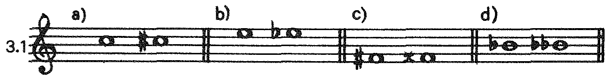

*Primjer 3.1. Tiskana str. 175.*

MuseScore: [za unos].

Alteriranih akorda ima dvije vrste: a) alterirani akordi u širem smislu, tj. takvi koji su u odnosu prema nekim tonalitetima alterirani, ali u odnosu prema nekim drugim nisu, kao kvintakord d-fis-a, koji je u C-duru alterirani akord, a u D-duru nije itd.; b) alterirani akordi u užem smislu ili pravi alterirani akordi, npr. povećani terckvartakord des-f-g-h koji se ni u jednom tonalitetu ne nalazi kao dijatonska formacija, tj. bez ijednoga alteriranog tona.

Kromatski se pomak izvodi u načelu u istom glasu, jer nastup dijatonskoga i alteriranog stupnja u susjednim akordima, a u raznim glasovima, dovodi do opreke (v. odsjek 2.4.2). Zabrana opreke nije apsolutna, jer se njeno neugodno djelovanje u određenim uvjetima znatno ublažuje, a može čak i sasvim nestati. Općenito, ono je najočitije između vanjskih glasova (pr. 3.2.a), kao i kada opreku tvore terce istoimenih dur-kvintakorda i mol-kvintakorda (pr. 3.2.b); ali kompozitori su umjeli i takvu opreku iskoristiti za postizanje posebnih efekata (pr. 3.3).

<!-- visual: 3.2; page 175 -->

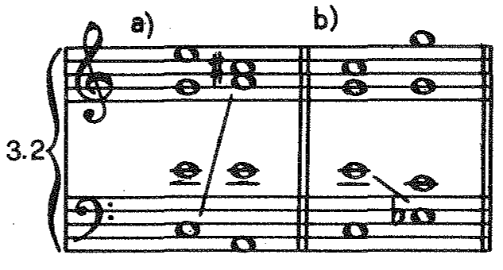

*Primjer 3.2. Tiskana str. 175.*

MuseScore: [za unos].

<!-- visual: 3.3; page 175 -->

**PROVISIONAL — needs cleanup/review; izrezak nije odobren.**

[Primjer 3.3 — tiskana str. 175 — neodobreni izvorni izrezak](../images/03-kromatika-a/primjer-3-3.png)

*Primjer 3.3. Tiskana str. 175.*

> Razlog zadržavanja statusa cleanup_required: Pencil harmonic annotations remain between the Brahms attribution and score and within the example bounds; excluding them rectangularly would lose required attribution or notation.

MuseScore: [za unos; izrezak čeka čišćenje i neovisnu provjeru].

<!-- source-page: 176; pdf-page: 89 -->

Loše zvuče kromatski spojevi akorda gdje je ton, koji će biti alteriran, u prvom akordu udvojen, a zatim se glasovi u kojima se udvajanje pojavljuje vode paralelno (pr. 3.4.a), ili ako se alterirani ton udvaja, a njegovo udvajanje bude »dosegnuto« također paralelnim pomakom (pr. 3.4.b). A isto su tako loše i sakrite kvinte koje nastaju u vanjskim glasovima ako se pritom u jednom od tih glasova pojavljuje kromatski pomak (pr. 3.5).

<!-- visual: 3.4; page 176 -->

**PROVISIONAL — needs cleanup/review; izrezak nije odobren.**

[Primjer 3.4 — tiskana str. 176 — neodobreni izvorni izrezak](../images/03-kromatika-a/primjer-3-4.png)

*Primjer 3.4. Tiskana str. 176.*

> Razlog zadržavanja statusa cleanup_required: Faint pencil traces overlap and extend below the bass-staff area of the a-d example. A clean rectangle cannot exclude embedded writing while retaining the complete staves.

MuseScore: [za unos; izrezak čeka čišćenje i neovisnu provjeru].

<!-- visual: 3.5; page 176 -->

**PROVISIONAL — needs cleanup/review; izrezak nije odobren.**

[Primjer 3.5 — tiskana str. 176 — neodobreni izvorni izrezak](../images/03-kromatika-a/primjer-3-5.png)

*Primjer 3.5. Tiskana str. 176.*

> Razlog zadržavanja statusa cleanup_required: Faint source pencil marks occur inside and below the score, including bass-staff regions; complete a-d notation cannot be retained in a handwriting-free rectangle.

MuseScore: [za unos; izrezak čeka čišćenje i neovisnu provjeru].

<!-- source-page: 177; pdf-page: 89 -->

## 3.2. Srodnost akorda u kromatici

### 3.2.1. Kvintna srodnost akorda u kromatici

Kvintna srodnost u kromatici dolazi do izražaja u kromatskim spojevima dur-kvintakorda, dominantnog septakorda ili dominantnog nonakorda s dominantnim septakordom ili dominantnim nonakordom, koji se nalaze kvintu niže, odnosno kvartu više. Temeljni ton prvog akorda je kvinta drugoga, pa se u tome očituje međusobna srodnost akorda, dok se kromatska priroda njihova odnosa pojavljuje kod spajanja, gdje terca prvog akorda — umjesto da najprije za pola stepena uzlazi, a zatim da na (prohodnu) septimu za cijeli stepen silazi (pr. 3.6.a) — odmah kromatski silazi na septimu drugoga (pr. 3.6.b). Paralelni pomak u septimu, a i u nonu, koji može u tim spojevima nastati kada basov ton skače prema dolje (pr. 3.6.b—g), nije pogrešan, jer se kromatsko kretanje odvija na razini istoga stupnja, koji se najprije pojavljuje kao dijatonski, a zatim snižen, tj. alteriran.

<!-- visual: 3.6; page 177 -->

**PROVISIONAL — needs cleanup/review; izrezak nije odobren.**

[Primjer 3.6 — tiskana str. 177 — neodobreni izvorni izrezak](../images/03-kromatika-a/primjer-3-6.png)

*Primjer 3.6. Tiskana str. 177.*

> Razlog zadržavanja statusa cleanup_required: Handwritten harmonic marks between the staves remain inside the a-g example. They cannot be removed by adjusting outer crop edges.

MuseScore: [za unos; izrezak čeka čišćenje i neovisnu provjeru].

U usporedbi sa spojevima po kvintnoj srodnosti u dijatonici, ovaj je aspekt spajanja akorda vrlo ograničen, jer u dijatonici i prvi i drugi akord mogu biti ili dur-kvintakordi ili mol-kvintakordi, a i spoj se može izvesti s kvintakordom koji leži ili kvintu niže ili kvintu više, odnosno kvartu više ili kvartu niže. Kod kromatskog spoja po kvintnoj srodnosti, naprotiv, drugi akord leži uvijek kvintu niže, odnosno kvartu više, i po svojoj je strukturi dominantni septakord ili dominantni nonakord, jer tada njegova septima (i nona) ne mora biti pripravljena; ako bi pak prvi akord bio mol-kvintakord, onda u spoju sa slijedećim ne bi ni došlo do kromatskog spoja, tako da ta progresija i ne spada u kromatiku, nego u dijatoniku. No, unatoč ograničenim mogućnostima, kromatski spoj kvinto-srodnih akorda vrlo je čest i može se korisno upotrebljavati i unutar tonaliteta i u kromatskim modulacijama, a njegovi se principi daju primijeniti i na neke druge kromatske progresije (v. poglavlja 3.3. i 3.4).

<!-- source-page: 178; pdf-page: 90 -->

### 3.2.2. Tercna srodnost akorda u kromatici

Kod kromatskih spojeva tercno-srodnih akorda broj kombinacija — u usporedbi s kombinacijama u dijatonici (v. odsjek 2.1.3) — znatno je veći. Taj broj obuhvaća ne samo kromatske odnose u kojima i prvi i drugi akord mogu biti ili dur-kvintakordi ili mol-kvintakordi nego se gotovo uvijek dur-kvintakord može zamijeniti dominantnim septakordom, a ponegdje i dominantnim nonakordom (pr. 3.7 — 3.10).

<!-- visual: 3.7; page 178 -->

**PROVISIONAL — needs cleanup/review; izrezak nije odobren.**

[Primjer 3.7 — tiskana str. 178 — neodobreni izvorni izrezak](../images/03-kromatika-a/primjer-3-7.png)

*Primjer 3.7. Tiskana str. 178.*

> Razlog zadržavanja statusa cleanup_required: Partial handwritten marks at the left of the lower system remain inside the horizontal bounds needed for number 3.7. Moving left edge past the writing would clip the number; all a-h variants must remain.

MuseScore: [za unos; izrezak čeka čišćenje i neovisnu provjeru].

<!-- visual: 3.8; page 178 -->

**PROVISIONAL — needs cleanup/review; izrezak nije odobren.**

[Primjer 3.8 — tiskana str. 178 — neodobreni izvorni izrezak](../images/03-kromatika-a/primjer-3-8.png)

*Primjer 3.8. Tiskana str. 178.*

> Razlog zadržavanja statusa cleanup_required: Source handwriting remains within and below the two systems. The very tight lower boundary also requires care against the following example's labels; no clean complete rectangular solution established.

MuseScore: [za unos; izrezak čeka čišćenje i neovisnu provjeru].

<!-- visual: 3.9; page 178 -->

**PROVISIONAL — needs cleanup/review; izrezak nije odobren.**

[Primjer 3.9 — tiskana str. 178 — neodobreni izvorni izrezak](../images/03-kromatika-a/primjer-3-9.png)

*Primjer 3.9. Tiskana str. 178.*

> Razlog zadržavanja statusa cleanup_required: Handwritten analysis above/below the a-e score is retained; lower handwritten marks occupy the same vertical range needed by the lowest printed notes. No clean rectangular solution.

MuseScore: [za unos; izrezak čeka čišćenje i neovisnu provjeru].

<!-- visual: 3.10; page 178 -->

**PROVISIONAL — needs cleanup/review; izrezak nije odobren.**

[Primjer 3.10 — tiskana str. 178 — neodobreni izvorni izrezak](../images/03-kromatika-a/primjer-3-10.png)

*Primjer 3.10. Tiskana str. 178.*

> Razlog zadržavanja statusa cleanup_required: Pencil analysis is visible above and beneath the a-d score, inside the necessary printed-content bounds. Removing it by crop would discard required labels/notation.

MuseScore: [za unos; izrezak čeka čišćenje i neovisnu provjeru].

Spoj (dominantnog) septakorda s kvintakordom nije moguć jedino kada je prvi akord septakord, a kvintakord — koji bi trebao da slijedi — leži malu tercu više (pr. 3.10.b), jer se ovdje septima ne bi mogla ni na koji način riješiti (usp. pr. 2.241.f). Ali spoj dominantnog septakorda s dur-kvintakordom ili mol-kvintakordom ili s dominantnim septakordom, udaljenim za veliku tercu prema gore, potpuno je moguć ako se prvi akord enharmonijski promijeni u povećani kvintsekstakord (pr. 3.9.a i 3.10.a). I mol-kvintakord, kao

<!-- continuation: paragraph continues on page 179 -->

<!-- source-page: 179; pdf-page: 90 -->

<!-- continuation: paragraph from page 178 -->

drugi akord u spoju, može biti zamijenjen odgovarajućim septakordom ako mu se septima može pripraviti, bilo u gornjem glasu (pr. 3.11.a), bilo u donjem (pr. 3.11.b i c). A isto je tako moguća i kombinacija u kojoj će kao prvi akord — umjesto mol-kvintakorda — stajati odgovarajući septakord, uz uvjet da mu septima nalazi u drugom akordu svoje rješenje (pr. 3.12).

<!-- visual: 3.11; page 179 -->

**PROVISIONAL — needs cleanup/review; izrezak nije odobren.**

[Primjer 3.11 — tiskana str. 179 — neodobreni izvorni izrezak](../images/03-kromatika-a/primjer-3-11.png)

*Primjer 3.11. Tiskana str. 179.*

> Razlog zadržavanja statusa cleanup_required: Handwritten chord names sit alongside the a-c labels and additional pencil figures remain below the notes; required labels/lowest notation prevent a clean rectangular crop.

MuseScore: [za unos; izrezak čeka čišćenje i neovisnu provjeru].

<!-- visual: 3.12; page 179 -->

**PROVISIONAL — needs cleanup/review; izrezak nije odobren.**

[Primjer 3.12 — tiskana str. 179 — neodobreni izvorni izrezak](../images/03-kromatika-a/primjer-3-12.png)

*Primjer 3.12. Tiskana str. 179.*

> Razlog zadržavanja statusa cleanup_required: Pencil chord names share the a-e label band and handwritten analysis remains below the score. Embedded foreign source ink cannot be removed by rectangular cropping.

MuseScore: [za unos; izrezak čeka čišćenje i neovisnu provjeru].

U primjeru 3.13. temeljni su tonovi također udaljeni međusobno za veliku ili malu tercu, ali među pripadnim kvintakordima ipak nema nijednoga zajedničkog tona, tako da se ovdje može govoriti samo o prividnoj tercnoj srodnosti, nastaloj po analogiji na realnu tercnu srodnost. No i takve progresije nalazimo u muzičkoj literaturi s kraja romantičkog razdoblja (pr. 3.14).

<!-- visual: 3.13; page 179 -->

**PROVISIONAL — needs cleanup/review; izrezak nije odobren.**

[Primjer 3.13 — tiskana str. 179 — neodobreni izvorni izrezak](../images/03-kromatika-a/primjer-3-13.png)

*Primjer 3.13. Tiskana str. 179.*

> Razlog zadržavanja statusa cleanup_required: Top edge includes fragments of preceding prose as well as handwritten chord names at the variant-label height. Trimming prose alone does not remove the embedded handwriting without losing labels.

MuseScore: [za unos; izrezak čeka čišćenje i neovisnu provjeru].

<!-- visual: 3.14; page 179 -->

**PROVISIONAL — needs cleanup/review; izrezak nije odobren.**

[Primjer 3.14 — tiskana str. 179 — neodobreni izvorni izrezak](../images/03-kromatika-a/primjer-3-14.png)

*Primjer 3.14. Tiskana str. 179.*

> Razlog zadržavanja statusa cleanup_required: Pencil C and other analysis occupy the upper band also required by the Wagner: Parsifal attribution. A trial lower top edge clipped the attribution and was rejected; no safe rectangle proposed.

MuseScore: [za unos; izrezak čeka čišćenje i neovisnu provjeru].

### 3.2.3. Nesrodni akordi u kromatici

Kromatika donosi i neke nove oblike srodnosti ili — točnije — nesrodnosti akorda, kakvi se u dijatonici nisu pojavljivali. Dok u dijatonici npr., dva susjedna septakorda — za razliku od dva susjedna kvintakorda — nisu više nesrodni, jer je temeljni ton prvoga septima u drugome, pa između njih postoji neka vrsta »septimne srodnosti« (pr. 3.15.a), dotle u kromatici može i između susjednih septakorda nedostajati zajednički ton. To se često zbiva kod kromatskih modulacija u spoju dominantnih septakorda, gdje se drugi pojavljuje pola stepena više od prvoga (pr. 3.15.b).

<!-- source-page: 180; pdf-page: 91 -->

<!-- visual: 3.15; page 180 -->

**PROVISIONAL — needs cleanup/review; izrezak nije odobren.**

[Primjer 3.15 — tiskana str. 180 — neodobreni izvorni izrezak](../images/03-kromatika-a/primjer-3-15.png)

*Primjer 3.15. Tiskana str. 180.*

> Razlog zadržavanja statusa cleanup_required: Pencil harmonic annotations remain within the two-variant example, including the lower printed-analysis band. A handwriting-free rectangle would lose required analysis/notation.

MuseScore: [za unos; izrezak čeka čišćenje i neovisnu provjeru].

Ali i dva dur-kvintakorda, udaljena za tritonus, tj. za povećanu kvartu ili za smanjenu kvintu prema gore ili prema dolje, koji također nemaju nijedan zajednički ton, mogu doći u međusobni kromatski odnos u progresiji, gdje se prvi kvintakord pojavljuje u obliku tzv. »napuljskog sekstakorda« (v. poglavlje 3.5), a drugi kao dominantni kvintakord (pr. 3.16.a). A ako pritom drugi akord bude zamijenjen dominantnim septakordom, onda će se opet među njima pojaviti i zajednički ton (pr. 3.16.b).

<!-- visual: 3.16; page 180 -->

**PROVISIONAL — needs cleanup/review; izrezak nije odobren.**

[Primjer 3.16 — tiskana str. 180 — neodobreni izvorni izrezak](../images/03-kromatika-a/primjer-3-16.png)

*Primjer 3.16. Tiskana str. 180.*

> Razlog zadržavanja statusa cleanup_required: Handwritten chord names occur beside the a/b labels and pencil analysis remains in the lower score area. Required labels and notation enclose the writing.

MuseScore: [za unos; izrezak čeka čišćenje i neovisnu provjeru].

U kasnoromantičkom razdoblju javljaju se i spojevi kvintakorda, udaljenih za tritonus, koji nisu posredno vezani nekim trećim akordom, kao što je to slučaj kod spoja napuljskog sekstakorda s dominantnim kvintakordom, nakon čega slijedi tonički kvintakord koji naknadno izmiruje međusobne suprotnosti prethodnih dvaju akorda. U primjeru 3.17. izmjenjuju se tako kvintakordi h-d-fis i f-a-c, a da se nakon te progresije ne pojavljuje nikakav treći akord, koji bi je naknadno funkcionalno opravdavao. Naprotiv, ponavljanje progresije, koje slijedi (u 3. i 4. taktu primjera), zapravo otkriva njezin pravi smisao, a taj je u snažnom tonsko-kolorističkom obratu, proizvedenom suprotstavljanjem međusobno najudaljenijih akorda. Taj obrat ne teži nikamo, pa ga kompozitor — moglo bi se reći — u pravoj impresionističkoj maniri ponavlja, zaustavljajući na tome mjestu harmonijsko kretanje i dovodeći u prvi plan zvučne kvalitete progresije same po sebi, bez neke harmonijsko-funkcionalne veze s kontekstom.

<!-- visual: 3.17; page 180 -->

**PROVISIONAL — needs cleanup/review; izrezak nije odobren.**

[Primjer 3.17 — tiskana str. 180 — neodobreni izvorni izrezak](../images/03-kromatika-a/primjer-3-17.png)

*Primjer 3.17. Tiskana str. 180.*

> Razlog zadržavanja statusa cleanup_required: Handwritten analysis is retained at attribution height and between the Liszt attribution and staves; preserving the printed title and full score encloses the foreign ink.

MuseScore: [za unos; izrezak čeka čišćenje i neovisnu provjeru].

\* Ton »e« u najgornjem glasu je appogiatura na tercu kvintakorda h—d—fis.

<!-- source-page: 181; pdf-page: 91 -->

## 3.3. Sekundarne dominante

Ako u progresiji I—VI—II₆—V—I (pr. 3.18.a) kvintakordu VI stupnja povisimo tercu, ona postaje umjetnom uzlaznom vođicom, koja nastupa kromatski, a akord kome pripada dobiva funkciju dominante II stupnja (D/II), te se kao takav i rješava, tj. u sekstakord II stupnja. U odnosu prema danom tonalitetu (C-dur) akord a-cis-e je sekundarna dominanta, a u odnosu prema akordu u koji se rješava on je dominanta II stupnja. On ne narušava tonalitet, nego ga na stanovit način proširuje. Ali ako taj isti akord shvatimo kao kvintakord V stupnja u d-molu i nastavimo harmonijsko kretanje u tome tonalitetu, dobit ćemo kromatsku modulaciju iz C-dura u d-mol (pr. 3.18.b). Dakle, o kontekstu ovisi da li će kromatski nastup neke harmonije predstavljati kromatsku modulaciju u novi tonalitet ili samo proširenje postojećeg tonaliteta jednim alteriranim akordom.

<!-- visual: 3.18; page 181 -->

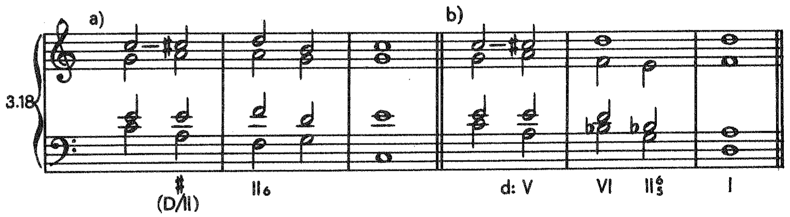

*Primjer 3.18. Tiskana str. 181.*

MuseScore: [za unos].

Svoju dominantu — koja će u odnosu prema danom tonalitetu biti sekundarna dominanta — može imati svaki kvintakord koji može »igrati ulogu« tonike, koja će opet u odnosu prema danom tonalitetu biti privremena tonika. A to može biti svaki konsonantni akord: u duru kvintakord II, III, IV, V i VI stupnja, a u (harmonijskom) molu kvintakord IV, V i VI stupnja. (Kvintakord I stupnja ne ulazi u tu shemu, jer se on — dok god smo na terenu danoga tonaliteta — pojavljuje kao prava, stalna, a ne kao privremena tonika.) Funkciju dominante nekog (konsonantnog) kvintakorda imat će svaki akord koji će s dotičnim kvintakordom tvoriti odnos, analogan odnosu V—I ili VII—I, a ako je dotični kvintakord neki mol-kvintakord, onda u sastav njegovih dominantnih harmonija ulaze i one koje s njim tvore odnos, analogan odnosu III—I u harmonijskom molu. Prema tome funkciju dominante II stupnja u C-duru mogu imati akordi a-cis-e, a-cis-e-g, a-cis-e-g-b, cis-e-g, cis-e-g-b, f-a-cis i f-a-cis-e, pa se i svaki od njih može pojaviti na mjestu drugoga po redu akorda iz progresije u pr. 3.18.a, a svi u istoj funkciji (pr. 3.19).

<!-- source-page: 182; pdf-page: 92 -->

<!-- visual: 3.19; page 182 -->

**PROVISIONAL — needs cleanup/review; izrezak nije odobren.**

[Primjer 3.19 — tiskana str. 182 — neodobreni izvorni izrezak](../images/03-kromatika-a/primjer-3-19.png)

*Primjer 3.19. Tiskana str. 182.*

> Razlog zadržavanja statusa cleanup_required: Pencil chord names/analysis occur above and between the three systems containing a-f; the intermediate writing cannot be excluded with an outer rectangle.

MuseScore: [za unos; izrezak čeka čišćenje i neovisnu provjeru].

Kada se na mjestu privremene tonike nalazi neki dur-kvintakord, onda u sastav njegovih dominantnih harmonija mogu ući i varijante koje bi odgovarale mol-duru, gdje bi dotični kvintakord predstavljao toničku funkciju. Tako npr. u harmonije koje u C-duru imaju funkciju D/IV spadaju osim akorda c-e-g-b, c-e-g-b-d, e-g-b i e-g-b-d još i akordi c-e-g-b-des i e-g-b-des; u c-molu, naprotiv, u analogni sastav akordi c-e-g-b-d i e-g-b-d ne ulaze, jer njih nema niti u tonalitetu, osnovanom na harmonijskoj mol-ljestvici, u kome bi kvintakord f-as-c bio tonički kvintakord. Kad je već riječ o harmonijama, koje imaju funkciju D/IV, spomenimo još jednu osobenost: kvintakord c-e-g možemo u c-molu bez daljnjega osjetiti kao dominantu IV stupnja, jer je on u c-molu alterirani akord, koji prirodno vodi u kvintakord IV stupnja, dok je taj isti akord u C-duru uvijek samo tonička funkcija, jer nije tamo alteriran, pa stoga i ne ulazi u sastav harmonija, koje imaju funkciju D/IV u C-duru.

Sekundarne dominante mogu nastupiti na razne načine, od kojih su najtipičniji: a) kromatski, po tercnoj srodnosti (pr. 3.20. i 3.19.a i b), b) kromatski, po kvintnoj srodnosti (pr. 3.21), c) s kromatskom promjenom istoga akorda (pr. 3.22) ili s kromatskom promjenom kvintakorda uz istodobno dodavanje septime (pr. 3.23). U posljednju grupu spada naoko i nastup sekundarne dominante u primjeru 3.19.c i d, ali se tu zapravo radi o kromatskom odosu po tercnoj srodnosti, u jednom slučaju između kvintakorda c-e-g i dominantnog septakorda a-cis-e-g, a u drugome između kvintakorda c-e-g i dominantnog nonakorda a-cis-e-g-b, samo što i dominantni septakord i dominantni nonakord nastupaju bez temeljnoga tona.

<!-- source-page: 183; pdf-page: 92 -->

<!-- visual: 3.20; page 183 -->

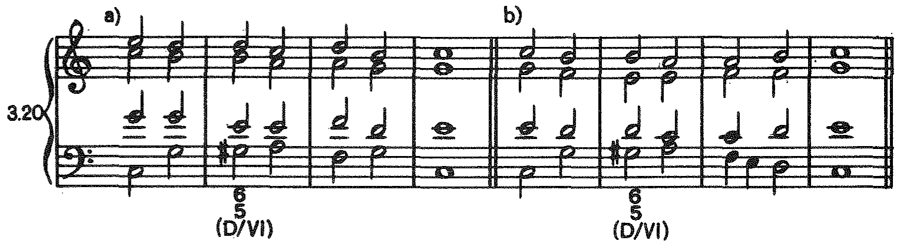

*Primjer 3.20. Tiskana str. 183.*

MuseScore: [za unos].

<!-- visual: 3.21; page 183 -->

**PROVISIONAL — needs cleanup/review; izrezak nije odobren.**

[Primjer 3.21 — tiskana str. 183 — neodobreni izvorni izrezak](../images/03-kromatika-a/primjer-3-21.png)

*Primjer 3.21. Tiskana str. 183.*

> Razlog zadržavanja statusa cleanup_required: Handwritten analysis is visible within the two-staff example and alongside the lower printed functions. It lies inside the bounds needed for complete a/b notation.

MuseScore: [za unos; izrezak čeka čišćenje i neovisnu provjeru].

<!-- visual: 3.22; page 183 -->

**PROVISIONAL — needs cleanup/review; izrezak nije odobren.**

[Primjer 3.22 — tiskana str. 183 — neodobreni izvorni izrezak](../images/03-kromatika-a/primjer-3-22.png)

*Primjer 3.22. Tiskana str. 183.*

> Razlog zadržavanja statusa cleanup_required: Pencil chord names and harmonic figures occupy the upper and inter-system bands of the multi-system example. Rectangular cropping cannot separate them from the complete intended example.

MuseScore: [za unos; izrezak čeka čišćenje i neovisnu provjeru].

<!-- visual: 3.23; page 183 -->

**PROVISIONAL — needs cleanup/review; izrezak nije odobren.**

[Primjer 3.23 — tiskana str. 183 — neodobreni izvorni izrezak](../images/03-kromatika-a/primjer-3-23.png)

*Primjer 3.23. Tiskana str. 183.*

> Razlog zadržavanja statusa cleanup_required: Handwritten chord names share the a/b label band; foreign marks are retained near the tightly adjacent preceding analysis. No complete handwriting-free rectangle established.

MuseScore: [za unos; izrezak čeka čišćenje i neovisnu provjeru].

<!-- source-page: 184; pdf-page: 93 -->

I kromatski odnosi koji nastaju pri nastupu sekundarnih dominanta u primjeru 3.24 treba također da se svedu na odnose gdje se pojavljuju dominantni septakordi i nonakordi bez temeljnoga tona: sekstakord d-f-h, u primjeru 3.24.a i b, treba promatrati kao dominantni septakord g-h-d-f, kome manjka temeljni ton »g«, smanjeni septakord e-g-b-des, u primjeru 3.24.b, kao dominantni nonakord c-e-g-b-des, kome manjka temeljni ton »c«, a septakord e-g-b-d u primjeru 3.24.c, opet kao dominantni nonakord bez temeljnoga tona, tako da se u svim tim slučajevima radi o kromatskoj kvintnoj srodnosti dviju harmonija, prve s temeljnim tonom »g«, a druge s temeljnim tonom »c«.

<!-- visual: 3.24; page 184 -->

**PROVISIONAL — needs cleanup/review; izrezak nije odobren.**

[Primjer 3.24 — tiskana str. 184 — neodobreni izvorni izrezak](../images/03-kromatika-a/primjer-3-24.png)

*Primjer 3.24. Tiskana str. 184.*

> Razlog zadržavanja statusa cleanup_required: Pencil chord names and lower annotations remain inside the complete a/b score's bounds; adjusting outer edges cannot remove all writing while retaining labels and functions.

MuseScore: [za unos; izrezak čeka čišćenje i neovisnu provjeru].

Kromatski odnos koji se pojavio s nastupom sekundarne dominante u primjeru 3.19.e predstavlja varijantu odnosa po kvintnoj srodnosti, gdje se kao drugi akord pojavljuje povećani kvintakord, a u primjeru 3.19.f sekundakord istoga stupnja s istim alteriranim tonom. Ako bismo tome sekundakordu još kromatski snizili basov ton, dobili bismo tzv. »povećani sekundakord« (v. poglavlje 3.8), koji ima dvije umjetne vođice, jednu uzlaznu (»cis«) i jednu silaznu (»es«), pa se zbog toga njegova težnja za rješenjem u kvintakord II stupnja još imperativnije nameće (pr. 3.25).

<!-- visual: 3.25; page 184 -->

**PROVISIONAL — needs cleanup/review; izrezak nije odobren.**

[Primjer 3.25 — tiskana str. 184 — neodobreni izvorni izrezak](../images/03-kromatika-a/primjer-3-25.png)

*Primjer 3.25. Tiskana str. 184.*

> Razlog zadržavanja statusa cleanup_required: Handwritten chord analysis appears at the a/b label height and beneath the staves, within the necessary printed-content rectangle.

MuseScore: [za unos; izrezak čeka čišćenje i neovisnu provjeru].

Sekundarne dominante mogu se uvesti i dijatonskim putem, ali će tada njihova primjena redovito djelovati više kao dijatonska modulacija u tonalitet, gdje bi one predstavljale pravu dominantnu funkciju, nego kao nastup sekundarne dominante u početnom tonalitetu; ali zbog kratkoće zadržavanja u novom tonalitetu, takva će se modulacija ipak doimati nedorečeno, pa je stoga nećemo ni nazivati modulacijom, već samo uklonom. I stoga u primjeru 3.26.a ne govorimo o modulaciji, nego o uklonu u tonalitet G-dura. U varijanti, što je donosi pr. 3.26.b, ovaj uklon je nešto kraći zbog kromatskog povratka u prvotni tonalitet, ali to još uvijek ostaje uklonom. Sekundarne

<!-- continuation: paragraph continues on page 185 -->

<!-- source-page: 185; pdf-page: 93 -->

<!-- continuation: paragraph from page 184 -->

dominante mogu se rješavati i u zamjenike svojih privremenih tonika (pr. 3.27.a); ako se zamjenici ne nalaze u danom tonalitetu kao nealterirani akordi, onda će takvim »varavim« rješenjima opet doći do uklona (pr. 3.27.b).

<!-- visual: 3.26; page 185 -->

**PROVISIONAL — needs cleanup/review; izrezak nije odobren.**

[Primjer 3.26 — tiskana str. 185 — neodobreni izvorni izrezak](../images/03-kromatika-a/primjer-3-26.png)

*Primjer 3.26. Tiskana str. 185.*

> Razlog zadržavanja statusa cleanup_required: Pencil analysis occupies the a/b label band and the lower printed-function area. The close 3.26/3.27 boundary cannot solve embedded handwriting by trimming.

MuseScore: [za unos; izrezak čeka čišćenje i neovisnu provjeru].

<!-- visual: 3.27; page 185 -->

**PROVISIONAL — needs cleanup/review; izrezak nije odobren.**

[Primjer 3.27 — tiskana str. 185 — neodobreni izvorni izrezak](../images/03-kromatika-a/primjer-3-27.png)

*Primjer 3.27. Tiskana str. 185.*

> Razlog zadržavanja statusa cleanup_required: Top contains handwritten analysis and a fragment of the preceding example's lowest printed function. Embedded pencil marks remain even if that foreign printed fragment is trimmed.

MuseScore: [za unos; izrezak čeka čišćenje i neovisnu provjeru].

Od svih sekundarnih dominanta najčešće se upotrebljavaju dominanta V stupnja i dominanta IV stupnja, dakle dominante glavnih stupnjeva.

Dominanta V stupnja, odnosno dominanta dominante (D/V ili DD), vrlo se dobro uklapa u kadencu, gdje obično dolazi iza subdominantne harmonije i zatim se rješava u dominantnu (pr. 3.28).

<!-- visual: 3.28; page 185 -->

**PROVISIONAL — needs cleanup/review; izrezak nije odobren.**

[Primjer 3.28 — tiskana str. 185 — neodobreni izvorni izrezak](../images/03-kromatika-a/primjer-3-28.png)

*Primjer 3.28. Tiskana str. 185.*

> Razlog zadržavanja statusa cleanup_required: Pencil chord names and analysis remain in upper, inter-system and lower bands of variants a-d; a complete clean rectangle is impossible without losing printed material.

MuseScore: [za unos; izrezak čeka čišćenje i neovisnu provjeru].

<!-- source-page: 186; pdf-page: 94 -->

<!-- visual: 3.28 (nastavak: e, f); page 186 -->

**PROVISIONAL — needs cleanup/review; izrezak nije odobren.**

[Primjer 3.28 (nastavak: e, f) — tiskana str. 186 — neodobreni izvorni izrezak](../images/03-kromatika-a/primjer-3-28-p186.png)

*Primjer 3.28 (nastavak: e, f). Tiskana str. 186.*

> Razlog zadržavanja statusa cleanup_required: Continuation e/f and Bach chorale attribution are present, but extensive pencil analysis occupies the label/title band and areas between/below the staves. No clean rectangle.

MuseScore: [za unos; izrezak čeka čišćenje i neovisnu provjeru].

Kad je funkcija DD u duru predstavljena smanjenim septakordom na povišenom IV stupnju, poslije koga slijedi zaostajalični kvartsekstakord na V stupnju, onda se taj smanjeni septakord ispravno notira onako kao u primjeru 3.29.a, a ne kao u primjeru 3.29.b, jer ta druga notacija odgovara smanjenom septakordu kada ima funkciju D/III (pr. 3.29.c), premda on u oba slučaja jednako zvuči, jer se radi o enharmonijski identičnim akordima. Međutim, i notacija iz primjera 3.29.c bit će na mjestu, makar iza smanjenog septakorda i slijedio zaostajalični kvartsekstakord na V stupnju ako se smanjeni septakord pojavljuje kao rezultat kromatskih prohoda (pr. 3.29.d i e). Ali u primjeru 3.29.e više se uopće i ne radi o funkciji DD, nego o subdominantnoj funkciji kvintsekstakorda na (dijatonskom) IV stupnju, koji preko dvostrukoga kromatskog prohoda (f-fis i d-dis) vodi u zaostajalični kvartsekstakord.⁵

<!-- visual: 3.29; page 186 -->

**PROVISIONAL — needs cleanup/review; izrezak nije odobren.**

[Primjer 3.29 — tiskana str. 186 — neodobreni izvorni izrezak](../images/03-kromatika-a/primjer-3-29.png)

*Primjer 3.29. Tiskana str. 186.*

> Razlog zadržavanja statusa cleanup_required: Handwritten analysis remains above, between and below the two systems containing a-c; intermediate marks cannot be removed by changing outside bounds.

MuseScore: [za unos; izrezak čeka čišćenje i neovisnu provjeru].

Dominanta IV stupnja našla je idealnu primjenu u proširenim kadencama mnogih klasičnih djela, u progresijama tipa I♭₇ (D/IV)—IV—V—I. U takvim progresijama odvija se vrlo fina tonalna oscilacija koja ne izlazi iz okvira

<!-- continuation: paragraph continues on page 187 -->

⁵ Istini za volju, treba priznati da se mnogi autori ne drže uvijek teoretski ispravnih notacija ni u kromatskim, ni u enharmonijskim progresijama.

<!-- source-page: 187; pdf-page: 94 -->

<!-- continuation: paragraph from page 186 -->

danoga tonaliteta, nego ga samo produbljuje: najprije nastupa septakord I stupnja sa sniženom septimom, koja odvodi harmonijsko kretanje prema IV stupnju kao prema privremenoj tonici, poslije koje se vođica u slijedećoj, dominantnoj, harmoniji naročito ističe, jer je ona ovdje i negacija snižene septime septakorda I stupnja (koji je bio nastupio na početku progresije), pa kao takva energično zahtijeva konačno smirenje harmonijskoga toka na završnom toničkom kvintakordu. Takav slijed harmonija odvija se u primjeru 3.30. na toničkom pedalnom tonu, koji leži u basu za cijelo vrijeme trajanja progresije.

<!-- visual: 3.30; page 187 -->

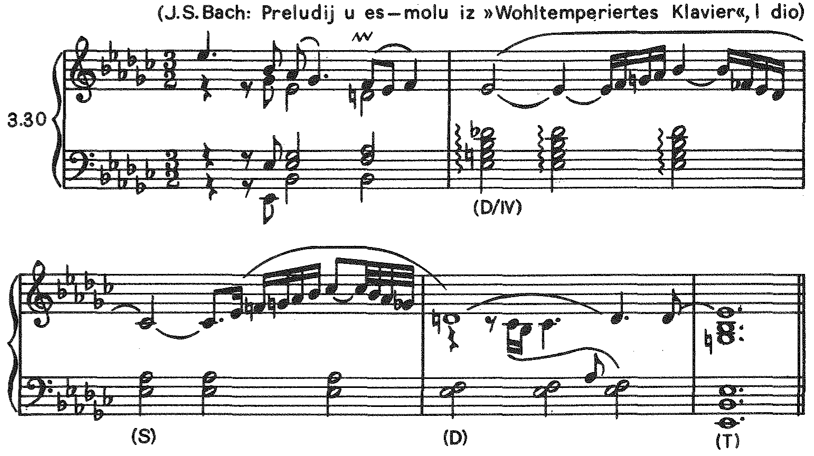

*Primjer 3.30. Tiskana str. 187.*

MuseScore: [za unos].

U proširenim kadencama romantičkih kompozitora sreću se, osim dominanta IV i V stupnja, i druge sekundarne dominante, kojima se održava i potencira harmonijska napetost sve do nastupa posljednjeg akorda, kao u pr. 3.31., gdje autor u proširenu kadencu ubacuje i kvintakord VI stupnja istoimenoga mol-tonaliteta, kojemu također prethodi njegova dominanta.

<!-- visual: 3.31; page 187 -->

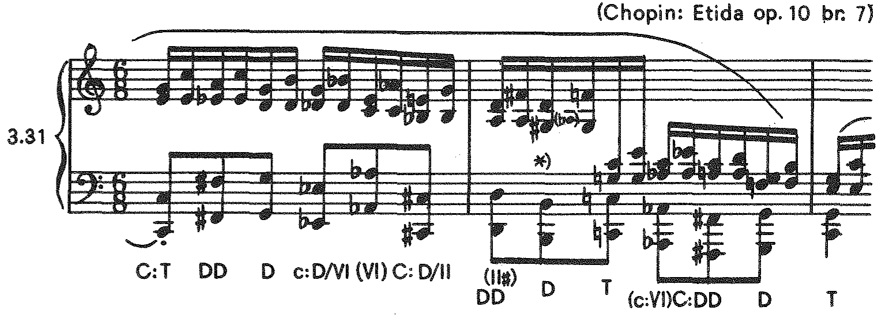

*Primjer 3.31. Tiskana str. 187.*

MuseScore: [za unos].

\* Kvintsekstakord h-d-f-gis trebao bi se zapravo notirati kao (smanjeni) septakord h-d-f-as — na VII stupnju u C-duru.

<!-- source-page: 188; pdf-page: 95 -->

Sekundarne dominante mogu činiti i sekventni lanac kromatskih odnosa po kvintnoj srodnosti, u kome se svaka sekundarna dominanta pojavljuje u funkciji dominante slijedeće harmonije, po shemama: a) dominantni septakord — dur-kvintakord (pr. 3.32), b) dominantni septakord — dominantni septakord (pr. 3.33); c) dominantni septakord — dominantni nonakord (pr. 3.34), kao i po peteroglasnoj shemi: dominantni nonakord — dominantni nonakord (pr. 3.35), iz koje se opet mogu izvesti, oduzimanjem basova tona, četveroglasne sheme: a) smanjeni septakord — smanjeni septakord (pr. 3.36.a) i b) septakord — septakord, konstrukcije septakorda na VII stupnju u duru (pr. 3.36.b).

<!-- visual: 3.32; page 188 -->

**PROVISIONAL — needs cleanup/review; izrezak nije odobren.**

[Primjer 3.32 — tiskana str. 188 — neodobreni izvorni izrezak](../images/03-kromatika-a/primjer-3-32.png)

*Primjer 3.32. Tiskana str. 188.*

> Razlog zadržavanja statusa cleanup_required: Top includes preceding prose fragments; handwritten chord names/analysis also remain in the upper and inter-system bands. Removing prose alone cannot create a handwriting-free complete crop.

MuseScore: [za unos; izrezak čeka čišćenje i neovisnu provjeru].

<!-- visual: 3.33; page 188 -->

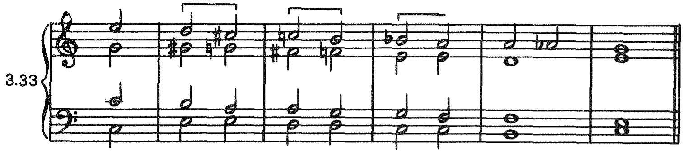

*Primjer 3.33. Tiskana str. 188.*

MuseScore: [za unos].

<!-- visual: 3.34; page 188 -->

**PROVISIONAL — needs cleanup/review; izrezak nije odobren.**

[Primjer 3.34 — tiskana str. 188 — neodobreni izvorni izrezak](../images/03-kromatika-a/primjer-3-34.png)

*Primjer 3.34. Tiskana str. 188.*

> Razlog zadržavanja statusa cleanup_required: Pencil chord names and analysis remain above and within/below the score. Embedded marks in the staff region prevent a safe handwriting-free rectangle.

MuseScore: [za unos; izrezak čeka čišćenje i neovisnu provjeru].

<!-- source-page: 189; pdf-page: 95 -->

<!-- visual: 3.35; page 189 -->

**PROVISIONAL — needs cleanup/review; izrezak nije odobren.**

[Primjer 3.35 — tiskana str. 189 — neodobreni izvorni izrezak](../images/03-kromatika-a/primjer-3-35.png)

*Primjer 3.35. Tiskana str. 189.*

> Razlog zadržavanja statusa cleanup_required: Handwritten analysis below the bass shares the vertical band required by the lowest down-stems. Trimming that band to remove writing would truncate required notation.

MuseScore: [za unos; izrezak čeka čišćenje i neovisnu provjeru].

<!-- visual: 3.36; page 189 -->

**PROVISIONAL — needs cleanup/review; izrezak nije odobren.**

[Primjer 3.36 — tiskana str. 189 — neodobreni izvorni izrezak](../images/03-kromatika-a/primjer-3-36.png)

*Primjer 3.36. Tiskana str. 189.*

> Razlog zadržavanja statusa cleanup_required: Handwritten chord names share the a/b label/bracket band and further pencil analysis remains between and below systems; no clean complete rectangular crop.

MuseScore: [za unos; izrezak čeka čišćenje i neovisnu provjeru].

\* Ovaj oblik sekvence ne bi bio dobar, jer paralelni tritonusi u vanjskim glasovima loše zvuče.

### Zadaci

1 Izradba progresije na osnovi sheme T—D/IV—IV—DD—D—T, u zadanim tonalitetima i u zadanoj mjeri.

<!-- visual: ZADACI 2; page 189 -->

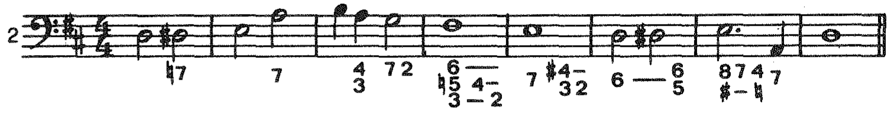

*Zadatak 2. Tiskana str. 189.*

MuseScore: [za unos].

<!-- visual: ZADACI 3; page 189 -->

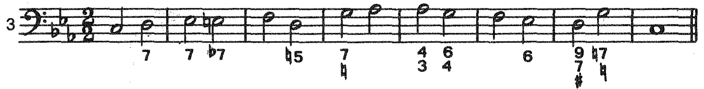

*Zadatak 3. Tiskana str. 189.*

MuseScore: [za unos].

<!-- visual: ZADACI 4; page 189 -->

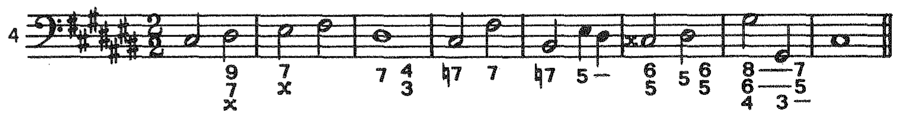

*Zadatak 4. Tiskana str. 189.*

MuseScore: [za unos].

<!-- source-page: 190; pdf-page: 96 -->

<!-- visual: ZADACI 5; page 190 -->

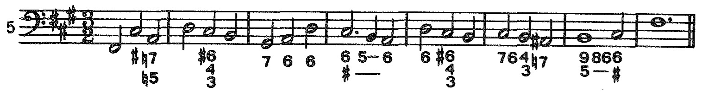

*Zadatak 5. Tiskana str. 190.*

MuseScore: [za unos].

<!-- visual: ZADACI 6; page 190 -->

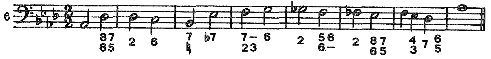

*Zadatak 6. Tiskana str. 190.*

MuseScore: [za unos].

<!-- visual: ZADACI 7; page 190 -->

**PROVISIONAL — needs cleanup/review; izrezak nije odobren.**

[Zadatak 7 — tiskana str. 190 — neodobreni izvorni izrezak](../images/03-kromatika-a/zadatak-3-190-7.png)

*Zadatak 7. Tiskana str. 190.*

> Razlog zadržavanja statusa cleanup_required: Bottom edge truncates the lowest figured-bass marks. Enlarged source strip y=680..755 shows the lowest figures interleaving vertically with the highest slur of exercise 8 around y=720; extending the rectangle includes the neighbouring slur. No safe complete single rectangle established.

MuseScore: [za unos; izrezak čeka čišćenje i neovisnu provjeru].

<!-- visual: ZADACI 8; page 190 -->

**PROVISIONAL — needs cleanup/review; izrezak nije odobren.**

[Zadatak 8 — tiskana str. 190 — neodobreni izvorni izrezak](../images/03-kromatika-a/zadatak-3-190-8.png)

*Zadatak 8. Tiskana str. 190.*

> Razlog zadržavanja statusa cleanup_required: Top retains partial lowest figures from exercise 7. Those figures extend into the vertical band needed to retain exercise 8's complete highest slur; moving the top far enough down removes required slur ink. Source-tested conflict, not a retouch/clipping solution.

MuseScore: [za unos; izrezak čeka čišćenje i neovisnu provjeru].

<!-- visual: ZADACI 9; page 190 -->

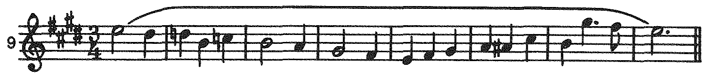

*Zadatak 9. Tiskana str. 190.*

MuseScore: [za unos].

<!-- visual: ZADACI 10; page 190 -->

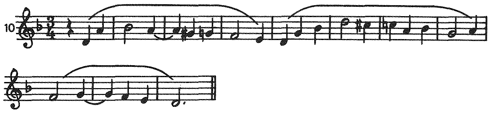

*Zadatak 10. Tiskana str. 190.*

MuseScore: [za unos].

<!-- visual: ZADACI 11; page 190 -->

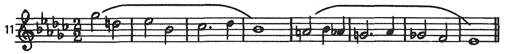

*Zadatak 11. Tiskana str. 190.*

MuseScore: [za unos].

<!-- visual: ZADACI 12; page 190 -->

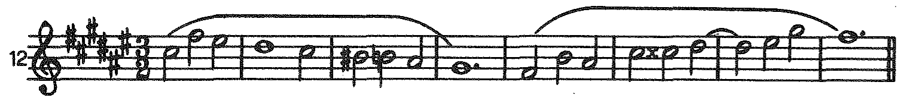

*Zadatak 12. Tiskana str. 190.*

MuseScore: [za unos].

<!-- visual: ZADACI 13; page 190 -->

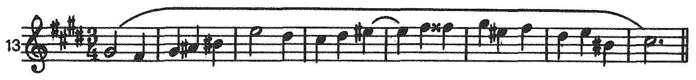

*Zadatak 13. Tiskana str. 190.*

MuseScore: [za unos].

<!-- visual: ZADACI 14; page 190 -->

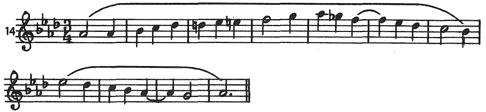

*Zadatak 14. Tiskana str. 190.*

MuseScore: [za unos].

<!-- source-page: 191; pdf-page: 96 -->
<!-- continuation: Granica 190–191: na str. 190 završava niz zadataka prethodnog odsjeka; str. 191 donosi zasebnu realizaciju zadatka 8. Nema prijenosa prozne rečenice. -->

Realizacija zadatka 8.

<!-- visual: Realizacija zadatka 8.; page 191 -->

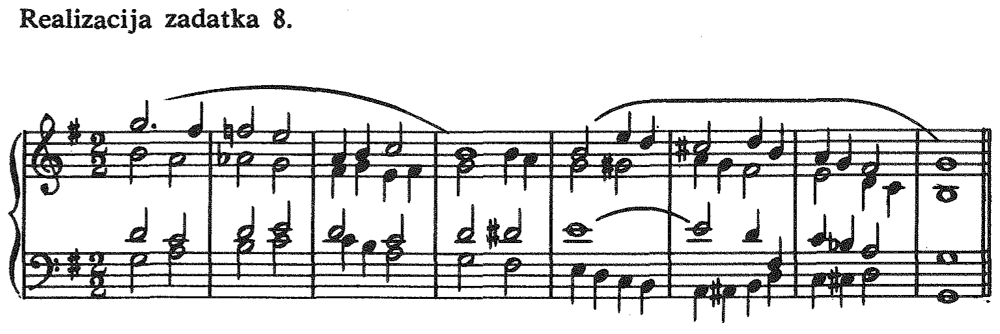

*Realizacija zadatka 8. Tiskana str. 191.*

MuseScore: [za unos].

<!-- source-page: 192; pdf-page: 97 -->

## 3.4. Kromatske modulacije

U svim kromatskim modulacijama prijelaz iz tonaliteta u tonalitet vrši se kromatskim pomakom, tako da se njime zapravo uvodi novi tonalitet. Modulativni kromatski pomak nastaje ili između dva akorda od kojih prvi pripada polaznom, a drugi ciljnom tonalitetu, ili se zbiva u okviru jedne harmonije, koja najprije nastupa dijatonski u polaznom tonalitetu, a zatim — kromatski promijenjena — dobiva određenu funkciju u ciljnom tonalitetu. Kod kromatskih modulacija pomoću kvintne i tercne srodnosti akorda, te kod kromatskih modulacija koje se izvode spojem nesrodnih akorda (v. odsjek 3. 2. 3. i poglavlje 3. 5), modulativni kromatski pomak nastaje u spoju dvaju različitih akorda, a kod kromatskih modulacija pomoću kromatske promjene akorda on se odigrava unutar jednoga te istog akorda. U tu drugu grupu kromatskih modulacija treba uvrstiti još i one gdje se akordu, koji se kromatski mijenja, istodobno dodaje još jedan novi ton, npr. kada se mol-kvintakordu povisuje terca i istodobno (ili neposredno nakon povišenja terce) dodaje mala septima, pa tako od mol-kvintakorda postaje dominantni septakord na istom temeljnom tonu.

### 3.4.1. Kromatske modulacije pomoću kvintne srodnosti akorda

Kromatski spoj kvintno-srodnih akorda može se vrlo dobro iskoristiti u modulativne svrhe, jer je drugi akord u takvom spoju redovito po svojoj strukturi dominantni septakord ili dominantni nonakord i on može prema tome dobiti u ciljnom tonalitetu dominantnu funkciju, tako da se njime odmah započinje i potvrđivanje ciljnoga tonaliteta (pr. 3.37. i 3.38).[^6]

<!-- visual: 3.37; page 192 -->

**PROVISIONAL — needs cleanup/review; izrezak nije odobren.**

[Primjer 3.37 — tiskana str. 192 — neodobreni izvorni izrezak](../images/03-kromatika-a/primjer-3-37.png)

*Primjer 3.37. Tiskana str. 192.*

> Razlog zadržavanja statusa cleanup_required: Pencil chord names occupy the upper score band and handwritten figures remain beside the printed lower function; complete number/staves/function enclose the writing.

MuseScore: [za unos; izrezak čeka čišćenje i neovisnu provjeru].
<!-- visual: 3.38; page 192 -->

**PROVISIONAL — needs cleanup/review; izrezak nije odobren.**

[Primjer 3.38 — tiskana str. 192 — neodobreni izvorni izrezak](../images/03-kromatika-a/primjer-3-38.png)

*Primjer 3.38. Tiskana str. 192.*

> Razlog zadržavanja statusa cleanup_required: Pencil chord names are retained above the staves and handwritten analysis shares the lower printed-function band. No clean complete rectangle.

MuseScore: [za unos; izrezak čeka čišćenje i neovisnu provjeru].

[^6]: Budući da smo kod dijatonskih modulacija prvu fazu (kretanje u polaznom tonalitetu) detaljno obradili, mi ćemo se od sada nadalje zadovoljiti time da u modulacijama najkraćim putem dođemo do prijelaza u novi tonalitet; kompletna izvedba prve faze ostaje, međutim, i dalje obaveznom u izradbi zadanih modulacija.

<!-- source-page: 193; pdf-page: 97 -->

<!-- visual: 3.39; page 193 -->

**PROVISIONAL — needs cleanup/review; izrezak nije odobren.**

[Primjer 3.39 — tiskana str. 193 — neodobreni izvorni izrezak](../images/03-kromatika-a/primjer-3-39.png)

*Primjer 3.39. Tiskana str. 193.*

> Razlog zadržavanja statusa cleanup_required: Handwritten chord names above the score and pencil marks beside the lower D/IV analysis remain within the required printed-content bounds.

MuseScore: [za unos; izrezak čeka čišćenje i neovisnu provjeru].

Nastup dominantnog sekundakorda ciljnog tonaliteta u primjeru 3.38. ne razlikuje se ni po čemu od nastupa istoga akorda u primjeru 3.39, gdje on ima funkciju sekundarne dominante, ali zato ipak ne bi bilo ispravno govoriti da je modulacija u primjeru 3.38. izvedena pomoću zajedničkog akorda (u polaznom tonalitetu sekundakorda I stupnja u funkciji D/IV, koji u ciljnom tonalitetu postaje sekundakordom V stupnja), jer se funkcija svake sekundarne dominante ostvaruje tek retrogradno, iz harmonijskog kretanja koje slijedi i iz kojega razabiremo da nastup dotičnog akorda nije značio modulativni prijelaz u novi tonalitet, nego proširenje postojećega jednim alteriranim akordom u funkciji sekundarne dominante.

Kada ne možemo s kromatskim spojem kvintno-srodnih akorda prijeći direktno u ciljni tonalitet, onda se — kao i kod analognih slučajeva u dijatonskim modulacijama — služimo posrednim tonalitetima (pr. 3.40. i 3.41) ili čak enharmonijskom zamjenom onog akorda koji nastupa kromatskim putem (pr. 3.42).

<!-- visual: 3.40; page 193 -->

**PROVISIONAL — needs cleanup/review; izrezak nije odobren.**

[Primjer 3.40 — tiskana str. 193 — neodobreni izvorni izrezak](../images/03-kromatika-a/primjer-3-40.png)

*Primjer 3.40. Tiskana str. 193.*

> Razlog zadržavanja statusa cleanup_required: Handwriting shares the printed E-c title band and remains near the lower analysis; removing it rectangularly would lose required printed content.

MuseScore: [za unos; izrezak čeka čišćenje i neovisnu provjeru].
<!-- visual: 3.41; page 193 -->

**PROVISIONAL — needs cleanup/review; izrezak nije odobren.**

[Primjer 3.41 — tiskana str. 193 — neodobreni izvorni izrezak](../images/03-kromatika-a/primjer-3-41.png)

*Primjer 3.41. Tiskana str. 193.*

> Razlog zadržavanja statusa cleanup_required: Handwritten chord names share the H-es heading band, with further pencil marks in the analysis area; the complete intended score cannot fit a clean rectangle.

MuseScore: [za unos; izrezak čeka čišćenje i neovisnu provjeru].
<!-- visual: 3.42; page 193 -->

**PROVISIONAL — needs cleanup/review; izrezak nije odobren.**

[Primjer 3.42 — tiskana str. 193 — neodobreni izvorni izrezak](../images/03-kromatika-a/primjer-3-42.png)

*Primjer 3.42. Tiskana str. 193.*

> Razlog zadržavanja statusa cleanup_required: Extensive handwritten chord names/figures remain above and beneath the staves, including the required heading/analysis bands. No safe rectangular removal.

MuseScore: [za unos; izrezak čeka čišćenje i neovisnu provjeru].

U tu vrstu modulacija spadaju naravno i one, gdje se drugi akord u kromatskom modulativnom spoju pojavljuje u obliku neke harmonije VII stupnja, jer nju smatramo teoretski također odgovarajućom harmonijom V stupnja, kojoj manjka temeljni ton (pr. 3.43. i 3.44).

<!-- source-page: 194; pdf-page: 98 -->

<!-- visual: 3.43; page 194 -->

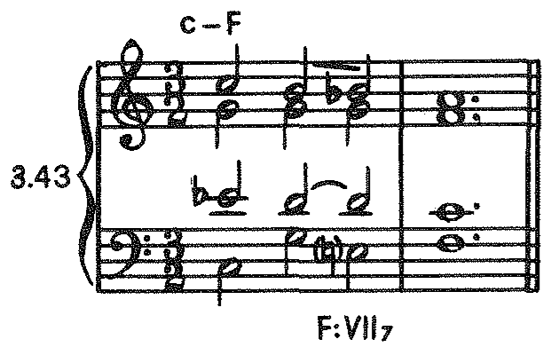

*Primjer 3.43. Tiskana str. 194.*

MuseScore: [za unos].
<!-- visual: 3.44; page 194 -->

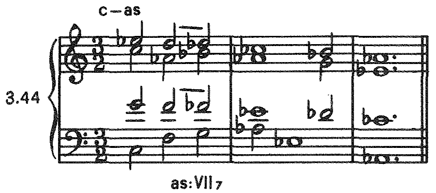

*Primjer 3.44. Tiskana str. 194.*

MuseScore: [za unos].

Sekventni kromatski nizovi akorda, analogni nizovima u primjerima 3.32—3.36, također se mogu iskoristiti u modulacijama, ali se — radi izbjegavanja monotonije — preporučuje razbijanje stroge sekvence mjestimičnim mijenjanjem obratâ i sl. (pr. 3.45).

<!-- visual: 3.45; page 194 -->

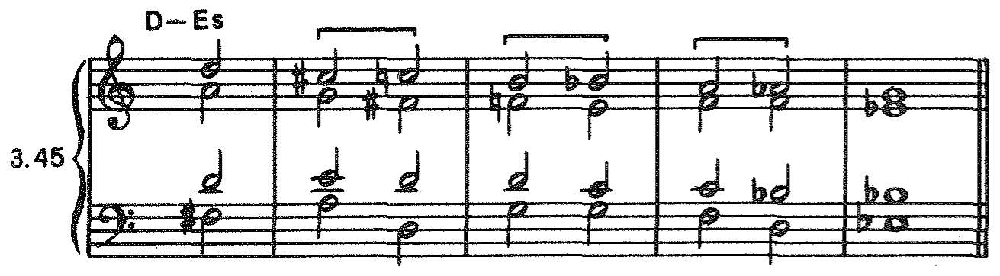

*Primjer 3.45. Tiskana str. 194.*

MuseScore: [za unos].

Dominantni septakord ili dominantni nonakord, koji nastupaju kromatskim putem, mogu se također shvatiti i kao harmonije IV stupnja s povišenom tercom u (ciljnome) mol-tonalitetu (pr. 3.45), a analogni se postupak može primijeniti i kada je drugi akord u kromatskom spoju smanjeni kvintakord ili neki njegov obrat (pr. 3.47).

<!-- visual: 3.46; page 194 -->

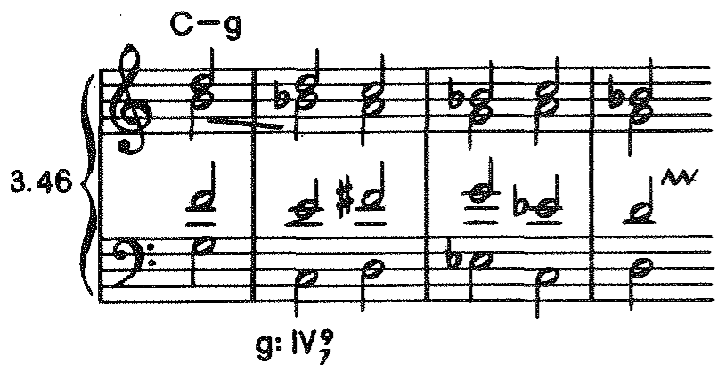

*Primjer 3.46. Tiskana str. 194.*

MuseScore: [za unos].
<!-- visual: 3.47; page 194 -->

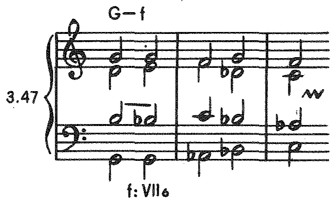

*Primjer 3.47. Tiskana str. 194.*

MuseScore: [za unos].

**ZADACI:** Izradba kromatskih modulacija pomoću kvintne srodnosti akorda, između zadanih tonaliteta i u zadanoj mjeri.

### 3.4.2. Kromatske modulacije pomoću tercne srodnosti akorda

Od modulacija, koje se izvode s kromatskim spojem tercno-srodnih akorda, slične su kromatskim modulacijama pomoću kvintne srodnosti akorda one gdje je drugi akord u modulativnom kromatskom spoju opet po svojoj strukturi dominantni septakord ili dominantni nonakord, jer se tada taj iskorištava kao akord dominantne funkcije u ciljnom tonalitetu (pr. 3.48. i 3.49).

<!-- source-page: 195; pdf-page: 98 -->

<!-- visual: 3.48; page 195 -->

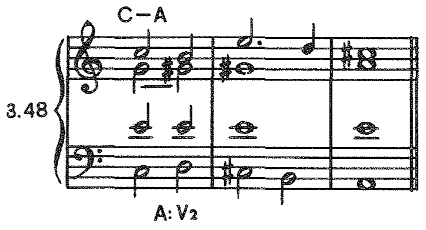

*Primjer 3.48. Tiskana str. 195.*

MuseScore: [za unos].
<!-- visual: 3.49; page 195 -->

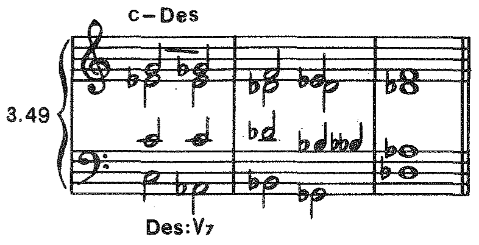

*Primjer 3.49. Tiskana str. 195.*

MuseScore: [za unos].

Znatno veću raznolikost »dohvaćanja« ciljnog tonaliteta pružaju kromatski spojevi tercno-srodnih akorda, gdje je drugi akord neki dur-kvintakord ili mol-kvintakord ili septakord građen na osnovi mol-kvintakorda. Kada je drugi akord dur-kvintakord, a njegova terca nastupa uzlaznim kromatskim pomakom, naravno da je najprirodnije tretirati je kao uzlaznu vođicu, a dotični kvintakord kao kvintakord V stupnja u ciljnom tonalitetu (pr. 3.50) ili također kao kvintakord IV stupnja s povišenom tercom u ciljnome mol-tonalitetu (pr. 3.51).

<!-- visual: 3.50; page 195 -->

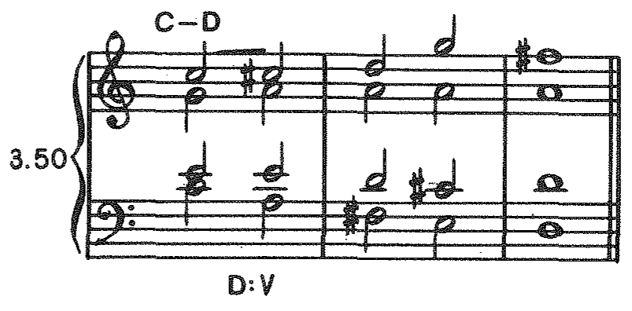

*Primjer 3.50. Tiskana str. 195.*

MuseScore: [za unos].
<!-- visual: 3.51; page 195 -->

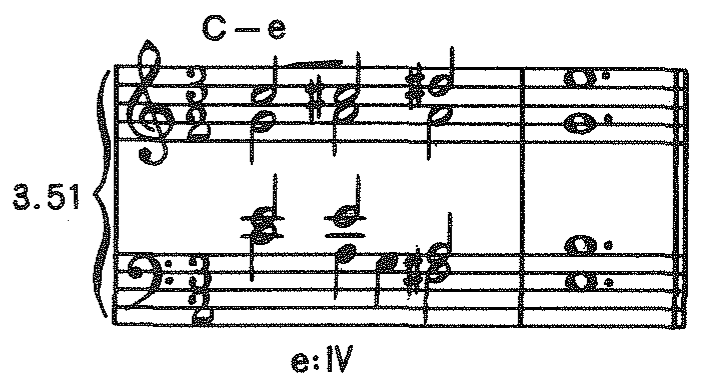

*Primjer 3.51. Tiskana str. 195.*

MuseScore: [za unos].

Ako je drugi akord mol-kvintakord ili odgovarajući septakord, a terca mu nastupa silaznim kromatskim pomakom, njezino najprirodnije iskorištenje bit će u svojstvu silazne vođice, pa će tada akord, u kome se ona pojavljuje, predstavljati u ciljnom tonalitetu (molu ili mol-duru) odgovarajuću harmoniju IV stupnja (pr. 3.52. i 3.53).

<!-- visual: 3.52; page 195 -->

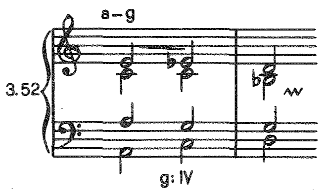

*Primjer 3.52. Tiskana str. 195.*

MuseScore: [za unos].
<!-- visual: 3.53; page 195 -->

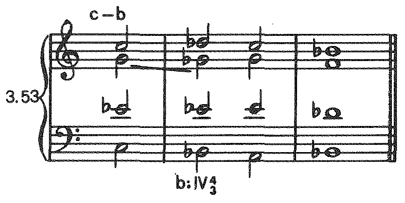

*Primjer 3.53. Tiskana str. 195.*

MuseScore: [za unos].

Budući da su dur-kvintakord i mol-kvintakord konsonantni akordi, koji kao takvi nužno ne zahtijevaju određeno rješenje, njihov nas kromatski nastup nipošto ne ograničava na obaveznu upotrebu u svojstvu dominantnih,

<!-- continuation: Rečenica se nastavlja na str. 196. -->
<!-- source-page: 196; pdf-page: 99 -->
<!-- continuation: Nastavak rečenice sa str. 195. -->

odnosno subdominantnih harmonija u novom tonalitetu; možemo ih shvatiti u svakom tonalitetu gdje oni na bilo kojem stupnju postoje kao dijatonske formacije, kao što smo to radili i u dijatonskim modulacijama (pr. 3.54. i 3.55).

<!-- visual: 3.54; page 196 -->

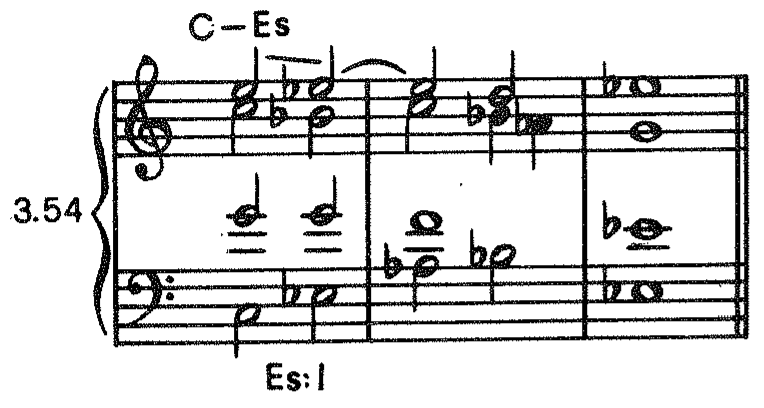

*Primjer 3.54. Tiskana str. 196.*

MuseScore: [za unos].
<!-- visual: 3.55; page 196 -->

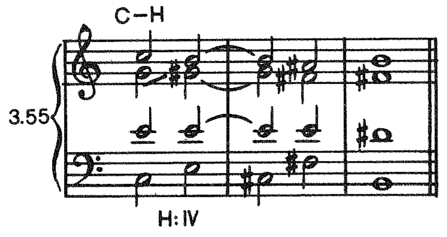

*Primjer 3.55. Tiskana str. 196.*

MuseScore: [za unos].

Kromatski spojevi tercno-srodnih akorda mogu se nadovezivati i jedan na drugi, pri čemu dolazi trenutačno i do nestanka tonalnog oslonca, kao u primjeru 3.56, između drugog i trećeg akorda. Kombinacije s enharmonijskom zamjenom akorda vrlo su efektne, a moguće su ne samo u modulacijama (pr. 3.57) nego i unutar tonaliteta; u takvom slučaju tonalna osnova može prilično izblijedjeti, pa će se dojam tonaliteta ostvarivati često samo melodijskom linijom, kao u primjeru 3.58, gdje sopran izvodi elementarnu melodijsku progresiju u C-duru ili u primjeru 3.59, gdje najgornji glas u orkestru donosi uzlazni gornji tetrakord mol-dur varijante Es-dura; a u oba ta primjera zapravo samo početni i završni tonički kvintakordi predstavljaju u harmonijskom smislu dani tonalitet.

<!-- visual: 3.56; page 196 -->

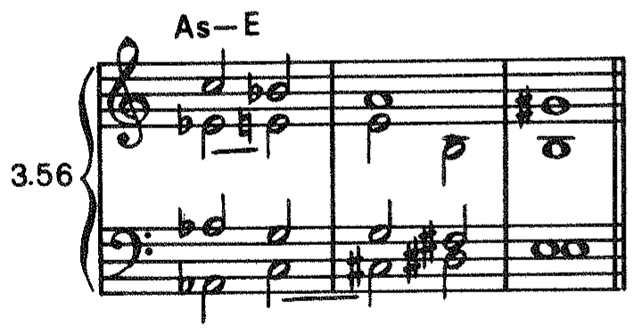

*Primjer 3.56. Tiskana str. 196.*

MuseScore: [za unos].
<!-- visual: 3.57; page 196 -->

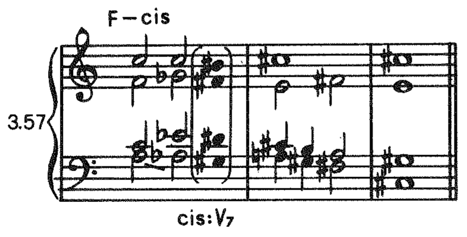

*Primjer 3.57. Tiskana str. 196.*

MuseScore: [za unos].
<!-- visual: 3.58; page 196 -->

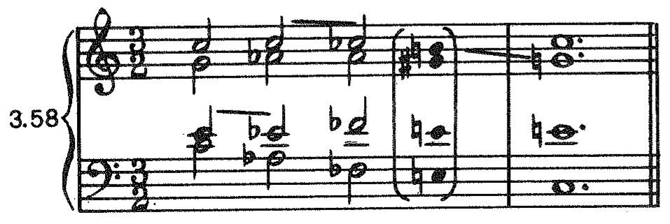

*Primjer 3.58. Tiskana str. 196.*

MuseScore: [za unos].

<!-- source-page: 197; pdf-page: 99 -->

(Liszt: Koncert za klavir i orkestar br. 1, u Es-duru)

<!-- visual: 3.59; page 197 -->

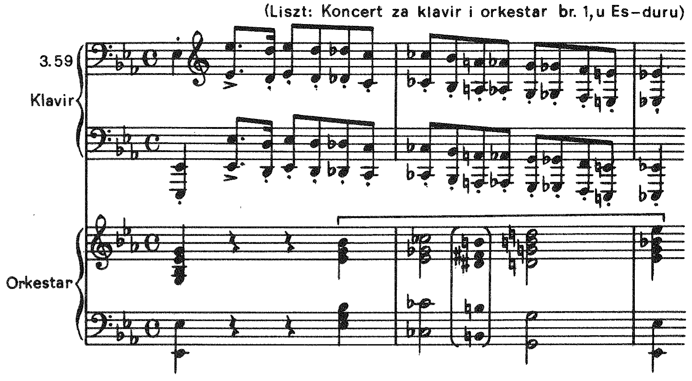

*Primjer 3.59. Tiskana str. 197.*

MuseScore: [za unos].

Romantički i kasnoromantički kompozitori smiono su iskorištavali kromatsku tercnu srodnost akorda za modulativne svrhe (3.60. i 3.61), kao i zato da bi obogatili i osvježili tonalitet ubacivanjem neočekivanih izvantonalnih harmonija (pr. 3.14, 3.31, 3.59. i 3.62).

(Chopin: Preludij op. 28 br. 9)

<!-- visual: 3.60; page 197 -->

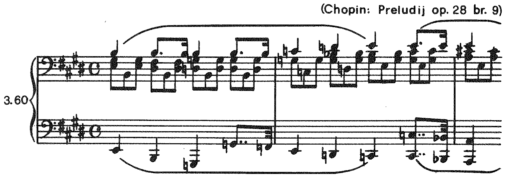

*Primjer 3.60. Tiskana str. 197.*

MuseScore: [za unos].

(Wagner: Parsifal)

<!-- visual: 3.61; page 197 -->

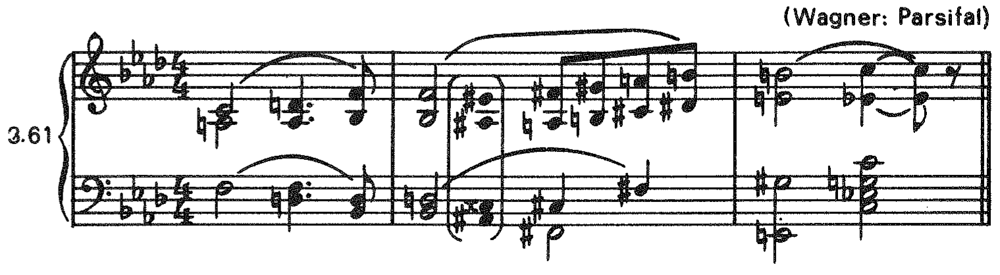

*Primjer 3.61. Tiskana str. 197.*

MuseScore: [za unos].

<!-- source-page: 198; pdf-page: 100 -->

(Grieg: Lirski komadi III, 22)

<!-- visual: 3.62; page 198 -->

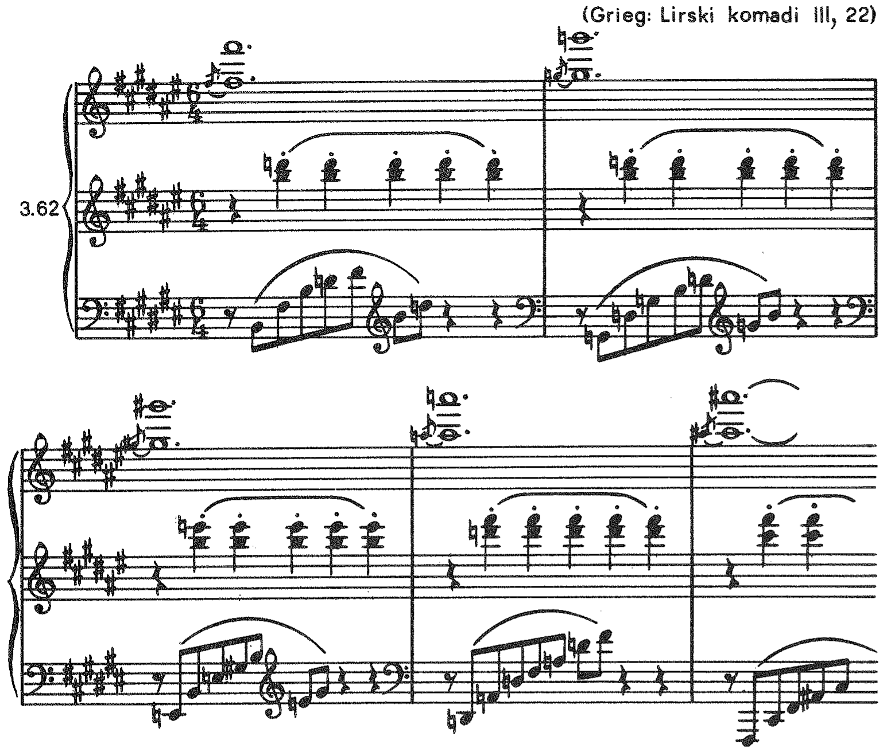

*Primjer 3.62. Tiskana str. 198.*

MuseScore: [za unos].

**ZADACI:** Izradba kromatskih modulacija pomoću tercne srodnosti akorda, između zadanih tonaliteta i u zadanoj mjeri.

### 3.4.3. Kromatske modulacije pomoću kromatske promjene akorda

Materija kromatskih modulacija, koje se izvode s kromatskom promjenom akorda, vrlo je opsežna i složena, te dopušta mnoštvo najrazličitijih mogućnosti: modulacije pomoću jednostruke, dvostruke i trostruke kromatske promjene kvintakordâ i septakordâ, kao i modulacije pomoću kromatske promjene kvintakordâ uz istodobno dodavanje novoga tona, odnosno uz istodobno pretvaranje kvintakorda u određeni septakord. Izvođenje svih pojedinih slučajeva u svakoj od nabrojenih vrsta otežalo bi svojom obimnošću uočavanje bitnoga, a jedva da bi praktički bilo i moguće. Zbog toga ćemo se ograničiti samo na prikaz osnovnih postupaka, a oni će nam dati putokaz i za analogna rješenja u raznim drugim situacijama koje se u praksi mogu pojaviti. Osnovni postupci grupirani su prema vrstama kvintakorda, a uz njih će biti dodani i odgovarajući septakordi, a sve to u granicama kromatskih promjena, koje rezultiraju alteriranim akordima u širem smislu, dok će se kromatske

<!-- continuation: Str. 198 završava slogom „pro-”; riječ „promjene” dehifenirana je na početku nastavka na str. 199. -->
<!-- source-page: 199; pdf-page: 100 -->
<!-- continuation: Nastavak odlomka i riječi „pro-mjene” sa str. 198. -->

promjene koje dovode do pravih alteriranih akorda — kao i kromatske modulacije s njima u vezi — obuhvatiti u materiji gdje su ti akordi posebno tretirani, u poglavljima 3. 6, 3. 8. i 3. 9.

**Modulacije na osnovi kromatske promjene mol-kvintakorda.** Protivno uobičajnom redoslijedu, ovaj prikaz počinjemo s modulacijama na osnovi kromatskih promjena mol-kvintakorda, jer se one u praksi češće javljaju od modulacija na osnovi kromatskih promjena dur-kvintakorda.

Kada se mol-kvintakordu **povisi terca**, ona postaje uzlaznom vođicom, a kvintakord dobiva dominantnu funkciju u novom tonalitetu; ona se pojačava ako kvintakordu istodobno ili neposredno nakon povišenja terce dodajemo malu septimu (pr. 3.63.a—c). Novodobiveni akord može se također iskoristiti i kao harmonija IV stupnja s povišenom tercom u molu (pr. 3.63.d).

<!-- visual: 3.63 a–d; page 199 -->

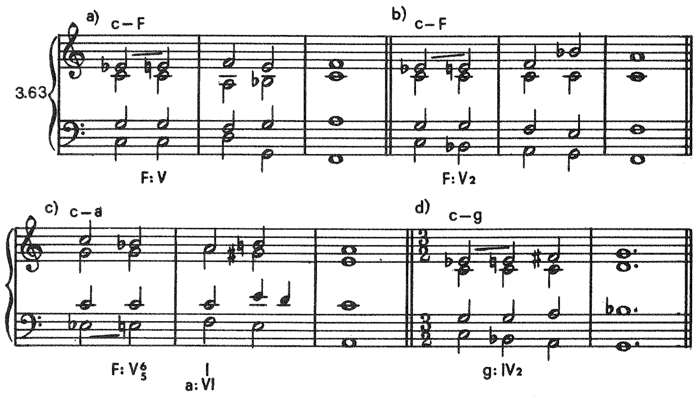

*Primjer 3.63 (a–d). Tiskana str. 199.*

MuseScore: [za unos].

Kromatsko **sniženje kvinte** rezultira sa smanjenim kvintakordom, u kome kvinta postaje silaznom vođicom, a akord se iskorištava kao kvintakord II stupnja u molu ili u mol-duru (pr. 3.64.a), ali i kao kvintakord na povišenom VI stupnju u molu ili na VII stupnju u duru i u molu (pr. 3.64.b i c).

<!-- visual: 3.64 a–c; page 199 -->

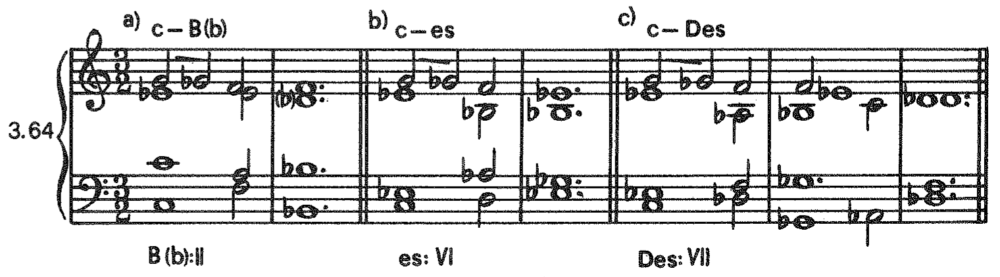

*Primjer 3.64 (a–c). Tiskana str. 199.*

MuseScore: [za unos].

<!-- source-page: 200; pdf-page: 101 -->

Istodobnim **povišenjem terce i kvinte** dobiva se povećani kvintakord na III stupnju u harmonijskom molu (pr. 3.65.a) ili alterirani kvintakord V stupnja u duru (pr. 3.65.b).

<!-- visual: 3.65 a–b; page 200 -->

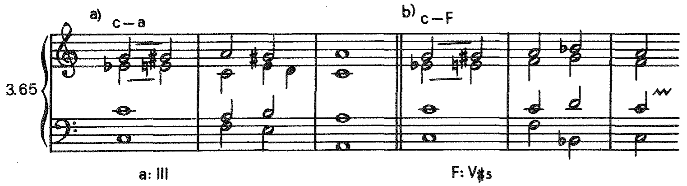

*Primjer 3.65 (a–b). Tiskana str. 200.*

MuseScore: [za unos].

Istodobno **povišenje prime i terce** rezultiralo bi također smanjenim kvintakordom, ali njegova praktična primjena ne dolazi u obzir, jer bi se u tom slučaju morala udvojiti kvinta, a smanjeni kvintakord s udvojenom (smanjenom) kvintom ne bi se mogao pravilno riješiti. Stoga se uz povišenje prime i terce dodaje još akordu i septima, čime se dobiva smanjeni septakord na VII stupnju u molu ili mol-duru (pr. 3.66).

<!-- visual: 3.66; page 200 -->

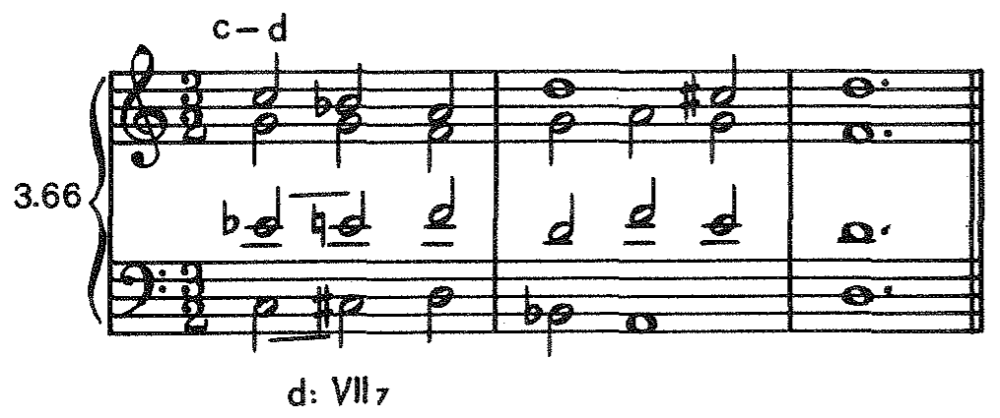

*Primjer 3.66. Tiskana str. 200.*

MuseScore: [za unos].

Postupci, prikazani u primjerima 3.63 — 3.66, analogno se primjenjuju i na septakorde, kojima je mol-kvintakord baza (pr. 3.67).

<!-- visual: 3.67 a–d; page 200 -->

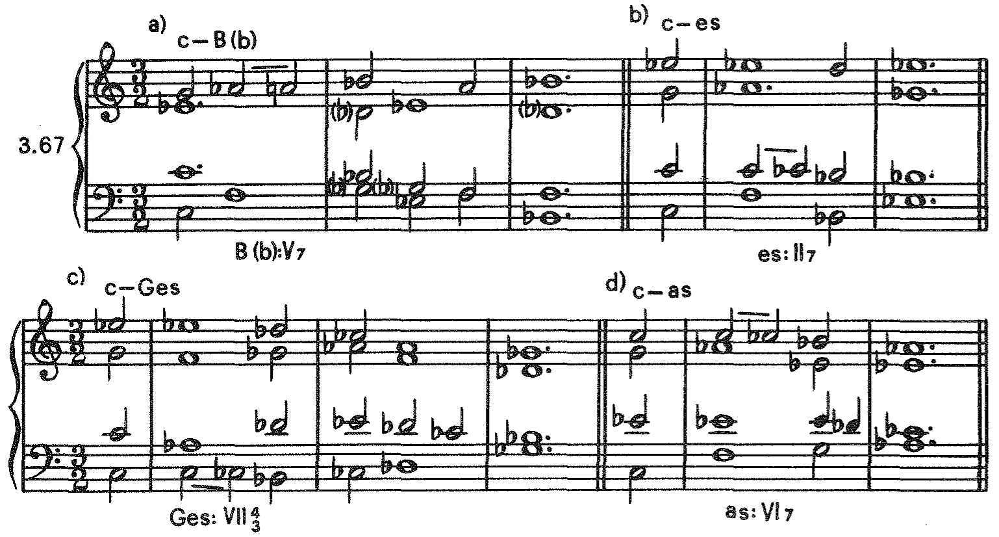

*Primjer 3.67 (a–d). Tiskana str. 200.*

MuseScore: [za unos].
<!-- continuation: Primjer 3.67 nastavlja se varijantama e) i f) na str. 201. -->

<!-- source-page: 201; pdf-page: 101 -->

<!-- visual: 3.67 e–f (nastavak); page 201 -->

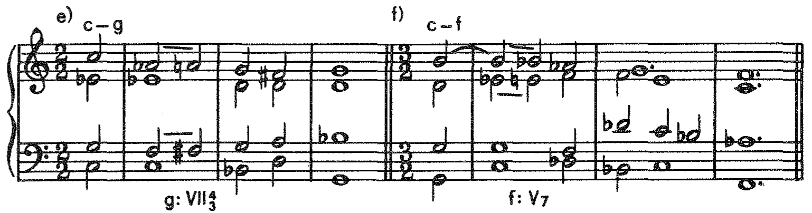

*Primjer 3.67 (nastavak: e, f). Tiskana str. 201.*

MuseScore: [za unos].

**Modulacije na osnovi kromatske promjene dur-kvintakorda.** Kromatskim **sniženjem terce**, koja tada postaje silaznom vođicom, redovito nastaje u novom tonalitetu subdominantna harmonija (pr. 3.68.a), a njena se funkcija intenzivira dodavanjem terce odozdo, tako da se onda dobiva septakord II stupnja u molu ili u mol-duru (pr. 3.68.b i c). Mol-kvintakord, koji nastaje sniženjem terce dur-kvintakorda, ne mora uvijek dobiti subdominantnu funkciju u novom tonalitetu. U primjeru 3.69. on postaje kvintakordom III stupnja, iza koga slijedi terckvartakord V stupnja, tako da čitava ta progresija sliči kromatskom spoju tercno-srodnih akorda e-gis-h i d-f-g-h, koji se ostvaruje u fazama: najprije se u kvintakordu e-gis-h samo snizuje terca »gis« na »g«, a ta u konkretnom kontekstu djeluje kao anticipacija temeljnoga tona trećeg akorda u nizu. Takav postupak tipičan je za Beethovena.

<!-- visual: 3.68 a–c; page 201 -->

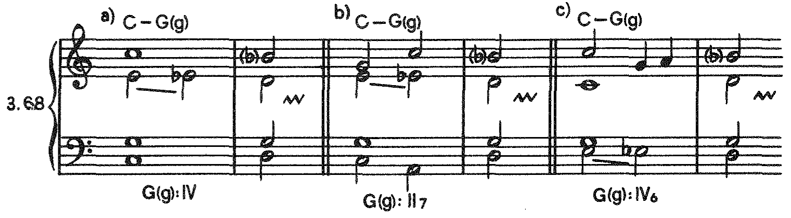

*Primjer 3.68 (a–c). Tiskana str. 201.*

MuseScore: [za unos].

(Beethoven: Sonata za klavir u cis-molu, op. 27 br. 2)

<!-- visual: 3.69; page 201 -->

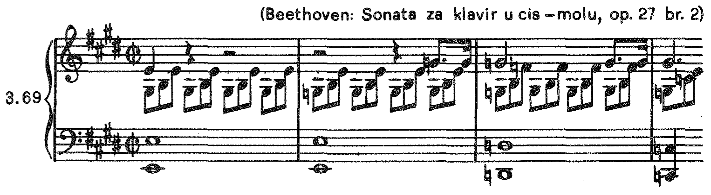

*Primjer 3.69. Tiskana str. 201.*

MuseScore: [za unos].

Kromatsko **sniženje terce i kvinte** rezultira smanjenim kvintakordom i nastavljanjima, analognim onima u primjeru 3.64.

Kromatsko **povišenje kvinte** daje povećani kvintakord s istim konsekvencama kao u primjeru 3.65.

Kromatskim **povišenjem prime** dobivamo smanjeni kvintakord na VII stupnju u duru ili u molu, ili na povišenom VI stupnju u molu, a istodobnim dodavanjem septime smanjeni septakord na VII stupnju u molu ili mol-duru (pr. 3.70).

<!-- source-page: 202; pdf-page: 102 -->

<!-- visual: 3.70; page 202 -->

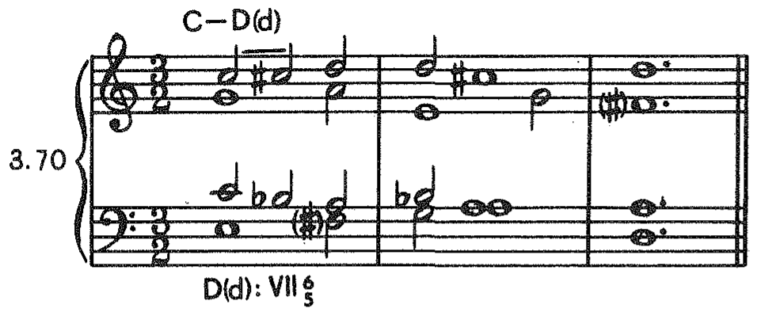

*Primjer 3.70. Tiskana str. 202.*

MuseScore: [za unos].

Ovamo spadaju i modulacije na osnovi kromatskih promjena septakorda, kojima je dur-kvintakord baza (pr. 3.71).

<!-- visual: 3.71 a–e; page 202 -->

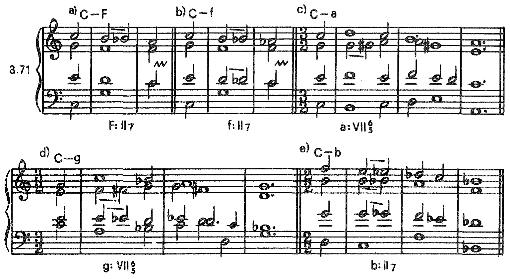

*Primjer 3.71 (a–e). Tiskana str. 202.*

MuseScore: [za unos].

**Modulacije na osnovi kromatske promjene smanjenog kvintakorda.** Ta vrsta modulacije rijetka je u četveroglasnom stavku, jer je vezana uz kromatsko sniženje prime ili uz kromatsko povišenje kvinte, a obje promjene spadaju više u područje enharmonijskih nego kromatskih promjena (pr. 3.72), a i te se odvijaju redovito unutar smanjenog septakorda (v. odsjek 3. 7. 2).

<!-- visual: 3.72 a–b; page 202 -->

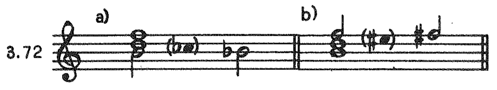

*Primjer 3.72 (a–b). Tiskana str. 202.*

MuseScore: [za unos].

Zbog toga ćemo ovdje prikazati samo slučajeve kromatskih promjena septakorda, kojemu je baza smanjeni kvintakord, a koji ima malu septimu. U primjeru 3.73. s istodobnim povišenjem terce i kvinte dobivamo dominantni septakord u novom tonalitetu, a u primjeru 3.74. sa sniženjem septime smanjeni septakord. Kromatsko sniženje septime daje mogućnost modulacije samo ako je izvršeno na septakordu II stupnja u polaznom tonalitetu —

<!-- continuation: Rečenica se nastavlja na str. 203. -->
<!-- source-page: 203; pdf-page: 102 -->
<!-- continuation: Nastavak rečenice sa str. 202. -->

molu ili mol-duru — jer ono koje se vrši na septakordu VII stupnja u duru ne čini modulaciju nego samo kromatski prijelaz iz dura u istoimeni mol-dur.

<!-- visual: 3.73; page 203 -->

*Primjer 3.73. Tiskana str. 203.*

MuseScore: [za unos].
<!-- visual: 3.74; page 203 -->

*Primjer 3.74. Tiskana str. 203.*

MuseScore: [za unos].

**Modulacije na osnovi kromatske promjene povećanog kvintakorda.** Kromatske promjene povećanog kvintakorda također spadaju u područje enharmonijskih modulacija (v. odsjek 3. 7. 3), tako da praktički preostaje samo modulacija pomoću trostruke kromatske promjene septakorda, kojemu je baza povećani kvintakord (pr. 3.75).

<!-- visual: 3.75; page 203 -->

*Primjer 3.75. Tiskana str. 203.*

MuseScore: [za unos].

**ZADACI:** Izradba modulacija pomoću kromatskih promjena akordâ, između zadanih tonaliteta i u zadanoj mjeri.

### 3.4.4. Rekapitulacija kromatskih modulacija

Usporedimo li kromatske modulacije s dijatonskima, vidjet ćemo da se kromatske odlikuju velikom raznolikošću postupaka i velikim izborom modulativnih kromatskih spojeva akorda, dok su sve dijatonske modulacije okarakterizirane u biti jedinstvenim načinom prelaženja iz tonaliteta u tonalitet, tj. uvijek pomoću nekoga zajedničkog akorda. Stoga je i naša metoda izvođenja dijatonskih modulacija imala značajke univerzalnoga jedinstvenog postupka: uvijek smo najprije odredili prijelazni, odnosno zajednički, akord i prema njemu i cjelokupno harmonijsko kretanje u modulaciji. Međutim, kod kromatskih modulacija takva metoda nije potrebna, jer se tu može — s jedne strane — modulirati veoma naglo, a — s druge — na najrazličitije načine, pa zato pitanje najkraćega puta uopće nije u prvom planu.

Kromatskim modulativnim postupcima mogu se također izrađivati modulativni stavci. Pri tome nije loše ako se mjestimično ubacuju i dijatonski pasusi, ne samo zbog veće raznolikosti već i zbog toga što se isključivo kromatskim prijelazima prenaglo prebacujemo iz tonaliteta u tonalitet i time narušavamo ravnomjernost tonalnoga kretanja (pr. 3.76).

<!-- source-page: 204; pdf-page: 103 -->

<!-- visual: 3.76; page 204 -->

*Primjer 3.76. Tiskana str. 204.*

MuseScore: [za unos].

U harmonizaciji kromatskih modulativnih pomaka u zadanom glasu pružaju se praktički neograničene mogućnosti variranja harmonizacije, pa će usvajanje nekoliko osnovnih postupaka uvelike olakšati prva snalaženja na tome terenu. Ti osnovni postupci, koji se odnose na harmonizaciju uzlaznih i silaznih kromatskih melodijskih progresija, vrlo su jednostavni.

Kada se radi o silaznom kromatskom pomaku, koji se u istom smjeru postepeno nastavlja, dakle kada obuhvaća tri tona, onda se kromatski snižen ton, tj. onaj u sredini progresije, može gotovo uvijek uvjerljivo harmonizirati tako da ga shvatimo ili kao septimu dominantnog septakorda (pr. 3.77.a i b) ili kao kvintu smanjenog septakorda (pr. 3.77.c i d), odnosno kao kvintu septakorda, kojemu je smanjeni kvintakord baza, a koji ima malu septimu — ali to samo kada će ta kvinta silaziti za pola stepena (pr. 3.77.e i f).

<!-- visual: 3.77 a–f; page 204 -->

*Primjer 3.77 (a–f). Tiskana str. 204.*

MuseScore: [za unos].

Kada se u zadanom glasu nalazi uzlazna kromatska progresija, postupak je ovakav: kromatski povišeni ton (srednji u progresiji) može se shvatiti kao terca dominantnog septakorda (pr. 3.78.a i b) ili kao prima smanjenog septakorda (pr. 3.78.c i d), ali ne više kao prima septakorda, kojemu je baza smanjeni kvintakord, a koji ima malu septimu, jer se sada ta ne može više pripraviti.

<!-- source-page: 205; pdf-page: 103 -->

<!-- visual: 3.78 a–d; page 205 -->

*Primjer 3.78 (a–d). Tiskana str. 205.*

MuseScore: [za unos].

Ti postupci mogu se iskoristiti jednako u modulativnim prijelazima, kao i unutar tonaliteta pri upotrebi sekundarnih dominanta.

#### Zadaci

1 Izradba kombiniranih dijatonsko-kromatskih modulativnih stavaka, unutar zadanih graničnih tonaliteta i u zadanoj mjeri.

<!-- visual: ZADACI 2; page 205 -->

*Zadatak 2. Tiskana str. 205.*

MuseScore: [za unos].
<!-- visual: ZADACI 3; page 205 -->

*Zadatak 3. Tiskana str. 205.*

MuseScore: [za unos].
<!-- visual: ZADACI 4; page 205 -->

*Zadatak 4. Tiskana str. 205.*

MuseScore: [za unos].
<!-- visual: ZADACI 5; page 205 -->

*Zadatak 5. Tiskana str. 205.*

MuseScore: [za unos].
<!-- visual: ZADACI 6; page 205 -->

*Zadatak 6. Tiskana str. 205.*

MuseScore: [za unos].

<!-- source-page: 206; pdf-page: 104 -->

<!-- visual: ZADACI 7; page 206 -->

*Zadatak 7. Tiskana str. 206.*

MuseScore: [za unos].
<!-- visual: ZADACI 8; page 206 -->

*Zadatak 8. Tiskana str. 206.*

MuseScore: [za unos].
<!-- visual: ZADACI 9; page 206 -->

*Zadatak 9. Tiskana str. 206.*

MuseScore: [za unos].
<!-- visual: ZADACI 10; page 206 -->

*Zadatak 10. Tiskana str. 206.*

MuseScore: [za unos].

Realizacija zadatka 7.

<!-- visual: Realizacija zadatka 7.; page 206 -->

*Realizacija zadatka 7. Tiskana str. 206.*

MuseScore: [za unos].
