# 3. Kromatika i enharmonija — nastavak

<!-- source-page: 207; pdf-page: 104 -->

## 3.5. Napuljski sekstakord; modulacije pomoću napuljskog sekstakorda

Napuljski sekstakord je sekstakord na IV stupnju u duru i u molu, koji ima malu sekstu i malu tercu, ili — praktičnije — to je **dur-sekstakord** na IV stupnju. U duru je on alterirani akord s dva alterirana tona, sa sniženom tercom i sniženom sekstom, a u molu alterirani akord s jednim alteriranim tonom — sa sniženom sekstom (pr. 3.79.a i b).

Napuljski sekstakord ima subdominantnu funkciju, pa mu se stoga redovito udvaja basov ton (subdominanta), ali se i seksta može udvajati, dok se terca, koja je silazna vođica, ne udvaja (pr. 3.79.c).

<!-- visual: 3.79; page 207 -->

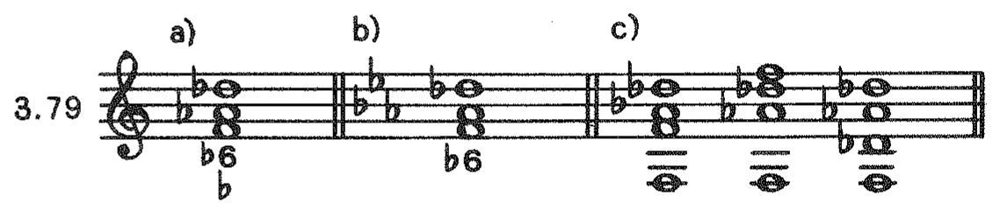

*Primjer 3.79. Tiskana str. 207.*

MuseScore: [za unos].

Nastup napuljskog sekstakorda može biti dijatonski (pr. 3.80.a i b) ili kromatski (pr. 3.80.c i d).

<!-- visual: 3.80; page 207 -->

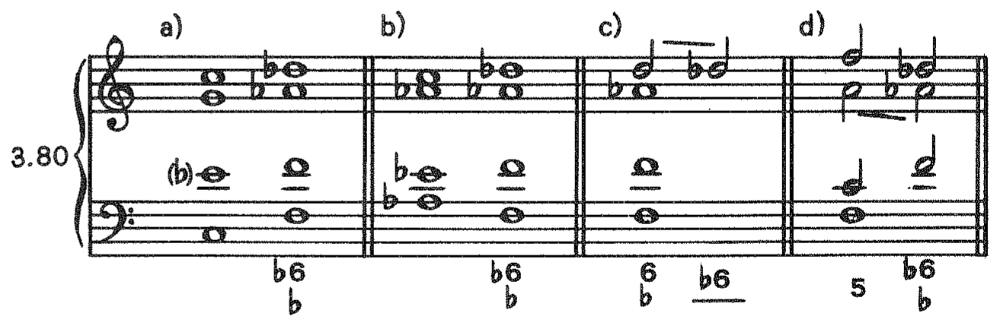

*Primjer 3.80. Tiskana str. 207.*

MuseScore: [za unos].

Poslije napuljskog sekstakorda najčešće dolazi neka harmonija V stupnja (pr. 3.81), ali on se dobro spaja i s harmonijama drugih stupnjeva (pr. 3.82). Ako poslije napuljskog sekstakorda s udvojenim basovim tonom dolazi kvintakord V stupnja i ako se — kao što je i normalno — gornji glasovi vode u protupomaku spram basa, onda se u takvom spoju javljaju dvije osobitosti: jedna je pomak u intervalu smanjene silazne terce (sa sekste napuljskog sekstakorda na tercu slijedećeg akorda), a druga je opreka, što nastaje između sekste napuljskog sekstakorda i kvinte slijedećeg akorda (pr. 3.81.a). Pomak za smanjenu tercu je posve ispravan ako se u nastavku kompenzira polustepenim pomakom u suprotnom pravcu, ali opreka može i neugodno

<!-- continuation: paragraph continues on printed page 208 -->

<!-- source-page: 208; pdf-page: 105 -->
<!-- continuation: paragraph from printed page 207 -->

djelovati. Ona se može izbjeći tako da se umjesto kvintakorda navede nepotpuni septakord V stupnja bez kvinte (pr. 3.81.b i c) ili da se na kvintakord V stupnja dođe preko zaostajaličnog kvartsekstakorda (pr. 3.81.d), odnosno preko sekstakorda kao zaostajalice (pr. 3.81.e). Ali ako prethodni kontekst dopušta da napuljski sekstakord nastupi s udvojenom sekstom, onda će jedna od njih moći kromatski uzlaziti, pa opet neće doći do opreke (pr. 3.81.f i g).

<!-- visual: 3.81; page 208 -->

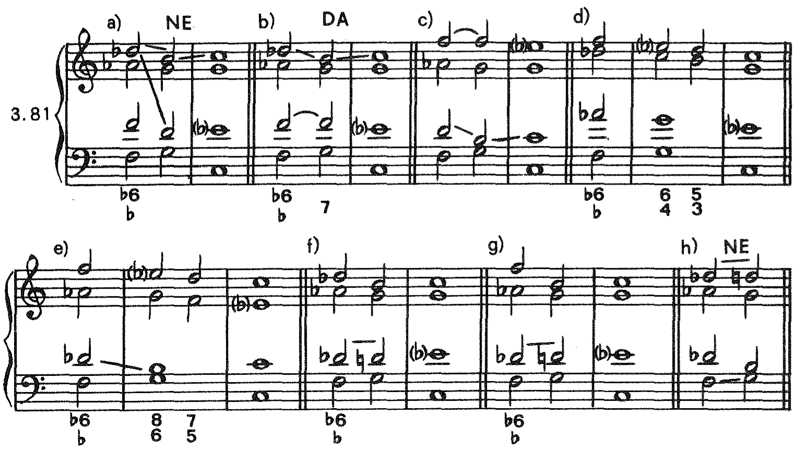

*Primjer 3.81. Tiskana str. 208.*

MuseScore: [za unos].

<!-- visual: 3.82; page 208 -->

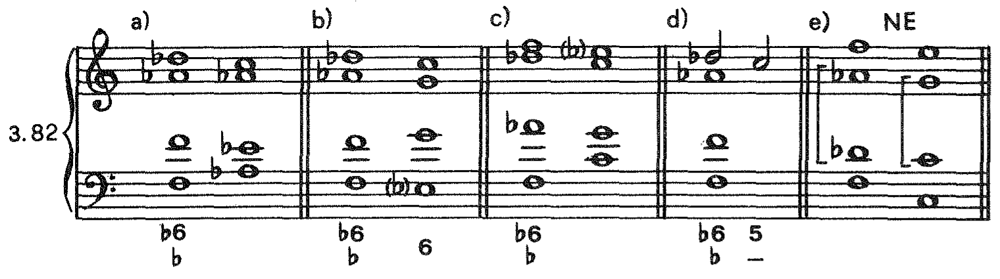

*Primjer 3.82. Tiskana str. 208.*

MuseScore: [za unos].

Budući da napuljski sekstakord predstavlja subdominantnu harmoniju, on se može vrlo dobro upotrijebiti u kadenci. Tada poslije njega dolazi dominantna harmonija (pr. 3.81.a—g) ili neka harmonija koja će imati funkciju DD i koja će se zatim riješiti u odgovarajući akord dominantne funkcije (pr. 3.83).

<!-- visual: 3.83; page 208 -->

**PROVISIONAL — cleanup_required; izrezak nije odobren.**

[Primjer 3.83 — tiskana str. 208 — neodobreni izvorni izrezak](../images/03-kromatika-b/primjer-3-83.png)

*Primjer 3.83. Tiskana str. 208.*

> Razlog zadržavanja statusa cleanup_required: Four-edge/source inspection: complete 3.83, a–b and lowest 4 are retained, but printed footer 208 is visible at bottom left. Its vertical band overlaps the lowest figured bass; its horizontal band overlaps the required example number. A bottom or sideways cut cannot exclude the footer while retaining all printed example content. No safe single source rectangle.

MuseScore: [za unos; izrezak čeka čišćenje i neovisnu provjeru].

<!-- source-page: 209; pdf-page: 105 -->

**Modulacije pomoću napuljskog sekstakorda** mogu biti i dijatonskoga i kromatskog i enharmonijskog tipa. Za modulacije u udaljene tonalitete, a po silaznom kvintnom krugu, uzima se napuljski sekstakord polaznog tonaliteta kao zajednički akord (pr. 3.84), dok se kod modulacija u obratnom pravcu traži kontakt s napuljskim sekstakordom ciljnog tonaliteta kao sa zajedničkim akordom (pr. 3.85), a u oba slučaja radit će se o dijatonskoj vrsti modulacije. U primjeru 3.84.a, gdje napuljski sekstakord polaznog tonaliteta postaje

<!-- continuation: paragraph resumes below examples 3.84 and 3.85 on this page -->

<!-- visual: 3.84; page 209 -->

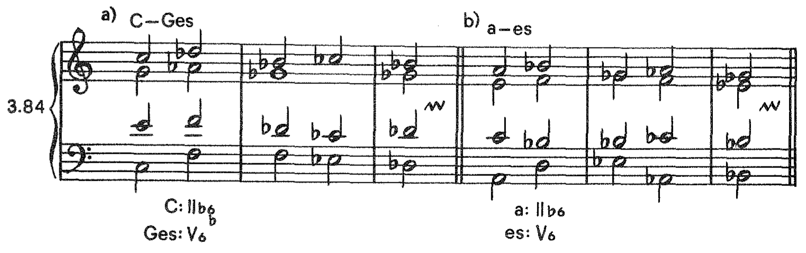

*Primjer 3.84. Tiskana str. 209.*

MuseScore: [za unos].

<!-- visual: 3.85; page 209 -->

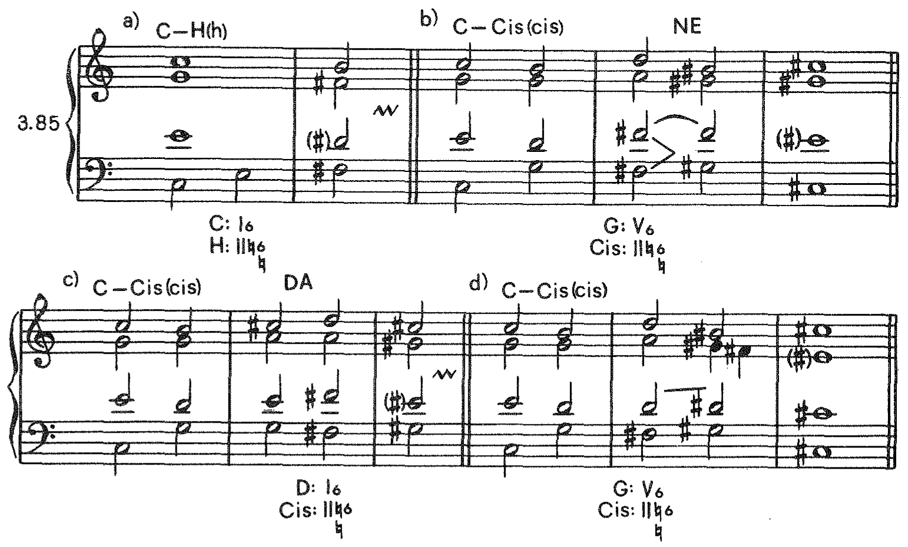

*Primjer 3.85. Tiskana str. 209.*

MuseScore: [za unos].

<!-- continuation: paragraph from above examples 3.84 and 3.85 -->

sekstakordom V stupnja u Ges-duru, izgledalo bi naoko kao da je pritom došlo do udvajanja vođice »f« (u Ges-duru); ali budući da je akord f-as-des nastupio kao harmonija u C-duru — gdje »f« nije nikakva vođica — mi to udvajanje ne čujemo kao udvajanje vođice u Ges-duru, nego kao udvajanje subdominantnoga tona u C-duru, pa je stoga ono potpuno ispravno. Međutim, u primjeru 3.85.b, udvajanje basova tona »fis« u napuljskom sekstakordu ciljnog tonaliteta je pogrešno, jer je akord fis-a-d nastupio kao sekstakord V stupnja u posrednom tonalitetu G-dura, dakle s udvojenom vođicom. U konkretnoj modulaciji može se pogrešno udvajanje učiniti korektnim ako se

<!-- continuation: paragraph continues on printed page 210 -->

<!-- source-page: 210; pdf-page: 106 -->
<!-- continuation: paragraph from printed page 209 -->

predbježno modulira u onakav posredni tonalitet u kome »fis« neće biti vođicom (pr. 3.85.c), a može se i G-dur zadržati kao posredni tonalitet, samo što onda u kritičnom akordu udvajamo sekstu, pa dobivamo kromatsku vrstu modulacije (pr. 3.85.d).

Kromatske modulacije pomoću napuljskog sekstakorda mogu nastati i na druge načine, kao u primjeru 3.86.a i b, gdje je napuljski sekstakord ciljnog tonaliteta onaj akord koji nastupa kromatski, ili kao u primjeru 3.86.c, gdje se napuljski sekstakord ciljnog tonaliteta kromatski spaja sa sekundakordom V stupnja. Enharmonijske modulacije pomoću napuljskog sekstakorda vrše se redovito njegovom enharmonijskom zamjenom (pr. 3.87).

<!-- visual: 3.86; page 210 -->

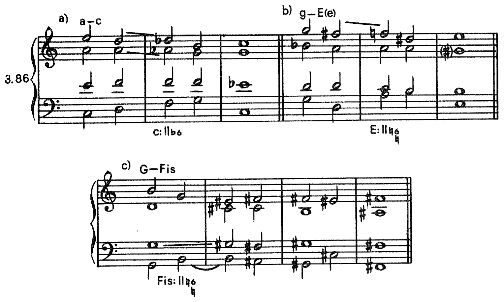

*Primjer 3.86. Tiskana str. 210.*

MuseScore: [za unos].

<!-- visual: 3.87; page 210 -->

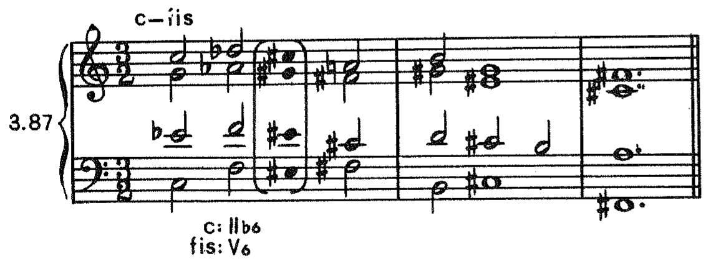

*Primjer 3.87. Tiskana str. 210.*

MuseScore: [za unos].

Primjenu »ad absurdum« napuljskog sekstakorda kao sredstva modulacije predstavlja modulacija iz C-dura u His-dur, što ju je izradio njemački kompozitor M. Reger (pr. 3.88). I u toj modulaciji nalazimo udvajanje vođice, jer napuljski sekstakord ciljnog tonaliteta, eis-gis-cis, nastupa kao sekstakord V stupnja prethodnoga posrednog Fis-dur tonaliteta s udvojenim basovim tonom (vođicom u Fis-duru), pa bi i u ovom slučaju bila bolja neka varijanta, gdje bi to udvajanje bilo izbjegnuto.

<!-- source-page: 211; pdf-page: 106 -->

<!-- visual: 3.88; page 211 -->

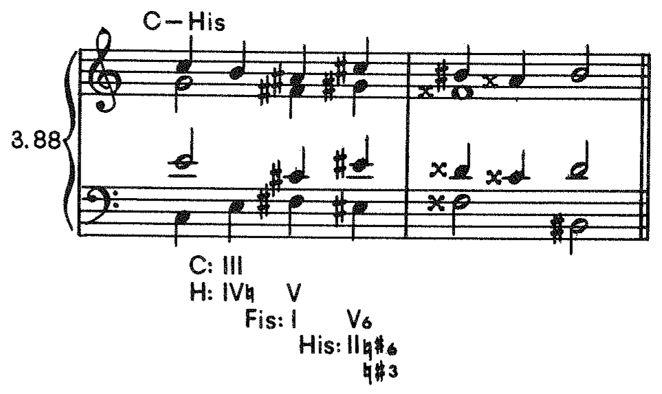

*Primjer 3.88. Tiskana str. 211.*

MuseScore: [za unos].

Napuljski sekstakord ima svoje ime po kompozitorima tzv. Napuljske škole (17—18. st.), koji su ga često upotrebljavali, ali njegovu primjenu srećemo u svim razdobljima tonalne harmonije (pr. 3.89. i 3.90). Nije rijetka ni pojava napuljskog sekstakorda u obliku kvintakorda, tj. kao dur-kvintakorda na sniženom II stupnju (pr. 3.91. i 3.92).

<!-- visual: 3.89; page 211 -->

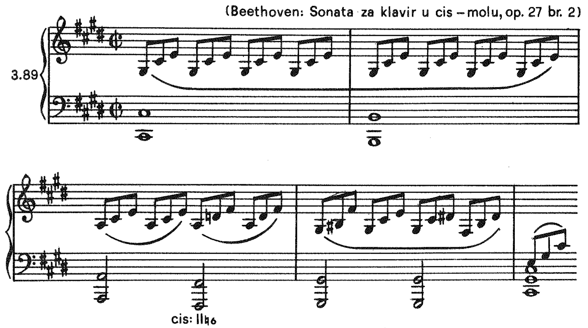

*Primjer 3.89. Tiskana str. 211.*

MuseScore: [za unos].

(Beethoven: Sonata za klavir u cis-molu, op. 27 br. 2)

<!-- visual: 3.90; page 211 -->

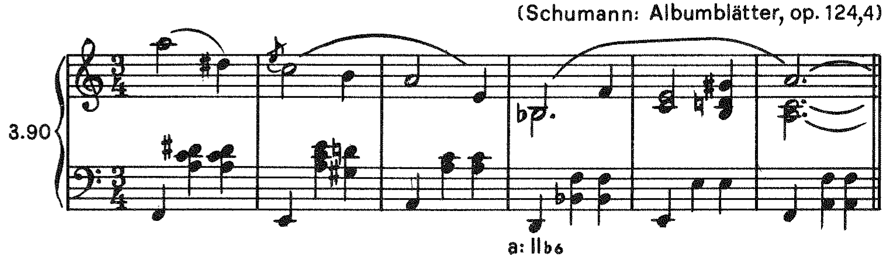

*Primjer 3.90. Tiskana str. 211.*

MuseScore: [za unos].

(Schumann: Albumblätter, op. 124,4)

<!-- source-page: 212; pdf-page: 107 -->

<!-- visual: 3.91; page 212 -->

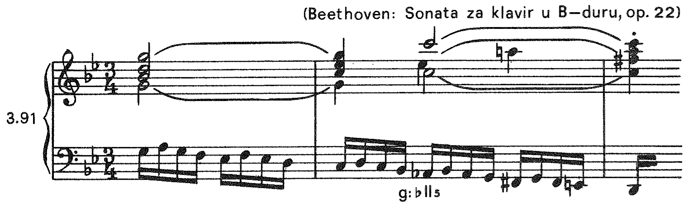

*Primjer 3.91. Tiskana str. 212.*

MuseScore: [za unos].

(Beethoven: Sonata za klavir u B-duru, op. 22)

<!-- visual: 3.92; page 212 -->

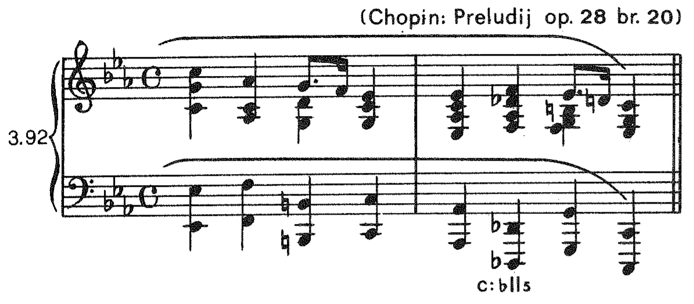

*Primjer 3.92. Tiskana str. 212.*

MuseScore: [za unos].

(Chopin: Preludij op. 28 br. 20)

### ZADACI

1 Različite vrste modulacija pomoću napuljskog sekstakorda, između zadanih tonaliteta i u zadanoj mjeri.

<!-- visual: ZADACI 2; page 212 -->

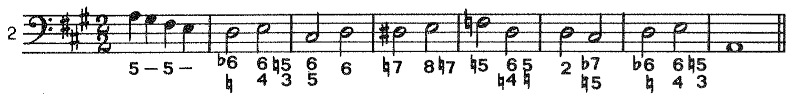

*Zadatak 2. Tiskana str. 212.*

MuseScore: [za unos].

<!-- visual: ZADACI 3; page 212 -->

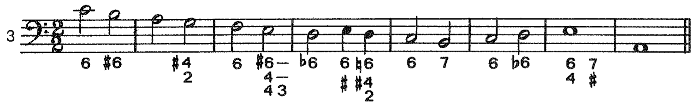

*Zadatak 3. Tiskana str. 212.*

MuseScore: [za unos].

<!-- visual: ZADACI 4; page 212 -->

**PROVISIONAL — cleanup_required; izrezak nije odobren.**

[Zadatak 4 — tiskana str. 212 — neodobreni izvorni izrezak](../images/03-kromatika-b/zadatak-3-212-4.png)

*Zadatak 4. Tiskana str. 212.*

> Razlog zadržavanja statusa cleanup_required: Four-edge/source inspection: ID4, both systems and lowest figures complete, but bottom edge includes a partial high note from exercise 5 near source x1050. Enlarged source overlap inspected: exercise 4's lowest 3 reaches y2223 while exercise 5's high note starts y2220. Full-width rectangular bottom cut cannot remove the foreign note without clipping the figure; sideways cut would remove required first-system notation. No safe single rectangle.

MuseScore: [za unos; izrezak čeka čišćenje i neovisnu provjeru].

<!-- visual: ZADACI 5; page 212 -->

**PROVISIONAL — cleanup_required; izrezak nije odobren.**

[Zadatak 5 — tiskana str. 212 — neodobreni izvorni izrezak](../images/03-kromatika-b/zadatak-3-212-5.png)

*Zadatak 5. Tiskana str. 212.*

> Razlog zadržavanja statusa cleanup_required: Four-edge/source inspection: ID5 and all notation/lowest figures retained, but top edge contains partial figures from exercise 4 and bottom left contains printed footer 212. Exercise 4's figures extend to y2223 while this exercise's high note starts y2220; the footer also shares the lower figure band and required ID's horizontal band. Neither top/bottom trimming nor sideways shifting yields an intact clean single rectangle.

MuseScore: [za unos; izrezak čeka čišćenje i neovisnu provjeru].

<!-- continuation: ZADACI continue on printed page 213 -->

<!-- source-page: 213; pdf-page: 107 -->
<!-- continuation: ZADACI from printed page 212 -->

<!-- visual: ZADACI 6; page 213 -->

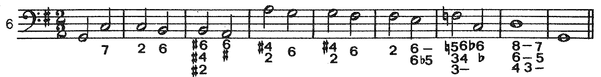

*Zadatak 6. Tiskana str. 213.*

MuseScore: [za unos].

<!-- visual: ZADACI 7; page 213 -->

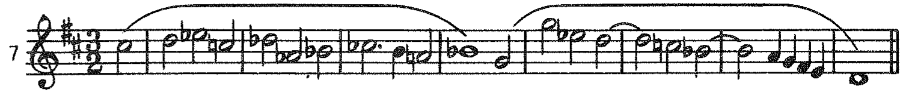

*Zadatak 7. Tiskana str. 213.*

MuseScore: [za unos].

<!-- visual: ZADACI 8; page 213 -->

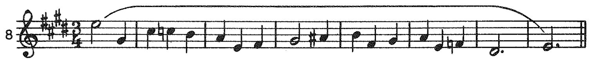

*Zadatak 8. Tiskana str. 213.*

MuseScore: [za unos].

<!-- visual: ZADACI 9; page 213 -->

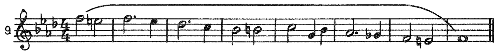

*Zadatak 9. Tiskana str. 213.*

MuseScore: [za unos].

<!-- visual: ZADACI 10; page 213 -->

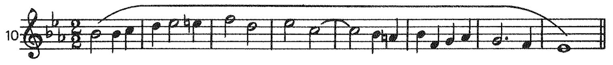

*Zadatak 10. Tiskana str. 213.*

MuseScore: [za unos].

<!-- visual: ZADACI 11; page 213 -->

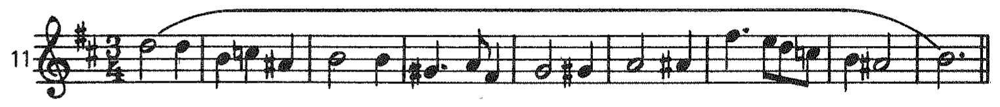

*Zadatak 11. Tiskana str. 213.*

MuseScore: [za unos].

<!-- visual: ZADACI 12; page 213 -->

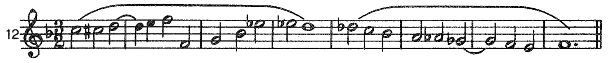

*Zadatak 12. Tiskana str. 213.*

MuseScore: [za unos].

<!-- visual: ZADACI 13; page 213 -->

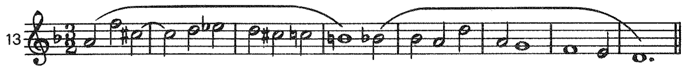

*Zadatak 13. Tiskana str. 213.*

MuseScore: [za unos].

Realizacija zadatka 7.

<!-- visual: Realizacija zadatka 7.; page 213 -->

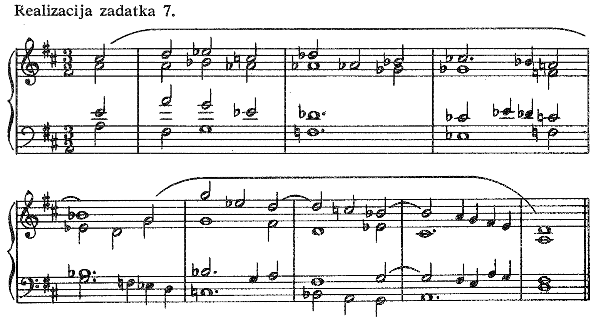

*Realizacija zadatka 7. Tiskana str. 213.*

MuseScore: [za unos].

<!-- source-page: 214; pdf-page: 108 -->

## 3.6. Povećani sekstakord, kvintsekstakord i terckvartakord

Većina alteriranih akorda u užem smislu, odnosno pravih alteriranih akorda, pojavljuje se u standardnom okviru intervala **povećane sekste**. Toj kategoriji alteriranih akorda pripadaju prije svega povećani sekstakord, povećani kvintsekstakord i povećani terckvartakord (koji su predmet prikazivanja ovog poglavlja), kao i povećani sekundakord (koji će biti obrađen u poglavlju 3. 8).

Povećani sekstakord sadrži intervale velike terce i povećane sekste (pr. 3.93.a), povećani kvintsekstakord intervale velike terce, čiste kvinte i povećane sekste (pr. 3.93.b), a povećani terckvartakord intervale velike terce, povećane kvarte i povećane sekste (pr. 3.93.c), računajući uvijek od basova tona. Povećani sekstakord nastao je od sekstakorda VII stupnja, povećani kvintsekstakord od prvog obrata smanjenog septakorda na VII stupnju u molu i mol-duru, a povećani terckvartakord od terckvartakorda V stupnja — — svi na jednak način, tj. sniženjem basova tona prvotnoga akorda, pa su sva tri i locirana na istom mjestu: na sniženom II stupnju u duru i u molu (pr. 3.93.d—f).

<!-- visual: 3.93; page 214 -->

**PROVISIONAL — cleanup_required; izrezak nije odobren.**

[Primjer 3.93 — tiskana str. 214 — neodobreni izvorni izrezak](../images/03-kromatika-b/primjer-3-93.png)

*Primjer 3.93. Tiskana str. 214.*

> Razlog zadržavanja statusa cleanup_required: Four-edge/source inspection: 3.93, a–f and complete lower analyses retained, but handwritten pencil annotation below/right of variant a's chord lies inside the notation/figure bounding rectangle. Moving any outer edge enough to remove it would remove required notation. No safe single source rectangle.

MuseScore: [za unos; izrezak čeka čišćenje i neovisnu provjeru].

Izolirano promatrani, povećani sekstakord i povećani kvintesekstakord zapravo nisu alterirani akordi u užem smislu, jer je interval povećane sekste, dakle njihov karakteristični interval, enharmonijski identičan s intervalom male septime (pr. 3.94.a), pa prema tome s enharmonijskom promjenom intervala povećane sekste u interval male septime dobivamo od povećanog sekstakorda akord strukture nepotpunoga dominantnog septakorda bez kvinte (pr. 3.94.b), a od povećanog kvintsekstakorda akord strukture potpunoga dominantnog septakorda (pr. 3.94.c).

<!-- visual: 3.94; page 214 -->

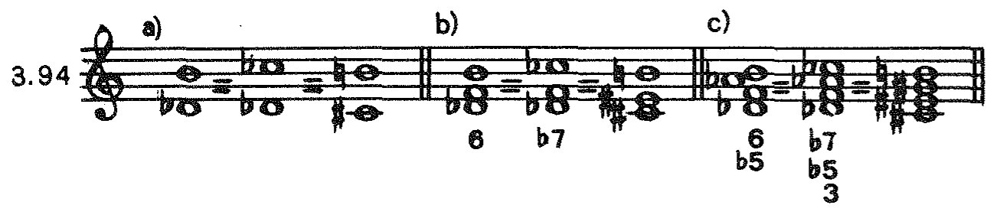

*Primjer 3.94. Tiskana str. 214.*

MuseScore: [za unos].

<!-- source-page: 215; pdf-page: 108 -->

No mi ih ipak svrstavamo u kategoriju pravih alteriranih akorda, jer kada njihov basov ton nastupa kromatski — kao u primjeru 3.95 — stvarno imamo dojam da je od velike sekste nastala povećana seksta, a od dijatonskog akorda pravi alterirani akord. Jedino pri dijatonskom nastupu basova tona skloni smo dotični akord čuti i kao dijatonsku formaciju, tj. kao dominantni septakord. Takvu situaciju imamo u primjeru 3.96, gdje se spoj kvintakorda f-a-c i povećanog kvintsekstakorda des-f-as-h doima kao kromatski spoj tercno-srodnih akorda, od kojih drugi zvuči poput dominantnog septakorda des-f-as-ces, pri čemu basov ton nastupa dijatonski, skokom od »f« na »des«. Međutim, ta nas okolnost neće spriječiti da takve alterirane akorde enharmonijski mijenjamo i onda kada njihov basov ton nastupa kromatski, jer će tada i konkretna enharmonijska modulacija biti efektnija (v. odsjek 3. 7).

<!-- visual: 3.95; page 215 -->

**PROVISIONAL — cleanup_required; izrezak nije odobren.**

[Primjer 3.95 — tiskana str. 215 — neodobreni izvorni izrezak](../images/03-kromatika-b/primjer-3-95.png)

*Primjer 3.95. Tiskana str. 215.*

> Razlog zadržavanja statusa cleanup_required: Four-edge/enlarged source inspection finds a faint handwritten curved stroke inside the bass staff, plus a tiny tip of the pencil word/curve below the staff at the bottom edge (source approximately x834,y1031). Temporary source recrops ending at y1025 and y1030 were inspected: y1025 clips bass stems; y1030 retains stems and excludes the lower tip but still contains the internal pencil arc. Thus neither is a fully safe proposal; no clean intact single rectangle.

MuseScore: [za unos; izrezak čeka čišćenje i neovisnu provjeru].

<!-- visual: 3.96; page 215 -->

**PROVISIONAL — cleanup_required; izrezak nije odobren.**

[Primjer 3.96 — tiskana str. 215 — neodobreni izvorni izrezak](../images/03-kromatika-b/primjer-3-96.png)

*Primjer 3.96. Tiskana str. 215.*

> Razlog zadržavanja statusa cleanup_required: Four-edge/source inspection: 3.96 and complete printed figures retained, but a handwritten curve crosses the bass staff and pencil words/IV lie alongside and below the printed 6/b5/(b7/b5). Internal handwriting cannot be removed by rectangular trimming while preserving notation and figures.

MuseScore: [za unos; izrezak čeka čišćenje i neovisnu provjeru].

Povećani terckvartakord — nasuprot povećanom sekstakordu i povećanom kvintsekstakordu — u svakoj je situaciji pravi alterirani akord, i to dominantni terckvartakord sa sniženim basovim tonom, koji ni u jednom tonalitetu nema dijatonsku strukturu.

Budući da se sva tri akorda pojavljuju kao kromatske, odnosno enharmonijske, derivacije nekoga dominantnog septakorda, njihova se povećana seksta, enharmonijski identična s malom septimom, ne mora pripravljati (pr. 3.97.a i b), ali ne smije niti nastupiti s paralelnim pomakom (pr. 3.97.c i d). Ali nastup povećane sekste u primjeru 3.96, koji je također uslijedio s paralelnim pomakom, ipak nije pogrešan, jer se glas u kome nastupa seksta — enharmonijski gledan — kreće na razini istoga stupnja, kromatski od »c« na »ces«, kao što se to redovito događa i kod kromatskog spoja kvintno-srodnih akorda (usp. pr. 3.6.b—g).

<!-- visual: 3.97; page 215 -->

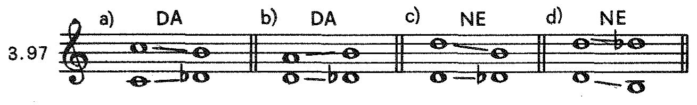

*Primjer 3.97. Tiskana str. 215.*

MuseScore: [za unos].

Povećani sekstakord, kvintsekstakord i terckvartakord na sniženom II stupnju imaju dominantnu funkciju. Oni osim prirodne, uzlazne vođice, sadrže i jednu umjetnu, silaznu, u obliku sniženoga basova tona, koji također teži za polustepenim (silaznim) pomakom u toniku. Zbog toga se u povećanom sekstakordu može udvojiti jedino terca, jer su i njegov basov ton i seksta vođice. Povećana seksta, što je dvije vođice međusobom čine, zahtijeva rješenje u oktavu, a smanjena terca — kao obrat povećane sekste — rješenje u unisono, dok će smanjena decima, koja nastaje uvećanjem smanjene terce

<!-- continuation: paragraph continues on printed page 216 -->

<!-- source-page: 216; pdf-page: 109 -->
<!-- continuation: paragraph from printed page 215 -->

za interval oktave, također iziskivati rješenje u oktavu (pr. 3.98). Rješenjima povećane sekste, odnosno smanjene decime, u oktavu treba davati prednost pred rješenjem smanjene terce u unisono, jer ovo slabije zvuči.

<!-- visual: 3.98; page 216 -->

**PROVISIONAL — cleanup_required; izrezak nije odobren.**

[Primjer 3.98 — tiskana str. 216 — neodobreni izvorni izrezak](../images/03-kromatika-b/primjer-3-98.png)

*Primjer 3.98. Tiskana str. 216.*

> Razlog zadržavanja statusa cleanup_required: Four-edge/source inspection: 3.98, a–c and all notation retained, but handwritten circles surround required labels a) and c). They are interleaved with label/staff vertical bands, so no intact clean rectangular recrop exists.

MuseScore: [za unos; izrezak čeka čišćenje i neovisnu provjeru].

S obzirom na svoju dominantnu funkciju, povećani sekstakord, kvintsekstakord i terckvartakord na sniženom II stupnju rješavaju se prije svega u tonički kvintakord direktno (pr. 3.99) ili preko zaostajaličnog kvartsekstakorda (pr. 3.100), a i preko sekstakorda kao zaostajalice (pr. 3.101).

<!-- visual: 3.99; page 216 -->

**PROVISIONAL — cleanup_required; izrezak nije odobren.**

[Primjer 3.99 — tiskana str. 216 — neodobreni izvorni izrezak](../images/03-kromatika-b/primjer-3-99.png)

*Primjer 3.99. Tiskana str. 216.*

> Razlog zadržavanja statusa cleanup_required: Four-edge/source inspection: complete 3.99, a–c and figures retained, but pencil words, circles and strokes appear above labels, inside both staves, between staves and beside lower figures; some foreign strokes meet outer edges. Required notation encloses the handwriting. No clean single rectangular crop.

MuseScore: [za unos; izrezak čeka čišćenje i neovisnu provjeru].

<!-- visual: 3.100; page 216 -->

**PROVISIONAL — cleanup_required; izrezak nije odobren.**

[Primjer 3.100 — tiskana str. 216 — neodobreni izvorni izrezak](../images/03-kromatika-b/primjer-3-100.png)

*Primjer 3.100. Tiskana str. 216.*

> Razlog zadržavanja statusa cleanup_required: Four-edge/source inspection: 3.100, all a–f, both systems and lowest figures complete. Pencil analysis/strokes are embedded between staves (especially c), around lower figures and in d; a partial exterior pencil stroke also meets the right edge. Outer-edge correction cannot remove the internal handwriting without losing notation.

MuseScore: [za unos; izrezak čeka čišćenje i neovisnu provjeru].

<!-- visual: 3.101 a–c; page 216 -->

**PROVISIONAL — cleanup_required; izrezak nije odobren.**

[Primjer 3.101 a–c — tiskana str. 216 — neodobreni izvorni izrezak](../images/03-kromatika-b/primjer-3-101-a-c.png)

*Primjer 3.101 a–c. Tiskana str. 216.*

> Razlog zadržavanja statusa cleanup_required: Four-edge/source inspection: printed 3.101, a–c, brackets and complete lower figures retained. Pencil DA/other analysis above c and pencil figures/strokes inside c's grand staff remain. Handwriting is inside the required content rectangle; no clean intact single rectangle.

MuseScore: [za unos; izrezak čeka čišćenje i neovisnu provjeru].

<!-- continuation: example 3.101 continues with d–f on printed page 217 -->

<!-- source-page: 217; pdf-page: 109 -->
<!-- continuation: example 3.101 from printed page 216 -->

<!-- visual: 3.101 d–f; page 217 -->

**PROVISIONAL — cleanup_required; izrezak nije odobren.**

[Primjer 3.101 d–f — tiskana str. 217 — neodobreni izvorni izrezak](../images/03-kromatika-b/primjer-3-101-d-f.png)

*Primjer 3.101 d–f. Tiskana str. 217.*

> Razlog zadržavanja statusa cleanup_required: Four-edge/source inspection: continuation d–f and all lower figures complete. The scan does not repeat example number 3.101; this is not a cropping omission. Pencil writing above d and inside its grand staff remains, inseparable by a clean rectangular crop.

MuseScore: [za unos; izrezak čeka čišćenje i neovisnu provjeru].

U primjeru 3.99.b nastaju paralelne kvinte, što ih čine basov ton i kvinta povećanog kvintsekstakorda s temeljnim tonom i kvintom kvintakorda koji leži pola stepena niže i u koji se povećani kvintsekstakord rješava. Te kvinte nisu loše kada se pojavljuju između basa i jednoga unutarnjeg glasa (tenora ili alta), jednako paralelno, kao niti nasljedne (pr. 3.100.c i d te 3.101.c i d). U drugim kombinacijama glasova treba da se izbjegavaju, a to se čini tako da se najprije kvinta povećanog kvintsekstakorda vodi polustepenim pomakom naniže, čime nastaje povećani terckvartakord, koji se onda normalno rješava u kvintakord (pr. 3.102).

<!-- visual: 3.102; page 217 -->

**PROVISIONAL — cleanup_required; izrezak nije odobren.**

[Primjer 3.102 — tiskana str. 217 — neodobreni izvorni izrezak](../images/03-kromatika-b/primjer-3-102.png)

*Primjer 3.102. Tiskana str. 217.*

> Razlog zadržavanja statusa cleanup_required: Four-edge/source inspection: 3.102, a–b, NE and complete low figures retained. Pencil analysis crosses a's staff/notation, lies between staves and extends around lower figures, with partial pencil strokes at top/bottom edges. No intact rectangular crop can remove the embedded handwriting.

MuseScore: [za unos; izrezak čeka čišćenje i neovisnu provjeru].

Analogne paralelne kvinte, koje nastaju u molu kod spoja povećanog kvintsekstakorda na VI stupnju sa kvintakordom V stupnja, poznate su pod imenom »Mozartove kvinte« (v. pr. 3.117).

Povećani kvintsekstakord, koji se rješava u dur-kvintakord preko zaostajaličnog kvartsekstakorda s velikom sekstom ili preko sekstakorda kao zaostajalice s velikom sekstom, notira se kod nekih autora i kao povećani terckvartakord s dvaput povećanom kvartom (pr. 3.103.a i b). Kako je interval dvaput povećane kvarte enharmonijski identičan s intervalom čiste kvinte, dakle s konsonantnim intervalom »par excellence«, i budući da tako i zvuči, takva notacija nije ni opravdana ni korektna: ona oštro proturiječi zvučnom dojmu. Eventualno se još može tolerirati u kromatskom prohodu, kao u primjeru 3.103.c, kada jedino čujemo kromatski pomak s povećane kvarte na dvaput povećanu kvartu.

<!-- visual: 3.103; page 217 -->

**PROVISIONAL — cleanup_required; izrezak nije odobren.**

[Primjer 3.103 — tiskana str. 217 — neodobreni izvorni izrezak](../images/03-kromatika-b/primjer-3-103.png)

*Primjer 3.103. Tiskana str. 217.*

> Razlog zadržavanja statusa cleanup_required: Four-edge/source inspection: 3.103, a–c and complete low figures retained. Pencil words/strokes at top and bottom boundaries, pencil marks inside the staves and circles around printed figures remain. Top/bottom trimming alone cannot remove internal handwriting while preserving complete notation.

MuseScore: [za unos; izrezak čeka čišćenje i neovisnu provjeru].

<!-- source-page: 218; pdf-page: 110 -->

Dur-kvintakordu, koji nastupa kao rješenje povećanog sekstakorda, kvintsekstakorda ili terckvartakorda, može se priključiti i prohodna mala septima (pr. 3.104.a), ali — umjesto toga — povećana seksta prethodnog akorda može i direktno, kromatski, silaziti na septimu novoga (dominantnog) septakorda (pr. 3.104.b—d). Promijenimo li enharmonijski, u primjeru 3.104.c, povećani kvintsekstakord također u dominantni septakord, dobivamo paralelni polustepeni silazni slijed dvaju dominantnih septakorda (pr. 3.104.e), a taj će postupak biti često iskorišten u enharmonijskim modulacijama.

<!-- visual: 3.104; page 218 -->

**PROVISIONAL — cleanup_required; izrezak nije odobren.**

[Primjer 3.104 — tiskana str. 218 — neodobreni izvorni izrezak](../images/03-kromatika-b/primjer-3-104.png)

*Primjer 3.104. Tiskana str. 218.*

> Razlog zadržavanja statusa cleanup_required: Four-edge/source inspection: 3.104, a–e, arrow and all lower figures complete, but handwritten pencil circle surrounds a's printed 8/b7. Circle overlaps the required figure/staff band; cannot remove it with an intact clean rectangular crop.

MuseScore: [za unos; izrezak čeka čišćenje i neovisnu provjeru].

Povećani kvintsekstakord i povećani terckvartakord mogu se upotrebljavati i u obratima (pr. 3.105). U klasifikaciji njihovih obrata pojavljuje se — u odnosu prema dosada primjenjivanom sistemu — mala anomalija, jer se ovdje septakordi više ne smatraju temeljnim oblicima akorda, nego odgovarajućim obratima povećanog kvintsekstakorda, odnosno povećanog terckvartakorda (pr. 3.105.a, d, e i f).

<!-- visual: 3.105; page 218 -->

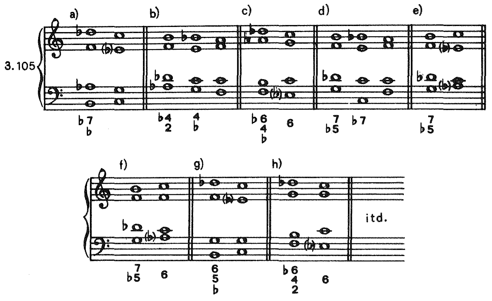

*Primjer 3.105. Tiskana str. 218.*

MuseScore: [za unos].

<!-- source-page: 219; pdf-page: 110 -->

Budući da i povećani sekstakord i povećani kvintsekstakord i povećani terckvartakord imaju strukturu dominantnih harmonija, oni se mogu upotrebljavati — osim na sniženom II stupnju — i na raznim drugim, dijatonskim i kromatskim stupnjevima u ulozi sekundarnih dominanta, pri čemu mogu nastupati na slične načine kao i sekundarne dominante dijatonskoga tipa: kromatski po kvintnoj srodnosti (pr. 3.106.b), kromatski po tercnoj srodnosti (pr. 3.106.d) ili s kromatskom promjenom istoga akorda uz istodobno dodavanje septime (pr. 3.106.c). Nastup povećanog kvintsekstakorda as-c-es-fis, u funkciji DD, u primjeru 3.106.a, slijedi također kromatski, s tercnom srodnošću, kao akord koji je enharmonijski identičan s dominantnim septakordom, pa spoj kvintakorda c-es-g ili c-e-g sa spomenutim povećanim kvintsekstakordom čujemo zapravo kao kromatski spoj s tercno-srodnim dominantnim septakordom as-c-es-ges, nakon čega tek dolazi do enharmonijske identifikacije dominantnoga septakorda s povećanim kvintsekstakordom. Povećani terckvartakord f-a-h-dis, u primjeru 3.106.e, nije s prethodnim sekstakordom f-a-d ni u jednom od standardnih kromatskih odnosa, ali zato međusobna povezanost tih dvaju akorda nije ništa slabija, jer njih vežu dva zajednička tona (»f« i »a«) i kromatski pomak s »d« na »dis«. Takve i slične kromatske veze među akordima česte su kada se operira s pravim alteriranim akordima, a pogotovo kada pritom dolazi i do enharmonijskih promjena.

<!-- visual: 3.106; page 219 -->

**PROVISIONAL — cleanup_required; izrezak nije odobren.**

[Primjer 3.106 — tiskana str. 219 — neodobreni izvorni izrezak](../images/03-kromatika-b/primjer-3-106.png)

*Primjer 3.106. Tiskana str. 219.*

> Razlog zadržavanja statusa cleanup_required: Four-edge/source inspection: 3.106, a–e, both systems and complete printed figures retained, but extensive handwritten chord names, Roman numerals, circles and strokes are interleaved with labels, notation and analyses; handwriting meets top/right/bottom regions. No clean intact source rectangle.

MuseScore: [za unos; izrezak čeka čišćenje i neovisnu provjeru].

Iako se povećani sekstakord, kvintsekstakord i terckvartakord mogu iskoristiti kao dominante svih stupnjeva, na kojima se nalaze konsonantni kvintakordi, oni se prije svega upotrebljavaju na VI stupnju u molu i na sniženom VI stupnju u duru — ili na VI stupnju u molu i mol-duru — dakle, u funkciji DD, zatim na sniženom II stupnju u duru i molu u funkciji primarne dominante, a tek onda na ostalim stupnjevima. U primjeru 3.107. prikazano je nekoliko karakterističnih slučajeva gdje se povećani sekstakord,

<!-- continuation: paragraph continues on printed page 220 -->

<!-- source-page: 220; pdf-page: 111 -->
<!-- continuation: paragraph from printed page 219 -->

kvintsekstakord i terckvartakord pojavljuju u funkciji DD u kadencama; u primjeru 3.107.g i h čak su i dominantna funkcija i funkcija DD predstavljene povećanim akordima. Kada povećani kvintsekstakord i terckvartakord nastupaju u obratu, gdje je tonika basov ton, onda se mogu rješavati i u tonički kvintakord. Tada se, naravno, ne može više govoriti o funkciji DD dotičnih povećanih akorda, nego o appoggiaturama na tonički kvintakord (pr. 3.108.a) ili o izmjeničnim akordima (pr. 3.108.b i c).

<!-- visual: 3.107; page 220 -->

**PROVISIONAL — cleanup_required; izrezak nije odobren.**

[Primjer 3.107 — tiskana str. 220 — neodobreni izvorni izrezak](../images/03-kromatika-b/primjer-3-107.png)

*Primjer 3.107. Tiskana str. 220.*

> Razlog zadržavanja statusa cleanup_required: Four-edge/source inspection: 3.107, all a–i, all three systems and lowest printed figures retained. Extensive pencil analysis overlaps labels/staves/figures and partial foreign underline/handwriting meets the top boundary. Cannot obtain an intact handwriting-free rectangle by edge changes; lowest figures must not be trimmed to conceal contamination.

MuseScore: [za unos; izrezak čeka čišćenje i neovisnu provjeru].

<!-- visual: 3.108; page 220 -->

**PROVISIONAL — cleanup_required; izrezak nije odobren.**

[Primjer 3.108 — tiskana str. 220 — neodobreni izvorni izrezak](../images/03-kromatika-b/primjer-3-108.png)

*Primjer 3.108. Tiskana str. 220.*

> Razlog zadržavanja statusa cleanup_required: Four-edge/source inspection: 3.108, a–c, complete Chopin: Mazurka op.63 br.3 attribution, both asterisk markers and all notation retained. Top edge includes preceding example's pencil harmonic analysis. Its vertical band overlaps the required attribution at another x-position; trimming below it clips the attribution, and sideways trimming loses staff/number. No safe single rectangle. Prose footnotes outside crop are not a notation omission.

MuseScore: [za unos; izrezak čeka čišćenje i neovisnu provjeru].

(Chopin: Mazurka op. 63 br. 3)

\* »Cis« se smatra basovim tonom koji leži kroz čitava dva takta.

\*\* Ton »h« u sopranu je prohodni ton na akordički ton »a«.

<!-- source-page: 221; pdf-page: 111 -->

U duru može povećani sekstakord nastati i od sekstakorda, a povećani kvintsekstakord od kvintsekstakorda II stupnja tako da se u oba slučaja prvotnom akordu povisi seksta (pr. 3.109), pa dobivamo povećani sekstakord i povećani kvintsekstakord na IV stupnju u duru u subdominantnoj funkciji. Subdominantna funkcija omogućuje nam da u povećanom sekstakordu na IV stupnju u duru udvajamo i basov ton, jer je on sâm subdominanta, a ne više silazna vođica; i, nadalje, basov ton povećanog sekstakorda i povećanog kvintsekstakorda na IV stupnju u duru sada više ne mora obavezno silaziti polustepenim pomakom, već može i postepeno uzlaziti, a također i skakati za kvartu dolje, odnosno za kvintu gore (pr. 3.110).

<!-- visual: 3.109; page 221 -->

**PROVISIONAL — cleanup_required; izrezak nije odobren.**

[Primjer 3.109 — tiskana str. 221 — neodobreni izvorni izrezak](../images/03-kromatika-b/primjer-3-109.png)

*Primjer 3.109. Tiskana str. 221.*

> Razlog zadržavanja statusa cleanup_required: Four-edge/source inspection: 3.109, a–b and complete lower figures retained, but pencil chord names/arrows above labels, writing in the treble staff and lower handwritten II remain. Internal marks cannot be excluded by a complete clean rectangular crop.

MuseScore: [za unos; izrezak čeka čišćenje i neovisnu provjeru].

<!-- visual: 3.110; page 221 -->

**PROVISIONAL — cleanup_required; izrezak nije odobren.**

[Primjer 3.110 — tiskana str. 221 — neodobreni izvorni izrezak](../images/03-kromatika-b/primjer-3-110.png)

*Primjer 3.110. Tiskana str. 221.*

> Razlog zadržavanja statusa cleanup_required: Four-edge/source inspection: 3.110, a–h and all printed figures complete. Pencil circles/arrows overlap staff notes and printed figures; handwritten Roman numerals run beneath the figures. No intact rectangular crop can remove embedded handwriting.

MuseScore: [za unos; izrezak čeka čišćenje i neovisnu provjeru].

Ako povećani kvintsekstakord na IV stupnju u duru riješimo — umjesto u kvintakord — u septakord I stupnja sa sniženom septimom (pr. 3.111), dobivamo — jer je povećani kvintsekstakord enharmonijski identičan s dominantnim septakordom — novu mogućnost kromatskog spoja kvinto-srodnih dominantnih septakorda za kvintu prema gore, koja se također može korisno upotrijebiti u enharmonijskim modulacijama.

<!-- visual: 3.111; page 221 -->

**PROVISIONAL — cleanup_required; izrezak nije odobren.**

[Primjer 3.111 — tiskana str. 221 — neodobreni izvorni izrezak](../images/03-kromatika-b/primjer-3-111.png)

*Primjer 3.111. Tiskana str. 221.*

> Razlog zadržavanja statusa cleanup_required: Four-edge/source inspection: 3.111, printed a/b labels and complete low figures retained. Pencil chord names/dashed arrow at top, pencil analysis inside bass staff and lower handwritten marks remain; some meet top boundary. No clean complete single rectangle.

MuseScore: [za unos; izrezak čeka čišćenje i neovisnu provjeru].

Analogno se u progresiji II♯⁶₅ – I₅ u duru (pr. 3.110.b) povećani kvintsekstakord zamjenjuje s povećanim terckvartakordom na IV stupnju, u kome je kvarta vođica, pa tada u novodobivenoj progresiji imamo istodobnu kombinaciju plagalnoga završetka (pomak basa) s autentičnim (uzlazni postepeni pomak vođice) (pr. 3.112).

<!-- source-page: 222; pdf-page: 112 -->

<!-- visual: 3.112; page 222 -->

**PROVISIONAL — cleanup_required; izrezak nije odobren.**

[Primjer 3.112 — tiskana str. 222 — neodobreni izvorni izrezak](../images/03-kromatika-b/primjer-3-112.png)

*Primjer 3.112. Tiskana str. 222.*

> Razlog zadržavanja statusa cleanup_required: Four-edge/source inspection: 3.112 and complete sharp-6/4/3 analysis retained. Pencil circle and handwritten analysis lie between the staves and beneath the bass; handwritten strokes remain close to the right/bottom regions. Embedded marks prevent an intact clean rectangular recrop.

MuseScore: [za unos; izrezak čeka čišćenje i neovisnu provjeru].

Prema iznesenome vidimo da se povećani sekstakordi, kvintsekstakordi i terckvartakordi mogu upotrebljavati u funkciji DD na VI stupnju u molu i na sniženom VI stupnju u duru, u funkciji dominante na sniženom II stupnju u duru i molu, te u funkciji drugih sekundarnih dominanta na različitim dijatonskim i kromatskim stupnjevima, a povećani sekstakord i povećani kvintsekstakord na IV stupnju u duru još i u subdominantnoj funkciji.

Povećani sekstakordi, kvintsekstakordi i terckvartakordi mogu se iskoristiti i za modulativne svrhe.

Kada se kao sredstvo modulacije upotrijebi u polaznom tonalitetu neki od tih akorda na sniženom II stupnju i zatim se protumači na VI, odnosno na sniženom VI stupnju u ciljnom tonalitetu, dobivaju se modulacije u najbliže tonalitete — iz dura ili mola u mol ili dur, udaljen kvintu niže (pr. 3.113). Obratni postupak (VI, odnosno sniženi VI stupanj polaznog tonaliteta tumači se kao sniženi II stupanj ciljnoga) daje modulacije iz mola ili dura u dur ili mol, udaljen kvintu više (pr. 3.114).

<!-- visual: 3.113; page 222 -->

**PROVISIONAL — cleanup_required; izrezak nije odobren.**

[Primjer 3.113 — tiskana str. 222 — neodobreni izvorni izrezak](../images/03-kromatika-b/primjer-3-113.png)

*Primjer 3.113. Tiskana str. 222.*

> Razlog zadržavanja statusa cleanup_required: Four-edge/source inspection: 3.113, a–c, modulation titles and lowest printed 3 retained. Pencil figures are interleaved with printed lower analyses. Bottom edge additionally clips into the following example's C(c)–G(g) title. That title starts above the bottom of c's required figure in a different column, so shortening the rectangle would clip the figure; embedded handwriting independently prevents a clean rectangle.

MuseScore: [za unos; izrezak čeka čišćenje i neovisnu provjeru].

<!-- visual: 3.114; page 222 -->

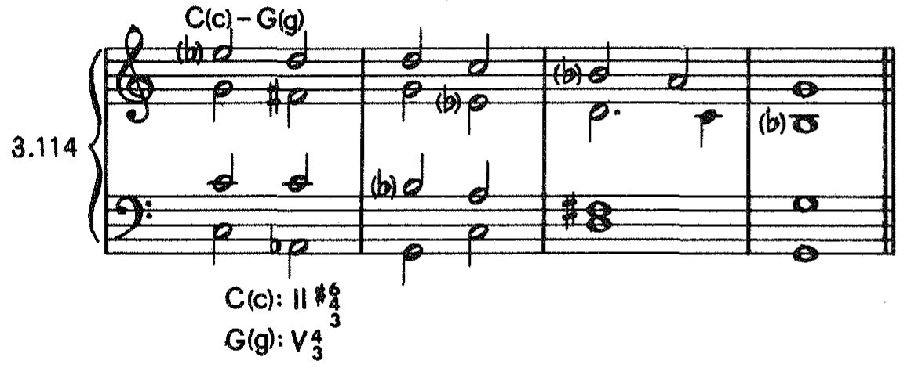

*Primjer 3.114. Tiskana str. 222.*

MuseScore: [za unos].

Za modulacije u udaljenije tonalitete uzimaju se direktno povećani akordi na VI ili na sniženom II stupnju ciljnog tonaliteta, a oni se povezuju s nekim prethodnim akordom polaznog tonaliteta na načine slične onima iz primjera 3.106, samo što sada modulativni povećani akord više ne predstavlja

<!-- continuation: paragraph continues on printed page 223 -->

<!-- source-page: 223; pdf-page: 112 -->
<!-- continuation: paragraph from printed page 222 -->

neku sekundarnu dominantu u polaznom tonalitetu, nego nastupa odmah u novoj funkciji u ciljnom tonalitetu (pr. 3.115). Naravno, u obzir dolaze i

<!-- continuation: paragraph resumes below example 3.115 on this page -->

<!-- visual: 3.115; page 223 -->

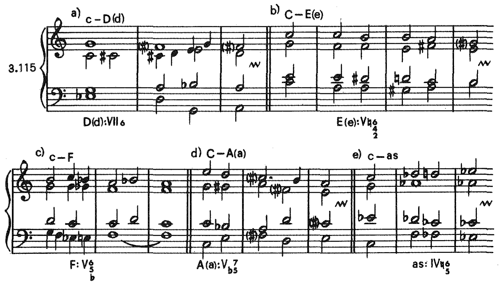

*Primjer 3.115. Tiskana str. 223.*

MuseScore: [za unos].

<!-- continuation: paragraph from above example 3.115 -->

modulacije u dur-tonalitete pomoću povećanog sekstakorda ili povećanog kvintsekstakorda na IV stupnju ciljnog tonaliteta (pr. 3.116). Sve takve modulacije (pr. 3.113 — 3.116) klasificiraju se kao kromatske, iako će među

<!-- continuation: paragraph resumes below example 3.116 on this page -->

<!-- visual: 3.116; page 223 -->

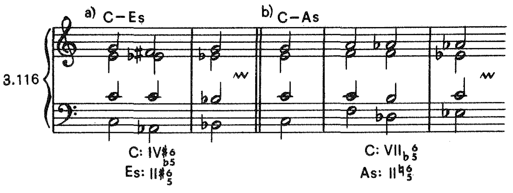

*Primjer 3.116. Tiskana str. 223.*

MuseScore: [za unos].

<!-- continuation: paragraph from above example 3.116 -->

njima biti i takvih gdje se ne pojavljuje nijedan kromatski pomak (v. pr. 3.113.b i c), jer i u njima nastup pravih alteriranih akorda više ne djeluje dijatonski.

Pravo područje za primjenu povećanih sekstakorda, kvintsekstakorda i terckvartakorda je enharmonija (v. odsjek 3. 7. 1), ali mi ih srećemo često u djelima kompozitora klasičnog i romantičkog razdoblja i u čistim kromatskim progresijama (pr. 3.117 — 3.120).

<!-- continuation: section continues beyond assigned range after printed page 223; examples 3.117–3.120 are referenced here but not printed on page 223. No prose sentence remains unfinished at this boundary. -->

<!-- source-page: 224; pdf-page: 113 -->
<!-- continuation: 223/224 — Stranica 223 završava potpunim odlomkom s uputom na pr. 3.117—3.120; na stranicama 224—225 slijede ti primjeri, bez nastavka rečenice. -->

<!-- visual: 3.117; page 224 -->

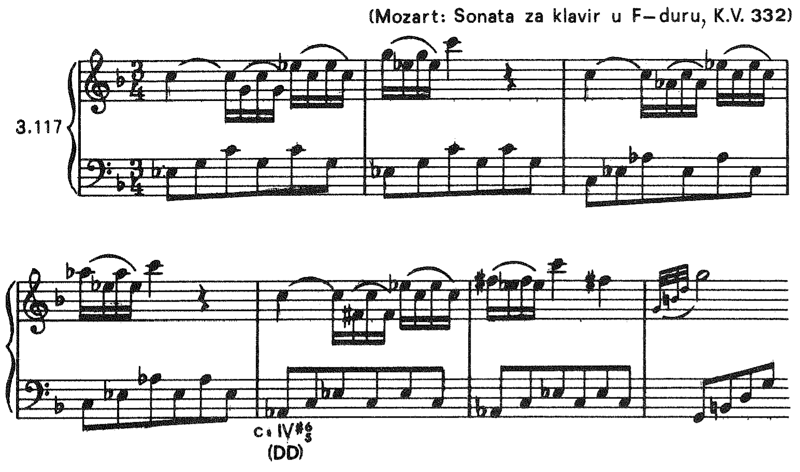

*Primjer 3.117. Tiskana str. 224.*

MuseScore: [za unos].

<!-- visual: 3.118; page 224 -->

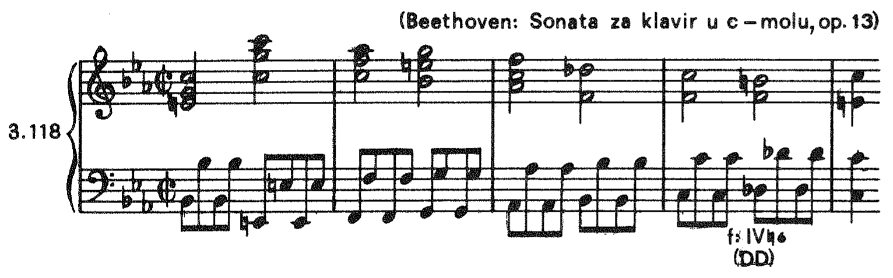

*Primjer 3.118. Tiskana str. 224.*

MuseScore: [za unos].

<!-- visual: 3.119; page 224 -->

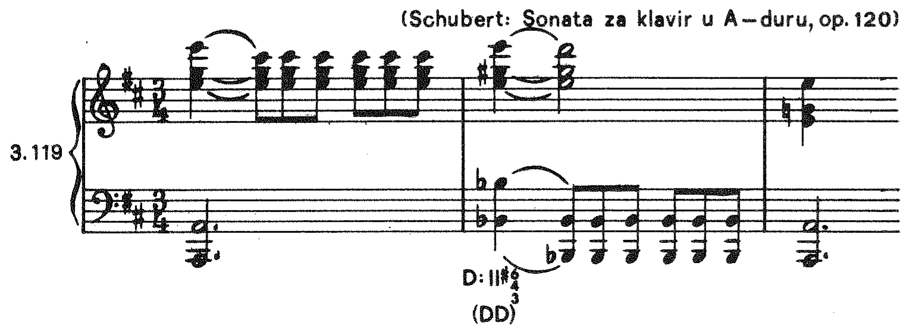

*Primjer 3.119. Tiskana str. 224.*

MuseScore: [za unos].

<!-- source-page: 225; pdf-page: 113 -->

<!-- visual: 3.120; page 225 -->

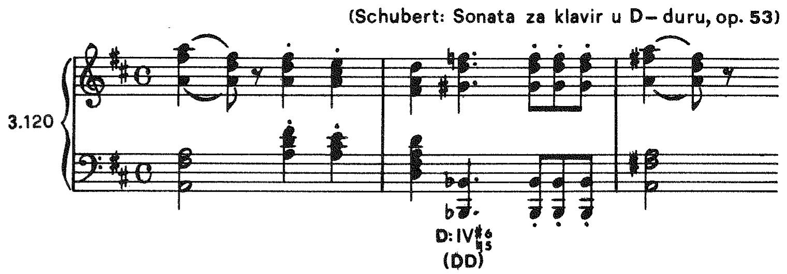

*Primjer 3.120. Tiskana str. 225.*

MuseScore: [za unos].

### ZADACI

1 Izradba kromatskih modulacija pomoću povećanog sekstakorda, kvintsekstakorda i terckvartakorda, između zadanih tonaliteta i u zadanoj mjeri.

<!-- visual: ZADACI 2; page 225 -->

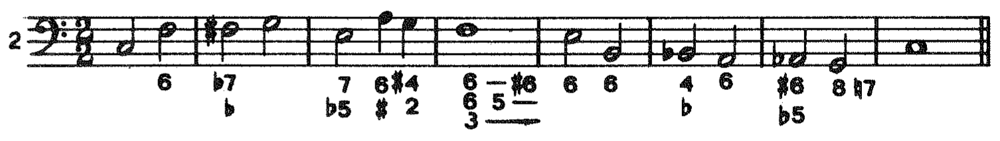

*ZADACI 2. Tiskana str. 225.*

MuseScore: [za unos].

<!-- visual: ZADACI 3; page 225 -->

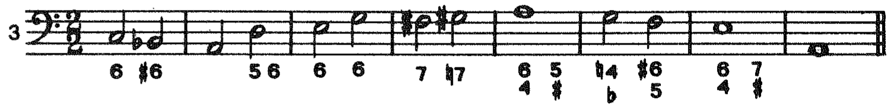

*ZADACI 3. Tiskana str. 225.*

MuseScore: [za unos].

<!-- visual: ZADACI 4; page 225 -->

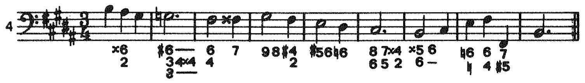

*ZADACI 4. Tiskana str. 225.*

MuseScore: [za unos].

<!-- visual: ZADACI 5; page 225 -->

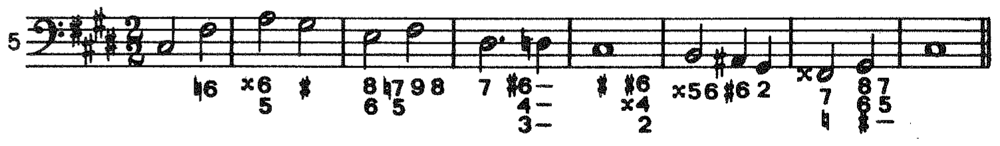

*ZADACI 5. Tiskana str. 225.*

MuseScore: [za unos].

<!-- visual: ZADACI 6; page 225 -->

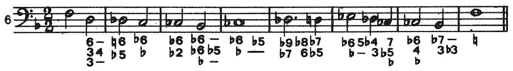

*ZADACI 6. Tiskana str. 225.*

MuseScore: [za unos].

<!-- visual: ZADACI 7; page 225 -->

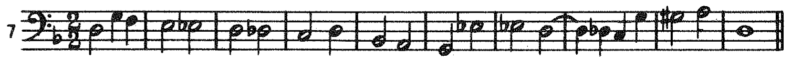

*ZADACI 7. Tiskana str. 225.*

MuseScore: [za unos].

<!-- source-page: 226; pdf-page: 114 -->

<!-- visual: ZADACI 8; page 226 -->

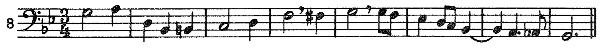

*ZADACI 8. Tiskana str. 226.*

MuseScore: [za unos].

<!-- visual: ZADACI 9; page 226 -->

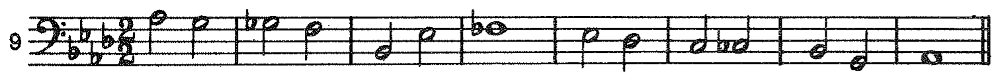

*ZADACI 9. Tiskana str. 226.*

MuseScore: [za unos].

<!-- visual: ZADACI 10; page 226 -->

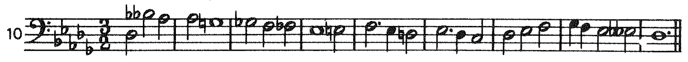

*ZADACI 10. Tiskana str. 226.*

MuseScore: [za unos].

<!-- visual: ZADACI 11; page 226 -->

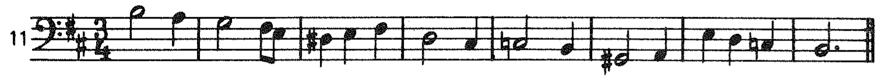

*ZADACI 11. Tiskana str. 226.*

MuseScore: [za unos].

<!-- visual: ZADACI 12; page 226 -->

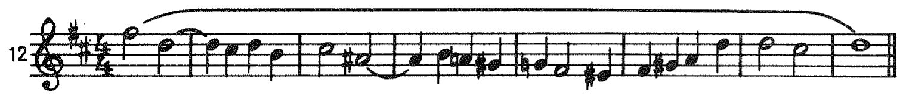

*ZADACI 12. Tiskana str. 226.*

MuseScore: [za unos].

<!-- visual: ZADACI 13; page 226 -->

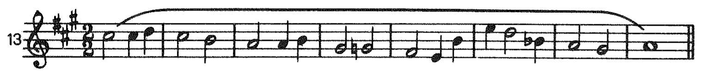

*ZADACI 13. Tiskana str. 226.*

MuseScore: [za unos].

<!-- visual: ZADACI 14; page 226 -->

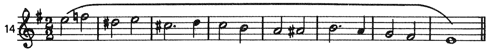

*ZADACI 14. Tiskana str. 226.*

MuseScore: [za unos].

<!-- visual: ZADACI 15; page 226 -->

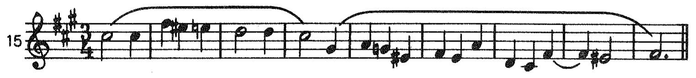

*ZADACI 15. Tiskana str. 226.*

MuseScore: [za unos].

<!-- visual: ZADACI 16; page 226 -->

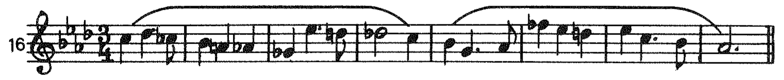

*ZADACI 16. Tiskana str. 226.*

MuseScore: [za unos].

<!-- visual: ZADACI 17; page 226 -->

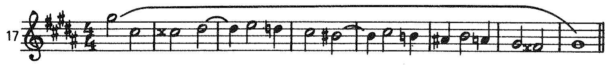

*ZADACI 17. Tiskana str. 226.*

MuseScore: [za unos].

<!-- visual: ZADACI 18; page 226 -->

*ZADACI 18. Tiskana str. 226.*

MuseScore: [za unos].

<!-- visual: ZADACI 19; page 226 -->

*ZADACI 19. Tiskana str. 226.*

MuseScore: [za unos].

<!-- source-page: 227; pdf-page: 114 -->

Realizacija zadatka 7.

<!-- visual: Realizacija zadatka 7.; page 227 -->

*Realizacija zadatka 7. Tiskana str. 227.*

MuseScore: [za unos].

\* Sopran ne silazi direktno kromatski s »cis« na »c« (u slijedećem taktu), nego prije toga skače na akordički ton »a«. Analogna situacija je i u taktovima 7—8.

Realizacija zadatka 12.

<!-- visual: Realizacija zadatka 12.; page 227 -->

*Realizacija zadatka 12. Tiskana str. 227.*

MuseScore: [za unos].

<!-- source-page: 228; pdf-page: 115 -->

## 3.7. Enharmonijske modulacije

Sve enharmonijske modulacije izvode se — kao i dijatonske — pomoću zajedničkog akorda, a taj se ili enharmonijski zamjenjuje s isto takvim, ali suprotnih predznaka, ili se enharmonijski mijenja u neki drugi akord. U prvom se slučaju dobivaju modulacije pomoću enharmonijske zamjene akorda, a u drugome modulacije pomoću enharmonijske promjene akorda. U odsjeku 2. 9. 7. obrađene su modulacije koje se izvode pomoću enharmonijske zamjene kvintakorda, a kod kromatskih modulacija primjenjivan je princip enharmonijske zamjene kvintakorda u pojedinim slučajevima i na septakorde (v. pr. 3.42. i 3.57). Također u odsjeku 2. 9. 7. protumačena je suština enharmonijske promjene akorda, a njena primjena u modulacijama već je bila dotaknuta u prethodnom poglavlju u primjerima 3.94, 3.96. i 3.111., dok će u ovom poglavlju biti detaljno prikazana.

Enharmonijske modulacije pomoću enharmonijske promjene akorda dijele se — prema akordima, koji se u njima enharmonijski mijenjaju — u tri osnovne grupe, a izvođenje enharmonijske promjene akorda u svakoj grupi polazi od enharmonijske promjene jednoga karakterističnog intervala. Prvu grupu čine modulacije pomoću enharmonijske promjene povećanog sekstakorda, kvintsekstakorda i terckvartakorda, koje se temelje na enharmonijskoj identičnosti karakterističnog intervala povećane sekste s intervalom male septime. Druga grupa obuhvaća modulacije pomoću enharmonijske promjene smanjenog septakorda s karakterističnim intervalom smanjene septime, koji se enharmonijski mijenja u interval velike sekste. U treću grupu svrstavaju se modulacije pomoću enharmonijske promjene povećanog kvintakorda, koja se temelji na enharmonijskoj promjeni karakterističnog intervala povećane kvinte u interval male sekste.

### 3.7.1. Enharmonijske modulacije pomoću povećanog sekstakorda kvintsekstakorda i terckvartsekstakorda

**Modulacije pomoću enharmonijske promjene povećanog sekstakorda i kvintsekstakorda.** Već smo u prethodnom poglavlju vidjeli da enharmonijska promjena intervala povećane sekste u interval male septime pretvara povećani sekstakord i povećani kvintsekstakord u dominantni septakord koji je s njima enharmonijski identičan. To pretvaranje, odnosno enharmonijska promjena, može se izvesti na dva načina: a) vrši se samo enharmonijska zamjena tona koji s basovim tonom čini povećanu sekstu, dok ostali tonovi ostaju nepromijenjeni, tako da se dobiva dominantni septakord na istom basovu tonu (pr. 3.121.a); b) seksta ostaje nepromijenjena, a ostali se tonovi enharmonijski zamijene (u istom pravcu), tako da se dobiva dominantni septakord koji je enharmonijski ekvivalent dominantnom septakordu, dobivenom

<!-- continuation: 228/229 — Nastavak iste rečenice nakon primjera 3.121. -->
<!-- source-page: 229; pdf-page: 115 -->

<!-- visual: 3.121 a), b); page 229 -->

*Primjer 3.121 a), b). Tiskana str. 229.*

MuseScore: [za unos].

na prvi način (pr. 3.121.b). Prema tome će i modulacijski postupak teći ovako: najprije u polaznom tonalitetu navedemo odgovarajući povećani sekstakord ili kvintsekstakord, zatim ga na jedan od dva navedena načina enharmonijski promijenimo, čime dobivamo u novom tonalitetu dominantni septakord, njega tada rješavamo i dovršavamo modulaciju. Izbor načina izvedbe enharmonijske promjene ovisit će o tome koji će nas od dva, enharmonijski identična, dominantna septakorda direktnije dovesti u ciljni tonalitet ili u posredni, ako se i on pojavljuje. Želimo li npr. iz C-dura modulirati preko povećanog sekstakorda na sniženom II stupnju u Ges-dur ili u Ces-dur, upotrijebit ćemo prvi način (pr. 3.122), a ako nam je cilj cis-mol ili koji drugi tonalitet s povisilicama, iskoristit ćemo drugi način (pr. 3.123); i ako se u tim modulacijama dominantni septakord u novom tonalitetu pojavljuje s udvojenom tercom, tu ipak ne čujemo udvajanje vođice, jer dotični dominantni septakord najprije nastupa u polaznom tonalitetu kao (enharmonijski identičan) povećani sekstakord u kome terca nije vođica.

<!-- visual: 3.122 a), b); page 229 -->

*Primjer 3.122 a), b). Tiskana str. 229.*

MuseScore: [za unos].

<!-- visual: 3.123; page 229 -->

*Primjer 3.123. Tiskana str. 229.*

MuseScore: [za unos].

Analogno, kao s povećanim sekstakordom, postupa se i s povećanim kvintsekstakordom (pr. 3.124. i 3.125.a), samo što se povećani kvintsekstakord može upotrijebiti i u obratima koji s enharmonijskom promjenom postaju odgovarajućim obratima dominantnog septakorda (pr. 3.125.b i c).

<!-- source-page: 230; pdf-page: 116 -->

<!-- visual: 3.124; page 230 -->

*Primjer 3.124. Tiskana str. 230.*

MuseScore: [za unos].

<!-- visual: 3.125 a), b), c); page 230 -->

*Primjer 3.125 a), b), c). Tiskana str. 230.*

MuseScore: [za unos].

Potpuno isti modulacijski postupak primjenjuje se i na povećani sekstakord ili kvintsekstakord koji se nalazi na VI stupnju u molu, odnosno na sniženom VI stupnju u duru (pr. 3.126). Naprotiv, enharmonijska promjena povećanog sekstakorda ili kvintsekstakorda na IV stupnju u duru, radi modulacije, bila bi suvišno kompliciranje; takav se akord može tada odmah navesti u obliku dominantnog septakorda, jer modulacija pomoću njega uopće nije enharmonijske, nego kromatske prirode (pr. 3.127).

<!-- visual: 3.126; page 230 -->

*Primjer 3.126. Tiskana str. 230.*

MuseScore: [za unos].

<!-- visual: 3.127 a), b); page 230 -->

*Primjer 3.127 a), b). Tiskana str. 230.*

MuseScore: [za unos].

<!-- source-page: 231; pdf-page: 116 -->

Nastupi povećanog kvintsekstakorda, koji dolazi poslije dur-kvintakorda ili mol-kvintakorda, udaljenog veliku tercu više, djeluju odmah kao nastupi dominantnog septakorda koji dolazi kromatski po tercnoj srodnosti, a cijela modulacija može se okvalificirati kao kromatska modulacija pomoću tercne srodnosti akorda. To je konkretno slučaj s modulacijom u primjeru 3.124.a, gdje se umjesto povećanog kvintsekstakorda des-f-as-h može odmah notirati dominantni septakord des-f-as-ces, jer je on u kromatskoj tercnoj srodnosti s prethodnim kvintakordom f-a-c; a slično je i u primjerima 3.125.a i 3.126., jer se tamo radi o enharmonijskoj zamjeni dominantnih septakorda koji su nastupili kromatski, po tercnoj srodnosti.

Kao što se svaki povećani kvintsekstakord može enharmonijski promijeniti u dominantni septakord, tako se i svaki dominantni septakord može enharmonijski promijeniti u povećani kvintsekstakord, i to također na dva načina (pr. 3.128). Takva enharmonijska promjena omogućuje novu vrstu

<!-- visual: 3.128 a), b); page 231 -->

*Primjer 3.128 a), b). Tiskana str. 231.*

MuseScore: [za unos].

modulacija, koje bismo mogli nazvati **modulacijama pomoću enharmonijske promjene dominantnog septakorda**, što se izvode tako da u polaznom tonalitetu navedemo dominantni septakord, a zatim ga enharmonijski promijenimo u povećani kvintsekstakord i tumačimo na sniženom II stupnju u novome dur-tonalitetu ili mol-tonalitetu (pr. 3.129) ili na VI stupnju u novome mol-tonalitetu, odnosno na sniženom VI stupnju u novome dur-tonalitetu (pr. 3.130) ili na IV stupnju u novome dur-tonalitetu (pr. 3.131).

<!-- visual: 3.129; page 231 -->

*Primjer 3.129. Tiskana str. 231.*

MuseScore: [za unos].

<!-- source-page: 232; pdf-page: 117 -->

<!-- visual: 3.130 a); page 232 -->

*Primjer 3.130 a). Tiskana str. 232.*

MuseScore: [za unos].

<!-- visual: 3.130 b); page 232 -->

*Primjer 3.130 b). Tiskana str. 232. Dio istoga primjera kao 3.130 a) na tiskanoj str. 232.*

Dio istoga primjera; broj je otisnut uz [prvi dio 3.130 a), tiskana str. 232](../images/03-kromatika-b/primjer-3-130-a.png) (identitet `M06-p232-slot-34`). Broj nije ponovljen u izvorniku.

MuseScore: [za unos].

<!-- visual: 3.130 c); page 232 -->

*Primjer 3.130 c). Tiskana str. 232. Dio istoga primjera kao 3.130 a) na tiskanoj str. 232.*

Dio istoga primjera; broj je otisnut uz [prvi dio 3.130 a), tiskana str. 232](../images/03-kromatika-b/primjer-3-130-a.png) (identitet `M06-p232-slot-34`). Broj nije ponovljen u izvorniku.

MuseScore: [za unos].

\* Note koje se pojavljuju u svakom taktu na drugoj osminki jesu izmjenični tonovi.

<!-- visual: 3.131; page 232 -->

*Primjer 3.131. Tiskana str. 232.*

MuseScore: [za unos].

Dominantni septakord, pomoću kojega se vrši enharmonijska modulacija, ne mora uopće biti u polaznom tonalitetu septakord V stupnja, već to može biti i dominantni septakord na nekom drugom stupnju, pa će on tada u polaznom

<!-- continuation: 232/233 — Riječ »polaznom« u izvorniku prelomljena »po- / laznom«; spojena je na prethodnoj stranici. -->
<!-- source-page: 233; pdf-page: 117 -->

tonalitetu predstavljati alterirani akord u širem smislu (pr. 3.132). u primjeru 3.133. izvršena je na takav način modulacija iz g-mola u dis-mol (notiran kao es-mol), a progresija IV𝄪65 — I64 upotrijebljena je kao model izvantonalne silazne sekvence koja se zaustavlja u A-duru.

<!-- visual: 3.132 a), b); page 233 -->

*Primjer 3.132 a), b). Tiskana str. 233.*

MuseScore: [za unos].

<!-- visual: 3.133; page 233 -->

*Primjer 3.133. Tiskana str. 233.*

MuseScore: [za unos].

Progresija, gdje iza dominantnog septakorda dolazi povećani kvintsekstakord na sniženom II stupnju (pr. 3.134.a), može se također iskoristiti za enharmonijske modulacije ako se povećani kvintsekstakord enharmonijski promijeni također u dominantni septakord (pr. 3.134.b i c); pri tome dobivamo spoj dvaju dominantnih septakorda udaljenih za tritonus, koji imaju dva zajednička tona: septima prvoga je terca drugoga, a terca prvoga je — s posredovanjem enharmonijske zamjene — septima drugoga. U primjeru 3.135.a primjena te vrste modulacije izvršena je u doslovnoj izvantonalnoj

<!-- continuation: 233/234 — Nastavak iste rečenice nakon primjera 3.134. -->
<!-- source-page: 234; pdf-page: 118 -->

<!-- visual: 3.134 a), b), c); page 234 -->

*Primjer 3.134 a), b), c). Tiskana str. 234.*

MuseScore: [za unos].

sekvenci; ona u originalnoj notaciji nije na prvi pogled dovoljno uočljiva, pa je stoga u primjeru 3.135.b donosimo u notaciji, teoretski konsekventno provedenoj, koje se autor nije pridržavao, jer bi ona nepotrebno otežala čitanje notnog teksta.

<!-- visual: 3.135 a), b); page 234 -->

*Primjer 3.135 a), b). Tiskana str. 234.*

MuseScore: [za unos].

**Modulacije pomoću erharmonijske promjene povećanog terckvartakorda.** Enharmonijska zamjena tona, koji u povećanom terckvartakordu čini s basovim tonom interval povećane sekste, još ne daje novi akord u klasičnom smislu, što znači da tonove ovog suzvučja ne možemo ni na koji način, ni u kojem obratu, poredati tako jedan iznad drugoga da dobijemo raspored po tercama (pr. 3.136.a). Željenu tercnu dispoziciju imat ćemo tek kada i ton koji s basovim tonom čini interval povećane kvarte enharmonijski u istom smislu zamijenimo, jer ćemo tada dobiti dominantni septakord sa smanjenom kvintom (pr. 3.136.b), a to nije ništa drugo nego obrat opet jednoga povećanog terckvartakorda, udaljenog za smanjenu kvintu prema gore od prvotnoga

<!-- continuation: 234/235 — Nastavak istoga odlomka. -->
<!-- source-page: 235; pdf-page: 118 -->

povećanog terckvartakorda (pr. 3.136.c). Obratni će postupak biti kada tonove koji s basovim tonom čine intervale povećane sekste i povećane kvarte ostavimo nepromijenjene, a basov ton i ton koji s njim čini interval velike terce enharmonijski zamijenimo; novi akord bit će enharmonijski ekvivalent dominantnog septakorda sa smanjenom kvintom, dobivenog na prvi način, a i on će biti obrat povećanog terckvartakorda koji je sada udaljen od prvotnog za smanjenu kvintu prema dolje (pr. 3.136.d i e). Cijeli se postupak može formulirati i na drugi, praktičniji, način koji se osniva na konstrukciji povećanog terckvartakorda, tj. na dvije velike terce, smještene jedna iznad druge u intervale velike sekunde (pr. 3.136.f). Polazeći od te konstrukcije, postupamo tako da tonove koji čine gornju tercu enharmonijski u istom smislu zamijenimo, a tonove koji čine donju tercu ostavimo nepromijenjene, ili obratno. Za razliku od povećanog kvintsekstakorda, koji s enharmonijskom promjenom postaje akord dijatonske konstrukcije, povećani terckvartakord pretvara se opet u pravi alterirani akord. To je i logično, jer on uvijek i zvuči kao pravi alterirani akord, pa će i njegova enharmonijski promijenjena konstrukcija morati opet odgovarati uvijek istome zvučnom dojmu.

<!-- visual: 3.136 a), b), c), d), e), f); page 235 -->

*Primjer 3.136 a), b), c), d), e), f). Tiskana str. 235.*

MuseScore: [za unos].

Modulacije pomoću enharmonijske promjene povećanog terckvartakorda izvode se tako da se u polaznom tonalitetu navede povećani terckvartakord na sniženom II stupnju ili na VI, odnosno na sniženom VI stupnju, i da se zatim enharmonijski promijeni u novi povećani terckvartakord koji se opet može tumačiti na svim spomenutim stupnjevima u novom tonalitetu (pr. 3.137).

<!-- visual: 3.137 a), b); page 235 -->

*Primjer 3.137 a), b). Tiskana str. 235.*

MuseScore: [za unos].

U polaznom tonalitetu može nastupiti povećani terckvartakord i na nekom drugom dijatonskom ili kromatskom stupnju na isti način kao što nastupa u ulozi neke sekundarne dominante (v. pr. 3.106), pa se onda njegova enharmonijska promjena također iskorištava u modulacijama (pr. 3.138).

Od povećanog terckvartakorda s enharmonijskom promjenom nastaje novi povećani terckvartakord u obliku septakorda i obratno, kao u primjeru

<!-- continuation: 235/236 — Nastavak iste rečenice. -->
<!-- source-page: 236; pdf-page: 119 -->

3.137, a od povećanog terckvartakorda u obliku kvintsekstakorda novi povećani terckvartakord u obliku sekundakorda i obratno, kao u primjeru 3.138.

<!-- visual: 3.138 a), b); page 236 -->

*Primjer 3.138 a), b). Tiskana str. 236.*

MuseScore: [za unos].

Citat iz Chopinove Fantazije op. 49 (pr. 3.139.a) sadrži čitav kompleks dijatonskih, kromatskih i enharmonijskih prijelaza tako da nam može poslužiti kao uzor modulativnog stavka koji ujedinjuje mnoge tipove modulacija: dijatonsku, na osnovi frigijskog pomaka, iz H-dura u gis-mol (2. takt); kromatsku, pomoću tercne srodnosti akorda, iz gis-mola u E-dur (3. takt); enharmonijsku, pomoću povećanog terckvartakorda, iz E-dura u B-dur (3—4. takt); enharmonijsku, pomoću enharmonijske zamjene povećanog sekstakorda, iz B-dura u cis-mol (4. takt); kromatsku iz cis-mola u H-dur (5. takt); dijatonsku iz H-dura u dis-mol (5. takt) i opet dijatonsku, iz dis-mola u H-dur (8. takt).

<!-- visual: 3.139 a); page 236 -->

*Primjer 3.139 a). Tiskana str. 236.*

MuseScore: [za unos].

<!-- source-page: 237; pdf-page: 119 -->

<!-- visual: 3.139 b); page 237 -->

*Primjer 3.139 b). Tiskana str. 237. Dio istoga primjera kao 3.139 a) na tiskanoj str. 236.*

Dio istoga primjera; broj je otisnut uz [prvi dio 3.139 a), tiskana str. 236](../images/03-kromatika-b/primjer-3-139-a.png) (identitet `M06-p236-slot-45`). Broj nije ponovljen u izvorniku.

MuseScore: [za unos].

Modulacija iz E-dura u B-dur, kao i prolaženje kroz tonalitet d-mola u 3. i 4. taktu, nisu vidljivi iz originalnoga notnog teksta iako se čuju. Međutim, konkretna notacija čini harmonijsku analizu toga pasusa vrlo lakom (pr. 3.139.b). Kromatski prijelaz iz cis-mola u H-dur (5. takt) vrši se kromatskom promjenom akorda uz istodobno dodavanje novoga tona: kvartsekstakordu gis-cis-e kromatski se snizuje basov ton i dodaje ton »h« tako da se dobiva terckvartakord na sniženom VI stupnju u H-duru, a taj se preko dvostrukog kromatskog prohoda (cis-cizis i e-eis) rješava u sekstakord III stupnja (koji odmah postaje sekstakordom I stupnja u slijedećem tonalitetu, dis-molu). U času nastupa dvostrukog kromatskog prohoda formira se — vertikalno gledajući — povećani kvintsekstakord g-h-d-eis na sniženom VI stupnju u H-duru, notiran kao povećani terckvartakord s neobičnim intervalom dvaput povećane kvarte g-cizis, ali to je slučaj kada se takva notacija može opravdati prohodom (usp. pr. 3.103.c).

Harmonijska analiza umjetničkog muzičkog teksta — kao što se vidi iz primjera 3.135. i 3.139. — može zbog načina notiranja biti vrlo teška. Originalna notacija često je izvedena tako da prvenstveno olakša čitanje i izvođenje (pr. 3.135.a), a katkada je opterećena i suvišnom dogmatičnošću (pr. 3.139.a — pasus u B-duru, a notiran u Ais-duru). Zato će se logična harmonijsko-teoretska interpretacija svake iole složenije situacije redovito morati vršiti uz istodobne modifikacije u notaciji kako pojedinih akorda, tako i čitavih progresija, kada ih treba obuhvatiti u enharmonijski zamijenjenom tonalitetu.

#### ZADACI

1 Izradba modulacija pomoću enharmonijske promjene povećanog sekstakorda, povećanog kvintsekstakorda, dominantnog septakorda i povećanog terckvartakorda, između zadanih tonaliteta i u zadanoj mjeri.

<!-- visual: ZADACI 2; page 237 -->

*ZADACI 2. Tiskana str. 237.*

MuseScore: [za unos].

<!-- visual: ZADACI 3; page 237 -->

*ZADACI 3. Tiskana str. 237.*

MuseScore: [za unos].

<!-- source-page: 238; pdf-page: 120 -->

<!-- visual: ZADACI 4; page 238 -->

*ZADACI 4. Tiskana str. 238.*

MuseScore: [za unos].

<!-- visual: ZADACI 5; page 238 -->

*ZADACI 5. Tiskana str. 238.*

MuseScore: [za unos].

<!-- visual: ZADACI 6; page 238 -->

**PROVISIONAL / cleanup_required — neodobren izvorni izrez.**

[Neodobren izvorni izrez: ZADACI 6 — tiskana str. 238](../images/03-kromatika-b/zadatak-3-7-1-6.png)

*ZADACI 6. Tiskana str. 238.*

Razlog neodobravanja (neovisni pregled): Exercise ID 6, both systems and lowest figures retained, but bottom edge includes clipped upper ink of exercise 7. In source coordinates exercise 6's lowest natural occupies x=528..540, y=1004..1035 (exclusive bounds [528,1004,541,1036]); exercise 7's high parenthetical accidental starts at y=1025. Thus a bottom retaining all 6 must be >=1036 while excluding all 7 requires <=1025. Both lie within the required staff width; no complete clean single rectangle exists. Do not trim intended figures, retouch or add borders; no safe proposed_rect.

MuseScore: [za unos; izrez nije odobren].

<!-- visual: ZADACI 7; page 238 -->

**PROVISIONAL / cleanup_required — neodobren izvorni izrez.**

[Neodobren izvorni izrez: ZADACI 7 — tiskana str. 238](../images/03-kromatika-b/zadatak-3-7-1-7.png)

*ZADACI 7. Tiskana str. 238.*

Razlog neodobravanja (neovisni pregled): Exercise ID 7 and intended staff/upper accidental retained, but top edge contains partial lowest figures of exercise 6, including x sign and flat/natural rows. Exercise 7 begins at source y=1025 whereas exercise 6 extends through y=1035. A top >1035 would remove intended 7 ink, and a top <=1025 retains foreign 6 ink. Required staff width spans both conflicting regions; no complete clean single-source rectangle exists. No safe proposed_rect; no retouching authorized.

MuseScore: [za unos; izrez nije odobren].

<!-- visual: ZADACI 8; page 238 -->

*ZADACI 8. Tiskana str. 238.*

MuseScore: [za unos].

<!-- visual: ZADACI 9; page 238 -->

*ZADACI 9. Tiskana str. 238.*

MuseScore: [za unos].

<!-- visual: ZADACI 10; page 238 -->

*ZADACI 10. Tiskana str. 238.*

MuseScore: [za unos].

<!-- visual: ZADACI 11; page 238 -->

*ZADACI 11. Tiskana str. 238.*

MuseScore: [za unos].

<!-- visual: ZADACI 12; page 238 -->

*ZADACI 12. Tiskana str. 238.*

MuseScore: [za unos].

<!-- source-page: 239; pdf-page: 120 -->

<!-- visual: ZADACI 13; page 239 -->

*ZADACI 13. Tiskana str. 239.*

MuseScore: [za unos].

<!-- visual: ZADACI 14; page 239 -->

*ZADACI 14. Tiskana str. 239.*

MuseScore: [za unos].

<!-- visual: ZADACI 15; page 239 -->

*ZADACI 15. Tiskana str. 239.*

MuseScore: [za unos].

<!-- visual: ZADACI 16; page 239 -->

*ZADACI 16. Tiskana str. 239.*

MuseScore: [za unos].

<!-- visual: ZADACI 17; page 239 -->

*ZADACI 17. Tiskana str. 239.*

MuseScore: [za unos].

Realizacija zadatka 7.

<!-- visual: Realizacija zadatka 7.; page 239 -->

*Realizacija zadatka 7. Tiskana str. 239.*

MuseScore: [za unos].

<!-- source-page: 240; pdf-page: 121 -->

Realizacija zadatka 11.

<!-- visual: Realizacija zadatka 11.; page 240 -->

*Realizacija zadatka 11. Tiskana str. 240.*

MuseScore: [za unos].

### 3.7.2. Enharmonijske modulacije pomoću smanjenog septakorda

Upotreba smanjenog septakorda kao sredstva enharmonijskog prijelaza iz tonaliteta u tonalitet zasniva se na njegovoj pravilnoj intervalskoj strukturi, koja opet omogućuje vrlo pravilne i jednostavne enharmonijske promjene. Smanjeni septakord čine tri male terce koje zajedno daju interval smanjene septime (v. pr. 2.224.a). Budući da je interval smanjene septime enharmonijski identičan s intervalom velike sekste, a ova je obrat male terce, onda će enharmonijska zamjena temeljnog tona enharmonijski promijeniti smanjeni septakord u treći obrat (sekundakord) novoga smanjenog septakorda, udaljenog malu tercu više (pr. 3.140.a). Ako sada u tom sekundakordu opet enharmonijski zamijenimo temeljni ton, dobit ćemo drugi obrat (terckvartakord) smanjenog septakorda, udaljenog opet malu tercu više (pr. 3.140.b). Analognim postupkom s tim terckvartakordom dobivamo prvi obrat (kvintsekstakord) smanjenog septakorda, udaljenog ponovno malu tercu više (pr. 3.140.c), a još jedna primjena istoga postupka vratit će nas na smanjeni septakord od koga smo cijelu operaciju počeli (pr. 3.140.d). Prema

<!-- continuation: 240/241 — Rečenica i odlomak nastavljaju se na stranici 241 riječju »tome« (»Prema tome, vidimo, da je smanjeni septakord…«); nastavak nije dio ovog raspona. -->

<!-- source-page: 241; pdf-page: 121 -->
<!-- continuation: 240/241 — Nastavak rečenice i odlomka sa stranice 240, koji završava riječju »Prema«. -->

tome, vidimo, da je smanjeni septakord enharmonijski identičan s tri druga smanjena septakorda u odgovarajućim obratima (pr. 3.140.e). Isti rezultat, samo s obratnim redoslijedom, dobiva se ako umjesto temeljnog tona svaki put enharmonijski zamjenjujemo septimu (pr. 3.141).

<!-- visual: 3.140; page 241 -->

*Primjer 3.140. Tiskana str. 241.*

MuseScore: [za unos].

<!-- visual: 3.141; page 241 -->

*Primjer 3.141. Tiskana str. 241.*

MuseScore: [za unos].

Enharmonijskim promjenama, što smo ih učinili u primjeru 3.140., odnosno u primjeru 3.141., dobili smo četiri smanjena septakorda, građena od tonova početnog septakorda, odnosno od tonova koji su s njima enharmonijski identični, a to su septakordi s temeljnim tonovima »h«, »d« (»cizis«), »f« (»eis«) i »gis«. Jednak postupak, prenesen pola stupnja naviše, otkriva isti međusobni odnos smanjenih septakorda na temeljnim tonovima »his«, »dis«, »fis« i »a«, a još jedno prenošenje za pola stupnja naviše opet isti odnos smanjenih septakorda na temeljnim tonovima »cis«, »e«, »g« i »b«. Time su iscrpljene sve mogućnosti, jer novim pomicanjem za pola stepena naviše dolazimo do istih smanjenih septakorda koje smo imali u prvoj grupi, samo što bismo sada grupu počeli od tona »d«, a završili na tonu »h«. Ako, dakle, apstrahiramo enharmonijske razlike, raspolažemo u temperiranom tonskom sistemu s cigla tri zvukovno različita smanjena septakorda, koji svojim temeljnim tonovima ispunjavaju interval male terce, odnosno povećane sekunde (koja je opet obrat smanjene septime), četiri puta u okviru jedne oktave (pr. 3. 142).

<!-- visual: 3.142; page 241 -->

*Primjer 3.142. Tiskana str. 241.*

MuseScore: [za unos].

<!-- source-page: 242; pdf-page: 122 -->

Malom broju zvukovno različitih smanjenih septakorda nasuprot stoji veliki broj njihovih enharmonijskih promjena. Svaki od njih može se pojaviti sa svakim od svoja četiri akordička tona kao s temeljnim, što znači da oni kao septakordi na VII stupnju pokrivaju sva 24 tonaliteta: 12 mol-tonaliteta i 12 istoimenih dur-tonaliteta (sa sniženim VI stupnjem), s time da se tonaliteti s 5,6 i 7 predznaka pojavljuju još i u svojim enharmonijskim dubletama (H-dur — Ces-dur, gis-mol — as-mol itd.). Ali smanjeni septakordi mogu se, osim na VII stupnju, pojaviti i na drugim, dijatonskim i kromatskim, stupnjevima u funkcijama sekundarnih dominanta. Ograničimo li se na upotrebu samo jednoga smanjenog septakorda u tri najčešće dominantne funkcije, u izvornoj (na VII stupnju u duru i molu), u funkciji DD (na povišenom IV stupnju u duru i molu) i u funkciji D/IV (na III stupnju u duru, odnosno na povišenom III stupnju u molu) vidjet ćemo da će se on sam na taj način već sada nalaziti u sva 24 tonaliteta (pr. 3.143). A ako to vrijedi za jedan od tri realna smanjena septakorda, vrijedit će i za druga dva, što se vrlo lako može dokazati transponiranjem primjera 3.143. dva puta za po pola stepena naviše ili naniže. Iz toga proizlazi da se svaki smanjeni septakord može pojaviti u raznim dominantnim funkcijama, na raznim dijatonskim i kromatskim stupnjevima, u svakome tonalitetu. A ako je to tako, onda se može i iz bilo kojeg tonaliteta modulirati pomoću bilo kojega smanjenog septakorda u bilo koji drugi tonalitet!

<!-- visual: 3.143; page 242 -->

*Primjer 3.143. Tiskana str. 242.*

MuseScore: [za unos].

Sve modulacije pomoću smanjenog septakorda, koje se osnivaju na netom izvedenom zaključku, odvijaju se po istom zajedničkom principu. Budući da se u svakom tonalitetu može pojaviti svaki smanjeni septakord, onda navodimo u polaznom tonalitetu onaj koji će u ciljnom tonalitetu imati željenu dominantnu, odnosno sekundarno-dominantnu funkciju, i njega zatim rješavamo u harmoniju odgovarajućeg stupnja u ciljnom tonalitetu i nastavljamo s potvrđivanjem toga tonaliteta.

**Modulacije pomoću smanjenog septakorda u dominantnoj funkciji u ciljnom tonalitetu.** Kod tih se modulacija prijelaz može izvesti tako da se smanjeni septakord koji u ciljnom tonalitetu ima dominantnu funkciju (dakle, onaj na VII stupnju) direktno riješi u odgovarajući obrat toničkoga

<!-- visual: 3.144 a–b; page 242 -->

*Primjer 3.144 a–b. Tiskana str. 242.*

MuseScore: [za unos].
<!-- continuation: 242/243 — Primjer 3.144 nastavlja se varijantom c); odlomak se nastavlja riječju »kvintakorda«. -->

<!-- source-page: 243; pdf-page: 122 -->

<!-- visual: 3.144 c; page 243 -->

*Primjer 3.144 c. Tiskana str. 243. Dio istoga primjera kao 3.144 a–b na tiskanoj str. 242.*

Prvi dio s izvornim brojem: [3.144 a–b, tiskana str. 242](../images/03-kromatika-b/primjer-3-144-ab.png).

MuseScore: [za unos].

(Chopin: Mazurka op. 7 br. 4)

<!-- visual: 3.145; page 243 -->

*Primjer 3.145. Tiskana str. 243.*

MuseScore: [za unos].

kvintakorda (pr. 3.144. i 3.145), ili tako da se tome smanjenom septakordu najprije samo riješi septima, pa se onda dobije odgovarajući obrat dominantnog septakorda u ciljnom tonalitetu (pr. 3.146 i 3.147).

<!-- visual: 3.146; page 243 -->

*Primjer 3.146. Tiskana str. 243.*

MuseScore: [za unos].

(Beethoven: Sonata za klavir u c-molu, op. 13)

<!-- visual: 3.147; page 243 -->

**PROVISIONAL / cleanup_required — neodobren izvorni izrez.**

[Neodobren izvorni izrez: Primjer 3.147 — tiskana str. 243](../images/03-kromatika-b/primjer-3-147.png)

*Primjer 3.147. Tiskana str. 243.*

Razlog neodobravanja (neovisni pregled): Bottom edge contains a partial unrelated marginal/handwritten stroke near source x1479–1482. Lowest intended figure reaches y2152 inclusive, while the foreign stroke also begins at y2152 at light decoded-pixel levels. Tested bottom=2153 still retains foreign pixels; bottom=2152 loses figure pixels. Full staff ends prevent trimming the right edge enough to exclude the stroke. No safe complete rectangular source crop established.

MuseScore: [za unos; izrez nije odobren].

Smanjeni septakord u enharmonijskim modulacijama notira se u pravilu na način koji odgovara njegovu nastupu u polaznom tonalitetu, a tek nakon toga vrše se potrebne enharmonijske zamjene pojedinih njegovih tonova. Od toga se principa može radi veće jasnoće i odstupati, ali ne u tolikoj

<!-- continuation: 243/244 — Odlomak i rečenica nastavljaju se riječju »mjeri«. -->
<!-- source-page: 244; pdf-page: 123 -->

mjeri da bi se smanjeni septakord odmah pojavio s tako notiranim tonovima koji bi predstavljali enharmonijske ekvivalente dijatonskih stupnjeva u polaznom tonalitetu. Npr. u modulaciji iz C-dura u gis-mol, u primjeru 3.144.c, logično je da se smanjeni septakord pojavi najprije kao sekundakord b-cis-e-g (jer bi kao takav mogao npr. imati funkciju D/II u polaznom tonalitetu), a zatim da se enharmonijski promijeni u kvintsekstakord ais-cis-e-fizis; međutim, ako se odmah navede u obliku septakorda ais-cis-e-g, notna slika postaje jasnijom (jer se »ušteđuje« jedna enharmonijska promjena), a pomak basove dionice za interval smanjene terce (c-ais) ipak dobiva melodijsko rješenje nastupom slijedećeg tona »h«; naprotiv, navođenje istoga smanjenog septakorda odmah u obliku koji odgovara njegovoj funkciji u ciljnom tonalitetu ne bi bilo dopustivo, jer bi se tada u okviru polaznoga C-dur tonaliteta pojavio ton koji enharmonijski mijenja jedan njegov dijatonski stupanj (»g« u »fizis«).

**Modulacije pomoću smanjenog septakorda u funkciji DD u ciljnom tonalitetu.** U tim se modulacijama kao prijelazni akord uzima smanjeni septakord na povišenom IV stupnju u ciljnom tonalitetu, i to obično u obliku koji će omogućiti da pri rješenju nastupi u basovoj dionici dominanta, što znači u temeljnom obliku (tada basov ton uzlazi na dominantu polustepenim pomakom) ili u obliku kvintsekstakorda (tada basov ton silazi na dominantu cjelostepenim pomakom) (pr. 3.148. i 3.149). Pri tome može onaj ton smanjenog septakorda koji se nalazi cijeli stupanj iznad dominante ciljnog tonaliteta (a to je terca smanjenog septakorda u njegovu temeljnom obliku) silaziti na nju i kromatskim prohodom. U tom času nastaje s prohodnim tonom odgovarajući obrat povećanog kvintsekstakorda na VI, odnosno na sniženom VI stupnju ciljnoga tonaliteta, koji potencira funkciju DD (pr. 3.150).

<!-- visual: 3.148; page 244 -->

*Primjer 3.148. Tiskana str. 244.*

MuseScore: [za unos].

(Beethoven: Sonata za klavir u A-duru, op. 2 br. 2)

<!-- visual: 3.149; page 244 -->

*Primjer 3.149. Tiskana str. 244.*

MuseScore: [za unos].

\* U odnosu prema polaznom tonalitetu (B-dur), taj smanjeni septakord treba da se shvati najprije kao VII₂ (ges-a-c-es).

<!-- source-page: 245; pdf-page: 123 -->

<!-- visual: 3.150; page 245 -->

*Primjer 3.150. Tiskana str. 245.*

MuseScore: [za unos].

**Modulacije pomoću smanjenog septakorda u funkciji drugih sekundarnih dominanta u ciljnom tonalitetu** ne donose bitno ništa novo. Kod njih se smanjeni septakord nakon izvršene enharmonijske promjene rješava u svoju privremenu toniku, nakon koje dolazi potvrđivanje ciljnog tonaliteta (pr. 3.151. i 3.152).

<!-- visual: 3.151; page 245 -->

*Primjer 3.151. Tiskana str. 245.*

MuseScore: [za unos].

(Beethoven: Sonata za klavir u A-duru, op. 2 br. 2)

<!-- visual: 3.152; page 245 -->

*Primjer 3.152. Tiskana str. 245.*

MuseScore: [za unos].

Kada se pomoću smanjenog septakorda modulira u blize tonalitete, često i ne dolazi do enharmonijskih promjena, nego do kromatskih modulacija u kojima kromatski nastup smanjenog septakorda uvodi novi tonalitet (pr. 3.153).

<!-- source-page: 246; pdf-page: 124 -->

<!-- visual: 3.153; page 246 -->

*Primjer 3.153. Tiskana str. 246.*

MuseScore: [za unos].

Primjena kromatike i enharmonije omogućuje još jedan poseban način iskorištenja smanjenog septakorda kao modulacijskog sredstva. To je obratan postupak od onoga gdje se septima smanjenog septakorda tretira kao silazna zaostajalica na temeljni ton dominantnog septakorda, odnosno gdje se smanjeni septakord rješava tako da samo jedan ton polustepenim pomakom silazi, dok ostali leže, a ton koji je nastupio silaznim pomakom postaje temeljnim tonom dominantnog septakorda (pr. 3.154). Obratan je postupak da jedan ton smanjenog septakorda ostane ležati, dok će ostali uzlaziti za pola stepena, pa će oni predstavljati trostruku uzlaznu zaostajalicu na dominantni septakord, a ton koji pritom leži postat će u dominantnom septakordu temeljnim tonom (pr. 3.155).

<!-- visual: 3.154; page 246 -->

**PROVISIONAL / cleanup_required — neodobren izvorni izrez.**

[Neodobren izvorni izrez: Primjer 3.154 — tiskana str. 246](../images/03-kromatika-b/primjer-3-154.png)

*Primjer 3.154. Tiskana str. 246.*

Razlog neodobravanja (neovisni pregled): Bottom edge includes the clipped top of 3.155's d) label. Intended low sharp-2 stack extends through source y1393; the next d) begins at y1394, leaving no clean horizontal whitespace. Bottom=1394 would leave intended ink touching the edge; any larger rectangle admits foreign label ink. All complete rectangular extents overlap for purposes of a clean margin. Cannot approve unavoidable foreign ink or clipping as cleanup.

MuseScore: [za unos; izrez nije odobren].

<!-- visual: 3.155; page 246 -->

**PROVISIONAL / cleanup_required — neodobren izvorni izrez.**

[Neodobren izvorni izrez: Primjer 3.155 — tiskana str. 246](../images/03-kromatika-b/primjer-3-155.png)

*Primjer 3.155. Tiskana str. 246.*

Razlog neodobravanja (neovisni pregled): Top edge includes clipped low figures from 3.154. The complete d) label begins at source y1394 immediately after 3.154's lowest stack ends at y1393. Raising top to1394 removes the preceding figures but leaves the label touching the edge; lowering it admits foreign figures. No clean-margin source rectangle preserves every printed label. Other notation is not a substitute for this failed top edge.

MuseScore: [za unos; izrez nije odobren].

Primjena toga postupka vrlo je jednostavna: u polaznom tonalitetu navodi se smanjeni septakord koji sadrži dominantu ciljnoga tonaliteta; ona se zadržava, a ostali se glasovi vode polustepenim pomakom naviše, čime se dobiva odgovarajući obrat dominantnog septakorda u ciljnom tonalitetu, za kojim slijedi potvrđivanje (pr. 3.156).

<!-- visual: 3.156; page 246 -->

*Primjer 3.156. Tiskana str. 246.*

MuseScore: [za unos].

<!-- source-page: 247; pdf-page: 124 -->

#### ZADACI

1 Izradba enharmonijskih modulacija pomoću smanjenog septakorda, između zadanih tonaliteta i u zadanoj mjeri.

<!-- visual: ZADACI 2; page 247 -->

*ZADACI 2. Tiskana str. 247.*

MuseScore: [za unos].

<!-- visual: ZADACI 3; page 247 -->

*ZADACI 3. Tiskana str. 247.*

MuseScore: [za unos].

<!-- visual: ZADACI 4; page 247 -->

*ZADACI 4. Tiskana str. 247.*

MuseScore: [za unos].

<!-- visual: ZADACI 5; page 247 -->

*ZADACI 5. Tiskana str. 247.*

MuseScore: [za unos].

<!-- visual: ZADACI 6; page 247 -->

*ZADACI 6. Tiskana str. 247.*

MuseScore: [za unos].

<!-- visual: ZADACI 7; page 247 -->

*ZADACI 7. Tiskana str. 247.*

MuseScore: [za unos].

<!-- source-page: 248; pdf-page: 125 -->

<!-- visual: ZADACI 8; page 248 -->

*ZADACI 8. Tiskana str. 248.*

MuseScore: [za unos].

<!-- visual: ZADACI 9; page 248 -->

*ZADACI 9. Tiskana str. 248.*

MuseScore: [za unos].

Realizacija zadatka 7.

<!-- visual: Realizacija zadatka 7.; page 248 -->

*Realizacija zadatka 7. Tiskana str. 248.*

MuseScore: [za unos].

\* Skok za interval povećane sekunde (gis-f) u tenoru opravdan je time što je »f« appoggiatura na akordički ton »e«.

\*\* Naknadno rješenje septime »as« je nota »g« u slijedećem taktu na 3. dobi, u sopranu.

<!-- source-page: 249; pdf-page: 125 -->

### 3.7.3. Enharmonijske modulacije pomoću povećanog kvintakorda

Poput smanjenog septakorda i povećani kvintakord ima također pravilnu intervalsku strukturu, pa stoga i on sadrži velike — iako ipak nešto manje — mogućnosti enharmonijskih promjena; manje utoliko što povećani kvintakord ima samo tri tona na raspolaganje za enharmonijske zamjene. Povećani kvintakord čine dvije velike terce, a one zajedno daju interval povećane kvinte (v. pr. 2.95). Budući da je povećana kvinta enharmonijski identična s malom sekstom, a ta je obrat velike terce, enharmonijska zamjena temeljnog tona promijenit će povećani kvintakord u drugi obrat (kvartsekstakord) novoga povećanog kvintakorda, udaljenog veliku tercu više (pr. 3.157.a). S enharmonijskom zamjenom temeljnog tona u tom kvartsekstakordu dobit ćemo prvi obrat (sekstakord) povećanog kvintakorda, udaljenog opet veliku tercu više (pr. 3.157.b), a još jedna primjena istog postupka vratit će nas na povećani kvintakord od koga smo na početku krenuli (pr. 3.157.c). Prema tome je povećani kvintakord enharmonijski identičan s još dva povećana kvintakorda, u odgovarajućim obratima. (pr. 3.157.d). Jednak rezultat, a s obratnim redoslijedom, dobiva se kada umjesto temeljnog tona svaki put enharmonijski zamijenimo kvintu (pr. 3.158). U temperiranom tonskom sistemu postoje ukupno četiri zvučno različita povećana kvintakorda; oni svojim temeljnim tonovima ispunjavaju interval velike terce, odnosno smanjene kvarte, tri puta u okviru oktave (pr. 3.159).

<!-- visual: 3.157; page 249 -->

*Primjer 3.157. Tiskana str. 249.*

MuseScore: [za unos].

<!-- visual: 3.158; page 249 -->

*Primjer 3.158. Tiskana str. 249.*

MuseScore: [za unos].

<!-- visual: 3.159; page 249 -->

*Primjer 3.159. Tiskana str. 249.*

MuseScore: [za unos].

Povećani kvintakord nalazi se na III stupnju u harmonijskom molu i na sniženom VI stupnju u duru, odnosno na VI stupnju u mol-duru, a kao alterirani akord u širem smislu pojavljuje se često još i na V stupnju u duru, dakle kao dominantni kvintakord s povišenom kvintom (pr. 3.160.a). Povišena kvinta dominantnog kvintakorda u molu bila bi enharmonijski identična s dijatonskim trećim stupnjem, a budući da smo uvijek voljni u danom tonalitetu prije čuti neki dijatonski stupanj nego njegovu enharmonijsku zamjenu, to bismo u ovom slučaju čuli opet povećani kvintakord III stupnja, u njegovu prvom obratu, tj. u obliku sekstakorda (pr. 3.160.b).

<!-- source-page: 250; pdf-page: 126 -->

<!-- visual: 3.160; page 250 -->

*Primjer 3.160. Tiskana str. 250.*

MuseScore: [za unos].

Povećani kvintakord nalazi se, dakle, ipak barem u tri tonaliteta (u molu na III stupnju, a u duru na V i na sniženom VI stupnju), što znači da ga, uključivši i njegove enharmonijske promjene, imamo ukupno u devet tonaliteta (pr. 3.161). Prema tome se pomoću svakoga povećanog kvintakorda može enharmonijski modulirati iz svakoga od tri tonaliteta, gdje se on pojavljuje još enharmonijski nepromijenjen, u šest drugih tonaliteta, u kojima će, naravno, nastupiti u enharmonijski promijenjenom obliku. Konkretno, pomoću povećanog kvintakorda c-e-gis moći ćemo, na osnovi tablice iz primjera 3.161, izvesti enharmonijske modulacije iz a-mola, F-dura ili E-dura u cis-mol, A-dur, As-dur, f-mol, Des-dur (Cis-dur) i u C-dur.

<!-- visual: 3.161; page 250 -->

*Primjer 3.161. Tiskana str. 250.*

MuseScore: [za unos].

Kada je ciljni tonalitet dur, a povećani se kvintakord, pomoću kojeg moduliramo, nalazi na V stupnju ciljnog tonaliteta, onda ćemo redovito nastaviti s harmonijom I stupnja (pr. 3.162), a ako se nalazi na sniženom VI stupnju, onda ćemo njegov temeljni ton (dakle sniženi VI stupanj) riješiti kao zaostajalicu na kvintu kvintakorda I stupnja (pr. 3.163. i 3.164).

<!-- visual: 3.162; page 250 -->

*Primjer 3.162. Tiskana str. 250.*

MuseScore: [za unos].

<!-- visual: 3.163; page 250 -->

*Primjer 3.163. Tiskana str. 250.*

MuseScore: [za unos].

(Schubert: Sonata za klavir u A-duru, op. 120)

<!-- visual: 3.164; page 250 -->

*Primjer 3.164. Tiskana str. 250.*

MuseScore: [za unos].

<!-- source-page: 251; pdf-page: 126 -->

Kada je ciljni tonalitet mol, onda ćemo poslije povećanog kvintakorda, pomoću kojeg moduliramo i koji će se tada nalaziti na III stupnju ciljnog tonaliteta, nastaviti s harmonijom I, VI ili V stupnja (pr. 3.165. i 3.166).

<!-- visual: 3.165; page 251 -->

*Primjer 3.165. Tiskana str. 251.*

MuseScore: [za unos].

(Chopin: Mazurka op. 7 br. 3)

<!-- visual: 3.166; page 251 -->

*Primjer 3.166. Tiskana str. 251.*

MuseScore: [za unos].

Povećani kvintakordi mogu nastupiti, osim na III stupnju u molu i na V i na sniženom VI stupnju u duru, i na drugim stupnjevima s kromatskim promjenama kvintakordâ ili s kromatskim spojem direktno, pa se tada i pomoću njih može izvršiti enharmonijski prijelaz u novi tonalitet (pr. 3.167. — 3.169).

<!-- visual: 3.167; page 251 -->

*Primjer 3.167. Tiskana str. 251.*

MuseScore: [za unos].

(Smetana: Uvertira operi »Prodana nevjesta«)

<!-- visual: 3.168; page 251 -->

*Primjer 3.168. Tiskana str. 251.*

MuseScore: [za unos].

<!-- source-page: 252; pdf-page: 127 -->

(Chopin: Preludij op. 28 br. 24)

<!-- visual: 3.169; page 252 -->

*Primjer 3.169. Tiskana str. 252.*

MuseScore: [za unos].

Enharmonijske promjene povećanog kvintakorda u četveroglasnom stavku često stvaraju teškoće pri udvajanju tonova. Ako npr. želimo modulirati iz a-mola u Des-dur pomoću povećanog kvintakorda na III stupnju polaznog tonaliteta, onda bi, s obzirom na ciljni tonalitet, bilo najbolje udvojiti kvintu »gis«, jer ona — enharmonijski zamijenjena s »as« — postaje dominantom, ali to nije izvedivo, jer je »gis« u polaznom tonalitetu vođica. Ako udvojimo tercu »e« (što bi u odnosu prema polaznom tonalitetu bilo najlogičnije), onda ne možemo novodobiveni sekstakord V stupnja s udvojenom povišenom tercom riješiti u kvintakord I stupnja bez pogrešnog pomaka za interval povećane sekunde ili povećane kvinte (pr. 3.170.a i b). Taj akord, doduše, možemo riješiti i u kvintakord f-as-c, ali to će onda biti modulacija preko posrednoga f-mola tonaliteta (pr. 3.170.c). Želimo li ipak direktno modulirati, onda preostaje kao jedina mogućnost, u ovom slučaju, da u povećanom kvintakordu udvojimo basov ton (pr. 3.170.d). Iz toga primjera može

<!-- visual: 3.170 a–c; page 252 -->

*Primjer 3.170 a–c. Tiskana str. 252.*

MuseScore: [za unos].
<!-- continuation: 252/253 — Primjer 3.170 nastavlja se varijantom d); rečenica i odlomak nastavljaju se riječima »se izvući pouka«. -->

<!-- source-page: 253; pdf-page: 127 -->

<!-- visual: 3.170 d; page 253 -->

*Primjer 3.170 d. Tiskana str. 253. Dio istoga primjera kao 3.170 a–c na tiskanoj str. 252.*

Prvi dio s izvornim brojem: [3.170 a–c, tiskana str. 252](../images/03-kromatika-b/primjer-3-170-abc.png).

MuseScore: [za unos].

se izvući pouka da se kod enharmonijskih modulacija pomoću povećanog kvintakorda 1) ne udvaja ton koji u polaznom tonalitetu predstavlja prirodnu ili umjetnu vođicu (kvinta povećanog kvintakorda na III stupnju u molu i povećanog kvintakorda na V stupnju u duru, te prima povećanog kvintakorda na sniženom VI stupnju u duru) i 2) da se udvaja onaj od preostala dva tona koji u ciljnom tonalitetu neće dovesti do pogrešnog vođenja glasova. Enharmonijske modulacije pomoću povećanog kvintakorda idealne su za troglasje, jer u njemu neće doći do udvajanja (v. pr. 3.166, gdje u taktovima 2—4. postoje samo tri realna harmonijska glasa, kao i pr. 3.168, gdje se kromatsko uvođenje povećanog kvintakorda i njegovo rješavanje u novom tonalitetu odvija u strogom troglasju).

#### ZADACI

1 Izradba enharmonijskih modulacija pomoću povećanog kvintakorda, između zadanih tonaliteta i u zadanoj mjeri.

<!-- visual: ZADACI 2; page 253 -->

*ZADACI 2. Tiskana str. 253.*

MuseScore: [za unos].

<!-- visual: ZADACI 3; page 253 -->

*ZADACI 3. Tiskana str. 253.*

MuseScore: [za unos].

<!-- visual: ZADACI 4; page 253 -->

*ZADACI 4. Tiskana str. 253.*

MuseScore: [za unos].

<!-- visual: ZADACI 5; page 253 -->

*ZADACI 5. Tiskana str. 253.*

MuseScore: [za unos].

<!-- source-page: 254; pdf-page: 128 -->

<!-- visual: ZADACI 6; page 254 -->

*ZADACI 6. Tiskana str. 254.*

MuseScore: [za unos].

Realizacija zadatka 5.

<!-- visual: Realizacija zadatka 5.; page 254 -->

*Realizacija zadatka 5. Tiskana str. 254.*

MuseScore: [za unos].

### 3.7.4. Rekapitulacija enharmonijskih modulacija

Usporedimo li sve vrste modulacija međusobno, tj. dijatonske, kromatske i enharmonijske, vidimo da su dijatonske i kromatske modulacije suprotni polovi, dok se enharmonijske nalaze na sredini između njih. Enharmonijske modulacije izvode se pomoću zajedničkog akorda između polaznoga i ciljnog tonaliteta, što ih čini srodnima s dijatonskim modulacijama, i to naročito one koje se izvode enharmonijskom zamjenom akorda. Kod enharmonijskih modulacija, koje se izvode s enharmonijskom promjenom akorda, zajednički akord često nastupa u polaznom tonalitetu kromatskim putem (v. pr. 3.132, 3.167 i dr.), a uvijek onda kada je to pravi alterirani akord, u čemu se očituje veza enharmonijskih modulacija s kromatskima. No te srodnosti i razlike između enharmonijskih modulacija s jedne strane, a dijatonskih i kromatskih s druge, prvenstveno su teoretske prirode. Pođemo li u uspoređivanju od efekta koji promjena tonaliteta u svakoj vrsti modulacija prouzrokuje, onda moramo na jednu stranu staviti dijatonske modulacije, a na drugu i kromatske i enharmonijske. Kod dijatonskih se modulacija prijelaz u novi tonalitet ostvaruje postepeno, a kod kromatskih i enharmonijskih naglo. Ali u toj naglosti postoji opet kvalitetna razlika između kromatskih i enharmonijskih prijelaza. U kromatskim modulacijama, ma kako bile nagle, rješenja umjetnih vođica redovito će odgovarati našim očekivanjima (pr. 3.171), dok će u modulacijama pomoću enharmonijske promjene akorda naglost prijelaza biti praćena i dolaskom na potpuno neočekivani cilj (pr. 3.172). I upravo u takvom prijelazu, koji se okreće u sasvim nenadanom pravcu, bitna je značajka i čar enharmonijskih modulacija — čar koji su neki romantički kompozitori, a među njima naročito Chopin, majstorski umjeli ostvariti (pr. 3.173. i 3.174).

<!-- source-page: 255; pdf-page: 128 -->

<!-- visual: 3.171; page 255 -->

*Primjer 3.171. Tiskana str. 255.*

MuseScore: [za unos].

<!-- visual: 3.172; page 255 -->

*Primjer 3.172. Tiskana str. 255.*

MuseScore: [za unos].

(Chopin: Sonata za klavir u h-molu, op. 58)

<!-- visual: 3.173; page 255 -->

*Primjer 3.173. Tiskana str. 255.*

MuseScore: [za unos].

(Chopin: Sonata za klavir u b-molu, op. 35)

<!-- visual: 3.174; page 255 -->

*Primjer 3.174. Tiskana str. 255.*

MuseScore: [za unos].

\* Ton »b« je appoggiatura na akordički ton »as«.

<!-- source-page: 256; pdf-page: 129 -->

Sada, kad smo apsolvirali i glavne tipove modulacija pomoću enharmonijske promjene akorda, možemo prijeći na izrađivanje modulativnih stavaka, koji će u sebi uključivati sve vrste modulacijskih postupaka. U primjeru 3.175. poslužili smo se osnovnom modulacijskom shemom iz primjera 3.172. i — proširivši je kromatskim i dijatonskim pasusima — dobili modulativni stavak koji polazi od C-dura, prolazi kroz više posrednih tonaliteta i stiže sve do Ges-dura, odakle se naglo vraća u polazni tonalitet.

<!-- visual: 3.175; page 256 -->

*Primjer 3.175. Tiskana str. 256.*

MuseScore: [za unos].

#### ZADACI

1. Izradba kombiniranih dijatonsko-kromatsko-enharmonijskih modulativnih stavaka, unutar zadanih tonaliteta i u zadanoj mjeri.
2. Analiza primjera 3.171. — 3.175.

<!-- continuation: 256/257 — Nema nastavka rečenice ni primjera preko granice; stranica 257 počinje novim odjeljkom »3. 8. Povećani sekundakord«. -->
