<!-- boundary 276/277: Stranica 277 započinje novo poglavlje 4; nema nastavka rečenice sa stranice 276. -->
<!-- source-page: 277; pdf-page: 139 -->

# 4. NEAKORDIČKI TONOVI

Akordi i njihovi međusobni odnosi čine osnovu harmonije kao specifičnog muzičkog izraza i kao posebne muzičko-teoretske discipline. I harmonijska materija, koju smo do sada proučavali, bila je isključivo akordičke prirode, a harmonizacije zadanih glasova također su bile dosljedno akordički provedene. Drugim riječima, u našim dosadašnjim harmonizacijama postojala je konstantna i kontinuirana akordička koordinacija glasova, gdje je u svakome momentu istodobnost zvučanja svih glasova bila identična s nekim akordom u kome je svaki glas bio jedan njegov sastavni (akordički) ton. Međutim, citati iz umjetničke muzičke literature, kojima smo ilustrirali pojedine teoretske postavke, nisu uvijek imali isključivo akordičku strukturu. U njima su se često uz određene akorde istodobno pojavljivali i neki strani, neakordički tonovi kao nerazdvojni element muzičkoga tkiva (v. primjere 2.42, 2.197, 2.269, 3.91, 3.149, 3.184. i dr.).

U neakordičke tonove spadaju zaostajalice, prohodni i izmjenični tonovi, appoggiature, anticipacije i pedalni ton. Svaka od tih vrsta odlikuje se posebnim zvukovnim značajkama, ima posebne modalitete upotrebe i igra posebnu ulogu u oblikovanju razvijenoga harmonijskog stavka.

**Zaostajalicama** se postiže čvršća međusobna povezanost akorda uz istodobno povišenje intenziteta i plastičnosti harmonijskih odnosa, što ga stvara disonantni nastup zaostajalice i njezino rješenje u konsonantnu ili u manje disonantnu akordičku formaciju. Tako npr. i sasvim stereotipna i neinteresantna harmonijska progresija, kao <!-- visual: nenumerirana harmonijska progresija u odlomku o zaostajalicama; page 277 --> , može uvođenjem zaostajalica oživjeti i dobiti izvjesnu izražajnost (pr. 4.1.a).

<!-- m08-slot: 001; id: progresija-277; status: independent_pass -->

*Nenumerirana harmonijska progresija u uvodnom odlomku o zaostajalicama. Izvor: tiskana stranica 277. PDF str. 139 (numeracija od 1).*

*MuseScore: prijepis na čekanju; bez izmišljanja broja za nenumerirani grafički prikaz.*

**Appoggiature**, za razliku od zaostajalica, ne pridonose nekom čvršćem međusobnom vezanju akorda, ali zato naglašenim disonantnim nastupom bez prethodne priprave i rješenjem, što mu slijedi, stvaraju vrlo izražajnu valovitu liniju oštrih kontrasta između disonanca i konsonanca, koje se međusobno izmjenjuju (pr. 4.1.b).

<!-- visual: 4.1 a–b; page 277 -->

<!-- m08-slot: 002; id: 4.1; status: cleanup_required -->

**PROVISIONAL — NEODOBRENO (cleanup required).** [4.1 a–b — neodobreni izvorni izrez](../images/04-neakordicki-a/primjer-4-1.png)

*4.1 a–b. Izvor: tiskana str. 277 (PDF str. 139, numeracija od 1).*

> Izrez nije prošao neovisni vizualni pregled; nije odobren za konačno izdanje. Printed number and variants a–b are retained, but source handwriting lies above, between and below the staves and within the example's rectangular extent. Fails the no-handwriting checklist; no safe rectangular replacement proposed. Izvorni pikseli nisu retuširani; ne uklanjati bilješke ili tuđu notaciju precrtavanjem.

*MuseScore: prijepis na čekanju; sačuvati sve tiskane varijante, analizu i veze s nastavcima. NEODOBRENO — najprije razriješiti navedenu zapreku.*

<!-- source-page: 278; pdf-page: 140 -->

**Anticipacije** animiraju harmonijsko kretanje na potpuno originalan način, gdje glavnu ulogu ima ritmički moment, dok je pojava disonantnih harmonijskih odnosa ovdje od drugorazredne važnosti (pr. 4.1.c).

<!-- visual: 4.1 c (nastavak); page 278 -->

<!-- m08-slot: 003; id: 4.1-c; status: cleanup_required -->

**PROVISIONAL — NEODOBRENO (cleanup required).** [4.1 c (nastavak) — neodobreni izvorni izrez](../images/04-neakordicki-a/primjer-4-1-c.png)

*4.1 c (nastavak). Izvor: tiskana str. 278 (PDF str. 140, numeracija od 1).*

> Izrez nije prošao neovisni vizualni pregled; nije odobren za konačno izdanje. Continuation c correctly pairs with 4.1 on page 277; the source does not repeat its number. Handwritten analysis remains around and within the notation, including the lower edge. No safe rectangular replacement proposed. Izvorni pikseli nisu retuširani; ne uklanjati bilješke ili tuđu notaciju precrtavanjem.

*MuseScore: prijepis na čekanju; sačuvati sve tiskane varijante, analizu i veze s nastavcima. NEODOBRENO — najprije razriješiti navedenu zapreku.*

**Prohodni i izmjenični tonovi** daju, s jedne strane, akordičkim progresijama općenito veću pokretljivost, a specijalno unutarnjim glasovima slobodnije gibanje i relativnu melodijsku samostalnost, dok — s druge strane — olakšaju elastičniju i prozračniju harmonizaciju bogato razvijenih melodijskih linija. Uzmimo za ilustraciju te dvostruke primjene prohodnih i izmjeničnih tonova, nešto varirani početak jedne popularne dječje pjesmice i harmonizirajmo ga najprije strogo akordički i pomoću jednostavnih harmonija, koje će biti u skladu s jednostavnošću napjeva (pr. 4.2.a). Iako smo tu harmonizaciju izveli adekvatnim akordima, njezin nas rezultat ipak u cjelini ne može zadovoljiti; početak napjeva, gdje je svaka od četiri osminke harmonizirana posebnim akordom, doima se preteško i koči pokretljivost melodije, a nastavak harmonizacije djeluje — u odnosu prema početku — kao zastoj. Druga verzija pokazuje, naprotiv, sasvim drukčiju sliku (pr. 4.2.b). Osminke na početku napjeva harmonizirane su umjesto s četiri razne harmonije s jednom jedinom, jer smo tonove »d« i »f« shvatili ne kao akordičke, nego kao neakordičke, prohodne tonove, a zastoj koji bi slijedeće četvrtinke mogle prouzrokovati uklonili smo uvođenjem prohodnih i izmjeničnih tonova u osminkama u unutarnje glasove, koji su time postali melodijski razvijeniji pa dobro kontrastiraju uzastopnom četvrtinskom ponavljanju u melodiji. Primjenom prohodnih i izmjeničnih tonova, jedanput u »zadanom« glasu, a drugi put u unutarnjim glasovima, uspostavili smo ritmičku i harmonijsku ravnotežu koje u prvoj varijanti nije bilo.

<!-- visual: 4.2; page 278 -->

<!-- m08-slot: 004; id: 4.2; status: cleanup_required -->

**PROVISIONAL — NEODOBRENO (cleanup required).** [4.2 — neodobreni izvorni izrez](../images/04-neakordicki-a/primjer-4-2.png)

*4.2. Izvor: tiskana str. 278 (PDF str. 140, numeracija od 1).*

> Izrez nije prošao neovisni vizualni pregled; nije odobren za konačno izdanje. Number, variants a–b and staff ends are present, but handwriting overlaps the interior and lower analysis region. Cannot approve under the no-handwriting checklist; no safe rectangular replacement proposed. Izvorni pikseli nisu retuširani; ne uklanjati bilješke ili tuđu notaciju precrtavanjem.

*MuseScore: prijepis na čekanju; sačuvati sve tiskane varijante, analizu i veze s nastavcima. NEODOBRENO — najprije razriješiti navedenu zapreku.*

**Pedalni ton** malo je po strani od ostalih neakordičkih tonova, jer djelovanje neke zaostajalice, appoggiature, prohodnoga i izmjeničnog tona ili anticipacije u principu je kratkoga trajanja, ograničenog na nastup dotičnoga

<!-- source-page: 279; pdf-page: 140 -->
<!-- continuation 278/279: Isti odlomak o pedalnom tonu nastavlja se bez prekida rečenice. -->

neakordičkog tona i na najuži neposredni kontekst unutar kojega se pojavljuje, dok je pedalni ton dugoga daha, te na specifičan način daje pečat čitavome harmonijskom kretanju koje se nad njime odvija.

U vezi s neakordičkim tonovima treba spomenuti i pojavu tzv. **slučajne harmonije**, koja nastaje istodobnim nastupom akordičkih i neakordičkih tonova (v. u primjeru 4.1.a i b mjesta označena zvjezdicom), ali i istodobnim nastupom samo neakordičkih tonova, bez prisutnosti ijednoga akordičkog (o čemu će dalje biti riječi).

U tih nekoliko primjera bile su predstavljene pojedine vrste neakordičkih tonova izolirano, svaka za sebe, a tako ćemo ih odvojeno u slijedećim poglavljima i detaljno proučiti. No, razumljivo je da se u idealnom harmonijskom stavku razne vrste neakordičkih tonova primjenjuju naizmjence ili istodobno, adekvatno konkretnoj situaciji, koja proizlazi iz dane melodije ili je ona na neki način sugerira, i adekvatno individualnom htijenju i zamisli izvodioca.

<!-- source-page: 280; pdf-page: 141 -->

## 4.1. Zaostajalice

S pojmom zaostajalice već smo se i do sada više puta sretali, kada smo u posebnim situacijama pojedine akorde tumačili kao zaostajalice (zaostajalični kvartsekstakord, sekstakord kao zaostajalica, smanjeni septakord kao zaostajalica na dominantni septakord) ili kada smo pojedine kritične tonove, kao septime i none, smatrali zaostajalicama. Ali u svim takvim slučajevima vertikalnu smo konstelaciju tonova mogli uvijek svesti na akorde tercne strukture, odnosno na njihove obrate. Osim toga, većina zaostajaličnih kvartsekstakorda i sekstakorda kao zaostajalica uopće nisu po svom intervalskom sastavu disonantni pa se za njih može kazati da su disonance samo po našem shvaćanju. A prave zaostajalice, ili zaostajalice u užem smislu, tvore s akordičkim tonovima s kojima istodobno zvuče takve slučajne harmonije, koje se, doduše, katkada mogu tumačiti i kao akordi složeni po tercama, ali će one uvijek po intervalima što ih sadrže biti i realne disonance.

Zaostajalicu određuju dva aspekta, ritmički i melodijski. Polazeći od njih, možemo je definirati kao neakordički ton koji se pojavljuje na naglašenoj dobi, a nalazi se sekundu više ili niže od akordičkog tona u koji se na nenaglašenoj dobi rješava. Zaostajalica je pripravljena kada se pojavljuje već u prethodnom akordu u istom glasu, kao akordički ton (pr. 4.3.a). Ako toga tona u prethodnom akordu nema (pr. 4.3.b), ili se javlja u nekom drugom glasu (pr. 4.3.c), zaostajalica je nepripravljena ili slobodna. U tom slučaju zvat ćemo je appoggiaturom (tal. appoggiare-*nasloniti, naslanjati*, dakle neakordički ton koji se naslanja na akordički), a izraz »zaostajalica« upotrijebit ćemo samo za pripravljene zaostajalice; u nazivu »nepripravljena zaostajalica« sadržana je, naime, »contradictio in adjecto«, tj. protivrječnost u pridatku, jer »zaostajalica« znači da nešto zaostaje, konkretno ton koji u istom glasu iz prethodnog akorda zaostaje, dok se kod appoggiature ne radi ni o kakvom zaostajanju, nego o nepripravljenom nastupu, zajedno s akordičkim tonovima.[^7]

<!-- visual: 4.3; page 280 -->

<!-- m08-slot: 005; id: 4.3; status: cleanup_required -->

**PROVISIONAL — NEODOBRENO (cleanup required).** [4.3 — neodobreni izvorni izrez](../images/04-neakordicki-a/primjer-4-3.png)

*4.3. Izvor: tiskana str. 280 (PDF str. 141, numeracija od 1).*

> Izrez nije prošao neovisni vizualni pregled; nije odobren za konačno izdanje. Number and variants a–c are present. Handwriting at the upper/left boundaries and among the printed notation and figures prevents a clean score-only rectangle. Izvorni pikseli nisu retuširani; ne uklanjati bilješke ili tuđu notaciju precrtavanjem.

*MuseScore: prijepis na čekanju; sačuvati sve tiskane varijante, analizu i veze s nastavcima. NEODOBRENO — najprije razriješiti navedenu zapreku.*

[^7]: Za appoggiaturu u primjeru 4.3.c može se reći da je **indirektno pripravljena**, tj. pripravljena akordičkim tonom u prethodnom akordu u nekom drugom glasu. Međutim, ta je distinkcija čisto teoretske prirode i uopće ne utječe na primjenu appoggiatura u praksi.

<!-- source-page: 281; pdf-page: 141 -->

Šifriranje zaostajalice vrši se dvjema brojkama, od kojih prva označuje interval što ga zaostajalica čini s basovim tonom, a druga interval što ga s basovim tonom čini ton u koji se zaostajalica rješava (pr. 4.3).

### 4.1.1. Osnovni principi primjene zaostajalica

**Priprava zaostajalice.** Zaostajalica se redovito pripravlja nekim akordičkim tonom prethodne harmonije. Priprava zaostajalice prohodnom septimom ne bi bila dobra (pr. 4.4.a) jer je prohodna septima isto što i svaki drugi prohodni ton, a u prirodi je prohodnih tonova kretanje bez zastoja. Naprotiv, priprava naknadnom septimom je dobra (pr. 4.4.b).

<!-- visual: 4.4; page 281 -->

<!-- m08-slot: 006; id: 4.4; status: cleanup_required -->

**PROVISIONAL — NEODOBRENO (cleanup required).** [4.4 — neodobreni izvorni izrez](../images/04-neakordicki-a/primjer-4-4.png)

*4.4. Izvor: tiskana str. 281 (PDF str. 141, numeracija od 1).*

> Izrez nije prošao neovisni vizualni pregled; nije odobren za konačno izdanje. Number, a–b and printed analysis are retained, but handwritten analysis occupies the space between the staves and around the upper and lower notation. No safe rectangular replacement proposed. Izvorni pikseli nisu retuširani; ne uklanjati bilješke ili tuđu notaciju precrtavanjem.

*MuseScore: prijepis na čekanju; sačuvati sve tiskane varijante, analizu i veze s nastavcima. NEODOBRENO — najprije razriješiti navedenu zapreku.*

Trajanje priprave može biti duže od trajanja zaostajalice, kao u primjeru 4.3.a, ili jednako s njime, a u tom slučaju u glasu gdje se zaostajalica javlja nastaje pravilna sinkopa (pr. 4.5.a). Sinkopa, koja bi nastala kao rezultat kraćeg trajanja priprave od trajanja zaostajalice, neosnovano bi narušila ravnomjernost ritmičkoga toka i zato kraće trajanje priprave nije dobro (pr. 4.5.b).

<!-- visual: 4.5; page 281 -->

<!-- m08-slot: 007; id: 4.5; status: cleanup_required -->

**PROVISIONAL — NEODOBRENO (cleanup required).** [4.5 — neodobreni izvorni izrez](../images/04-neakordicki-a/primjer-4-5.png)

*4.5. Izvor: tiskana str. 281 (PDF str. 141, numeracija od 1).*

> Izrez nije prošao neovisni vizualni pregled; nije odobren za konačno izdanje. Complete a–b notation is accompanied by source handwriting within the example and beneath the bass. Fails the no-handwriting and clean-margin requirements. Izvorni pikseli nisu retuširani; ne uklanjati bilješke ili tuđu notaciju precrtavanjem.

*MuseScore: prijepis na čekanju; sačuvati sve tiskane varijante, analizu i veze s nastavcima. NEODOBRENO — najprije razriješiti navedenu zapreku.*

**Nastup zaostajalice.** Zaostajalica nastupa na naglašenoj, a rješava se na nenaglašenoj dobi. Kada na nekoj nenaglašenoj dobi dolaze dvije dvaput manje notne vrijednosti, prva od njih bit će opet naglašena, a druga nenaglašena, pa tada također može na prvoj, tj. relativno naglašenoj dobi, zaostajalica nastupiti, a na drugoj se riješiti (pr. 4.6.a). Analogno zaostajalica može nastupiti na drugoj dobi u trodijelnoj mjeri, a riješiti se na trećoj (pr. 4.6.b). A kada zaostajalica svojim trajanjem ispunjava cijeli takt, ona se može riješiti na naglašenoj prvoj dobi slijedećega takta, koji u odnosu prema prethodnom postaje lakim, odnosno nenaglašenim (pr. 4.6.c).

<!-- source-page: 282; pdf-page: 142 -->

<!-- visual: 4.6; page 282 -->

<!-- m08-slot: 008; id: 4.6; status: independent_pass -->

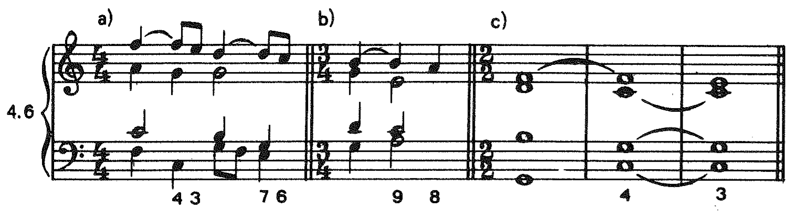

*4.6. Izvor: tiskana str. 282 (PDF str. 142, numeracija od 1).*

*MuseScore: prijepis na čekanju; sačuvati sve tiskane varijante, analizu i veze s nastavcima.*

**Udvajanje tona u koji se zaostajalica rješava.** Ton, u koji se zaostajalica rješava, može biti udvojen samo ispod zaostajalice i u intervalu none; ako se udvajanje izvrši iznad zaostajalice, nastaje pogrešno rješenje septime u oktavu, u donjem glasu (pr. 4.7). Mi ćemo modalitete, pod kojima se vrši udvajanje tona u koji se zaostajalica rješava, razmotriti ovdje samo u vezi sa silaznim zaostajalicama, a kod uzlaznih oni će biti objašnjeni u odsjeku 4.1.6.

<!-- visual: 4.7; page 282 -->

<!-- m08-slot: 009; id: 4.7; status: cleanup_required -->

**PROVISIONAL — NEODOBRENO (cleanup required).** [4.7 — neodobreni izvorni izrez](../images/04-neakordicki-a/primjer-4-7.png)

*4.7. Izvor: tiskana str. 282 (PDF str. 142, numeracija od 1).*

> Izrez nije prošao neovisni vizualni pregled; nije odobren za konačno izdanje. Number and both printed demonstrations are intact, but handwriting remains above and within the staff/analysis area and near the lower edge. No safe rectangular replacement proposed. Izvorni pikseli nisu retuširani; ne uklanjati bilješke ili tuđu notaciju precrtavanjem.

*MuseScore: prijepis na čekanju; sačuvati sve tiskane varijante, analizu i veze s nastavcima. NEODOBRENO — najprije razriješiti navedenu zapreku.*

Kod silaznih zaostajalica udvajanje je uvijek dobro kada se javlja u basu u intervalu i velike i male none ili none uvećane za oktavu (pr. 4.8). Udvajanje u nekom unutarnjem glasu, ispod zaostajalice i u intervalu none, zvučat će dobro samo kod velike none, a kod male bit će loše (pr. 4.9). Izuzetak od te zabrane je samo slučaj kada se radi o zaostajalici na temeljni ton dominantnog sekstakorda (pr. 4.10.a), jer ovdje udvajanje jednako dobro zvuči kao i kod prvog obrata dominantnog nonakorda, gdje se nona (koja se — štoviše — ne mora ni pripraviti) rješava poput silazne zaostajalice (pr. 4.10.b); analogno udvajanje može se primjenjivati i kod zaostajalice na temeljni ton dur-sekstakorda drugih stupnjeva, jer će se oni tada doimati tako kao da također imaju dominantnu funkciju (pr. 4.10.c).

<!-- visual: 4.8; page 282 -->

<!-- m08-slot: 010; id: 4.8; status: independent_pass -->

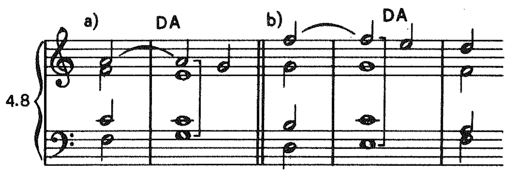

*4.8. Izvor: tiskana str. 282 (PDF str. 142, numeracija od 1).*

*MuseScore: prijepis na čekanju; sačuvati sve tiskane varijante, analizu i veze s nastavcima.*

<!-- visual: 4.9; page 282 -->

<!-- m08-slot: 011; id: 4.9; status: cleanup_required -->

**PROVISIONAL — NEODOBRENO (cleanup required).** [4.9 — neodobreni izvorni izrez](../images/04-neakordicki-a/primjer-4-9.png)

*4.9. Izvor: tiskana str. 282 (PDF str. 142, numeracija od 1).*

> Izrez nije prošao neovisni vizualni pregled; nije odobren za konačno izdanje. Number and all printed material are present, but source handwriting is visible above and within the example. Keeping all printed notation does not yield a handwriting-free rectangle. Izvorni pikseli nisu retuširani; ne uklanjati bilješke ili tuđu notaciju precrtavanjem.

*MuseScore: prijepis na čekanju; sačuvati sve tiskane varijante, analizu i veze s nastavcima. NEODOBRENO — najprije razriješiti navedenu zapreku.*

<!-- source-page: 283; pdf-page: 142 -->

<!-- visual: 4.10; page 283 -->

<!-- m08-slot: 012; id: 4.10; status: cleanup_required -->

**PROVISIONAL — NEODOBRENO (cleanup required).** [4.10 — neodobreni izvorni izrez](../images/04-neakordicki-a/primjer-4-10.png)

*4.10. Izvor: tiskana str. 283 (PDF str. 142, numeracija od 1).*

> Izrez nije prošao neovisni vizualni pregled; nije odobren za konačno izdanje. Number and a–c are retained, but handwritten harmonic analysis remains below the bass and inside the printed example's extent. No safe rectangular replacement proposed. Izvorni pikseli nisu retuširani; ne uklanjati bilješke ili tuđu notaciju precrtavanjem.

*MuseScore: prijepis na čekanju; sačuvati sve tiskane varijante, analizu i veze s nastavcima. NEODOBRENO — najprije razriješiti navedenu zapreku.*

**Oktave i kvinte kod zaostajalica.** Nasljedne oktave i nasljedne kvinte što nastaju rješenjem zaostajalica pogrešne su jednako kao i paralelne oktave i kvinte (pr. 4.11).

<!-- visual: 4.11; page 283 -->

<!-- m08-slot: 013; id: 4.11; status: cleanup_required -->

**PROVISIONAL — NEODOBRENO (cleanup required).** [4.11 — neodobreni izvorni izrez](../images/04-neakordicki-a/primjer-4-11.png)

*4.11. Izvor: tiskana str. 283 (PDF str. 142, numeracija od 1).*

> Izrez nije prošao neovisni vizualni pregled; nije odobren za konačno izdanje. Printed number, NE labels and notation are complete. Handwritten figures immediately beneath the bass intrude into the lower margin; enlarged source inspection shows no safe horizontal cut demonstrated that preserves every low stem and removes the handwriting. Izvorni pikseli nisu retuširani; ne uklanjati bilješke ili tuđu notaciju precrtavanjem.

*MuseScore: prijepis na čekanju; sačuvati sve tiskane varijante, analizu i veze s nastavcima. NEODOBRENO — najprije razriješiti navedenu zapreku.*

**Promjena akorda u času rješenja zaostajalice.** Promjena akorda, koja nastupa istodobno s rješenjem zaostajalice, pojavljuje se već kod sporednih septakorda s velikom septimom, kada se ona rješava kao uzlazna zaostajalica (pr. 2.213.d—t). Isti se postupak može primjenjivati i kod silaznih zaostajalica, uz pretpostavku da ne rezultira pogrešnim vođenjem glasova. Promjena akorda vrši se najčešće u okviru iste harmonije (pr. 4.12.a), ali i nastup nove harmonije također je moguć (pr. 4.12.b i c), pa čak i izmjena više harmonijâ za vrijeme trajanja zaostajalice (pr. 4.12.d).

<!-- visual: 4.12; page 283 -->

<!-- m08-slot: 014; id: 4.12; status: cleanup_required -->

**PROVISIONAL — NEODOBRENO (cleanup required).** [4.12 — neodobreni izvorni izrez](../images/04-neakordicki-a/primjer-4-12.png)

*4.12. Izvor: tiskana str. 283 (PDF str. 142, numeracija od 1).*

> Izrez nije prošao neovisni vizualni pregled; nije odobren za konačno izdanje. Number, a–d and notation are retained, but handwritten analysis remains within/below the bass region, including the bottom boundary. No safe rectangular replacement proposed. Izvorni pikseli nisu retuširani; ne uklanjati bilješke ili tuđu notaciju precrtavanjem.

*MuseScore: prijepis na čekanju; sačuvati sve tiskane varijante, analizu i veze s nastavcima. NEODOBRENO — najprije razriješiti navedenu zapreku.*

Izbjegavanje nasljednih oktava s promjenom akorda ne donosi rezultata, jer unatoč tome ostaje neugodan dojam (pr. 4.13.a), pa stoga niti uvođenje zaostajalice na oktavu susjednom oktavom, smještenom sekundu više, nije dobro. A i sakrita oktava, koja bi nastala kao rezultat rješenja zaostajalice uz istodobnu promjenu akorda također zvuči loše (pr. 4.13.b).

<!-- visual: 4.13; page 283 -->

<!-- m08-slot: 015; id: 4.13; status: independent_pass -->

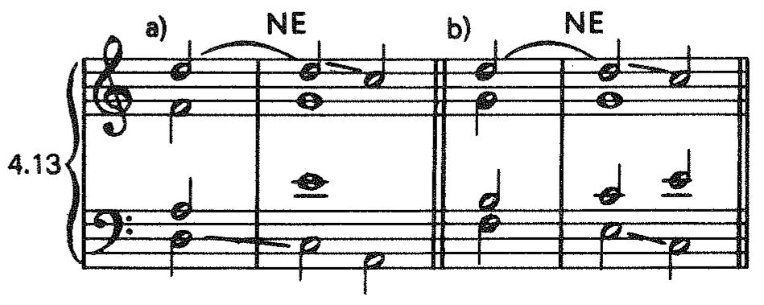

*4.13. Izvor: tiskana str. 283 (PDF str. 142, numeracija od 1).*

*MuseScore: prijepis na čekanju; sačuvati sve tiskane varijante, analizu i veze s nastavcima.*

<!-- source-page: 284; pdf-page: 143 -->

J. S. Bach često u svojim koralima zaostajalicu u tenorovoj dionici i ton koji predstavlja udvajanje rješenja zaostajalice u basovoj dionici dovodi u interval sekunde, a izlaz iz toga »škripca« postiže promjenom akorda u času rješenja zaostajalice; pri tome bas ili skače na drugi ton (pr. 4.14) ili dolazi na nj prohodom (pr. 4.15). A nije rijedak niti slučaj kada se Bach ne susteže ni od iznimnoga rješenja sekunde u unisono (pr. 4.16).

<!-- visual: 4.14; page 284 -->

<!-- m08-slot: 016; id: 4.14; status: cleanup_required -->

**PROVISIONAL — NEODOBRENO (cleanup required).** [4.14 — neodobreni izvorni izrez](../images/04-neakordicki-a/primjer-4-14.png)

*4.14. Izvor: tiskana str. 284 (PDF str. 143, numeracija od 1).*

> Izrez nije prošao neovisni vizualni pregled; nije odobren za konačno izdanje. Number and Bach chorale attribution are retained. Source handwriting intrudes between the staves and throughout the lower annotation area; no clean score-only rectangle proposed. Izvorni pikseli nisu retuširani; ne uklanjati bilješke ili tuđu notaciju precrtavanjem.

*MuseScore: prijepis na čekanju; sačuvati sve tiskane varijante, analizu i veze s nastavcima. NEODOBRENO — najprije razriješiti navedenu zapreku.*

<!-- visual: 4.15; page 284 -->

<!-- m08-slot: 017; id: 4.15; status: cleanup_required -->

**PROVISIONAL — NEODOBRENO (cleanup required).** [4.15 — neodobreni izvorni izrez](../images/04-neakordicki-a/primjer-4-15.png)

*4.15. Izvor: tiskana str. 284 (PDF str. 143, numeracija od 1).*

> Izrez nije prošao neovisni vizualni pregled; nije odobren za konačno izdanje. Number, Bach chorale attribution and staff ends are present, but handwritten analysis remains at the upper and lower boundaries and within the example. No safe rectangular replacement proposed. Izvorni pikseli nisu retuširani; ne uklanjati bilješke ili tuđu notaciju precrtavanjem.

*MuseScore: prijepis na čekanju; sačuvati sve tiskane varijante, analizu i veze s nastavcima. NEODOBRENO — najprije razriješiti navedenu zapreku.*

<!-- visual: 4.16; page 284 -->

<!-- m08-slot: 018; id: 4.16; status: cleanup_required -->

**PROVISIONAL — NEODOBRENO (cleanup required).** [4.16 — neodobreni izvorni izrez](../images/04-neakordicki-a/primjer-4-16.png)

*4.16. Izvor: tiskana str. 284 (PDF str. 143, numeracija od 1).*

> Izrez nije prošao neovisni vizualni pregled; nije odobren za konačno izdanje. Number, Bach chorale attribution and notation are retained. Handwritten marks occur inside the example and at its upper/lower boundaries; cannot pass the clean-source checklist by the current crop. Izvorni pikseli nisu retuširani; ne uklanjati bilješke ili tuđu notaciju precrtavanjem.

*MuseScore: prijepis na čekanju; sačuvati sve tiskane varijante, analizu i veze s nastavcima. NEODOBRENO — najprije razriješiti navedenu zapreku.*

### 4.1.2. Silazne zaostajalice na tonove kvintakorda

U principu se može pojaviti zaostajalica na svaki ton nekoga akorda. Kod kvintakorda bi to značilo mogućnost pojave zaostajalice na temeljni ton u basu, na (udvojeni) temeljni ton u nekom gornjem glasu, na tercu i na kvintu (pr. 4.17). Ali dok će zaostajalice na temeljni ton i na tercu biti prave zaostajalice, dotle će zaostajalica na kvintu, koja s basom čini interval sekste, rezultirati sekstakordom kao slučajnom harmonijom (pr. 4.17.c). Prava slučajna harmonija kod zaostajalice na kvintu nastat će samo ako se ta kvinta udvaja, ali tada mora zaostajalica s udvojenom kvintom tvoriti interval velike none; ako bismo htjeli da interval none bude vidljiv i iz šifraže, morali bismo takvu zaostajalicu šifrirati po sistemu obilježavanja obratâ

<!-- source-page: 285; pdf-page: 143 -->
<!-- continuation 284/285: Nastavak istog odlomka. -->

nonakorda (pr. 4.17.d). Analogna će situacija nastati i sa zaostajalicom na tercu, ako se terca udvaja (pr. 4.17.e). Kod zaostajalice na temeljni ton u basu temeljni se ton ne udvaja, nego terca ili kvinta, a zaostajalica se obilježava tako da se ispod rješenja stavi brojka koja označuje dobiveni akord — u ovom slučaju brojku 5 — a od nje se povuče unatrag horizontalna linija (pr. 4.17.f i g). Nasljedne kvinte, koje bi mogle nastati u nekim spojevima kod zaostajalice na temeljni ton u basu (pr. 4.17.h), lako se mogu izbjeći s promjenom položaja akorda u času rješenja zaostajalice (pr. 4.17.i).

<!-- visual: 4.17; page 285 -->

<!-- m08-slot: 019; id: 4.17; status: cleanup_required -->

**PROVISIONAL — NEODOBRENO (cleanup required).** [4.17 — neodobreni izvorni izrez](../images/04-neakordicki-a/primjer-4-17.png)

*4.17. Izvor: tiskana str. 285 (PDF str. 143, numeracija od 1).*

> Izrez nije prošao neovisni vizualni pregled; nije odobren za konačno izdanje. Number, both rows and variants a–i are retained. Source handwriting is interspersed with notation/analysis and reaches the upper and side regions. No safe rectangular replacement proposed. Izvorni pikseli nisu retuširani; ne uklanjati bilješke ili tuđu notaciju precrtavanjem.

*MuseScore: prijepis na čekanju; sačuvati sve tiskane varijante, analizu i veze s nastavcima. NEODOBRENO — najprije razriješiti navedenu zapreku.*

Zaostajalice na tonove obratâ kvintakorda ne donose ništa novo, samo se kod njih pojavljuju drugi intervali i drukčija šifraža (pr. 4.18. i 4.19).

<!-- visual: 4.18; page 285 -->

<!-- m08-slot: 020; id: 4.18; status: independent_pass -->

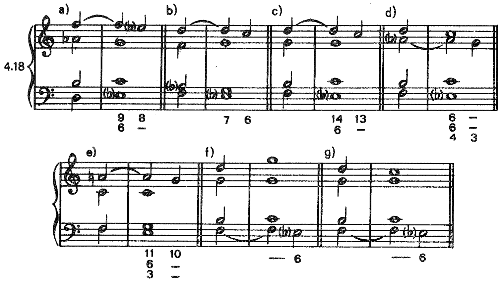

*4.18. Izvor: tiskana str. 285 (PDF str. 143, numeracija od 1).*

*MuseScore: prijepis na čekanju; sačuvati sve tiskane varijante, analizu i veze s nastavcima.*

<!-- source-page: 286; pdf-page: 144 -->

<!-- visual: 4.19; page 286 -->

<!-- m08-slot: 021; id: 4.19; status: independent_pass -->

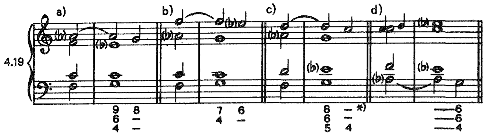

*4.19. Izvor: tiskana str. 286 (PDF str. 144, numeracija od 1).*

*MuseScore: prijepis na čekanju; sačuvati sve tiskane varijante, analizu i veze s nastavcima.*

\* Brojka 8 dodana je zato da bi se šifraža zaostajalice razlikovala od šifraže za kvintsekstakord.

Analogno zaostajalicama na tonove dur-kvintakorda i mol-kvintakorda, izvode se i zaostajalice na tonove smanjenog i povećanog kvintakorda, uz pretpostavku da pri tome ne dođe do udvajanja vođice ili do udvajanja smanjene kvinte (pr. 4.20. i 4.21).

<!-- visual: 4.20; page 286 -->

<!-- m08-slot: 022; id: 4.20; status: independent_pass -->

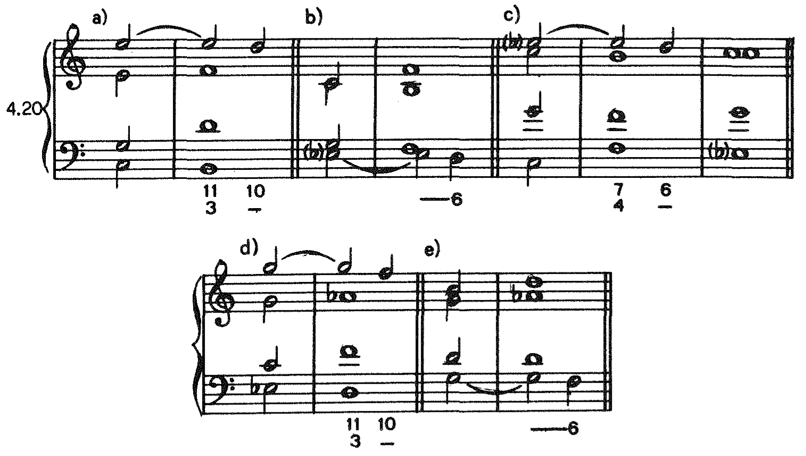

*4.20. Izvor: tiskana str. 286 (PDF str. 144, numeracija od 1).*

*MuseScore: prijepis na čekanju; sačuvati sve tiskane varijante, analizu i veze s nastavcima.*

<!-- visual: 4.21 a–c; page 286 -->

<!-- m08-slot: 023; id: 4.21; status: independent_pass -->

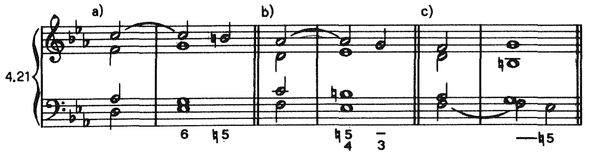

*4.21 a–c. Izvor: tiskana str. 286 (PDF str. 144, numeracija od 1).*

*MuseScore: prijepis na čekanju; sačuvati sve tiskane varijante, analizu i veze s nastavcima.*

<!-- source-page: 287; pdf-page: 144 -->

<!-- visual: 4.21 d–f (nastavak); page 287 -->

<!-- m08-slot: 024; id: 4.21-cont; status: independent_pass -->

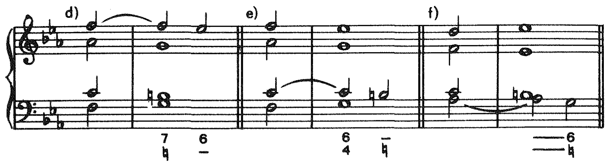

*4.21 d–f (nastavak). Izvor: tiskana str. 287 (PDF str. 144, numeracija od 1).*

*MuseScore: prijepis na čekanju; sačuvati sve tiskane varijante, analizu i veze s nastavcima.*

#### ZADACI

<!-- visual: zadatak 1; page 287 -->

<!-- m08-slot: 025; id: 4.z287-1; status: independent_pass -->

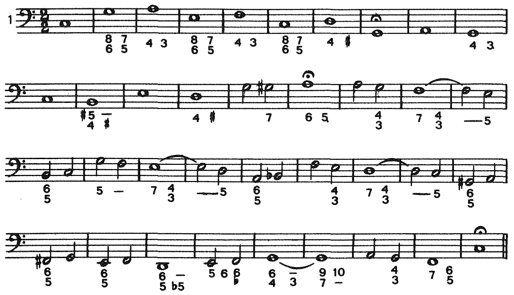

*zadatak 1. Izvor: tiskana str. 287 (PDF str. 144, numeracija od 1).*

*MuseScore: prijepis na čekanju; sačuvati sve tiskane varijante, analizu i veze s nastavcima.*

<!-- visual: zadatak 2; page 287 -->

<!-- m08-slot: 026; id: 4.z287-2; status: independent_pass -->

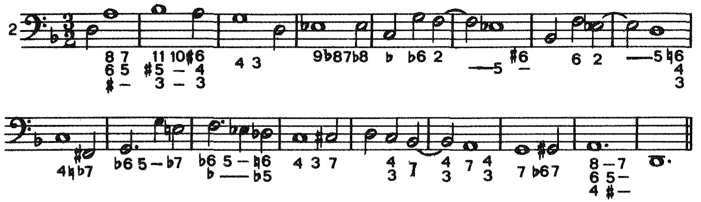

*zadatak 2. Izvor: tiskana str. 287 (PDF str. 144, numeracija od 1).*

*MuseScore: prijepis na čekanju; sačuvati sve tiskane varijante, analizu i veze s nastavcima.*

<!-- visual: zadatak 3 (početak); page 287 -->

<!-- m08-slot: 027; id: 4.z287-3; status: independent_pass -->

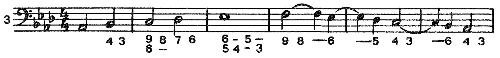

*zadatak 3 (početak). Izvor: tiskana str. 287 (PDF str. 144, numeracija od 1).*

*MuseScore: prijepis na čekanju; sačuvati sve tiskane varijante, analizu i veze s nastavcima.*

<!-- source-page: 288; pdf-page: 145 -->

<!-- visual: zadatak 3 (nastavak); page 288 -->

<!-- m08-slot: 028; id: 4.z288-3-cont; status: independent_pass -->

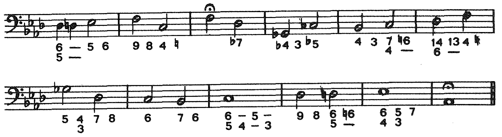

*zadatak 3 (nastavak). Izvor: tiskana str. 288 (PDF str. 145, numeracija od 1).*

*MuseScore: prijepis na čekanju; sačuvati sve tiskane varijante, analizu i veze s nastavcima.*

<!-- visual: zadatak 4; page 288 -->

<!-- m08-slot: 029; id: 4.z288-4; status: independent_pass -->

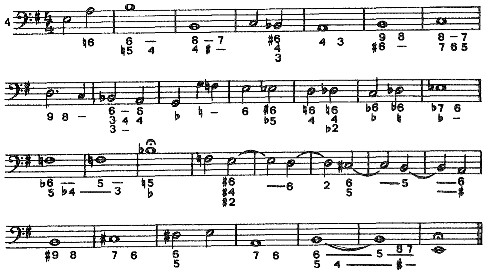

*zadatak 4. Izvor: tiskana str. 288 (PDF str. 145, numeracija od 1).*

*MuseScore: prijepis na čekanju; sačuvati sve tiskane varijante, analizu i veze s nastavcima.*

<!-- visual: zadatak 5; page 288 -->

<!-- m08-slot: 030; id: 4.z288-5; status: independent_pass -->

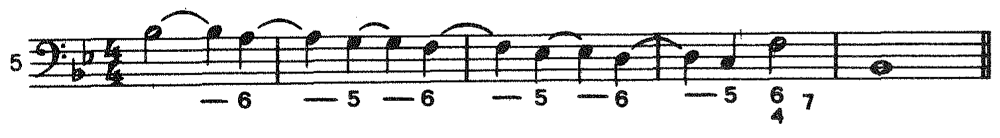

*zadatak 5. Izvor: tiskana str. 288 (PDF str. 145, numeracija od 1).*

*MuseScore: prijepis na čekanju; sačuvati sve tiskane varijante, analizu i veze s nastavcima.*

<!-- visual: zadatak 6; page 288 -->

<!-- m08-slot: 031; id: 4.z288-6; status: independent_pass -->

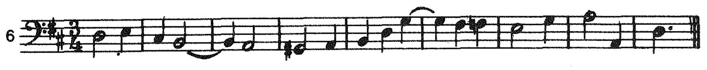

*zadatak 6. Izvor: tiskana str. 288 (PDF str. 145, numeracija od 1).*

*MuseScore: prijepis na čekanju; sačuvati sve tiskane varijante, analizu i veze s nastavcima.*

<!-- visual: zadatak 7; page 288 -->

<!-- m08-slot: 032; id: 4.z288-7; status: independent_pass -->

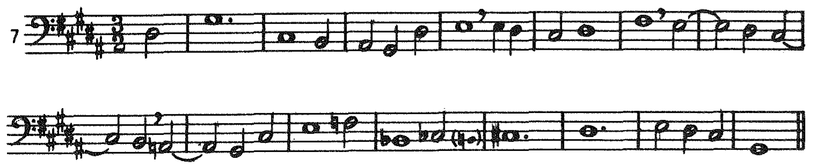

*zadatak 7. Izvor: tiskana str. 288 (PDF str. 145, numeracija od 1).*

*MuseScore: prijepis na čekanju; sačuvati sve tiskane varijante, analizu i veze s nastavcima.*

<!-- visual: zadatak 8; page 288 -->

<!-- m08-slot: 033; id: 4.z288-8; status: independent_pass -->

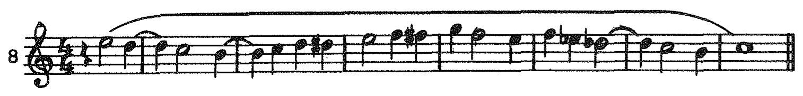

*zadatak 8. Izvor: tiskana str. 288 (PDF str. 145, numeracija od 1).*

*MuseScore: prijepis na čekanju; sačuvati sve tiskane varijante, analizu i veze s nastavcima.*

<!-- source-page: 289; pdf-page: 145 -->

<!-- visual: zadatak 9; page 289 -->

<!-- m08-slot: 034; id: 4.z289-9; status: independent_pass -->

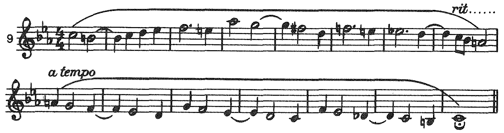

*zadatak 9. Izvor: tiskana str. 289 (PDF str. 145, numeracija od 1).*

*MuseScore: prijepis na čekanju; sačuvati sve tiskane varijante, analizu i veze s nastavcima.*

<!-- visual: zadatak 10; page 289 -->

<!-- m08-slot: 035; id: 4.z289-10; status: independent_pass -->

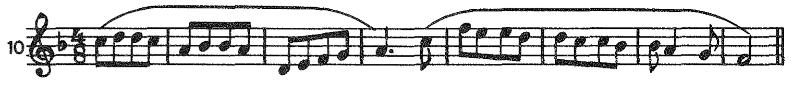

*zadatak 10. Izvor: tiskana str. 289 (PDF str. 145, numeracija od 1).*

*MuseScore: prijepis na čekanju; sačuvati sve tiskane varijante, analizu i veze s nastavcima.*

<!-- visual: zadatak 11; page 289 -->

<!-- m08-slot: 036; id: 4.z289-11; status: independent_pass -->

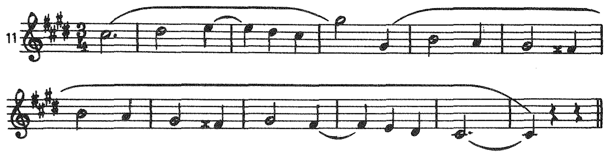

*zadatak 11. Izvor: tiskana str. 289 (PDF str. 145, numeracija od 1).*

*MuseScore: prijepis na čekanju; sačuvati sve tiskane varijante, analizu i veze s nastavcima.*

<!-- visual: zadatak 12; page 289 -->

<!-- m08-slot: 037; id: 4.z289-12; status: independent_pass -->

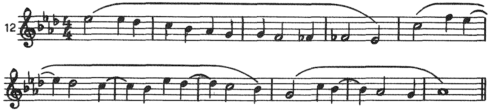

*zadatak 12. Izvor: tiskana str. 289 (PDF str. 145, numeracija od 1).*

*MuseScore: prijepis na čekanju; sačuvati sve tiskane varijante, analizu i veze s nastavcima.*

<!-- visual: zadatak 13; page 289 -->

<!-- m08-slot: 038; id: 4.z289-13; status: independent_pass -->

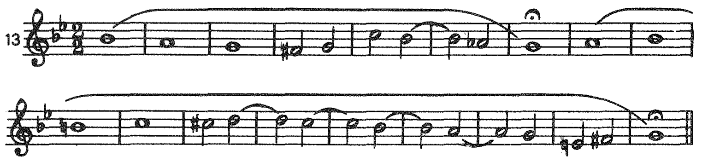

*zadatak 13. Izvor: tiskana str. 289 (PDF str. 145, numeracija od 1).*

*MuseScore: prijepis na čekanju; sačuvati sve tiskane varijante, analizu i veze s nastavcima.*

Realizacija zadatka 9.

<!-- visual: Realizacija zadatka 9 (početak); page 289 -->

<!-- m08-slot: 039; id: 4.z289-9-realizacija; status: independent_pass -->

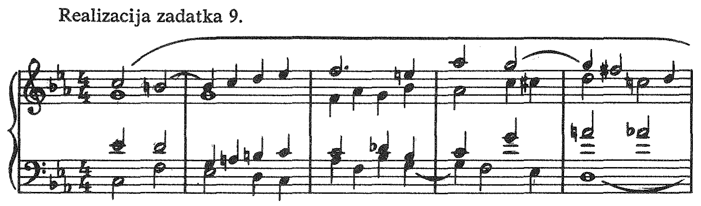

*Realizacija zadatka 9 (početak). Izvor: tiskana str. 289 (PDF str. 145, numeracija od 1).*

*MuseScore: prijepis na čekanju; sačuvati sve tiskane varijante, analizu i veze s nastavcima.*

<!-- source-page: 290; pdf-page: 146 -->

<!-- visual: Realizacija zadatka 9 (nastavak); page 290 -->

<!-- m08-slot: 040; id: 4.z290-9-realizacija-cont; status: source_damage -->

**SOURCE DAMAGE / NOTATION UNCERTAIN — NEODOBRENO.** [Realizacija zadatka 9 (nastavak) — neodobreni izvorni izrez](../images/04-neakordicki-a/zadatak-4-290-9-realizacija-cont.png)

*Realizacija zadatka 9 (nastavak). Izvor: tiskana str. 290 (PDF str. 146, numeracija od 1).*

> Granice izreza imaju neovisni prolaz, ali abrazija izvornoga skena zahvaća notaciju. To nije odobrenje čitljivosti ni točnosti oštećenih nota. Both continuation systems and printed analysis are within clean boundaries; paired title on page 289 is correct. White abrasion already in the source removes ink in the first system's lower staff near its second measure, with further worn ink near the next system's left side. This is source damage, not crop clipping; exact affected notation is not certified. Izvorni pikseli nisu retuširani; potrebna je neovisna provjera notacije ili neoštećen izvor.

*MuseScore: prijepis na čekanju; sačuvati sve tiskane varijante, analizu i veze s nastavcima. NEODOBRENO — najprije razriješiti navedenu zapreku.*

### 4.1.3. Silazne zaostajalice na tonove dominantnog septakorda i dominantnog nonakorda

U dominantnom septakordu može se pojaviti samo zaostajalica na tercu i na kvintu (pr. 4.22.a i b). Zaostajalica na temeljni ton čini s ostalim tonovima sekundakord VII stupnja, a njezino je rješenje identično s normalnim rješenjem sekundakorda (pr. 4.22.c). Zaostajalica na septimu bila bi identična s temeljnim tonom, tako da se u dijatonici o njoj ne može ni govoriti, ali se u kromatici ona može pojaviti; tada ona čini s temeljnim tonom interval velike septime, a rješava se kromatski u malu septimu (pr. 4.22.d i e). Ali u tom slučaju ne radi se ipak o pravoj zaostajalici, nego o kromatskoj promjeni akorda koja nastaje s kromatskim sniženjem septime.

<!-- visual: 4.22; page 290 -->

<!-- m08-slot: 041; id: 4.22; status: cleanup_required -->

**PROVISIONAL — NEODOBRENO (cleanup required).** [4.22 — neodobreni izvorni izrez](../images/04-neakordicki-a/primjer-4-22.png)

*4.22. Izvor: tiskana str. 290 (PDF str. 146, numeracija od 1).*

> Izrez nije prošao neovisni vizualni pregled; nije odobren za konačno izdanje. Number and a–e are retained, but faint handwritten analysis lies within the staff/analysis area and near the top. No safe rectangular replacement proposed. Izvorni pikseli nisu retuširani; ne uklanjati bilješke ili tuđu notaciju precrtavanjem.

*MuseScore: prijepis na čekanju; sačuvati sve tiskane varijante, analizu i veze s nastavcima. NEODOBRENO — najprije razriješiti navedenu zapreku.*

Primjeri 4.23 — 4.25. prikazuju analogne zaostajalice na tonove obratâ dominantnog septakorda.

<!-- source-page: 291; pdf-page: 146 -->

<!-- visual: 4.23; page 291 -->

<!-- m08-slot: 042; id: 4.23; status: cleanup_required -->

**PROVISIONAL — NEODOBRENO (cleanup required).** [4.23 — neodobreni izvorni izrez](../images/04-neakordicki-a/primjer-4-23.png)

*4.23. Izvor: tiskana str. 291 (PDF str. 146, numeracija od 1).*

> Izrez nije prošao neovisni vizualni pregled; nije odobren za konačno izdanje. Number, a–c and printed notation/figures are retained, but faint handwriting occurs between staves and alongside/below bass figures. No safe rectangular replacement proposed. Izvorni pikseli nisu retuširani; ne uklanjati bilješke ili tuđu notaciju precrtavanjem.

*MuseScore: prijepis na čekanju; sačuvati sve tiskane varijante, analizu i veze s nastavcima. NEODOBRENO — najprije razriješiti navedenu zapreku.*

<!-- visual: 4.24; page 291 -->

<!-- m08-slot: 043; id: 4.24; status: cleanup_required -->

**PROVISIONAL — NEODOBRENO (cleanup required).** [4.24 — neodobreni izvorni izrez](../images/04-neakordicki-a/primjer-4-24.png)

*4.24. Izvor: tiskana str. 291 (PDF str. 146, numeracija od 1).*

> Izrez nije prošao neovisni vizualni pregled; nije odobren za konačno izdanje. Number and a–c are retained. Handwritten figures remain above and between staves and below printed analysis; cannot pass the no-handwriting checklist. Izvorni pikseli nisu retuširani; ne uklanjati bilješke ili tuđu notaciju precrtavanjem.

*MuseScore: prijepis na čekanju; sačuvati sve tiskane varijante, analizu i veze s nastavcima. NEODOBRENO — najprije razriješiti navedenu zapreku.*

<!-- visual: 4.25; page 291 -->

<!-- m08-slot: 044; id: 4.25; status: cleanup_required -->

**PROVISIONAL — NEODOBRENO (cleanup required).** [4.25 — neodobreni izvorni izrez](../images/04-neakordicki-a/primjer-4-25.png)

*4.25. Izvor: tiskana str. 291 (PDF str. 146, numeracija od 1).*

> Izrez nije prošao neovisni vizualni pregled; nije odobren za konačno izdanje. Number and a–c are retained, but handwritten analysis occurs within the notation area and below printed figures. No safe rectangular replacement proposed. Izvorni pikseli nisu retuširani; ne uklanjati bilješke ili tuđu notaciju precrtavanjem.

*MuseScore: prijepis na čekanju; sačuvati sve tiskane varijante, analizu i veze s nastavcima. NEODOBRENO — najprije razriješiti navedenu zapreku.*

Kod zaostajalice na tercu može septima, kada se nalazi u unutarnjem glasu, uzlaziti u času rješenja, pa je tada shvaćamo kao izmjenični ton (pr. 4.26.a). Uzlaženje septime u primjeru 4.26.b sasvim je druge prirode, jer se septima tamo ipak naknadno rješava nadolje.

<!-- visual: 4.26; page 291 -->

<!-- m08-slot: 045; id: 4.26; status: cleanup_required -->

**PROVISIONAL — NEODOBRENO (cleanup required).** [4.26 — neodobreni izvorni izrez](../images/04-neakordicki-a/primjer-4-26.png)

*4.26. Izvor: tiskana str. 291 (PDF str. 146, numeracija od 1).*

> Izrez nije prošao neovisni vizualni pregled; nije odobren za konačno izdanje. Number and a–b are complete, but extensive handwritten arrows and harmonic analysis are interspersed with the score and extend into top/bottom margins. No safe rectangular replacement proposed. Izvorni pikseli nisu retuširani; ne uklanjati bilješke ili tuđu notaciju precrtavanjem.

*MuseScore: prijepis na čekanju; sačuvati sve tiskane varijante, analizu i veze s nastavcima. NEODOBRENO — najprije razriješiti navedenu zapreku.*

<!-- source-page: 292; pdf-page: 147 -->

U dominantnom nonakordu dolazi do analognih zaostajalica kao u dominantnom septakordu. Njihova će primjena biti češća u peteroglasju, gdje nonakord nastupa potpun (pr. 4.27 — 4.30), ali u većini tih slučajeva možemo ispuštanjem jednoga glasa dobiti i sasvim dobro četveroglasje.

<!-- visual: 4.27; page 292 -->

<!-- m08-slot: 046; id: 4.27; status: independent_pass -->

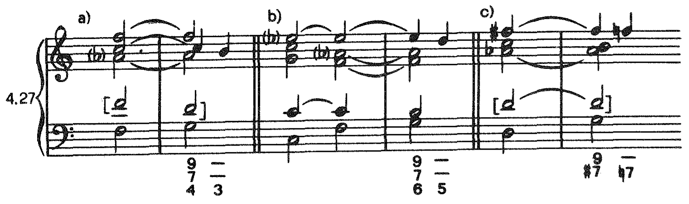

*4.27. Izvor: tiskana str. 292 (PDF str. 147, numeracija od 1).*

*MuseScore: prijepis na čekanju; sačuvati sve tiskane varijante, analizu i veze s nastavcima.*

<!-- visual: 4.28; page 292 -->

<!-- m08-slot: 047; id: 4.28; status: independent_pass -->

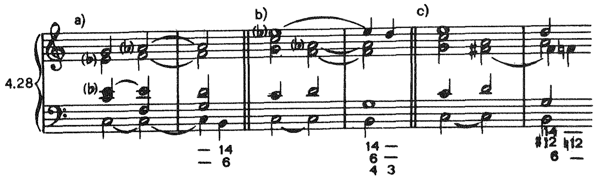

*4.28. Izvor: tiskana str. 292 (PDF str. 147, numeracija od 1).*

*MuseScore: prijepis na čekanju; sačuvati sve tiskane varijante, analizu i veze s nastavcima.*

<!-- visual: 4.29; page 292 -->

<!-- m08-slot: 048; id: 4.29; status: independent_pass -->

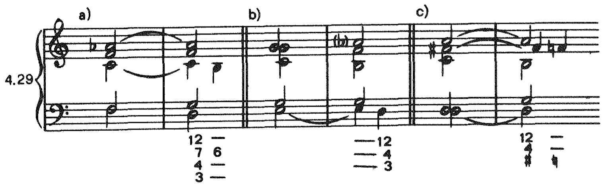

*4.29. Izvor: tiskana str. 292 (PDF str. 147, numeracija od 1).*

*MuseScore: prijepis na čekanju; sačuvati sve tiskane varijante, analizu i veze s nastavcima.*

<!-- visual: 4.30; page 292 -->

<!-- m08-slot: 049; id: 4.30; status: independent_pass -->

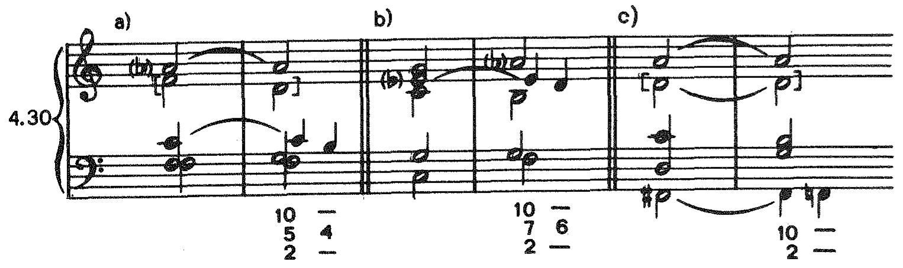

*4.30. Izvor: tiskana str. 292 (PDF str. 147, numeracija od 1).*

*MuseScore: prijepis na čekanju; sačuvati sve tiskane varijante, analizu i veze s nastavcima.*

<!-- boundary 292/293: Stranica 292 završava primjerom 4.30; posljednji prozni odlomak završava potpunom rečenicom. Stranica 293 nije dio dodijeljenog raspona. -->

<!-- boundary 292/293: Nastavak odsjeka 4.1.3 iz review-candidates/book/M08/text-277-292.md, bez ponavljanja korijenskog naslova. Stranica 292 završava primjerom 4.30 i potpunom proznom rečenicom; stranica 293 počinje zadacima. -->

<!-- source-page: 293; pdf-page: 147 -->

#### ZADACI

<!-- visual: 4.1.3 — zadatak 1; page 293 -->

<!-- m08-slot: 050; id: 4.z293-1; status: independent_pass -->

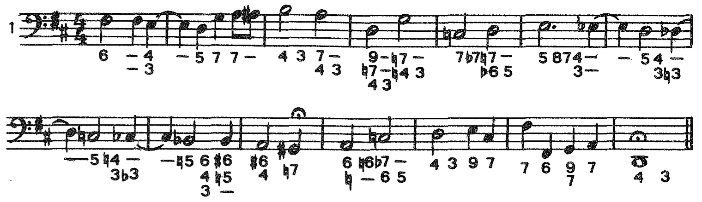

*4.1.3 — zadatak 1. Izvor: tiskana str. 293 (PDF str. 147, numeracija od 1).*

*MuseScore: prijepis na čekanju; sačuvati sve tiskane varijante, analizu i veze s nastavcima.*

<!-- visual: 4.1.3 — zadatak 2; page 293 -->

<!-- m08-slot: 051; id: 4.z293-2; status: independent_pass -->

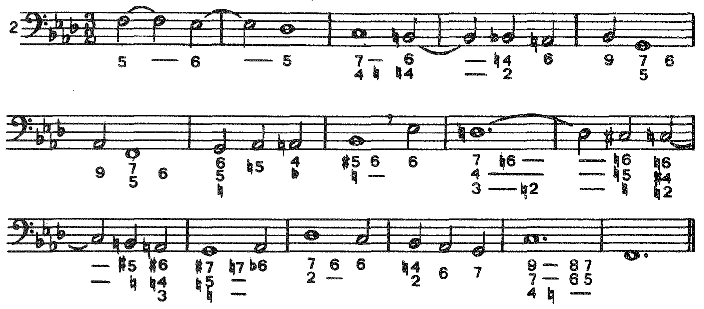

*4.1.3 — zadatak 2. Izvor: tiskana str. 293 (PDF str. 147, numeracija od 1).*

*MuseScore: prijepis na čekanju; sačuvati sve tiskane varijante, analizu i veze s nastavcima.*

<!-- visual: 4.1.3 — zadatak 3; page 293 -->

<!-- m08-slot: 052; id: 4.z293-3; status: independent_pass -->

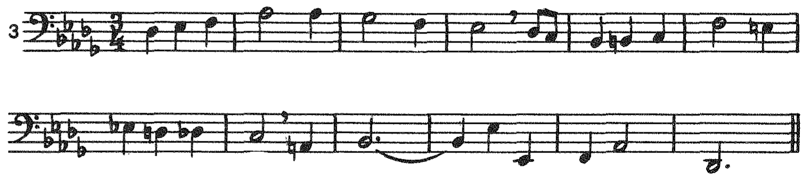

*4.1.3 — zadatak 3. Izvor: tiskana str. 293 (PDF str. 147, numeracija od 1).*

*MuseScore: prijepis na čekanju; sačuvati sve tiskane varijante, analizu i veze s nastavcima.*

<!-- visual: 4.1.3 — zadatak 4; page 293 -->

<!-- m08-slot: 053; id: 4.z293-4; status: independent_pass -->

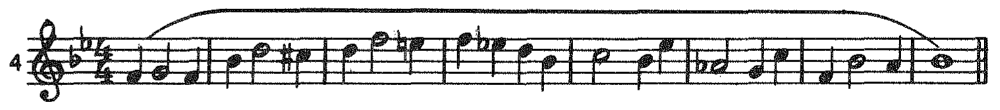

*4.1.3 — zadatak 4. Izvor: tiskana str. 293 (PDF str. 147, numeracija od 1).*

*MuseScore: prijepis na čekanju; sačuvati sve tiskane varijante, analizu i veze s nastavcima.*

<!-- visual: 4.1.3 — zadatak 5; page 293 -->

<!-- m08-slot: 054; id: 4.z293-5; status: independent_pass -->

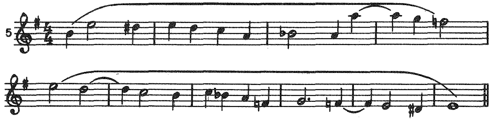

*4.1.3 — zadatak 5. Izvor: tiskana str. 293 (PDF str. 147, numeracija od 1).*

*MuseScore: prijepis na čekanju; sačuvati sve tiskane varijante, analizu i veze s nastavcima.*

<!-- visual: 4.1.3 — zadatak 6 (početak); page 293 -->

<!-- m08-slot: 055; id: 4.z293-6; status: independent_pass -->

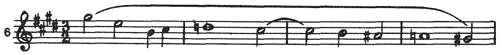

*4.1.3 — zadatak 6 (početak). Izvor: tiskana str. 293 (PDF str. 147, numeracija od 1).*

*MuseScore: prijepis na čekanju; sačuvati sve tiskane varijante, analizu i veze s nastavcima.*

<!-- source-page: 294; pdf-page: 148 -->

<!-- visual: 4.1.3 — zadatak 6 (nastavak); page 294 -->

<!-- m08-slot: 056; id: 4.z294-6-cont; status: independent_pass -->

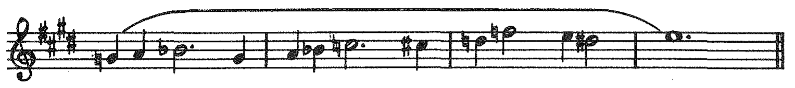

*4.1.3 — zadatak 6 (nastavak). Izvor: tiskana str. 294 (PDF str. 148, numeracija od 1).*

*MuseScore: prijepis na čekanju; sačuvati sve tiskane varijante, analizu i veze s nastavcima.*

<!-- visual: 4.1.3 — zadatak 7; page 294 -->

<!-- m08-slot: 057; id: 4.z294-7; status: independent_pass -->

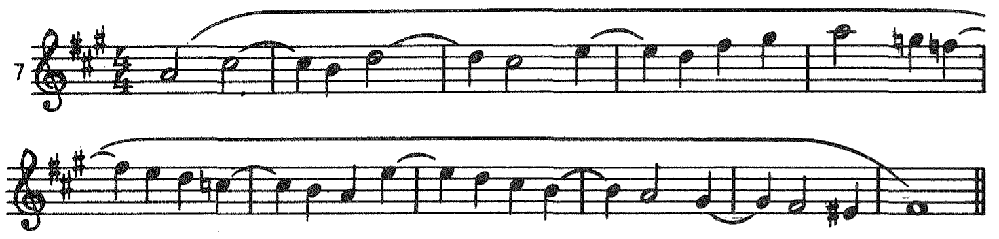

*4.1.3 — zadatak 7. Izvor: tiskana str. 294 (PDF str. 148, numeracija od 1).*

*MuseScore: prijepis na čekanju; sačuvati sve tiskane varijante, analizu i veze s nastavcima.*

Realizacija zadatka 5.

<!-- visual: 4.1.3 — Realizacija zadatka 5; page 294 -->

<!-- m08-slot: 058; id: 4.z294-5-realizacija; status: independent_pass -->

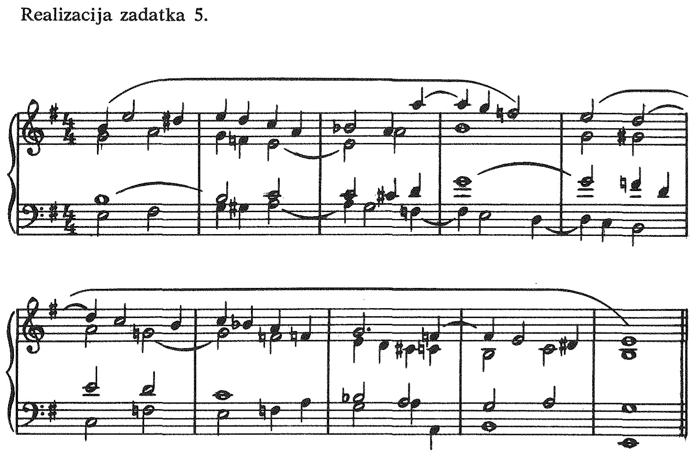

*4.1.3 — Realizacija zadatka 5. Izvor: tiskana str. 294 (PDF str. 148, numeracija od 1).*

*MuseScore: prijepis na čekanju; sačuvati sve tiskane varijante, analizu i veze s nastavcima.*

### 4.1.4. Silazne zaostajalice na tonove smanjenog septakorda

Zaostajalice u smanjenom septakordu analogne su zaostajalicama u dominantnom septakordu, pa tako i ovdje imamo zaostajalice na tercu i na kvintu (pr. 4.31.a i b), dok će zaostajalica na temeljni ton činiti s ostalim tonovima opet jedan sekundakord (pr. 4.31.c). Kod zaostajalice na septimu, koja će s temeljnim tonom činiti interval smanjene oktave (a u obratu interval povećane prime), uvodi se temeljni ton redovito kromatskim putem (pr. 4.31.d), a do analognih situacija dolazi i u obratima (pr. 4.32 — 4.34).

<!-- source-page: 295; pdf-page: 148 -->

<!-- visual: 4.31 a–d; page 295 -->

<!-- m08-slot: 059; id: 4.31; status: source_damage -->

**SOURCE DAMAGE / NOTATION UNCERTAIN — NEODOBRENO.** [4.31 a–d — neodobreni izvorni izrez](../images/04-neakordicki-a/primjer-4-31.png)

*4.31 a–d. Izvor: tiskana str. 295 (PDF str. 148, numeracija od 1).*

> Granice izreza imaju neovisni prolaz, ali abrazija izvornoga skena zahvaća notaciju. To nije odobrenje čitljivosti ni točnosti oštećenih nota. Number, a–d, all available printed notation and analysis retained inside clean margins. White abrasion in variant c's upper staff is already present in the authoritative source, not introduced by cropping. Missing/worn notation there remains source-limited and is not interpreted here. Izvorni pikseli nisu retuširani; potrebna je neovisna provjera notacije ili neoštećen izvor.

*MuseScore: prijepis na čekanju; sačuvati sve tiskane varijante, analizu i veze s nastavcima. NEODOBRENO — najprije razriješiti navedenu zapreku.*

<!-- visual: 4.32 a–c; page 295 -->

<!-- m08-slot: 060; id: 4.32; status: independent_pass -->

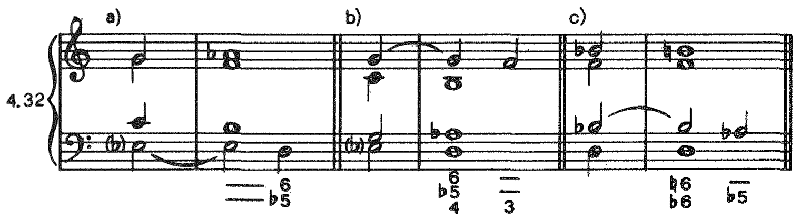

*4.32 a–c. Izvor: tiskana str. 295 (PDF str. 148, numeracija od 1).*

*MuseScore: prijepis na čekanju; sačuvati sve tiskane varijante, analizu i veze s nastavcima.*

<!-- visual: 4.33 a–c; page 295 -->

<!-- m08-slot: 061; id: 4.33; status: independent_pass -->

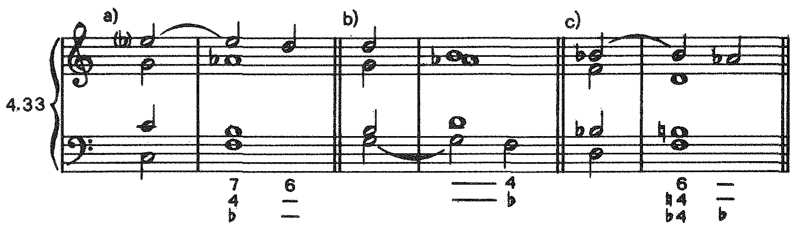

*4.33 a–c. Izvor: tiskana str. 295 (PDF str. 148, numeracija od 1).*

*MuseScore: prijepis na čekanju; sačuvati sve tiskane varijante, analizu i veze s nastavcima.*

<!-- visual: 4.34 a–c; page 295 -->

<!-- m08-slot: 062; id: 4.34; status: independent_pass -->

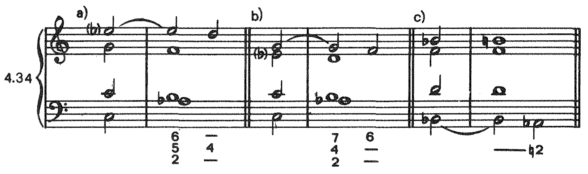

*4.34 a–c. Izvor: tiskana str. 295 (PDF str. 148, numeracija od 1).*

*MuseScore: prijepis na čekanju; sačuvati sve tiskane varijante, analizu i veze s nastavcima.*

Već smo, uzimajući sporedne septakorde, vidjeli da je smanjeni septakord zapravo dominantni nonakord kojemu manjka temeljni ton (v. odsjek 2.5.3). Podudarnost tih dvaju akorda omogućuje nam i primjenu zaostajalice na nonu dominantnog nonakorda s malom nonom, samo što sada tercu nonakorda uvodimo kromatskim putem jednako kao što uvodimo primu smanjenog septakorda kod zaostajalice na njegovu septimu (pr. 4.35).

<!-- source-page: 296; pdf-page: 149 -->

<!-- visual: 4.35 a–e; page 296 -->

<!-- m08-slot: 063; id: 4.35; status: independent_pass -->

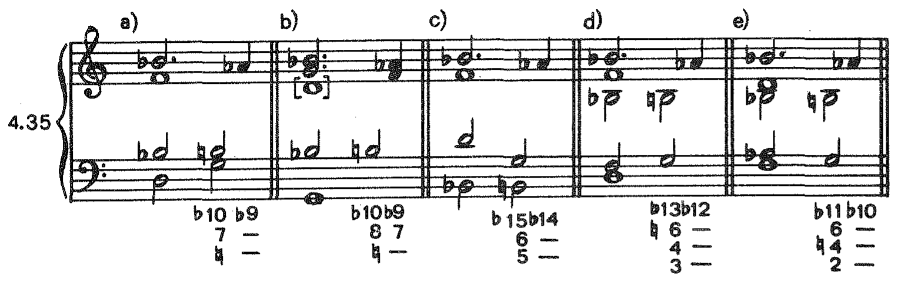

*4.35 a–e. Izvor: tiskana str. 296 (PDF str. 149, numeracija od 1).*

*MuseScore: prijepis na čekanju; sačuvati sve tiskane varijante, analizu i veze s nastavcima.*

#### ZADACI

<!-- visual: 4.1.4 — zadatak 1; page 296 -->

<!-- m08-slot: 064; id: 4.z296-1; status: independent_pass -->

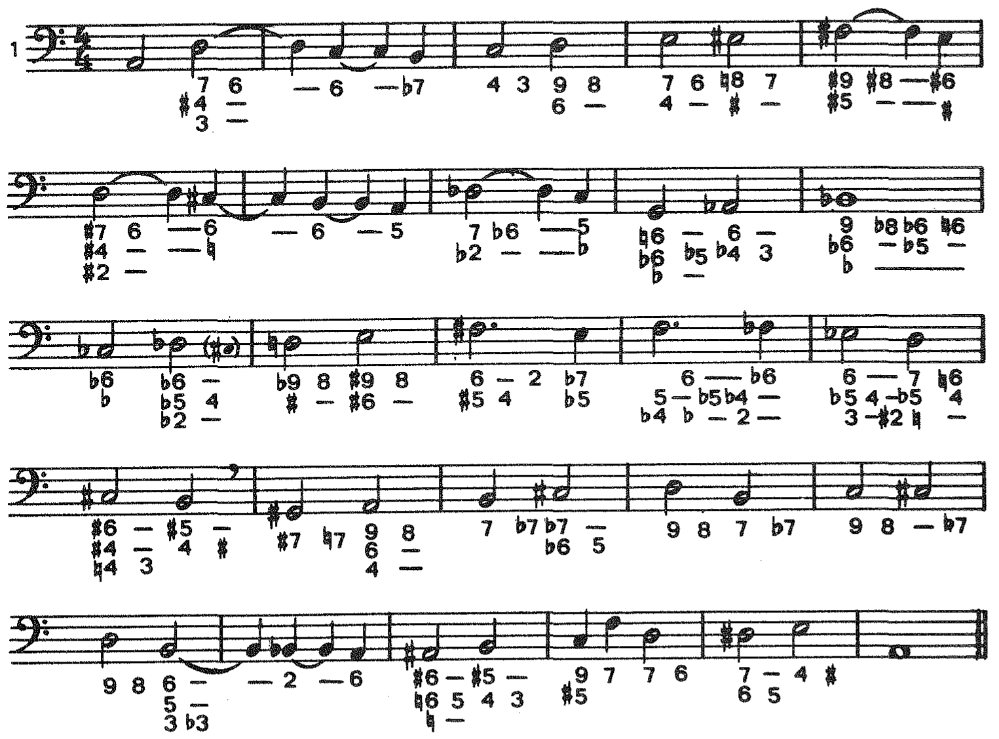

*4.1.4 — zadatak 1. Izvor: tiskana str. 296 (PDF str. 149, numeracija od 1).*

*MuseScore: prijepis na čekanju; sačuvati sve tiskane varijante, analizu i veze s nastavcima.*

<!-- visual: 4.1.4 — zadatak 2; page 296 -->

<!-- m08-slot: 065; id: 4.z296-2; status: independent_pass -->

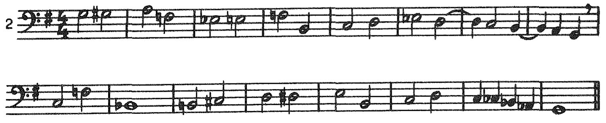

*4.1.4 — zadatak 2. Izvor: tiskana str. 296 (PDF str. 149, numeracija od 1).*

*MuseScore: prijepis na čekanju; sačuvati sve tiskane varijante, analizu i veze s nastavcima.*

<!-- source-page: 297; pdf-page: 149 -->

<!-- visual: 4.1.4 — zadatak 3; page 297 -->

<!-- m08-slot: 066; id: 4.z297-3; status: independent_pass -->

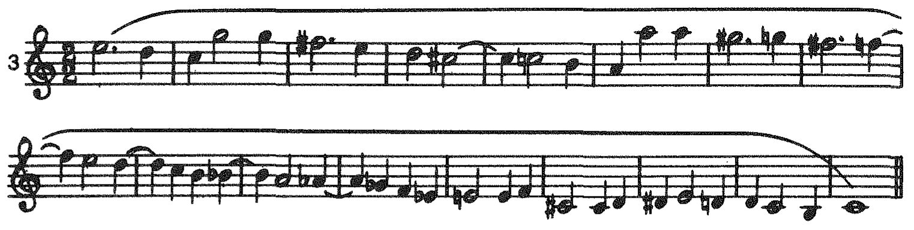

*4.1.4 — zadatak 3. Izvor: tiskana str. 297 (PDF str. 149, numeracija od 1).*

*MuseScore: prijepis na čekanju; sačuvati sve tiskane varijante, analizu i veze s nastavcima.*

<!-- visual: 4.1.4 — zadatak 4; page 297 -->

<!-- m08-slot: 067; id: 4.z297-4; status: independent_pass -->

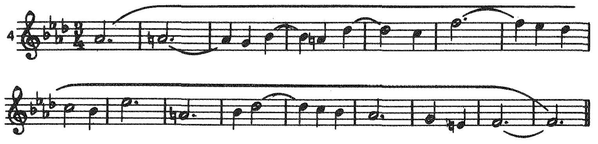

*4.1.4 — zadatak 4. Izvor: tiskana str. 297 (PDF str. 149, numeracija od 1).*

*MuseScore: prijepis na čekanju; sačuvati sve tiskane varijante, analizu i veze s nastavcima.*

Realizacija zadatka 3.

<!-- visual: 4.1.4 — Realizacija zadatka 3; page 297 -->

<!-- m08-slot: 068; id: 4.z297-3-realizacija; status: independent_pass -->

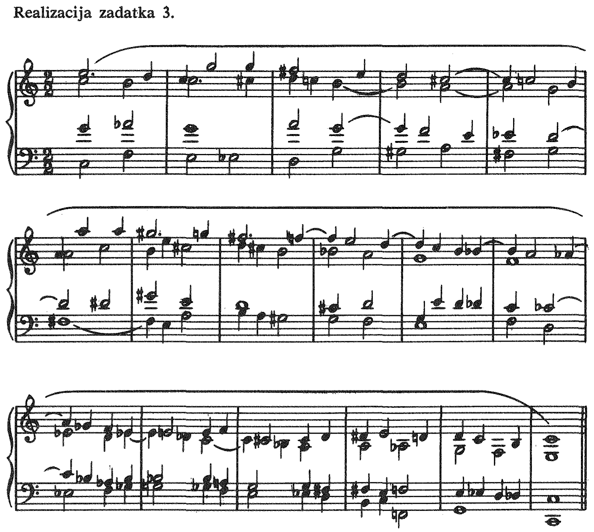

*4.1.4 — Realizacija zadatka 3. Izvor: tiskana str. 297 (PDF str. 149, numeracija od 1).*

*MuseScore: prijepis na čekanju; sačuvati sve tiskane varijante, analizu i veze s nastavcima.*

<!-- source-page: 298; pdf-page: 150 -->

### 4.1.5. Silazne zaostajalice na tonove sporednih septakorda i sporednih nonakorda

Analogija s dominantnim septakordom nastavlja se i kod zaostajalica u sporednim septakordima, tako da ćemo i ovdje imati prave zaostajalice na tercu i na kvintu, dok će zaostajalica na temeljni ton uvijek činiti s akordičkim tonovima sekundakord septakorda, koji leži tercu više. Razlika će biti jedino u tome što će kod zaostajalica u sporednim septakordima trebati pripraviti dva tona: zaostajalicu i septimu (pr. 4.36.a—c). I zaostajalica na septimu može se također pojaviti, ali to će također prije biti kromatska promjena septakorda nego prava zaostajalica (pr. 4.36.d).

<!-- visual: 4.36 a–d; page 298 -->

<!-- m08-slot: 069; id: 4.36; status: independent_pass -->

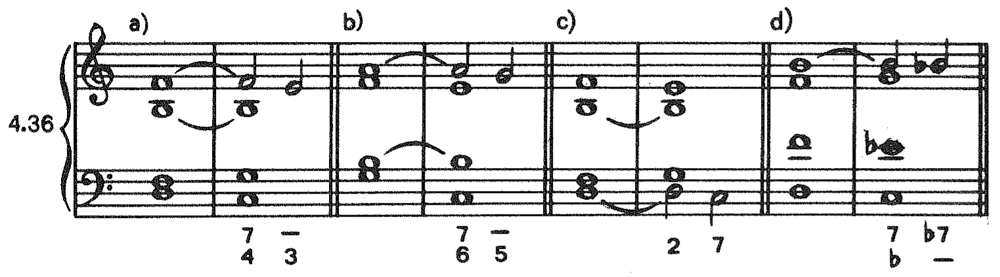

*4.36 a–d. Izvor: tiskana str. 298 (PDF str. 150, numeracija od 1).*

*MuseScore: prijepis na čekanju; sačuvati sve tiskane varijante, analizu i veze s nastavcima.*

Kod zaostajalica u sporednim nonakordima treba pripraviti čak tri tona, tj. zaostajalicu, nonu i septimu, pa će se stoga takvi slučajevi rijetko pojavljivati u strogom četveroglasnom stavku (pr. 4.37).

<!-- visual: 4.37 a–b; page 298 -->

<!-- m08-slot: 070; id: 4.37; status: independent_pass -->

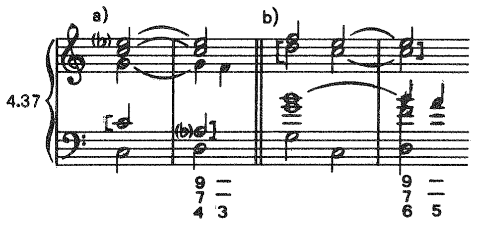

*4.37 a–b. Izvor: tiskana str. 298 (PDF str. 150, numeracija od 1).*

*MuseScore: prijepis na čekanju; sačuvati sve tiskane varijante, analizu i veze s nastavcima.*

#### ZADACI

<!-- visual: 4.1.5 — zadatak 1 (početak); page 298 -->

<!-- m08-slot: 071; id: 4.z298-1; status: independent_pass -->

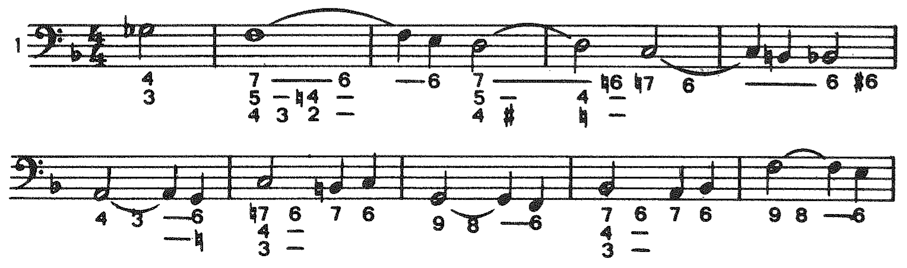

*4.1.5 — zadatak 1 (početak). Izvor: tiskana str. 298 (PDF str. 150, numeracija od 1).*

*MuseScore: prijepis na čekanju; sačuvati sve tiskane varijante, analizu i veze s nastavcima.*

<!-- source-page: 299; pdf-page: 150 -->

<!-- visual: 4.1.5 — zadatak 1 (nastavak); page 299 -->

<!-- m08-slot: 072; id: 4.z299-1-cont; status: independent_pass -->

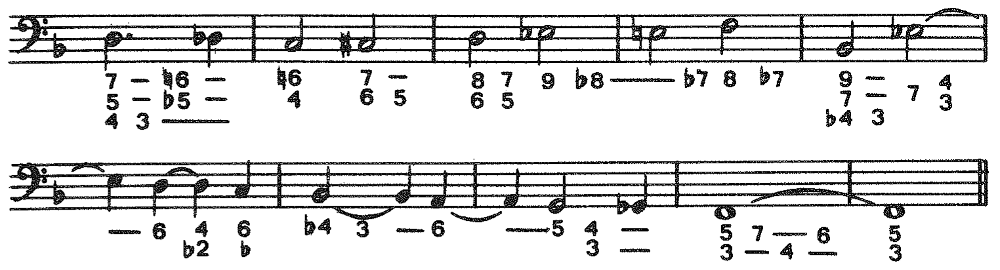

*4.1.5 — zadatak 1 (nastavak). Izvor: tiskana str. 299 (PDF str. 150, numeracija od 1).*

*MuseScore: prijepis na čekanju; sačuvati sve tiskane varijante, analizu i veze s nastavcima.*

<!-- visual: 4.1.5 — zadatak 2; page 299 -->

<!-- m08-slot: 073; id: 4.z299-2; status: independent_pass -->

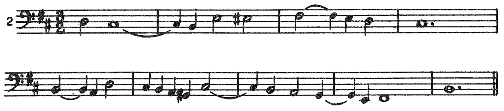

*4.1.5 — zadatak 2. Izvor: tiskana str. 299 (PDF str. 150, numeracija od 1).*

*MuseScore: prijepis na čekanju; sačuvati sve tiskane varijante, analizu i veze s nastavcima.*

### 4.1.6. Uzlazne i višestruke zaostajalice

**Uzlazne zaostajalice** najčešće se pojavljuju tamo gdje uzlaze za malu sekundu, uz istodobno udvajanje tona u koji se rješavaju. Udvajanje se smije izvršiti samo ispod zaostajalice, a to znači u intervalu septime ili septime, uvećane za oktavu. Najčešće su uzlazne zaostajalice na oktavu u kvintakordu (pr. 4.38.a), na tercu u kvintakordu (pr. 4.38.b i c), na oktavu u sekstakordu (pr. 4.38.d i e) i na tercu u nekim sporednim septakordima (pr. 4.38.f).

<!-- visual: 4.38 a–f; page 299 -->

<!-- m08-slot: 074; id: 4.38; status: independent_pass -->

*4.38 a–f. Izvor: tiskana str. 299 (PDF str. 150, numeracija od 1).*

*MuseScore: prijepis na čekanju; sačuvati sve tiskane varijante, analizu i veze s nastavcima.*

<!-- source-page: 300; pdf-page: 151 -->

Uzlazne zaostajalice, koje uzlaze za veliku sekundu, moguće su kada se ne udvaja ton u koji idu, jer bi u protivnom činile s njime interval male septime, koja ne teži naviše nego naniže. Takve uzlazne zaostajalice redovito su zaostajalice na tercu (pr. 4.39). Zaostajalice na kvintu opet će uzlaziti za malu sekundu (pr. 4.40).

<!-- visual: 4.39 a–c; page 300 -->

<!-- m08-slot: 075; id: 4.39; status: independent_pass -->

*4.39 a–c. Izvor: tiskana str. 300 (PDF str. 151, numeracija od 1).*

*MuseScore: prijepis na čekanju; sačuvati sve tiskane varijante, analizu i veze s nastavcima.*

<!-- visual: 4.40 a–b; page 300 -->

<!-- m08-slot: 076; id: 4.40; status: independent_pass -->

*4.40 a–b. Izvor: tiskana str. 300 (PDF str. 151, numeracija od 1).*

*MuseScore: prijepis na čekanju; sačuvati sve tiskane varijante, analizu i veze s nastavcima.*

**Višestruke zaostajalice** mogu biti dvostruke ili trostruke. Tonovi dvostruke silazne zaostajalice nalaze se međusobno u intervalu terce ili sekste (pr. 4.41), a kod trostruke silazne zaostajalice priključuje se terci, odnosno seksti, još i interval kvarte, tako da u glasovima, u kojima se trostruka zaostajalica pojavljuje, dolazi pri rješavanju do pomaka u paralelnim sekstakordima ili u paralelnim kvartsekstakordima (pr. 4.42).

<!-- visual: 4.41 a–e; page 300 -->

<!-- m08-slot: 077; id: 4.41; status: independent_pass -->

*4.41 a–e. Izvor: tiskana str. 300 (PDF str. 151, numeracija od 1).*

*MuseScore: prijepis na čekanju; sačuvati sve tiskane varijante, analizu i veze s nastavcima.*

<!-- source-page: 301; pdf-page: 151 -->

<!-- visual: 4.42 a–d; page 301 -->

<!-- m08-slot: 078; id: 4.42; status: independent_pass -->

*4.42 a–d. Izvor: tiskana str. 301 (PDF str. 151, numeracija od 1).*

*MuseScore: prijepis na čekanju; sačuvati sve tiskane varijante, analizu i veze s nastavcima.*

Višestruke uzlazne zaostajalice također su dvostruke ili trostruke, a i kod njih postoje isti intervalski odnosi kao i kod višestrukih silaznih zaostajalica (pr. 4.43.a — c). Uzlazna zaostajalica na kvintu, koja se sama za sebe pojavljuje samo kada uzlazi za malu sekundu, može »u društvu« s drugim uzlaznim zaostajalicama također uzlaziti i za veliku sekundu (pr. 4.43.d).

<!-- visual: 4.43 a–d; page 301 -->

<!-- m08-slot: 079; id: 4.43; status: independent_pass -->

*4.43 a–d. Izvor: tiskana str. 301 (PDF str. 151, numeracija od 1).*

*MuseScore: prijepis na čekanju; sačuvati sve tiskane varijante, analizu i veze s nastavcima.*

Istodobnim nastupom uzlaznih i silaznih zaostajalica nastaju tzv. **kombinirane višestruke zaostajalice** (pr. 4.44).

<!-- visual: 4.44 a–d; page 301 -->

<!-- m08-slot: 080; id: 4.44; status: independent_pass -->

*4.44 a–d. Izvor: tiskana str. 301 (PDF str. 151, numeracija od 1).*

*MuseScore: prijepis na čekanju; sačuvati sve tiskane varijante, analizu i veze s nastavcima.*

Višestruke zaostajalice mogu se rješavati i u fazama, jedna za drugom, čime se postiže raznolikije kretanje glasova (pr. 4.45).

<!-- source-page: 302; pdf-page: 152 -->

<!-- visual: 4.45 a–d; page 302 -->

<!-- m08-slot: 081; id: 4.45; status: independent_pass -->

*4.45 a–d. Izvor: tiskana str. 302 (PDF str. 152, numeracija od 1).*

*MuseScore: prijepis na čekanju; sačuvati sve tiskane varijante, analizu i veze s nastavcima.*

#### ZADACI

<!-- visual: 4.1.6 — zadatak 1; page 302 -->

<!-- m08-slot: 082; id: 4.z302-1; status: independent_pass -->

*4.1.6 — zadatak 1. Izvor: tiskana str. 302 (PDF str. 152, numeracija od 1).*

*MuseScore: prijepis na čekanju; sačuvati sve tiskane varijante, analizu i veze s nastavcima.*

<!-- visual: 4.1.6 — zadatak 2 (početak); page 302 -->

<!-- m08-slot: 083; id: 4.z302-2; status: independent_pass -->

*4.1.6 — zadatak 2 (početak). Izvor: tiskana str. 302 (PDF str. 152, numeracija od 1).*

*MuseScore: prijepis na čekanju; sačuvati sve tiskane varijante, analizu i veze s nastavcima.*

<!-- source-page: 303; pdf-page: 152 -->

<!-- visual: 4.1.6 — zadatak 2 (nastavak); page 303 -->

<!-- m08-slot: 084; id: 4.z303-2-cont; status: cleanup_required -->

**PROVISIONAL — NEODOBRENO (cleanup required).** [4.1.6 — zadatak 2 (nastavak) — neodobreni izvorni izrez](../images/04-neakordicki-a/zadatak-4-303-2-cont.png)

*4.1.6 — zadatak 2 (nastavak). Izvor: tiskana str. 303 (PDF str. 152, numeracija od 1).*

> Izrez nije prošao neovisni vizualni pregled; nije odobren za konačno izdanje. Complete two-row continuation and low figures retained, but bottom includes part of exercise 3's upper slur. Enlarged source confirms exercise 2's lowest figures overlap exercise 3's slur in vertical range. Straight rectangular separation cannot retain both complete examples without foreign ink; no safe rectangle proposed. Izvorni pikseli nisu retuširani; ne uklanjati bilješke ili tuđu notaciju precrtavanjem.

*MuseScore: prijepis na čekanju; sačuvati sve tiskane varijante, analizu i veze s nastavcima. NEODOBRENO — najprije razriješiti navedenu zapreku.*

<!-- visual: 4.1.6 — zadatak 3; page 303 -->

<!-- m08-slot: 085; id: 4.z303-3; status: cleanup_required -->

**PROVISIONAL — NEODOBRENO (cleanup required).** [4.1.6 — zadatak 3 — neodobreni izvorni izrez](../images/04-neakordicki-a/zadatak-4-303-3-coverage-recrop.png)

*4.1.6 — zadatak 3. Izvor: tiskana str. 303 (PDF str. 152, numeracija od 1).*

> Izrez nije prošao neovisni vizualni pregled; nije odobren za konačno izdanje. Current extractor recrop restores exercise ID 3 and its complete upper slur, but partial preceding exercise-2 figures remain at the top. Enlarged source confirms vertical overlap; moving top down would clip the intended slur. No safe rectangular replacement proposed. Izvorni pikseli nisu retuširani; ne uklanjati bilješke ili tuđu notaciju precrtavanjem.

*MuseScore: prijepis na čekanju; sačuvati sve tiskane varijante, analizu i veze s nastavcima. NEODOBRENO — najprije razriješiti navedenu zapreku.*

<!-- visual: 4.1.6 — zadatak 4; page 303 -->

<!-- m08-slot: 086; id: 4.z303-4; status: independent_pass -->

*4.1.6 — zadatak 4. Izvor: tiskana str. 303 (PDF str. 152, numeracija od 1).*

*MuseScore: prijepis na čekanju; sačuvati sve tiskane varijante, analizu i veze s nastavcima.*

<!-- visual: 4.1.6 — zadatak 5; page 303 -->

<!-- m08-slot: 087; id: 4.z303-5; status: independent_pass -->

*4.1.6 — zadatak 5. Izvor: tiskana str. 303 (PDF str. 152, numeracija od 1).*

*MuseScore: prijepis na čekanju; sačuvati sve tiskane varijante, analizu i veze s nastavcima.*

<!-- visual: 4.1.6 — zadatak 6; page 303 -->

<!-- m08-slot: 088; id: 4.z303-6; status: independent_pass -->

*4.1.6 — zadatak 6. Izvor: tiskana str. 303 (PDF str. 152, numeracija od 1).*

*MuseScore: prijepis na čekanju; sačuvati sve tiskane varijante, analizu i veze s nastavcima.*

Realizacija zadatka 3.

<!-- visual: 4.1.6 — Realizacija zadatka 3 (početak); page 303 -->

<!-- m08-slot: 089; id: 4.z303-3-realizacija; status: independent_pass -->

*4.1.6 — Realizacija zadatka 3 (početak). Izvor: tiskana str. 303 (PDF str. 152, numeracija od 1).*

*MuseScore: prijepis na čekanju; sačuvati sve tiskane varijante, analizu i veze s nastavcima.*

<!-- source-page: 304; pdf-page: 153 -->

<!-- visual: 4.1.6 — Realizacija zadatka 3 (nastavak; oznake * i **); page 304 -->

<!-- m08-slot: 090; id: 4.z304-3-realizacija-cont; status: independent_pass -->

*4.1.6 — Realizacija zadatka 3 (nastavak; oznake * i **). Izvor: tiskana str. 304 (PDF str. 153, numeracija od 1).*

*MuseScore: prijepis na čekanju; sačuvati sve tiskane varijante, analizu i veze s nastavcima.*

\* Tonovi »c«, »fis« i »a«, premda pripravljeni, doimaju se više kao appoggiature nego kao zaostajalice; oni nastupaju iznova (a nisu vezani ligaturom s pripravom iz prethodnog akorda) i u dužem trajanju od priprave, koje im — zajedno s novim nastupom — daje težinu i akcent svojstven appoggiaturi.

\*\* Nastup tona »d« u basu ne znači i nastup dominantnog septakorda, iako se on u tom času — vertikalno gledajući — formira; tonovi u gornjim glasovima ostaju i dalje appoggiature, a u basu se samo izmjenjuju akordički tonovi toničkog kvintakorda. Trostruka appoggiatura <!-- visual: 4.1.6 — šifra trostruke appoggiature u bilješci ** (9/7/4 > 8/3); page 304 -->  na tonove toničkog kvintakorda, kao i istodobni pomak basa s temeljnog tona na kvintu, bila je omiljenom Mozartovom manirom u autentičnim kadencama (usp. pr. 2.66.c).

<!-- m08-slot: 091; id: sifra-appoggiature-304; status: independent_pass -->

*Nenumerirana šifra trostruke appoggiature (9/7/4 > 8/3) u bilješci ** uz realizaciju zadatka 3 iz odsjeka 4.1.6. Tiskana str. 304. PDF str. 153 (numeracija od 1).*

*MuseScore: prijepis na čekanju; bez izmišljanja broja za nenumerirani grafički prikaz.*

### 4.1.7. Zaostajalice u vezi s alteracijama i s enharmonijom

Zaostajalice na alterirane akorde izvode se po istim principima kao i zaostajalice u dijatonici (pr. 4.46).

<!-- visual: 4.46 a–h, itd.; page 304 -->

<!-- m08-slot: 092; id: 4.46; status: independent_pass -->

*4.46 a–h, itd.. Izvor: tiskana str. 304 (PDF str. 153, numeracija od 1).*

*MuseScore: prijepis na čekanju; sačuvati sve tiskane varijante, analizu i veze s nastavcima.*

<!-- source-page: 305; pdf-page: 153 -->

Slučajne harmonije koje nastaju nastupom zaostajalica u alteriranim akordima mogu se često enharmonijski i drukčije tumačiti. Tada redovito dolazi do kompleksnih enharmonijskih promjena, gdje ne samo pojedini tonovi mijenjaju svoju akordičku ulogu nego i od zaostajalica postaju akordički tonovi, od akordičkih tonova zaostajalice, od silaznih zaostajalica uzlazne, a od uzlaznih silazne (pr. 4.47. i 4.48).

<!-- visual: 4.47 a–b; page 305 -->

<!-- m08-slot: 093; id: 4.47; status: independent_pass -->

*4.47 a–b. Izvor: tiskana str. 305 (PDF str. 153, numeracija od 1).*

*MuseScore: prijepis na čekanju; sačuvati sve tiskane varijante, analizu i veze s nastavcima.*

<!-- visual: 4.48 a–b; page 305 -->

<!-- m08-slot: 094; id: 4.48; status: independent_pass -->

*4.48 a–b. Izvor: tiskana str. 305 (PDF str. 153, numeracija od 1).*

*MuseScore: prijepis na čekanju; sačuvati sve tiskane varijante, analizu i veze s nastavcima.*

I slučajne harmonije mogu se također enharmonijski pretvoriti u alterirane akorde, pri čemu zaostajalice postaju akordičkim tonovima (pr. 4.49. i 4.50), a i pojedini alterirani akordi mogu se enharmonijskom promjenom pretvoriti u slučajne harmonije, pa tada i neki akordički tonovi postaju zaostajalice (pr. 4.51).

<!-- visual: 4.49 a–b; page 305 -->

<!-- m08-slot: 095; id: 4.49; status: independent_pass -->

*4.49 a–b. Izvor: tiskana str. 305 (PDF str. 153, numeracija od 1).*

*MuseScore: prijepis na čekanju; sačuvati sve tiskane varijante, analizu i veze s nastavcima.*

<!-- visual: 4.50 a–b; page 305 -->

<!-- m08-slot: 096; id: 4.50; status: independent_pass -->

*4.50 a–b. Izvor: tiskana str. 305 (PDF str. 153, numeracija od 1).*

*MuseScore: prijepis na čekanju; sačuvati sve tiskane varijante, analizu i veze s nastavcima.*

<!-- source-page: 306; pdf-page: 154 -->

<!-- visual: 4.51 a–b; page 306 -->

<!-- m08-slot: 097; id: 4.51; status: independent_pass -->

*4.51 a–b. Izvor: tiskana str. 306 (PDF str. 154, numeracija od 1).*

*MuseScore: prijepis na čekanju; sačuvati sve tiskane varijante, analizu i veze s nastavcima.*

Kod enharmonijske promjene akordičkoga tona »es« u zaostajalicu »dis«, u primjeru 4.52., radi se zapravo o enharmonijskoj zamjeni kompletnoga kvintakorda es-g-b u kvintakord dis-fizis-ais, nakon kojega slijedi kvintsekstakord II stupnja u H-duru sa zaostajalicom na sekstu. Modulacija, koja pritom nastaje, zapravo je samo nešto složeniji slučaj modulacije pomoću enharmonijske zamjene kvintakorda: akord dis-fizis-ais, shvaćen kao kvintakord V stupnja u posrednom gis-mol tonalitetu, rješava se varavo, tj. u kvintakord VI stupnja (e-gis-h) s dodanom sekstom (»cis«), koji odmah postaje kvintsekstakordom II stupnja u ciljnom tonalitetu.

<!-- visual: 4.52 — (Chopin: Mazurka op. 63 br. 1); page 306 -->

<!-- m08-slot: 098; id: 4.52; status: independent_pass -->

*4.52 — (Chopin: Mazurka op. 63 br. 1). Izvor: tiskana str. 306 (PDF str. 154, numeracija od 1).*

*MuseScore: prijepis na čekanju; sačuvati sve tiskane varijante, analizu i veze s nastavcima.*

#### ZADACI

<!-- visual: 4.1.7 — zadatak 1; page 306 -->

<!-- m08-slot: 099; id: 4.z306-1; status: independent_pass -->

*4.1.7 — zadatak 1. Izvor: tiskana str. 306 (PDF str. 154, numeracija od 1).*

*MuseScore: prijepis na čekanju; sačuvati sve tiskane varijante, analizu i veze s nastavcima.*

<!-- visual: 4.1.7 — zadatak 2 (početak); page 306 -->

<!-- m08-slot: 100; id: 4.z306-2; status: independent_pass -->

*4.1.7 — zadatak 2 (početak). Izvor: tiskana str. 306 (PDF str. 154, numeracija od 1).*

*MuseScore: prijepis na čekanju; sačuvati sve tiskane varijante, analizu i veze s nastavcima.*

<!-- source-page: 307; pdf-page: 154 -->

<!-- visual: 4.1.7 — zadatak 2 (nastavak); page 307 -->

<!-- m08-slot: 101; id: 4.z307-2-cont; status: independent_pass -->

*4.1.7 — zadatak 2 (nastavak). Izvor: tiskana str. 307 (PDF str. 154, numeracija od 1).*

*MuseScore: prijepis na čekanju; sačuvati sve tiskane varijante, analizu i veze s nastavcima.*

<!-- visual: 4.1.7 — zadatak 3; page 307 -->

<!-- m08-slot: 102; id: 4.z307-3; status: independent_pass -->

*4.1.7 — zadatak 3. Izvor: tiskana str. 307 (PDF str. 154, numeracija od 1).*

*MuseScore: prijepis na čekanju; sačuvati sve tiskane varijante, analizu i veze s nastavcima.*

<!-- visual: 4.1.7 — zadatak 4; page 307 -->

<!-- m08-slot: 103; id: 4.z307-4; status: independent_pass -->

*4.1.7 — zadatak 4. Izvor: tiskana str. 307 (PDF str. 154, numeracija od 1).*

*MuseScore: prijepis na čekanju; sačuvati sve tiskane varijante, analizu i veze s nastavcima.*

<!-- visual: 4.1.7 — zadatak 5; page 307 -->

<!-- m08-slot: 104; id: 4.z307-5; status: independent_pass -->

*4.1.7 — zadatak 5. Izvor: tiskana str. 307 (PDF str. 154, numeracija od 1).*

*MuseScore: prijepis na čekanju; sačuvati sve tiskane varijante, analizu i veze s nastavcima.*

<!-- source-page: 308; pdf-page: 155 -->

Realizacija zadatka 3.

<!-- visual: 4.1.7 — Realizacija zadatka 3; page 308 -->

<!-- m08-slot: 105; id: 4.z308-3-realizacija; status: independent_pass -->

*4.1.7 — Realizacija zadatka 3. Izvor: tiskana str. 308 (PDF str. 155, numeracija od 1).*

*MuseScore: prijepis na čekanju; sačuvati sve tiskane varijante, analizu i veze s nastavcima.*

<!-- boundary 308/309: Stranica 308 završava potpunom realizacijom zadatka 3 s konačnom dvostrukom taktnicom. Nema prekinutoga proznog odlomka ni nedovršenog notnog sustava na ovoj granici; stranica 309 nije dio dodijeljenog raspona. -->
