# 4. Neakordički tonovi — prohodni i izmjenični tonovi

<!-- M09: integrated printed pages 309–328 only; PDF pages 155–165. -->

> Integrirani raspon: tiskane str. 309–328. Tekst je preuzet iz vizualno provjerenih prijepisa. Od 68 slikovnih mjesta 52 imaju neovisni PASS; 16 je označeno kao PROVISIONAL / cleanup_required i nisu odobrena. Stranice 329–348 nisu slikovno integrirane.

<!-- boundary 308/309: Stranica 309 započinje novi odsjek 4.2. -->
<!-- source-page: 309; pdf-page: 155 -->

## 4.2. Prohodni i izmjenični tonovi

**Prohodni ton** je melodijska spona — u jednom glasu — između dva razna akordička tona iste harmonije ili između akordičkih tonova dviju različitih harmonija. Nastupa postepenim pomakom, a i novi akordički ton, koji za njim slijedi, također će nastupiti postepenim pomakom, i to u istome smjeru (pr. 4.53.a—d). Ako je razmak između akordičkih tonova, koji treba prohodom premostiti, veći od terce, onda slijedi više prohodnih tonova za redom; neki od njih redovito će se poklapati s akordičkim tonovima, ali i njih ćemo zbog njihova prohodnog karaktera smatrati također prohodnim tonovima (pr. 4.53.e—f).

<!-- visual: 4.53; page 309 -->

<!-- integrated-slot: primjer-4-53; status: cleanup_required -->

**PROVISIONAL — cleanup_required / ručni pregled; nije odobreno.**

[Primjer 4.53. Izvor: tiskana str. 309 — neodobren izvorni izrez](../images/04-neakordicki-b/primjer-4-53.png)

*Primjer 4.53. Izvor: tiskana str. 309. Neodobren prikaz.*

Razlog: Rukopisna slova i harmonijska analiza iznad, unutar i ispod notnoga primjera. Rukopis zahtijeva ručni pregled; siguran pravokutni zamjenski izrez nije certificiran. Mogućnost novoga izreza nije ovime isključena.

MuseScore: [nije izrađeno; izrez nije odobren].

**Izmjenični ton** je neakordički ton koji se s nekim akordičkim tonom u istome glasu »izmjenjuje«, a vezan je s njime — kao i prohodni ton — također postepenim pomakom, ali se melodijsko kretanje nakon izmjeničnog tona ne nastavlja u istome, nego u protivnom smjeru (pr. 4.54.a i b). Iza izmjeničnog tona može također nastupiti nova harmonija; akordički ton, s kojim kretanje završava, bit će, doduše, opet ista nota, ali će u novom akordu imati novu ulogu (pr. 4.54.e i d).

<!-- visual: 4.54; page 309 -->

<!-- integrated-slot: primjer-4-54; status: cleanup_required -->

**PROVISIONAL — cleanup_required / ručni pregled; nije odobreno.**

[Primjer 4.54. Izvor: tiskana str. 309 — neodobren izvorni izrez](../images/04-neakordicki-b/primjer-4-54.png)

*Primjer 4.54. Izvor: tiskana str. 309. Neodobren prikaz.*

Razlog: Olovkom dopisana akordička slova iznad varijanti i strani trag uz gornji rub. Rukopis zahtijeva ručni pregled; siguran pravokutni zamjenski izrez nije certificiran. Mogućnost novoga izreza nije ovime isključena.

MuseScore: [nije izrađeno; izrez nije odobren].

<!-- source-page: 310; pdf-page: 156 -->

Kao što po smjeru kretanja razlikujemo uzlazne prohodne tonove (pr. 4.53.a, c i e) i silazne prohodne tonove (pr. 4.53.b, d i f), tako isto razlikujemo gornje izmjenične tonove (pr. 4.54 a i c) i donje izmjenične tonove (pr. 4.54.b i d).

Za razliku od zaostajalica, ni prohodni niti izmjenični ton ne pojavljuju se prethodno kao neki akordički tonovi, nego slijede postepenim pomakom nakon nastupa akordičkoga tona, pa će se stoga prvenstveno pojavljivati na nenaglašenoj dobi. Ali oni mogu također nastupiti i na naglašenoj dobi, a i postepeno kretanje može se prekinuti skokom, i to posebno kod izmjeničnih tonova. No to su slučajevi koje ćemo razmotriti pošto proučimo prohodne i izmjenične tonove u najjednostavnijem obliku, tj. one koji se pojavljuju na nenaglašenoj dobi i samo unutar kontinuiranoga, postepenog, kretanja.

### 4.2.1. Osnovni principi primjene prohodnih i izmjeničnih tonova

**Ritmička određenost.** Trajanje prohodnoga ili izmjeničnog tona može biti jednako kao i trajanje prethodnoga akordičkog tona (pr. 4.53. i 4.54) ili kraće (pr. 4.55. i 4.56). Kada je ono kraće, već se može dogoditi da prohodni ili izmjenični ton nastupi na naglašenoj, odnosno na relativno naglašenoj dobi (pr. 4.55.b i 4.56.b), ali dok se pri tome u ostalim glasovima ništa ne zbiva, ovakve situacije ne iziskuju nikakve posebne postupke. Duže trajanje od trajanja prethodnog akordičkog tona nije dobro, jer stvara sinkopu, a ta bi — kao i kod zaostajalice — nemotivirano narušila ravnomjernost ritmičkog toka (pr. 4.57. i 4.58).

<!-- visual: 4.55; page 310 -->

<!-- integrated-slot: primjer-4-55; status: cleanup_required -->

**PROVISIONAL — cleanup_required / ručni pregled; nije odobreno.**

[Primjer 4.55. Izvor: tiskana str. 310 — neodobren izvorni izrez](../images/04-neakordicki-b/primjer-4-55.png)

*Primjer 4.55. Izvor: tiskana str. 310. Neodobren prikaz.*

Razlog: Rukopisni krugovi oko notacije; donji rub zahvaća olovku uz sljedeći primjer. Rukopis zahtijeva ručni pregled; siguran pravokutni zamjenski izrez nije certificiran. Mogućnost novoga izreza nije ovime isključena.

MuseScore: [nije izrađeno; izrez nije odobren].

<!-- visual: 4.56; page 310 -->

<!-- integrated-slot: primjer-4-56; status: cleanup_required -->

**PROVISIONAL — cleanup_required / ručni pregled; nije odobreno.**

[Primjer 4.56. Izvor: tiskana str. 310 — neodobren izvorni izrez](../images/04-neakordicki-b/primjer-4-56.png)

*Primjer 4.56. Izvor: tiskana str. 310. Neodobren prikaz.*

Razlog: Olovkom nacrtan krug oko gornjih nota i zvjezdice u varijanti b. Rukopis zahtijeva ručni pregled; siguran pravokutni zamjenski izrez nije certificiran. Mogućnost novoga izreza nije ovime isključena.

MuseScore: [nije izrađeno; izrez nije odobren].

<!-- visual: 4.57; page 310 -->

<!-- integrated-slot: primjer-4-57; status: cleanup_required -->

**PROVISIONAL — cleanup_required / ručni pregled; nije odobreno.**

[Primjer 4.57. Izvor: tiskana str. 310 — neodobren izvorni izrez](../images/04-neakordicki-b/primjer-4-57.png)

*Primjer 4.57. Izvor: tiskana str. 310. Neodobren prikaz.*

Razlog: Rukopisni krugovi oko oznaka NE, uključujući tragove uz gornji rub. Rukopis zahtijeva ručni pregled; siguran pravokutni zamjenski izrez nije certificiran. Mogućnost novoga izreza nije ovime isključena.

MuseScore: [nije izrađeno; izrez nije odobren].

<!-- visual: 4.58; page 310 -->

<!-- integrated-slot: primjer-4-58; status: cleanup_required -->

**PROVISIONAL — cleanup_required / ručni pregled; nije odobreno.**

[Primjer 4.58. Izvor: tiskana str. 310 — neodobren izvorni izrez](../images/04-neakordicki-b/primjer-4-58.png)

*Primjer 4.58. Izvor: tiskana str. 310. Neodobren prikaz.*

Razlog: Rukopisni krugovi oko NE i odrezani strani tragovi olovke uz gornji rub. Rukopis zahtijeva ručni pregled; siguran pravokutni zamjenski izrez nije certificiran. Mogućnost novoga izreza nije ovime isključena.

MuseScore: [nije izrađeno; izrez nije odobren].

**Udvajanje akordičkih tonova u vezi s prohodnim tonovima.** Kada prohodni ton povezuje akordičke tonove iste harmonije, često se događa da glas, u kojemu se odvija prohod, dođe na neki akordički ton koji već od prije leži, pa tada nastaje njegovo udvajanje. Ono je dobro kada prohodni ton s akordičkim (koji će biti udvojen) nastupi u intervalu gornje ili donje septime ili none, tako da se udvajanje, što slijedi, ostvaruje u intervalu oktave (pr. 4.59).

<!-- source-page: 311; pdf-page: 156 -->

<!-- visual: 4.59; page 311 -->

<!-- integrated-slot: primjer-4-59; status: independent_pass -->

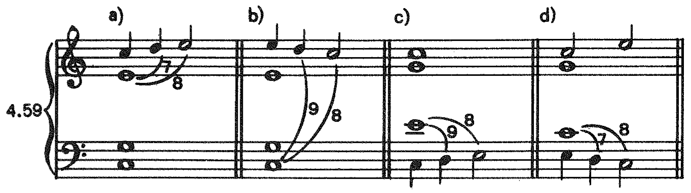

*Primjer 4.59. Izvor: tiskana str. 311.*

MuseScore: [nije izrađeno].

Budući da je svaki dur-kvintakord potencijalna dominantna harmonija, udvajanju njegove terce treba pristupati s posebnom pažnjom. Kada silaznim polustepenim pomakom dolazimo na tercu dur-kvintakorda, ona se doima kao privremena vođica (jer je od gornjega susjednog stupnja dijeli polustepeni razmak). Zbog toga će udvajanje terce dur-kvintakorda, na koju se dolazi silaznim cjelostepenim pomakom (pr. 4.60.a) biti potpuno korektno, nasuprot slučajevima gdje se udvajanje doseže silaznim polustepenim pomakom. Ono će najmanje smetati kada jedna terca leži u basu, a na drugu se dolazi prohodom u sopranu, jer se između njih nalaze još dva unutarnja glasa, a na oktavno podvostručenje dolazi se s none (pr. 4.60.b). Već je neugodniji dojam kada se silazni pomak s none na oktavu odvija između susjednih glasova (pr. 4.60.c), a najneugodniji će biti kada je silazni pomak ispod terce koja leži, jer se on više ne odvija — u odnosu prema njoj — s male none na oktavu, nego s velike septime na oktavu u donjem glasu (pr. 4.60.d). I, konačno, udvajanje prave vođice ne dolazi ni uz koje uvjete u obzir (pr. 4.60.e—g).

<!-- visual: 4.60; page 311 -->

<!-- integrated-slot: primjer-4-60; status: cleanup_required -->

**PROVISIONAL — cleanup_required / ručni pregled; nije odobreno.**

[Primjer 4.60. Izvor: tiskana str. 311 — neodobren izvorni izrez](../images/04-neakordicki-b/primjer-4-60.png)

*Primjer 4.60. Izvor: tiskana str. 311. Neodobren prikaz.*

Razlog: Rukopisni krugovi, strelice i analiza unutar notacije te strani tragovi uz gornji/desni rub. Rukopis zahtijeva ručni pregled; siguran pravokutni zamjenski izrez nije certificiran. Mogućnost novoga izreza nije ovime isključena.

MuseScore: [nije izrađeno; izrez nije odobren].

Udvajanje akordičkog tona, prema kojemu se prohodni ton kreće, nije dobro u intervalu sekunde, jer ono rezultira završetkom kretanja u unisonu. Unisono se u tom slučaju može izbjeći uklanjanjem glasa, u kojemu akordički ton leži, na neki drugi akordički ton (pr. 4.61).

<!-- source-page: 312; pdf-page: 157 -->

<!-- visual: 4.61; page 312 -->

<!-- integrated-slot: primjer-4-61; status: cleanup_required -->

**PROVISIONAL — cleanup_required / ručni pregled; nije odobreno.**

[Primjer 4.61. Izvor: tiskana str. 312 — neodobren izvorni izrez](../images/04-neakordicki-b/primjer-4-61.png)

*Primjer 4.61. Izvor: tiskana str. 312. Neodobren prikaz.*

Razlog: Blijedi rukopisni obris oko DA u varijanti c i potez koji dodiruje gornji rub. Rukopis zahtijeva ručni pregled; siguran pravokutni zamjenski izrez nije certificiran. Mogućnost novoga izreza nije ovime isključena.

MuseScore: [nije izrađeno; izrez nije odobren].

Pomak prohodnog tona iz unisona je dobar (pr. 4.62.a), ali i tu treba izbjegavati uzlazni polustepeni pomak iz udvojene terce dur-kvintakorda (pr. 4.62.b), dok će on iz udvojene kvinte mol-kvintakorda biti opet sasvim u redu (pr. 4.62.c).

<!-- visual: 4.62; page 312 -->

<!-- integrated-slot: primjer-4-62; status: cleanup_required -->

**PROVISIONAL — cleanup_required / ručni pregled; nije odobreno.**

[Primjer 4.62. Izvor: tiskana str. 312 — neodobren izvorni izrez](../images/04-neakordicki-b/primjer-4-62.png)

*Primjer 4.62. Izvor: tiskana str. 312. Neodobren prikaz.*

Razlog: Rukopisni kružni luk ispod početnoga gornjeg akorda varijante b. Rukopis zahtijeva ručni pregled; siguran pravokutni zamjenski izrez nije certificiran. Mogućnost novoga izreza nije ovime isključena.

MuseScore: [nije izrađeno; izrez nije odobren].

Udvajanje septime prohodnim tonom nije dobro (pr. 4.63.a), ali se ipak može tolerirati kada je kratkog trajanja (pr. 4.63.b).

<!-- visual: 4.63; page 312 -->

<!-- integrated-slot: primjer-4-63; status: cleanup_required -->

**PROVISIONAL — cleanup_required / ručni pregled; nije odobreno.**

[Primjer 4.63. Izvor: tiskana str. 312 — neodobren izvorni izrez](../images/04-neakordicki-b/primjer-4-63.png)

*Primjer 4.63. Izvor: tiskana str. 312. Neodobren prikaz.*

Razlog: Rukopisni krugovi oko NE/nota i zakrivljeni trag iznad b, sve do gornjega ruba. Rukopis zahtijeva ručni pregled; siguran pravokutni zamjenski izrez nije certificiran. Mogućnost novoga izreza nije ovime isključena.

MuseScore: [nije izrađeno; izrez nije odobren].

**Udvajanje akordičkih tonova u vezi s izmjeničnim tonovima.** Pri udvajanju akordičkog tona, s kojim se izmjenični ton izmjenjuje, primjenjuju se isti principi kao pri udvajanju akordičnih tonova u koje se rješavaju zaostajalice. Prema tome će doći u obzir samo udvajanje akordičkog tona ispod izmjeničnoga (pr. 4.64.a), ali i ovdje treba opet izbjegavati udvajanje terce dur-kvintakorda kada se s njom izmjenjuje gornji izmjenični ton koji nastupa polustepenim pomakom (pr. 4.64.b).

<!-- visual: 4.64; page 312 -->

<!-- integrated-slot: primjer-4-64; status: cleanup_required -->

**PROVISIONAL — cleanup_required / ručni pregled; nije odobreno.**

[Primjer 4.64. Izvor: tiskana str. 312 — neodobren izvorni izrez](../images/04-neakordicki-b/primjer-4-64.png)

*Primjer 4.64. Izvor: tiskana str. 312. Neodobren prikaz.*

Razlog: Rukopisne brojke uz gornje note b i krugovi oko basovih nota. Rukopis zahtijeva ručni pregled; siguran pravokutni zamjenski izrez nije certificiran. Mogućnost novoga izreza nije ovime isključena.

MuseScore: [nije izrađeno; izrez nije odobren].

<!-- boundary 312/313: Stranica 312 završava cjelovit odlomak i primjer 4.64; sljedeći odlomak počinje na stranici 313. -->

<!-- boundary 312/313: Nastavlja se objašnjenje udvajanja tona uz izmjenične tonove; prethodna rečenica završava na stranici 312. -->
<!-- source-page: 313; pdf-page: 157 -->

Iznimno se može akordički ton, s kojim se izmjenični izmjenjuje, udvojiti iznad izmjeničnog tona u dva slučaja: a) kada izmjenični ton nastupa u basu ako se kretanje od njega i nakon akordičkog tona nastavi prohodom u istom smjeru i u istim notnim vrijednostima (pr. 4.65. i 4.66) i b) kada donji izmjenični ton također nastupa u basu uz kadencirajući kvartsekstakord, makar se i ne nastavlja kretanje basove dionice (kao u prvom slučaju), jer se ono i tako na završetku fraze zaustavlja (pr. 4.67).

<!-- visual: 4.65; page 313 -->

<!-- integrated-slot: primjer-4-65; status: cleanup_required -->

**PROVISIONAL — cleanup_required / ručni pregled; nije odobreno.**

[Primjer 4.65. Izvor: tiskana str. 313 — neodobren izvorni izrez](../images/04-neakordicki-b/primjer-4-65.png)

*Primjer 4.65. Izvor: tiskana str. 313. Neodobren prikaz.*

Razlog: Rukopisna harmonijska analiza i krugovi u basu/ispod njega; donji rub reže rukopisno T. Rukopis zahtijeva ručni pregled; siguran pravokutni zamjenski izrez nije certificiran. Mogućnost novoga izreza nije ovime isključena.

MuseScore: [nije izrađeno; izrez nije odobren].

<!-- visual: 4.66; page 313 -->

<!-- integrated-slot: primjer-4-66; status: cleanup_required -->

**PROVISIONAL — cleanup_required / ručni pregled; nije odobreno.**

[Primjer 4.66. Izvor: tiskana str. 313 — neodobren izvorni izrez](../images/04-neakordicki-b/primjer-4-66.png)

*Primjer 4.66. Izvor: tiskana str. 313. Neodobren prikaz.*

Razlog: Rukopisna analiza i krugovi u basu/ispod njega te strani trag prethodnoga primjera uz gornji rub. Rukopis zahtijeva ručni pregled; siguran pravokutni zamjenski izrez nije certificiran. Mogućnost novoga izreza nije ovime isključena.

MuseScore: [nije izrađeno; izrez nije odobren].

<!-- visual: 4.67; page 313 -->

<!-- integrated-slot: primjer-4-67; status: cleanup_required -->

**PROVISIONAL — cleanup_required / ručni pregled; nije odobreno.**

[Primjer 4.67. Izvor: tiskana str. 313 — neodobren izvorni izrez](../images/04-neakordicki-b/primjer-4-67.png)

*Primjer 4.67. Izvor: tiskana str. 313. Neodobren prikaz.*

Razlog: BLOKIRANO: otisnuta fusnota i potpuna donja fermata/zvjezdica dijele vertikalni raspon; uklanjanje proze donjim rezom odrezalo bi notaciju. Prisutan je i rukopis. Ne odobravati zadržanu prozu niti odrezati fermatu ili zvjezdicu. Siguran pravokutni izrez samo iz izvornika nije utvrđen; potrebni su ručni pregled i nova neovisna provjera.

MuseScore: [nije izrađeno; izrez nije odobren].

\* Ton »d« je anticipacija.

U baroknoj muzici često nalazimo u polovičnoj i u autentičnoj kadenci izmjenični ton koji se nadovezuje na rješenje silazne zaostajalice na tercu dominantnog trozvuka (pr. 4.68); taj je postupak bio općenitom manirom kompozitora toga razdoblja (v. pr. 4.66).

<!-- visual: 4.68; page 313 -->

<!-- integrated-slot: primjer-4-68; status: cleanup_required -->

**PROVISIONAL — cleanup_required / ručni pregled; nije odobreno.**

[Primjer 4.68. Izvor: tiskana str. 313 — neodobren izvorni izrez](../images/04-neakordicki-b/primjer-4-68.png)

*Primjer 4.68. Izvor: tiskana str. 313. Neodobren prikaz.*

Razlog: Olovkom nacrtana petlja iznad drugoga takta i strani podcrtani fragment uz gornji lijevi rub; vrlo tijesan razmak. Rukopis zahtijeva ručni pregled; siguran pravokutni zamjenski izrez nije certificiran. Mogućnost novoga izreza nije ovime isključena.

MuseScore: [nije izrađeno; izrez nije odobren].

<!-- source-page: 314; pdf-page: 158 -->

**Oktave i kvinte.** Paralelne oktave i kvinte što nastaju kretanjem prohodnih i izmjeničnih tonova, naravno, nisu dobre (pr. 4.69.a i b), kao ni kvinte u protupomaku u vanjskim glasovima iako su skokovi ispunjeni prohodnim tonovima (pr. 4.69.c i d).

<!-- visual: 4.69; page 314 -->

<!-- integrated-slot: primjer-4-69; status: independent_pass -->

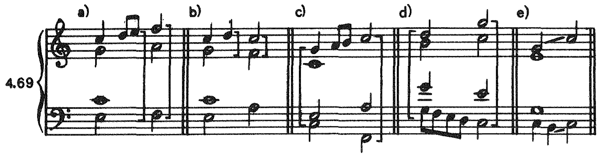

*Primjer 4.69. Izvor: tiskana str. 314.*

MuseScore: [nije izrađeno].

Kao što se kod Bacha sreće iznimno rješenje zaostajalice s pomakom iz sekunde u unisono (v. pr. 4.16), tako se u njegovim koralima pojavljuju i iznimni pomaci prohodnih tonova iz sekunde u unisono (pr. 4.70), kao i unisona podvostručenja akordičkog tona s kojim se izmjenični ton izmjenjuje (pr. 4.71).

<!-- visual: 4.70; page 314 -->

<!-- integrated-slot: primjer-4-70; status: independent_pass -->

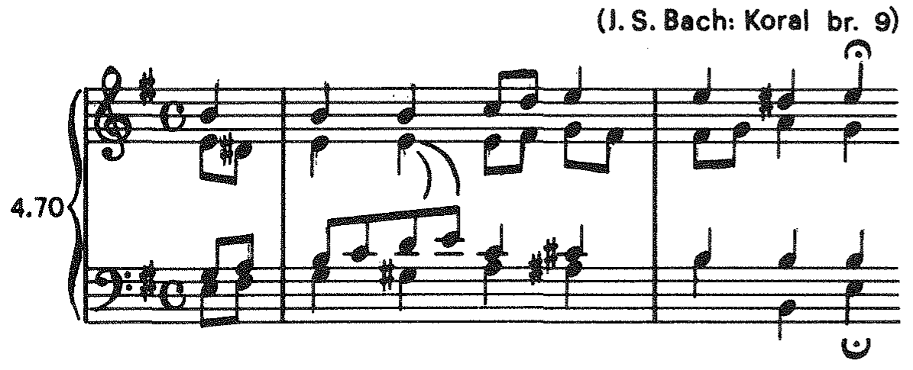

*Primjer 4.70. Izvor: tiskana str. 314.*

MuseScore: [nije izrađeno].

<!-- visual: 4.71; page 314 -->

<!-- integrated-slot: primjer-4-71; status: cleanup_required -->

**PROVISIONAL — cleanup_required / ručni pregled; nije odobreno.**

[Primjer 4.71. Izvor: tiskana str. 314 — neodobren izvorni izrez](../images/04-neakordicki-b/primjer-4-71.png)

*Primjer 4.71. Izvor: tiskana str. 314. Neodobren prikaz.*

Razlog: Opsežna rukopisna analiza ispod basa, odrezana donjim rubom; neki tragovi dijele vertikalni raspon s donjom fermatom. Rukopis zahtijeva ručni pregled; siguran pravokutni zamjenski izrez nije certificiran. Mogućnost novoga izreza nije ovime isključena.

MuseScore: [nije izrađeno; izrez nije odobren].

Prohodni i izmjenični tonovi u pravilu se posebno ne obilježavaju, nego se obilježava samo akord unutar kojega se oni pojavljuju, a brojci se dodaje horizontalna linija kroz cijelo trajanje akorda (v. pr. 4.53.c—f, pr. 4.54.d i e i dalje). Ako je ipak važno da se neki prohodni ili izmjenični ton posebno obilježi, onda se u zagrade stavlja brojka koja označuje interval što ga dotični prohodni ili izmjenični ton čini s basom (v. pr. 4.68).

<!-- source-page: 315; pdf-page: 158 -->

### 4.2.2. Prohodni i izmjenični tonovi u jednom glasu

Principi, izneseni u prethodnom odsjeku, dovoljni su da bi se njihovom primjenom, a bez ikakvih dodatnih uputa, moglo već pristupiti izradbi jednostavnih zadataka u kojima će se prohodni, odnosno izmjenični tonovi, pojavljivati uvijek samo u jednom glasu. Potrebno je jedino — u času kada nastupa neki prohodni ili izmjenični ton — izbjegavati istodobno kretanje u drugim glasovima, jer tada nužno dolazi do tzv. sudara s akordičkim tonovima, a to je vrlo osjetljiva materija koja će biti posebno obrađena tek u odsjeku 4.2.4.

#### ZADACI

Prohodni i izmjenični tonovi u basu:

<!-- visual: zadatak 1; page 315 -->

<!-- integrated-slot: zadatak-4-315-1; status: independent_pass -->

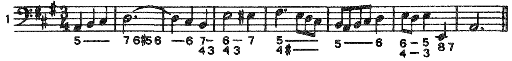

*Zadatak 1. Izvor: tiskana str. 315.*

MuseScore: [nije izrađeno].

<!-- visual: zadatak 2; page 315 -->

<!-- integrated-slot: zadatak-4-315-2; status: independent_pass -->

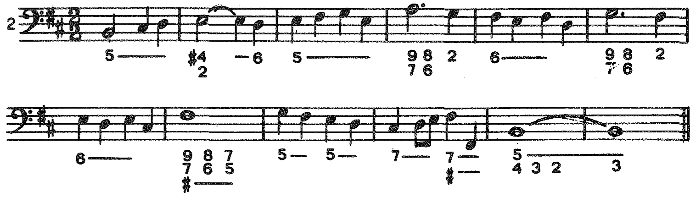

*Zadatak 2. Izvor: tiskana str. 315.*

MuseScore: [nije izrađeno].

Prohodni i izmjenični tonovi u sopranu:

<!-- visual: zadatak 3; page 315 -->

<!-- integrated-slot: zadatak-4-315-3; status: independent_pass -->

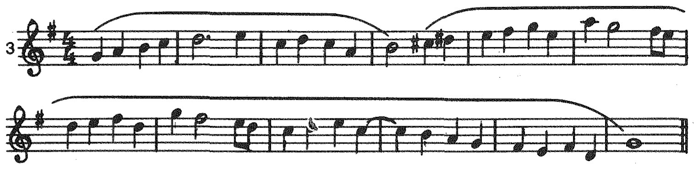

*Zadatak 3. Izvor: tiskana str. 315.*

MuseScore: [nije izrađeno].

<!-- visual: zadatak 4; page 315 -->

<!-- integrated-slot: zadatak-4-315-4; status: independent_pass -->

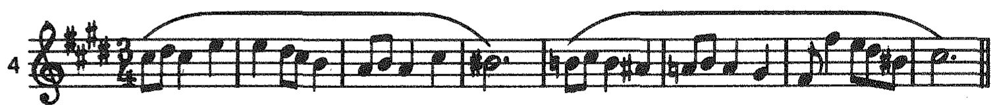

*Zadatak 4. Izvor: tiskana str. 315.*

MuseScore: [nije izrađeno].

<!-- visual: zadatak 5; page 315 -->

<!-- integrated-slot: zadatak-4-315-5; status: independent_pass -->

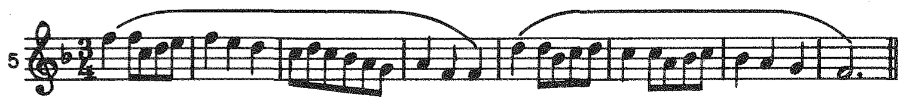

*Zadatak 5. Izvor: tiskana str. 315.*

MuseScore: [nije izrađeno].

<!-- source-page: 316; pdf-page: 159 -->

<!-- visual: zadatak 6; page 316 -->

<!-- integrated-slot: zadatak-4-316-6; status: independent_pass -->

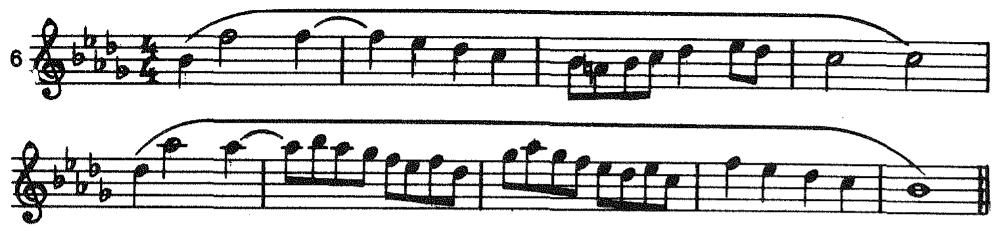

*Zadatak 6. Izvor: tiskana str. 316.*

MuseScore: [nije izrađeno].

Prohodni i izmjenični tonovi u raznim glasovima naizmjence:

<!-- visual: zadatak 7; page 316 -->

<!-- integrated-slot: zadatak-4-316-7; status: independent_pass -->

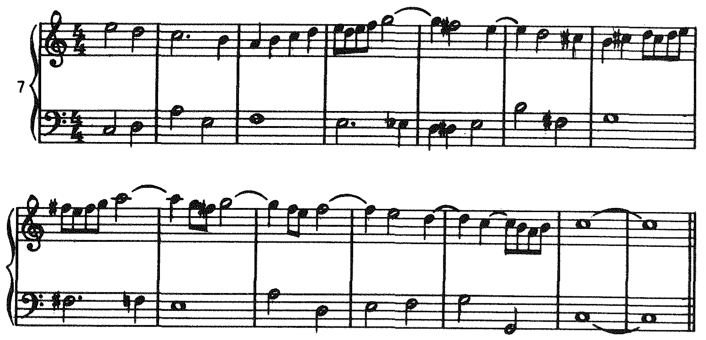

*Zadatak 7. Izvor: tiskana str. 316.*

MuseScore: [nije izrađeno].

<!-- visual: zadatak 8; page 316 -->

<!-- integrated-slot: zadatak-4-316-8; status: independent_pass -->

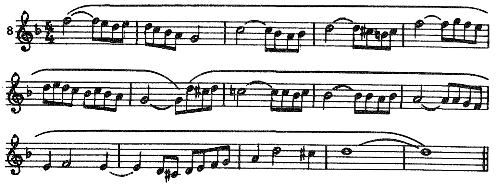

*Zadatak 8. Izvor: tiskana str. 316.*

MuseScore: [nije izrađeno].

<!-- boundary 316/317: Zadatak 8 završava na stranici 316; niz zadataka nastavlja se zadatkom 9 na stranici 317. -->

<!-- boundary 316/317: Nastavlja se niz zadataka iz odsjeka 4.2.2; zadatak 9 počinje na stranici 317. -->
<!-- source-page: 317; pdf-page: 159 -->

<!-- visual: zadatak 9; page 317 -->

<!-- integrated-slot: zadatak-4-317-9; status: independent_pass -->

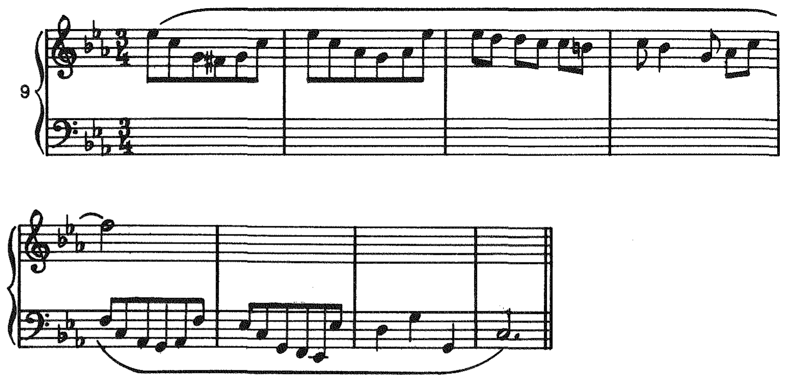

*Zadatak 9. Izvor: tiskana str. 317.*

MuseScore: [nije izrađeno].

Realizacija zadatka 3.

<!-- visual: Realizacija zadatka 3; page 317 -->

<!-- integrated-slot: zadatak-4-317-3-realizacija; status: independent_pass -->

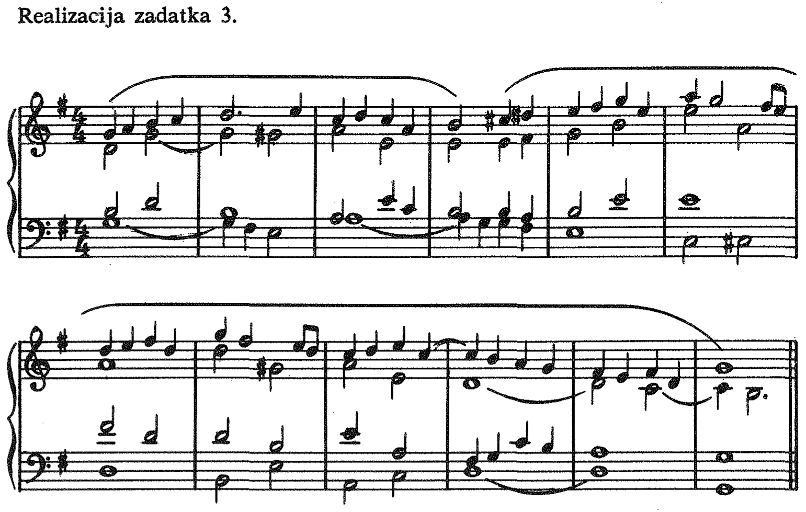

*Realizacija zadatka 3. Izvor: tiskana str. 317.*

MuseScore: [nije izrađeno].

### 4.2.3. Višestruki prohodni i izmjenični tonovi

Kada istodobno nastupaju dva ili tri prohodna tona istoga smjera, odnosno dva ili tri gornja ili donja izmjenična tona, onda dolazi do potpune sukladnosti s višestrukim uzlaznim ili silaznim zaostajalicama: dvostruki <!-- source-page: 318; pdf-page: 160 -->prohodni i dvostruki izmjenični tonovi nastupaju u paralelnim tercama ili sekstama (pr. 4.72. i 4.73), a trostruki prohodni i trostruki izmjenični tonovi u paralelnim sekstakordima ili kvartsekstakordima (pr. 4.74. i 4.75).

<!-- continuation 317/318: Spojena je izvorna rečenica; riječ prohodni bila je prelomljena između stranica kao proho-/dni. -->

<!-- visual: 4.72; page 318 -->

<!-- integrated-slot: primjer-4-72; status: independent_pass -->

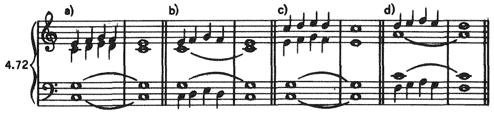

*Primjer 4.72. Izvor: tiskana str. 318.*

MuseScore: [nije izrađeno].

<!-- visual: 4.73; page 318 -->

<!-- integrated-slot: primjer-4-73; status: independent_pass -->

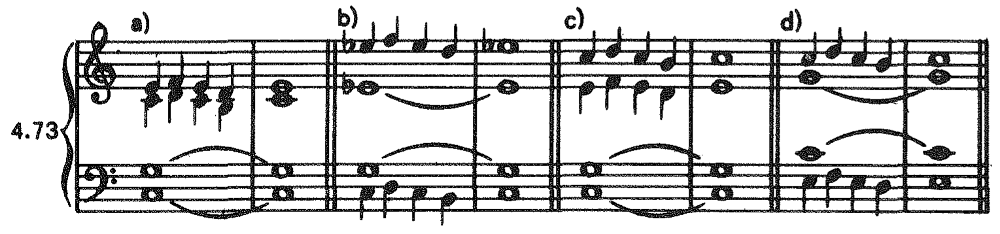

*Primjer 4.73. Izvor: tiskana str. 318.*

MuseScore: [nije izrađeno].

<!-- visual: 4.74; page 318 -->

<!-- integrated-slot: primjer-4-74; status: independent_pass -->

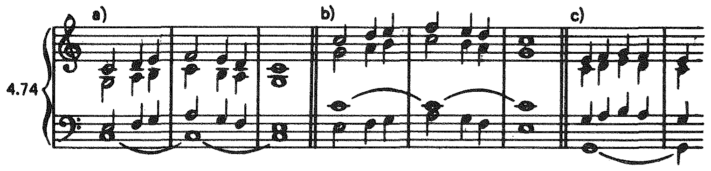

*Primjer 4.74. Izvor: tiskana str. 318.*

MuseScore: [nije izrađeno].

<!-- visual: 4.75; page 318 -->

<!-- integrated-slot: primjer-4-75; status: independent_pass -->

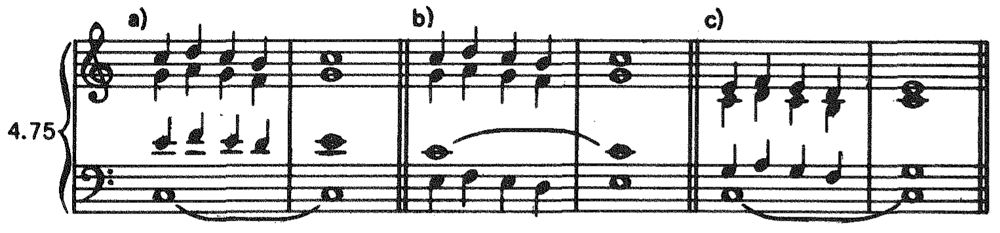

*Primjer 4.75. Izvor: tiskana str. 318.*

MuseScore: [nije izrađeno].

Istodobnim nastupom uzlaznih i silaznih prohodnih ili gornjih i donjih izmjeničnih tonova, kao i istodobnim nastupom prohodnih i izmjeničnih tonova, dolazi između njih do različitih konsonantnih i disonantnih intervalskih odnosa, a takav najjednostavniji slučaj već smo davno imali kod prohodnog kvartsekstakorda koji zapravo nastaje istodobnim nastupom dvaju prohodnih i jednoga izmjeničnog tona (pr. 4.67).

<!-- boundary 318/319: Stranica 318 završava cjelovitim odlomkom; sljedeća stranica nastavlja isti odsjek. -->

<!-- boundary 318/319: Stranica 318 završava cjelovitim odlomkom i upućivanjem na pr. 4.67; stranica 319 počinje primjerom 4.76 u istom odsjeku 4.2.3. Prethodne datoteke ostaju neizmijenjene. -->
<!-- source-page: 319; pdf-page: 160 -->

<!-- visual: 4.76; page 319 -->

<!-- integrated-slot: primjer-4-76; status: independent_pass -->

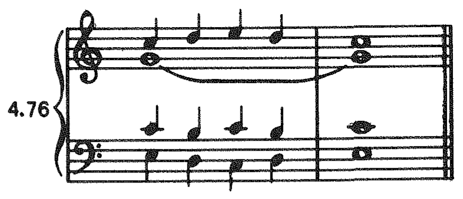

*Primjer 4.76. Izvor: tiskana str. 319.*

MuseScore: [nije izrađeno].

Nikakvi posebni postupci nisu potrebni ni kada se intervalski odnosi svode na oktavu ili na tercu s oktavom ili na sekstu s oktavom ili opet na oblik sekstakorda ili kvartsekstakorda (pr. 4.77 — 4.80).

<!-- visual: 4.77; page 319 -->

<!-- integrated-slot: primjer-4-77; status: independent_pass -->

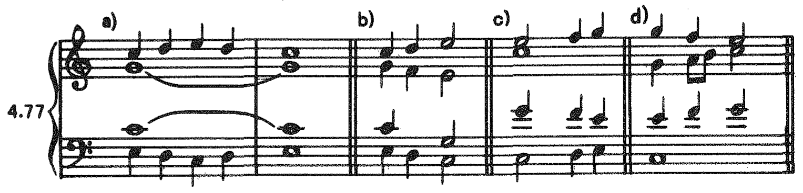

*Primjer 4.77. Izvor: tiskana str. 319.*

MuseScore: [nije izrađeno].

<!-- visual: 4.78; page 319 -->

<!-- integrated-slot: primjer-4-78; status: independent_pass -->

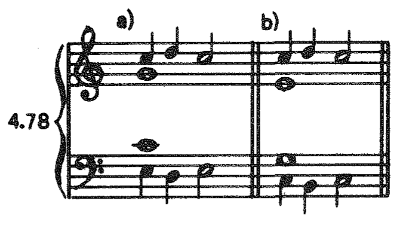

*Primjer 4.78. Izvor: tiskana str. 319.*

MuseScore: [nije izrađeno].

<!-- visual: 4.79; page 319 -->

<!-- integrated-slot: primjer-4-79; status: independent_pass -->

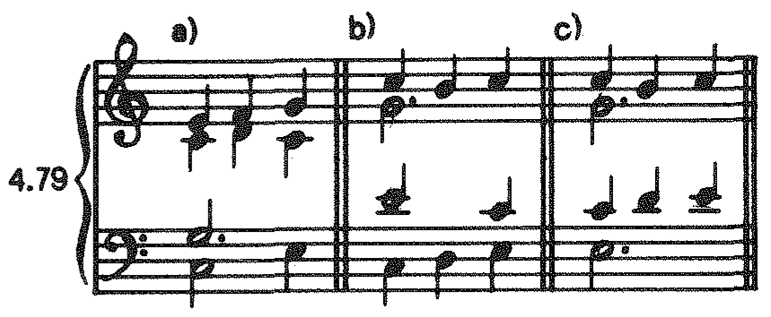

*Primjer 4.79. Izvor: tiskana str. 319.*

MuseScore: [nije izrađeno].

<!-- visual: 4.80; page 319 -->

<!-- integrated-slot: primjer-4-80; status: independent_pass -->

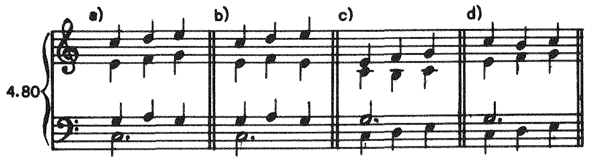

*Primjer 4.80. Izvor: tiskana str. 319.*

MuseScore: [nije izrađeno].

Isto tako nema problema kod istodobnog nastupa jednoga gornjeg i jednoga donjeg izmjeničnog tona u intervalu smanjene kvinte ili povećane kvarte (pr. 4.81.a i b), kao ni kod nastupa triju izmjeničnih tonova kada oni između sebe formiraju neki obrat smanjenog septakorda (pr. 4.81.c—f). Čak ni mala septima, dakle očita disonanca, nije problematična ako joj se pridružuje smanjena kvinta koja je ublažuje; to je slučaj što također nastaje istodobnim nastupom samih izmjeničnih tonova (pr. 4.81.g). A snalaženje u još <!-- source-page: 320; pdf-page: 161 -->složenijim disonantnim intervalskim konstelacijama pretpostavlja svladavanje primjene sudara prohodnih i izmjeničnih tonova s akordičkima, pa ćemo stoga i razmatranje takvih situacija ostaviti za kasnije.

<!-- visual: 4.81; page 320 -->

<!-- integrated-slot: primjer-4-81; status: independent_pass -->

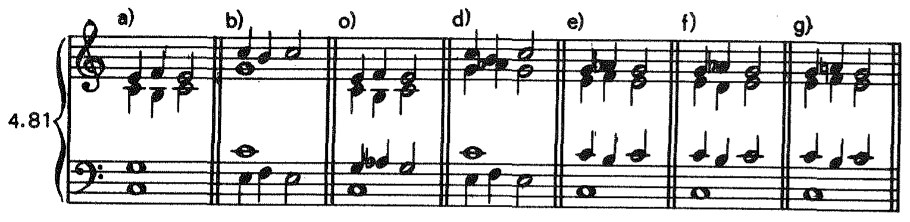

*Primjer 4.81. Izvor: tiskana str. 320.*

MuseScore: [nije izrađeno].

Varijante dvostrukih i trostrukih prohodnih i izmjeničnih tonova, kao i njihovih međusobnih kombinacija, nastaju kada dotični prohodni ili izmjenični tonovi nastupaju jedan za drugim ili dva zajedno, a jedan za njima, i obratno (pr. 4.82). U tim varijantama manjka istodobnost nastupa neakordičkih tonova, ali ostaje istodobnost nastupa akordičkih tonova koji im slijede. I još nešto: ritmičke modifikacije ne smiju rezultirati dužim trajanjem nekoga prohodnog ili izmjeničnog tona od trajanja prethodnoga akordičkog tona u istom glasu.

<!-- visual: 4.82; page 320 -->

<!-- integrated-slot: primjer-4-82; status: independent_pass -->

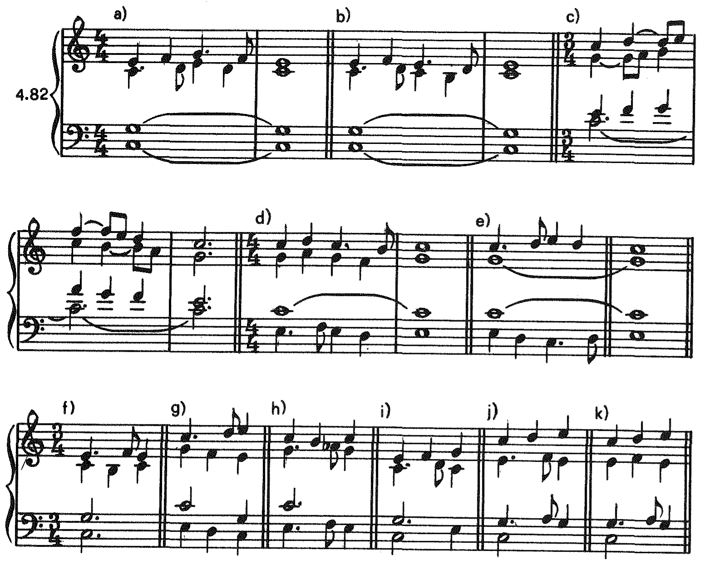

*Primjer 4.82. Izvor: tiskana str. 320.*

MuseScore: [nije izrađeno].

<!-- source-page: 321; pdf-page: 161 -->

#### ZADACI

<!-- visual: zadatak 1; page 321 -->

<!-- integrated-slot: zadatak-4-321-1; status: independent_pass -->

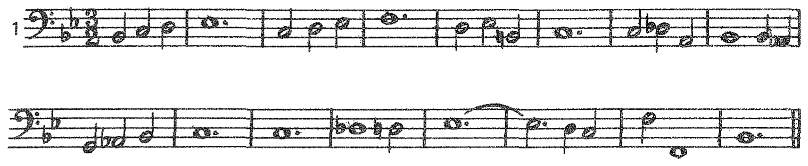

*Zadatak 1. Izvor: tiskana str. 321.*

MuseScore: [nije izrađeno].

<!-- visual: zadatak 2; page 321 -->

<!-- integrated-slot: zadatak-4-321-2; status: independent_pass -->

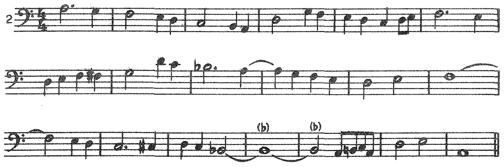

*Zadatak 2. Izvor: tiskana str. 321.*

MuseScore: [nije izrađeno].

<!-- visual: zadatak 3; page 321 -->

<!-- integrated-slot: zadatak-4-321-3; status: independent_pass -->

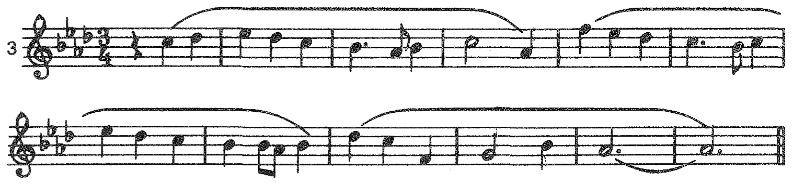

*Zadatak 3. Izvor: tiskana str. 321.*

MuseScore: [nije izrađeno].

<!-- visual: zadatak 4; page 321 -->

<!-- integrated-slot: zadatak-4-321-4; status: independent_pass -->

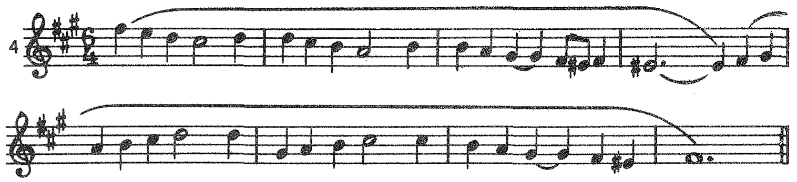

*Zadatak 4. Izvor: tiskana str. 321.*

MuseScore: [nije izrađeno].

<!-- visual: zadatak 5; page 321 -->

<!-- integrated-slot: zadatak-4-321-5; status: independent_pass -->

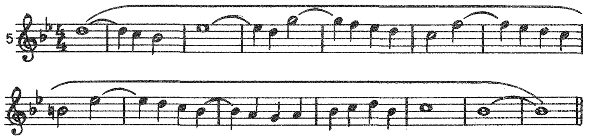

*Zadatak 5. Izvor: tiskana str. 321.*

MuseScore: [nije izrađeno].

<!-- source-page: 322; pdf-page: 162 -->

Realizacija zadatka 4.

<!-- visual: Realizacija zadatka 4; page 322 -->

<!-- integrated-slot: zadatak-4-322-4-realizacija; status: independent_pass -->

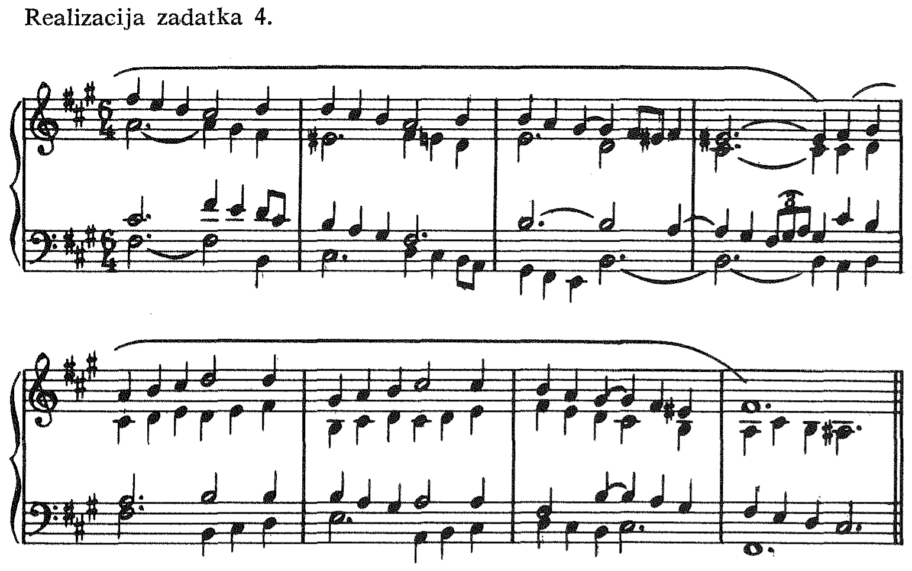

*Realizacija zadatka 4. Izvor: tiskana str. 322.*

MuseScore: [nije izrađeno].

### 4.2.4. Sudari prohodnih i izmjeničnih tonova s akordičkim tonovima

Sudar prohodnoga ili izmjeničnog tona s akordičkim tonom nastaje kada s nastupom prohodnoga, odnosno izmjeničnog tona, u jednom glasu, istodobno u nekom drugom glasu dođe do pomaka s jednog akordičkog tona na neki drugi akordički ton. Sudari su konsonatnoga ili disonantnog karaktera, u zavisnosti od intervala u kome do njih dolazi.

**Sudar prohodnog tona s akordičkim** može biti dvojak: a) sudar s akordičkim tonom koji predstavlja udvajanje onoga akordičkog tona prema kojemu se prohodni ton kreće i b) sudar s nekim drugim akordičkim tonom.

Sudar s nekim drugim akordičkim tonom u principu je uvijek dobar, nastaje li u protupomaku (pr. 4.83), ili u paralelnom pomaku (pr. 4.84).

<!-- visual: 4.83; page 322 -->

<!-- integrated-slot: primjer-4-83; status: independent_pass -->

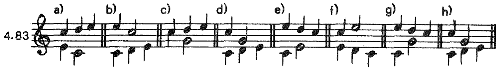

*Primjer 4.83. Izvor: tiskana str. 322.*

MuseScore: [nije izrađeno].

<!-- visual: 4.84; page 322 -->

<!-- integrated-slot: primjer-4-84; status: independent_pass -->

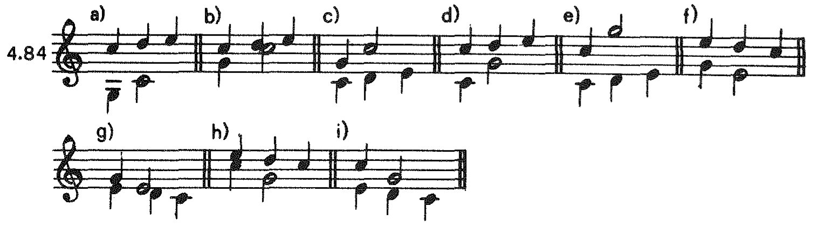

*Primjer 4.84. Izvor: tiskana str. 322.*

MuseScore: [nije izrađeno].

<!-- source-page: 323; pdf-page: 162 -->

Naprotiv, sudar prohodnoga tona s akordičkim, koji je cilj njegovoga kretanja, dobar je samo kada se zbiva u protupomaku, u intervalu none ili septime (pr. 4.85), a još je bolji kada se protupomak i dalje nakon sudara nastavlja (pr. 4.86).

<!-- continuation 322/323: Izvorno Na-/protiv spojeno je u Naprotiv uz ostatak rečenice na stranici 323; prvi slog otisnut je na kraju proze stranice 322, prije primjera 4.83 i 4.84. -->

<!-- visual: 4.85; page 323 -->

<!-- integrated-slot: primjer-4-85; status: independent_pass -->

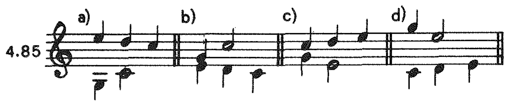

*Primjer 4.85. Izvor: tiskana str. 323.*

MuseScore: [nije izrađeno].

<!-- visual: 4.86; page 323 -->

<!-- integrated-slot: primjer-4-86; status: independent_pass -->

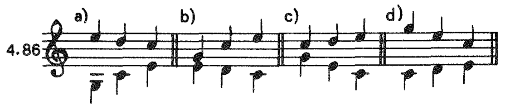

*Primjer 4.86. Izvor: tiskana str. 323.*

MuseScore: [nije izrađeno].

U času sudara drugi glasovi mogu mirovati (pr. 4.87.a), ali i oni se mogu također kretati; tako može doći do sudara s dva akordička tona (pr. 4.87.b), pa i s tri (pr. 4.87.c); nadalje, sudar mogu tvoriti dva prohodna i jedan akordički ton (pr. 4.87.d) ili dva prohodna i dva akordička tona (pr. 4.87.e), kao i tri prohodna tona i jedan akordički (pr. 4.87.f).

<!-- visual: 4.87; page 323 -->

<!-- integrated-slot: primjer-4-87; status: independent_pass -->

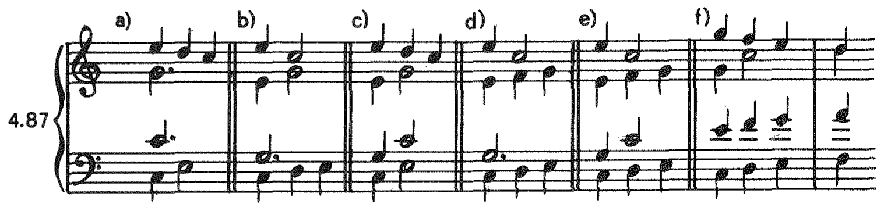

*Primjer 4.87. Izvor: tiskana str. 323.*

MuseScore: [nije izrađeno].

**Sudar izmjeničnog tona s akordičkim tonom.** Budući da prohodni tonovi povezuju uvijek različite tonove, a izmjenični ton se uvijek izmjenjuje s jednim te istim tonom, bit će i kod sudara izmjeničnih tonova s akordičkima manjih mogućnosti nego što je to bilo kod sudara prohodnih s akordičkim tonovima.

Sudar izmjeničnog tona s nekim drugim akordičkim tonom bit će također uvijek dobar (pr. 4.88).

<!-- visual: 4.88; page 323 -->

<!-- integrated-slot: primjer-4-88; status: independent_pass -->

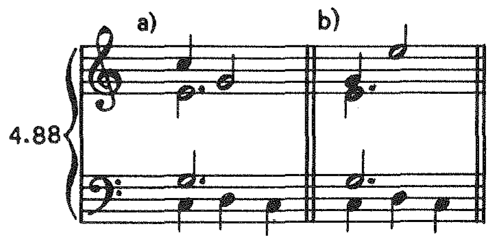

*Primjer 4.88. Izvor: tiskana str. 323.*

MuseScore: [nije izrađeno].

<!-- source-page: 324; pdf-page: 163 -->

Ako akordički ton, što sudjeluje u sudaru, predstavlja udvajanje onoga s kojim se izmjenični izmjenjuje, kriteriji će biti nešto drukčiji: ni stroži, niti blaži, nego možda, u izvjesnom smislu, osjetljiviji. Pogledajmo redom sve mogućnosti koje se čisto matematički dadu izvesti: 1. izmjenični gornji ton nastupa u gornjem glasu sa sudarom u protupomaku ili u paralelnom pomaku (pr. 4.89.a i b); 2. izmjenični donji ton nastupa u gornjem glasu, također s dvije mogućnosti sudara (pr. 4.89.c i d); 3. izmjenični gornji ton nastupa u donjem glasu — dvije mogućnosti sudara (pr. 4.89.e i f); 4. izmjenični donji ton u donjem glasu — dvije mogućnosti sudara (pr. 4.89.g i h).

<!-- visual: 4.89; page 324 -->

<!-- integrated-slot: primjer-4-89; status: independent_pass -->

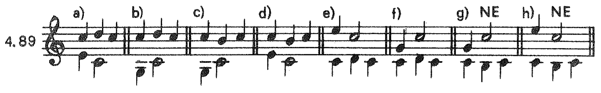

*Primjer 4.89. Izvor: tiskana str. 324.*

MuseScore: [nije izrađeno].

Najprije ćemo odbaciti kao neupotrebljive slučajeve pod 4, jer ovdje izmjenični ton — u odnosu prema akordičkom s kojim se sudara — nastupa kao silazna prohodna septima i nužno zahtijeva daljnje silazno kretanje.

Svi slučajevi pod 1. i 2. teoretski su dobri, ali će se doimati prazno ako ostali glasovi miruju (pr. 4.90). Zbog toga ih treba primjenjivati uz istodobno kretanje u drugim glasovima, bilo nakon sudara (pr. 4.91.a—c), ili istodobno sa sudarom (pr. 4.91.d).

<!-- visual: 4.90; page 324 -->

<!-- integrated-slot: primjer-4-90; status: independent_pass -->

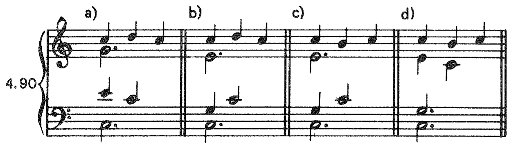

*Primjer 4.90. Izvor: tiskana str. 324.*

MuseScore: [nije izrađeno].

<!-- visual: 4.91; page 324 -->

<!-- integrated-slot: primjer-4-91; status: independent_pass -->

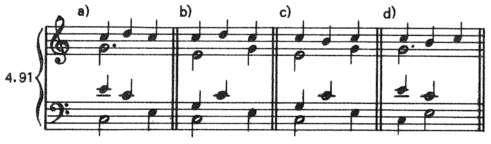

*Primjer 4.91. Izvor: tiskana str. 324.*

MuseScore: [nije izrađeno].

Slučajevi pod 3. također su dobri ako se u glasu, gdje nastupa akordički ton, kretanje nastavlja (pr. 4.92.a—c) ali će ipak biti problematični kada se izmjenični ton sudara s akordičkim u intervalu velike septime (pr. 4.92.d i e).

<!-- source-page: 325; pdf-page: 163 -->

<!-- visual: 4.92; page 325 -->

<!-- integrated-slot: primjer-4-92; status: independent_pass -->

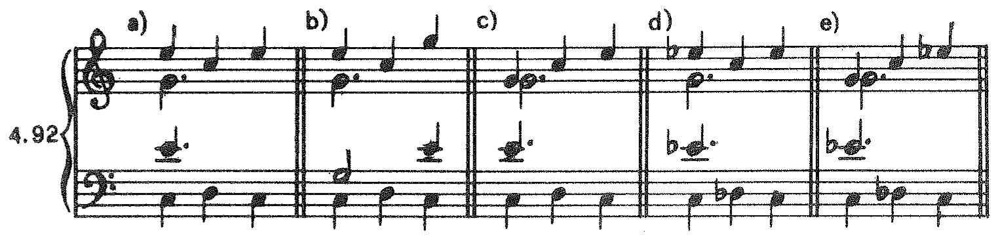

*Primjer 4.92. Izvor: tiskana str. 325.*

MuseScore: [nije izrađeno].

Nikakvu posebnu kategoriju ne predstavlja istodobni sudar jednoga izmjeničnog tona i dvaju prohodnih tonova s jednim akordičkim, kao u primjeru 4.93. U njemu, kao i u svim eventualnim sličnim slučajevima, treba samo poštovati iste osnovne principe koji jednako reguliraju sudare, bez obzira na to da li se oni događaju između dva ili više glasova istodobno.

<!-- visual: 4.93; page 325 -->

<!-- integrated-slot: primjer-4-93; status: independent_pass -->

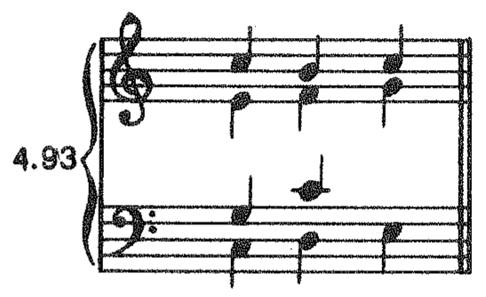

*Primjer 4.93. Izvor: tiskana str. 325.*

MuseScore: [nije izrađeno].

Vrlo instruktivan primjer kompleksne primjene prohodnih i izmjeničnih tonova u sudaru s akordičkima dao je francuski kompozitor i teoretičar Ch. Koechlin u III dijelu svoga udžbenika harmonije (pr. 4.94). Na zadnjoj osminki 1. takta pojavljuje se na izgled septakord IV stupnja; paralelni pomak u septimu je ipak potpuno korektan, jer se tu uopće ne radi o septakordu, nego o slučajnoj harmoniji: »as« u altu je izmjenični ton akordičkog tona »g«, a »f« u basu je prohodni ton koji nastupa zajedno s izmjeničnim tonom »as« i ujedno se sudara s akordičkim tonom »es« u tenoru.

<!-- visual: 4.94; page 325 -->

<!-- integrated-slot: primjer-4-94; status: independent_pass -->

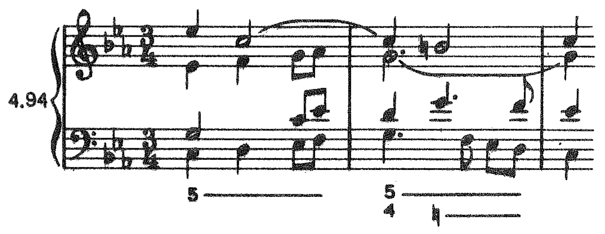

*Primjer 4.94. Izvor: tiskana str. 325.*

MuseScore: [nije izrađeno].

Istodobno kretanje prohodnih tonova u protupomaku može dovesti do disonantnih kolizija koje također možemo smatrati sudarima, kao u primjeru 4.95, gdje se prohodni tonovi u vanjskim glasovima međusobno sudaraju u intervalima septime i none uzastopce. Ta disonantna situacija potpuno je u redu, jer je opravdava dobro vođenje glasova, tj. konsekventni protupomak.

<!-- source-page: 326; pdf-page: 164 -->

U primjeru 4.96.a identični sudari zbivaju se zbog kretanja izmjeničnih tonova, ali oni ne zvuče dobro: njima manjkaju melodijske linije koje bi ih na neki način »pokrile«. Ali i ta se situacija može poboljšati ritmičkim modifikacijama i uvođenjem još jednoga izmjeničnog tona koji s jednim od prva dva nastupa u konsonantnom intervalu (decime) (pr. 4.96.b).

<!-- visual: 4.95; page 326 -->

<!-- integrated-slot: primjer-4-95; status: independent_pass -->

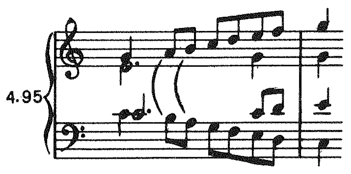

*Primjer 4.95. Izvor: tiskana str. 326.*

MuseScore: [nije izrađeno].

<!-- visual: 4.96; page 326 -->

<!-- integrated-slot: primjer-4-96; status: independent_pass -->

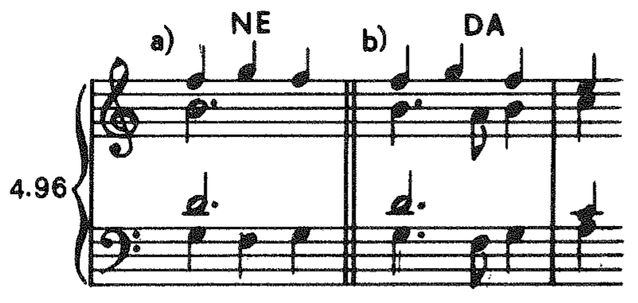

*Primjer 4.96. Izvor: tiskana str. 326.*

MuseScore: [nije izrađeno].

Prohodni i izmjenični tonovi vrlo dobro se kombiniraju sa zaostajalicama. Mogu nastupati za vrijeme trajanja zaostajalica ili istodobno s rješenjem zaostajalica, a sudari koji pri tome mogu nastati bit će ponavljanje već poznatih slučajeva ako je kretanje prohodnih ili izmjeničnih tonova suprotno kretanju zaostajalica (pr. 4.97. i 4.98).

<!-- visual: 4.97; page 326 -->

<!-- integrated-slot: primjer-4-97; status: independent_pass -->

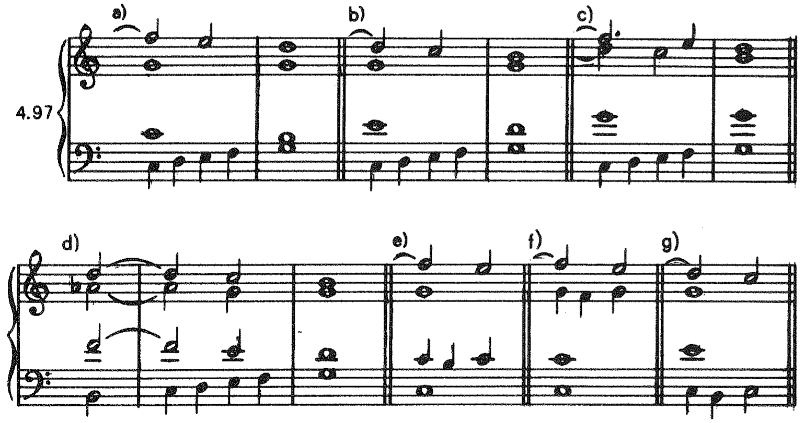

*Primjer 4.97. Izvor: tiskana str. 326.*

MuseScore: [nije izrađeno].

<!-- visual: 4.98 a–c; page 326 -->

<!-- integrated-slot: primjer-4-98-a; status: independent_pass -->

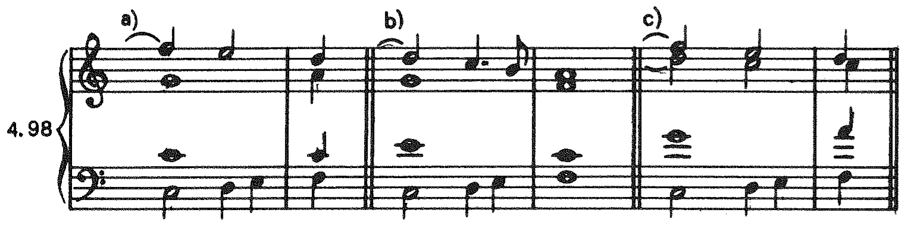

*Primjer 4.98, a–c (početak). Izvor: tiskana str. 326.*

MuseScore: [nije izrađeno].

<!-- source-page: 327; pdf-page: 164 -->

<!-- visual: 4.98 d–e; page 327 -->

<!-- integrated-slot: primjer-4-98-b; status: independent_pass -->

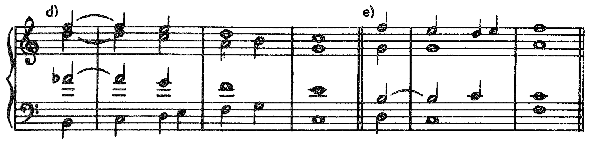

*Primjer 4.98, d–e (nastavak). Izvor: tiskana str. 327.*

MuseScore: [nije izrađeno].

Složenije situacije, koje mogu rezultirati i pomacima u paralelnim disonantnim intervalima, mogu se pojaviti kada se prohodni tonovi kreću sa zaostajalicama u istome smjeru. Paralelne none u primjeru 4.99.a, koje su rezultat istodobnog nastupa prohodnog tona u basu i rješenja zaostajalice u sopranu, npr. ne zvuče dobro. Ali u primjeru 4.99.b te iste none bit će sasvim u redu zbog toga što sada imamo u altu: 1. pomak u dvostruko kraćim notnim vrijednostima, 2. protupomak spram paralelnih nona i 3. ton koji s jednim od tonova none tvori konsonatni interval, tj. ton »h« koji s tonom »g« u sopranu čini konsonantni interval sekste.

<!-- visual: 4.99; page 327 -->

<!-- integrated-slot: primjer-4-99; status: independent_pass -->

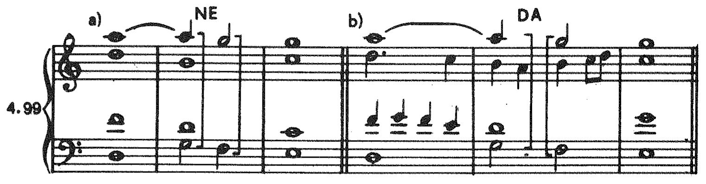

*Primjer 4.99. Izvor: tiskana str. 327.*

MuseScore: [nije izrađeno].

Mnogo jednostavniji je slučaj također potpuno korektnih paralelnih nona u primjeru 4.100.a. One su nastale sudarom prohodnog tona »e« u basu s akordičkim tonom »f« u sopranu, koji je uslijedio nakon izmjeničnog tona »g«. Glasovi između kojih je došlo do pomaka u paralelnim nonama kreću se u različitim notnim vrijednostima, a izmjenični ton »g« samo je nenametljivo ukrašavanje akordičkog tona »f«, gotovo tako kao da »f« stalno leži (pr. 4.100.b).

<!-- visual: 4.100; page 327 -->

<!-- integrated-slot: primjer-4-100; status: independent_pass -->

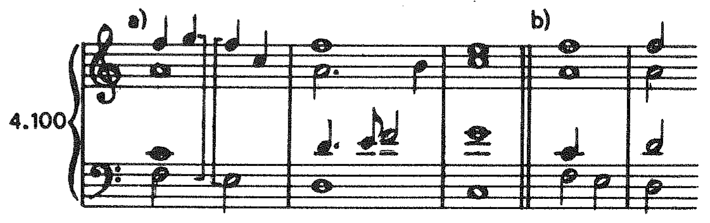

*Primjer 4.100. Izvor: tiskana str. 327.*

MuseScore: [nije izrađeno].

Slobodnije kretanje i relativna melodijska samostalnost, što je unutarnjim glasovima mogu dati prohodni tonovi, ne može se uvijek uspješno os<!-- source-page: 328; pdf-page: 165 -->tvariti u prostoru kojim raspolaže tenor i — naročito — alt. Razvijenijem gibanju jednoga od njih smetat će drugi: tenoru će smetati alt, a altu tenor, a katkada i sopran, kao i tenoru bas. Zbog toga će funkcionalna i muzikalna primjena ne samo prohodnih tonova nego neakordičkih tonova uopće zahtijevati nešto od čega smo se do sada sustezali, a to je **križanje glasova**.

Križanje glasova bit će potrebno najviše između unutarnjih glasova, ali može se opravdano pojaviti i između tenora i basa, kao i između alta i soprana. Odlične primjere za križanje glasova u fakturi, koja još uvijek nije primarno polifone nego akordičke prirode, naći ćemo opet u Bachovim koralima (pr. 4.101. i 4.102). Potpuni antipod križanju glasova je slučaj u primjeru 4.103, gdje se unutarnji glasovi u jednom momentu udaljuju jedan od drugoga čak na interval undecime, upravo kao da bi dobili mjesta za zalet u protupomaku, koji će »na kraju puta« završiti intervalom terce — izvanredna ekspresija unutarnjih glasova!

<!-- visual: 4.101; page 328 -->

<!-- integrated-slot: primjer-4-101; status: independent_pass -->

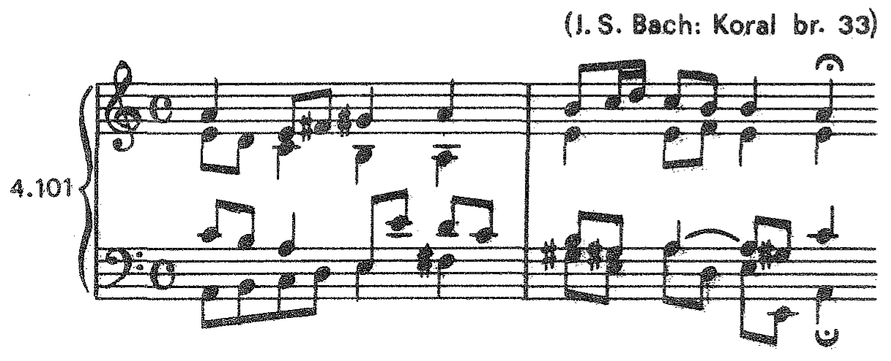

*Primjer 4.101. Izvor: tiskana str. 328.*

MuseScore: [nije izrađeno].
<!-- visual-note: 4.101 — (J. S. Bach: Koral br. 33) -->

<!-- visual: 4.102; page 328 -->

<!-- integrated-slot: primjer-4-102; status: independent_pass -->

*Primjer 4.102. Izvor: tiskana str. 328.*

MuseScore: [nije izrađeno].
<!-- visual-note: 4.102 — (J. S. Bach: Koral br. 52) -->

<!-- visual: 4.103; page 328 -->

<!-- integrated-slot: primjer-4-103; status: independent_pass -->

*Primjer 4.103. Izvor: tiskana str. 328.*

MuseScore: [nije izrađeno].
<!-- visual-note: 4.103 — (J. S. Bach: Koral br. 26) -->

<!-- M09 append-only integration: printed pages 329–348; PDF pages 165–175. -->

> Dodatak integraciji: tiskane str. 329–348, PDF str. 165–175. Ova napomena dopunjuje povijesni status na početku datoteke, koji je ostavljen neizmijenjen. Dodano je 66 mjesta: 59 independent_pass i 7 PROVISIONAL / cleanup_required, bez odobrenja blokiranih izreza. Ukupno za str. 309–348: 134 mjesta, 111 independent_pass i 23 cleanup_required. M09 nije dovršen.

<!-- source-page: 329; pdf-page: 165 -->

#### ZADACI

<!-- visual: zadatak 1; page 329 -->

<!-- integrated-slot: zadatak-4-329-1; status: independent_pass -->

*Zadatak 1. Izvor: tiskana str. 329.*

MuseScore: [nije izrađeno].

<!-- visual: zadatak 2; page 329 -->

<!-- integrated-slot: zadatak-4-329-2; status: independent_pass -->

*Zadatak 2. Izvor: tiskana str. 329.*

MuseScore: [nije izrađeno].

<!-- visual: zadatak 3; page 329 -->

<!-- integrated-slot: zadatak-4-329-3; status: independent_pass -->

*Zadatak 3. Izvor: tiskana str. 329.*

MuseScore: [nije izrađeno].

<!-- visual: zadatak 4; page 329 -->

<!-- integrated-slot: zadatak-4-329-4; status: independent_pass -->

*Zadatak 4. Izvor: tiskana str. 329.*

MuseScore: [nije izrađeno].

<!-- visual: zadatak 5 početak; page 329 -->

<!-- integrated-slot: zadatak-4-329-5-a; status: independent_pass -->

*Zadatak 5 — početak. Izvor: tiskana str. 329.*

MuseScore: [nije izrađeno].

<!-- source-page: 330; pdf-page: 166 -->

<!-- visual: zadatak 5 nastavak; page 330 -->

<!-- integrated-slot: zadatak-4-330-5-b; status: independent_pass -->

*Zadatak 5 — nastavak. Izvor: tiskana str. 330.*

MuseScore: [nije izrađeno].

Realizacija zadatka 3.

<!-- visual: Realizacija zadatka 3; page 330 -->

<!-- integrated-slot: zadatak-4-330-3-realizacija; status: independent_pass -->

*Realizacija zadatka 3. Izvor: tiskana str. 330.*

MuseScore: [nije izrađeno].

### 4.2.5. Prohodni i izmjenični tonovi uz promjenu akorda

Promjene akorda u času nastupa prohodnih i izmjeničnih tonova zbivale su se već i kod sudara s akordičkim tonovima (v. pr. 4.87.a i c i pr. 3.91.d), no to su bile samo promjene obratâ. Ali i potpuno nova harmonija može nastupiti istodobno s nekim prohodnim ili izmjeničnim tonom. Prohodni i izmjenični tonovi tada redovito nastupaju na naglašenoj dobi, pa ih zbog toga neki teoretičari smatraju appoggiaturama, premda između njih i appoggiatura postoji kvalitativna razlika. U primjeru 4.104.a—c ton »c«, koji nastupa istodobno s novom harmonijom, bit će prohodni ton, ali u primjeru 4.104.d on je appoggiatura, jer mu je u odnosu prema prethodnom akordičkom tonu produženo trajanje, zbog čega dobiva težinu, a gubi prohodnom tonu svojstvenu lakoću i pokretljivost. I kod izmjeničnih tonova, koji nastupaju istodobno s promjenom harmonije, također može doći do sličnih, vrlo suptilnih razlika. Zvjezdicama označeni neakordički tonovi u primjeru 4.105.a i b tipični su izmjenični tonovi, a u primjeru 4.105.c oni su appoggiature, dok se u primjeru 4.105.d mogu jednako tumačiti i kao appoggiature i kao izmjenični tonovi.

<!-- source-page: 331; pdf-page: 166 -->

<!-- visual: 4.104; page 331 -->

<!-- integrated-slot: primjer-4-104; status: independent_pass -->

*Primjer 4.104. Izvor: tiskana str. 331.*

MuseScore: [nije izrađeno].

<!-- visual: 4.105; page 331 -->

<!-- integrated-slot: primjer-4-105; status: independent_pass -->

*Primjer 4.105. Izvor: tiskana str. 331.*

MuseScore: [nije izrađeno].

Fenomen sudara javlja se i u istodobnom nastupu prohodnoga ili izmjeničnog tona s novom harmonijom, samo što će to sada biti sudari s akordičkim tonovima nove harmonije, a izvodit će se opet po istim principima kao i sudari unutar iste harmonije.

Vrlo složene situacije mogu nastati kada nakon nekoga izmjeničnog tona nastupa ponovo ton koji je prije bio akordički, a u novom kontekstu postaje prohodnim. Za ilustraciju ćemo se ponovo poslužiti citatima iz Bachovih korala. U primjeru 4.106. najprije se pojavljuje u basu iznimni pomak izmjeničnog tona »d« iz sekunde u unisono; »c«, koji zatim slijedi, nije više akordički ton, jer je istodobno s njime nastupila nova harmonija: u odnosu prema njoj »c« postaje prohodni ton koji se sudara s akordičkim tonom »h« u sopranu, u intervalu septime i u protupomaku. Citat u primjeru 4.107. donosi više karakterističnih postupaka s izmjeničnim i prohodnim tonovima za redom: prvi takt počinje s dvostrukim prohodom u basu i altu, nakon čega slijedi još jedan izmjenični ton u basu. U drugom taktu pojavljuje se u basu izmjenični ton »fis«, dok u altu traje zaostajalica »a«; na treću dobu istoga takta ton »g« u basu, koji nastupa nakon izmjeničnog tona »a«, postaje — zbog istodobne promjene harmonije — prohodnim tonom na basov ton sekstakorda f-a-d. Na početku trećeg takta prividno nastupa nepotpuni septakord es-g-d, a zapravo je to sekstakord es-g-c sa zaostajalicom »d« u tenoru; za vrijeme trajanja zaostajalice nastupa u basu izmjenični ton »d«, a nakon njega nova harmonija, tj. sekundakord es-f-a-c, i sada se ponovo odvija slična situacija kao u prethodnom taktu na istim dobama.

<!-- visual: 4.106; page 331 -->

<!-- integrated-slot: primjer-4-106; status: independent_pass -->

*Primjer 4.106. Izvor: tiskana str. 331.*

MuseScore: [nije izrađeno].
<!-- visual-note: 4.106 — (J. S. Bach: Koral br. 13) -->

<!-- source-page: 332; pdf-page: 167 -->

<!-- visual: 4.107; page 332 -->

<!-- integrated-slot: primjer-4-107; status: independent_pass -->

*Primjer 4.107. Izvor: tiskana str. 332.*

MuseScore: [nije izrađeno].
<!-- visual-note: 4.107 — (J. S. Bach: Koral br. 203) -->

#### ZADACI

<!-- visual: zadatak 1; page 332 -->

<!-- integrated-slot: zadatak-4-332-1; status: independent_pass -->

*Zadatak 1. Izvor: tiskana str. 332.*

MuseScore: [nije izrađeno].

<!-- visual: zadatak 2; page 332 -->

<!-- integrated-slot: zadatak-4-332-2; status: independent_pass -->

*Zadatak 2. Izvor: tiskana str. 332.*

MuseScore: [nije izrađeno].

<!-- source-page: 333; pdf-page: 167 -->

<!-- visual: zadatak 3; page 333 -->

<!-- integrated-slot: zadatak-4-333-3; status: independent_pass -->

*Zadatak 3. Izvor: tiskana str. 333.*

MuseScore: [nije izrađeno].

<!-- visual: zadatak 4; page 333 -->

<!-- integrated-slot: zadatak-4-333-4; status: independent_pass -->

*Zadatak 4. Izvor: tiskana str. 333.*

MuseScore: [nije izrađeno].

Realizacija zadatka 3.

<!-- visual: Realizacija zadatka 3; page 333 -->

<!-- integrated-slot: zadatak-4-333-3-realizacija; status: independent_pass -->

*Realizacija zadatka 3. Izvor: tiskana str. 333.*

MuseScore: [nije izrađeno].
<!-- visual-note: Oznaka *) pod početkom drugoga sustava upućuje na sljedeću bilješku. -->

\* Sinkopirana harmonija (B: I₆), koja nastupa na trećoj dobi 4. takta i traje još kroz prvu dobu 5. takta, ne predstavlja ovdje uopće neki zastoj u harmonijskom kretanju, zahvaljujući pojavi izmjeničnog tona »a« u sopranu i prohodnog tona »c« u tenoru na posljednjoj četvrtinki 4. takta, a unutar dotične harmonije.

### 4.2.6. Kromatski prohodni tonovi

Kromatski prohodni tonovi pojavljuju se u istim oblicima i uz istu primjenu kao i dijatonski prohodni tonovi. Mogu biti jednostruki i višestruki, mogu nastupati zajedno s izmjeničnim tonovima, tvoriti sudare s akordičkim i neakordičkim tonovima i nastupati istodobno s novom harmonijom, a izvode se u tim slučajevima također po istim principima koji vrijede za primjenu prohodnih tonova u dijatonici.

<!-- boundary 333/334: Odsjek 4.2.6 počinje na stranici 333; ovdje je prepisan samo njegov prvi, cjelovit odlomak. Nastavak odsjeka na stranici 334 izvan je dodijeljenog raspona i nije obrađivan. -->

<!-- boundary 333/334: Nastavak odsjeka 4.2.6. Kromatski prohodni tonovi; prvi odlomak odsjeka nalazi se na stranici 333 u prethodnoj tekstnoj dionici. Na stranici 334 počinje novi, cjelovit odlomak. -->

<!-- source-page: 334; pdf-page: 168 -->

Kod uzlaznih kromatskih prohoda u duru notacija se izvodi tako da se povisuju svi dijatonski stupnjevi osim šestoga; umjesto povišenog šestog stupnja piše se sniženi sedmi stupanj. Kod silaznih kromatskih prohoda u duru snizuju se svi dijatonski stupnjevi osim petoga, pa se umjesto sniženog petog stupnja navodi povišeni četvrti (pr. 4.108). U molu se i uzlazni i silazni kromatski prohodi notiraju na jednaki način: uvijek se povisuju svi dijatonski stupnjevi osim prvoga, a na njegovu mjestu navodi se uvijek sniženi drugi stupanj (pr. 4.109).

<!-- visual: 4.108; page 334 -->

<!-- integrated-slot: primjer-4-108; status: cleanup_required -->

**PROVISIONAL — cleanup_required / blokirano; nije odobreno.**

[Primjer 4.108. Izvor: tiskana str. 334 — neodobren izvorni izrez](../images/04-neakordicki-b/primjer-4-108.png)

*Primjer 4.108. Izvor: tiskana str. 334. Neodobren prikaz.*

Razlog: Rukopisni krugovi oko nota u oba sustava prepliću se s crtovljem; potpun primjer nije moguće odvojiti jednim sigurnim pravokutnikom prema neovisnom pregledu. BLOKIRANO: source_limited; siguran zamjenski izrez nije certificiran. Bez retuširanja ili odobrenja; potrebni su ručni pregled izvora i nova neovisna provjera.

MuseScore: [nije izrađeno; izrez nije odobren].
<!-- visual-note: C-dur; dva notna retka. -->

<!-- visual: 4.109; page 334 -->

<!-- integrated-slot: primjer-4-109; status: cleanup_required -->

**PROVISIONAL — cleanup_required / blokirano; nije odobreno.**

[Primjer 4.109. Izvor: tiskana str. 334 — neodobren izvorni izrez](../images/04-neakordicki-b/primjer-4-109.png)

*Primjer 4.109. Izvor: tiskana str. 334. Neodobren prikaz.*

Razlog: Rukopisni lukovi oko i ispod nota prvoga sustava ostaju unutar notacije; njihovo uklanjanje pravokutnim rezom izgubilo bi pripadnu notaciju. BLOKIRANO: source_limited; siguran zamjenski izrez nije certificiran. Bez retuširanja ili odobrenja; potrebni su ručni pregled izvora i nova neovisna provjera.

MuseScore: [nije izrađeno; izrez nije odobren].
<!-- visual-note: c-mol; dva notna retka. -->

Odstupanja od generalnog povišenja svih dijatonskih stupnjeva u uzlaznoj, a sniženja u silaznoj kromatici, učinjena su tamo gdje bi konsekventno sprovedena notacija rezultirala pojavom nekog danom tonalitetu vrlo udaljenog alteriranog tona, koji se onda zamjenjuje enharmonijski indentičnim, a bližim. Npr. povišeni šesti stupanj u C-duru (»ais«) nalazi se kao dijatonski stupanj tek u Fis-duru ili u h-molu, a »b«, koji je s njime enharmonijski identičan, nalazi se već u najsrodnijem F-duru, a osim toga može se pojaviti i u C-duru kao akordički ton neke harmonije u funkciji dominante IV stupnja. Međutim, ta se odstupanja ipak ne primjenjuju u pojedinim slučajevima, tj. u višestrukim kromatskim prohodima istoga smjera gdje bi rezultirala neujednačenom notnom slikom, koja, osim toga, ne bi ni odgovarala zvučnom dojmu. U primjeru 4.110.a dvostruki kromatski prohod notiran je, prema gornjem principu, kao smanjena septima, premda zvuči kao velika seksta; prema tome ćemo u konkretnom slučaju taj dvostruki prohod notirati kao veliku sekstu, a za tu notaciju imamo opet dvije mogućnosti, jednu u snizilicama i jednu u povisilicama (pr. 4.110.b i c), dok će izbor između njih ovisiti o kontekstu (pr. 4.111).

<!-- visual: 4.110 a–c; page 334 -->

<!-- integrated-slot: primjer-4-110; status: independent_pass -->

*Primjer 4.110. Izvor: tiskana str. 334.*

MuseScore: [nije izrađeno].

<!-- source-page: 335; pdf-page: 168 -->

<!-- visual: 4.111 a–b; page 335 -->

<!-- integrated-slot: primjer-4-111; status: independent_pass -->

*Primjer 4.111. Izvor: tiskana str. 335.*

MuseScore: [nije izrađeno].

**Kromatski izmjenični tonovi**, strogo teoretski, ne postoje, ali ima izmjeničnih tonova u obliku alteriranih dijatonskih stupnjeva: povišenih, koji se pojavljuju kao donji izmjenični tonovi, i sniženih, koji se pojavljuju kao gornji izmjenični tonovi (pr. 4.112). Iako pri njihovoj primjeni ne dolazi do kromatskih pomaka, naziv »kromatski izmjenični tonovi« prilično je uvriježen zato što oni predstavljaju kromatski promijenjene stupnjeve u odnosu prema danom tonalitetu.

<!-- visual: 4.112; page 335 -->

<!-- integrated-slot: primjer-4-112; status: independent_pass -->

*Primjer 4.112. Izvor: tiskana str. 335.*

MuseScore: [nije izrađeno].

#### ZADACI

<!-- visual: zadatak 1; page 335 -->

<!-- integrated-slot: zadatak-4-335-1; status: independent_pass -->

*Zadatak 1. Izvor: tiskana str. 335.*

MuseScore: [nije izrađeno].
<!-- visual-note: Dva sustava. -->

<!-- source-page: 336; pdf-page: 169 -->

<!-- visual: zadatak 2; page 336 -->

<!-- integrated-slot: zadatak-4-336-2; status: cleanup_required -->

**PROVISIONAL — cleanup_required / blokirano; nije odobreno.**

[Zadatak 2. Izvor: tiskana str. 336 — neodobren izvorni izrez](../images/04-neakordicki-b/zadatak-4-336-2.png)

*Zadatak 2. Izvor: tiskana str. 336. Neodobren prikaz.*

Razlog: Donji rub y=892 reže donju povisilicu/brojku 4 šifriranoga basa (x=657–698). Te se oznake dodiruju s lukom zadatka 3; proširenje unosi tuđi luk, a sužavanje gubi šifražu. BLOKIRANO: source_limited; siguran zamjenski izrez nije certificiran. Bez retuširanja ili odobrenja; potrebni su ručni pregled izvora i nova neovisna provjera.

MuseScore: [nije izrađeno; izrez nije odobren].
<!-- visual-note: Četiri retka; riten. -->

<!-- visual: zadatak 3; page 336 -->

<!-- integrated-slot: zadatak-4-336-3; status: cleanup_required -->

**PROVISIONAL — cleanup_required / blokirano; nije odobreno.**

[Zadatak 3. Izvor: tiskana str. 336 — neodobren izvorni izrez](../images/04-neakordicki-b/zadatak-4-336-3.png)

*Zadatak 3. Izvor: tiskana str. 336. Neodobren prikaz.*

Razlog: Gornji rub y=894 reže početni dugi luk (x=442–1661). Najniže brojke zadatka 2 dodiruju/preklapaju luk oko x=650–700; proširenje unosi tuđe brojke, a sužavanje dodatno reže luk. BLOKIRANO: source_limited; siguran zamjenski izrez nije certificiran. Bez retuširanja ili odobrenja; potrebni su ručni pregled izvora i nova neovisna provjera.

MuseScore: [nije izrađeno; izrez nije odobren].
<!-- visual-note: Četiri retka. -->

Realizacija zadatka 1.

<!-- visual: Realizacija zadatka 1 početak; page 336 -->

<!-- integrated-slot: zadatak-4-336-1-realizacija-a; status: independent_pass -->

*Realizacija zadatka 1 — početak. Izvor: tiskana str. 336.*

MuseScore: [nije izrađeno].

<!-- source-page: 337; pdf-page: 169 -->

<!-- visual: Realizacija zadatka 1 nastavak; page 337 -->

<!-- integrated-slot: zadatak-4-337-1-realizacija-b; status: independent_pass -->

*Realizacija zadatka 1 — nastavak. Izvor: tiskana str. 337.*

MuseScore: [nije izrađeno].
<!-- visual-note: Dva sustava do završne dvostruke crte. -->

### 4.2.7. Varijante izmjeničnih tonova i posredna rješenja zaostajalica

Čitavo naše dosadašnje bavljenje neakordičkim tonovima kretalo se isključivo na terenu postepenih pomaka: sve zaostajalice rješavali smo direktno, postepenim pomakom, a prohodne i izmjenične tonove uvodili smo također postepenim pomakom, jednako kao i akordički ton koji za njima slijedi.

Prekid postepenog pomaka može se pojaviti kod izmjeničnog tona, pa tada nastaju njegove varijante, kao i kod posrednih rješenja zaostajalica a ova se mogu izvesti ili preko drugih akordičkih tonova ili preko varijanata izmjeničnog tona.

**Varijante izmjeničnog tona.** Postoje dva oblika u kojima se varijante izmjeničnog tona mogu pojaviti: a) varijanta gdje izmjenični ton nastupa, kao i do sada, postepenim pomakom, ali akordički ton, koji slijedi nastupa skokom (pr. 4.113.a) i b) varijanta gdje izmjenični ton nastupa skokom, a akordički, koji za njim slijedi, postepenim pomakom (pr. 4.113.b). U obje varijante izmjenični ton pojavljuje se na nenaglašenoj dobi, a akordički tonovi, koji

<!-- visual: 4.113 a–b; page 337 -->

<!-- integrated-slot: primjer-4-113; status: cleanup_required -->

**PROVISIONAL — cleanup_required / blokirano; nije odobreno.**

[Primjer 4.113. Izvor: tiskana str. 337 — neodobren izvorni izrez](../images/04-neakordicki-b/primjer-4-113.png)

*Primjer 4.113. Izvor: tiskana str. 337. Neodobren prikaz.*

Razlog: Rukopisna podcrta/strelica spušta se do prve zvjezdice, a ispod basa ostaju rukopisne harmonijske oznake. Samo podizanje donjega ruba ne bi uklonilo strelicu uz notaciju. BLOKIRANO: source_limited; siguran zamjenski izrez nije certificiran. Bez retuširanja ili odobrenja; potrebni su ručni pregled izvora i nova neovisna provjera.

MuseScore: [nije izrađeno; izrez nije odobren].

uokviruju izmjenični ton, u oba su slučaja različite note. Izmjenični ton u prvoj varijanti pripada prethodnom akordičkom tonu, a u drugoj akordičkom tonu koji mu slijedi.

<!-- source-page: 338; pdf-page: 170 -->

**Prva varijanta** izmjeničnog tona pojavljuje se u pravilu između raznih harmonija, a skok, kojim nastupa novi akordički ton, redovito je suprotan pravcu kretanja (prethodnog) izmjeničnog tona: poslije gornjega izmjeničnog tona slijedit će skok prema dolje (pr. 4.114. i 4.115), a poslije donjega skok prema gore (pr. 4.116), no može biti i obratno, kao u primjeru 4.114.b, na kraju 1. takta, gdje poslije izmjeničnog tona »d« slijedi skok naviše, ili u primjeru 4.116.a, na kraju 1. takta, gdje poslije izmjeničnog tona »e« slijedi skok naniže.

<!-- visual: 4.114 a–b; page 338 -->

<!-- integrated-slot: primjer-4-114; status: cleanup_required -->

**PROVISIONAL — cleanup_required / blokirano; nije odobreno.**

[Primjer 4.114. Izvor: tiskana str. 338 — neodobren izvorni izrez](../images/04-neakordicki-b/primjer-4-114.png)

*Primjer 4.114. Izvor: tiskana str. 338. Neodobren prikaz.*

Razlog: Rukopisna rimska i brojčana analiza ispod lijevoga i srednjega dijela basa prepliće se s otisnutim donjim zvjezdicama i dopire do crtovlja; nije dio tiskanoga primjera. BLOKIRANO: source_limited; siguran zamjenski izrez nije certificiran. Bez retuširanja ili odobrenja; potrebni su ručni pregled izvora i nova neovisna provjera.

MuseScore: [nije izrađeno; izrez nije odobren].

<!-- visual: 4.115; page 338 -->

<!-- integrated-slot: primjer-4-115; status: independent_pass -->

*Primjer 4.115. Izvor: tiskana str. 338.*

MuseScore: [nije izrađeno].
<!-- visual-note: (Beethoven: Sonata za klavir u C-duru, op. 2 br. 3) -->

<!-- visual: 4.116 a–b; page 338 -->

<!-- integrated-slot: primjer-4-116; status: independent_pass -->

*Primjer 4.116. Izvor: tiskana str. 338.*

MuseScore: [nije izrađeno].

Akordički ton, koji prethodi izmjeničnome, može se udvajati u donjoj oktavi, dakle ispod izmjeničnoga, a ako je on temeljni ton akorda, onda i u gornjoj oktavi (pr. 4.117). I druga, iznimna udvajanja bit će u praksi moguća, ali njih treba ocjenjivati uvijek u vezi s konkretnim kontekstom.

<!-- visual: 4.117 a–b; page 338 -->

<!-- integrated-slot: primjer-4-117; status: independent_pass -->

*Primjer 4.117. Izvor: tiskana str. 338.*

MuseScore: [nije izrađeno].

<!-- source-page: 339; pdf-page: 170 -->

Ta varijanta izmjeničnog tona može nastupiti i u dva glasa istodobno (pr. 4.118. i 4.119), a izvedive su također i kombinacije gdje istodobno s izmjeničnim tonom nastupa u nekom drugom glasu i prohodni ton (pr. 4.120).

<!-- visual: 4.118 a–b; page 339 -->

<!-- integrated-slot: primjer-4-118; status: independent_pass -->

*Primjer 4.118. Izvor: tiskana str. 339.*

MuseScore: [nije izrađeno].

<!-- visual: 4.119; page 339 -->

<!-- integrated-slot: primjer-4-119; status: independent_pass -->

*Primjer 4.119. Izvor: tiskana str. 339.*

MuseScore: [nije izrađeno].
<!-- visual-note: (Haydn: Sonata za klavir u Es-duru); oznaka *) pod notama. -->

\* U basu leži tonički pedalni ton »e«.

<!-- visual: 4.120 a–b; page 339 -->

<!-- integrated-slot: primjer-4-120; status: independent_pass -->

*Primjer 4.120. Izvor: tiskana str. 339.*

MuseScore: [nije izrađeno].

**Druga varijanta** izmjeničnog tona može se pojaviti u okviru iste harmonije (pr. 4.121.a) ili između dviju raznih harmonija (pr. 4.121.b). I ovdje je moguća dvoglasna primjena (pr. 4.122), kao i istodobne kombinacije s prohodnim tonovima (pr. 4.123). Ta se varijanta naročito često sreće u instrumentalnoj muzici (pr. 4.124. i 4.125), a — zbog skokova, koji se redovito odvijaju u kraćim notnim vrijednostima — rjeđe u vokalnoj.

<!-- visual: 4.121 a–b; page 339 -->

<!-- integrated-slot: primjer-4-121; status: independent_pass -->

*Primjer 4.121. Izvor: tiskana str. 339.*

MuseScore: [nije izrađeno].

<!-- visual: 4.122 a–b; page 339 -->

<!-- integrated-slot: primjer-4-122; status: independent_pass -->

*Primjer 4.122. Izvor: tiskana str. 339.*

MuseScore: [nije izrađeno].

<!-- visual: 4.123 a–b; page 339 -->

<!-- integrated-slot: primjer-4-123; status: independent_pass -->

*Primjer 4.123. Izvor: tiskana str. 339.*

MuseScore: [nije izrađeno].

<!-- source-page: 340; pdf-page: 171 -->

<!-- visual: 4.124; page 340 -->

<!-- integrated-slot: primjer-4-124; status: independent_pass -->

*Primjer 4.124. Izvor: tiskana str. 340.*

MuseScore: [nije izrađeno].
<!-- visual-note: (Beethoven: Sonata za klavir u A-duru, op. 2 br. 2) -->

<!-- visual: 4.125; page 340 -->

<!-- integrated-slot: primjer-4-125; status: cleanup_required -->

**PROVISIONAL — cleanup_required / blokirano; nije odobreno.**

[Primjer 4.125. Izvor: tiskana str. 340 — neodobren izvorni izrez](../images/04-neakordicki-b/primjer-4-125.png)

*Primjer 4.125. Izvor: tiskana str. 340. Neodobren prikaz.*

Razlog: Gornji rub y=555 reže završnu zagradu atribucije (počinje na y=553), a donji y=988 reže zadnju nisku basovu notu i uključuje vrhove proznih naglasaka od y=987. Prethodni primjer završava na y=552; siguran potpun pravokutnik bez susjedne proze nije utvrđen. BLOKIRANO: source_limited; siguran zamjenski izrez nije certificiran. Bez retuširanja ili odobrenja; potrebni su ručni pregled izvora i nova neovisna provjera.

MuseScore: [nije izrađeno; izrez nije odobren].
<!-- visual-note: (Chopin: Preludij op. 28 br. 23) -->

Iza nekog izmjeničnog tona može skokom nastupiti suprotni izmjenični ton istoga akordičkog tona, tako da u tom slučaju nastaje **kruženje** izmjeničnih tonova oko akordičkoga; ono može početi od istoga akordičkog tona (pr. 4.126.a—c i 4.127), ali i od nekoga drugog, pa će tada oba izmjenična tona nastupiti skokom (pr. 4.126.b). Melodijska figura u primjeru 4.126.a, gdje izmjenični tonovi kruže oko akordičkoga tona »e«, može se harmonizirati i tako da se ton »d« shvati također kao akordički ton; tada dobivamo dvaput za redom varijantu izmjeničnog tona, nakon koga novi akordički ton nastupa skokom (pr. 4.126.e). Kruženje se može odvijati i oko dva razna akordička tona istodobno (pr. 4.128), pa i oko tri (pr. 4.129).

<!-- visual: 4.126 a–e; page 340 -->

<!-- integrated-slot: primjer-4-126; status: independent_pass -->

*Primjer 4.126. Izvor: tiskana str. 340.*

MuseScore: [nije izrađeno].

<!-- visual: 4.127; page 340 -->

<!-- integrated-slot: primjer-4-127; status: independent_pass -->

*Primjer 4.127. Izvor: tiskana str. 340.*

MuseScore: [nije izrađeno].
<!-- visual-note: (Chopin: Etida op. 10 br. 6); donje brojčane oznake pripadaju primjeru. -->

<!-- source-page: 341; pdf-page: 171 -->

<!-- visual: 4.128; page 341 -->

<!-- integrated-slot: primjer-4-128; status: independent_pass -->

*Primjer 4.128. Izvor: tiskana str. 341.*

MuseScore: [nije izrađeno].

\* Opreka f-fis ne smeta, jer nastaje između neakordičkih tonova.

<!-- visual: 4.129; page 341 -->

<!-- integrated-slot: primjer-4-129; status: independent_pass -->

*Primjer 4.129. Izvor: tiskana str. 341.*

MuseScore: [nije izrađeno].
<!-- visual-note: (J. S. Bach: Muka po Mateju) -->

I izmjenični ton može imati vlastiti izmjenični ton, a on nastupa ili postepenim pomakom, i tada se radi o regularnom izmjeničnom tonu (pr. 4.130.a), ili skokom (pr. 4.130.b i 4.131).

<!-- visual: 4.130 a–b; page 341 -->

<!-- integrated-slot: primjer-4-130; status: independent_pass -->

*Primjer 4.130. Izvor: tiskana str. 341.*

MuseScore: [nije izrađeno].

<!-- visual: 4.131; page 341 -->

<!-- integrated-slot: primjer-4-131; status: independent_pass -->

*Primjer 4.131. Izvor: tiskana str. 341.*

MuseScore: [nije izrađeno].
<!-- visual-note: (Chopin: Etida u f-molu); oznake *), **), ***) upućuju na tri sljedeća objašnjenja. -->

\* Izmjenični ton koji nastupa skokom.

\*\* Izmjenični tonovi koji kruže oko akordičkoga.

\*\*\* Izmjenični ton izmjeničnoga tona.

<!-- source-page: 342; pdf-page: 172 -->

Izmjeničnim tonom, koji nastupa skokom, može se vrlo elegantno izbjeći udvajanje septime prohodom. U primjeru 4.132.a nastaje pogrešno udvajanje, a u primjeru 4.132.b ono je izbjegnuto skokom u sopranu na izmjenični ton »e«; nakon njega slijedi prohodna linija u paralelnim decimama s linijom basove dionice, dok se u unutarnjim glasovima izmjenjuju akordički tonovi, tako da na kraju opet zazvuči — u obliku terckvartakorda — početna harmonija. Takvih situacija ima dosta u umjetničkoj muzičkoj literaturi, pa kao primjer navodimo gotovo posve identičan pasus (čak i u istom tonalitetu!) iz 7. pjesme Schumannova ciklusa »Dichterliebe«, za glas i klavir (pr. 4.133).

<!-- visual: 4.132 a–b; page 342 -->

<!-- integrated-slot: primjer-4-132; status: independent_pass -->

*Primjer 4.132. Izvor: tiskana str. 342.*

MuseScore: [nije izrađeno].
<!-- visual-note: a) NE; b) * DA. -->

<!-- visual: 4.133; page 342 -->

<!-- integrated-slot: primjer-4-133; status: independent_pass -->

*Primjer 4.133. Izvor: tiskana str. 342.*

MuseScore: [nije izrađeno].

**Posredno rješenje zaostajalice** nastaje kada akordički ton, u koji se zaostajalica rješava, ne nastupa neposredno iza nje, nego prije toga slijedi u istom glasu, a za vrijeme trajanja odnosne harmonije, jedan ili više drugih akordičkih tonova ili izmjenični ton koji nastupa skokom, a veže se postepenim pomakom uz rješenje zaostajalice. U primjeru 4.134. interpoliran je između zaostajalice i njena rješenja svaki put po jedan akordički ton, a u primjeru 4.135. po dva, dok se u primjeru 4.136, gdje nastupa dvostruka zaostajalica, jedan od njenih tonova rješava direktno, a drugi posredno, preko drugog akordičkog tona.

<!-- visual: 4.134 a–b; page 342 -->

<!-- integrated-slot: primjer-4-134; status: independent_pass -->

*Primjer 4.134. Izvor: tiskana str. 342.*

MuseScore: [nije izrađeno].

<!-- source-page: 343; pdf-page: 172 -->

<!-- visual: 4.135 a–b; page 343 -->

<!-- integrated-slot: primjer-4-135; status: independent_pass -->

*Primjer 4.135. Izvor: tiskana str. 343.*

MuseScore: [nije izrađeno].

<!-- visual: 4.136 a–c; page 343 -->

<!-- integrated-slot: primjer-4-136; status: independent_pass -->

*Primjer 4.136. Izvor: tiskana str. 343.*

MuseScore: [nije izrađeno].
<!-- visual-note: itd. -->

Kretanje interpoliranog izmjeničnog tona u obratnom je odnosu spram kretanja zaostajalice iz koje se umeće: nakon silazne zaostajalice umeće se donji izmjenični ton, koji prema tome uzlazi, a nakon uzlazne umeće se gornji, koji silazi, tako da nastaje figura slična onoj gdje izmjenični tonovi kruže oko akordičkoga (pr. 4.137). Nasljedna kvinta u primjeru 4.137.c nije pogrešna, jer je čine ne dva akordička tona, nego jedan akordički (»a«) i jedan neakordički (»d«); naprotiv, nasljedna oktava u primjeru 4.137.d nije dobra, jer se i naknadni paralelizam istovjetnih tonova ipak suviše ističe.

<!-- visual: 4.137 a–f; page 343 -->

<!-- integrated-slot: primjer-4-137; status: independent_pass -->

*Primjer 4.137. Izvor: tiskana str. 343.*

MuseScore: [nije izrađeno].
<!-- visual-note: Dva sustava; d) NE. -->

<!-- source-page: 344; pdf-page: 173 -->

Posredno rješenje zaostajalice preko izmjeničnoga tona može se na razne načine primjenjivati i varirati. Ispred ili iza izmjeničnog tona može uskočiti još i neki akordički ton (4.138.a i b), a i taj može dobiti svoj izmjenični ton, koji će opet nastupiti skokom (pr. 4.138.c i d). Nadalje, i dvostruka zaostajalica može se rješavati preko izmjeničnih tonova (pr. 4.139.a—c); moguće je također jedan od tonova dvostruke zaostajalice riješiti posredno, a drugi direktno (pr. 4.139.d—f), no i nova harmonija može nastupiti istodobno s rješenjem zaostajalice (pr. 4.139.d).

<!-- visual: 4.138 a–d; page 344 -->

<!-- integrated-slot: primjer-4-138; status: independent_pass -->

*Primjer 4.138. Izvor: tiskana str. 344.*

MuseScore: [nije izrađeno].

<!-- visual: 4.139 a–e; page 344 -->

<!-- integrated-slot: primjer-4-139; status: independent_pass -->

*Primjer 4.139. Izvor: tiskana str. 344.*

MuseScore: [nije izrađeno].
<!-- visual-note: Dva sustava, a–c i d–e, zatim itd.; proza navodi d—f, ali na stranici nema varijante f. -->

Šifraža se kod posrednih rješenja zaostajalice izvodi tako da se intervali, koje čine interpolirani tonovi s basom, označe brojkama u zagradama (v. pr. 4.134. i dalje).

Vrlo originalnu primjenu zaostajalice — koja zaslužuje posebnu pažnju — ima Liszt u svojoj klavirskoj kompoziciji »Consolation«, br. 2 (pr. 4.140). U 3. taktu citata nastupa u sopranu zaostajalica (»dis«) na kvintu dominantnog septakorda u H-duru (ton »h« u basu je pedalni ton); nakon zaostajalice slijedi najprije izmjenični ton »gis« skokom; nakon izmjeničnog tona uopće ne dolazi akordički ton »fis«, kojemu bi on pripadao, nego opet skokom drugi akordički ton (»ais«), a za njim — i opet skokom — povratak na zaostajalicu »dis«. Međutim, »komplikacije« još uvijek ne prestaju: istodobno s nastupom tona »cis«, koji predstavlja rješenje zaostajalice, mijenja se harmonija, jer nastupa tonički kvintakord, tako da »cis« postaje appoggiatura na akordički ton »h«, a tek s njegovom pojavom konačno nestaje napetosti i nastupa iščekivano smirenje.

<!-- source-page: 345; pdf-page: 173 -->

<!-- visual: 4.140; page 345 -->

<!-- integrated-slot: primjer-4-140; status: independent_pass -->

*Primjer 4.140. Izvor: tiskana str. 345.*

MuseScore: [nije izrađeno].

Prohodni ton uglavnom nema svojih varijanata, jer u njegovoj prirodi leži kontinuirano ravnomjerno kretanje (u istom pravcu). No, ipak se može naći i varijanta prohodnog tona, koja sliči tzv. »cambiati« iz strogog kontrapunkta. Cambiata u kontrapunktu je figura koja nastaje kada nakon disonirajuće četvrtinke, uvedene postepenim pomakom odozgo, umjesto daljnjeg postepenog silaznog pomaka dolazi skok za tercu u istom pravcu, a zatim postepeni pomak u suprotnome, tako da s četvrtom četvrtinkom nastupa naknadno rješenje disonance (pr. 4.141). Varijanta prohodnog tona, koja bi odgovarala cambiati, nastaje kada nakon silaznoga prohodnog tona dolazi skok u istom pravcu na neki akordički ton, a zatim slijedi postepeno kretanje u suprotnom pravcu (pr. 4.142); ali i ovdje se napušteni prohodni ton (označen u primjeru zvjezdicom) može bolje klasificirati kao izmjenični, nakon koga novi akordički ton dolazi skokom, tako da se i ta varijanta prohodnog tona opet svodi na varijantu izmjeničnog tona. Izmjenični ton, koji nastupa u cambiati, naziva se također i »Fuxov izmjenični ton«, prema teoretičaru J. J. Fuxu (1660—1741).

<!-- visual: 4.141; page 345 -->

<!-- integrated-slot: primjer-4-141; status: independent_pass -->

*Primjer 4.141. Izvor: tiskana str. 345.*

MuseScore: [nije izrađeno].
<!-- visual-note: CAMBIATA -->

<!-- visual: 4.142 a–b; page 345 -->

<!-- integrated-slot: primjer-4-142; status: independent_pass -->

*Primjer 4.142. Izvor: tiskana str. 345.*

MuseScore: [nije izrađeno].
<!-- visual-note: (Marx—Bayer: Harmonielehre) -->

U francuskoj muzičkoj terminologiji upotrebljava se za izmjenični ton, uveden postepenim pomakom, nakon koga akordički ton nastupa skokom u suprotnom pravcu, izraz »échappée« (od échapper—*izbjeći*, dakle nota kojom se izbjegava postepeni pomak ili neko direktno rješenje) (pr. 4.114—4.116). Ali budući da se taj izraz upotrebljava u Francuzâ i za akordički ton, preko koga se zaostajalica posredno rješava, mi ćemo ga se odreći da ne bi došlo do nepotrebne zbrke pojmova.

<!-- source-page: 346; pdf-page: 174 -->

#### ZADACI

<!-- visual: zadatak 1; page 346 -->

<!-- integrated-slot: zadatak-4-346-1; status: independent_pass -->

*Zadatak 1. Izvor: tiskana str. 346.*

MuseScore: [nije izrađeno].
<!-- visual-note: Dva retka s kompletnom šifražom. -->

<!-- visual: zadatak 2; page 346 -->

<!-- integrated-slot: zadatak-4-346-2; status: independent_pass -->

*Zadatak 2. Izvor: tiskana str. 346.*

MuseScore: [nije izrađeno].
<!-- visual-note: Dva retka s kompletnom šifražom. -->

<!-- visual: zadatak 3; page 346 -->

<!-- integrated-slot: zadatak-4-346-3; status: independent_pass -->

*Zadatak 3. Izvor: tiskana str. 346.*

MuseScore: [nije izrađeno].
<!-- visual-note: Dva retka. -->

<!-- visual: zadatak 4; page 346 -->

<!-- integrated-slot: zadatak-4-346-4; status: independent_pass -->

*Zadatak 4. Izvor: tiskana str. 346.*

MuseScore: [nije izrađeno].
<!-- visual-note: Dva retka. -->

<!-- visual: zadatak 5; page 346 -->

<!-- integrated-slot: zadatak-4-346-5; status: independent_pass -->

*Zadatak 5. Izvor: tiskana str. 346.*

MuseScore: [nije izrađeno].
<!-- visual-note: Allegretto; dva retka. -->

<!-- source-page: 347; pdf-page: 174 -->

<!-- visual: zadatak 6; page 347 -->

<!-- integrated-slot: zadatak-4-347-6; status: independent_pass -->

*Zadatak 6. Izvor: tiskana str. 347.*

MuseScore: [nije izrađeno].
<!-- visual-note: Dva retka. -->

<!-- visual: zadatak 7; page 347 -->

<!-- integrated-slot: zadatak-4-347-7; status: independent_pass -->

*Zadatak 7. Izvor: tiskana str. 347.*

MuseScore: [nije izrađeno].
<!-- visual-note: Dva retka. -->

<!-- visual: zadatak 8; page 347 -->

<!-- integrated-slot: zadatak-4-347-8; status: independent_pass -->

*Zadatak 8. Izvor: tiskana str. 347.*

MuseScore: [nije izrađeno].
<!-- visual-note: Dva retka. -->

<!-- visual: zadatak 9; page 347 -->

<!-- integrated-slot: zadatak-4-347-9; status: independent_pass -->

*Zadatak 9. Izvor: tiskana str. 347.*

MuseScore: [nije izrađeno].
<!-- visual-note: Tri retka; promjene mjere 3/2, 4/4, 3/2. -->

<!-- source-page: 348; pdf-page: 175 -->

Realizacija zadatka 3.

<!-- visual: Realizacija zadatka 3; page 348 -->

<!-- integrated-slot: zadatak-4-348-3-realizacija; status: independent_pass -->

*Realizacija zadatka 3. Izvor: tiskana str. 348.*

MuseScore: [nije izrađeno].
<!-- visual-note: Dva sustava; zagrade s oznakama *) i **) u drugom sustavu upućuju na sljedeća objašnjenja. -->

\* Ton »a« u sopranu je izmjenični ton koji je interpoliran između zaostajalice »c« i njezina rješenja, tona »b«, a istodobno s tim rješenjem mijenja se harmonija.

\*\* Ista situacija, kao i u prvoj polovici takta: zaostajalica »b«, izmjenični ton »g« i »as« kao rješenje zaostajalice, uz istodobnu promjenu harmonije.

<!-- boundary 348/349: Stranica 348 završava cjelovitom Realizacijom zadatka 3. i njezinim dvama objašnjenjima; nema prekinute rečenice niti notnoga sustava na donjoj granici. Stranica 349 izvan je dodijeljenog raspona i nije obrađivana. -->
