# 4. Neakordički tonovi — nastavak (str. 349–378)

> Integracijska verzija M10: 30 tiskanih stranica, PDF 175–190. Tekst je prenesen iz pet provjerenih transkripcija. Od 86 vizualnih mjesta 80 ima neovisno odobren izrez; pet je **PROVISIONAL / CLEANUP REQUIRED / UNAPPROVED**, a primjer 4.173 ostaje **SOURCE DAMAGE / NOTATION UNCERTAIN / UNAPPROVED**. Šest zadržanih izreza dostupno je samo poveznicom, ne kao odobrena slika. MuseScore zapisi nisu izrađeni. M10 nije označen dovršenim.

<!-- boundary 348/349: Stranica 349 započinje novi odsjek 4.3. -->
<!-- source-page: 349; pdf-page: 175 -->

## 4.3. Appoggiature

Appoggiatura je, kao i zaostajalica, neakordički ton koji se pojavljuje na naglašenoj dobi i nalazi se sekundu više ili niže od akordičkog tona u koji se na nenaglašenoj dobi rješava, ali — za razliku od zaostajalice — nastupa bez priprave, te može uslijediti postepenim pomakom ili skokom (pr. 4.143). Ako kod nastupa postepenim pomakom izjednačimo trajanje appoggiature s trajanjem prethodnog tona u istom glasu, ona će se pretvoriti u prohodni ili u izmjenični ton (pr. 4.144), a isto će se dogoditi i u slučaju kraćeg trajanja od trajanja prethodnoga tona.

<!-- visual: 4.143; page 349 -->

<!-- integration-slot: primjer-4-143; status: independent_pass -->
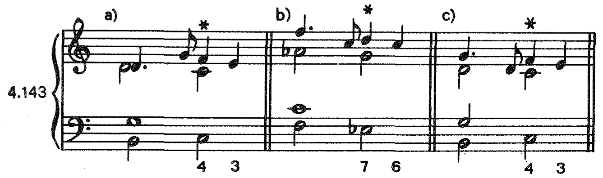

*Primjer 4.143. Izvor: tiskana str. 349; PDF str. 175.*

[Izvorna stranica 349](../sources/pages/page-349.png).

MuseScore: TODO — zapis nije izrađen.
<!-- /integration-slot: primjer-4-143 -->

<!-- visual: 4.144; page 349 -->

<!-- integration-slot: primjer-4-144; status: independent_pass -->
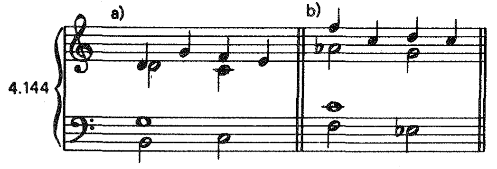

*Primjer 4.144. Izvor: tiskana str. 349; PDF str. 175.*

[Izvorna stranica 349](../sources/pages/page-349.png).

MuseScore: TODO — zapis nije izrađen.
<!-- /integration-slot: primjer-4-144 -->

Nastup appoggiature vrlo je upadljiv. U času nastupa ona potiskuje na drugi plan sve ostale faktore konkretnoga harmonijskog zbivanja; zbog toga će dobro zvučati i appoggiatura koja je uslijedila paralelnim pomakom, čak i kada je to paralelni pomak u septimu (pr. 4.145). U primjeru 4.145.b slučajna je harmonija, što je čini appoggiatura s akordičkim tonovima, identična s (nepotpunim) septakordom II stupnja, ali mi je čujemo kao sekstakord VII stupnja sa silaznom appoggiaturom na njegovu sekstu.

<!-- visual: 4.145; page 349 -->

<!-- integration-slot: primjer-4-145; status: independent_pass -->
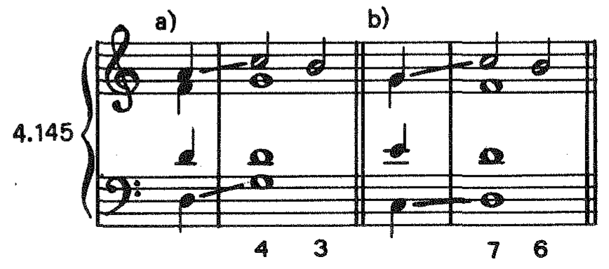

*Primjer 4.145. Izvor: tiskana str. 349; PDF str. 175.*

[Izvorna stranica 349](../sources/pages/page-349.png).

MuseScore: TODO — zapis nije izrađen.
<!-- /integration-slot: primjer-4-145 -->

<!-- source-page: 350; pdf-page: 176 -->

Paralelni pomak na appoggiaturu neće biti dobar ako se njime zamjenjuje pomak, koji bi bez nje bio pogrešan; npr. appoggiatura u sopranu, koja s basom čini interval none i koja nastupa skokom paralelno s basom, bit će loša, jer pokriva pogrešnu sakritu oktavu, koja nastaje ako uklonimo appoggiaturu (pr. 4.146).

<!-- visual: 4.146; page 350 -->

<!-- integration-slot: primjer-4-146; status: independent_pass -->
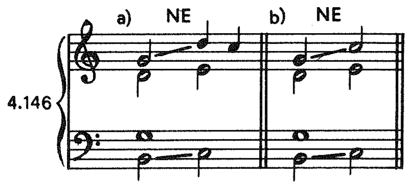

*Primjer 4.146. Izvor: tiskana str. 350; PDF str. 176.*

[Izvorna stranica 350](../sources/pages/page-350.png).

MuseScore: TODO — zapis nije izrađen.
<!-- /integration-slot: primjer-4-146 -->

I nastup appoggiature skokom za neki povećani interval također dobro zvuči (pr. 4.147); takvi skokovi su česti kod uzlaznih appoggiatura, koje nastupaju u obliku nekoga povišenog stupnja (pr. 4.148). Nisu loše ni paralelne kvinte, koje nastaju pomakom s kvinte što je čine dva akordička tona na kvintu što je čini jedan akordički ton i jedna appoggiatura (pr. 4.149).

<!-- visual: 4.147; page 350 -->

<!-- integration-slot: primjer-4-147; status: independent_pass -->
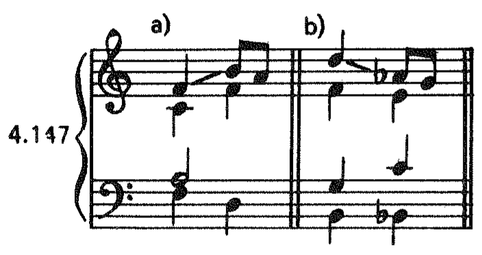

*Primjer 4.147. Izvor: tiskana str. 350; PDF str. 176.*

[Izvorna stranica 350](../sources/pages/page-350.png).

MuseScore: TODO — zapis nije izrađen.
<!-- /integration-slot: primjer-4-147 -->

<!-- visual: 4.148; page 350 -->

<!-- integration-slot: primjer-4-148; status: independent_pass -->
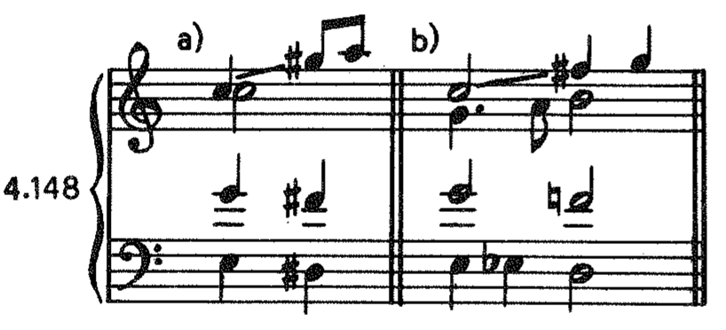

*Primjer 4.148. Izvor: tiskana str. 350; PDF str. 176.*

[Izvorna stranica 350](../sources/pages/page-350.png).

MuseScore: TODO — zapis nije izrađen.
<!-- /integration-slot: primjer-4-148 -->

<!-- visual: 4.149; page 350 -->

<!-- integration-slot: primjer-4-149; status: independent_pass -->
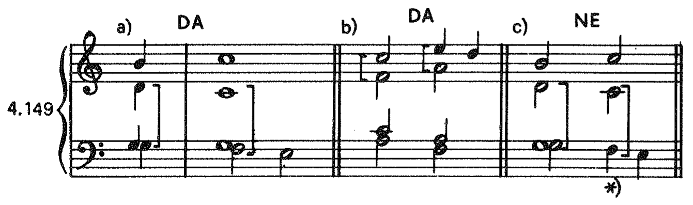

*Primjer 4.149. Izvor: tiskana str. 350; PDF str. 176.*

[Izvorna stranica 350](../sources/pages/page-350.png).

MuseScore: TODO — zapis nije izrađen.
<!-- /integration-slot: primjer-4-149 -->

\* Ton »f« u ovom slučaju nije appoggiatura, nego prohodni ton.

Udvajanje akordičkog tona u koji se appoggiatura rješava izvodi se uz iste uvjete kao i analogno udvajanje pri rješavanju zaostajalice. Prema tome je udvajanje korektno kada se pojavljuje ispod appoggiature u intervalu none, i to u basu u intervalu velike i male none, a u unutarnjem glasu u intervalu velike none, a ako se radi o appoggiaturi na neku dominantu, onda je udvajanje u unutarnjem glasu dobro i u intervalu male none.

<!-- boundary 350/351: Stranica 350 završava cjelovitim odlomkom; sljedeća stranica nastavlja isti odsjek. -->

<!-- source-page: 351; pdf-page: 176 -->

Šifriranje appoggiatura također je isto kao i šifriranje zaostajalica. Kod zadanoga obilježenog basa može se u pojedinim situacijama ista šifraža realizirati i appoggiaturama i zaostajalicama; želimo li da to bude upravo pomoću appoggiatura, onda dotične brojke stavljamo u zagrade (pr. 4.150).

<!-- visual: 4.150; page 351 -->

<!-- integration-slot: primjer-4-150; status: independent_pass -->
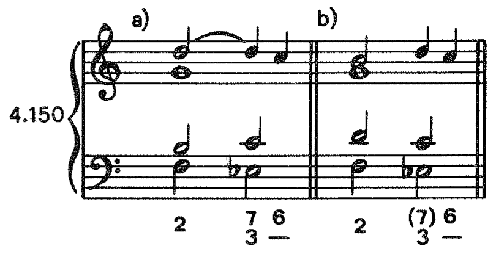

*Primjer 4.150. Izvor: tiskana str. 351; PDF str. 176.*

[Izvorna stranica 351](../sources/pages/page-351.png).

MuseScore: TODO — zapis nije izrađen.
<!-- /integration-slot: primjer-4-150 -->

I appoggiature mogu biti također dvostruke i trostruke. U času rješenja može nastupiti i nova harmonija, a za vrijeme trajanja appoggiature može u drugim glasovima doći do kretanja prohodnih ili izmjeničnih tonova — sve na isti način kao i kod zaostajalica. I, konačno, appoggiatura se može također pojaviti s vlastitim izmjeničnim tonom (pr. 4.151). Navođenje školskih primjera za svaki pojedini slučaj potpuno je izlišno, jer se analogni primjeri, kojima je bila ilustrirana upotreba zaostajalica (v. odsjeke 4.1.2—4.1.7) mogu primijeniti i na appoggiature. Stoga ćemo se sada zadovoljiti minimalnim brojem ilustracija za svaku pojedinu vrstu appoggiatura (pr. 4.152—4.154) i dodati još nekoliko karakterističnih primjera iz umjetničke muzičke literature (pr. 4.155—4.159).

<!-- Izvorni odlomak bio je prekinut slikom 4.151 unutar riječi škol-/skih. Ovdje je riječ i odlomak spojen bez gubitka teksta; slikovni slijed ostaje 4.150, 4.151, 4.152. -->

<!-- visual: 4.151; page 351 -->

<!-- integration-slot: primjer-4-151; status: independent_pass -->
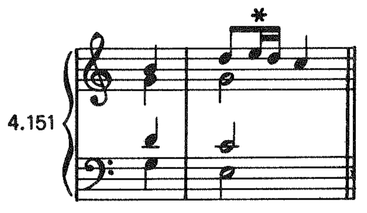

*Primjer 4.151. Izvor: tiskana str. 351; PDF str. 176.*

[Izvorna stranica 351](../sources/pages/page-351.png).

MuseScore: TODO — zapis nije izrađen.
<!-- /integration-slot: primjer-4-151 -->

<!-- visual: 4.152 a–c; page 351 -->

<!-- integration-slot: primjer-4-152-a; status: independent_pass -->
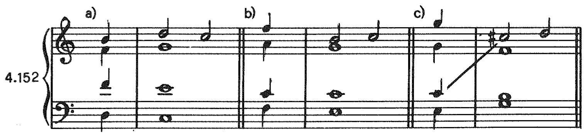

*Primjer 4.152 a–c. Izvor: tiskana str. 351; PDF str. 176.*

[Izvorna stranica 351](../sources/pages/page-351.png).

MuseScore: TODO — zapis nije izrađen.
<!-- /integration-slot: primjer-4-152-a -->

<!-- source-page: 352; pdf-page: 177 -->

<!-- visual: 4.152 d–g (nastavak); page 352 -->

<!-- integration-slot: primjer-4-152-b; status: independent_pass -->
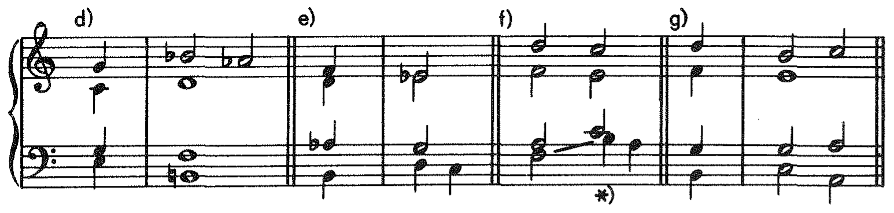

*Primjer 4.152 d–g (nastavak). Izvor: tiskana str. 352; PDF str. 177.*

[Izvorna stranica 352](../sources/pages/page-352.png).

MuseScore: TODO — zapis nije izrađen.
<!-- /integration-slot: primjer-4-152-b -->

\* Preskok u basu je korektan, jer appoggiatura »h« stoji umjesto akordičkoga tona »a«, pa bez appoggiature preskoka ne bi ni bilo.

<!-- visual: 4.153; page 352 -->

<!-- integration-slot: primjer-4-153; status: independent_pass -->
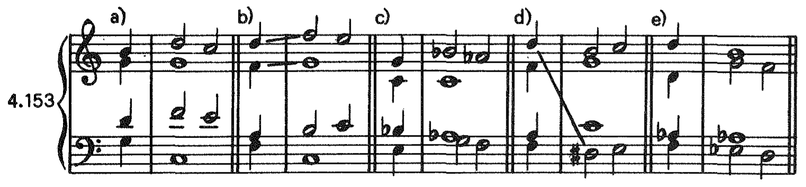

*Primjer 4.153. Izvor: tiskana str. 352; PDF str. 177.*

[Izvorna stranica 352](../sources/pages/page-352.png).

MuseScore: TODO — zapis nije izrađen.
<!-- /integration-slot: primjer-4-153 -->

<!-- visual: 4.154; page 352 -->

<!-- integration-slot: primjer-4-154; status: independent_pass -->
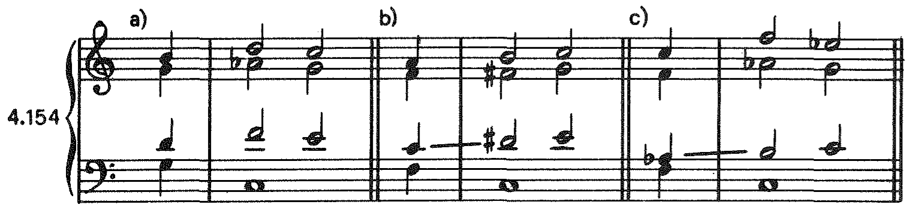

*Primjer 4.154. Izvor: tiskana str. 352; PDF str. 177.*

[Izvorna stranica 352](../sources/pages/page-352.png).

MuseScore: TODO — zapis nije izrađen.
<!-- /integration-slot: primjer-4-154 -->

<!-- visual: 4.155; page 352 -->

<!-- integration-slot: primjer-4-155; status: independent_pass -->
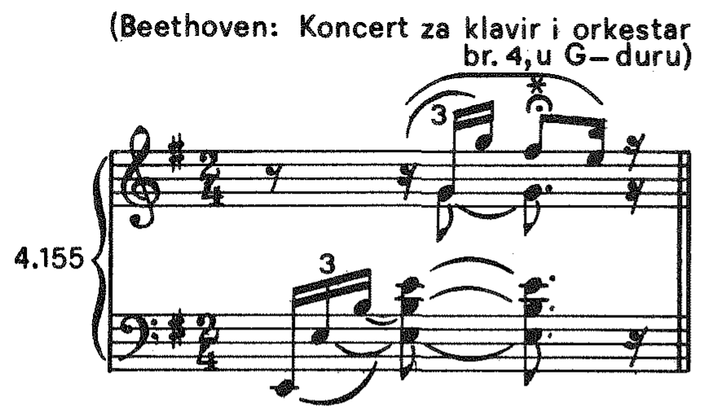

*Primjer 4.155. Izvor: tiskana str. 352; PDF str. 177.*

[Izvorna stranica 352](../sources/pages/page-352.png).

MuseScore: TODO — zapis nije izrađen.
<!-- /integration-slot: primjer-4-155 -->

<!-- visual: 4.156; page 352 -->

<!-- integration-slot: primjer-4-156; status: independent_pass -->
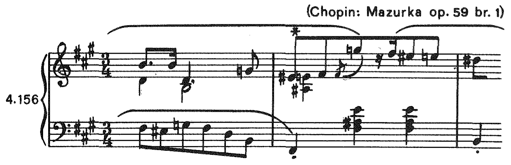

*Primjer 4.156. Izvor: tiskana str. 352; PDF str. 177.*

[Izvorna stranica 352](../sources/pages/page-352.png).

MuseScore: TODO — zapis nije izrađen.
<!-- /integration-slot: primjer-4-156 -->

<!-- source-page: 353; pdf-page: 177 -->

<!-- visual: 4.157; page 353 -->

<!-- integration-slot: primjer-4-157; status: independent_pass -->
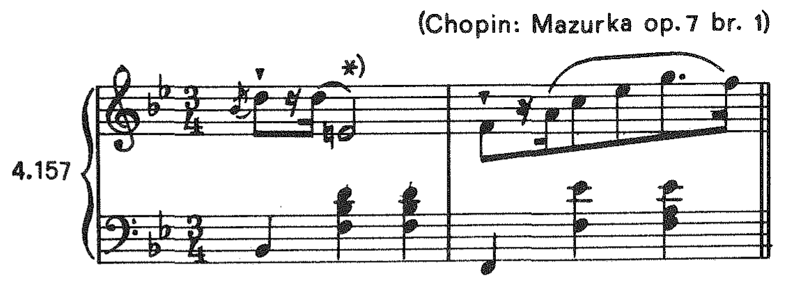

*Primjer 4.157. Izvor: tiskana str. 353; PDF str. 177.*

[Izvorna stranica 353](../sources/pages/page-353.png).

MuseScore: TODO — zapis nije izrađen.
<!-- /integration-slot: primjer-4-157 -->

\* Appoggiatura »e« nastupa u kvintakordu I stupnja, a rješava se istodobno s nastupom nove harmonije (V₇).

<!-- visual: 4.158; page 353 -->

<!-- integration-slot: primjer-4-158; status: independent_pass -->
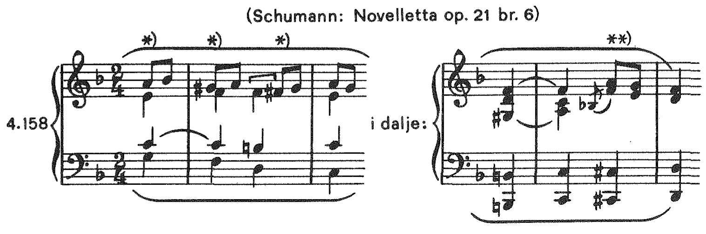

*Primjer 4.158. Izvor: tiskana str. 353; PDF str. 177.*

[Izvorna stranica 353](../sources/pages/page-353.png).

MuseScore: TODO — zapis nije izrađen.
<!-- /integration-slot: primjer-4-158 -->

\* Jednostruke appoggiature u najgornjem glasu.

\*\* Dvostruka appoggiatura (»f« i »a«).

<!-- visual: 4.159; page 353 -->

<!-- integration-slot: primjer-4-159; status: independent_pass -->
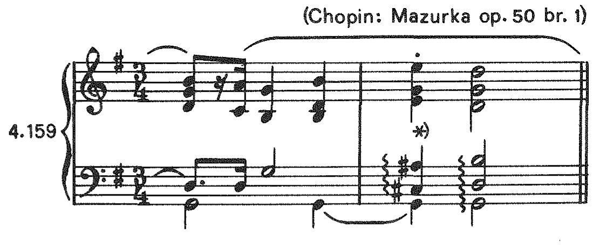

*Primjer 4.159. Izvor: tiskana str. 353; PDF str. 177.*

[Izvorna stranica 353](../sources/pages/page-353.png).

MuseScore: TODO — zapis nije izrađen.
<!-- /integration-slot: primjer-4-159 -->

\* Trostruka appoggiatura (»cis«, »ais« i »e«).

Appoggiature mogu nastupiti i istodobno u svim glasovima. U takvom slučaju ne nastaje slučajna harmonija s istodobnim nastupom appoggiaturâ i akordičkih tonova, nego s nastupom samih appoggiatura.

Možda je najpoznatiji adekvatni primjer iz muzičke literature četverostruka appoggiatura na dominantni septakord u prvom stavku Mozartove Simfonije u g-molu, K.V.550 (pr. 4.160.a). Ako bismo tonove, što čine tu četverostruku appoggiaturu stavili na nenaglašenoj dobi između dva nastupa dominantnog septakorda, dobili bismo opet slučajnu harmoniju, a činio bi je istodobni nastup izmjeničnih tonova u svim glasovima (pr. 4.160.b i c).

<!-- source-page: 354; pdf-page: 178 -->

<!-- visual: 4.160; page 354 -->

<!-- integration-slot: primjer-4-160; status: independent_pass -->
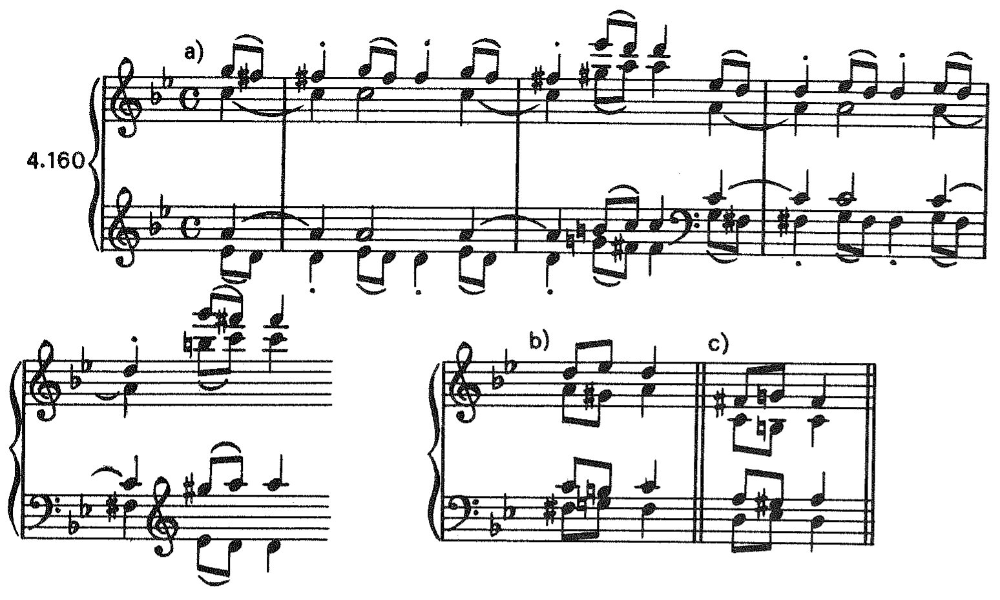

*Primjer 4.160. Izvor: tiskana str. 354; PDF str. 178.*

[Izvorna stranica 354](../sources/pages/page-354.png).

MuseScore: TODO — zapis nije izrađen.
<!-- /integration-slot: primjer-4-160 -->

Nešto složeniju situaciju nalazimo kod Schumanna, u Novelletti op. 21 br. 8 (pr. 4.161). Na početku citata nalazi se obrat smanjenog septakorda h-d-f-as, od koga »f«, »h« i »d« ostaju ležati i na slijedećoj, naglašenoj dobi, a glas u kojemu je bio nastupio ton »as« skače za smanjenu tercu prema dolje na ton »fis«; tako nastaje slučajna harmonija, koju ćemo klasificirati kao kombinaciju trostruke zaostajalice (f-h-d) i jednostruke appoggiature (fis) na sekstakord es-g-c, koji zatim slijedi.

<!-- visual: 4.161; page 354 -->

<!-- integration-slot: primjer-4-161; status: independent_pass -->
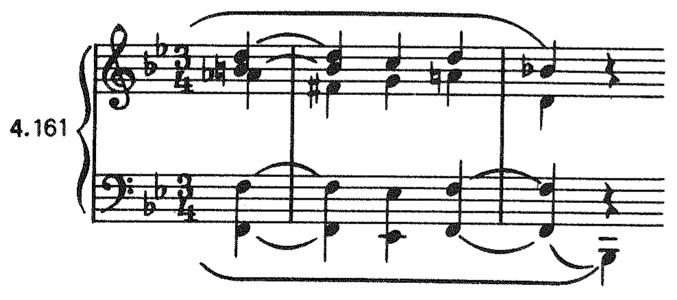

*Primjer 4.161. Izvor: tiskana str. 354; PDF str. 178.*

[Izvorna stranica 354](../sources/pages/page-354.png).

MuseScore: TODO — zapis nije izrađen.
<!-- /integration-slot: primjer-4-161 -->

I u jednom i u drugom slučaju, slučajne harmonije koje se sastoje od samih neakordičkih tonova sadrže oštru disonancu povećane oktave. No unatoč tome ni jedna od njih ne iskače naročito iz harmonijskog kretanja, unutar kojega se pojavljuje, jer se u oba slučaja radi o brzom tempu i o kratkim trajanjima. Ali četverostruka appoggiatura s početka orkestralne rapsodije »Taras Bulba« L. Janačeka, koja nastupa na koroni (pr. 4.162), doima se zbog dugog trajanja naročito disonantno. Posebno je zanimljivo njeno rješavanje. Kompozitor kao da je osjetio da bi poslije tako eksponirane disonance nastup čistoga dur-kvintakorda djelovao »izvan stila«, pa zato jedan ton (gis) zadržava kao zaostajalicu, koja ovdje nije pripravljena nekim akordičkim tonom akorda tercne strukture (jer takav, uostalom, niti ne prethodi), nego appoggiaturom.

<!-- boundary 354/355: Stranica 354 završava cjelovitim odlomkom; primjer 4.162 na koji se odlomak poziva slijedi na stranici 355. -->

<!-- source-page: 355; pdf-page: 178 -->

<!-- visual: 4.162; page 355 -->

<!-- integration-slot: primjer-4-162; status: independent_pass -->
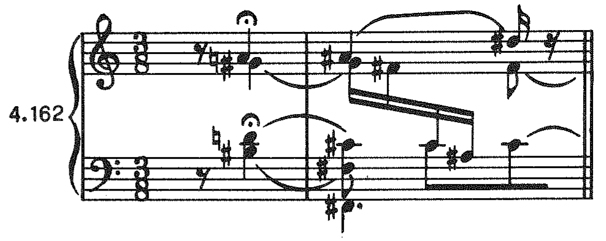

*Primjer 4.162. Izvor: tiskana str. 355; PDF str. 178.*

[Izvorna stranica 355](../sources/pages/page-355.png).

MuseScore: TODO — zapis nije izrađen.
<!-- /integration-slot: primjer-4-162 -->

Glavni je problem upotrebe appoggiaturâ u harmonizaciji zadanog glasa pronalaženje pravoga mjesta za neku appoggiaturu. Tipična su takva mjesta note na naglašenoj dobi, koje dolaze skokom, ako nakon njih slijedi postepeni pomak: tada se ta nota može u većini slučajeva smatrati appoggiaturom, a slijedeća akordičkim tonom (pr. 4.163).

<!-- visual: 4.163; page 355 -->

<!-- integration-slot: primjer-4-163; status: independent_pass -->
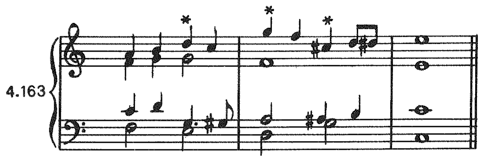

*Primjer 4.163. Izvor: tiskana str. 355; PDF str. 178.*

[Izvorna stranica 355](../sources/pages/page-355.png).

MuseScore: TODO — zapis nije izrađen.
<!-- /integration-slot: primjer-4-163 -->

S nastupom appoggiature često nastaju opreke (v. pr. 4.152.c i 4.153.d), ali one ne zvuče loše, jer se ne pojavljuju između dva akordička tona, nego između jednoga akordičkog i jednoga neakordičkog tona.

### ZADACI

Appoggiature u sopranu:

<!-- visual: zadatak 1; page 355 -->

<!-- integration-slot: zadatak-4-355-1; status: independent_pass -->
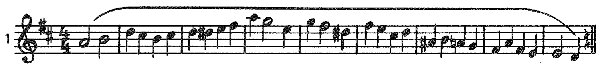

*Zadatak 1. Izvor: tiskana str. 355; PDF str. 178.*

[Izvorna stranica 355](../sources/pages/page-355.png).

MuseScore: TODO — zapis nije izrađen.
<!-- /integration-slot: zadatak-4-355-1 -->

<!-- visual: zadatak 2; page 355 -->

<!-- integration-slot: zadatak-4-355-2; status: independent_pass -->
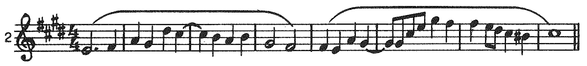

*Zadatak 2. Izvor: tiskana str. 355; PDF str. 178.*

[Izvorna stranica 355](../sources/pages/page-355.png).

MuseScore: TODO — zapis nije izrađen.
<!-- /integration-slot: zadatak-4-355-2 -->

<!-- visual: zadatak 3; page 355 -->

<!-- integration-slot: zadatak-4-355-3; status: independent_pass -->
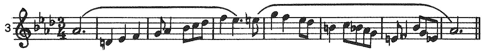

*Zadatak 3. Izvor: tiskana str. 355; PDF str. 178.*

[Izvorna stranica 355](../sources/pages/page-355.png).

MuseScore: TODO — zapis nije izrađen.
<!-- /integration-slot: zadatak-4-355-3 -->

<!-- source-page: 356; pdf-page: 179 -->

Appoggiature u basu:

<!-- visual: zadatak 4; page 356 -->

<!-- integration-slot: zadatak-4-356-4; status: independent_pass -->
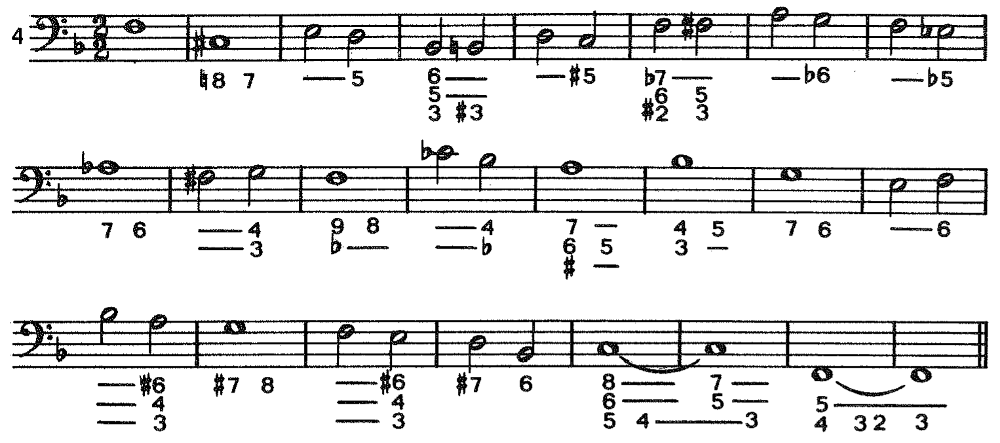

*Zadatak 4. Izvor: tiskana str. 356; PDF str. 179.*

[Izvorna stranica 356](../sources/pages/page-356.png).

MuseScore: TODO — zapis nije izrađen.
<!-- /integration-slot: zadatak-4-356-4 -->

<!-- visual: zadatak 5; page 356 -->

<!-- integration-slot: zadatak-4-356-5; status: independent_pass -->
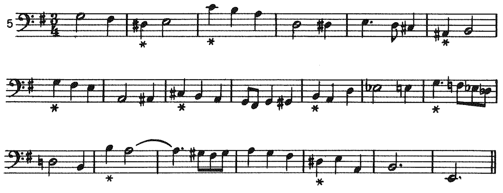

*Zadatak 5. Izvor: tiskana str. 356; PDF str. 179.*

[Izvorna stranica 356](../sources/pages/page-356.png).

MuseScore: TODO — zapis nije izrađen.
<!-- /integration-slot: zadatak-4-356-5 -->

Višestruke appoggiature:

<!-- visual: zadatak 6; page 356 -->

<!-- integration-slot: zadatak-4-356-6; status: independent_pass -->
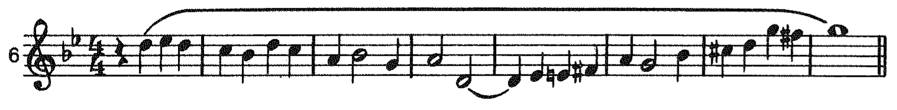

*Zadatak 6. Izvor: tiskana str. 356; PDF str. 179.*

[Izvorna stranica 356](../sources/pages/page-356.png).

MuseScore: TODO — zapis nije izrađen.
<!-- /integration-slot: zadatak-4-356-6 -->

<!-- visual: zadatak 7; page 356 -->

<!-- integration-slot: zadatak-4-356-7; status: independent_pass -->
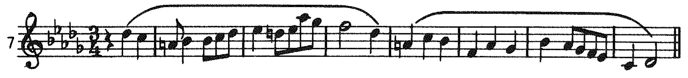

*Zadatak 7. Izvor: tiskana str. 356; PDF str. 179.*

[Izvorna stranica 356](../sources/pages/page-356.png).

MuseScore: TODO — zapis nije izrađen.
<!-- /integration-slot: zadatak-4-356-7 -->

<!-- visual: zadatak 8 (početak); page 356 -->

<!-- integration-slot: zadatak-4-356-8-a; status: independent_pass -->
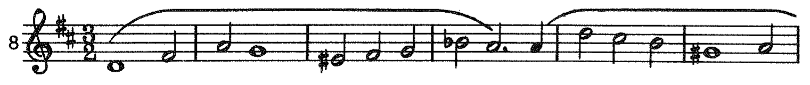

*Zadatak 8 (početak). Izvor: tiskana str. 356; PDF str. 179.*

[Izvorna stranica 356](../sources/pages/page-356.png).

MuseScore: TODO — zapis nije izrađen.
<!-- /integration-slot: zadatak-4-356-8-a -->

<!-- source-page: 357; pdf-page: 179 -->

<!-- visual: zadatak 8 (nastavak); page 357 -->

<!-- integration-slot: zadatak-4-357-8-b; status: independent_pass -->
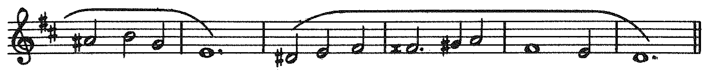

*Zadatak 8 (nastavak). Izvor: tiskana str. 357; PDF str. 179.*

[Izvorna stranica 357](../sources/pages/page-357.png).

MuseScore: TODO — zapis nije izrađen.
<!-- /integration-slot: zadatak-4-357-8-b -->

Kombinacije raznih vrsta appoggiatura:

<!-- visual: zadatak 9; page 357 -->

<!-- integration-slot: zadatak-4-357-9; status: independent_pass -->
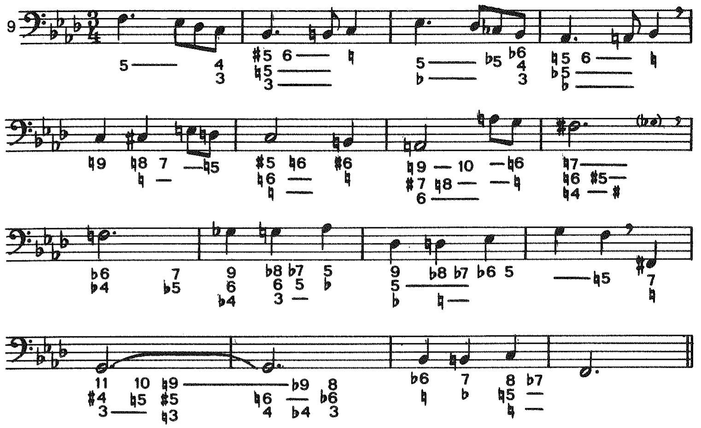

*Zadatak 9. Izvor: tiskana str. 357; PDF str. 179.*

[Izvorna stranica 357](../sources/pages/page-357.png).

MuseScore: TODO — zapis nije izrađen.
<!-- /integration-slot: zadatak-4-357-9 -->

<!-- visual: zadatak 10; page 357 -->

<!-- integration-slot: zadatak-4-357-10; status: independent_pass -->
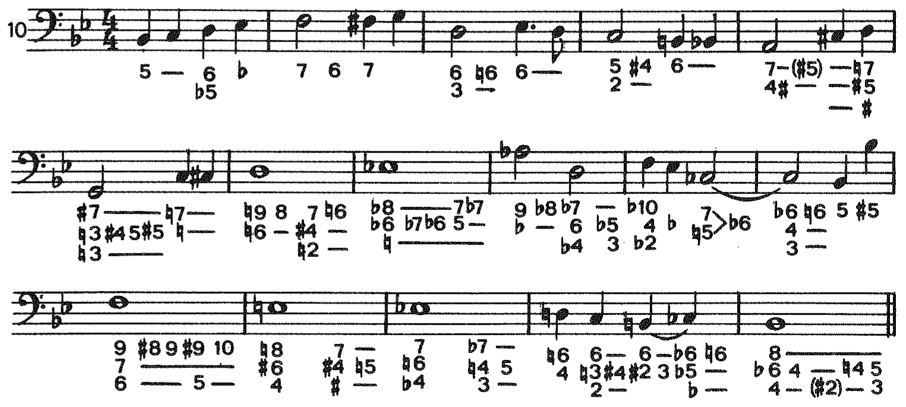

*Zadatak 10. Izvor: tiskana str. 357; PDF str. 179.*

[Izvorna stranica 357](../sources/pages/page-357.png).

MuseScore: TODO — zapis nije izrađen.
<!-- /integration-slot: zadatak-4-357-10 -->

<!-- visual: zadatak 11 (početak); page 357 -->

<!-- integration-slot: zadatak-4-357-11-a; status: independent_pass -->
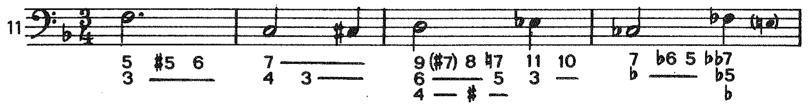

*Zadatak 11 (početak). Izvor: tiskana str. 357; PDF str. 179.*

[Izvorna stranica 357](../sources/pages/page-357.png).

MuseScore: TODO — zapis nije izrađen.
<!-- /integration-slot: zadatak-4-357-11-a -->

<!-- source-page: 358; pdf-page: 180 -->

<!-- visual: zadatak 11 (nastavak); page 358 -->

<!-- integration-slot: zadatak-4-358-11-b; status: independent_pass -->
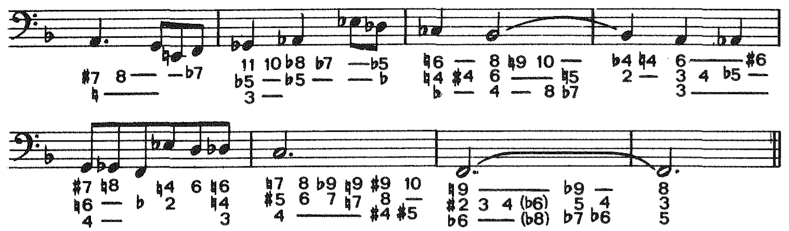

*Zadatak 11 (nastavak). Izvor: tiskana str. 358; PDF str. 180.*

[Izvorna stranica 358](../sources/pages/page-358.png).

MuseScore: TODO — zapis nije izrađen.
<!-- /integration-slot: zadatak-4-358-11-b -->

<!-- visual: zadatak 12; page 358 -->

<!-- integration-slot: zadatak-4-358-12; status: independent_pass -->
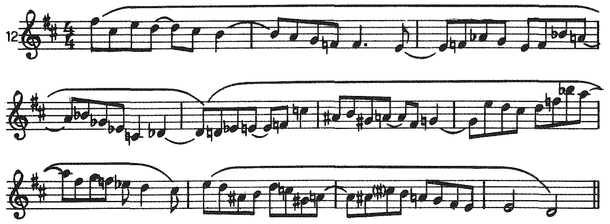

*Zadatak 12. Izvor: tiskana str. 358; PDF str. 180.*

[Izvorna stranica 358](../sources/pages/page-358.png).

MuseScore: TODO — zapis nije izrađen.
<!-- /integration-slot: zadatak-4-358-12 -->

<!-- visual: zadatak 13; page 358 -->

<!-- integration-slot: zadatak-4-358-13; status: independent_pass -->
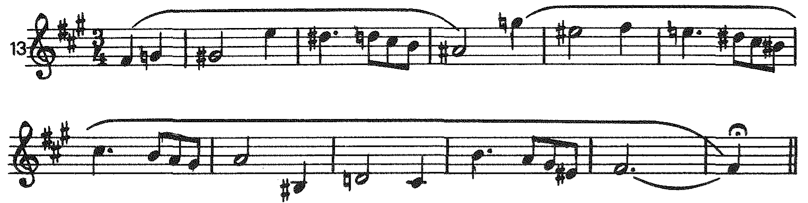

*Zadatak 13. Izvor: tiskana str. 358; PDF str. 180.*

[Izvorna stranica 358](../sources/pages/page-358.png).

MuseScore: TODO — zapis nije izrađen.
<!-- /integration-slot: zadatak-4-358-13 -->

<!-- visual: zadatak 14; page 358 -->

<!-- integration-slot: zadatak-4-358-14; status: independent_pass -->
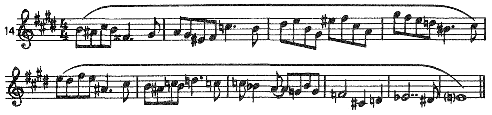

*Zadatak 14. Izvor: tiskana str. 358; PDF str. 180.*

[Izvorna stranica 358](../sources/pages/page-358.png).

MuseScore: TODO — zapis nije izrađen.
<!-- /integration-slot: zadatak-4-358-14 -->

<!-- boundary 358/359: Niz zadataka završava cjelovitim zadatkom 14 na stranici 358; na stranici 359 slijedi realizacija zadatka 9. -->

<!-- boundary 358/359: Prethodna provjerena dionica završava zadatkom 14 na stranici 358. Stranica 359 počinje zasebnom realizacijom zadatka 9; nema prenesene prozne rečenice. -->

<!-- source-page: 359; pdf-page: 180 -->

Realizacija zadatka 9.

<!-- visual: realizacija zadatka 9; page 359 -->

<!-- integration-slot: zadatak-4-359-9-realizacija; status: independent_pass -->
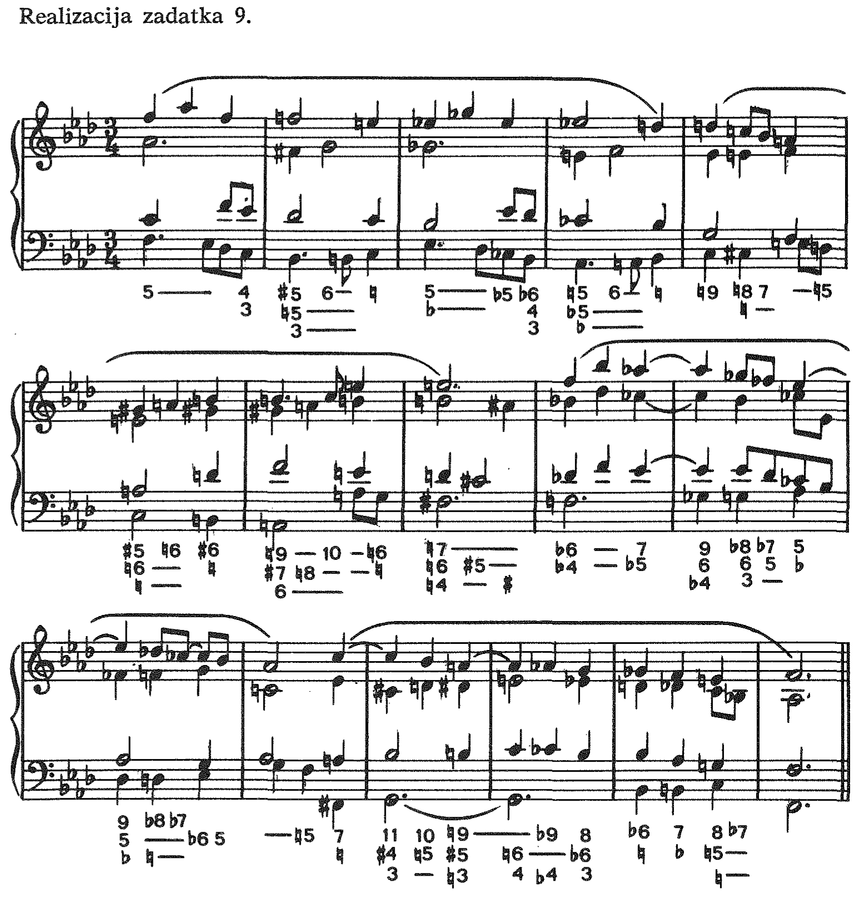

*Realizacija zadatka 9. Izvor: tiskana str. 359; PDF str. 180.*

[Izvorna stranica 359](../sources/pages/page-359.png).

MuseScore: TODO — zapis nije izrađen.
<!-- /integration-slot: zadatak-4-359-9-realizacija -->

<!-- source-page: 360; pdf-page: 181 -->

Realizacija zadatka 12.

<!-- visual: realizacija zadatka 12; page 360 -->

<!-- integration-slot: zadatak-4-360-12-realizacija; status: independent_pass -->
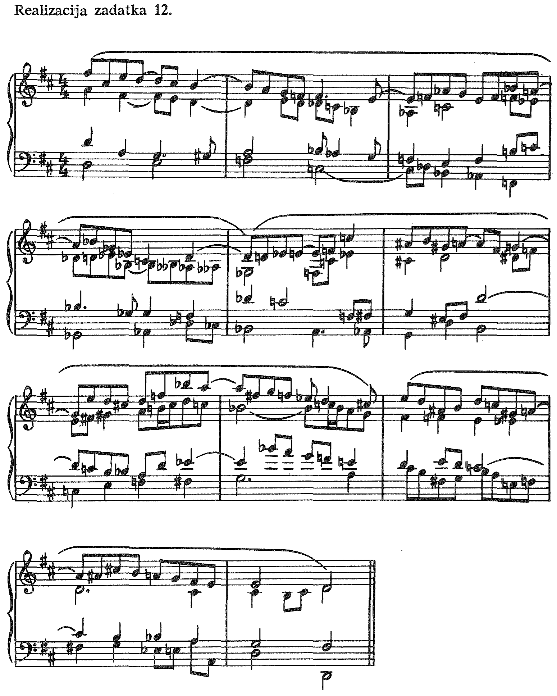

*Realizacija zadatka 12. Izvor: tiskana str. 360; PDF str. 181.*

[Izvorna stranica 360](../sources/pages/page-360.png).

MuseScore: TODO — zapis nije izrađen.
<!-- /integration-slot: zadatak-4-360-12-realizacija -->

<!-- source-page: 361; pdf-page: 181 -->

## 4.4. Anticipacije

Anticipacija (lat. anticipatio — *uzimanje unaprijed*) je prijevremeni nastup na nenaglašenoj dobi, jednoga ili više tonova nekog akorda, koji se u cjelini pojavljuje tek na slijedećoj naglašenoj dobi. Ti »anticipirani« tonovi najčešće dolaze u disonantne odnose s akordičkim tonovima akorda, s kojima istodobno zvuče, ali disonantni intervali ne tretiraju se onako kao pri rješavanju disonantnih akorda ili zaostajalica; budući da oni kod anticipacija nastupaju na nenaglašenoj dobi, oni se naprosto ignoriraju, to više što automatski nestaju sa slijedećim nastupom kompletnoga akorda. Zbog tih slučajnih disonantnih odnosa trajanje anticipacije treba da bude kraće od trajanja note koja joj prethodi (pr. 4.164.a) ili najviše jednako s njim (pr. 4.164.b). Anticipacija najčešće slijedi postepenim pomakom, kao u prethodnim primjerima, ali se javljaju također i anticipacije koje nastupaju skokom (pr. 4.164.c i d).

<!-- visual: 4.164; page 361 -->

<!-- integration-slot: primjer-4-164; status: independent_pass -->
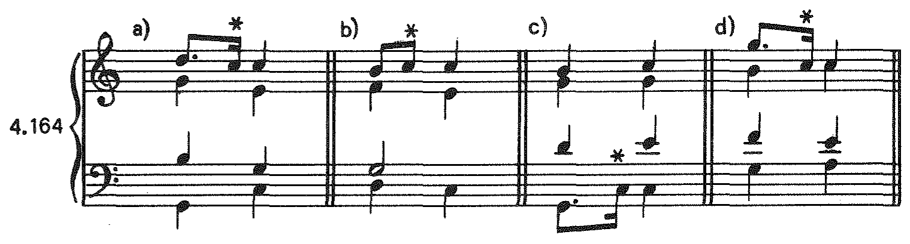

*Primjer 4.164. Izvor: tiskana str. 361; PDF str. 181.*

[Izvorna stranica 361](../sources/pages/page-361.png).

MuseScore: TODO — zapis nije izrađen.
<!-- /integration-slot: primjer-4-164 -->

Anticipacija može biti jednostruka (pr. 4.164. i 4.165) ili višestruka (pr. 4.166. i 4.167), a može nastupiti i u svim glasovima istodobno, pa tada dobivamo čitav »anticipirani akord« (pr. 4.168. i 4.169).

(Beethoven: Sonata za klavir u G-duru, op. 49 br. 2)

<!-- visual: 4.165; page 361 -->

<!-- integration-slot: primjer-4-165; status: independent_pass -->
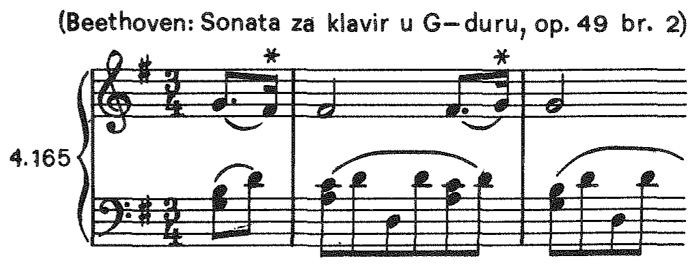

*Primjer 4.165. Izvor: tiskana str. 361; PDF str. 181.*

[Izvorna stranica 361](../sources/pages/page-361.png).

MuseScore: TODO — zapis nije izrađen.
<!-- /integration-slot: primjer-4-165 -->

<!-- visual: 4.166; page 361 -->

<!-- integration-slot: primjer-4-166; status: independent_pass -->
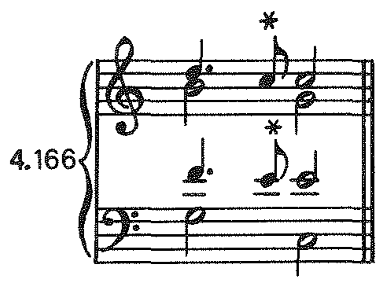

*Primjer 4.166. Izvor: tiskana str. 361; PDF str. 181.*

[Izvorna stranica 361](../sources/pages/page-361.png).

MuseScore: TODO — zapis nije izrađen.
<!-- /integration-slot: primjer-4-166 -->

<!-- source-page: 362; pdf-page: 182 -->

(Beethoven: Sonata za klavir u A-duru, op. 2 br. 2)

<!-- visual: 4.167; page 362 -->

<!-- integration-slot: primjer-4-167; status: independent_pass -->
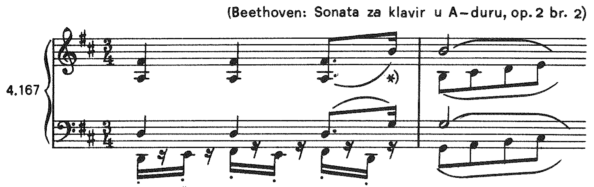

*Primjer 4.167. Izvor: tiskana str. 362; PDF str. 182.*

[Izvorna stranica 362](../sources/pages/page-362.png).

MuseScore: TODO — zapis nije izrađen.
<!-- /integration-slot: primjer-4-167 -->

\* Dvostruka anticipacija.

<!-- visual: 4.168; page 362 -->

<!-- integration-slot: primjer-4-168; status: independent_pass -->
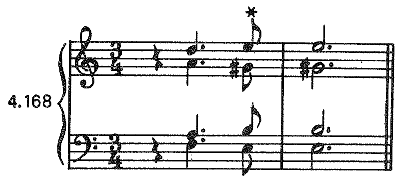

*Primjer 4.168. Izvor: tiskana str. 362; PDF str. 182.*

[Izvorna stranica 362](../sources/pages/page-362.png).

MuseScore: TODO — zapis nije izrađen.
<!-- /integration-slot: primjer-4-168 -->

(Beethoven: Sonata za klavir u c-molu, op. 111)

<!-- visual: 4.169; page 362 -->

<!-- integration-slot: primjer-4-169; status: cleanup_required -->
**PROVISIONAL / CLEANUP REQUIRED / MANUAL REVIEW / UNAPPROVED** — [Primjer 4.169 — tiskana str. 362 — neodobreni izvorni izrez](../images/04-neakordicki-c/primjer-4-169.png).

*Primjer 4.169. Izvor: tiskana str. 362; PDF str. 182.*

> Razlog zadržavanja (neovisna recenzija): Bottom edge contains partial characters of the explanatory footnote, not specks. Full Beethoven op.111 attribution, number and notation are retained, but lowest bass beams occupy the same vertical band as footnote tops. No safe single rectangular replacement verified; raising bottom would clip beams, moving sideways would lose required score content. Layout hold; no retouch authorized.

[Izvorna stranica 362](../sources/pages/page-362.png).

MuseScore: TODO — BLOKIRANO; ne prepisivati ni certificirati nesigurnu notaciju.
<!-- /integration-slot: primjer-4-169 -->

\* Četverostruke anticipacije.

Česti su i slučajevi da se ton, koji na nenaglašenoj dobi predstavlja anticipaciju, pojavljuje kao akordički ton na idućoj naglašenoj dobi u nekom drugom glasu, kao slobodno riješena anticipacija (pr. 4.170 — 4.172); slobodno riješena anticipacija u primjeru 4.170.b mogla bi se tumačiti i kao izmjenični ton prethodnoga akordičkog tona, nakog koga u istom glasu novi akordički ton nastupa skokom (v. također i pr. 4.116, gdje bi se opet varijanta izmjeničnog tona »e«, na kraju 1. takta, mogla obratno tumačiti i kao slobodno riješena anticipacija).

<!-- visual: 4.170; page 362 -->

<!-- integration-slot: primjer-4-170; status: independent_pass -->
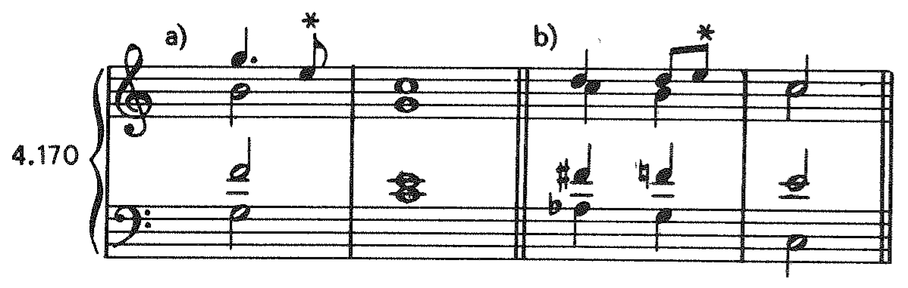

*Primjer 4.170. Izvor: tiskana str. 362; PDF str. 182.*

[Izvorna stranica 362](../sources/pages/page-362.png).

MuseScore: TODO — zapis nije izrađen.
<!-- /integration-slot: primjer-4-170 -->

<!-- source-page: 363; pdf-page: 182 -->

(Chopin: Preludij op. 28 br. 2)

<!-- visual: 4.171; page 363 -->

<!-- integration-slot: primjer-4-171; status: independent_pass -->
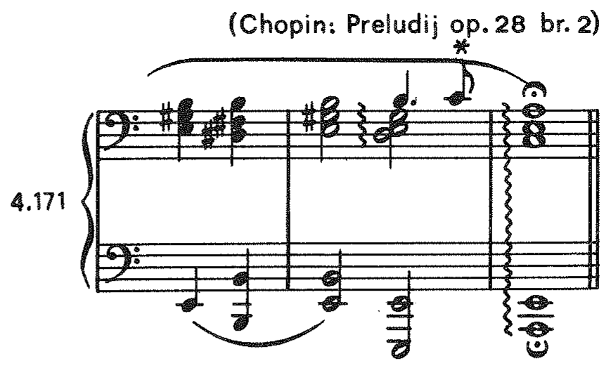

*Primjer 4.171. Izvor: tiskana str. 363; PDF str. 182.*

[Izvorna stranica 363](../sources/pages/page-363.png).

MuseScore: TODO — zapis nije izrađen.
<!-- /integration-slot: primjer-4-171 -->

(Chopin: Mazurka op. 24 br. 2)

<!-- visual: 4.172; page 363 -->

<!-- integration-slot: primjer-4-172; status: independent_pass -->
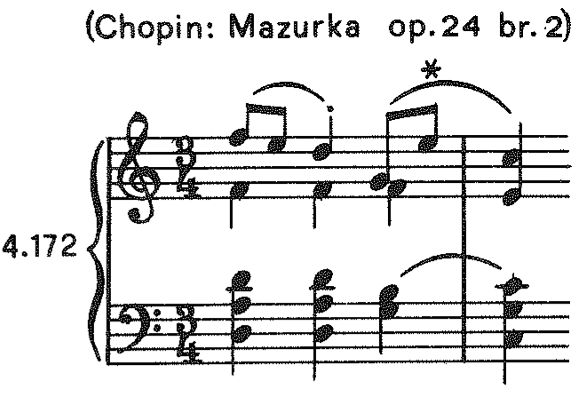

*Primjer 4.172. Izvor: tiskana str. 363; PDF str. 182.*

[Izvorna stranica 363](../sources/pages/page-363.png).

MuseScore: TODO — zapis nije izrađen.
<!-- /integration-slot: primjer-4-172 -->

I neakordički tonovi mogu biti anticipirani, i to uglavnom appoggiature (pr. 4.173).

(Schumann: Carnaval op. 9)

<!-- visual: 4.173; page 363 -->

<!-- integration-slot: primjer-4-173; status: source_damage -->
**SOURCE DAMAGE / NOTATION UNCERTAIN / UNAPPROVED** — [Primjer 4.173 — tiskana str. 363 — neodobreni izvorni izrez](../images/04-neakordicki-c/primjer-4-173.png).

*Primjer 4.173. Izvor: tiskana str. 363; PDF str. 182.*

> Razlog zadržavanja (neovisna recenzija): Crop retains number, Schumann Carnaval op.9 attribution, stars, highest ledger notes, lowest bass note and all source-visible staff ends, with four clean source margins. Source abrasion interrupts the right final barline; source notation is not independently certified, and damaged or faint notes must not be inferred. Crop PASS is not notation approval: retain source_damage hold.

[Izvorna stranica 363](../sources/pages/page-363.png).

MuseScore: TODO — BLOKIRANO; ne prepisivati ni certificirati nesigurnu notaciju.
<!-- /integration-slot: primjer-4-173 -->

U primjeru 4.174, koji sadrži pretežno također anticipirane appoggiature, anticipacija »gizis«, na kraju 2. takta, ne pojavljuje se na slijedećoj naglašenoj dobi ni kao akordički ton, niti kao appoggiatura, nego kao prohodni ton, nakon koga slijedi još jedan prohod (»ais«), a taj bi se opet mogao tumačiti i kao anticipacija appoggiature. Analogan slučaj ponavlja se i s anticipacijom »his« u slijedećem taktu. Međutim, te finese u razlikama nisu na ovom mjestu važne; one dolaze kao rezultat sekventnoga uzlaznog pomicanja najgornjega glasa, stoga se kao harmonijske pojave nalaze u drugom planu.

(Chopin: Preludij op. 28 br. 12)

<!-- visual: 4.174; page 363 -->

<!-- integration-slot: primjer-4-174; status: independent_pass -->
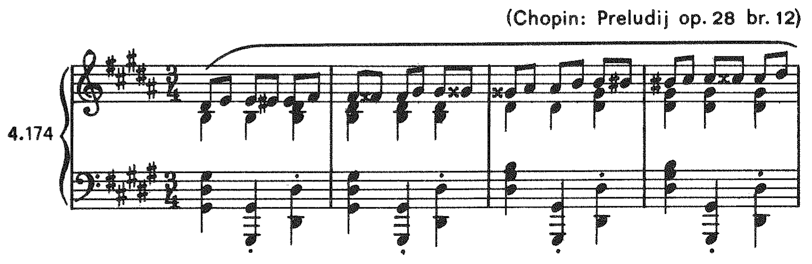

*Primjer 4.174. Izvor: tiskana str. 363; PDF str. 182.*

[Izvorna stranica 363](../sources/pages/page-363.png).

MuseScore: TODO — zapis nije izrađen.
<!-- /integration-slot: primjer-4-174 -->

Vrlo su uobičajene i anticipacije koje anticipiraju rješenja zaostajalica ili appoggiatura, pa se prema tome pojavljuju već unutar akorda, od koga je barem temeljni ton već nastupio na naglašenoj dobi neposredno prije pojave takve anticipacije (pr. 4.175).

<!-- source-page: 364; pdf-page: 183 -->

(Chopin: Mazurka op. 24 br. 4)

<!-- visual: 4.175; page 364 -->

<!-- integration-slot: primjer-4-175; status: independent_pass -->
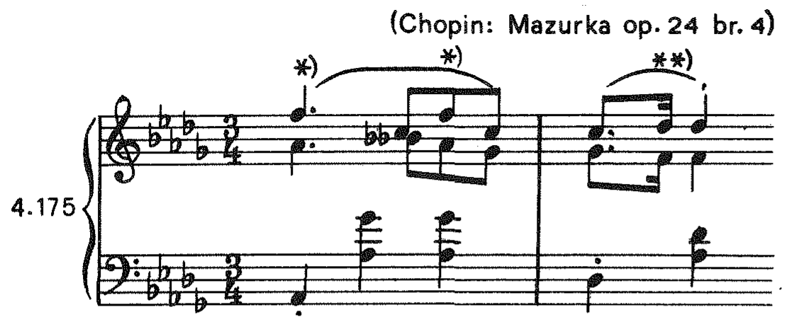

*Primjer 4.175. Izvor: tiskana str. 364; PDF str. 183.*

[Izvorna stranica 364](../sources/pages/page-364.png).

MuseScore: TODO — zapis nije izrađen.
<!-- /integration-slot: primjer-4-175 -->

\* Ton »f« u najgornjem glasu je appoggiatura na kvintu dominantnog septakorda »es«; ta se appoggiatura uopće ne rješava, nego poslije nje skokom nastupa drugi akordički ton »c«.

\*\* Dvostruka anticipacija rješenja prethodne dvostruke appoggiature.

Istodobno s anticipiranim tonom može nastupiti i prohodni ton. Istodobni nastup prohodne septime i anticipacije temeljnoga tona iduće harmonije srećemo čak kao maniru u autentičnim završecima mnogih Bachovih korala; paralelne kvinte, koje pri tom nastaju, nisu pogrešne (pr. 4.176). Spomenimo još na kraju i jedan istodobni nastup anticipacije i rješenja zaostajalice kod Corellija, koji rezultira pomakom u paralelnim sekundama (pr. 4.177).

(J. S. Bach: Koral br. 8)

<!-- visual: 4.176; page 364 -->

<!-- integration-slot: primjer-4-176; status: independent_pass -->

*Primjer 4.176. Izvor: tiskana str. 364; PDF str. 183.*

[Izvorna stranica 364](../sources/pages/page-364.png).

MuseScore: TODO — zapis nije izrađen.
<!-- /integration-slot: primjer-4-176 -->

<!-- visual: 4.177; page 364 -->

<!-- integration-slot: primjer-4-177; status: independent_pass -->

*Primjer 4.177. Izvor: tiskana str. 364; PDF str. 183.*

[Izvorna stranica 364](../sources/pages/page-364.png).

MuseScore: TODO — zapis nije izrađen.
<!-- /integration-slot: primjer-4-177 -->

### ZADACI

<!-- visual: zadatak 1; page 364 -->

<!-- integration-slot: zadatak-4-364-1; status: independent_pass -->

*Zadatak 1. Izvor: tiskana str. 364; PDF str. 183.*

[Izvorna stranica 364](../sources/pages/page-364.png).

MuseScore: TODO — zapis nije izrađen.
<!-- /integration-slot: zadatak-4-364-1 -->

<!-- visual: zadatak 2 (početak); page 364 -->

<!-- integration-slot: zadatak-4-364-2-a; status: independent_pass -->

*Zadatak 2 (početak). Izvor: tiskana str. 364; PDF str. 183.*

[Izvorna stranica 364](../sources/pages/page-364.png).

MuseScore: TODO — zapis nije izrađen.
<!-- /integration-slot: zadatak-4-364-2-a -->

<!-- source-page: 365; pdf-page: 183 -->

<!-- visual: zadatak 2 (nastavak); page 365 -->

<!-- integration-slot: zadatak-4-365-2-b; status: independent_pass -->

*Zadatak 2 (nastavak). Izvor: tiskana str. 365; PDF str. 183.*

[Izvorna stranica 365](../sources/pages/page-365.png).

MuseScore: TODO — zapis nije izrađen.
<!-- /integration-slot: zadatak-4-365-2-b -->

<!-- visual: zadatak 3; page 365 -->

<!-- integration-slot: zadatak-4-365-3; status: independent_pass -->

*Zadatak 3. Izvor: tiskana str. 365; PDF str. 183.*

[Izvorna stranica 365](../sources/pages/page-365.png).

MuseScore: TODO — zapis nije izrađen.
<!-- /integration-slot: zadatak-4-365-3 -->

<!-- visual: zadatak 4; page 365 -->

<!-- integration-slot: zadatak-4-365-4; status: independent_pass -->

*Zadatak 4. Izvor: tiskana str. 365; PDF str. 183.*

[Izvorna stranica 365](../sources/pages/page-365.png).

MuseScore: TODO — zapis nije izrađen.
<!-- /integration-slot: zadatak-4-365-4 -->

<!-- source-page: 366; pdf-page: 184 -->

## 4.5. Pedalni ton

Pedalni ton, ili njem. »Orgelpunkt«, izdržani je basov ton nad kojim se odvija više ili manje samostalno harmonijsko kretanje. Na početku i na završetku svoga trajanja pedalni je ton ujedno i akordički ton akorda, što se na tim mjestima pojavljuju, dok u srednjem dijelu on može s akordima, koji se nad njime izmjenjuju, doći i u oštru koliziju.

U strogom četveroglasnom stavku harmonijsko kretanje nad pedalnim tonom odvijat će se samo u tri gornja glasa, tako da će se tada i obrati mnogih akorda, a naročito septakorda, pojavljivati u nepotpunom obliku. Ali vrlo se često pedalni ton uvodi i kao peti glas, pa onda opet imamo iznad njega kompletno četveroglasje. Iako za vrijeme trajanja pedalnog tona tenor preuzima ulogu basa u superponiranom harmonijskom stavku, njegovo će kretanje ipak i dalje biti prvenstveno melodijske prirode. Relativno česti skokovi, normalni u pravoj basovoj dionici, ne bi bili na mjestu u tenoru jer, premda on preuzima funkciju basa, on ipak neće biti zato najdublji glas. Kretanje tenora u skokovima zapravo bi demantiralo pedalni ton; ako najdublji ton leži, on na neki način izaziva određeni odaziv ili određenu rezonancu u drugim glasovima, koja se prirodno očituje u mirnim melodijskim linijama. Prema tome će općenita karakteristika harmonijskog zbivanja iznad pedalnog tona biti pretežni postepeni pomak, i to naročito u unutarnjim glasovima. Tako će npr. iznad pedalnog tona biti vrlo česta i pojava paralelnih kvartsekstakorda, koji će tada imati karakter prohodnih akorda; već kod nekih trostrukih prohodnih i izmjeničnih tonova mogli smo nazrijevati zametke takvih situacija (v. pr. 4.74.a i c, te 4.75.a i c).

Pedalni ton redovito nastupa kao dominanta ili kao tonika, odnosno kao **dominantni pedalni ton** (pr. 4.178) ili kao **tonički pedalni ton** (pr. 4.179. i 4.180). I

(Chopin: Preludij op. 28, br. 8)

<!-- visual: 4.178 (početak); page 366 -->

<!-- integration-slot: primjer-4-178-a; status: cleanup_required -->
**PROVISIONAL / CLEANUP REQUIRED / MANUAL REVIEW / UNAPPROVED** — [Primjer 4.178 (početak) — tiskana str. 366 — neodobreni izvorni izrez](../images/04-neakordicki-c/primjer-4-178-a.png).

*Primjer 4.178 (početak). Izvor: tiskana str. 366; PDF str. 184.*

> Razlog zadržavanja (neovisna recenzija): Number, Chopin Prelude op.28 no.8 attribution and full opening system retained with clean outer margins, but handwritten circles surround bass pedal notes inside notation. These are meaningful nonprinted marks, not scan specks, and cannot be excluded by a rectangle without losing notes. No safe replacement verified; no retouch. Paired continuation367 also fails; underlying notation is not certified where handwriting interferes.

[Izvorna stranica 366](../sources/pages/page-366.png).

MuseScore: TODO — BLOKIRANO; ne prepisivati ni certificirati nesigurnu notaciju.
<!-- /integration-slot: primjer-4-178-a -->

<!-- source-page: 367; pdf-page: 184 -->

<!-- visual: 4.178 (nastavak); page 367 -->

<!-- integration-slot: primjer-4-178-b; status: cleanup_required -->
**PROVISIONAL / CLEANUP REQUIRED / MANUAL REVIEW / UNAPPROVED** — [Primjer 4.178 (nastavak) — tiskana str. 367 — neodobreni izvorni izrez](../images/04-neakordicki-c/primjer-4-178-b.png).

*Primjer 4.178 (nastavak). Izvor: tiskana str. 367; PDF str. 184.*

> Razlog zadržavanja (neovisna recenzija): Both continuation systems and printed open endpoints retained; number/attribution occur in paired366 opening. Handwritten circles surround bass notes in both systems and violate the no-handwriting rule despite clean outer edges. No safe rectangular replacement verified without deleting notation; no retouch. Underlying marked notation remains uncertified.

[Izvorna stranica 367](../sources/pages/page-367.png).

MuseScore: TODO — BLOKIRANO; ne prepisivati ni certificirati nesigurnu notaciju.
<!-- /integration-slot: primjer-4-178-b -->

(J. S. Bach: Preludij u b-molu iz »Wohltemperiertes Klavier« I dio)

<!-- visual: 4.179; page 367 -->

<!-- integration-slot: primjer-4-179; status: independent_pass -->

*Primjer 4.179. Izvor: tiskana str. 367; PDF str. 184.*

[Izvorna stranica 367](../sources/pages/page-367.png).

MuseScore: TODO — zapis nije izrađen.
<!-- /integration-slot: primjer-4-179 -->

(Chopin: Mazurka op. 67 br. 3)

<!-- visual: 4.180; page 367 -->

<!-- integration-slot: primjer-4-180; status: independent_pass -->

*Primjer 4.180. Izvor: tiskana str. 367; PDF str. 184.*

[Izvorna stranica 367](../sources/pages/page-367.png).

MuseScore: TODO — zapis nije izrađen.
<!-- /integration-slot: primjer-4-180 -->

<!-- continuation 366/367: Slijedi nastavak rečenice koja na stranici 366 završava riječju »I«; između su u izvoru primjeri 4.178–4.180. -->

drugi stupnjevi mogu se pojaviti u ulozi pedalnog tona, ali će i oni ubrzo poprimiti karakter ili dominantnoga ili toničkog pedalnog tona; svojim dugim trajanjem oni će se nužno nametnuti kao neki glavni stupanj i prouzrokovati odgovarajuću polarizaciju akorda, koji se nad njima pojavljuju, kao podređenih harmonija dotičnome glavnom stupnju. A među glavnim stupnjevima opet su tonika i dominanta važniji od subdominante, pa će i pedalni ton dobiti ili toničku ili dominantnu funkciju; koju konkretno, ovisit će o superponiranom harmonijskom kretanju, kao i o harmonijskom kretanju, što će se neposredno nakon pedalnog tona nastaviti.

<!-- source-page: 368; pdf-page: 185 -->

U klasičnim djelima u širokom smislu tonički pedalni ton pojavljuje se najčešće na početku i na kraju, a dominantni na karakterističnim mjestima u sredini stavka, kao pred nastupom reprize, a također i prije završnoga toničkog pedalnog tona, odnosno prije završnoga toničkog kvintakorda.

Osim jednostrukog pedalnog tona postoji i **dvostruki pedalni ton**, u intervalu kvinte (pr. 4.181).

(Grieg: Lirski komadi X, 60)

<!-- visual: 4.181; page 368 -->

<!-- integration-slot: primjer-4-181; status: independent_pass -->

*Primjer 4.181. Izvor: tiskana str. 368; PDF str. 185.*

[Izvorna stranica 368](../sources/pages/page-368.png).

MuseScore: TODO — zapis nije izrađen.
<!-- /integration-slot: primjer-4-181 -->

Pedalni ton je često ritmiziran (pr. 4.178. i 4.179), isprekidan pauzama i figuriran izmjeničnim tonovima, a može poprimiti i oblik kraćega melodijskog motiva (pr. 4.182), pa je u tom slučaju srodan ostinatu (v. slijedeće poglavlje). U romantičkim kompozicijama nalazimo i pedalne tonove, koji ne predstavljaju obavezno na početku ili na završetku svoga trajanja i neki akordički ton (pr. 4.183).

(Chopin: Balada op. 38)

<!-- visual: 4.182; page 368 -->

<!-- integration-slot: primjer-4-182-a; status: independent_pass -->

*Primjer 4.182 (početak). Izvor: tiskana str. 368; PDF str. 185.*

[Izvorna stranica 368](../sources/pages/page-368.png).

MuseScore: TODO — zapis nije izrađen.
<!-- /integration-slot: primjer-4-182-a -->

<!-- boundary 368/369: Posljednji prozni odlomak stranice 368 završava cjelovitom rečenicom »(pr. 4.183).«; ispod njega je primjer 4.182. Stranica 369 nije dio ove dodjele i nije ovdje transkribirana; primjer 4.183 samo je unaprijed referenciran u tekstu stranice 368. -->

<!-- boundary 368/369: Prozni odlomak stranice 368 završava cjelovitom rečenicom »(pr. 4.183).«; nema prenesene prozne rečenice. Na vrhu stranice 369 nastavlja se primjer 4.182 (Chopin: Balada op. 38), započet na 368, a zatim slijedi zaseban primjer 4.183, unaprijed referenciran na 368. -->

<!-- source-page: 369; pdf-page: 185 -->

<!-- visual: 4.182 (nastavak); page 369 -->

<!-- integration-slot: primjer-4-182-b; status: independent_pass -->

*Primjer 4.182 (nastavak). Izvor: tiskana str. 369; PDF str. 185.*

[Izvorna stranica 369](../sources/pages/page-369.png).

MuseScore: TODO — zapis nije izrađen.
<!-- /integration-slot: primjer-4-182-b -->

(Chopin: Mazurka op. 17 br. 4)

<!-- visual: 4.183; page 369 -->

<!-- integration-slot: primjer-4-183; status: independent_pass -->

*Primjer 4.183. Izvor: tiskana str. 369; PDF str. 185.*

[Izvorna stranica 369](../sources/pages/page-369.png).

MuseScore: TODO — zapis nije izrađen.
<!-- /integration-slot: primjer-4-183 -->

Izraz »pedalni« potiče od konstrukcije orgulja i tehnike sviranja na orguljama, gdje se pedalni ton redovito izvodi nogom na pedalnim tipkama, odnosno pedalima (lat. pes, pedis — *noga*).

Izdržani ton, uz koji se odvija neko kretanje u drugim glasovima, može se pojaviti i u kojem unutarnjem ili u najgornjem glasu, i tada ga nazivamo **ležećim tonom**.

U polifonoj muzici baroka pedalni ton bio je omiljenim sredstvom za postizanje efekata monumentalnosti, kao u završnim dijelovima kompozicija, a u klasičnom razdoblju sredstvom za pojačavanje napetosti, kao na kraju provedbenih dijelova. Kompozitori romantičkog i naročito impresionističkog razdoblja radije su pribjegavali primjeni ležećeg tona, postižući njime osebujne kolorističke efekte (pr. 4.184. — 4.187).

(Beethoven: Sonata za klavir op. 111)

<!-- visual: 4.184; page 369 -->

<!-- integration-slot: primjer-4-184; status: independent_pass -->

*Primjer 4.184. Izvor: tiskana str. 369; PDF str. 185.*

[Izvorna stranica 369](../sources/pages/page-369.png).

MuseScore: TODO — zapis nije izrađen.
<!-- /integration-slot: primjer-4-184 -->

<!-- source-page: 370; pdf-page: 186 -->

(Schumann: Albumblätter op. 124, 13)

<!-- visual: 4.185; page 370 -->

<!-- integration-slot: primjer-4-185; status: independent_pass -->

*Primjer 4.185. Izvor: tiskana str. 370; PDF str. 186.*

[Izvorna stranica 370](../sources/pages/page-370.png).

MuseScore: TODO — zapis nije izrađen.
<!-- /integration-slot: primjer-4-185 -->

\* Ležeći ton »as«.

(R. Strauss: Simfonijska pjesma »Don Quichotte«)

<!-- visual: 4.186; page 370 -->

<!-- integration-slot: primjer-4-186; status: independent_pass -->

*Primjer 4.186. Izvor: tiskana str. 370; PDF str. 186.*

[Izvorna stranica 370](../sources/pages/page-370.png).

MuseScore: TODO — zapis nije izrađen.
<!-- /integration-slot: primjer-4-186 -->

(Schumann: Papillons op. 2)

<!-- visual: 4.187; page 370 -->

<!-- integration-slot: primjer-4-187; status: independent_pass -->

*Primjer 4.187. Izvor: tiskana str. 370; PDF str. 186.*

[Izvorna stranica 370](../sources/pages/page-370.png).

MuseScore: TODO — zapis nije izrađen.
<!-- /integration-slot: primjer-4-187 -->

<!-- source-page: 371; pdf-page: 186 -->

### ZADACI

<!-- visual: zadatak 1; page 371 -->

<!-- integration-slot: zadatak-4-371-1; status: independent_pass -->

*Zadatak 1. Izvor: tiskana str. 371; PDF str. 186.*

[Izvorna stranica 371](../sources/pages/page-371.png).

MuseScore: TODO — zapis nije izrađen.
<!-- /integration-slot: zadatak-4-371-1 -->

Allegro, ma non troppo

<!-- visual: zadatak 2 (početak); page 371 -->

<!-- integration-slot: zadatak-4-371-2-a; status: independent_pass -->

*Zadatak 2 (početak). Izvor: tiskana str. 371; PDF str. 186.*

[Izvorna stranica 371](../sources/pages/page-371.png).

MuseScore: TODO — zapis nije izrađen.
<!-- /integration-slot: zadatak-4-371-2-a -->

<!-- source-page: 372; pdf-page: 187 -->

<!-- visual: zadatak 2 (nastavak); page 372 -->

<!-- integration-slot: zadatak-4-372-2-b; status: independent_pass -->

*Zadatak 2 (nastavak). Izvor: tiskana str. 372; PDF str. 187.*

[Izvorna stranica 372](../sources/pages/page-372.png).

MuseScore: TODO — zapis nije izrađen.
<!-- /integration-slot: zadatak-4-372-2-b -->

<!-- visual: zadatak 3; page 372 -->

<!-- integration-slot: zadatak-4-372-3; status: independent_pass -->

*Zadatak 3. Izvor: tiskana str. 372; PDF str. 187.*

[Izvorna stranica 372](../sources/pages/page-372.png).

MuseScore: TODO — zapis nije izrađen.
<!-- /integration-slot: zadatak-4-372-3 -->

<!-- source-page: 373; pdf-page: 187 -->

Andantino grazioso

<!-- visual: zadatak 4; page 373 -->

<!-- integration-slot: zadatak-4-373-4; status: independent_pass -->

*Zadatak 4. Izvor: tiskana str. 373; PDF str. 187.*

[Izvorna stranica 373](../sources/pages/page-373.png).

MuseScore: TODO — zapis nije izrađen.
<!-- /integration-slot: zadatak-4-373-4 -->

<!-- visual: zadatak 5 (početak); page 373 -->

<!-- integration-slot: zadatak-4-373-5-a; status: independent_pass -->

*Zadatak 5 (početak). Izvor: tiskana str. 373; PDF str. 187.*

[Izvorna stranica 373](../sources/pages/page-373.png).

MuseScore: TODO — zapis nije izrađen.
<!-- /integration-slot: zadatak-4-373-5-a -->

<!-- source-page: 374; pdf-page: 188 -->

<!-- visual: zadatak 5 (nastavak); page 374 -->

<!-- integration-slot: zadatak-4-374-5-b; status: independent_pass -->

*Zadatak 5 (nastavak). Izvor: tiskana str. 374; PDF str. 188.*

[Izvorna stranica 374](../sources/pages/page-374.png).

MuseScore: TODO — zapis nije izrađen.
<!-- /integration-slot: zadatak-4-374-5-b -->

Realizacija zadatka 1.

<!-- visual: realizacija zadatka 1 (početak); page 374 -->

<!-- integration-slot: zadatak-4-374-1-realizacija-a; status: independent_pass -->

*Realizacija zadatka 1 (početak). Izvor: tiskana str. 374; PDF str. 188.*

[Izvorna stranica 374](../sources/pages/page-374.png).

MuseScore: TODO — zapis nije izrađen.
<!-- /integration-slot: zadatak-4-374-1-realizacija-a -->

<!-- source-page: 375; pdf-page: 188 -->

<!-- visual: realizacija zadatka 1 (nastavak); page 375 -->

<!-- integration-slot: zadatak-4-375-1-realizacija-b; status: independent_pass -->

*Realizacija zadatka 1 (nastavak). Izvor: tiskana str. 375; PDF str. 188.*

[Izvorna stranica 375](../sources/pages/page-375.png).

MuseScore: TODO — zapis nije izrađen.
<!-- /integration-slot: zadatak-4-375-1-realizacija-b -->

<!-- source-page: 376; pdf-page: 189 -->

## 4.6. Neki posebni aspekti neakordičkih pojava

**Retardacija** (lat. retardatio — *zadržavanje, zakašnjavanje*) nastaje kada jedan ili više glasova neprestano kasni za drugima u pravilnom sinkopiranom ritmu (pr. 4.188), pa je stoga naizgled slična zaostajalicama. Ali sličnost

(Beethoven: Sonata za klavir u f-molu, op. 57)

<!-- visual: 4.188; page 376 -->

<!-- integration-slot: primjer-4-188; status: independent_pass -->

*Primjer 4.188. Izvor: tiskana str. 376; PDF str. 189.*

[Izvorna stranica 376](../sources/pages/page-376.png).

MuseScore: TODO — zapis nije izrađen.
<!-- /integration-slot: primjer-4-188 -->

<!-- continuation within page 376: Rečenica prekinuta primjerom 4.188 nastavlja se neposredno ispod njega; »Ali sličnost« i »postoji« pripadaju istoj rečenici. Dvije uzastopne crtice uz »nego«/»slično« odgovaraju dvjema otisnutim crticama na prijelomu redaka. -->

postoji zapravo samo u sinkopiranju; disonantni harmonijski odnosi, koji kod retardacije nastaju, ne rješavaju se po principu rješavanja zaostajalica, nego — — slično kao i kod anticipacija, samo u obratnom smislu — automatski nestaju u času kada glas koji retardira, odnosno zakašnjava, stigne ostale glasove. Kod retardacije je u prvom planu neprestano i pravilno zaostajanje jednih glasova za drugima, a sve ostalo — dakle i slučajni disonantni odnosi — u pozadini. Osim toga, dok se zaostajalica može i izolirano pojaviti, retardacija se javlja uvijek u dužem nizu sinkopa; time se ona nameće kao namjerno upotrijebljeni postupak, a ne ispada — što bi se neminovno dogodilo kod izoliranog nastupa — kao neka slučajna pogreška.

**Dvostruka harmonija.** Istodobno zvučanje dvaju raznih akorda nazivamo dvostrukom harmonijom. Ali u dvostrukoj harmoniji ipak će jedan od akorda dominirati, dok će se tonovi drugoga odnositi prema njemu kao određeni neakordički tonovi. U primjeru 4.189, u 2. i 4. taktu, nastaju na prvoj dobi dvostruke harmonije, što ih čine kvintakord I stupnja i terckvartakord V stupnja, prvi put u B-duru, a drugi put u g-molu. Tonovi kvintakorda I stupnja odnose se teoretski prema terckvartakordu V stupnja kao zaostajalice, ali se zbog različite zvučne fakture, u kojoj se svaka od tih dviju harmonija pojavljuje, tako ne doimaju, nego mi stvarno na tim mjestima doživljavamo sudar dvaju akorda, odnosno dvostruku harmoniju.

<!-- source-page: 377; pdf-page: 189 -->

(Beethoven: Sonata za klavir u D-duru, op. 10 br. 3)

<!-- visual: 4.189; page 377 -->

<!-- integration-slot: primjer-4-189; status: independent_pass -->

*Primjer 4.189. Izvor: tiskana str. 377; PDF str. 189.*

[Izvorna stranica 377](../sources/pages/page-377.png).

MuseScore: TODO — zapis nije izrađen.
<!-- /integration-slot: primjer-4-189 -->

Slična je situacija i u primjeru 4.190, gdje dvostruku harmoniju čini sudar kvartsekstakorda I stupnja i terckvartakorda smanjenog septakorda na povišenom IV stupnju u f-molu. Iako dominira donji akord, tj. kvartsekstakord, ipak ne možemo tonove »h« i »d« okvalificirati kao izmjenične, jer su nošeni drukčijom fakturom.

(Beethoven: Sonata za klavir u A-duru, op. 2 br. 2)

<!-- visual: 4.190; page 377 -->

<!-- integration-slot: primjer-4-190; status: independent_pass -->

*Primjer 4.190. Izvor: tiskana str. 377; PDF str. 189.*

[Izvorna stranica 377](../sources/pages/page-377.png).

MuseScore: TODO — zapis nije izrađen.
<!-- /integration-slot: primjer-4-190 -->

U trećem slučaju, u primjeru 4.191, dvostruka harmonija nastaje tehnikom imitacije, gdje se dvoglasna harmonijska progresija I—V—I₆ donosi u dva razna sloja (registra) u međusobnom zakašnjenju, a to rezultira sudarima, u kojima dominira — zbog svoga dužeg trajanja — harmonija V stupnja.

<!-- source-page: 378; pdf-page: 190 -->

(Beethoven: Sonata za klavir u Es-duru, op. 81a)

<!-- visual: 4.191; page 378 -->

<!-- integration-slot: primjer-4-191; status: independent_pass -->

*Primjer 4.191. Izvor: tiskana str. 378; PDF str. 190.*

[Izvorna stranica 378](../sources/pages/page-378.png).

MuseScore: TODO — zapis nije izrađen.
<!-- /integration-slot: primjer-4-191 -->

Dvostruke harmonije možemo smatrati vjesnicima bitonalnih i politonalnih harmonijskih pojava, koje se javljaju u muzici ovoga stoljeća (Milhaud, Stravinski i drugi), gdje se harmonijska kretanja u raznim slojevima određenih faktura istodobno odvijaju svako u drugom tonalitetu.

**Ostinato** (lat. obstinatus — *uporan*) ili **ostinatna figura** je motiv određene melodijske i ritmičke fizionomije, koji se »uporno« ponavlja u nekom glasu. On je srodan pedalnom tonu kada se ovaj također pojavljuje u obliku nekog motiva, a razlikuje se od njega većom samostalnošću i većom nezavisnošću od ostaloga zvučnog zbivanja. Samostalnost i nezavisnost ostinantne figure postiže se redovito većom melodijskom ili ritmičkom individualizacijom (raznolikošću melodijskih intervala, izmjenjivanjem uzlaznih i silaznih pomaka, različitim notnim vrijednostima i sl.) nego što je ima varirani pedalni ton (pr. 4.192), ali također i njenim smještavanjem u neki istaknuti, vrlo visoki ili vrlo duboki, registar, kao i posebnom instrumentacijom, ako se radi o orkestralnoj kompoziciji (pr. 4.193).

(Beethoven: Simfonija br. 9, u d-molu)

<!-- visual: 4.192; page 378 -->

<!-- integration-slot: primjer-4-192; status: cleanup_required -->
**PROVISIONAL / CLEANUP REQUIRED / MANUAL REVIEW / UNAPPROVED** — [Primjer 4.192 — tiskana str. 378 — neodobreni izvorni izrez](../images/04-neakordicki-c/primjer-4-192-coverage-recrop.png).

*Primjer 4.192. Izvor: tiskana str. 378; PDF str. 190.*

> Razlog zadržavanja (neovisna recenzija): Current recrop correctly restores complete Beethoven Symphony9 attribution, but top edge retains partial preceding prose characters. Bottom edge reaches lowest bass slur at the touching-height boundary with193 attribution. These are layout conflicts, not specks; no safe full-content rectangular replacement verified. Do not remove title or clip slur, and do not retouch.

[Izvorna stranica 378](../sources/pages/page-378.png).

MuseScore: TODO — BLOKIRANO; ne prepisivati ni certificirati nesigurnu notaciju.
<!-- /integration-slot: primjer-4-192 -->

(Ravel: Rapsodie espagnole)

<!-- visual: 4.193; page 378 -->

<!-- integration-slot: primjer-4-193; status: cleanup_required -->
**PROVISIONAL / CLEANUP REQUIRED / MANUAL REVIEW / UNAPPROVED** — [Primjer 4.193 — tiskana str. 378 — neodobreni izvorni izrez](../images/04-neakordicki-c/primjer-4-193.png).

*Primjer 4.193. Izvor: tiskana str. 378; PDF str. 190.*

> Razlog zadržavanja (neovisna recenzija): Top edge contains the lower slurs of192 immediately above/touching the Ravel Rapsodie espagnole attribution; these are meaningful foreign staff-example marks. Number, full title, notes and lowest stems are otherwise present. No safe rectangular replacement verified without losing title or retaining foreign ink. Right open endpoints are printed, not crop damage; no379 continuation or invented barline is needed.

[Izvorna stranica 378](../sources/pages/page-378.png).

MuseScore: TODO — BLOKIRANO; ne prepisivati ni certificirati nesigurnu notaciju.
<!-- /integration-slot: primjer-4-193 -->

<!-- boundary 378/379: Posljednji prozni odlomak stranice 378 završava cjelovitom rečenicom »(pr. 4.193).«; ispod njega nalaze se primjeri 4.192 i 4.193. Nema nedovršene prozne rečenice koju bi trebalo prenijeti na 379. Primjer 4.193 na 378 nema završnu dvostruku taktnu crtu; eventualni nastavak notnog primjera treba provjeriti na 379 pri sljedećoj dodjeli. Stranica 379 nije otvorena niti transkribirana u ovoj dodjeli. -->
