<!-- source-page: 379; pdf-page: 190 -->

# 5. REKAPITULACIJA

Svaka pojedina partija zadataka u ovoj knjizi uključuje uvijek i svo, do danog momenta prijeđeno, prethodno gradivo. Tako već svladavanje zadataka, dodanih posljednjim poglavljima, pretpostavlja stečena znanja iz svih područja harmonije: iz dijatonike, kromatike i enharmonije, kao i iz širokoga područja neakordičkih tonova. Međutim, i u tim posljednjim tablicama — kao i u svima drugima — uvijek je prisutna predominacija konkretnoga elementa, koji se u odnosnom poglavlju obrađuje. Zbog toga je na kraju dodan i još jedan izbor zadanih basova i soprana, koji uključuju u sebi cjelokupnu harmonijsku materiju, a sastavljeni su tako da omogućuju izbalansiranu primjenu svih elemenata i postupaka, bez preferiranja jednoga od njih. Osim toga, ovdje se uopće više ne pojavljuju obilježeni basovi, tako da će pri izradbi konkretnih, neobilježenih, basova izvodilac imati punu slobodu izbora harmonija.

## ZADACI

<!-- visual: zadatak 1; page 379 --><!-- m11-slot-01 -->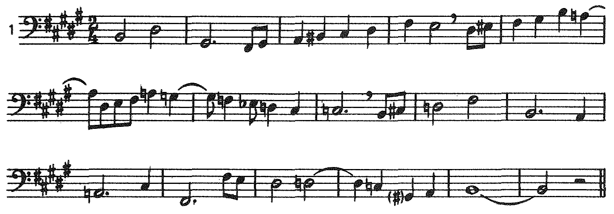[^m11v01]<!-- /m11-slot-01 -->

<!-- visual: zadatak 2; page 379 --><!-- m11-slot-02 -->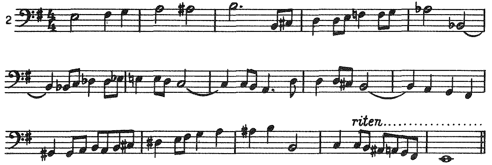[^m11v02]<!-- /m11-slot-02 -->

<!-- source-page: 380; pdf-page: 191 -->

<!-- visual: zadatak 3; page 380 --><!-- m11-slot-03 -->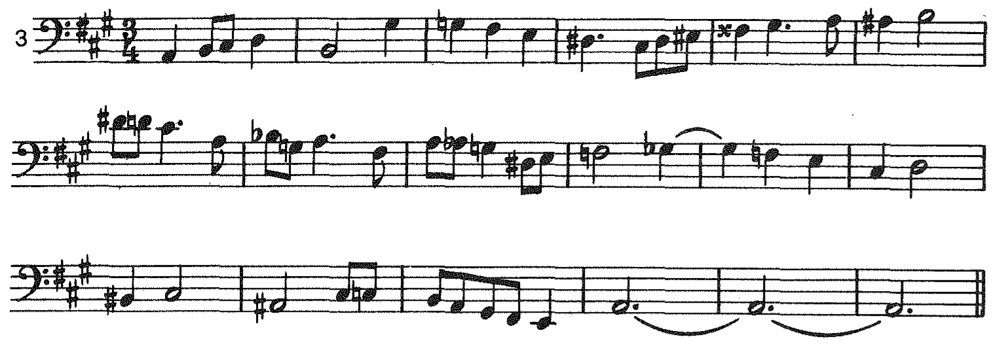[^m11v03]<!-- /m11-slot-03 -->

<!-- visual: zadatak 4; page 380 --><!-- m11-slot-04 -->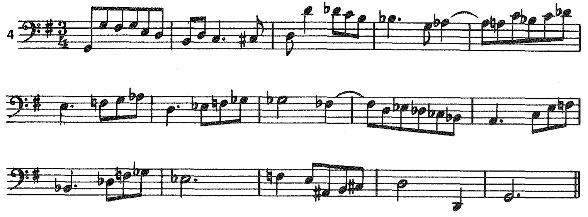[^m11v04]<!-- /m11-slot-04 -->

<!-- visual: zadatak 5; page 380 --><!-- m11-slot-05 -->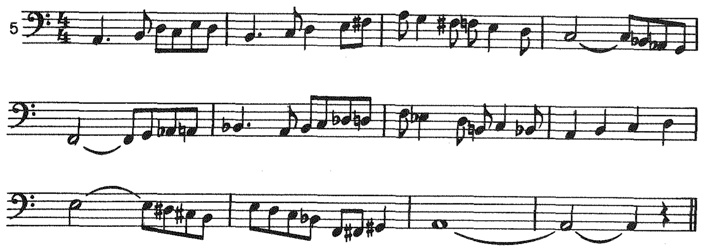[^m11v05]<!-- /m11-slot-05 -->

<!-- visual: zadatak 6; page 380 --><!-- m11-slot-06 -->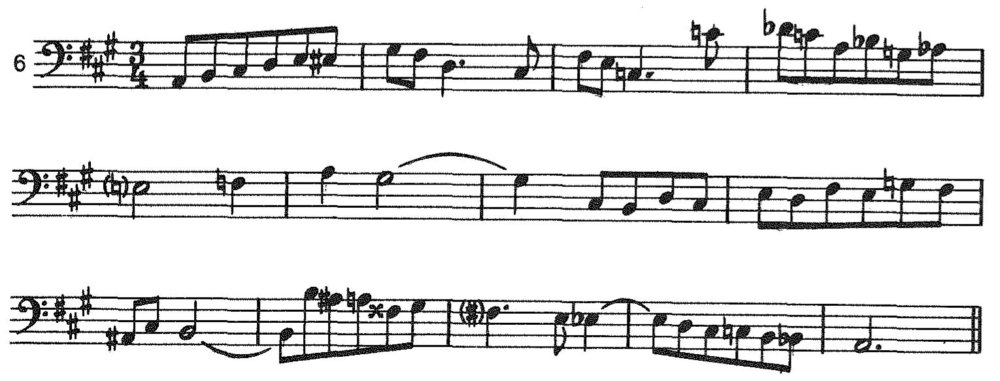[^m11v06]<!-- /m11-slot-06 -->

<!-- source-page: 381; pdf-page: 191 -->

<!-- visual: zadatak 7; page 381 --><!-- m11-slot-07 -->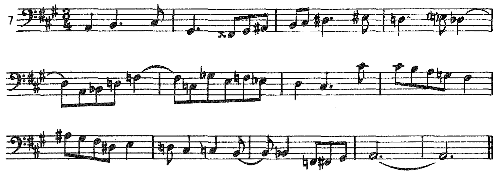[^m11v07]<!-- /m11-slot-07 -->

<!-- visual: zadatak 8; page 381 --><!-- m11-slot-08 -->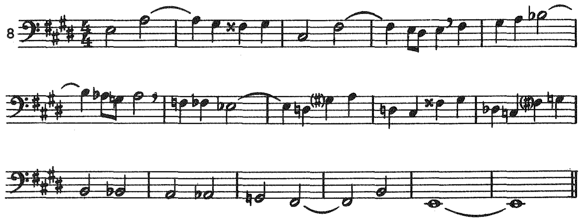[^m11v08]<!-- /m11-slot-08 -->

<!-- visual: zadatak 9; page 381 --><!-- m11-slot-09 -->[PRIVREMENO — NEODOBREN IZREZ: Zadatak 9.](../images/05-rekapitulacija/primjer-5-9.png)[^m11v09]<!-- /m11-slot-09 -->

<!-- visual: zadatak 10 (početak, Andantino); page 381 --><!-- m11-slot-10 -->[PRIVREMENO — NEODOBREN IZREZ: Zadatak 10., prvi dio.](../images/05-rekapitulacija/primjer-5-10-part-1.png)[^m11v10]<!-- /m11-slot-10 -->

<!-- source-page: 382; pdf-page: 192 -->

<!-- visual: zadatak 10 (nastavak); page 382 --><!-- m11-slot-11 -->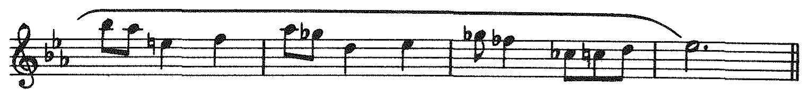[^m11v11]<!-- /m11-slot-11 -->

<!-- visual: zadatak 11; page 382 --><!-- m11-slot-12 -->[PRIVREMENO — NEODOBREN IZREZ: Zadatak 11.](../images/05-rekapitulacija/primjer-5-11.png)[^m11v12]<!-- /m11-slot-12 -->

<!-- visual: zadatak 12 (Risoluto); page 382 --><!-- m11-slot-13 -->[PRIVREMENO — NEODOBREN IZREZ: Zadatak 12.](../images/05-rekapitulacija/primjer-5-12.png)[^m11v13]<!-- /m11-slot-13 -->

<!-- visual: zadatak 13 (početak); page 382 --><!-- m11-slot-14 -->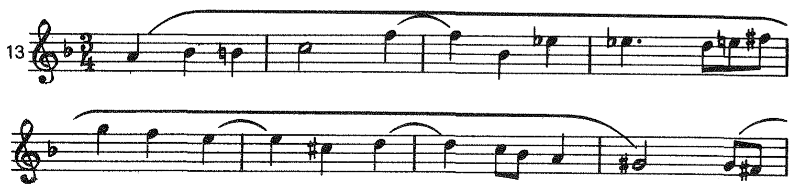[^m11v14]<!-- /m11-slot-14 -->

<!-- source-page: 383; pdf-page: 192 -->

<!-- visual: zadatak 13 (nastavak); page 383 --><!-- m11-slot-15 -->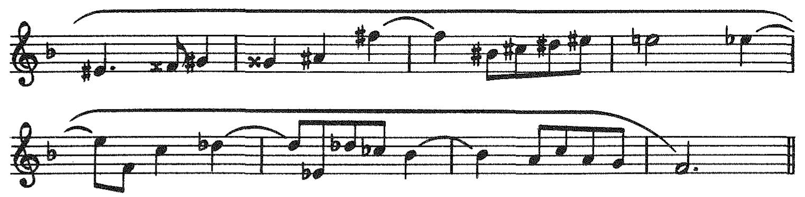[^m11v15]<!-- /m11-slot-15 -->

<!-- visual: zadatak 14 (Andantino); page 383 --><!-- m11-slot-16 -->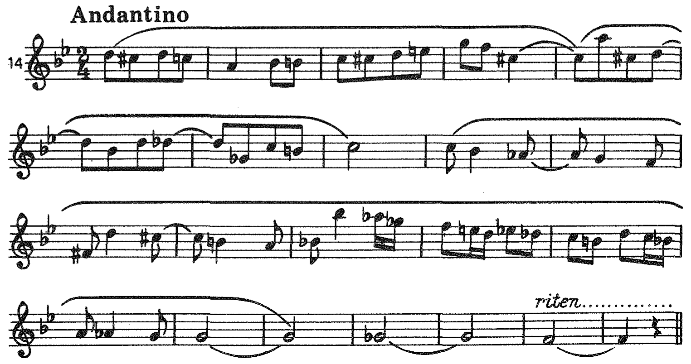[^m11v16]<!-- /m11-slot-16 -->

<!-- visual: zadatak 15; page 383 --><!-- m11-slot-17 -->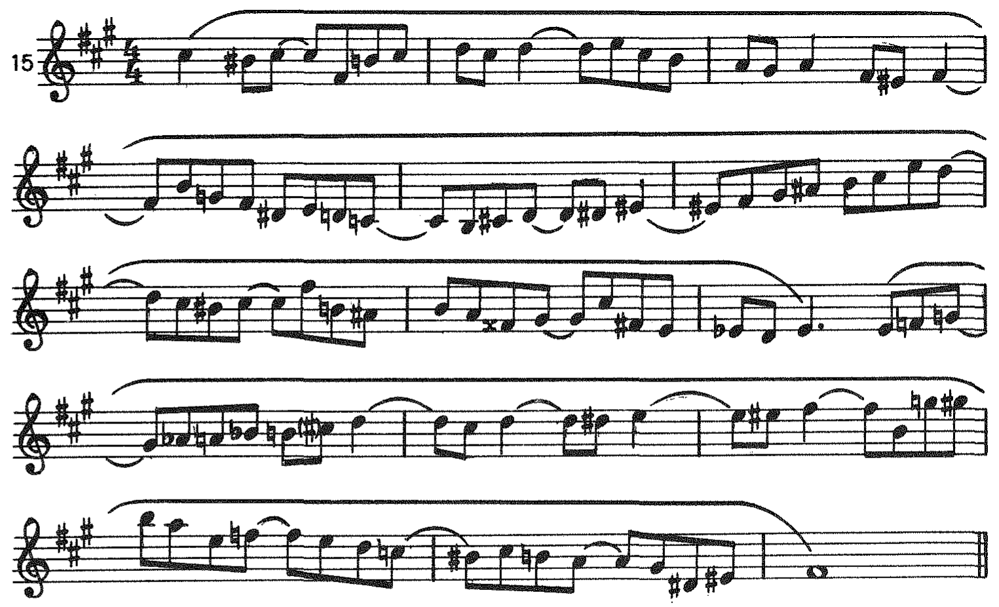[^m11v17]<!-- /m11-slot-17 -->

<!-- source-page: 384; pdf-page: 193 -->

Realizacija zadatka 4.

<!-- visual: Realizacija zadatka 4; page 384 --><!-- m11-slot-18 -->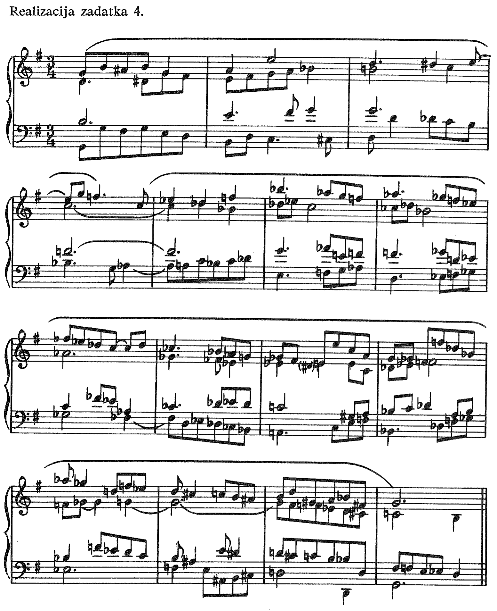[^m11v18]<!-- /m11-slot-18 -->

<!-- source-page: 385; pdf-page: 193 -->

Realizacija zadatka 9.

<!-- visual: Realizacija zadatka 9; page 385 --><!-- m11-slot-19 -->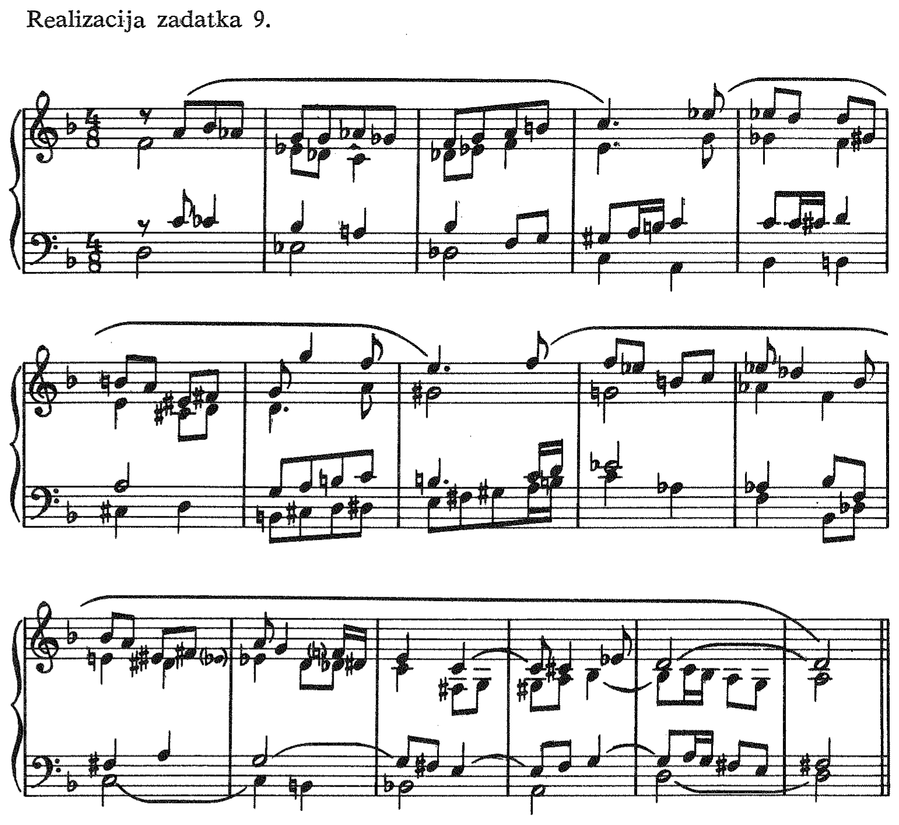[^m11v19]<!-- /m11-slot-19 -->

<!-- boundary 385/386: Završio je numerirani odjeljak 5; slijedi zaseban nenumerirani pregled obilježavanja akorda, namijenjen datoteci dodataka. -->
<!-- output-section: appendices -->

<!-- M11 editorial image captions: these are not printed book prose. -->
[^m11v01]: Zadatak 1. Izvor: tiskana str. 379; PDF str. 190 (1-based). MuseScore: TODO — naknadni prijepis.

[^m11v02]: Zadatak 2. Izvor: tiskana str. 379; PDF str. 190 (1-based). MuseScore: TODO — naknadni prijepis.

[^m11v03]: Zadatak 3. Izvor: tiskana str. 380; PDF str. 191 (1-based). MuseScore: TODO — naknadni prijepis.

[^m11v04]: Zadatak 4. Izvor: tiskana str. 380; PDF str. 191 (1-based). MuseScore: TODO — naknadni prijepis.

[^m11v05]: Zadatak 5. Izvor: tiskana str. 380; PDF str. 191 (1-based). MuseScore: TODO — naknadni prijepis.

[^m11v06]: Zadatak 6. Izvor: tiskana str. 380; PDF str. 191 (1-based). MuseScore: TODO — naknadni prijepis.

[^m11v07]: Zadatak 7. Izvor: tiskana str. 381; PDF str. 191 (1-based). MuseScore: TODO — naknadni prijepis.

[^m11v08]: Zadatak 8. Izvor: tiskana str. 381; PDF str. 191 (1-based). MuseScore: TODO — naknadni prijepis.

[^m11v09]: Zadatak 9. Izvor: tiskana str. 381; PDF str. 191 (1-based). MuseScore: TODO — naknadni prijepis. **PRIVREMENO / NEODOBRENO — potreban novi izrez i neovisna provjera.** Razlog: Bottom edge contains coherent upper portions of the following exercise 10 title Andantino. Exercise 9's low ending slurs occupy the same vertical band elsewhere across the width. Raising the bottom would clip those slurs; moving a side would lose exercise content. No safe single source rectangle certified. Printed 9 and remaining notation otherwise present; requires a separately reviewed source-only multipart solution, not erasure.

[^m11v10]: Zadatak 10., prvi dio. Izvor: tiskana str. 381; PDF str. 191 (1-based). MuseScore: TODO — naknadni prijepis. **PRIVREMENO / NEODOBRENO — potreban novi izrez i neovisna provjera.** Razlog: Top contains cut-off low slurs/accidental from exercise 9, while Andantino genuinely belongs to exercise 10 and must remain. Their vertical ranges overlap. No safe full-width rectangle certified. Printed 10 and three systems retained; continuation pairing is correct, but this first part is not clean.

[^m11v11]: Zadatak 10., nastavak sa str. 381. Izvor: tiskana str. 382; PDF str. 192 (1-based). MuseScore: TODO — naknadni prijepis.

[^m11v12]: Zadatak 11. Izvor: tiskana str. 382; PDF str. 192 (1-based). MuseScore: TODO — naknadni prijepis. **PRIVREMENO / NEODOBRENO — potreban novi izrez i neovisna provjera.** Razlog: Contains unrelated Risoluto title of exercise 12 at lower left. The genuine final reduction, its low beams and closing chord of exercise 11 extend into the same vertical band at right. Removing the title by a straight bottom crop would remove the reduction. No safe single rectangle certified. Printed 11 and four main systems are otherwise intact.

[^m11v13]: Zadatak 12. Izvor: tiskana str. 382; PDF str. 192 (1-based). MuseScore: TODO — naknadni prijepis. **PRIVREMENO / NEODOBRENO — potreban novi izrez i neovisna provjera.** Razlog: Top-right edge retains cut-off reduction/beams and chord belonging to exercise 11. Risoluto belongs to exercise 12 at top left and cannot be discarded. No safe single rectangle certified because the two occupy the same vertical range. Printed 12, five systems, riten. and low ending sharp otherwise retained.

[^m11v14]: Zadatak 13., prvi dio. Izvor: tiskana str. 382; PDF str. 192 (1-based). MuseScore: TODO — naknadni prijepis.

[^m11v15]: Zadatak 13., nastavak sa str. 382. Izvor: tiskana str. 383; PDF str. 192 (1-based). MuseScore: TODO — naknadni prijepis.

[^m11v16]: Zadatak 14. Izvor: tiskana str. 383; PDF str. 192 (1-based). MuseScore: TODO — naknadni prijepis.

[^m11v17]: Zadatak 15. Izvor: tiskana str. 383; PDF str. 192 (1-based). MuseScore: TODO — naknadni prijepis.

[^m11v18]: Realizacija zadatka 4. Izvor: tiskana str. 384; PDF str. 193 (1-based). MuseScore: TODO — naknadni prijepis.

[^m11v19]: Realizacija zadatka 9. Izvor: tiskana str. 385; PDF str. 193 (1-based). MuseScore: TODO — naknadni prijepis.
