<!-- source-page: 386; pdf-page: 194 -->

# OBILJEŽAVANJE AKORDA

U partiturama djela baroknog razdoblja redovito se pojavljuje poseban način bilježenja akorda za instrument, koji izvodi akordičku pratnju (orgulje, klavikord, čembalo, lutnja i sl.). Pratnja se označivala tako da se u partituru unosila samo basova dionica instrumenta, a njoj su se dodavale potrebne brojke. Budući da je pratnja tekla kroz čitavu kompoziciju kao njen sastavni dio, uvriježio se za instrument pratnje naziv **continuo** (lat. continuus — *neprekidan*), a za samu basovu dionicu **basso continuo** ili **generalbas**. Obilježavanje akorda, kojim smo se služili, uglavnom se poklapa s obilježavanjem generalbasa, pa ćemo stoga ovdje navesti još samo neke manje razlike i dodati oznake koje se u ovoj knjizi nisu pojavljivale.

**Povišenje dijatonskog stupnja** označuje se u generalbasu ili stavljanjem predznaka ispred odgovarajuće brojke (npr. <!-- visual: slika-386-1; page 386 --><!-- m11-slot-20 -->[PRIVREMENO — NEODOBREN IZREZ: Oznaka povišene kvarte: ♯4.](../images/dodaci/slika-386-1-recrop-m11.png)[^m11v20]<!-- /m11-slot-20 --> označuje povišenu kvartu, računajući od basova tona) — kao što smo, uostalom, i mi radili — ili tako da se odnosna brojka precrta kosim potezom .(<!-- visual: slika-386-2; page 386 --><!-- m11-slot-21 -->[PRIVREMENO — NEODOBREN IZREZ: Brojka 4 precrtana kosim potezom.](../images/dodaci/slika-386-2-recrop-m11.png)[^m11v21]<!-- /m11-slot-21 -->).

**Kosi potezi**, kada stoje sami za sebe (<!-- visual: slika-386-3; page 386 --><!-- m11-slot-22 -->[^m11v22]<!-- /m11-slot-22 -->), znače u generalbasu ponavljanje prethodne oznake, dakle iste intervale iznad dotičnih tonova u basu, kao što su bili iznad tona koji prethodi prvome kosom potezu u nizu (npr. ako fragment basove dionice sadrži redom tonove »c«, »d«, »e«, s brojkom 6, ispod »c«, a s kosim potezima ispod »d« i ispod »e«, to znači tri sekstakorda za redom).

**Ništica (0)** u generalbasu znači pauziranje svih gornjih glasova — tzv. **tasto solo** — tj. sviranje samo basova tona.

U brojnim francuskim udžbenicima harmonije srećemo brojku, precrtanu kosim potezom, u sasvim drugom značenju nego u generalbasu: precrtana brojka 5 (<!-- visual: slika-386-4; page 386 --><!-- m11-slot-23 -->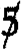[^m11v23]<!-- /m11-slot-23 -->) označuje kod njih smanjenu kvintu, odnosno smanjeni kvintakord, a precrtana brojka 7 (<!-- visual: slika-386-5; page 386 --><!-- m11-slot-24 -->[PRIVREMENO — NEODOBREN IZREZ: Precrtana brojka 7 u francuskom obilježavanju.](../images/dodaci/slika-386-5-recrop-m11.png)[^m11v24]<!-- /m11-slot-24 -->) smanjenu septimu, odnosno smanjeni septakord. Osim toga, Francuzi obilježavaju vođicu u raznim akordima dominantne funkcije križićem (+), tako da se kombinacijama brojaka, križića i kosog poteza dobivaju ove oznake:

<!-- visual: slika-386-6; page 386 --><!-- m11-slot-25 -->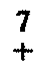[^m11v25]<!-- /m11-slot-25 --> označuje dominantni septakord;

<!-- visual: slika-386-7; page 386 --><!-- m11-slot-26 -->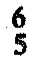[^m11v26]<!-- /m11-slot-26 --> označuje dominantni kvintsekstakord;

<!-- visual: slika-386-8; page 386 --><!-- m11-slot-27 -->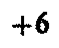[^m11v27]<!-- /m11-slot-27 --> označuje dominantni terckvartakord;

<!-- visual: slika-386-9; page 386 --><!-- m11-slot-28 -->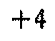[^m11v28]<!-- /m11-slot-28 --> označuje dominantni sekundakord;

<!-- visual: slika-386-10; page 386 --><!-- m11-slot-29 -->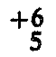[^m11v29]<!-- /m11-slot-29 --> označuje prvi obrat smanjenog septakorda;

<!-- visual: slika-386-11; page 386 --><!-- m11-slot-30 -->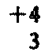[^m11v30]<!-- /m11-slot-30 --> označuje drugi obrat smanjenog septakorda s time da se brojka 3 također zamjenjuje i odgovarajućim predznakom ovisno o armaturi,

<!-- source-page: 387; pdf-page: 194 -->
<!-- continuation 386/387: Nastavlja se isti završni unos popisa oznaka; zarez na kraju stranice 386 zadržan je. -->

dakle još <!-- visual: slika-387-1; page 387 --><!-- m11-slot-31 -->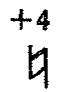[^m11v31]<!-- /m11-slot-31 --> ili <!-- visual: slika-387-2; page 387 --><!-- m11-slot-32 -->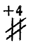[^m11v32]<!-- /m11-slot-32 --> ili <!-- visual: slika-387-3; page 387 --><!-- m11-slot-33 -->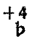[^m11v33]<!-- /m11-slot-33 -->;

<!-- visual: slika-387-4; page 387 --><!-- m11-slot-34 -->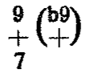[^m11v34]<!-- /m11-slot-34 --> označuje dominantni nonakord;

<!-- visual: slika-387-5; page 387 --><!-- m11-slot-35 -->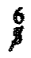[^m11v35]<!-- /m11-slot-35 --> označuje prvi obrat dominantnog nonakorda;

<!-- visual: slika-387-6; page 387 --><!-- m11-slot-36 -->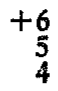[^m11v36]<!-- /m11-slot-36 --> označuje drugi obrat dominantnog nonakorda;

<!-- visual: slika-387-7; page 387 --><!-- m11-slot-37 -->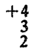[^m11v37]<!-- /m11-slot-37 --> označuje treći obrat dominantnog nonakorda.

Francuske oznake za zaostajalice u basu poklapaju se s našima, ali se sreću i drukčije, također francuske:

<!-- visual: slika-387-8; page 387 --><!-- m11-slot-38 -->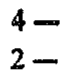[^m11v38]<!-- /m11-slot-38 --> označuje zaostajalicu na basov ton kvintakorda (—5);

<!-- visual: slika-387-9; page 387 --><!-- m11-slot-39 -->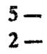[^m11v39]<!-- /m11-slot-39 --> označuje zaostajalicu na basov ton sekstakorda (—6);

<!-- visual: slika-387-10; page 387 --><!-- m11-slot-40 -->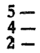[^m11v40]<!-- /m11-slot-40 --> označuje zaostajalicu na basov ton kvintsekstakorda <!-- visual: slika-387-11; page 387 --><!-- m11-slot-41 -->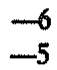[^m11v41]<!-- /m11-slot-41 -->;

<!-- visual: slika-387-12; page 387 --><!-- m11-slot-42 -->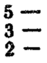[^m11v42]<!-- /m11-slot-42 --> označuje zaostajalicu na basov ton terckvartakorda <!-- visual: slika-387-13; page 387 --><!-- m11-slot-43 -->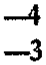[^m11v43]<!-- /m11-slot-43 -->.

Ponegdje se za smanjenu kvintu, odnosno za smanjeni kvintakord, također upotrebljava i oznaka <!-- visual: slika-387-14; page 387 --><!-- m11-slot-44 -->[PRIVREMENO — NEODOBREN IZREZ: Alternativna oznaka smanjene kvinte odnosno smanjenog kvintakorda.](../images/dodaci/slika-387-14-recrop-m11.png)[^m11v44]<!-- /m11-slot-44 -->.

<!-- boundary 387/388: Pregled obilježavanja završava cjelovitom rečenicom; stranica 388 je prazna, a na 389 počinje usporedni pregled termina. -->
<!-- source-page: 388; pdf-page: 195 -->
<!-- blank-page: 388; izvorna stranica nema tiskanog teksta ni vizualnih primjera, samo sitne tragove skena. -->

<!-- source-page: 389; pdf-page: 195 -->

# USPOREDNI PREGLED TERMINA

Ovaj usporedni pregled sadrži najuobičajenije engleske (e.), francuske (f.), njemačke (nj.) i talijanske (t.) nazive iz područja harmonije, a svrha mu je da olakša snalaženje pri čitanju odgovarajuće stručne literature na navedenim jezicima.[^8]

<!-- Nazivi stupaca dodani su radi prikaza izvornog dvostupčanog popisa u Markdown tablici. -->

| Naziv | Strani nazivi |
| --- | --- |
| **akord** | *e.* chord |
| **anticipacija** | *nj.* Vorausnahme, Antizipation |
| **cjelostepeni pomak** | *nj.* Ganztonschritt |
| **dominanta dominante** | *nj.* Doppeldominante, Wechseldominante |
| **dominantni kvintsekstakord** | *f.* accord de quinte diminuée et sixte |
| **dominantni nonakord** | *f.* (accord de) neuvième de Dominante; *nj.* Dominantseptnonakkord |
| **dominantni sekundakord** | *f.* accord de triton |
| **dominantni septakord** | *e.* dominant seventh chord; *f.* (accord de) septième de Dominante; *nj.* Dominantseptimmenakkord, Dominantseptakkord; *t.* accordo di settima (sulla) dominante |
| **dominantni terckvartakord** | *f.* accord de sixte sensible |
| **frigijska kadenca** | *e.* Phrygian Close |
| **generalbas** | *e.* thorough-bass, figured bass; *f.* basse continue, basse chiffrée; *nj.* Generalbass, bezifferter Bass; *t.* basso continuo |
| **glavni kvintakordi** | *e.* primary triads; *nj.* Hauptdreiklänge; *t.* accordi principali |
| **izmjenični kvartsekstakord** | *e.* auxiliary (chord of the) six-four; *nj.* Quartsextakkord als Wechselakkord |
| **izmjenični ton** | *e.* auxiliary tone, embellishment, returning note, alternating note; *f.* broderie; *nj.* Wechselnote; *t.* nota cambiata |
| **jednostrani pomak** | *e.* oblique motion; *f.* mouvement oblique; *nj.* Seitenbewegung; *t.* moto obliquo |

[^8]: U pregled nisu uvršteni strani nazivi kojima se i mi služimo i koji se od naših oblika razlikuju u nevažnim detaljima, tj. u onima koji nikako ne mogu ometati direktno razumijevanje. Na primjer, nazivi za akord na francuskom (accord), njemačkom (Akkord) i na talijanskom (accordo) nisu uvršteni, a engleski naziv (chord) već jest i sl.

<!-- boundary 389/390: Usporedni pregled termina nastavlja se na stranici 390 stavkom kadenca; na prijelazu nema prekinute riječi ni započetog retka. -->
<!-- boundary 389/390: Nastavlja se usporedni pregled termina; prethodna stavka jednostrani pomak završena je na stranici 389. -->
<!-- source-page: 390; pdf-page: 196 -->

<!-- Nazivi stupaca služe prikazu izvornog dvostupčanog popisa; nisu dodatni tiskani tekst. -->

| Naziv | Strani nazivi |
| --- | --- |
| **kadenca** | *nj.* Schluss, Kadenz |
| **kadencirajući kvartsekstakord** | *e.* cadential (chord of the) six-four; *nj.* kadenzierender Quartsextakkord |
| **konsonantni kvintakord** | *e.* common chord; *f.* accord parfait; *t.* accordo perfetto |
| **križanje glasova** | *e.* crossing of parts; *f.* croisement; *nj.* Stimmenkreuzung; *t.* incrociamento delle parti |
| **kvartsekstakord** | *e.* chord of the six-four; *f.* (accord de) quarte et sixte; *nj.* Quartsextakkord; *t.* accordo di quarta e sesta |
| **kvartsekstakord kao obrat** | *e.* arpeggio six-four; *nj.* Quartsextakkord als Umkehrungsakkord |
| **kvintakord v. trozvuk** | |
| **kvintni položaj** | *nj.* Quintlage; *t.* posizione di quinta |
| **kvintsekstakord** | *f.* accord de quinte et sixte; *t.* accordo di quinta e sesta |
| **mješoviti slog** | *nj.* gemischte Lage |
| **napuljski sekstakord** | *e.* Neapolitan Sixth; *f.* sixte napolitaine; *nj.* Neapolitanischer Sextakkord; *t.* sesta napoletana |
| **nasljedne kvinte** | *nj.* nachschlagende Quinten |
| **nasljedne oktave** | *nj.* nachschlagende Oktaven |
| **neakordički tonovi** | *e.* nonharmonic tones, unessential notes; *f.* notes étrangères; *nj.* harmoniefremde Töne, akkordfremde Töne; *t.* note accidentali melodiche, note ornamentali |
| **nesavršena kadenca** | *f.* cadence imparfaite; *nj.* unvollkommener Schluss; *t.* cadenza imperfetta |
| **nonakord** | *e.* ninth chord; *f.* accord de neuvième; *t.* accordo di nona |
| **obilježeni (šifrirani) bas** | *e.* figured bass; *f.* basse chiffrée; *nj.* bezifferter Bass; *t.* basso numerato |
| **obrat akorda** | *e.* inversion of a chord; *f.* renversement d’un accord; *nj.* Umkehrung des Akkords; *t.* rivolto di un accordo |
| **oktavni položaj** | *nj.* Oktavlage; *t.* posizione di ottava; |
| **opreka** | *e.* false relation, cross-relation; *f.* fausse relation; *nj.* Qurstand; *t.* falsa relazione; |
| **paralelne kvinte** | *e.* parallel fifths, consecutive fifths; *f.* quintes consécutives; *nj.* parallele Quinten; *t.* quinte consecutive |
| **paralelne oktave** | *e.* parallel octaves, consecutive octaves; *f.* octaves consécutives; *nj.* parallele Oktaven; *t.* ottave consecutive |

<!-- source-page: 391; pdf-page: 196 -->

| Naziv | Strani nazivi |
| --- | --- |
| **paralelni pomak** | *e.* similar motion, parallel movement; *f.* mouvement direct; *nj.* gerade Bewegung, Parallelbewegung; *t.* moto retto |
| **pedalni ton** | *e.* pedal point; *f.* point d’orgue, pedale; *nj.* Orgelpunkt; *t.* pedale, pedale d’armonia |
| **polovična kadenca** | *e.* half cadence, Half Close; *f.* demi-cadence; *nj.* Halbschluss; *t.* cadenza alla dominante, semicadenza |
| **polustepen** | *e.* semitone; *f.* demi-ton; *nj.* Halbton; *t.* semitono |
| **polustepeni pomak** | *nj.* Halbtonschritt; *t.* movimento per semitoni |
| **postepeni pomak** | *e.* conjunct movement; *f.* mouvement conjoint; *nj.* stufenweise Fortschreitung; *t.* movimento per gradi congiunti |
| **povećani kvintakord** | *e.* augmented triad; *f.* accord de quinte augmentée; *nj.* übermässiger Dreiklang; *t.* triade aumentata; |
| **povećani kvintsekstakord** | *e.* German Sixth; *nj.* übermässiger Quintsextakkord |
| **povećani sekstakord** | *e.* Italian Sixth; *nj.* übermässiger Sextakkord |
| **povećani terckvartakord** | *e.* French Sixth; *nj.* übermässiger Terzquartakkord |
| **prohodni kvartsekstakord** | *e.* passing (chord of the) six-four; *nj.* Quartsextakkord als Durchgangsakkord |
| **protupomak** | *e.* contrary motion, contrary movement; *f.* mouvement contraire; *nj.* Gegenbewegung; *t.* moto contrario |
| **sakrite kvinte** | *e.* hidden fifths, covered fifths, exposed fifths; *f.* quintes directes; *nj.* verdeckte Quinten; *t.* quinte nascoste |
| **sakrite oktave** | *e.* hidden octaves, covered octaves, exposed octaves; *f.* octaves directes; *nj.* verdeckte Oktaven; *t.* ottave nascoste |
| **savršena kadenca** | *e.* perfect cadence; *f.* cadence parfaite; *nj.* vollkommener Schluss; *t.* cadenza perfetta |
| **sekstakord** | *f.* accord de sixte; *t.* accordo di sesta |
| **sekundakord** | *f.* accord de seconde; *t.* accordo di seconda |
| **sekundarne dominante** | *e.* secondary dominants; *nj.* Zwischendominanten, Dominanten zweiten Grades |
| **sekvence** | *f.* marche d’harmonie; *t.* progressione |
| **septakord** | *e.* seventh chord; *f.* accord de septième; *nj.* Septimmenakkord, Septakkord; *t.* accordo di settima |

<!-- boundary 391/392: Posljednja stavka septakord cjelovita je na stranici 391; nastavak popisa treba provjeriti na sljedećoj stranici. -->
<!-- source-page: 392; pdf-page: 197 -->
<!-- boundary 391/392: Nastavak usporednog pregleda termina nakon cjelovite stavke septakord. -->

| Naziv | Strani nazivi |
| --- | --- |
| **slog (akorda)** | *e.* position, spacing; *f.* position; *nj.* Lage; *t.* posizione |
| **slučajna harmonija** | *nj.* zufällige Harmoniebildung |
| **slušne kvinte** | *nj.* Ohrenquinten |
| **smanjeni kvintakord** | *e.* diminished triad; *f.* accord de quinte diminuée; *nj.* verminderter Dreiklang; *t.* triade diminuita |
| **smanjeni septakord** | *e.* diminished seventh chord; *f.* (accord de) septième diminuée; *nj.* verminderter Septimmenakkord, verminderter Septakkord; *t.* accordo di settima diminuita |
| **sporedni kvintakordi** | *e.* secondary triads; *nj.* Nebendreiklänge; *t.* accordi accessori |
| **sporedni septakordi** | *nj.* Nebenseptimeenakkorde, Nebenseptakkorde; *t.* accordi accessori |
| **stupanj** | *e.* degree; *f.* degré; *nj.* Stufe; *t.* grado |
| **subdominanta** | *f.* sous-Dominante; *nj.* Unterdominante, Subdominante; *t.* sotto-dominante |
| **široki slog** | *e.* open position, open harmony; *f.* position separée, position écartée; *nj.* weite Lage; *t.* posizione lata |
| **temeljni oblik (akorda)** | *e.* root position; *f.* état fondamental, position fondamentale, état direct; *nj.* Grundlage, Grundgestalt; *t.* stato fondamentale di un accordo |
| **temeljni ton** | *e.* root; *f.* fondamentale; *nj.* Grundton; *t.* fondamentale |
| **terckvartakord** | *f.* accord de tierce et quarte; *t.* accordo di terza e quarta |
| **tercni položaj** | *nj.* Terzlage; *t.* posizione di terza |
| **tijesni slog** | *e.* close position, close harmony; *f.* position serrée; *nj.* enge Lage; *t.* posizione stretta |
| **trozvuk (kvintakord)** | *e.* triad; *nj.* Dreiklang; *t.* triade |
| **unutarnji glasovi** | *nj.* Mittelstimmen; *t.* parti medie, parti interne |
| **varava kadenca** | *e.* deceptive cadence, interrupted cadence; *f.* cadence rompue, cadence évitée; *nj.* Trugschluss; *t.* cadenza d’inganno |
| **vođica** | *e.* leading tone, leading note; *f.* note sensible; *nj.* Leitton; *t.* sensibile |
| **zaostajalica** | *e.* suspension; *f.* retard, suspension; *nj.* Vorhalt; *t.* ritardo |
| **zaostajalični kvartsekstakord** | *nj.* Quartsextakkord als Vorhaltsakkord |

<!-- boundary 392/393: Usporedni pregled termina završava na stranici 392; stranica 393 započinje novi naslov INDEKS POJMOVA. -->
<!-- source-page: 393; pdf-page: 197 -->
<!-- boundary 392/393: Završio je usporedni pregled termina; započinje zaseban indeks pojmova. -->

# INDEKS POJMOVA

<!-- Nazivi stupaca služe Markdown prikazu. Brojevi su izvorne tiskane stranice, ne PDF stranice; crtice i podstavke zadržane su kao u izvorniku. -->

| Pojam | Tiskane stranice |
| --- | --- |
| **akcentne kvinte** | 27, 46 |
| **akcentne oktave** | 27, 46 |
| **akord** | 7 |
| **akordička figuracija** | 8 |
| **akordička struktura** | 7 |
| **akordički tonovi** | 8, 277—279 |
| **alikvotni niz** | 15, 16, 42 |
| **alteracija** | 175 |
| **alterirani akordi** | 175, 258 |
| — a. a. u širem smislu | 175 |
| — a. a. u užem smislu (pravi a. a.) | 175, 214—215, 223, 235, 254, 257 |
| — varijante alteriranih akorda | 273—276 |
| **alterirani dominantni nonakord** | |
| — v. nonakord | |
| **alterirani ton** | 76. 175 |
| **anticipacija** | 71, 278, 313, 361—364 |
| — a. appoggiature | 363 |
| — a. prohodnog tona | 363 |
| — slobodno riješena a. | 362 |
| **anticipirani akord** | 361 |
| **anticipirani ton** | 361 |
| **antiparalelne kvinte** | 26 |
| **antiparalelne oktave** | 26 |
| **appoggiatura** | 55, 65, 180, 220, 248, 255, 259, 267, 273, 277, 280, 304, 330, 344, 349—355 |
| — četverostruka a. | 353, 354 |
| **atonalna muzika** | 8 |
| **autentična kadenca** — v. kadenca | |
| **autentični (stari) načini** | 165 |
| **basso continuo** | 386 |
| **bitonalnost** | 378 |
| **cambiata** | 345 |
| **ciljni tonalitet** | 138 |
| **cjelotonska ljestvica** | 263—264, 270 |
| **continuo** | 386 |
| **četveroglasje, četveroglasni stavak** | 13—14, 124, 125, 252, 268, 292, 298, 366 |
| **četverozvuk** — v. septakord | |
| **dijatonske modulacije** — v. modulacije | |

<!-- boundary 393/394: Stranica 393 završava cjelovitom unakrsnom uputom dijatonske modulacije — v. modulacije; indeks se nastavlja na sljedećoj stranici. -->
<!-- source-page: 394; pdf-page: 198 -->
<!-- continuation: Nastavak indeksa pojmova; stranica 393 završila je cjelovitom uputom dijatonske modulacije — v. modulacije. -->

| Pojam | Tiskane stranice |
| --- | --- |
| **disonanca** | 277, 280 |
| **disonantni akordi** | 46, 49, 51, 83 |
| **disonantni intervali** | 12, 49, 83, 318, 327, 361 |
| **disonantni kvintakordi** | 12 |
| **dodana seksta** | 94—95 |
| **dominanta** | 12 |
| — d. u starim načinima | 165—166 |
| **dominanta dominante** | 185—186, 208, 219—220, 222, 273, |
| **dominantna funkcija** | 12, 13, 46, 50, 90, 104, 181, 192, 208, 215, 216, 219, 222, 282, 367 |
| **dominantne harmonije** | 181, 187, 208, 219, 311 |
| **dominantni četverozvuk** | |
| — v. septakord | |
| **dominantni kvintakord** | |
| — v. kvintakord | |
| **dominantni pedalni ton** | 366—368 |
| **dorska ljestvica** — v. dorski način | |
| **dorska seksta** | 166, 171 |
| **dorski način** | 165, 166, 167, 168 |
| **dorski završetak** | 169, 173 |
| **dur-kvintakord** — v. kvintakord | |
| **dur-sekstakord** | 48 |
| **dvostruka harmonija** | 376—378 |
| **échappée** | 345 |
| **eolska ljestvica** — v. eolski način | |
| **eolski način** | 166, 167, 168 |
| **enharmonija** | 162 |
| **enharmonijska promjena** | |
| — e. p. akorda | 162, 215 |
| — e. p. alteriranoga dominantnog nonakorda | 269 |
| — e. p. dominantnog septakorda | 231 |
| — e. p. povećanog kvintakorda | 249—250 |
| — e. p. povećanog kvintsekstakorda | 214, 228—229 |
| — e. p. povećanog sekstakorda | 214, 228—229 |
| — e. p. povećanog sekundakorda | 262 |
| — e. p. povećanog terckvartakorda | 234—236 |
| — e. p. smanjenog septakorda | 240—242 |
| **enharmonijska zamjena akorda** | 162—163, 193, 236, 306 |
| **enharmonijske modulacije** — v. modulacije | |

<!-- boundary 394/395: Svi ovdašnji retci i unakrsne upute cjeloviti su; indeks pojmova nastavlja se na sljedećoj stranici. -->
<!-- source-page: 395; pdf-page: 198 -->

| Pojam | Tiskane stranice |
| --- | --- |
| **frigijska kadenca** | 33, 79—81, 170 |
| **frigijska ljestvica** — v. frigijski način | |
| **frigijska sekunda** | 166, 171 |
| **frigijski način** | 79, 165, 166, 167, 168 |
| **frigijski pomak** | 79, 155—156 |
| **frigijski završetak** | 169, 171 |
| **funkcija** — v. harmonijske funkcije | |
| **Fuxov izmjenični ton** | 345 |
| **generalbas** | 386 |
| **glasovi (harmonijski)** | 7, 13 |
| — gornji g. | 14 |
| — unutarnji (srednji) g. | 14 |
| — vanjski g. | 14 |
| **glavni kvintakordi** — v. kvintakord | |
| **glavni stupnjevi** — v. stupanj | |
| **gornji glasovi** — v. glasovi | |
| **harmonija** | 7, 8, 9 |
| — klasična h. | 9, 14, 116 |
| — tradicionalna h. | 9 |
| **harmonijske funkcije** | 12 |
| **harmonijski mol** | 13, 76—77, 147, 181—182 |
| **harmonijski ritam** | 43—44 |
| **harmonizacija** | |
| — h. basa | 28—30 |
| — h. melodijske mol-ljestvice | 78 |
| — h. modulirajućega zadanog glasa | 159 |
| — h. soprana | 38—44, 46, 57 |
| — h. starih načina | 168 |
| **homofono muzičko tkivo** | 7 |
| **impresionističke harmonijske pojave** | 180, 263—264, 270 |
| **izbjegnuta kadenca** — v. kadenca | |
| **izbor harmonija** | 38—39, 56—57 |
| **izmjenični kvartsekstakord** | |
| — v. kvartsekstakord | |
| **izmjenični ton** | 55, 69, 70, 278, 291, 309—310, 377 |
| — i. t. izmjeničnog tona | 341 |
| — i. tonovi u jednom glasu | 315 |
| — i. tonovi uz promjenu akorda | 330—331 |
| — kromatski i. tonovi | 335 |

<!-- source-page: 396; pdf-page: 199 -->
<!-- continuation 395/396: Prve tri podstavke i dalje pripadaju nadređenoj stavci izmjenični ton sa stranice 395. -->

| Pojam | Tiskane stranice |
| --- | --- |
| — kruženje i. tonova oko akordičkoga | 340, 343 |
| — varijante i. tona | 337—342, 344 |
| — višestruki i. tonovi | 317—320 |
| **jednostrani pomak** | 18 |
| **jonska ljestvica** — v. jonski način | |
| **jonski način** | 166, 167 |
| **kadenca** | 31 |
| — autentična k. | 31—32, 34—35, 39, 41, 170, 221, 313 |
| — izbjegnuta k. | 33, 37 |
| — mješovita (složena) k. | 31—32, 53, 98, 139 |
| — nepotpuna k. | 32 |
| — nesavršena k. | 32, 42, 46 |
| — plagalna k. | 31, 32, 35—36, 39, 69, 116—117, 170, 221, 276 |
| — polovična k. | 33, 36, 41, 313 |
| — savršena k. | 31, 41, 42 |
| — varava k. | 33, 36—37 |
| — ženska k. (ženski završetak) | 34, 37 |
| **kadencirajući kvartsekstakord** | |
| — v. kvartsekstakord | |
| **klasična harmonija** — v. harmonija | |
| **konsonanca** | 277 |
| **konsonantni akordi** | 12 |
| **konsonantni kvintakordi** | 12 |
| **koral** | |
| — Bachovi korali | 284, 314, 328, 331—332 |
| — gregorijanski (rimski) k. | 165 |
| **križanje glasova** | 17, 328 |
| **kromatika** | 175 |
| **kromatska promjena** | |
| — k. p. akorda | 182, 219, 290 |
| — k. p. kvintakorda | 251 |
| **kromatske modulacije** — v. modulacije | |
| **kromatski pomak** | 175, 219 |
| **kromatski prohod** | 186, 217, 244, 267, 269 |
| **kromatski spoj akorda** | 176, 177 |
| **kvartsekstakord** | 64, 86 |
| — izmjenični k. | 69—70, 77 |
| — kadencirajući k. | 66—67, 98, 313 |
| — k. kao obrat | 72 |
| — prohodni k. | 70—72, 262, 318 |
| — zaostajalični k. | 64—66, 77, 87, 186, 208, 216, 280 |

<!-- boundary 396/397: Nastavlja se indeks pojmova; pripadnost eventualnih sljedećih podstavki treba provjeriti uz stranicu 397. -->
<!-- source-page: 397; pdf-page: 199 -->

| Pojam | Tiskane stranice |
| --- | --- |
| **kvartsekstakord kao obrat** — v. kvartsekstakord | |
| **kvintakord** | 11—12, 175, 180 |
| — dominantni k. | 12, 180 |
| — dur-kvintakord (veliki) | 11, 177, 178, 182, 188, 195, 201—202, 218, 311 |
| — glavni kvintakordi | 13 |
| — mol-kvintakord (mali) | 11, 12, 177, 178, 181, 195, 199—200 |
| — povećani k. | 11, 46—47, 184, 200, 201, 249—253 |
| — smanjeni k. | 11, 18, 58—59, 76, 77, 199, 200, 201, 204 |
| — sporedni kvintakordi | 13 |
| — subdominantni k. | 12, 31 |
| — tonički k. | 12, 31, 187, 196, 216, 268 |
| **kvinte, rastavljene promjenom položaja** | 27 |
| **kvinte u protupomaku** | 26, 314 |
| **kvintna srodnost** | |
| — k. s. akordâ u kromatici | 177, 182, 188, 219, 258 |
| — k. s. kvintakordâ | 17 |
| **kvintni krug** | |
| — silazni k. k. | 144, 145, 147, 149, 150, 151, 152, 153, 154, 209 |
| — uzlazni k. k. | 144, 145, 147, 148, 149, 150, 152, 154, 209 |
| **kvintni položaj kvintakorda** | 16 |
| **kvintsekstakord** | 85 |
| **lančana modulacija** | 143 |
| **ležeći ton** | 369 |
| **lidijska kvarta** | 166, 172 |
| **lidijska ljestvica** — v. lidijski način | |
| **lidijski način** | 165, 166. 167, 168 |
| **melodijski mol** | 76—78, 147 |
| **miksolidijska ljestvica** | |
| — v. miksolidijski način | |
| **miksolidijska septima** | 166, 172 |
| **miksolidijski način** | 165, 166, 167, 168 |
| **miksolidijski završetak** | 170 |
| **mješovita kadenca** — v. kadenca | |
| **mješoviti slog** | 16 |
| **model (sekvence)** | 118 |
| **modulacije** | 137—138 |
| — dijatonske m. (općenito) | 138—142, 156—159, 236, 254 |
| — dijatonske m. iz dura u dur | 142—146 |
| — dijatonske m. iz dura u mol | 147—150 |
| — dijatonske m. iz mola u dur | 150—152 |
| — dijatonske m. iz mola u mol | 152—154 |
| — dijatonske m. na osnovi frigijskog pomaka | 155—156, 236 |

<!-- source-page: 398; pdf-page: 200 -->
<!-- continuation 397/398: Prvih dvadeset podstavki na398 nastavlja nadređenu stavku modulacije sa397. -->

| Pojam | Tiskane stranice |
| --- | --- |
| — enharmonijske m. (općenito) | 228, 254 |
| — e. m. pomoću enharmonijske promjene dominantnog nonakorda | 269—270 |
| — e. m. pomoću e. promjene dominantnog septakorda | 231—234 |
| — e. m. pomoću e. promjene povećanog kvintakorda | 250—253 |
| — e. m. pomoću e. promjene povećanog sekstakorda i povećanog kvintsekstakorda | 228—231 |
| — e. m. pomoću e. promjene povećanog sekundakorda | 262—263 |
| — e. m. pomoću e. promjene povećanog terckvartakorda | 234—236 |
| — e. m. pomoću e. promjene smanjenog septakorda | 242—246 |
| — e. m. pomoću e. zamjene kvintakorda | 162—164, 306 |
| — kromatske m. (općenito) | 192, 203—205, 254 |
| — k. m. na osnovi kromatske promjene dur-kvintakorda | 201—202 |
| — k. m. na osnovi k. promjene mol-kvintakorda | 199—201 |
| — k. m. na osnovi k. promjene povećanog kvintakorda | 203 |
| — k. m. na osnovi k. promjene smanjenog kvintakorda | 202—203 |
| — k. m. pomoću k. promjene akorda | 198—199, 237 |
| — k. m. pomoću kvintne srodnosti akordâ | 192—194 |
| — k. m. pomoću povećanog sekstakorda, kvintsekstakorda i terckvartakorda | 222—225 |
| — k. m. pomoću povećanog sekundakorda | 258, 260—261 |
| — k. m. pomoću tercne srodnosti akordâ | 194—198, 231, 236 |
| — modulacije pomoću napuljskog sekstakorda | 209—210 |
| **modulativni stavak** | 158, 203—204, 256 |
| **modus** — v. stari načini | |
| **mol-dur** | 115—117, 124, 144, 145, 148, 156—157, 182 |
| **mol-kvintakord** — v. kvintakord | |
| **mol-sekstakord** | 48 |
| **Mozartove kvinte** | 25, 217 |
| **muški završetak** | 34 |
| **naknadna septima** | 87 |
| **napuljski sekstakord** | 180, 207—208 |

<!-- source-page: 399; pdf-page: 200 -->

| Pojam | Tiskane stranice |
| --- | --- |
| **nasljedne kvinte** | 26, 217, 283, 285 |
| **nasljedne oktave** | 26, 283 |
| **neakordički tonovi** | 277, 279 |
| **nepotpuna kadenca** — v. kadenca | |
| **nepotpuni oblik kvintakorda** | 15—16, 261 |
| **nesavršena kadenca** — v. kadenca | |
| **nesrodni akordi u kromatici** | 179—180 |
| **nesrodni kvintakordi** | 17 |
| **nonakord** | 124 |
| — alterirani dominantni n. | 267—270 |
| — dominantni n. | 104, 124—129, 177, 178, 184, 188, 192, 194, 270 |
| — sporedni nonakordi | 131—134 |
| **notacija** | |
| — n. enharmonijskih promjena akordâ | 234, 237, 263 |
| — n. kromatskih prohodnih tonova | 334 |
| — n. smanjenog septakorda | 186, 187, 243—244 |
| **nota finalis** | 79, 156, 165, 167 |
| **obilježavanje (šifriranje)** | |
| — o. akordâ | 386—387 |
| — o. appoggiaturâ | 351 |
| — o. basa | 59—60 |
| — o. obratâ nonakorda | 125, 129 |
| — o. posrednih rješenja zaostajalice | 344 |
| — o. povećanog kvintakorda | 47 |
| — o. prohodnih i izmjeničnih tonova | 314 |
| — o. terce | 30 |
| — o. zaostajalicâ | 281, 285, 286 |
| **obrati** | |
| — o. akordâ | 14 |
| — o. nonakorda | 125 |
| — o. povećanog kvintsekstakorda | 218 |
| — o. povećanog sekstakorda | 218 |
| — o. povećanog sekundakorda | 257 |
| — o. povećanog terckvartakorda | 218 |
| — o. septakorda | 85—86 |
| **oktave, rastavljene promjenom položaja** | 27 |
| **oktave u protupomaku** | 26 |
| **oktavni položaj kvintakorda** | 16 |
| **opreka** | 78, 116, 175, 207—208, 341, 355 |
| **opseg glasova** | 14 |
| **organum** | 8 |

<!-- boundary 399/400: Svi ovdašnji retci završeni su; indeks se nastavlja na stranici400. -->
<!-- Editorial format: Table headings are editorial, not printed. Bold marks main index entries; em-dash rows retain printed subentries. Wrapped lines are joined, including line-break hyphenation; printed lexical hyphens, punctuation, page values and ranges are retained. Contents indentation is represented by nested labels in the first column. No index table is a visual-example slot. -->
<!-- boundary 399/400: Page 399 ends with the complete main entry organum; page 400 begins the new main entry orgelpunkt. No parent entry carries across this boundary. -->
<!-- source-page: 400; pdf-page: 201 -->

| Pojam | Tiskane stranice |
| --- | --- |
| **orgelpunkt** | 366 |
| **ostinato (ostinatna figura)** | 378 |
| **paralelna unisona** | 24 |
| **paralelne kvinte** | 24—26, 46, 51, 53, 89, 94, 217, 314, 350, 364 |
| **paralelne ljestvice** | 13 |
| **paralelne oktave** | 24, 314 |
| **paralelni pomak** | 18, 24 |
| **pedalni ton** | 278—279, 366—370, 378 |
| — dvostruki p. t. | 368 |
| **peteroglasje, peteroglasni stavak** | 292, 366 |
| **peterozvuk** — v. nonakord | |
| **pikardijska terca** | 32, 163 |
| **plagalna kadenca** — v. kadenca | |
| **plagalni (stari) načini** | 165 |
| **polazni tonalitet** | 138 |
| **polifono muzičko tkivo** | 7 |
| **politonalnost** | 378 |
| **polovična kadenca** — v. kadenca | |
| **pomak** | |
| — polustepeni p. | 246 |
| — p. za povećanu sekundu | 21 |
| — postepeni p. | 70, 71, 72, 84, 88, 221 |
| **posredni tonalitet** | 143, 193 |
| **posredno rješenje zaostajalice** — v. zaostajalica | |
| **postavljanje konsonantnih kvintakorda** | 13—17 |
| **postavljanje konsonantnih sekstakorda** | 48—49 |
| **potpuni oblik akorda** | 14 |
| **povećani kvintakord** — v. kvintakord | |
| **povećani kvintsekstakord** | 25, 162, 178, 214—225, 244, 262, 263 |
| **povećani sekstakord** | 214—225 |
| **povećani sekundakord** | 184, 214, 257—264, 268, 270 |
| **povećani terckvartakord** | 214—225, 268 |
| **preskok** | 23, 50, 52, 352 |
| **priprava** | |
| — p. none | 124, 131, 268, 298 |
| — p. septime | 93, 103, 114, 124, 131, 268, 298 |
| — p. zaostajalice | 281 |
| **prirodni mol** | 76 |
| **privremena tonika** | 181, 185, 187, 245 |
| **progresija** | 19 |
| **prohod** | 70 |
| — kromatski p. | 81 |
| **prohodna septima** | 87, 177 |
| **prohodni akordi** | 51, 86, 262 |
| **prohodni kvartsekstakord** — v. kvartsekstakord | |

<!-- source-page: 401; pdf-page: 201 -->

| Pojam | Tiskane stranice |
| --- | --- |
| **prohodni sekstakord VII stupnja** | 51, 89 |
| **prohodni ton** | 220, 278, 309, 350 |
| — kromatski p. tonovi | 333—334 |
| — p. tonovi u jednom glasu | 315 |
| — p. tonovi uz promjenu akorda | 330—331 |
| — varijanta prohodnog tona | 345 |
| — višestruki p. tonovi | 317—320 |
| **promjena akorda u času rješenja zaostajalice** | 283 |
| **promjena sloga** | 22 |
| **protupomak** | 18, 51, 83, 124, 322, 324, 325, 327, 328, 331 |
| **razmak između glasova** | 16, 17, 328 |
| **repercussa** | 165 |
| **retardacija** | 376 |
| **ritmička određenost** | |
| — r. o. izmjeničnog tona | 310, 330, 337 |
| — r. o. prohodnog tona | 310, 330 |
| **rješenje** | |
| — iznimna rješenja septime | 88—90, 94 |
| — naknadno r. septime | 90, 98, 291 |
| — r. septime u donjem glasu | 88 |
| — silazno r. none | 125, 269 |
| — silazno r. septime | 84 |
| — uzlazno r. none | 128—129, 131, 268 |
| — uzlazno r. septime | 97, 103, 104, 275 |
| **sakrite kvinte** | 27, 176 |
| **sakrite oktave** | 27, 84, 283, 350 |
| **savršena kadenca** — v. kadenca | |
| **Scarlattijeve kvinte** | 25 |
| **sekstakord** | 48 |
| — s. kao zaostajalica | 55, 88, 280 |
| — s. II stupnja u molu | 51—52 |
| — s. III stupnja u molu | 52 |
| — s. VII stupnja | 49—51 |
| **sekundakord** | 86 |
| **sekundarne dominante** | 181—188, 193, 205, 219—220, 222, 223, 235, 259 |
| **sekvenca** | 99, 108, 118—119, 134, 146, 188, 189, 194 |
| — harmonijska s. | 118 |
| — izvantonalna s. | 120, 233—234 |
| — melodijska s. | 118 |
| — slobodna s. | 119 |
| **septakord** | 83, 179 |
| — dominantni s. | 49, 83—90, 105, 106, 177, 178, 179, 180, 182, 188, 192, 194, 202, 204, 215, 218, 219, 221, 228—229, 230, 231, 232, 233, 234—235 |
| — smanjeni s. | 104—105, 184, 186, 188, 200, 201 202, 204, 242—246, 319 |

<!-- source-page: 402; pdf-page: 202 -->
<!-- continuation 401/402: The first three subentries continue septakord. -->

| Pojam | Tiskane stranice |
| --- | --- |
| — sporedni septakordi u duru | 93—99 |
| — sporedni s. u melodijskom molu | 105—108 |
| — sporedni s. u molu (harmonijskom) | 103—105 |
| **septimna srodnost akorda** | 18, 156 |
| **sinkopirana harmonija** | 43—44, 57, 333 |
| **sixte ajoutée** | 94—95, 140 |
| **skokovi** | |
| — s. u basu | 56, 221 |
| — s. u melodiji | 43 |
| — s. u vođanju glasova | 22—23 |
| — s. za povećane intervale | 23, 350 |
| — s. za smanjene intervale | 23 |
| **slobodni spoj** | |
| — s. s. nesrodnih kvintakorda | 19 |
| — s. s. srodnih kvintakorda | 21 |
| **slog** | |
| — široki s. | 14, 16 |
| — tijesni s. | 14, 16 |
| **složena kadenca** — v. kadenca | |
| **slučajna harmonija** | 279, 284, 305, 353—354 |
| **slušne kvinte** | 28 |
| **smanjeni kvintakord** — v. kvintakord | |
| **smanjeni septakord** — v. septakord | |
| **spajanje septakorda međusobno** | 95—97, 103, 111—112 |
| **sporedni kvintakordi** — v. kvintakord | |
| **sporedni septakordi** — v. septakord | |
| **sporedni stupnjevi** — v. stupanj | |
| **srednji glasovi** — v. glasovi | |
| **srodnost kvintakorda** | 17 |
| **stari načini** | 9, 165—171 |
| **starocrkvene ljestvice** — v. stari načini | |
| **strogi spoj** | 18 |
| **stupanj** | |
| — alterirani s. | 177 |
| — dijatonski s. | 177, 219, 235 |
| — glavni stupnjevi | 13 |
| — kromatski s. | 219, 235 |
| — sporedni stupnjevi | 13 |
| **subdominanta** | 12, 221 |
| **subdominantna funkcija** | 12, 13, 51, 186, 201, 207, 221 |
| **subdominantne harmonije** | 201 |
| **subdominantni kvintakord** — v. kvintakord | |
| **sudar** | |

<!-- source-page: 403; pdf-page: 202 -->
<!-- continuation 402/403: The first four subentries belong to sudar, printed at the foot of 402. -->

| Pojam | Tiskane stranice |
| --- | --- |
| — s. izmjeničnih tonova međusobno | 326 |
| — s. izmjeničnog tona s akordičkim tonom | 322, 323—325 |
| — s. prohodnih tonova međusobno | 325 |
| — s. prohodnog tona s akordičkim tonom | 322—323, 325, 337 |
| **šifriranje** — v. obilježavanje | |
| **široki slog** — v. slog | |
| **tasto solo** | 386 |
| **temeljni oblik akorda** | 14 |
| **temeljni ton** | |
| — t. t. kvintakorda | 11 |
| — t. t. nonakorda | 125, 126, 132, 268 |
| **temperirani tonski sistem** | 162 |
| **terckvartakord** | 85 |
| **tercna srodnost** | |
| — t. s. akordâ u kromatici | 178—179, 182, 219, 258 |
| — t. s. kvintakordâ u dijatonici | 17 |
| **tercni položaj kvintakorda** | 16 |
| **tetrakord** | |
| — donji frigijski t. | 79 |
| — gornji t. u harmonijskoj mol-ljestvici | 115, 196 |
| — gornji t. u prirodnoj mol-ljestvici (u silaznoj melodijskoj mol-ljestvici) | 79, 147 |
| **tijesni slog** — v. slog | |
| **tonalitet** | 9, 12, 13, 137, 138, 181 |
| **tonalni plan** | 159 |
| **tonalni skok** | 137 |
| **tonika** | 12, 181 |
| **tonička funkcija** | 12, 13, 182, 367 |
| **tonički kvintakord** — v. kvintakord | |
| **tonički pedalni ton** | 187, 339, 366—367 |
| **tradicionalna harmonija** — v. harmonija | |
| **»Tristan-akord«** | 273, 274 |
| **tritonus** | 49, 83, 104, 105, 124, 180, 189, 233, 276 |
| **troglasje, troglasni stavak** | 253 |
| **trozvuk** | 11 |
| **udvajanje** | |
| — u. akordičkih tonova u vezi s izmjeničnim tonovima | 312—313, 338 |
| — u. akordičkih tonova u vezi s prohodnim tonovima | 310—312 |
| — u. alteriranog tona | 176 |
| — u. basovog tona sekstakorda | 49—50 |

<!-- source-page: 404; pdf-page: 203 -->
<!-- continuation 403/404: The first nine subentries continue udvajanje. -->

| Pojam | Tiskane stranice |
| --- | --- |
| — u. kvinte konsonantnih kvintakorda | 15 |
| — u. septime | 312, 342 |
| — u. temeljnog tona konsonantnih kvintakorda | 14—15 |
| — u. terce konsonantnih kvintakorda | 15, 20, 311, 312 |
| — u. terce septakorda | 94 |
| — u. tona u koji se appoggiatura rješava | 350 |
| — u. tona u koji se zaostajalica rješava | 282, 284, 285, 299 |
| — u. tonova povećanog kvintakorda | 46, 252—253 |
| — u. vođice | 119, 209, 229 |
| **uklon** | 184—185 |
| **unisono** | 17, 56, 311—312, 314 |
| **unutarnji glasovi** — v. glasovi | |
| **vanjski glasovi** — v. glasovi | |
| **varava kadenca** — v. kadenca | |
| **varijante izmjeničnog tona** — v. izmjenični ton | |
| **vođica** | 12, 19—20, 21, 29, 39, 46, 49, 65, 78, 84, 85, 86, 132, 187, 221 |
| — privremena v. | 311 |
| — silazna v. | 12, 49, 51, 103, 104, 115, 195, 199, 201, 207, 221 |
| — umjetna v. | 181, 184, 253, 257, 268 |
| — uzlazna v. | 195, 199 |
| **zajednički akord** | 138, 139, 140, 142, 143, 144, 147, 148, 150, 152, 156, 209, 254 |
| **zajednički ton** | 17, 18, 54, 219 |
| **zaostajalica** | 55, 64, 78, 98, 105, 127, 246, 250, 260, 277, 280—284, 376 |
| — kombinirane višestruke z. | 301 |
| — nastup zaostajalice | 281 |
| — nepripravljena (slobodna) z. | 280 |
| — posredna rješenja zaostajalice | 342 |
| — priprava zaostajalice | 281 |
| — silazne z. na tonove dominantnog septakorda i dominantnog nonakorda | 290—292, 295 |
| — silazne z. na tonove kvintakorda | 284—286 |
| — silazne z. na tonove smanjenog septakorda | 294 |
| — silazne z. na tonove sporednih septakorda i nonakorda | 298 |
| — uzlazne z. | 97, 128, 246, 268, 299—300 |
| — višestruke z. | 300—301 |

<!-- source-page: 405; pdf-page: 203 -->
<!-- continuation 404/405: The first subentry continues zaostajalica. -->

| Pojam | Tiskane stranice |
| --- | --- |
| — zaostajalice u vezi s kromatikom i enharmonijom | 304—305 |
| **zaostajalični kvartsekstakord** — v. kvartsekstakord | |
| **završni ton (starih načina)** — v. nota finalis | |
| **ženska kadenca** — v. kadenca | |
| **ženski završetak** — v. kadenca | |

<!-- source-page: 406; pdf-page: 204 -->
<!-- Blank source page: no printed text, heading, page numeral, diagram or score. -->

<!-- source-page: 407; pdf-page: 204 -->

# INDEKS IMENA

| Ime | Tiskane stranice |
| --- | --- |
| Bach, Johann Sebastian | 8, 28, 34, 35, 36, 37, 67, 69, 80, 91, 98, 116, 122, 156, 186, 187, 284, 313, 314, 328, 331—332, 341, 364, 367 |
| Beethoven, Ludwig van | 35, 36, 89—90, 91, 95, 121, 127, 137, 157, 201, 211, 224, 243, 244, 245, 338, 340, 361, 362, 369, 376, 377, 378 |
| Brahms, Johannes | 175 |
| Bruckner, Anton | 7, 274 |
| Chopin, Frédéric | 8, 25, 35, 37, 116, 123, 171, 172, 187, 197, 212, 220, 236, 243, 251, 252, 254, 255, 258, 306, 340, 341, 352, 353, 363, 364, 366, 367, 368, 369 |
| Corelli, Arcangelo | 364 |
| Debussy, Claude | 37, 172, 173 |
| Dugan st., Franjo | 168 |
| Dvořak, Antonín | 173 |
| Fux, Johann Joseph | 345 |
| Grieg, Edward | 35, 128, 171, 172, 198, 275, 368 |
| Haydn, Joseph | 80, 128, 157, 339 |
| Janáček, Leoš | 354 |
| Koechlin, Charles | 325 |
| Liszt, Franz | 81, 180, 197, 259, 263—264, 268, 344 |
| Marx, Joseph — Bayer, Friedrich | 345 |
| Mendelssohn-Bartholdy, Felix | 68 |
| Milhaud, Darius | 378 |
| Mozart, Wolfgang Amadeus | 25, 34, 80, 122, 128, 188, 217, 224, 232, 304, 353 |
| Rameau, Jean-Philippe | 94 |
| Ravel, Maurice | 378 |
| Reger, Max | 210 |
| Rimski-Korsakov, Andrej Nikolajevič | 234 |

<!-- source-page: 408; pdf-page: 205 -->

| Ime | Tiskane stranice |
| --- | --- |
| Scarlatti, Domenico | 25 |
| Schubert, Franz | 224, 225, 232, 233, 250 |
| Schumann, Robert | 36, 37, 91, 137, 211, 342, 353, 354, 363, 370 |
| Skrjabin, Aleksandr Nikolajevič | 171, 260, 276 |
| Smetana, Bedřich | 251 |
| Strauss, Richard | 172, 275, 370 |
| Stravinski, Igor | 378 |
| Tjulin, Jurij Nikolajevič | 8 |
| Wagner, Richard | 117, 270, 179, 273—274 |
| Webern, Anton von | 9 |

<!-- source-page: 409; pdf-page: 205 -->

# SADRŽAJ

| Sadržaj | str. |
| --- | --- |
| **PREDGOVOR** | 5 |
| **1. UVOD** | 7 |
| **2. DIJATONIKA** | 11 |
| **2.1. Kvintakordi** | 11 |
| &emsp;2.1.1. Podjela kvintakorda | 11 |
| &emsp;2.1.2. Postavljanje kvintakorda u četveroglasju | 13 |
| &emsp;2.1.3. Srodnost kvintakorda | 17 |
| &emsp;2.1.4. Spajanje kvintakorda | 18 |
| &emsp;2.1.5. Oktave i kvinte | 24 |
| &emsp;2.1.6. Harmonizacija basa konsonantnim kvintakordima | 28 |
| &emsp;2.1.7. Kadence | 31 |
| &emsp;2.1.8. Harmonizacija soprana konsonantnim kvintakordima | 38 |
| &emsp;2.1.9. Kvintakord III stupnja u molu (povećani kvintakord) | 46 |
| **2.2. Sekstakordi** | 48 |
| &emsp;2.2.1. Postavljanje konsonantnih sekstakorda | 48 |
| &emsp;2.2.2. Sekstakord VII stupnja; postavljanje i rješenja | 49 |
| &emsp;2.2.3. Sekstakord II stupnja u molu; postavljanje i rješenja | 51 |
| &emsp;2.2.4. Sekstakord III stupnja u molu; postavljanje i rješenja | 52 |
| &emsp;2.2.5. Sekstakord II stupnja u kadenci | 53 |
| &emsp;2.2.6. Spajanje sekstakorda i kvintakorda; spajanje sekstakorda međusobno | 54 |
| &emsp;2.2.7. Primjena sekstakordâ u harmonizaciji | 56 |
| &emsp;2.2.8. Smanjeni kvintakordi u vezi sa sekstakordima; smanjeni kvintakordi kao samostalni akordi | 58 |
| &emsp;2.2.9. Obilježavanje basa | 59 |
| **2.3. Kvartsekstakordi** | 64 |
| &emsp;2.3.1. Zaostajalični kvartsekstakord | 64 |
| &emsp;2.3.2. Izmjenični kvartsekstakord | 69 |
| &emsp;2.3.3. Prohodni kvartsekstakord | 70 |
| &emsp;2.3.4. Kvartsekstakord kao obrat | 72 |
| **2.4. Melodijski mol** | 76 |
| &emsp;2.4.1. Kvintakordi i obrati kvintakorda u melodijskom molu | 76 |
| &emsp;2.4.2. Primjena akordičkih elemenata melodijskog mola u harmonizaciji | 77 |
| &emsp;2.4.3. Frigijska kadenca | 79 |

<!-- source-page: 410; pdf-page: 206 -->
<!-- continuation 409/410: Contents sections 2.5–2.10 remain children of 2. DIJATONIKA; chapter 3 begins below. -->

| Sadržaj | str. |
| --- | --- |
| **2.5. Septakordi** | 83 |
| &emsp;2.5.1. Dominantni septakord | 83 |
| &emsp;2.5.2. Sporedni septakordi u duru | 93 |
| &emsp;2.5.3. Sporedni septakordi u molu | 103 |
| &emsp;2.5.4. Dodatna rješenja septakordâ | 111 |
| **2.6. Mol-dur** | 115 |
| **2.7. Sekvence** | 118 |
| **2.8. Nonakordi** | 124 |
| &emsp;2.8.1. Dominantni nonakord | 124 |
| &emsp;2.8.2. Sporedni nonakordi | 131 |
| **2.9. Dijatonske modulacije** | 137 |
| &emsp;2.9.1. Modulacije iz dura u dur | 142 |
| &emsp;2.9.2. Modulacije iz dura u mol | 147 |
| &emsp;2.9.3. Modulacije iz mola u mol | 150 |
| &emsp;2.9.4. Modulacije iz mola u dur | 152 |
| &emsp;2.9.5. Modulacije na osnovi frigijskog pomaka | 155 |
| &emsp;2.9.6. Rekapitulacija dijatonskih modulacija | 156 |
| &emsp;2.9.7. Modulacije pomoću enharmonijske zamjene kvintakorda | 162 |
| **2.10. Stari načini** | 165 |
| **3. KROMATIKA I ENHARMONIJA** | 175 |
| **3.1. Kromatski pomak i alteracija** | 175 |
| **3.2. Srodnost akorda u kromatici** | 177 |
| &emsp;3.2.1. Kvintna srodnost akorda u kromatici | 177 |
| &emsp;3.2.2. Tercna srodnost akorda u kromatici | 178 |
| &emsp;3.2.3. Nesrodni akordi u kromatici | 179 |
| **3.3. Sekundarne dominante** | 181 |
| **3.4. Kromatske modulacije** | 192 |
| &emsp;3.4.1. Kromatske modulacije pomoću kvintne srodnosti akorda | 192 |
| &emsp;3.4.2. Kromatske modulacije pomoću tercne srodnosti akorda | 194 |
| &emsp;3.4.3. Kromatske modulacije pomoću kromatske promjene akorda | 198 |
| &emsp;3.4.4. Rekapitulacija kromatskih modulacija | 203 |
| **3.5. Napuljski sekstakord; modulacije pomoću napuljskog sekstakorda** | 207 |
| **3.6. Povećani sekstakord, kvintsekstakord i terckvartakord** | 214 |
| **3.7. Enharmonijske modulacije** | 228 |
| &emsp;3.7.1. Enharmonijske modulacije pomoću povećanog sekstakorda, kvintsekstakorda i terckvartakorda | 228 |
| &emsp;3.7.2. Enharmonijske modulacije pomoću smanjenog septakorda | 240 |
| &emsp;3.7.3. Enharmonijske modulacije pomoću povećanog kvintakorda | 249 |
| &emsp;3.7.4. Rekapitulacija enharmonijskih modulacija | 254 |

<!-- boundary 410/411: The complete final row here is 3.7.4 (254). Page 411 starts 3.8. Povećani sekundakord (257), continuing chapter 3, not subsection 3.7. No row from the parent's 29-row page-411 shard is repeated here. -->
<!-- source-page: 411; pdf-page: 206 -->
<!-- boundary 410/411: Nastavak izvornog sadržaja; stranica započinje stavkom 3.8, bez ponavljanja naslova sadržaja. -->
<!-- Nazivi stupaca služe Markdown prikazu; svi brojevi u tablici izvorne su tiskane stranice. -->

| Odjeljak | Tiskana stranica |
| --- | ---: |
| **3.8. Povećani sekundakord** | 257 |
| **3.9. Alterirani dominantni nonakord** | 267 |
| **3.10. Neke varijante alteriranih akorda** | 273 |
| **4. NEAKORDIČKI TONOVI** | 277 |
| **4.1. Zaostajalice** | 280 |
| 4.1.1. Osnovni principi primjene zaostajalica | 281 |
| 4.1.2. Silazne zaostajalice na tonove kvintakorda | 284 |
| 4.1.3. Silazne zaostajalice na tonove dominantnog septakorda i dominantnog nonakorda | 290 |
| 4.1.4. Silazne zaostajalice na tonove smanjenog septakorda | 294 |
| 4.1.5. Silazne zaostajalice na tonove sporednih septakorda i sporednih nonakorda | 298 |
| 4.1.6. Uzlazne i višestruke zaostajalice | 299 |
| 4.1.7. Zaostajalice u vezi s alteracijama i s enharmonijom | 304 |
| **4.2. Prohodni i izmjenični tonovi** | 309 |
| 4.2.1. Osnovni principi primjene prohodnih i izmjeničnih tonova | 310 |
| 4.2.2. Prohodni i izmjenični tonovi u jednom glasu | 315 |
| 4.2.3. Višestruki prohodni i izmjenični tonovi | 317 |
| 4.2.4. Sudari prohodnih i izmjeničnih tonova s akordičkim tonovima | 322 |
| 4.2.5. Prohodni i izmjenični tonovi uz promjenu akorda | 330 |
| 4.2.6. Kromatski prohodni tonovi | 333 |
| 4.2.7. Varijante izmjeničnih tonova i posredna rješenja zaostajalica | 337 |
| **4.3. Appoggiature** | 349 |
| **4.4. Anticipacije** | 361 |
| **4.5. Pedalni ton** | 366 |
| **4.6. Neki posebni aspekti neakordičkih pojava** | 376 |
| **5. REKAPITULACIJA** | 379 |
| **OBILJEŽAVANJE AKORDA** | 386 |
| **USPOREDNI PREGLED TERMINA** | 389 |
| **INDEKS POJMOVA** | 393 |
| **INDEKS IMENA** | 407 |

<!-- Kraj izvornog tiskanog sadržaja. Bibliotečni pečat pri dnu skena i tiskani broj 411 nisu dio sadržaja i nisu prepisani kao tekst knjige. -->

<!-- M11 editorial image captions: these are not printed book prose. -->
[^m11v20]: Oznaka povišene kvarte: ♯4. Izvor: tiskana str. 386; PDF str. 194 (1-based). MuseScore: TODO — naknadni prijepis. **PRIVREMENO / NEODOBRENO — potreban novi izrez i neovisna provjera.** Razlog: Complete sharp and 4 retained, but coherent tops of the next prose line remain at lower right. Sharp descender and next-line ink overlap in vertical range; shortening the rectangle clips the sharp. No safe combined rectangle certified. A split sharp/4 representation would need new extraction and review; no stitching or retouch approved.

[^m11v21]: Brojka 4 precrtana kosim potezom. Izvor: tiskana str. 386; PDF str. 194 (1-based). MuseScore: TODO — naknadni prijepis. **PRIVREMENO / NEODOBRENO — potreban novi izrez i neovisna provjera.** Razlog: Slashed 4 and its lower slash tip retained, but right edge contains coherent fragments of closing parenthesis, not scan specks. Full glyph and parenthesis overlap in horizontal range, so narrowing would clip glyph. Text already supplies parentheses; do not integrate fragments or duplicate punctuation. No safe glyph-only rectangle certified.

[^m11v22]: Kosi potezi za ponavljanje prethodne oznake. Izvor: tiskana str. 386; PDF str. 194 (1-based). MuseScore: TODO — naknadni prijepis.

[^m11v23]: Precrtana brojka 5 u francuskom obilježavanju. Izvor: tiskana str. 386; PDF str. 194 (1-based). MuseScore: TODO — naknadni prijepis.

[^m11v24]: Precrtana brojka 7 u francuskom obilježavanju. Izvor: tiskana str. 386; PDF str. 194 (1-based). MuseScore: TODO — naknadni prijepis. **PRIVREMENO / NEODOBRENO — potreban novi izrez i neovisna provjera.** Razlog: Bottom-left black blob is coherent next-line i dot, not part of the slashed 7 or a random speck. Enlarged source also shows upper slash ink at y=1724, while current top=1725 loses its first tip pixel; extending to 1724 includes preceding-line descender at left. Lower slash reaches y=1773 and i dot begins y=1774. Tested temporary alternatives were rejected; no safe complete rectangular glyph-only replacement certified. Keep notation/separation uncertainty on parent hold; do not clip tips or paint out prose.

[^m11v25]: Francuska oznaka dominantnog septakorda. Izvor: tiskana str. 386; PDF str. 194 (1-based). MuseScore: TODO — naknadni prijepis.

[^m11v26]: Francuska oznaka dominantnog kvintsekstakorda. Izvor: tiskana str. 386; PDF str. 194 (1-based). MuseScore: TODO — naknadni prijepis.

[^m11v27]: Francuska oznaka dominantnog terckvartakorda. Izvor: tiskana str. 386; PDF str. 194 (1-based). MuseScore: TODO — naknadni prijepis.

[^m11v28]: Francuska oznaka dominantnog sekundakorda. Izvor: tiskana str. 386; PDF str. 194 (1-based). MuseScore: TODO — naknadni prijepis.

[^m11v29]: Francuska oznaka prvog obrata smanjenog septakorda. Izvor: tiskana str. 386; PDF str. 194 (1-based). MuseScore: TODO — naknadni prijepis.

[^m11v30]: Francuska oznaka drugog obrata smanjenog septakorda. Izvor: tiskana str. 386; PDF str. 194 (1-based). MuseScore: TODO — naknadni prijepis.

[^m11v31]: Varijanta oznake s razrješilicom. Izvor: tiskana str. 387; PDF str. 194 (1-based). MuseScore: TODO — naknadni prijepis.

[^m11v32]: Varijanta oznake s povisilicom. Izvor: tiskana str. 387; PDF str. 194 (1-based). MuseScore: TODO — naknadni prijepis.

[^m11v33]: Varijanta oznake sa snizilicom. Izvor: tiskana str. 387; PDF str. 194 (1-based). MuseScore: TODO — naknadni prijepis.

[^m11v34]: Francuska oznaka dominantnog nonakorda. Izvor: tiskana str. 387; PDF str. 194 (1-based). MuseScore: TODO — naknadni prijepis.

[^m11v35]: Francuska oznaka prvog obrata dominantnog nonakorda. Izvor: tiskana str. 387; PDF str. 194 (1-based). MuseScore: TODO — naknadni prijepis.

[^m11v36]: Francuska oznaka drugog obrata dominantnog nonakorda. Izvor: tiskana str. 387; PDF str. 194 (1-based). MuseScore: TODO — naknadni prijepis.

[^m11v37]: Francuska oznaka trećeg obrata dominantnog nonakorda. Izvor: tiskana str. 387; PDF str. 194 (1-based). MuseScore: TODO — naknadni prijepis.

[^m11v38]: Francuska oznaka zaostajalice na basov ton kvintakorda. Izvor: tiskana str. 387; PDF str. 194 (1-based). MuseScore: TODO — naknadni prijepis.

[^m11v39]: Francuska oznaka zaostajalice na basov ton sekstakorda. Izvor: tiskana str. 387; PDF str. 194 (1-based). MuseScore: TODO — naknadni prijepis.

[^m11v40]: Francuska oznaka zaostajalice na basov ton kvintsekstakorda. Izvor: tiskana str. 387; PDF str. 194 (1-based). MuseScore: TODO — naknadni prijepis.

[^m11v41]: Oznaka rješenja zaostajalice na basov ton kvintsekstakorda. Izvor: tiskana str. 387; PDF str. 194 (1-based). MuseScore: TODO — naknadni prijepis.

[^m11v42]: Francuska oznaka zaostajalice na basov ton terckvartakorda. Izvor: tiskana str. 387; PDF str. 194 (1-based). MuseScore: TODO — naknadni prijepis.

[^m11v43]: Oznaka rješenja zaostajalice na basov ton terckvartakorda. Izvor: tiskana str. 387; PDF str. 194 (1-based). MuseScore: TODO — naknadni prijepis.

[^m11v44]: Alternativna oznaka smanjene kvinte odnosno smanjenog kvintakorda. Izvor: tiskana str. 387; PDF str. 194 (1-based). MuseScore: TODO — naknadni prijepis. **PRIVREMENO / NEODOBRENO — potreban novi izrez i neovisna provjera.** Razlog: Full overbar and 5 retained, but coherent sentence period remains at lower right and is already represented after the text slot. Full overbar extends farther right than the period's left edge, preventing a clean glyph-only rectangle without clipping notation. No safe replacement rectangle certified; do not shorten overbar, erase period or duplicate punctuation.
